Games from the Super Nintendo and Mega Drive years got huge, moody skies out
of tiny palettes. Their artists used flat bands of colour with a ragged,
dithered seam where two bands meet, stair-stepped edges with no blur, and
silhouettes stacked like stage flats. Those same rules make a striking
editorial cover.

In this tutorial you'll make the winter issue of **SLEEPER**, an imaginary
quarterly for people who love night trains. The cover story is the Orient
Express: a blue and gold sleeper train crossing a viaduct at dusk, with the
domes and minarets of Istanbul behind it. The finished cover has:

- a banded, **dithered dusk sky** made with Add Noise, Pixelate and Posterize, then tinted with the **Color** blend mode
- a setting **sun** with a stepped glow, and pixel **stars** and **clouds**
- hills, the **Istanbul skyline**, steam and wheels drawn as **crisp, stair-stepped silhouettes**, using a mask trick you'll use over and over
- a brick **viaduct** made from a pattern you define, with arches cut by a group mask
- a **train** built from one carriage, duplicated as a group and moved as one piece
- a rippled **reflection** made with Copy Merged, Flip Vertical and Pixel Stretch
- a **masthead**, coverlines, a rotated **badge**, a cover story block and a barcode, all set in **pixel fonts**

Everything is drawn in Lopsy. You don't need any photos.

The tools you'll use:

- **View → Show Grid** and **Snap to Grid**, set to an 8 px grid
- **Filter → Add Noise, Pixelate, Posterize, Threshold, Motion Blur** and **Pixel Stretch**
- the **Gradient**, **Pencil** and **Text** tools, and **Edit → Fill**
- the **Rectangular** and **Elliptical Marquee** and the **Lasso**, with [[Shift]] to add and **Select → Inverse**
- **layer masks**, including a mask on a group
- **Edit → Define Pattern**, **Fill with Pattern**, **Copy Merged** and **Paste**
- **Group Layers**, **Duplicate Layer**, **Image → Flip Vertical** and the **Move** tool's rotate handle
- **Stroke** and **Drop Shadow** effects, and the **Color** and **Screen** blend modes
- **Jersey 15**, **Silkscreen**, **Press Start 2P** and **VT323** from the font picker

The palette:

- Sky `#1B1440` → `#3A1F5C` → `#6B2C6E` → `#B8436A` → `#EE7356` → `#FFB067` → `#FFD98A`
- Dusk tint `#5A1E8C`, `#8A2C7A`
- Sun `#FFF4C8` → `#FFC86B`
- Stars `#FFF3D6` / `#B9A6E8`
- Clouds `#F08A7E`, underside `#C25478`, lit tops `#FFC2A0`
- Hills `#4E2860`, skyline `#2A1840`
- Water `#6B2C6E` → `#3A1F5C` → `#120C26`
- Stone `#7A3E55`, lit edge `#B4596A`, mortar `#4A2445`
- Carriages `#1F3C8C` / `#142862`, roof `#0E1638`, lining `#F2C14E`, windows `#FFE7A0`
- Locomotive `#1A1A33`, boiler highlight `#3A3A66`, smokebox `#2A2A44`, wheels `#C8323A`, rod `#C9C9D9`
- Steam `#F7DCC6`, steam shadow `#D99AA0`
- Type cream `#FFF3D6`, ink `#120C26`, shadow pink `#B8436A`

> **Tip:** Throughout this tutorial, "one pixel" or "one square" of the art means one 8 × 8 square of the grid, so 15 squares is 120 px. Sizes written with `px` are document pixels. Positions are written as `x, y` in document pixels from the top-left corner; watch the status bar at the bottom left as you move the pointer. The landmarks are the **horizon** at `y 1000`, the top of the **viaduct** at `y 1128` and the **waterline** at `y 1312`.

> **Tip:** Key names are Mac keys. On Windows and Linux, use Ctrl for Cmd. Filter dialogs open with their default values every time, so set every value a step lists.

## Set up the document and an 8 px grid

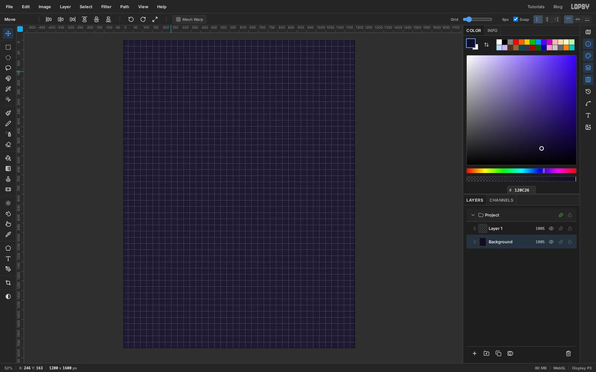

1. Open [Lopsy](/). In the **New Document** dialog, set **Width** to `1200` and **Height** to `1600`, then click **Create**.
2. Click the **Background** layer, set the foreground colour to `#120C26` and choose **Edit → Fill**.
3. Choose **View → Show Grid**. The options bar now shows a **Grid** slider and a **Snap** checkbox. Drag the slider until it reads **8px**. Snap is switched on with the grid, so every marquee you draw lands on the grid.

Working on an 8 px grid gives you a 150 × 200 "screen", which is close to the resolution of a 16-bit console. Everything you draw from now on is built out of these big square pixels.

## Lay down the sky gradient

1. Double-click `Layer 1` in the Layers panel and rename it `Sky`.
2. Pick the **Rectangular Marquee** and drag from the top-left corner of the canvas to the right edge at the horizon, `1200, 1000`.
3. Pick the **Gradient** tool, set the type to **Linear** and click **Advanced…**. Make seven stops, clicking the bar to add each one and setting its colour:
   - left end `#1B1440`
   - about 30% along, `#3A1F5C`
   - halfway, `#6B2C6E`
   - about two thirds, `#B8436A`
   - about 80%, `#EE7356`
   - about 90%, `#FFB067`
   - right end `#FFD98A`
4. Click **Done**, then drag straight down from the top of the selection to the horizon.

## Band the sky with noise, Pixelate and Posterize

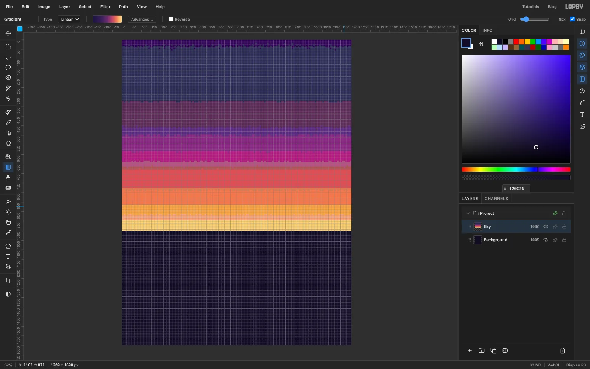

Keep the selection and run three filters:

1. **Filter → Add Noise…**: set **Amount** to `8`, click **Mono**, and click **Apply**.
2. **Filter → Pixelate…**: set **Block Size** to `8` and click **Apply**.
3. **Filter → Posterize…**: set **Levels** to `7` and click **Apply**. Then press [[Cmd+D]].

Posterize snaps every pixel to one of a few levels, so the smooth gradient breaks into flat bands. The noise matters: pixels near a band edge get pushed one way or the other, so each seam turns into a ragged, dithered line instead of a hard step. Because Pixelate ran first, that dither is made of whole 8 px squares, just like a console sky.

## Tint the night bands violet

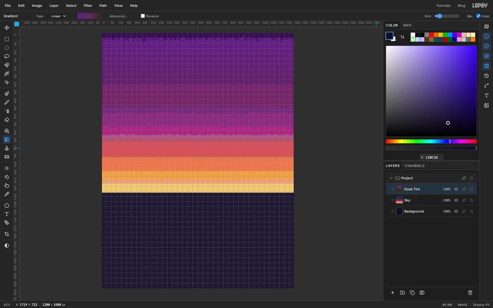

Posterize works on red, green and blue separately, so the dark top bands come out a dull slate blue. You can fix the colour without touching the bands:

1. Add a new layer with the **+** button and name it `Dusk Tint`.
2. Select the sky area again, from the top-left corner to `1200, 1000`.
3. Pick the **Gradient** tool (**Linear**) and click **Advanced…**. Make three stops: `#5A1E8C` at the left end, `#8A2C7A` at about 55%, and `#8A2C7A` again at the right end. Each stop has its own opacity strip under the colour square: drag the middle stop's opacity down to about 60% and the right stop's all the way to 0. Click **Done**.
4. Drag from the top of the canvas down to about `y 760`, then press [[Cmd+D]].
5. Click the ✦ button on the layer's row to open its effects, and set **Blend Mode** to **Color**.

The Color blend mode takes the hue from this layer and the brightness from the sky below, so every band and dither keeps its place while the top of the sky turns violet.

## Add a stepped sun glow

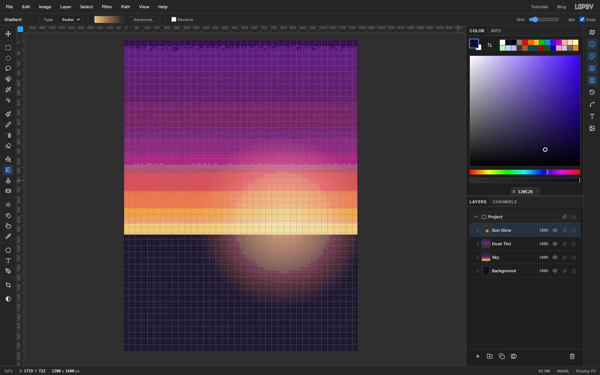

The sun is centred at `816, 936`, just above the horizon, with a radius of 184 px.

1. Add a layer named `Sun Glow`.
2. With the **Elliptical Marquee**, drag a big circle, 880 px across, centred on the sun. It's fine for it to run off the right side of the canvas.
3. Make a **Radial** gradient with three stops: `#FFD98A` at about 90% opacity on the left, `#FFB067` at about 55% opacity just before the middle, and `#EE7356` at 0% opacity on the right. Drag from the centre of the circle out to its edge, then press [[Cmd+D]].
4. **Filter → Pixelate…** with **Block Size** `16`, then **Filter → Posterize…** with **Levels** `5`.
5. Open the effects drawer and set **Blend Mode** to **Screen**.

The bigger 16 px blocks keep the glow chunky and soft-looking next to the 8 px detail, and Posterize turns it into rings.

## Paint the sun

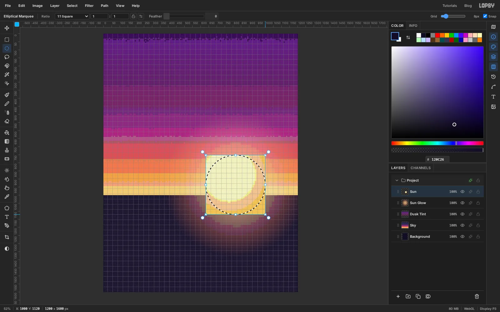

1. Add a layer named `Sun`.
2. Draw a square marquee around the sun's circle: 368 px across, centred on `816, 936`. Snap makes the corners land at `632, 752` and `1000, 1120`.
3. Make a **Radial** gradient: `#FFF4C8` on the left, `#FFF4C8` again at about 55%, and `#FFC86B` on the right. Drag from a little above and left of the centre out to the square's right edge.
4. Press [[Cmd+D]], then run **Pixelate** (`8`) and **Posterize** (`6`) as before.
5. With the **Elliptical Marquee**, drag a circle that fills the same square.

Leave the circle selected for the next step.

## Give the sun a crisp, stair-stepped edge

This is the most useful trick in the tutorial. You'll use it for the hills, skyline, viaduct arches, wheels, steam and badge.

1. Click the **Add Mask** button at the bottom of the Layers panel. With a selection active, the new mask shows only what's inside it.
2. Click the mask thumbnail on the `Mask` row under `Sun` to edit the mask, and press [[Cmd+D]].
3. **Filter → Pixelate…** with **Block Size** `8`. In mask edit mode, filters run on the mask, so the circle's edge turns into grey 8 px blocks.
4. **Filter → Threshold…** with **Level** `128`. Each grey block becomes pure black or pure white.
5. Click the `Sun` layer's name to go back to editing its pixels.

Pixelate alone would leave half-transparent blocks along the edge, which look blurry. Threshold forces each block to be fully in or fully out, so you get the hard staircase of real pixel art.

## Scatter stars with the Pencil

1. Add a layer named `Stars`.
2. Pick the **Pencil** ([[N]]) and set **Size** to `8`. One click paints exactly one art-pixel.
3. With `#B9A6E8`, click a few dim stars. Then switch to `#FFF3D6` and click brighter ones.
4. For a twinkle, click one pixel, then the four pixels touching it above, below, left and right.

Keep the stars to the right half and the band below the masthead. The left side will hold the coverlines, and stars behind small type make it hard to read.

## Build flat clouds from rectangles

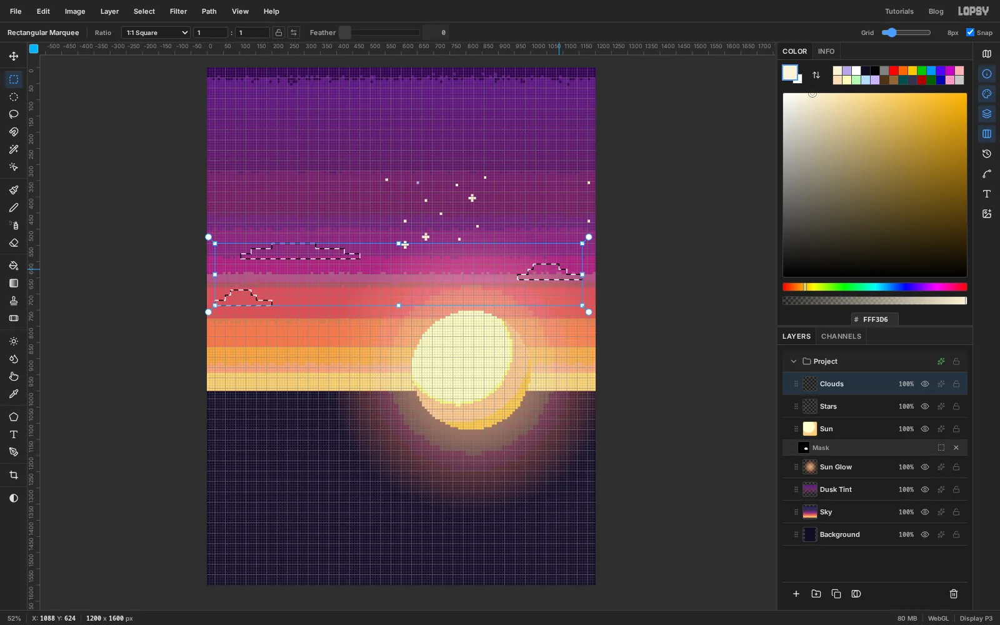

SNES clouds are long and flat, like stacked planks. Build each one from three rectangles:

1. Add a layer named `Clouds`.
2. With the **Rectangular Marquee**, drag a long, thin base two pixels tall. Hold [[Shift]] and drag a shorter rectangle on top of it, starting a few pixels in from each end. Then [[Shift]]-drag a short crown on top of that.
3. Do the same for two more clouds: a small one above the skyline on the left, and one on the right below where the badge will go. Keep holding [[Shift]] each time so they all add to the same selection.

## Shade the clouds

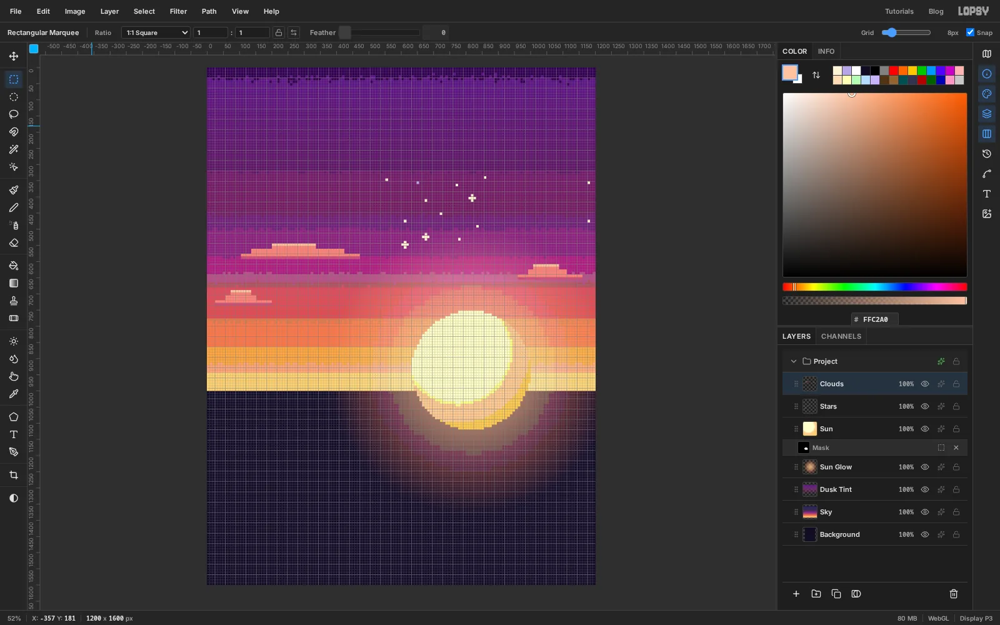

1. Fill the selection with `#F08A7E` and press [[Cmd+D]].
2. Select the bottom pixel row of each cloud's base (one 8 px strip each, [[Shift]] to add) and fill it with `#C25478`.
3. Select the top pixel row of each crown and fill it with `#FFC2A0`. Deselect.

A dark underside and a lit top are all a pixel cloud needs to look round.

## Add the hills

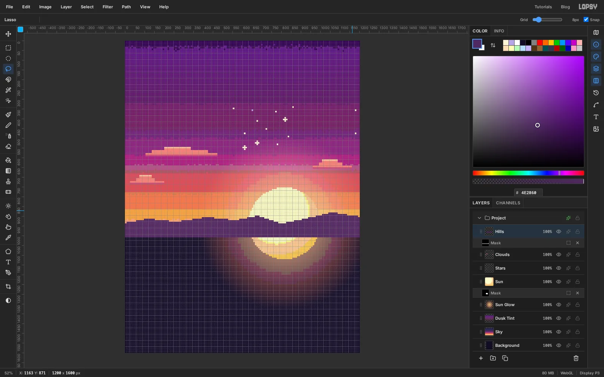

1. Add a layer named `Hills`.
2. Select from `0, 840` to `1200, 1008`, fill it with `#4E2860` and deselect.
3. With the **Lasso**, draw a gently rolling ridge from the left edge to the right, with low peaks at around `y 880`–`930`, then come down below the horizon and back to where you started.
4. Click **Add Mask**, then make the edge crisp exactly as you did for the sun: edit the mask, deselect, **Pixelate** `8`, **Threshold** `128`, and click the layer name.

## Draw the Istanbul skyline

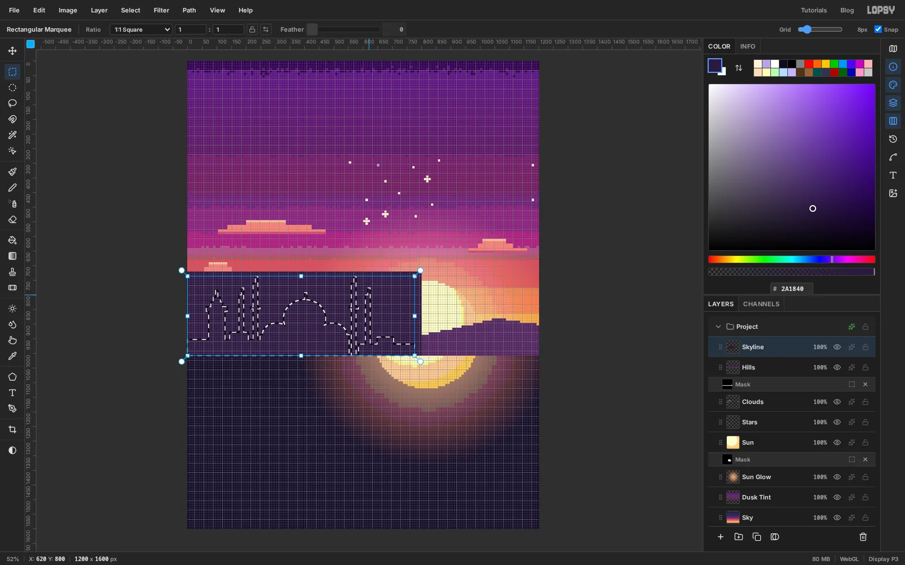

1. Add a layer named `Skyline`. Select from `0, 720` to `800, 1008`, fill it with `#2A1840` and deselect.
2. Now draw the outline as one selection. Use the **Rectangular Marquee** for blocks and the **Elliptical Marquee** for domes, and hold [[Shift]] for every shape after the first. All of them sit on the horizon and run a square below it.
   - **Galata Tower**: a block from `x 72` to `128` rising to `y 856`, a balcony one square wider on each side above it, then three blocks that get narrower (40, 24 and 8 px wide) stacked into a pointed cap that ends at `y 784`
   - **Old town roofs**: a low block from the left edge to `x 256` up to `y 952`, a small one from `x 144` to `208` up to `y 928`, and on the right a block from `x 584` to `776` up to `y 968` with a little one on top
   - **The mosque**: a wide base from `x 248` to `552` up to `y 936`; two half domes (96 × 80 ellipses) centred on the base's top edge at `x 304` and `496`; a drum from `x 336` to `464` up to `y 880`; a big dome 144 px wide and 128 px tall centred on the top of the drum; and a one-square finial on top
   - **Minarets**: two tall ones two squares wide at `x 224` and `x 560`, rising to `y 760` with a one-square tip and a balcony a square wider each side at `y 840`, and two shorter ones at `x 176` and `x 608` rising to `y 800`

The grid snap makes it easy to keep every shape a whole number of squares wide.

## Make the skyline crisp and light its windows

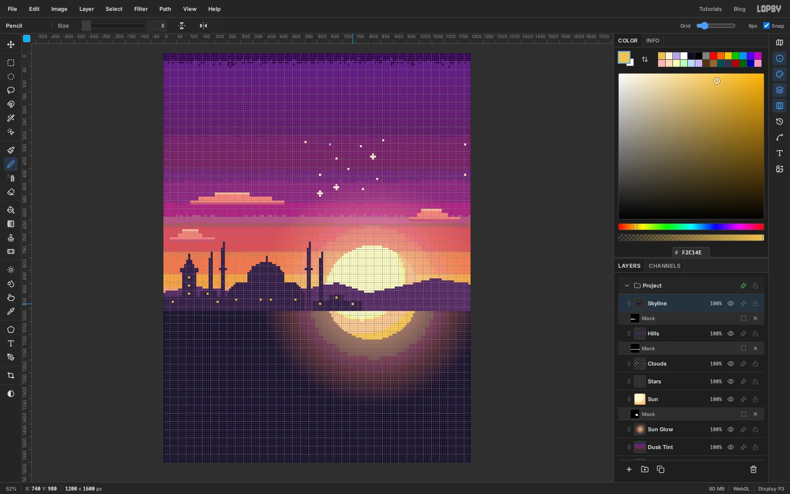

1. Click **Add Mask**, then run the crisp-edge routine: edit the mask, deselect, **Pixelate** `8`, **Threshold** `128`, and click the layer name.
2. Pick the **Pencil** at size `8` and the colour `#F2C14E`, and click a dozen single-pixel windows on the tower and the roofs.

Because the layer has a mask, any window you click slightly outside the silhouette is hidden, so you can't spoil the edge.

## Paint the water

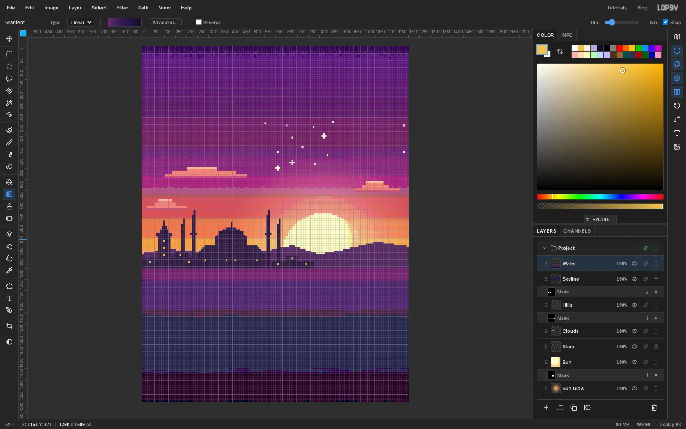

1. Add a layer named `Water` and select from the horizon (`0, 1000`) to the bottom-right corner.
2. Make a **Linear** gradient from `#6B2C6E` through `#3A1F5C` (about 30% along) to `#120C26`, and drag from the horizon to the bottom edge.
3. **Filter → Add Noise…** with **Amount** `30` and **Mono**.
4. **Filter → Motion Blur…** with **Angle** `0` and **Distance** `80`. This stretches the noise into horizontal streaks.
5. **Filter → Pixelate…** `8`, then **Filter → Posterize…** with **Levels** `8`. Deselect.

## Lay the sun's path on the water

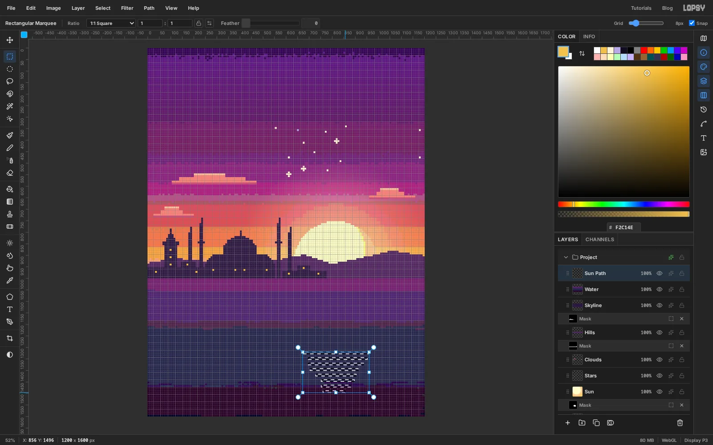

1. Add a layer named `Sun Path`.
2. Just below where the viaduct's waterline will be (`y 1320`), drag a dash one square tall and 36 squares wide, centred under the sun.
3. Hold [[Shift]] and add seven more dashes, each three squares below the last and a couple of squares narrower, so the stack tapers to a point. Shift every other dash one square left or right so the column wobbles like light on moving water.
4. Fill with `#FFC86B`, deselect, and set the layer's opacity to **80%**.

The viaduct will cover the top of the water, so the glints show up in the open water below it.

## Define a brick pattern

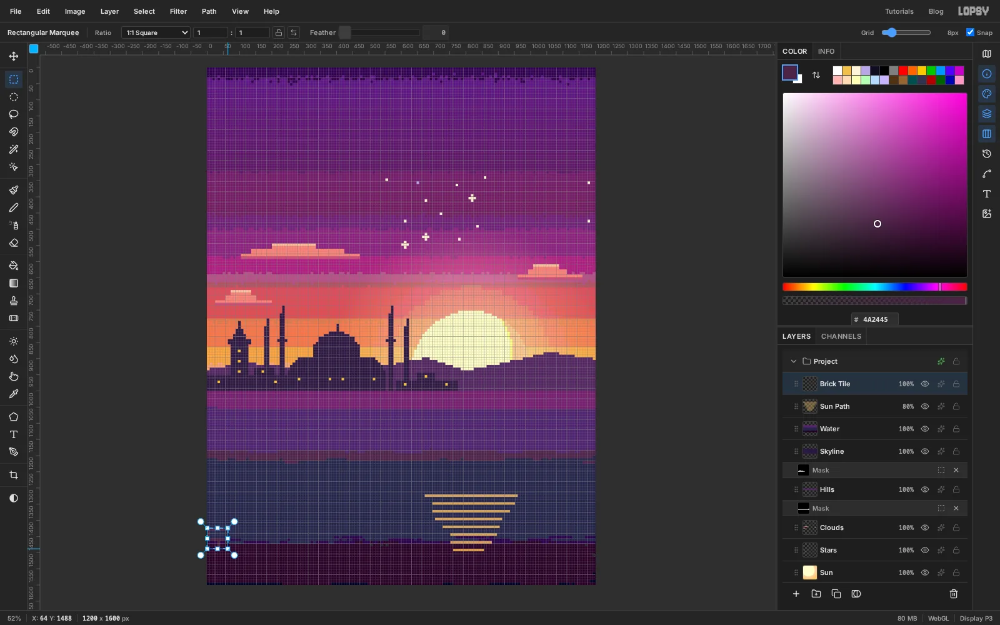

1. Add a layer named `Brick Tile`.
2. In the empty bottom-left corner, make a selection that draws a 64 × 64 tile of bricks with the **Rectangular Marquee**, holding [[Shift]] to add each one-square-wide strip. The tile runs from `0, 1424` to `64, 1488`:
   - a strip across the full width at the top, and another across the middle
   - a short upright strip at the left edge of the top half
   - a short upright strip in the centre of the bottom half
3. Fill it with `#4A2445`. That's two rows of offset bricks with mortar lines.
4. Select exactly the 64 × 64 square and choose **Edit → Define Pattern**.
5. Press [[Cmd+D]] and delete the `Brick Tile` layer with the bin button.

## Build the viaduct stonework

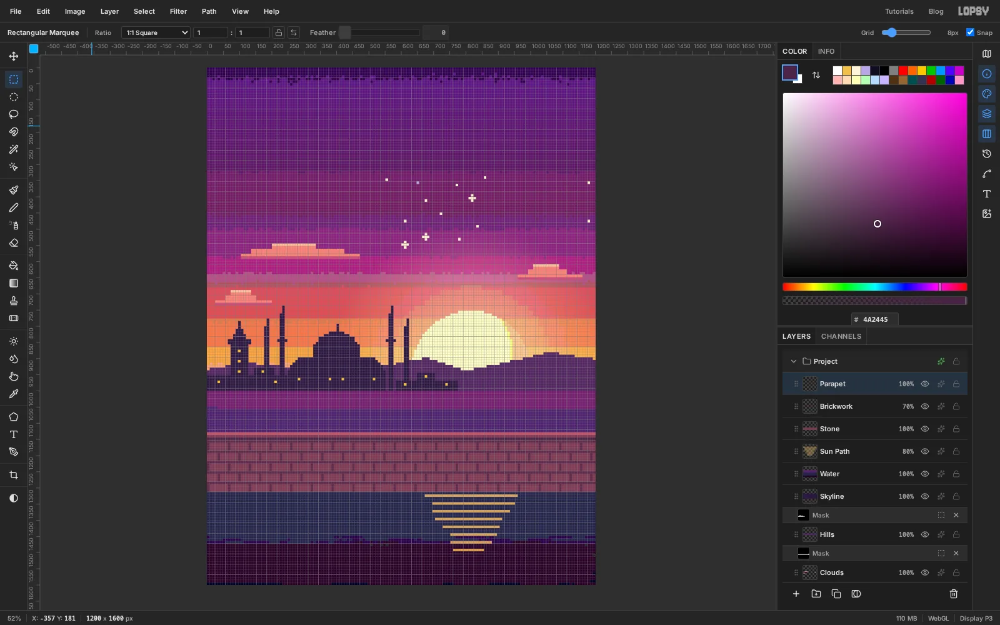

1. Click `Sun Path`, then add a layer named `Stone`. Fill from `0, 1128` to `1200, 1312` with `#7A3E55`.
2. Add a layer named `Brickwork`. Select from `0, 1144` to `1200, 1312`, choose **Edit → Fill with Pattern…**, pick your brick pattern and click **Apply**. Deselect and set the layer's opacity to **70%**.
3. Add a layer named `Parapet`. Fill a one-pixel strip along `y 1128` with `#B4596A` for the lit top edge, and another at `y 1144` with `#4A2445` for the shadow under the coping.

## Group the viaduct and cut the arches

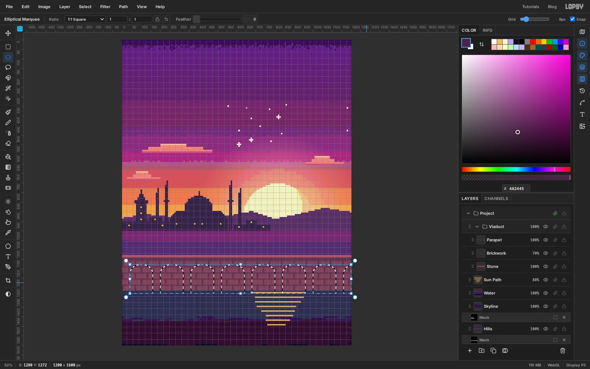

1. Click `Stone`, then [[Shift]]-click `Parapet` so all three viaduct layers are selected, and choose **Layer → Group Layers**. Rename the group `Viaduct`.
2. Draw the arch openings as one selection. Each arch is a rectangle 15 squares (120 px) wide from `y 1224` down past the waterline, plus an ellipse 15 squares wide and 12 tall centred on the rectangle's top edge, which gives it a round top. Start the first arch at `x 40` and leave a 5-square pier between arches, so each arch starts 160 px after the last. The eighth arch runs off the right edge. Hold [[Shift]] for every shape after the first.

## Mask the arches out of the whole group

1. Choose **Select → Inverse** ([[Cmd+Shift+I]]) so everything except the arches is selected.
2. With the `Viaduct` group still active, click **Add Mask**. The mask belongs to the group, so it cuts the stone, the bricks and the parapet together.
3. Make it crisp: click the group's mask thumbnail, deselect, **Pixelate** `8`, **Threshold** `128`, then click the group name.
4. Click the arrow next to `Viaduct` to collapse the group.

Collapsing matters: a new layer added while an open group is active goes inside that group.

## Draw one carriage

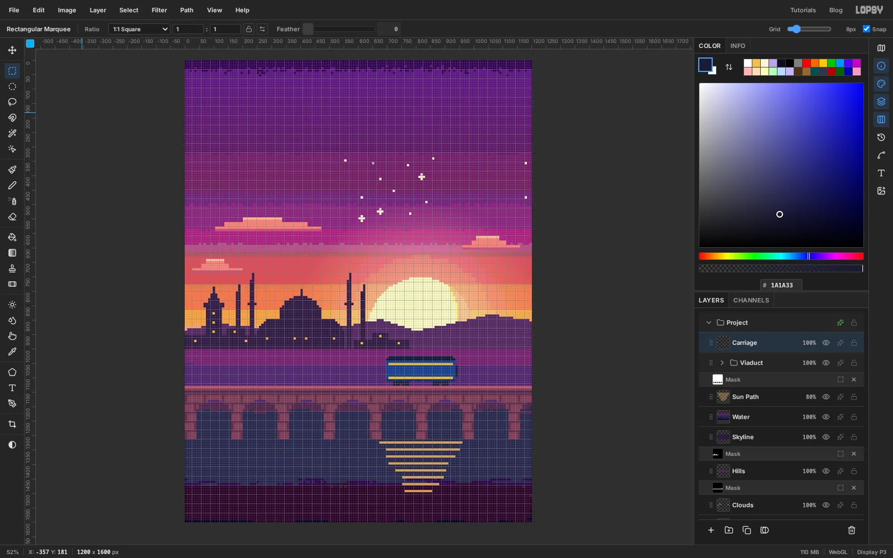

With the collapsed `Viaduct` group selected, add a layer named `Carriage`. The carriage is 30 squares (240 px) long, from `x 696` to `936`. Its roof starts at `y 1024` and its wheels sit on the viaduct at `y 1128`. Draw each part with the **Rectangular Marquee** and fill it with **Edit → Fill**:

1. **Roof**: a two-square-tall block from `x 704` to `928`, plus a one-square row the full length under it, in `#0E1638`.
2. **Body**: from `y 1040` to `1112`, the full length, in `#1F3C8C`.
3. **Lining**: two one-square gold rows in `#F2C14E` at `y 1048` and `y 1096`, stopping a square short of each end.
4. **Skirt**: the bottom row of the body, at `y 1104`, in `#142862`.
5. **Running gear**, in `#1A1A33`: two one-square-tall bogies under the body (`x 720`–`776` and `856`–`912`), a three-square-wide wheel block at each end of each bogie reaching down to `y 1128`, and a one-square-wide gangway sticking out from the right end of the carriage.

## Add the windows and group the carriage

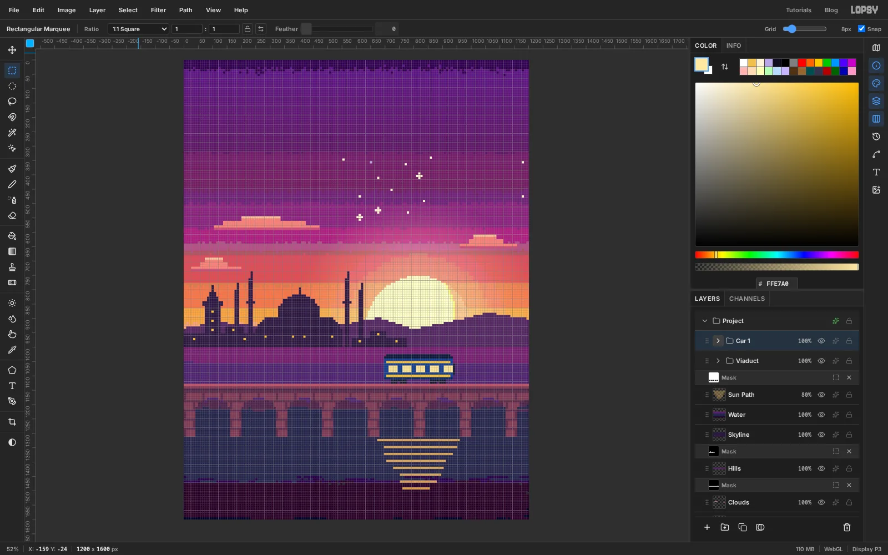

1. Add a layer named `Windows`. Select five windows, each 4 × 3 squares, starting at `x 712, y 1064` and spaced 6 squares apart ([[Shift]] to add), and fill them with `#FFE7A0`.
2. Click `Carriage`, [[Shift]]-click `Windows`, choose **Layer → Group Layers** and name the group `Car 1`. Collapse it.

## Duplicate the carriage three times

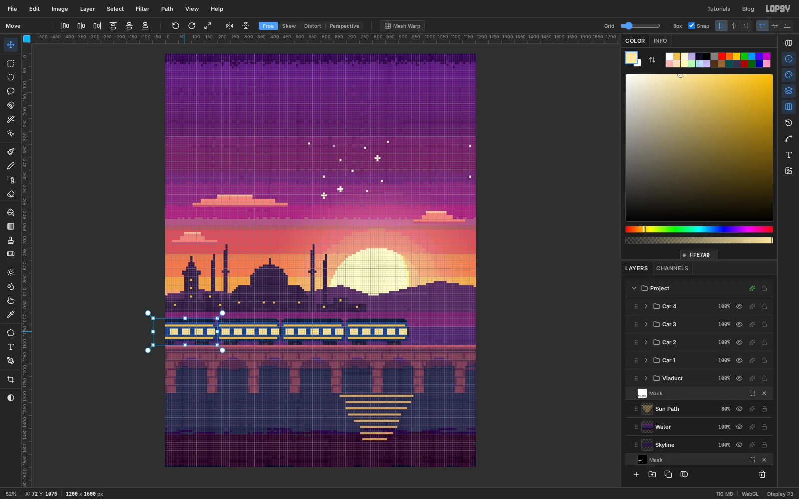

1. With `Car 1` selected, click **Duplicate Layer** at the bottom of the Layers panel and rename the copy `Car 2`.
2. Pick the **Move** tool ([[V]]) and drag the carriage 31 squares (248 px) to the left, so it sits one square behind the first one with room for the gangway. With Snap on, the drag moves in whole squares.
3. Duplicate `Car 2`, name it `Car 3` and drag it left the same way. Do it once more for `Car 4`, which runs off the edge of the canvas.

Moving a group moves both of its layers together, so the windows stay in their carriage.

## Build the locomotive

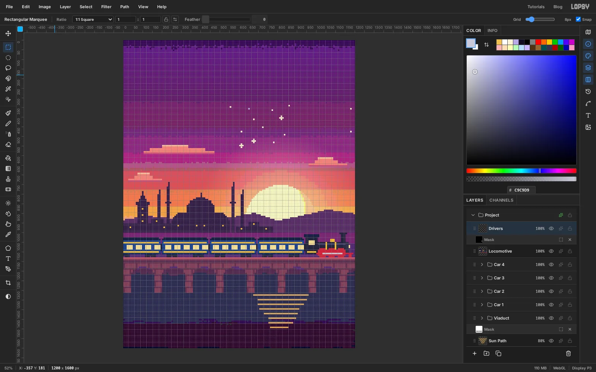

Click `Car 4` and add a layer named `Locomotive`. The engine starts right after the first carriage's gangway, at `x 944`.

1. **Body**, in `#1A1A33`: the cab from `x 944` to `1008`, `y 1024` to `1112`; the boiler from `x 1008` to `1160`, `y 1048` to `1104`; a chimney three squares wide at `x 1128` rising to `y 1008`, with a lip one square wider each side on top.
2. **Trim**: a `#0E1638` cab roof from `x 936` to `1016` along `y 1008`–`1024`; a one-square highlight along the top of the boiler in `#3A3A66`; and a two-square smokebox front at the right end of the boiler in `#2A2A44`.
3. **Brass**, in `#F2C14E`: two one-square bands around the boiler, a 3 × 2 dome on top between them, and a step under the cab. Then a 4 × 3 cab window and a one-square headlamp in `#FFE7A0`.
4. **Red**, in `#C8323A`: a running board along `y 1104` from `x 1000` to `1176`, and a two-step cowcatcher at the front.
5. Now the drive wheels, on their own layer so they can have crisp round edges. Add a layer named `Drivers` and fill a red `#C8323A` block from `1000, 1080` to `1160, 1128`.
6. With the **Elliptical Marquee**, select three circles six squares across, centred on `y 1104` at `x 1032`, `1080` and `1128` ([[Shift]] to add the second and third).
7. Click **Add Mask** and run the crisp-edge routine (Pixelate `8`, Threshold `128`, then click the layer name).
8. With the **Pencil** at size `8` and `#F2C14E`, click a hub pixel in the middle of each wheel.
9. Select a one-square strip from `x 1032` to `1136` at `y 1104` and fill it with `#C9C9D9` for the coupling rod.

## Group the train and pull it into the frame

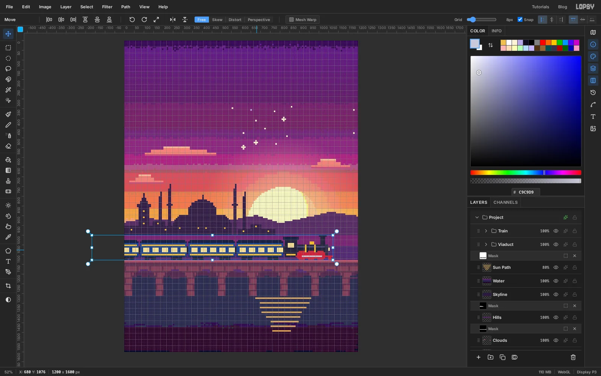

1. Click `Drivers`, then [[Shift]]-click `Car 1`, and choose **Layer → Group Layers**. Name the group `Train` and collapse it.
2. With the **Move** tool, drag the train 15 squares (120 px) to the left.

Right now the cowcatcher touches the right edge of the cover, so the train looks like it's leaving. With some open track ahead of the engine, it reads as arriving.

> **Tip:** This is a good moment to test your history. Drag the train somewhere else, press [[Cmd+Z]] and [[Cmd+Shift+Z]] a few times, then undo back to the position you want. The group always moves back as one piece.

## Puff out the steam

1. Click the `Train` group and add a layer named `Steam`. Fill a big rectangle from `600, 776` to `1080, 1016` with `#F7DCC6`. It covers the chimney and the sun, and the mask in step 3 will cut the puffs out of it.
2. With the **Elliptical Marquee**, drag a chain of circles from the chimney up and back to the left: small near the chimney, growing to six or seven pixels across over the sun, then shrinking again at the tail. Vary the sizes and let them overlap. Hold [[Shift]] for each one after the first.
3. Click **Add Mask** and make it crisp (Pixelate `8`, Threshold `128`).
4. Open the layer's effects, turn on **Drop Shadow** and set **Offset X** `0`, **Offset Y** `8`, **Blur** `0`, **Opacity** `100`, with the colour `#D99AA0`.

A hard shadow one pixel down gives every puff a shaded underside, the way a sprite artist would hand-shade it.

## Make the reflection

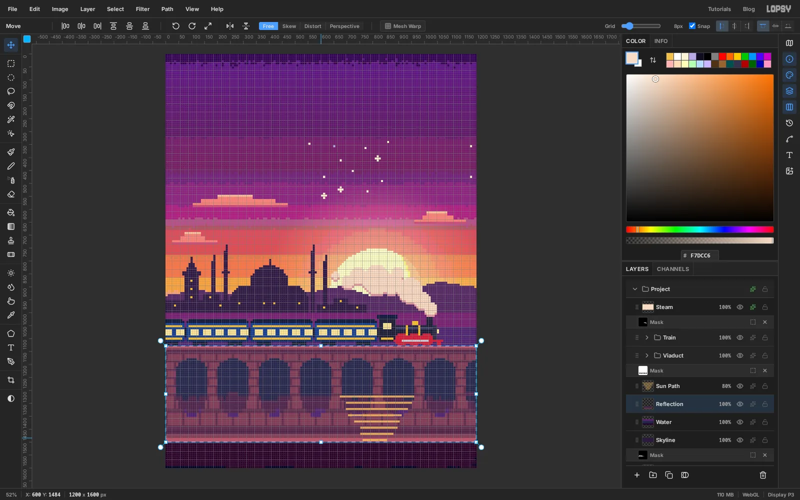

1. Click `Water`. Draw a marquee over the viaduct band, from `0, 1128` to `1200, 1312`.
2. Choose **Edit → Copy Merged**. It copies everything you can see in that band, not just one layer. Press [[Cmd+D]].
3. Press [[Cmd+V]] to paste it as a new layer just above `Water`, and name it `Reflection`.
4. Choose **Image → Flip Vertical**.
5. With the **Move** tool, drag it straight down 23 squares (184 px), so its top edge meets the waterline at `y 1312`. Then press [[Cmd+D]].

## Ripple the reflection and add a scrim

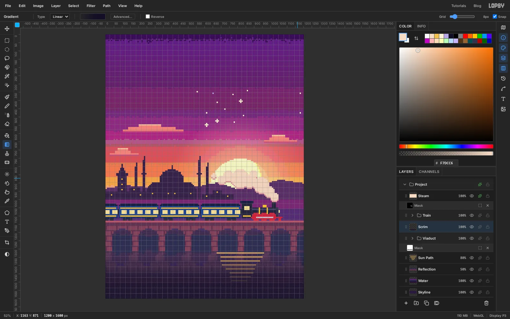

1. **Filter → Pixel Stretch…**: **Amount** `16`, **Bands** `24`, **Seed** `7`, **RGB Split** `0`. Click **Apply**. Each band slides sideways by a different amount, like water breaking up a reflection.
2. Set the layer's opacity to **50%**.
3. Click the `Viaduct` group and add a layer named `Scrim`. Select from `0, 1336` to the bottom-right corner, and drag a **Linear** gradient from the top of the selection to the bottom: `#120C26` fully transparent, then about 85% opaque a little past halfway, then 95% at the bottom. Deselect.
4. **Filter → Pixelate…** `8`, so the darkening steps down in whole pixel rows.

The scrim gives the cover story text a dark, quiet floor without hiding the water completely.

## Set the masthead

From here on you're setting type, which has its own pixel grid. Untick **Snap** in the options bar (or choose **View → Snap to Grid**) so arrow keys move one pixel at a time instead of one square.

> **Tip:** Before you start each new text block in this tutorial, click a picture layer such as `Steam` and click an empty part of the canvas. If you click inside an existing text layer's box, the Text tool edits that layer instead of starting a new one. Set each block somewhere clear, then move it into place with the Move tool.

1. Click the `Steam` layer.
2. Pick the **Text** tool ([[T]]), choose **Jersey 15** in the font picker, set the colour to `#FFF3D6`, and click an empty area of the canvas. Type `SLEEPER` and press [[Tab]] to commit. Name the layer `Masthead`.
3. With the layer selected and the Text tool still active, raise the **Size** until the word spans the cover with about 48 px to spare on each side. That's about `382` px.
4. With the **Move** tool, line the left edge of the S up 48 px from the edge of the canvas and the top of the letters 96 px down. Use the arrow keys for the last few pixels.
5. Open the effects. Turn on **Stroke** with **Width** `8` and the colour `#120C26`. Turn on **Drop Shadow** with **Offset X** `0`, **Offset Y** `16`, **Blur** `0` and the colour `#B8436A`.

The thick outline and the hard pink shadow give you the chunky, layered look of a 16-bit title screen.

## Add the kicker and issue line

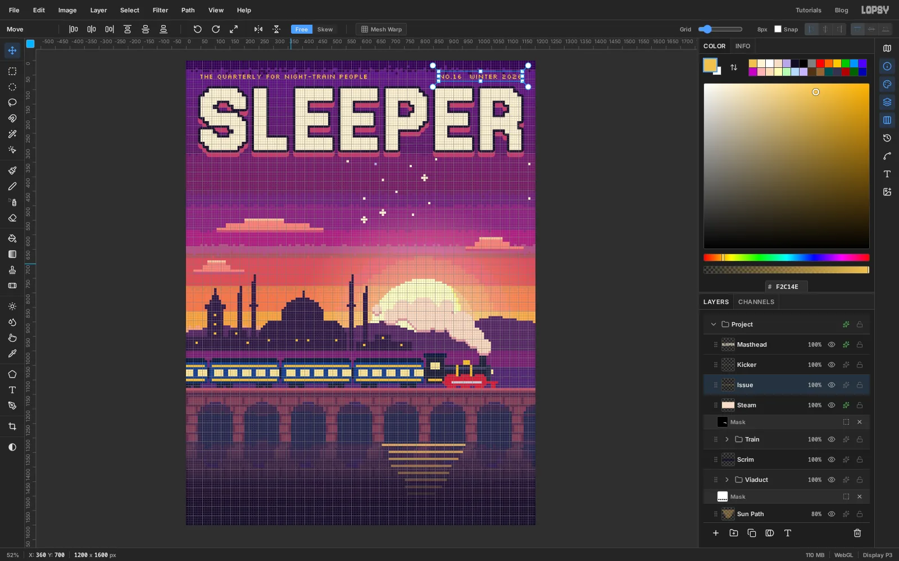

1. Click `Steam` again, pick the Text tool, choose **Silkscreen** at size `24` in `#F2C14E`, click an empty area and type `THE QUARTERLY FOR NIGHT-TRAIN PEOPLE`. Commit with [[Tab]] and name it `Kicker`.
2. Move it so its left edge lines up with the masthead, 48 px from the left and 48 px from the top.
3. Make a second line the same way reading `NO.16  WINTER 2026`, name it `Issue`, and line up its *right* edge 48 px from the right side, at the same height.

## Add the coverlines

1. Set three text layers in **Silkscreen** at size `32` in `#FFF3D6`: `THE DINING CAR AT DUSK`, `SNOW ON THE SIMPLON PASS` and `HOW TO SLEEP ON A TRAIN`. Name them `Coverline 1` to `3`.
2. Line them all up 48 px from the left, with the first one about 64 px below the masthead and each line 56 px below the one before.
3. Give each one a **Drop Shadow**: **Offset X** `4`, **Offset Y** `4`, **Blur** `0`, colour `#120C26`.

The shared 48 px left edge ties the coverlines to the masthead and, later, to the cover story block.

## Cut a starburst badge

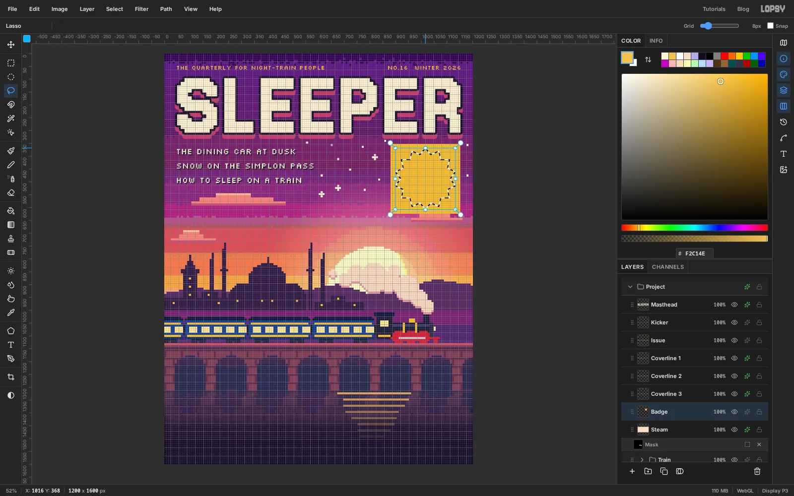

1. Click `Steam` and add a layer named `Badge`. Fill a gold `#F2C14E` square about 34 pixels across on the right, centred on about `1016, 488`.
2. With the **Lasso**, click around a 14-point star inside the square: alternate between points near the edge of the square and points three pixels further in.
3. Click **Add Mask** and make it crisp (Pixelate `8`, Threshold `128`).
4. Add a **Stroke** effect with **Width** `8` and the colour `#120C26`.

## Fill and tilt the badge

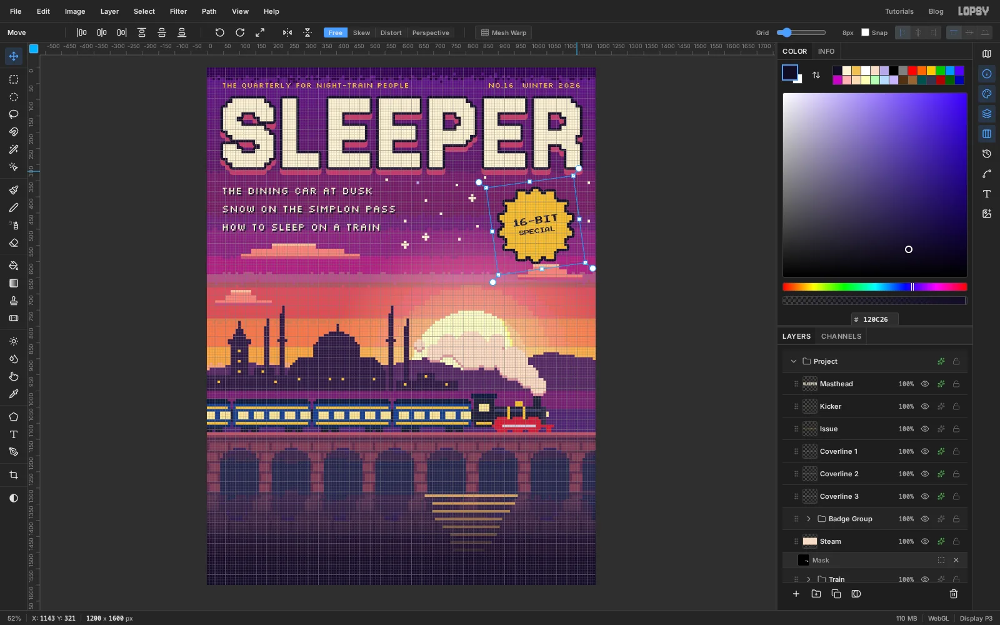

1. With `Badge` selected, use the Text tool to set `16-BIT` in **Press Start 2P** at size `24`, and `SPECIAL` at size `16`, both in `#120C26`. Name them `Badge Top` and `Badge Bottom`.
2. Centre both lines on the badge, with `16-BIT` just above the middle and `SPECIAL` just below it.
3. Click `Badge`, [[Shift]]-click `Badge Top` so all three layers are selected, and choose **Layer → Group Layers**. Name it `Badge Group` and collapse it.
4. With the **Move** tool, drag the rotation handle just outside the top-right corner of the box to turn the badge about 8° anticlockwise, then press [[Enter]].

Press Start 2P draws its letters on an 8-unit grid, so sizes of `16` and `24` keep each font pixel a whole number of screen pixels wide. A small tilt makes the badge read as a sticker slapped onto the cover.

## Seat the cover story label

1. Set `COVER STORY` in **Silkscreen** at size `24` in `#120C26`, and name it `Label Text`.
2. Click `Steam` and add a layer named `Label Box`. Draw a rectangle starting 48 px from the left at `y 1384`. Make it 16 px wider than the letters on each side, and 16 px taller than the capitals above and below, rounded up to whole grid squares. For this text that's 224 × 48. Fill it with `#F2C14E`.
3. Move `Label Text` so it sits in the exact middle of the box. Check the gap on all four sides: it should be about 16–20 px everywhere, and no letter should touch the box.

## Set the cover story title

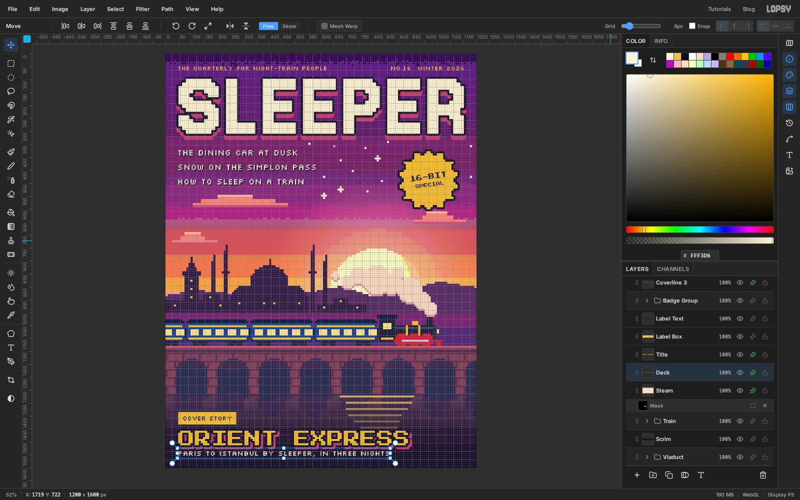

1. Set `ORIENT EXPRESS` in **Press Start 2P** at size `64` in `#F2C14E`, and name it `Title`. Line its left edge up at 48 px, 24 px below the label.
2. Give it a **Stroke** of **Width** `8` in `#120C26` and a **Drop Shadow** with **Offset X** `8`, **Offset Y** `8`, **Blur** `0` in `#B8436A`, which echoes the masthead.
3. Under it, set `PARIS TO ISTANBUL BY SLEEPER, IN THREE NIGHTS` in **Silkscreen** at size `28` in `#FFF3D6`, named `Deck`. Line it up at 48 px, 24 px below the title, and give it the same small ink drop shadow as the coverlines.

## Draw the barcode

1. Click `Steam` and add a layer named `Barcode`. Draw a 152 px wide box at `x 1000`, with its top level with the top of the gold label and its bottom level with the bottom of the `Deck` text. Fill it with `#FFF3D6`.
2. Pick the **Pencil** with the colour `#120C26`. For each bar, set **Size** to `8` or `4`, click at the top of the bar and [[Shift]]-click at the bottom to draw a straight vertical line. Leave a 4 px gap between bars and stop 16 px short of each side.
3. Set the digits `9 771234 016006` in **VT323** at size `24` in `#120C26`, name the layer `Barcode Digits`, and centre it in the box under the bars, 16 px above the box's bottom edge.

Lining up the barcode's top and bottom with the type block makes it look like part of the layout, not something stuck on.

## Export and save

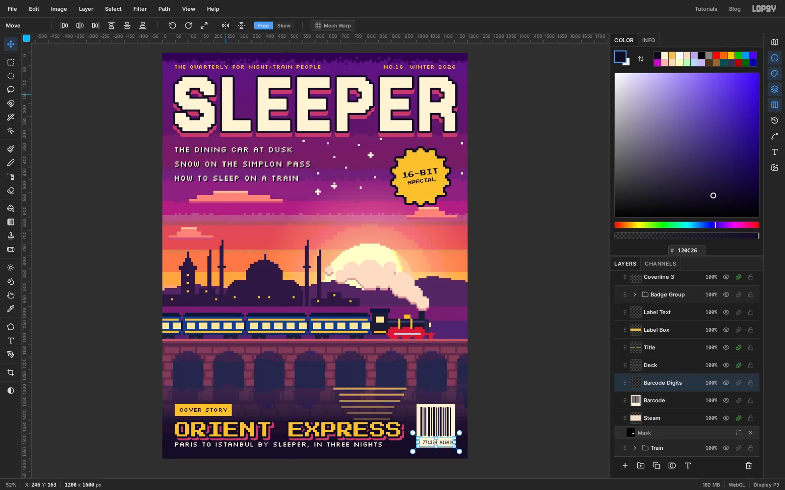

1. Press [[Cmd+D]] in case anything is still selected, and choose **View → Show Grid** to hide the grid.
2. Choose **File → Quick Export PNG** to save the cover as an image.
3. Choose **File → Save Project** to keep a `.lopsy` file with every layer, mask and effect still editable.

If you want another issue, the layer stack is ready to reuse: hide the `Train` group, change the masthead's issue line, and you're halfway to the spring edition.
