Art Nouveau posters of the 1890s sold everything from biscuits to bicycles
with the same few devices: a big decorated disc behind the subject (the
*nimbus*), plants that grow over and through the frame, long whiplash curves
that coil back on themselves, and flat areas of colour held together by a
confident dark outline.

In this tutorial you'll use those devices to make a logo for **Fig & Quince**,
an imaginary maker of preserves and cordials. The finished logo has:

- a **ring and halo** emblem with sunburst rays and a circle of mosaic dots
- two **fig leaves** that break out of the frame, drawn once and mirrored
- a **quince**, a **fig** and a **halved fig**, each in three flat tones with a matching outline
- a **branch** drawn with the Pen tool that ends in whiplash **spirals** and weaves **under** the ring
- a wordmark and a tagline set **on a curved path**

Everything is drawn in Lopsy. You don't need any photos.

The tools you'll use:

- **ruler guides**, the **Elliptical Marquee** and the **Lasso**, with [[Shift]] to add, [[Alt]] to subtract and [[Shift]]+[[Alt]] to intersect
- the **Gradient**, **Brush**, **Spray** and **Pen** tools, and **Edit → Fill**
- **Radial Symmetry** on the Brush
- **Filter → Texture** and **Filter → Sunburst**
- **Select → Shrink** and **Select → Inverse**, and a **layer mask**
- **Duplicate Layer**, **Image → Flip Horizontal** and the Move tool's **rotate handle**
- **Stroke**, **Inner Glow** and **Drop Shadow** effects, **Copy effects** / **Paste effects**, and the **Screen** blend mode
- a **Photo Filter** adjustment on a group
- **Federo** and **Cormorant Garamond** from the font picker, and the **Path** option for text

The palette:

- Paper `#F1E6CC`
- Ring green `#3E4A2F`, gold line `#D9A83A`, mosaic green `#6F7F55`
- Halo `#FBF3DC` → `#E4DDB8` → `#A9B88F`, rays `#FFF4D2`
- Leaf `#93AA78`, leaf shade `#6F8B5B`, veins `#34492B`
- Branch and outlines `#4A3524` / `#2B1E16`
- Quince `#E4B03E`, shade `#C4832A`, highlight `#F6D877`, calyx `#5A3A16` / `#8E5E24`
- Fig `#6D3159`, shade `#4A1D3D`, highlight `#9A5684`, stem `#5B4A2A`
- Cut fig skin `#4E2140`, flesh `#D9727F` → `#F0B9A4`, seeds `#E9C05E` / `#8C2F4E`
- Wordmark `#3E4A2F`, tagline `#5A1F45`

> **Tip:** Positions are written as `x, y` in document pixels from the top-left corner of the canvas. Watch the **X** and **Y** readout in the status bar at the bottom left as you move the pointer. The centre of the emblem is `750, 600`, where the two guides cross.

> **Tip:** The screenshots were taken in one session, so the **Text** panel on the right already shows the tagline's font settings from the end of the tutorial. You can ignore it until you get to the type.

> **Tip:** Key names are Mac keys. On Windows and Linux, use Ctrl for Cmd. To make a perfect circle with the Elliptical Marquee, drag from the top-left corner of its bounding square to the bottom-right corner; the radii in the steps tell you where those corners are.

## Make the paper and the centre guides

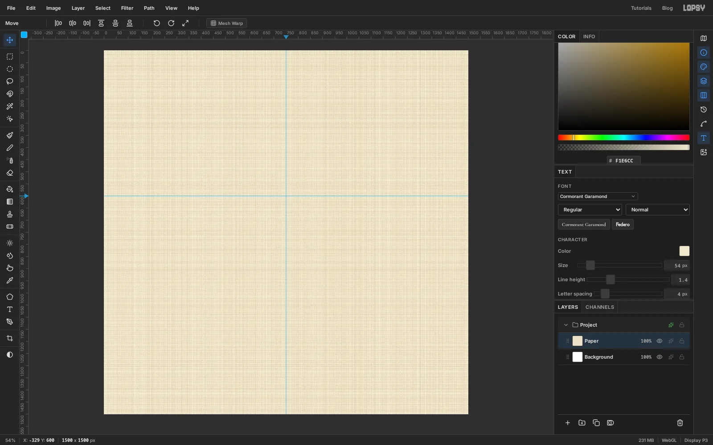

1. Open [Lopsy](/). In the **New Document** dialog, set **Width** and **Height** to `1500`, then click **Create**.
2. A new document comes with a white **Background** layer and an empty **Layer 1**, both inside a top-level **Project** group. Double-click **Layer 1** in the Layers panel and rename it `Paper`.
3. Set the foreground colour to `#F1E6CC`, choose **Select → All**, then **Edit → Fill**. Press [[Cmd+D]] to deselect.
4. Choose **Filter → Texture...**, click **Canvas** and click **Apply**. The paper picks up a fine woven linen grain.
5. **Cmd-click** the ruler along the top of the canvas. The guide drops exactly on the centre line, `x 750`.
6. Click the ruler on the left side at `y 600`. This guide is the centre of the emblem. It sits a little above the middle of the canvas, which leaves room for the type underneath.

## Draw the ring and the halo

1. Click **New Group** at the bottom of the Layers panel and rename the group `Emblem`. Everything in the emblem goes in here, so you can move it all at once later.
2. Click **Add Layer** and name the layer `Ring`. Pick the **Elliptical Marquee** and draw a circle from `280, 130` to `1220, 1070`, so its radius is 470 px. Fill it with `#3E4A2F`.
3. Add a layer called `Halo` and draw a smaller circle from `355, 205` to `1145, 995`, so its radius is 395 px.
4. Pick the **Gradient** tool, set **Type** to **Radial** and click **Advanced...**. Set the stops to `#FBF3DC` on the left, `#E4DDB8` at about two thirds of the way along and `#A9B88F` on the right, then click **Done**.
5. Drag from just above the centre (`750, 540`) straight down to the bottom of the circle. The halo is now pale in the middle and sage at the rim.
6. Deselect. Open the **Halo** layer's effects (the sparkle button on its row), switch on **Inner Glow** and set **Size** `45`, **Opacity** `45` and the glow colour to `#6F7F55`. The edge of the halo darkens a little, so it looks set into the ring.

## Add the sunburst rays

1. Add a layer called `Halo Rays` and draw the same 395 px circle again with the Elliptical Marquee. The rays will stay inside it.
2. Set the foreground colour to `#FFF4D2`.
3. Choose **Filter → Sunburst...** and set **Rays** `48`, **Length** `34`, **Width** `38`, **Fade** `55`, **Softness** `20` and **Center Y** `40`. Leave **Center X** at `50`. A **Center Y** of 40% of the 1500 px canvas is `y 600`, so the rays come from the middle of the halo. Click **Apply**.
4. Deselect. In the layer's effects drawer, set the blend mode to **Screen**, then click the layer's opacity and set it to **55%**. The rays should be a soft shimmer, not stripes.

## Cut two thin gold rings

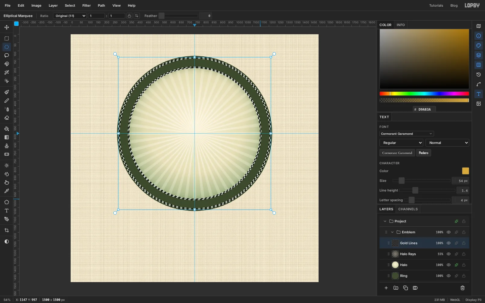

You'll build both gold lines as one selection, then fill it once.

You want one thin gold line just inside the outer edge of the green ring, and another just outside the halo. Each one is a band between two circles, all centred where the guides cross.

1. Add a layer called `Gold Lines`.
2. With the Elliptical Marquee, draw a circle of radius 462, then hold [[Alt]] and draw one of radius 455 inside it. Alt subtracts, so you're left with a 7 px band near the outer edge of the ring.
3. Hold [[Shift]] and draw a circle of radius 403, then hold [[Alt]] and draw one of radius 397. That adds a second 6 px band just outside the halo.
4. Set the foreground colour to `#D9A83A`, choose **Edit → Fill** and deselect.

> **Tip:** For a circle of radius *r* around `750, 600`, drag from `750 − r, 600 − r` to `750 + r, 600 + r`. For radius 462 that's `288, 138` to `1212, 1062`.

## Stamp the mosaic dots with radial symmetry

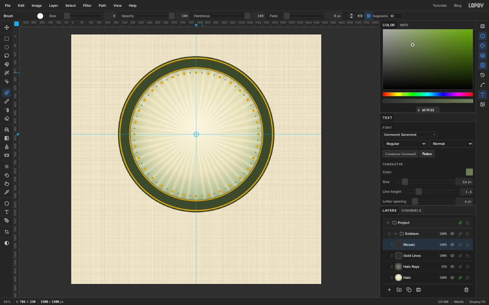

1. Add a layer called `Mosaic` and pick the **Brush**.
2. In the options bar, click **Radial Symmetry** (the snowflake) and set **Segments** to `32`.
3. **Cmd-click** the centre of the emblem, where the guides cross. This moves the symmetry centre there without painting anything.
4. Set **Size** `16`, **Hardness** `100` and the colour `#D9A83A`. Click once at `750, 228`, just inside the inner gold ring. One click stamps 32 gold dots around the circle.
5. Set **Size** `8` and the colour `#6F7F55`. Click once at `786, 231`, halfway between the first two gold dots. That puts a small green dot between every pair of gold ones.
6. Click **Radial Symmetry** again to switch it off.

## Lasso the first fig leaf

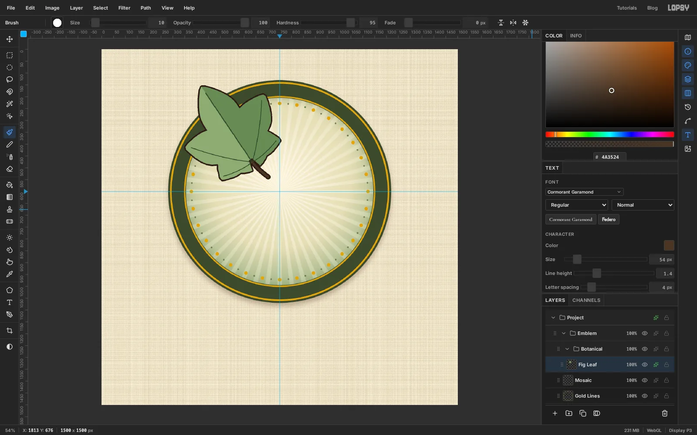

1. Before you start on the plants, lift the emblem off the paper. Open the **Ring** layer's effects and switch on **Drop Shadow** with **Offset X** `0`, **Offset Y** `14`, **Blur** `30`, **Opacity** `35` and the colour `#5A4630`.
2. Click the **Emblem** group, click **New Group** and name it `Botanical`. It sits inside Emblem. Add a layer called `Fig Leaf`.
3. Pick the **Lasso** and drag the outline of a fig leaf at the top left of the emblem, about 400 px across and tilted up and to the left. A fig leaf has five pointed lobes. Use these landmarks, going round clockwise from the stalk:
   - the base of the leaf, where the stalk joins, at about `634, 476`
   - a small lower lobe pointing down-right, tip at about `748, 384`
   - a deep notch at about `694, 328`, then a big side lobe with its tip at about `682, 196`
   - a notch at about `578, 278`, then the main lobe with its tip at about `424, 163`, just outside the ring
   - a notch at about `472, 349`, then the other big side lobe with its tip at about `357, 415`
   - a notch at about `475, 476`, then a small lower lobe with its tip at about `506, 547`, and back to the base

   Keep the edges between the points fairly straight, and make the lobes taper to sharp tips. Release the mouse to close the shape. Fill it with `#93AA78` and deselect.
4. **Cmd-click** the **Fig Leaf** thumbnail in the Layers panel to load the leaf as a selection. Then hold [[Shift]]+[[Alt]] and lasso a large shape that covers everything to the right of an imaginary line from the base of the leaf up to its tip. Shift+Alt keeps only the overlap, so now just the right half of the leaf is selected. Fill it with `#6F8B5B` and deselect.
5. Pick the **Brush** with **Hardness** `95` and the colour `#34492B`. At **Size** `5`, draw the midrib from the base of the leaf to the tip of the main lobe. Then at **Size** `4`, draw the four side veins from the base to the other lobe tips, each with a slight curve.
6. Switch the colour to `#4A3524` and the size to `10`, and draw a short stalk about 70 px long from the base down and to the right.
7. Open the layer's effects, switch on **Stroke** and set **Width** `6` and the colour `#2B1E16`. This dark outline is what makes the leaf read as Art Nouveau rather than clip art, so every fruit will get the same one later.

> **Tip:** Lasso drawings don't have to be perfect. If a lobe comes out lumpy, press [[Cmd+Z]] and draw it again. Undo steps back one selection at a time.

## Mirror the leaf to the right

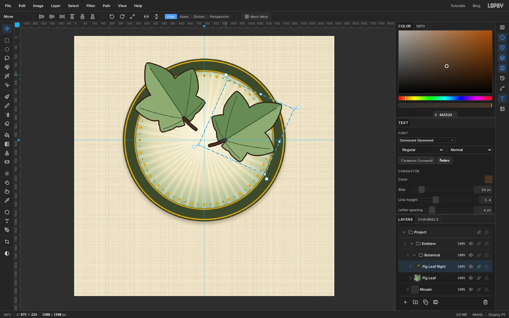

1. Choose **Layer → Duplicate Layer** and rename the copy `Fig Leaf Right`. It comes with the same Stroke effect.
2. Choose **Image → Flip Horizontal**. The copy now faces the other way.
3. Pick the **Move** tool and drag the copy about 440 px to the right and 170 px down, so its stalk sits near the middle of the emblem.
4. Pick the **Rectangular Marquee** and draw a box around the whole leaf. Switch back to the **Move** tool: transform handles appear around the selection. Press just outside the top-left corner handle, where the pointer turns into a curved arrow, and drag clockwise by about 24°. The leaf tilts so its tip points up and to the right.
5. Press [[Cmd+D]]. Deselecting commits the rotation, so the leaf's pixels are redrawn at the new angle.

## Draw the branch with the Pen

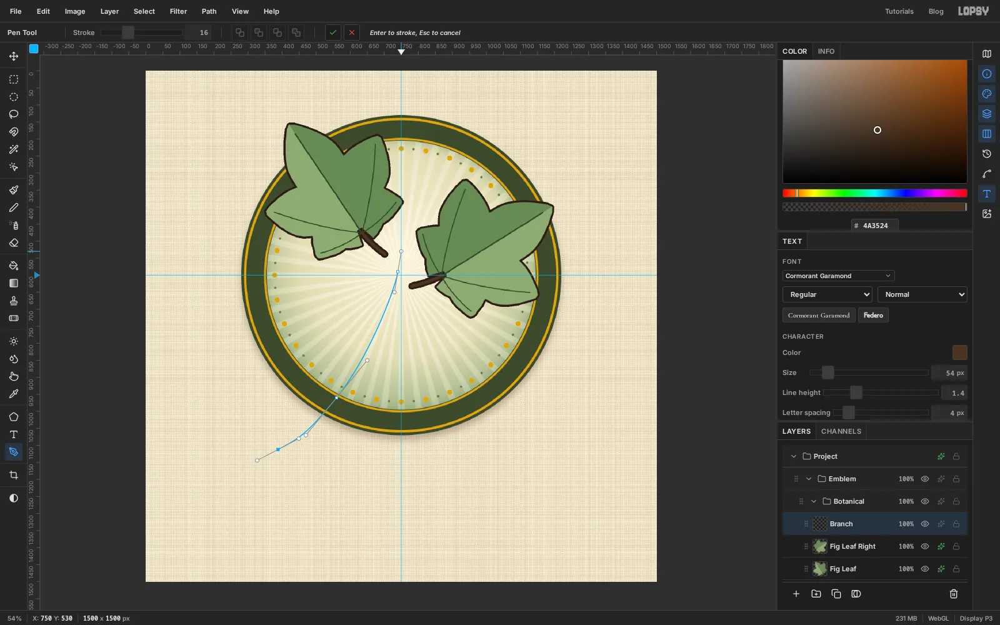

1. With **Fig Leaf Right** selected, add a layer called `Branch`.
2. Pick the **Pen** tool, set **Stroke** to `16` in the options bar and the foreground colour to `#4A3524`.
3. Place three anchors. Press at `388, 1112`, below the ring on the left, and drag about 70 px up and to the right. Press at `560, 960` and drag about 140 px up and to the right, along the direction the stem is heading. Press at `740, 590`, just below the centre of the emblem, and drag about 60 px straight up. Dragging pulls out handles, so the stem curves smoothly instead of zigzagging.
4. Press [[Enter]]. Lopsy saves the path as **Path 1** and strokes it onto the Branch layer.
5. The path stays selected, so a thin blue line keeps showing on top of the stem in the next few screenshots. To hide it, open the **Paths** panel and click **Path 1** to deselect it. The stroke you painted stays.

## Add side stems and whiplash spirals

1. Pick the **Brush** with **Hardness** `95`. With **Size** `14`, extend the top of the stem up to about `742, 558`.
2. With **Size** `11`, draw two side stems from there. One arcs to the left to `568, 598`, where the quince will hang. The other arcs to the right to `941, 612`, where the fig will hang.
Each spiral is about one and a half turns that get tighter towards the middle. To make it taper like a real whiplash, draw it in four pieces, picking up each one where the last ended: the first quarter at **Size** `13`, then `10`, `7`, and `5` for the tight inner coil.

3. Draw the left spiral starting from the bottom end of the stem. Swing out to the left, then curl clockwise around a centre near `255, 1020`.
4. Draw the right spiral as its mirror image. Start right at the outer edge of the ring at about `1127, 870`, so the tendril looks as if it grows out from behind the ring. Run down and out to the right, then curl anticlockwise around a centre near `1250, 1010`.

> **Tip:** Keep the two spirals the same weight and roughly the same size. When one is heavier than the other, the logo looks lopsided rather than deliberate.

## Shade the fig in three flat tones

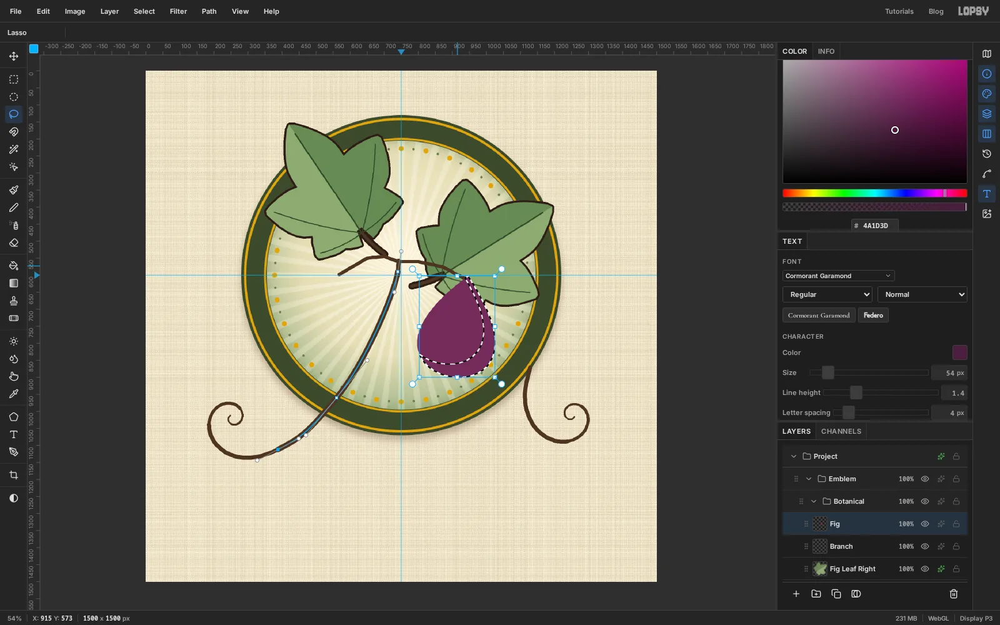

Art Nouveau posters use flat tones, not soft airbrushing. Every fruit gets the same three-step treatment: a base colour, a shadow crescent and a highlight.

1. Add a layer called `Fig`. Lasso a plump teardrop centred at about `920, 750`. Make it about 300 px wide and 300 px tall, round at the bottom and narrowing to a point at the top, standing nearly upright. Fill it with `#6D3159`.
2. **Cmd-click** the **Fig** thumbnail to load the shape. Hold [[Alt]] and lasso the same teardrop again, shifted about 30 px up and to the left. Subtracting it leaves a crescent along the lower right edge. That's the side in shadow.
3. Fill the crescent with `#4A1D3D` and deselect.
4. Lasso a narrow upright oval on the upper left of the fig and fill it with `#9A5684` for the highlight.
5. Lasso a short stalk on the top of the fig, pointing up towards the end of the right side stem, and fill it with `#5B4A2A`.

## Make the quince pear-shaped and lumpy

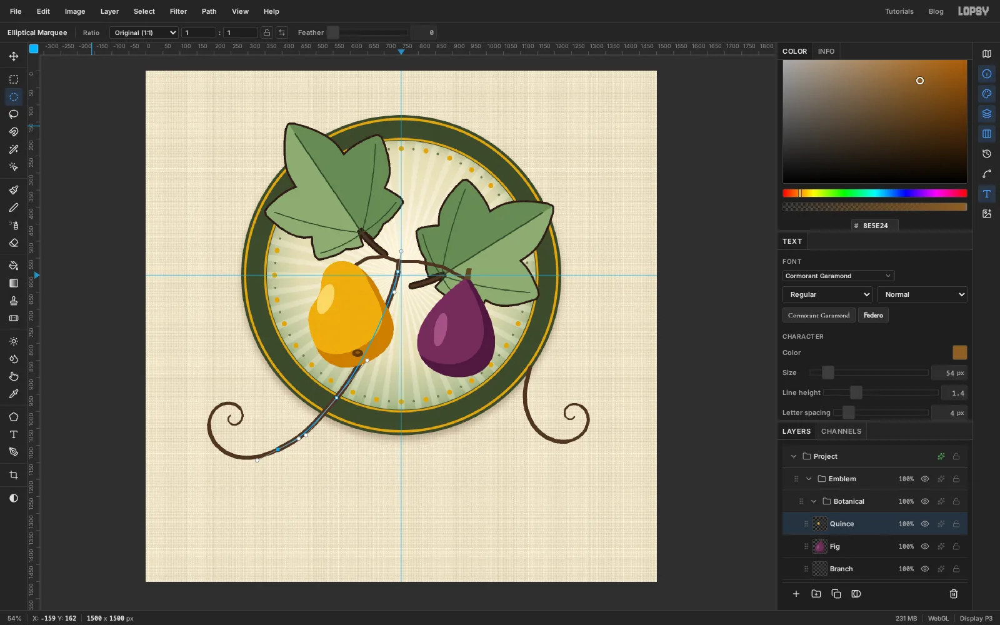

A smooth round fruit reads as an orange or an apricot. A quince is lumpy and shaped like a pear, with an uneven shoulder and a dark, puckered calyx at the bottom.

1. Add a layer called `Quince`. Lasso a pear shape centred at about `590, 700`, about 300 px wide and 340 px tall. Make the narrow end point up and to the left, towards the left side stem, and give the outline a few gentle bumps. Fill it with `#E4B03E`.
2. Shade it the same way as the fig: **Cmd-click** the thumbnail, [[Alt]]-lasso the shape again shifted up and to the left, and fill the crescent with `#C4832A`.
3. Lasso a long highlight on the upper left of the body and fill it with `#F6D877`.
4. For the calyx, draw a small elliptical marquee about 32 × 22 px at `622, 829` and fill it with `#5A3A16`. Then draw a smaller one, about 14 × 8 px, just above its centre and fill it with `#8E5E24`.

## Cut open the halved fig

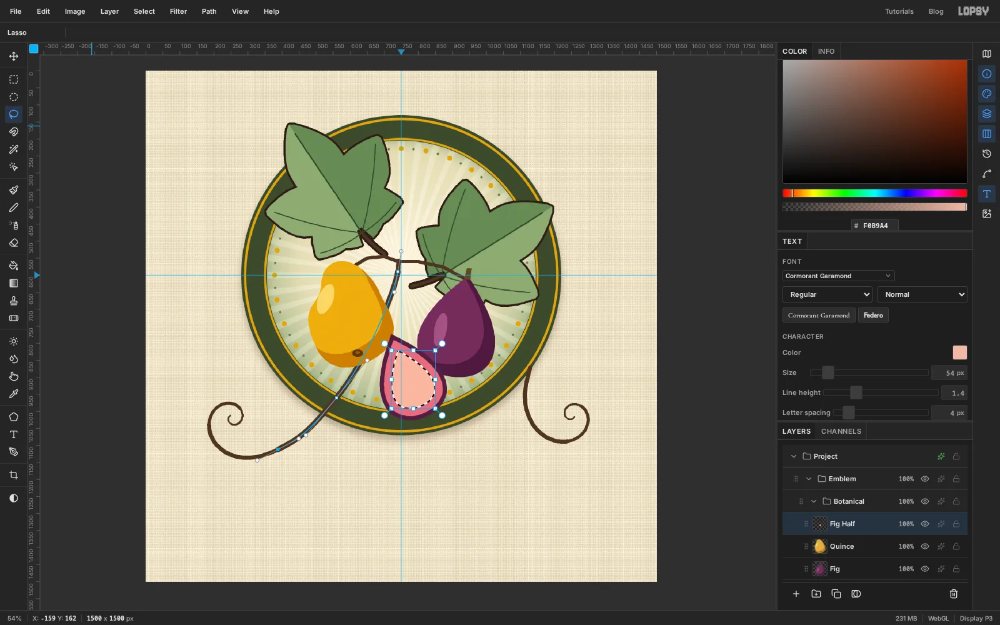

1. Add a layer called `Fig Half`. Lasso a teardrop at the bottom of the group, centred at about `770, 895`, about 256 px wide, tilted to the left so it overlaps both the quince and the fig. Fill it with `#4E2140`.
2. Don't deselect. Choose **Select → Shrink...**, enter `12` and click **Apply**. Fill the smaller shape with `#D9727F`.
3. Shrink the selection again by `22` and fill it with `#F0B9A4`. You now have skin, flesh and a pale centre, each a clean band.

## Spray the seeds

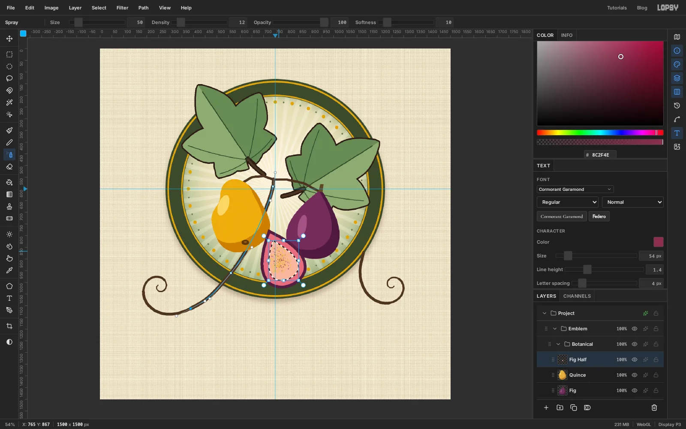

The selection from the last step keeps the seeds inside the pale centre.

1. Pick the **Spray** tool and set **Size** `64`, **Density** `26`, **Opacity** `100` and **Softness** `10`.
2. With the colour `#E9C05E`, drag a short zigzag through the pale centre. Then set **Size** `50` and **Density** `40` and add a second pass so the seeds cluster towards the middle.
3. Switch to `#8C2F4E`, set **Density** `12` and add a light sprinkle of dark seeds.
4. Deselect.

## Give the fruit one outline

1. Open the **Fig Leaf** layer's effects drawer and click **Copy effects**.
2. Open the effects drawer for **Fig**, **Quince** and **Fig Half** in turn, and click **Paste effects** in each one. All five shapes now share the same 6 px outline.
3. In the **Fig Half** effects, switch on **Drop Shadow** with **Offset X** `6`, **Offset Y** `10`, **Blur** `14`, **Opacity** `45` and the colour `#2B1E16`. The cut fig now sits in front of the others.

## Select where the stem crosses the ring

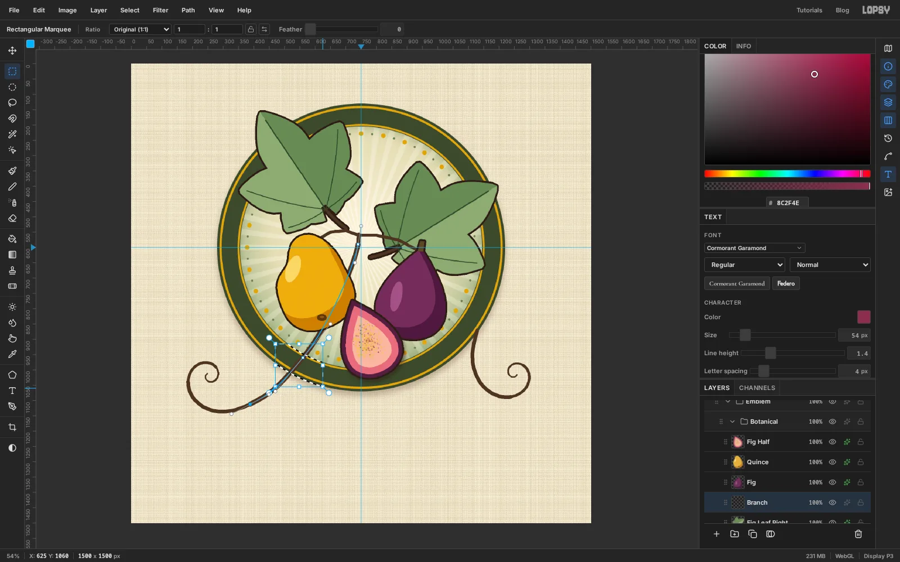

Right now the stem lies on top of everything. Weaving it under the ring at one point makes the emblem feel like a single woven object, which is a classic Art Nouveau touch.

1. Click the **Branch** layer.
2. With the Elliptical Marquee, select the whole green ring: draw a circle of radius 471, just outside the ring, then [[Alt]]-drag a circle of radius 396 to cut the halo out of it.
3. Pick the **Rectangular Marquee**, hold [[Shift]]+[[Alt]] and drag a box from `470, 915` to `625, 1060` around the spot where the stem crosses the ring. Only the piece of ring inside that box stays selected.

## Weave the stem under the ring

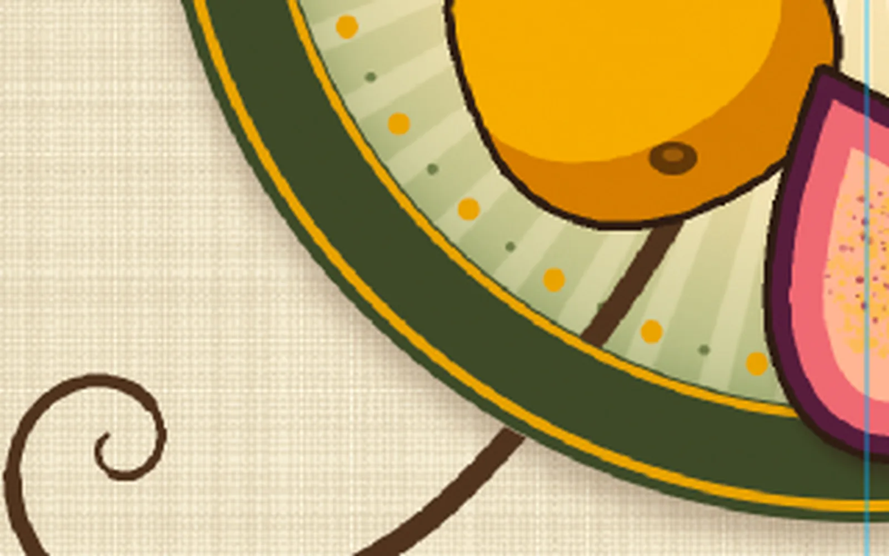

1. Choose **Select → Inverse**. Everything except that piece of ring is now selected.
2. Click **Add Mask** at the bottom of the Layers panel. The mask reveals the stem everywhere except over the ring, so the stem now looks as if it passes behind the frame.
3. Click the **Branch** row to leave mask editing.

## Warm the emblem with a Photo Filter

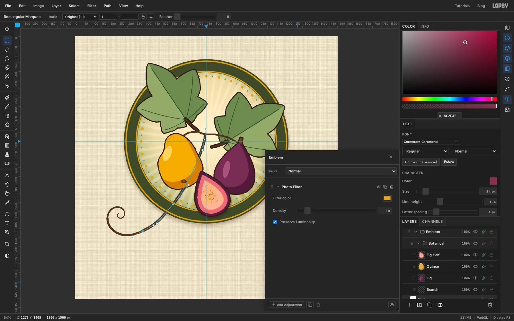

1. Click the **Emblem** group and open its effects drawer. A group's drawer shows adjustments instead of layer effects.
2. Click **Add Adjustment** and choose **Photo Filter**.
3. Leave the warm orange colour and set **Density** to `10`. Every layer in the group gets a faint golden cast, which pulls the greens and plums together like old printing ink.
4. Close the drawer.

## Set the wordmark

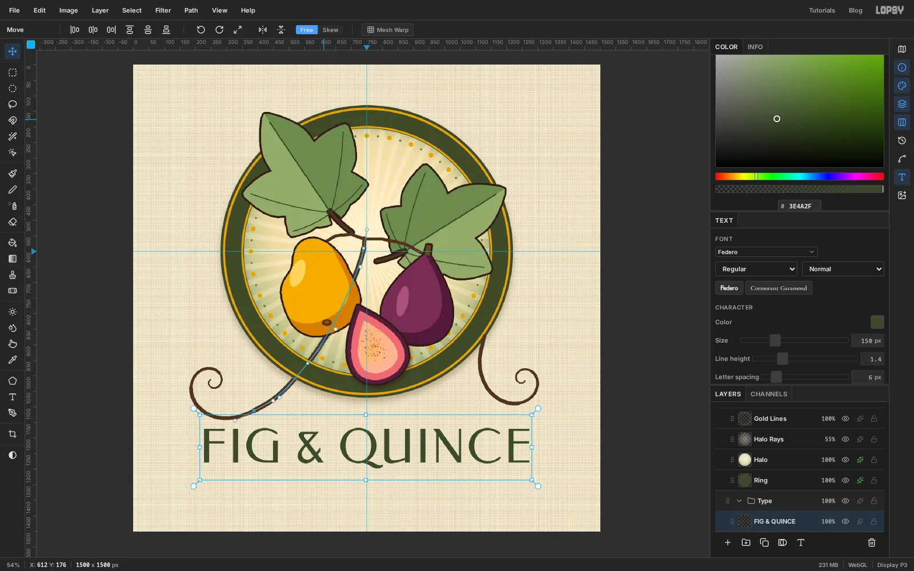

1. Click the **Paper** layer, click **New Group** and name it `Type`. It sits outside the Emblem group, so moving the emblem later won't move the type.
2. Set the foreground colour to `#3E4A2F`. Pick the **Text** tool and click in an empty part of the canvas below the emblem, at about `300, 1125`.
3. In the options bar, set **Size** to `150` and choose **Federo** from the font picker. Federo was drawn after Art Nouveau signage, with tall, slightly flared capitals. Type `FIG & QUINCE` and press [[Tab]] to commit.
4. In the **Text** panel, set **Letter spacing** to `6 px`. A little extra tracking suits all-caps type.
5. Pick the **Move** tool and click **Align center horizontally** in the options bar.

## Draw the tagline's curve

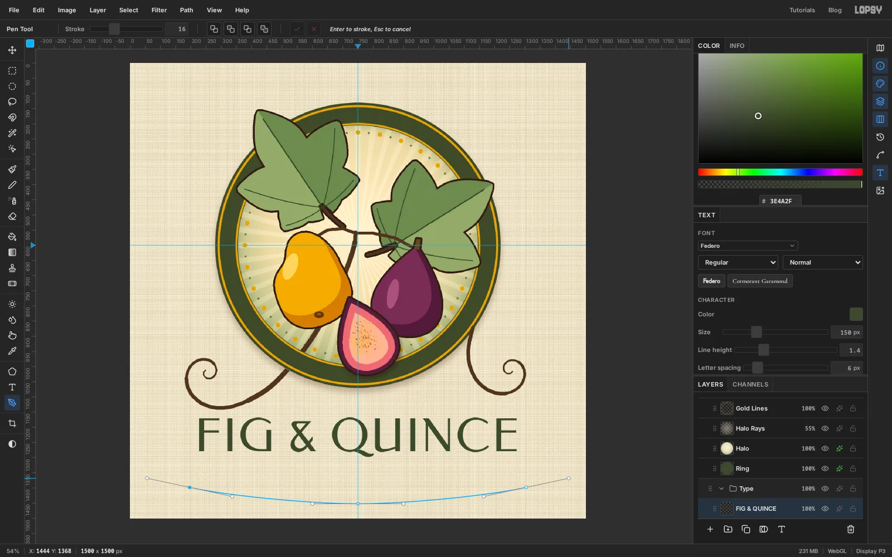

1. Pick the **Pen** tool. Press at `196, 1398` and drag about 140 px to the right and 30 px down. Press at `750, 1452` and drag about 150 px straight to the right. Press at `1304, 1398` and drag about 140 px to the right and 30 px up.
2. Click the **✓** (**Commit path**) button in the options bar. Don't press Enter: Enter would also stroke the curve onto the layer, and you only want the path.

The curve is a gentle smile that echoes the bottom of the ring. If the tagline sits on a curve that's too shallow, it just looks like a wobbly baseline.

## Put the tagline on the path

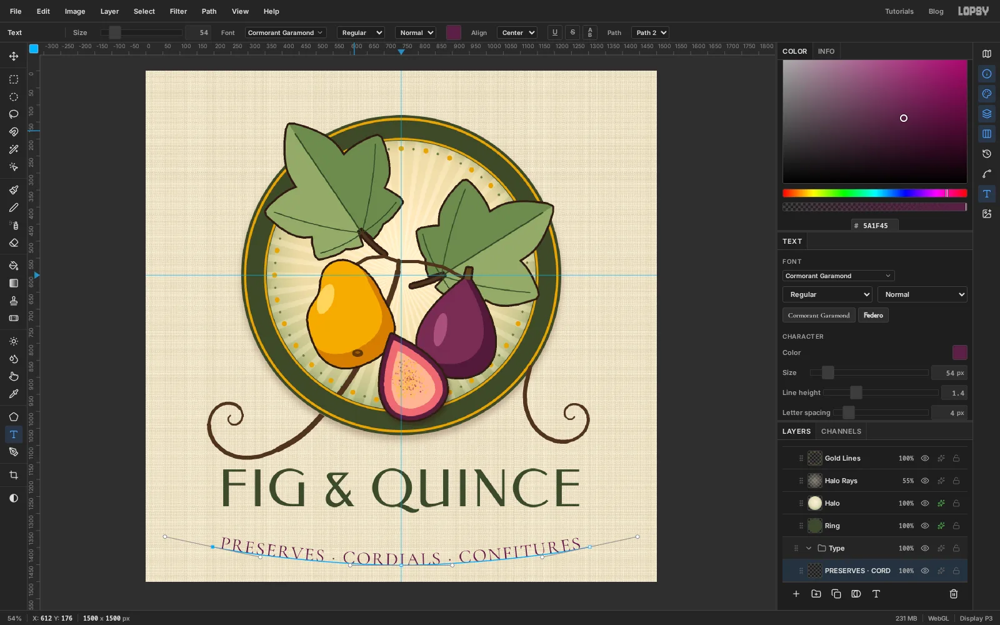

1. Set the foreground colour to `#5A1F45`. With the **Text** tool, click in an empty area at the top of the canvas.
2. Set **Size** to `54` and choose **Cormorant Garamond**. Type `PRESERVES · CORDIALS · CONFITURES` and press [[Tab]]. On a Mac, type the middle dot with [[Option+Shift+9]].
3. In the **Text** panel, set **Letter spacing** to `4 px`.
4. In the options bar, open the **Path** menu and choose **Path 2**, the curve you just drew. The text jumps onto the curve. Set **Align** to **Center** so it sits in the middle of the path.

> **Tip:** Letters that don't fit on the path are cut off at its end. If you ever see a word cut short, use the Pen tool to drag the path's end anchors further out. The text reflows as you drag.

## Nudge the emblem up as one piece

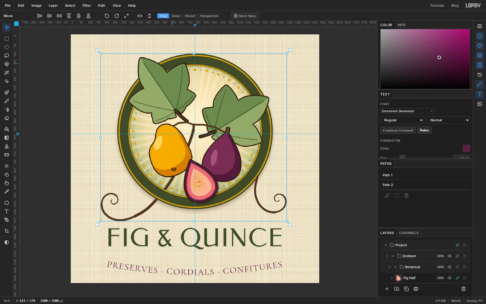

1. Click the **Emblem** group in the Layers panel and pick the **Move** tool. The box now frames everything in the group: ring, halo, leaves, fruit and branch.
2. Press [[Shift+Up]] once and [[Up]] five times to raise the whole emblem 15 px. That opens a little more air between the spirals and the wordmark.
3. Click **Path 2** in the **Paths** panel to deselect it, so its blue line is hidden.
4. Choose **File → Quick Export PNG** to save the logo. Then choose **File → Save Project** to keep an editable copy.

For a version that will be printed very small, such as a jar lid, hide the **Halo Rays** and **Mosaic** layers. The fruit, ring and wordmark still read clearly without them.
