ASCII art is drawing with the characters on a keyboard. Before screens could show pictures, people made them out of slashes, dashes and hash signs on terminals and line printers. The same habit lives on in terminal apps, where a box is a row of dashes between two plus signs and a progress bar is a run of `#`.

In this tutorial you'll use that language to mock up a phone app. *Yeti Ascent* is an imaginary summit tracker, and almost everything on its screen is typed: the mountain, the yeti standing on it, the stat boxes, the progress bars. The board is 1500 × 2000 px and holds:

- a title in block letters built from `#`
- a phone drawn with the Shape tool
- a typed app screen with a hero drawing, three stat boxes, a log, a button and a tab bar
- a tilted alert card, six callouts, and a background of typed snow
- a screen glow, scanlines and a glass glare on top

The trick that makes it work is a **monospaced font**. Every character is the same width, so text layers typed at the same size line up into a grid. You can stack several text layers on the same spot, one per colour, and they fit together like printing plates.

The tools you'll use:

- the **Text** tool with **IBM Plex Mono**, including **Line height**, **Align**, and recolouring part of a text
- the **Shape** tool with **Corner Radius**, fill and stroke
- **ruler guides**, with the Shape tool and the marquee snapping to them
- **Filter → Clouds**, **Pixelate** and **Posterize**, and a **layer mask** with a gradient
- **Define Pattern** and **Fill with Pattern** for scanlines
- a selection loaded from a layer's thumbnail, and the marquee's exact-size dialog
- **Group Layers** and the **Move** tool's rotate handle on a whole group
- **Rasterize Layer**, **Drop Shadow**, **Outer Glow**, and the **Soft Light** and **Screen** blend modes

The palette is a cold night with one warm accent and one alarm colour:

- Night `#04070B` → `#0A1620` → `#10222C`
- Phone `#05080C`, screen `#0A141B`, bezel line `#35586A`
- Ice `#7FE7FF`, snow `#EAF6FA`, yeti white `#FFFFFF`
- Dim blue `#5E94AA`, soft blue `#8CC4D8`, snowflake `#2F566B`
- Amber `#FFB000`
- Alert coral `#FF5A4F`, alert text `#3A0B08`
- Glow `#38C8F0`

> **Tip:** Typing the drawings by hand takes a while. You can copy any block from the project file: open it with the button above, click a text layer with the **Text** tool, then press [[Cmd+A]] and [[Cmd+C]]. Most text layers in the project are locked, so unlock the one you want first.

> **Note:** Shortcuts are written for a Mac. On Windows use [[Ctrl]] wherever it says [[Cmd]].

## Paint the night sky

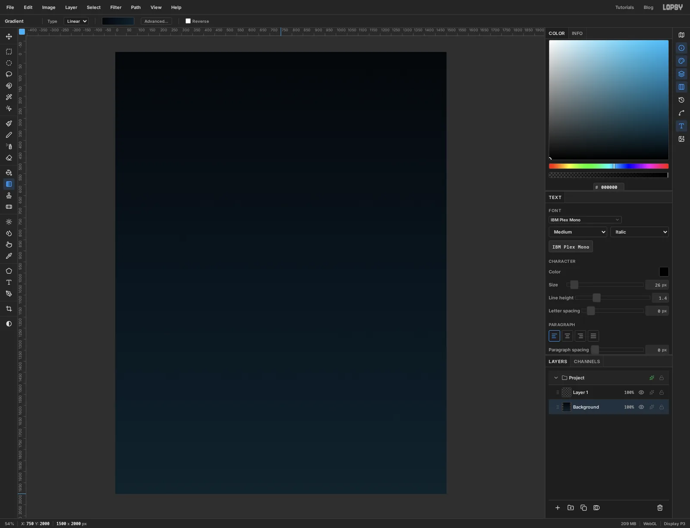

Choose **File → New**, keep the units on **Pixels**, and make the document **1500** wide and **2000** high with a white background.

Click the *Background* layer. Pick the **Gradient** tool, set its type to **Linear** and open the gradient editor. Give it three stops: `#04070B` at the left end, `#0A1620` a little past the middle, and `#10222C` at the right end. Click **Done**, then drag straight down from the top edge of the canvas to the bottom edge.

## Render some clouds

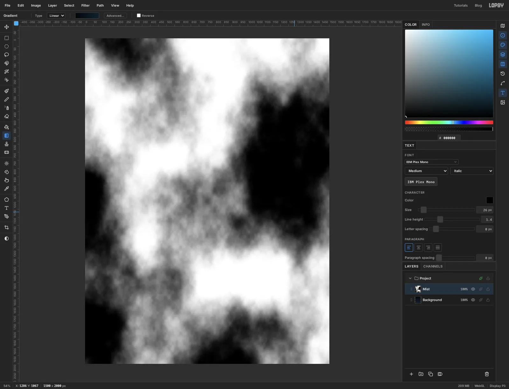

The new document comes with an empty layer called *Layer 1*. Double-click its name and call it *Mist*.

Choose **Filter → Clouds…**, set **Scale** to **4** and click **Apply**. Clouds is random, so yours won't match mine. If you don't like the pattern, undo and run it again.

## Turn the clouds into character cells

Soft clouds look wrong next to typed characters. A terminal screen is a grid of cells, so the mist should be a grid too.

Choose **Filter → Pixelate…** and set **Block Size** to **32**. Then choose **Filter → Posterize…** and set **Levels** to **5**. The clouds are now big flat squares in five greys.

## Blend the mist and fade it out at the top

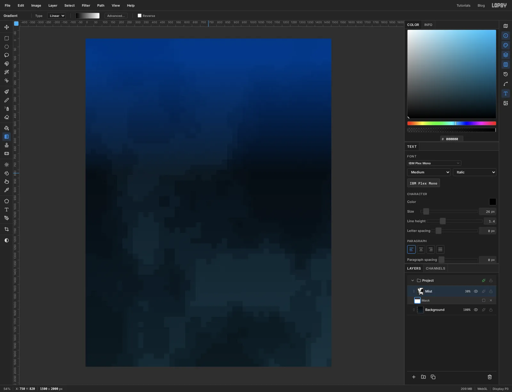

Click the effects button on the *Mist* row to open its drawer and set the blend mode to **Soft Light**. Close the drawer, click the layer's opacity number and bring it down to **30%**. The blocks become a faint blue fog.

The title goes at the top, and it will read better on a clean sky. With *Mist* still selected, click **Add Mask** at the bottom of the Layers panel. You're now painting on the mask.

Pick the **Gradient** tool again and open the editor. It still holds the three sky colours, so click the middle stop and delete it with the trash button. Set the two that are left to black `#000000` and white `#FFFFFF`. Drag from a little below the top of the canvas down to about two fifths of the way. Black hides the layer and white shows it, so the mist fades in below the title area. The blue tint in the screenshot is the mask overlay. Click the *Mist* row to leave the mask.

## Type a field of snow

The snow is one big text layer made mostly of spaces.

Set the foreground colour to `#2F566B`. Pick the **Text** tool and click near the left edge, roughly a sixth of the way down the canvas. In the options bar set **Size** to **26**, pick **IBM Plex Mono** in the font list and choose **Bold**.

Now type rows of about 94 characters. Mostly press the space bar, and drop in a `.` every dozen or so characters, with the odd `*`, `'` or `+`. Press [[Enter]] at the end of each row. You need about 46 rows to reach the bottom of the canvas.

That's a lot of space bar. A quicker way is to type eight or ten rows, select them with [[Cmd+A]], copy with [[Cmd+C]], then press [[End]] and paste a few times with [[Cmd+V]]. If you do that, change a few characters in each pasted block so the repeat doesn't show.

Press [[Tab]] to finish. Name the layer *Snow field* and click its lock icon.

> **Tip:** Lock every text layer once it's done. A click with the Text tool inside an existing text layer edits that layer, and on a screen this full of type you'd hit one all the time. Locked text is skipped. One catch: while a locked layer is the *selected* layer, the Text tool won't place anything, so click an unlocked layer in the panel before you type the next piece.

## Drop guides for the phone

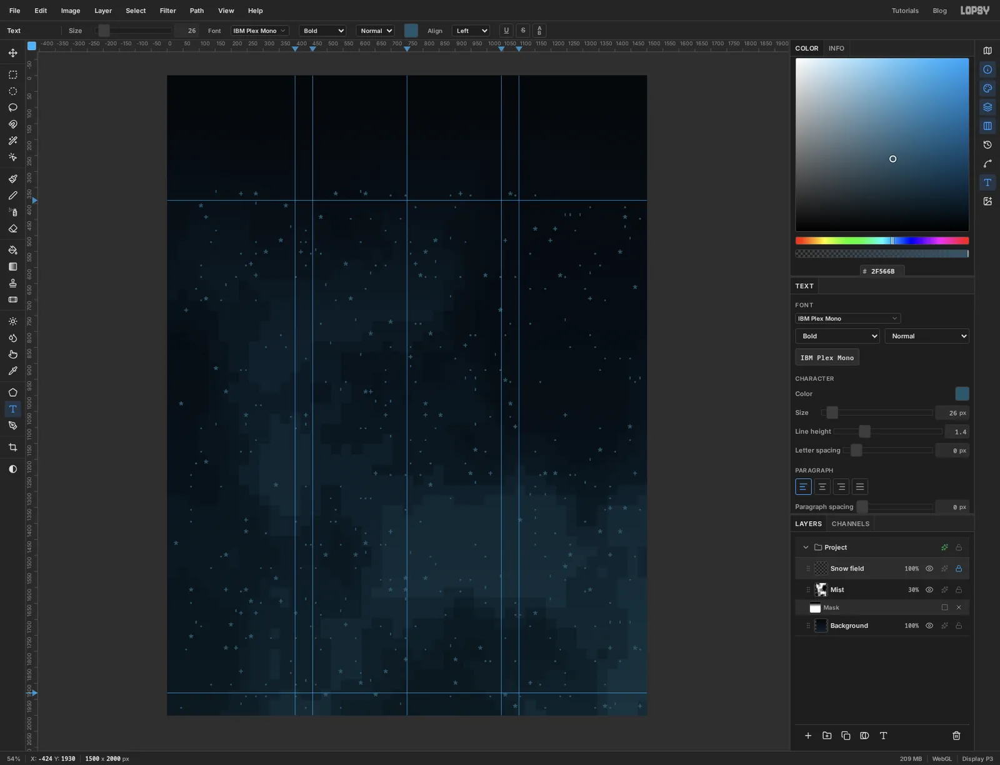

Guides keep the phone centred and give the screen text a margin to line up with.

Click on the top ruler to drop a vertical guide. Put one at **400** and one at **1100** for the sides of the phone, and one at **455** and one at **1045** for the text margins. Then hold [[Cmd]] and click the ruler near the middle: the guide jumps to the exact centre.

Click the left ruler to drop horizontal guides at **390** and **1930** for the top and bottom of the phone. Watch the **X** and **Y** readout in the status bar as you hover to find the right spot.

## Draw the phone body

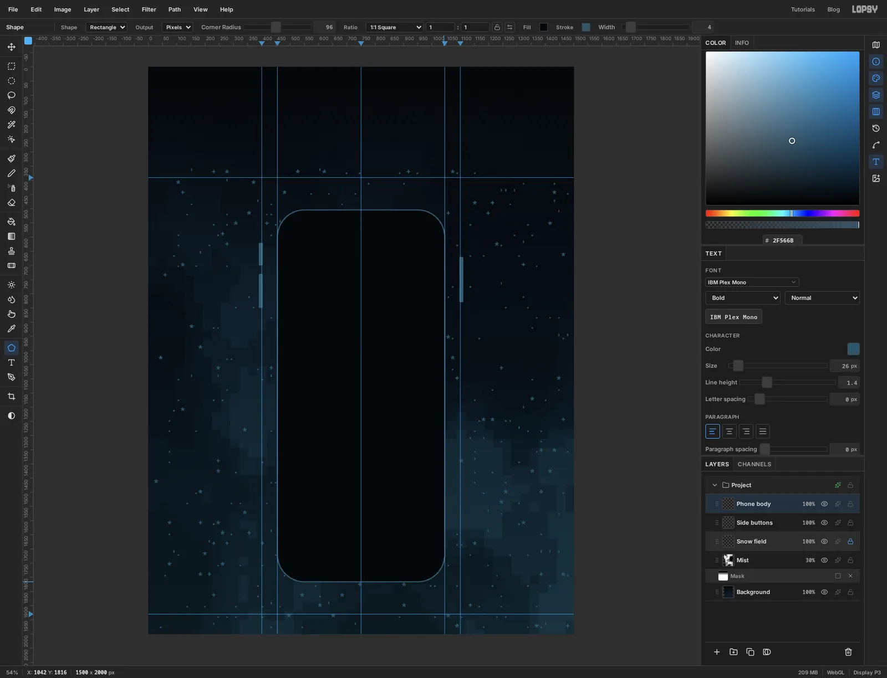

Start with the side buttons, because they sit behind the body. Click *Snow field*, then click **Add Layer** and name the new layer *Side buttons*. A new layer always lands just above the selected one.

Pick the **Shape** tool. Set **Shape** to **Rectangle**, **Corner Radius** to **4**, and click the **Fill** swatch to set it to `#35586A`. Leave **Stroke** off. Shapes grow from the centre, so press on a side guide and drag out a few pixels sideways and a long way up or down. Make two slivers on the left guide and one on the right. They only need to poke out about 10 px.

Add another layer and call it *Phone body*. Set **Corner Radius** to **96** and the fill to `#05080C`. Click the **—** next to **Stroke**, set the colour to `#35586A`, and set **Width** to **4**.

Press on the centre guide, halfway between the two horizontal guides. That's Y **1160**: watch the readout in the status bar as you hover. Drag toward the corner where the **1100** and **1930** guides cross. The corner snaps to the guides when you get close, and the body fills the box between all four.

## Add the screen and the notch

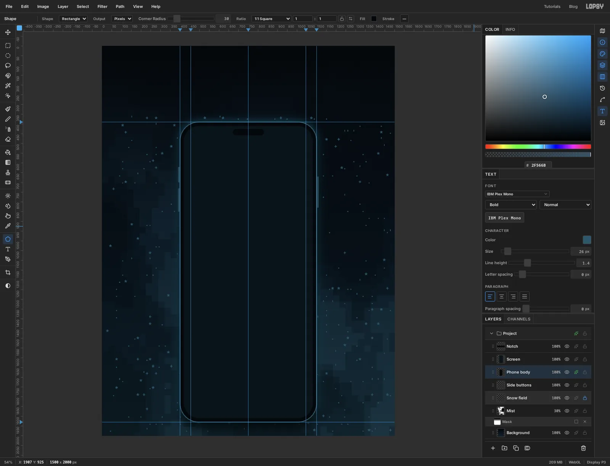

Add a layer called *Screen*. Set **Corner Radius** to **78**, the fill to `#0A141B`, and remove the stroke (click its swatch, then **Remove stroke**). Drag from the same centre point, and stop about 20 px inside the body's corner so a thin bezel shows all the way round. If the corner jumps onto the guides, you've gone too close. Back off a little.

Add a layer called *Notch*. Set **Corner Radius** to **30** and the fill to `#05080C`. Press on the centre guide just below the top of the screen and drag out a pill about 160 px wide and 32 px high.

Now give the body some depth. Click the effects button on the *Phone body* row:

- Tick **Drop Shadow**. Set **Offset X** to **0**, **Offset Y** to **30**, **Blur** to **60** and **Opacity** to **80**.
- Tick **Outer Glow**. Set **Size** to **70**, **Opacity** to **35** and the colour to `#38C8F0`.

## Type the status bar and the nav row

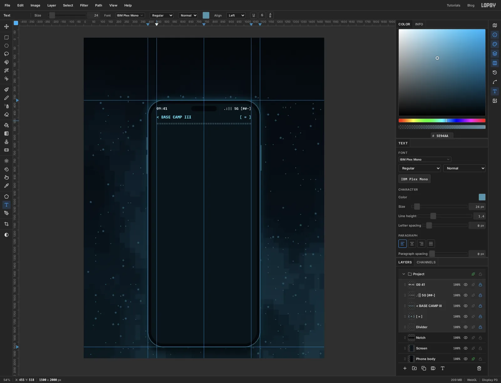

Everything on the screen is IBM Plex Mono. The screen is 41 characters wide at size 24, running from one margin guide to the other.

For each piece: click the *Notch* layer in the panel, click on the canvas with the **Text** tool, set the size and weight, type, and press [[Tab]]. Clicking *Notch* first does two things. It puts the new text above the phone in the stack, and it gets you off the locked layer you just finished. Do this before every new piece of text from here on.

- At the left margin, level with the notch: `09:41` in snow `#EAF6FA`, size **22**, **SemiBold**.
- Ending at the right margin: `.:|| 5G [##-]`, the same style. The dots and bars are the signal and `[##-]` is the battery.
- Below, at the left margin: `< BASE CAMP III` in ice `#7FE7FF`, size **24**, **Bold**.
- Ending at the right margin: `[ = ]` in the same style. It's the menu button.
- Below that: a row of 41 equals signs in dim blue `#5E94AA`, size **24**, **Regular**.

To line something up with the right margin, type it anywhere empty, then pick the **Move** tool and drag it until its last character touches the guide. Lock each layer once it's in place.

## Type the mountain

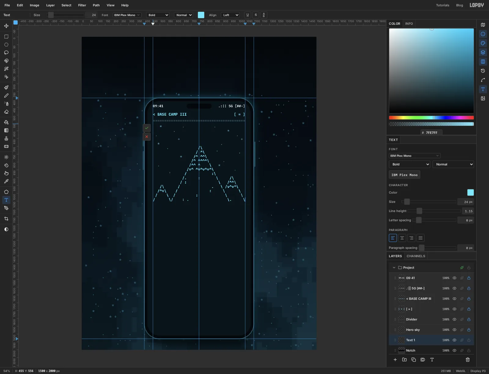

The hero picture is 41 characters wide and 18 rows tall, and it's built from four text layers stacked on the same spot. Start with the sky, which is the simplest. All four layers have to start at the same point, so use the status bar readout: click where it says X **455**, Y **556**, on the left margin guide just under the divider. Set size **24**, **Medium**, dim blue `#5E94AA`, and type 12 rows of spaces with a dozen or so `.`, `*` and `+` scattered through them. Press [[Tab]], open the **Text** panel and set **Line height** to **1.15**. Name it *Hero sky* and lock it.

Now the mountain. Click *Notch* again, then click with the Text tool at the same X **455**, Y **556**. Because *Hero sky* is locked, you get a new layer, not an edit. If a layer ends up a pixel or two off, pick the **Move** tool afterward and nudge it with the arrow keys until its characters sit in the same cells as the others. Set ice `#7FE7FF`, size **24**, **Bold**.

Press [[Enter]] five times to leave room for the yeti. Then draw the big peak, one row at a time:

- The summit is a `/` and a `\` side by side in the middle of the row, at columns 21 and 22.
- On every row below, the `/` moves one column left and the `\` one column right, so the peak is two characters wider each time. There are 13 rows.
- Fill the top five rows between the slopes with `^` for snow, then one row of alternating `v` and `^` for the ragged snow line.
- Below the snow line, leave the inside mostly empty with a few `:` and `.` for rock.

Add a small peak the same way low on each side, four to six rows tall, with a couple of `^` at its tip.

> **Tip:** Count spaces carefully on the first couple of rows. After that you can see where the next slash goes: one to the left of the slash above it.

## Turn the snow cap white

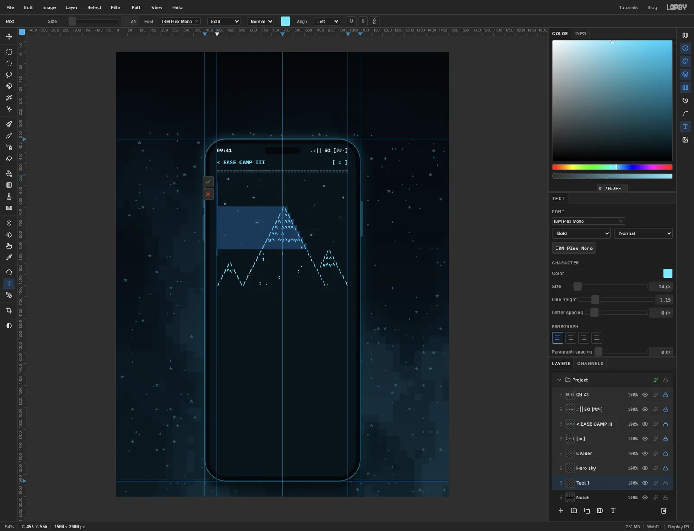

A text layer can hold more than one colour. While you're still editing the mountain, press [[Up]] until the caret is on the first row and press [[Home]]. Hold [[Shift]] and press [[Down]] eleven times to select everything down to the snow line.

Click the **Text color** swatch in the options bar and enter snow `#EAF6FA`. Only the selected rows change. Click the swatch again to close the picker and press [[Tab]].

Set **Line height** to **1.15** to match the sky, name the layer *Hero mountain* and lock it.

## Add the route and the yeti on their own layers

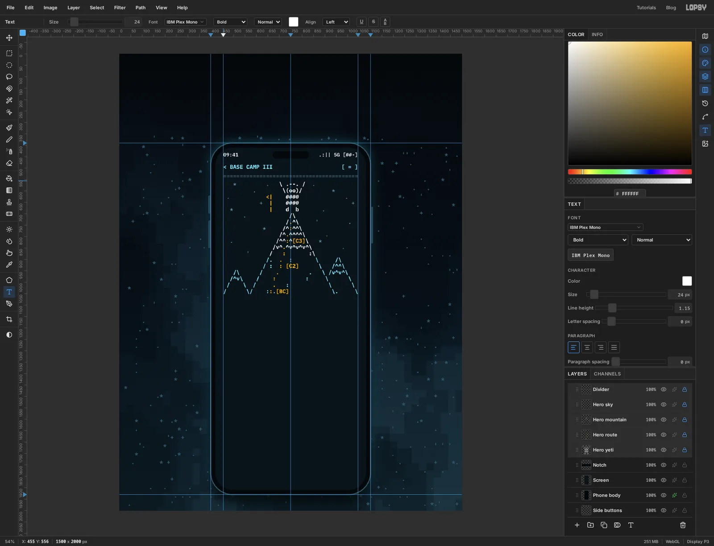

Two more layers go on the same spot, each in its own colour. Because the grid is the same, a character you type in row 9, column 20 lands exactly in that cell of the picture.

**The route.** Click *Notch*, click the same X **455**, Y **556** with the Text tool and set amber `#FFB000`, **Bold**, size **24**. Type spaces to reach a cell, then the character:

- A dotted line of `.` and `:` climbing just inside the left slope, one per row, from the bottom row to the summit.
- Three camp labels beside the line: `[BC]` on the bottom row, `[C2]` about a third of the way up and `[C3]` just under the snow line.
- A flag to the left of where the yeti will stand: `<|` with two more `|` below it.

Wherever a route character lands on a cell that already holds a mountain character, unlock *Hero mountain*, click into it, swap that one for a space and lock it again, or the two will print on top of each other.

**The yeti.** Same again in white `#FFFFFF`, **Bold**. It is five rows, centred over the summit:

- Row 1: 17 spaces, then `\ .--. /` (raised arms and a brow)
- Row 2: 18 spaces, then `\(oo)/`
- Row 3: 19 spaces, then `####`
- Row 4: 19 spaces, then `####`
- Row 5: 19 spaces, then `d`, two spaces and `b` for the feet

Set both layers' **Line height** to **1.15**, name them *Hero route* and *Hero yeti*, and lock them.

## Type the peak heading

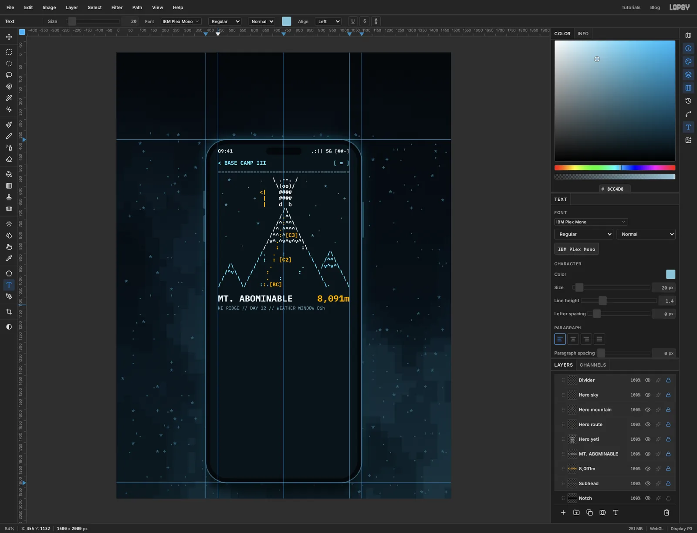

Under the mountain, at the left margin, type `MT. ABOMINABLE` in snow `#EAF6FA`, size **40**, **Bold**. On the same line, ending at the right margin, type `8,091m` in amber `#FFB000`, same size.

Below them, type `NE RIDGE // DAY 12 // WEATHER WINDOW 06h` in soft blue `#8CC4D8`, size **20**, **Regular**.

Leave about 25 px between the bottom of the mountain and the top of the heading so the two don't crowd each other.

## Draw the stat boxes with characters

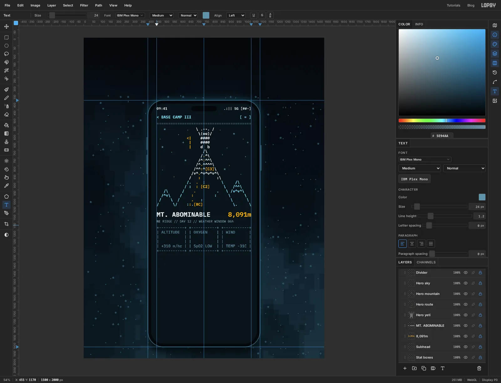

The three boxes are one text layer. Each box is 13 characters wide with one space between boxes, which makes exactly 41.

Use dim blue `#5E94AA`, size **24**, **Medium**. Type six rows:

- Row 1: `+-----------+` three times, with a space between each.
- Row 2: `|`, a space, the label (`ALTITUDE`, `OXYGEN`, `WIND`), spaces to fill, and a closing `|` in column 13.
- Rows 3 and 4: `|`, eleven spaces, `|`. The big numbers go here.
- Row 5: like row 2, with the small print: `+310 m/hr`, `SpO2 LOW`, `TEMP -31C`.
- Row 6: the same as row 1.

Press [[Tab]] and set **Line height** to **1.2**. Name it *Stat boxes* and lock it.

## Drop the big numbers into the boxes

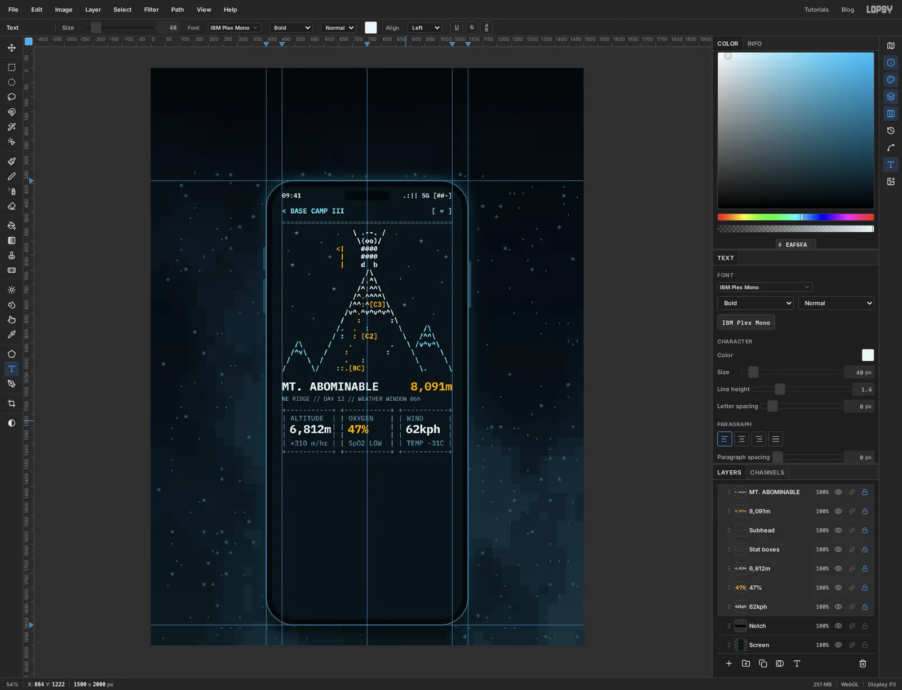

The values are separate text layers at size **40**, **Bold**, sitting in the empty rows of each box:

- `6,812` in snow `#EAF6FA`
- `47%` in amber `#FFB000`, because it's the one reading that's a warning
- `62kph` in snow

Start each number two characters in from its box's left edge, so it lines up with the label above it. Check that the tops of the numbers clear the labels and the bottoms clear the small print. If one is off, nudge it with the arrow keys and the **Move** tool.

## Chart the climb with hash marks

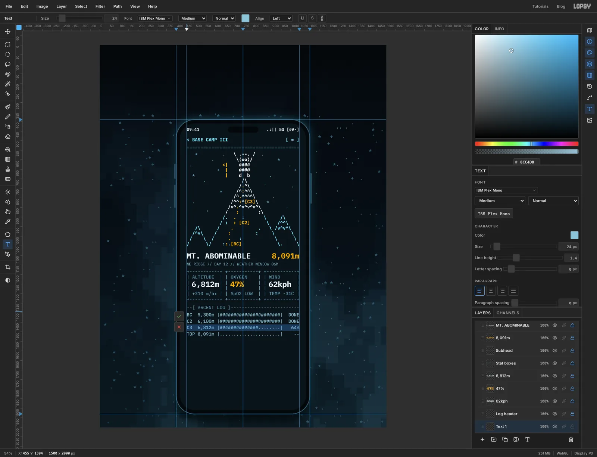

First the section heading: `--[ ASCENT LOG ]` followed by 25 more dashes, in dim blue `#5E94AA`, size **24**, **Regular**.

The chart is four rows in soft blue `#8CC4D8`, size **24**, **Medium**. Each row has a label, a height, a bar 22 characters long between two `|`, and a status that ends at the right margin:

- `BC  5,300m |` then 22 `#`, then `|  DONE`
- `C2  6,100m |` then 22 `#`, then `|  DONE`
- `C3  6,812m |` then 14 `#` and 8 `.`, then `|   64%`
- `TOP 8,091m |` then 22 `.`, then `|    --`

Pad the statuses with spaces on the left so they all end in the same column.

Before you finish, move the caret to the third row, press [[Home]], then [[Shift+End]] to select the row. Click **Text color** and set it to amber `#FFB000`. That's the camp you're at. Press [[Tab]] and set **Line height** to **1.4**.

## Fill a button bar between the guides

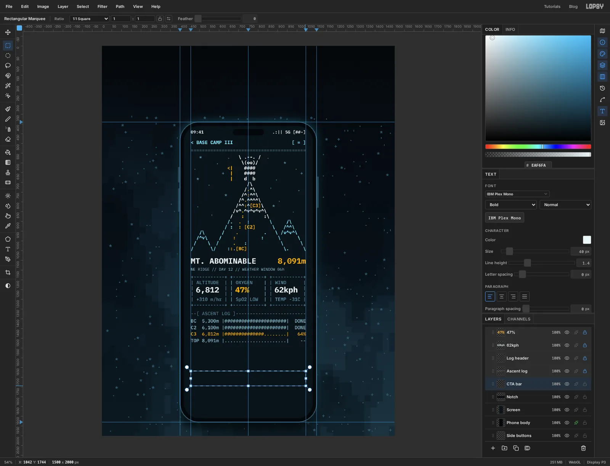

Terminals show a selected item in reverse video: a solid bar with dark text. That's the button.

Click *Notch*, click **Add Layer** and name it *CTA bar*. Pick the **Rectangular Marquee** and drag from the left margin guide to the right one, about 76 px high, below the chart. Leave about 110 px of empty screen between the chart and the bar, for the alert card. The marquee's sides snap to the guides.

Set the foreground to ice `#7FE7FF` and choose **Edit → Fill**. Press [[Cmd+D]] to deselect.

## Type the tab bar and highlight one tab

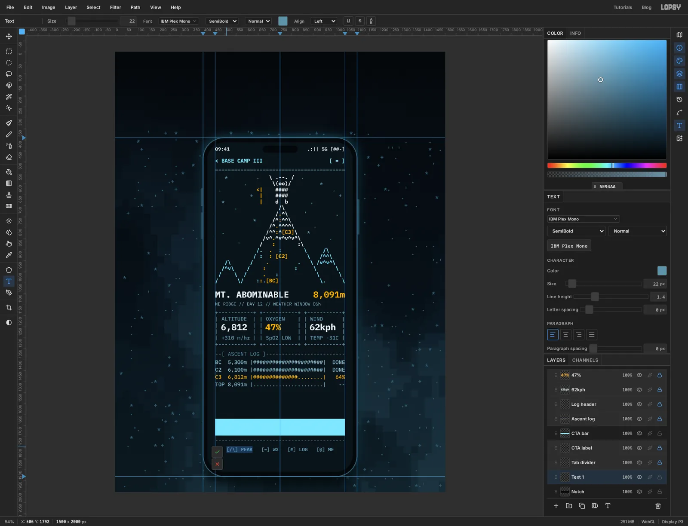

Under the bar, type a row of 41 dashes in dim blue `#5E94AA`, size **24**, **Regular**.

Under that, centred on the screen, type the tabs in dim blue, size **22**, **SemiBold**, with three spaces between tabs:

- `[/\] PEAK`
- `[~] WX`
- `[#] LOG`
- `[@] ME`

While still editing, press [[Home]], hold [[Shift]] and press [[Right]] nine times to select the first tab. Set **Text color** to ice `#7FE7FF`, then press [[Tab]]. One bright tab among dim ones shows which screen you're on.

Add one more layer and name it *Home indicator*: with the **Shape** tool, **Corner Radius 5** and fill `#5E94AA`, drag a thin bar about 200 px wide and 10 px high on the centre guide near the bottom of the screen.

## Label the button and build the alert card

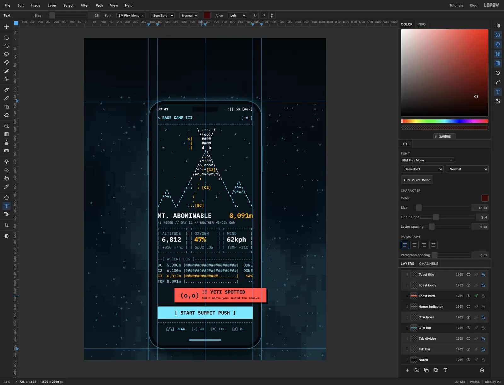

**The label.** Click the *CTA bar* layer so the text lands above it. Type `[ START SUMMIT PUSH ]` in `#05080C`, size **30**, **Bold**, and centre it on the bar. If the label disappears, it's below the bar in the stack. Drag its row above *CTA bar* by the grip at the left of the row.

**The card.** With *Home indicator* selected, add a layer called *Toast card*. Drag a marquee about 570 px wide and 90 px high in the gap above the button, starting 100 px in from the left margin and running out past the right edge of the phone. Fill it with coral `#FF5A4F` and deselect.

Open the card's effects and tick **Drop Shadow**: **Offset X 10**, **Offset Y 10**, **Blur 0**, **Opacity 75**. With no blur the shadow is a solid offset block, the way old text-mode windows drew theirs.

Click *Toast card*, then type three pieces on it:

- `(o,o)` in `#05080C`, size **40**, **Bold**, at the left of the card. It's a small yeti face.
- `!! YETI SPOTTED` in `#05080C`, size **30**, **Bold**, to the right of the face.
- `400 m above you. Guard the snacks.` in `#3A0B08`, size **18**, **SemiBold**, under the headline.

Name them *Toast face*, *Toast title* and *Toast body*, and leave these three unlocked, because you're about to turn them. To place the second and third without hitting the first, click *Toast card* in the panel before each one and click on a part of the card with no text. Keep the padding even: about 35 px from the card's left edge to the face, and the same from the end of the small text to the right edge.

## Group the alert

The card and its three texts should move as one. Click *Toast card* in the Layers panel, hold [[Shift]] and click the top one of the three text layers. All four are selected. Choose **Layer → Group Layers** and name the group *Yeti alert*.

Pick the **Move** tool. With the group selected, handles frame everything inside it.

## Tilt the whole group

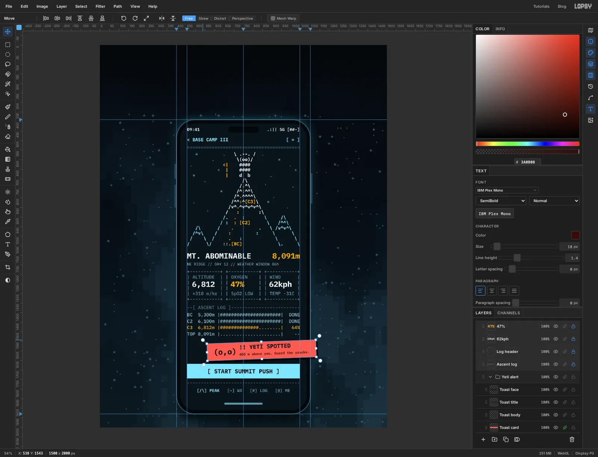

Move the pointer just outside a corner handle until it turns into the rotate cursor. Drag a short way anticlockwise, to about **2°**. The card, the face and both lines of text turn together around the centre of the frame.

Press [[Cmd+D]] to commit. The text layers stay live after the turn. You can still retype them.

> **Tip:** Keep the tilt small. The card needs to clear the last row of the chart at its right end and the button at its left end.

## Bring the alert to the front

An alert floats above everything. Grab the *Yeti alert* row by its grip and drag it to the very top of the Layers panel. The list scrolls by itself when you hold the pointer at its top edge. Drop it on the line above the first row.

## Type the title in block letters

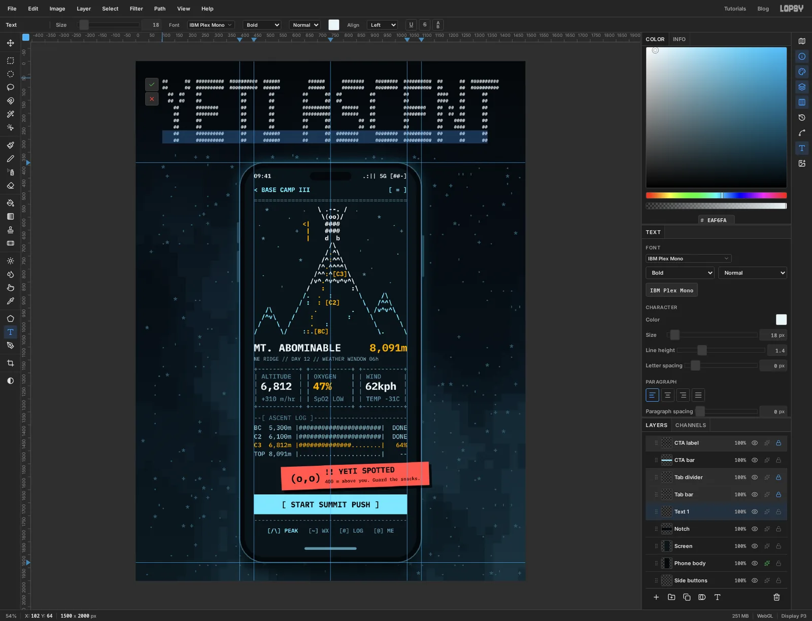

The title is ASCII art too. Each letter is drawn on a grid five cells wide and five tall, then every cell is doubled both ways so the strokes are two characters thick. That gives letters 10 characters wide and 10 rows tall. With two spaces between letters and eight between the words, the title is 120 characters wide.

Click *Notch*, then click with the Text tool near the top-left of the board, about 100 px in from the edge. Set snow `#EAF6FA`, size **18**, **Bold**. Type the ten rows. Every row appears twice, so type one, then type it again. Here are the letters on their small grids, with `.` standing for an empty cell. `I` is only three cells wide:

- **Y**: `#...#`, `.#.#.`, `..#..`, `..#..`, `..#..`
- **E**: `#####`, `#....`, `####.`, `#....`, `#####`
- **T**: `#####`, `..#..`, `..#..`, `..#..`, `..#..`
- **I**: `###`, `.#.`, `.#.`, `.#.`, `###`
- **A**: `.###.`, `#...#`, `#####`, `#...#`, `#...#`
- **S**: `.####`, `#....`, `.###.`, `....#`, `####.`
- **C**: `.####`, `#....`, `#....`, `#....`, `.####`
- **N**: `#...#`, `##..#`, `#.#.#`, `#..##`, `#...#`

To type a row, take that row from each letter in turn. Type `##` for every `#` and two spaces for every `.`, and put two spaces between letters. The first row of `YETI` is therefore `##`, six spaces and `##` for the arms of the Y, two spaces, ten `#` for the top of the E, two spaces, ten `#` for the T, two spaces and six `#` for the I.

When all ten rows are in, the caret is at the end of the last row. Hold [[Shift]] and press [[Up]], then [[Home]]. The bottom two rows are selected. Set **Text color** to ice `#7FE7FF` so the letters stand on a cyan base, and press [[Tab]].

## Tighten the title and add the tagline

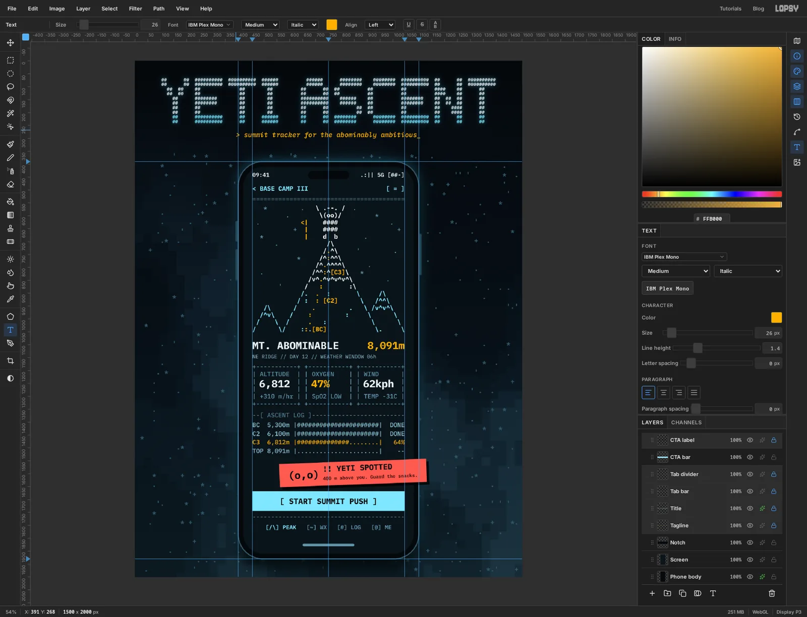

In the **Text** panel set the title's **Line height** to **1.0**. The rows close up and the letters turn solid. Check that the title is centred on the centre guide, and nudge it if it isn't.

Open its effects and tick **Outer Glow**: **Size 24**, **Opacity 55**, colour `#38C8F0`. Name the layer *Title* and lock it.

For the tagline, click *Notch* again (the title is locked, and the Text tool won't start on a locked layer). Click in the empty space under the title and type `> summit tracker for the abominably ambitious_` in amber `#FFB000`, size **26**, **Medium**, with the style set to **Italic**. The `>` is a prompt and the `_` is a cursor. Centre it under the title.

## Add the first callout

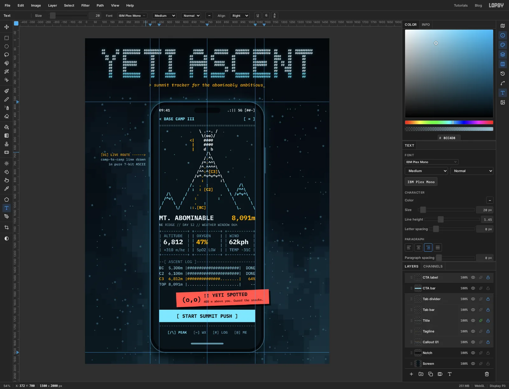

Callouts explain the screen, with arrows made of dashes.

Click *Notch*, pick the **Text** tool and set **Align** to **Right** before you click. Set the style back to **Normal** too, or the callouts will come out italic like the tagline. Click to the left of the phone, about 30 px out from its edge and level with the mountain. With right alignment, the point you click is where each line *ends*. Set soft blue `#8CC4D8`, size **20**, **Medium**, and type three lines:

- `[01] LIVE ROUTE ------>`
- `camp-to-camp line drawn`
- `in pure 7-bit ASCII`

Select the first line ([[Up]] twice, [[Home]], [[Shift+End]]) and set **Text color** to amber `#FFB000`. Press [[Tab]] and set **Line height** to **1.45**.

## Add the other callouts

Two more go down the left side, right-aligned like the first:

- Level with the log: `[03] ASCENT LOG ------>`, `every camp, every metre,`, `one # at a time`
- Level with the tab bar: `[05] WORKS OFFLINE ---->`, `no signal above 6,000 m?`, `no problem`

Switch **Align** to **Left** for the right side, where the arrow comes first:

- Level with the stat boxes: `<------ VITALS [02]`, `altitude, O2 and wind`, `without taking mittens off`
- Level with the alert: `<-- YETI RADAR [04]`, `proximity alerts for`, `the abominable snowman`

Give each the same amber first line and **1.45** line height.

## Clear the snow behind the callouts

First add a sixth callout. There's room at the top right, level with the yeti: `<------ SUMMIT CAM [06]`, `a live view of whoever`, `got there first`, left-aligned like the other two on that side.

Now look closely at the callouts. Snowflakes from the background land between their letters and make them harder to read. The snow is text, and you can't erase part of a text layer, so turn it into pixels first.

Unlock *Snow field*, select it and click **Rasterize Layer** at the bottom of the Layers panel. Pick the **Rectangular Marquee** and drag a box around the first callout. Hold [[Shift]] and drag a box around each of the others to add them to the selection.

Press [[Delete]]. The snow inside the boxes is gone. Press [[Cmd+D]].

## Load the screen as a selection

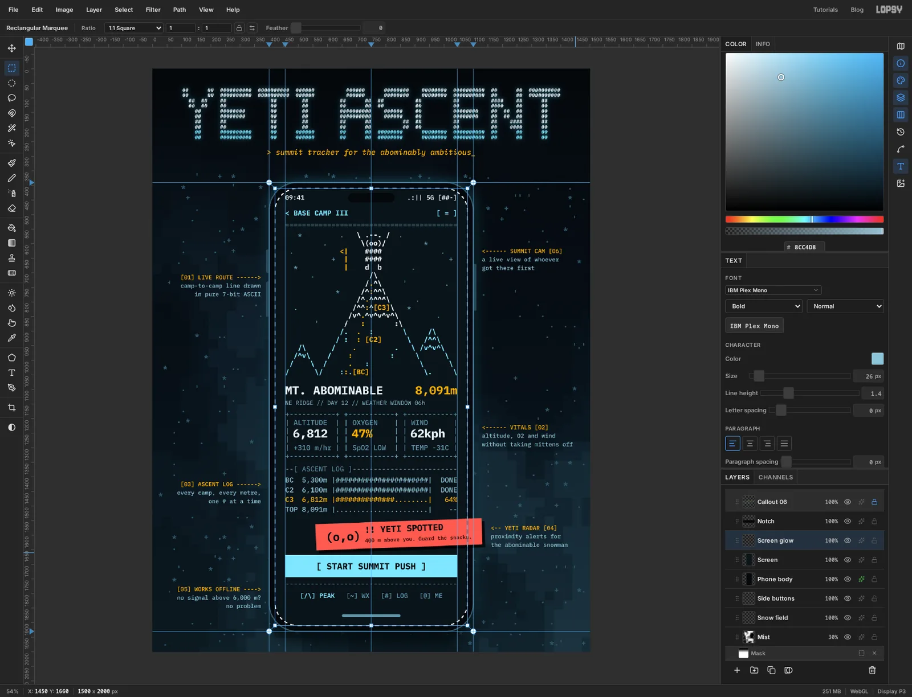

The last three layers are light and glass effects that must stay inside the screen. The *Screen* layer already has the right shape.

Click *Screen*, add a layer and name it *Screen glow*. Then hold [[Cmd]] and click the *Screen* layer's thumbnail. Its rounded shape loads as a selection, while *Screen glow* stays the selected layer.

## Pour in a glow

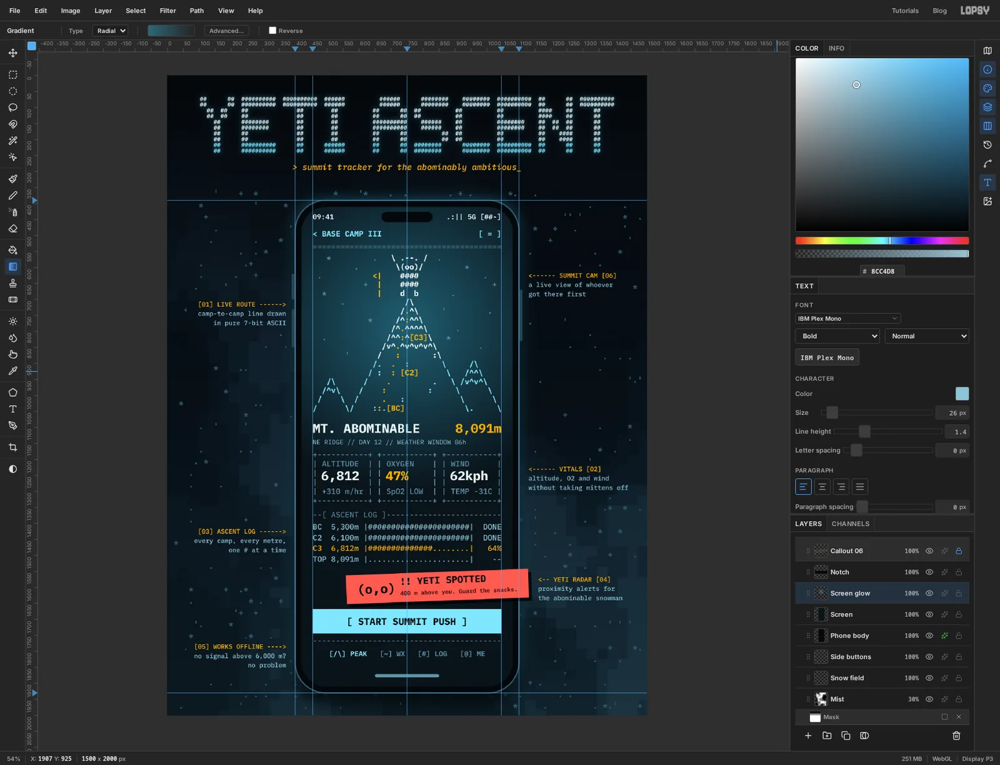

Pick the **Gradient** tool and set its type to **Radial**. Open the editor and make both stops `#38C8F0`. Drag the first stop's opacity to about **40%** and the second to **0%**.

Drag from the middle of the mountain straight down to about the stat boxes. Press [[Cmd+D]], then open the layer's effects and set its blend mode to **Screen**. The mountain now looks lit from behind, the way a CRT glows around bright text.

## Make a scanline tile

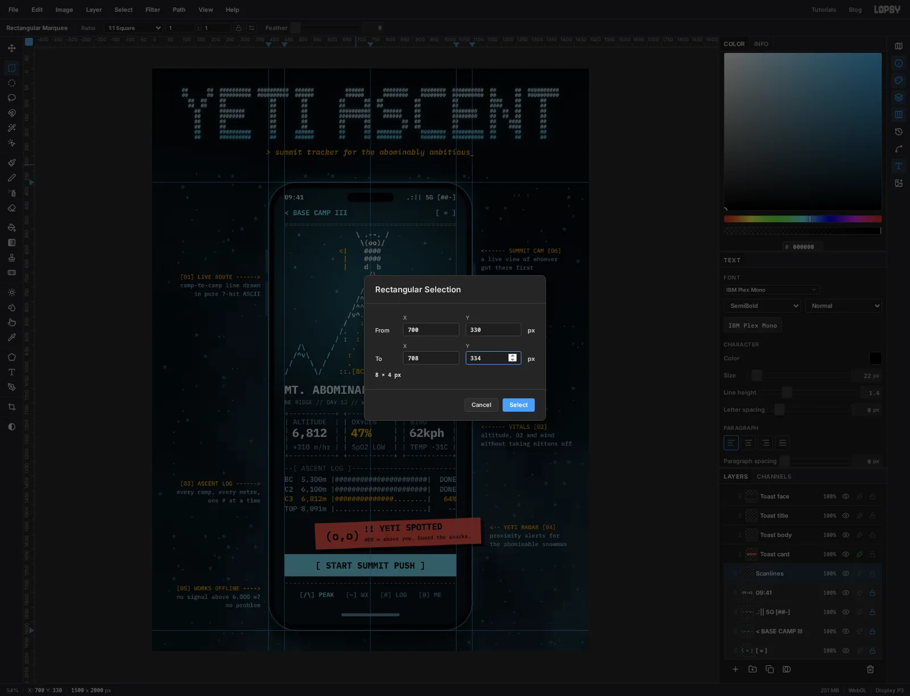

Scanlines are a tiny pattern repeated down the screen: two dark rows, two clear rows.

Click the layer just under the *Yeti alert* group, which is the top one of the phone's text layers. Add a layer and name it *Scanlines*. The tile is only a few pixels across, too small to drag by hand, so use the marquee's dialog.

Pick the **Rectangular Marquee** and click once on an empty bit of canvas without dragging. In the dialog, set **From** to X **700**, Y **330** and **To** to X **708**, Y **332**, then click **Select**. Set the foreground to black and choose **Edit → Fill**.

Press [[Cmd+D]] and click once again. The dialog starts fresh each time, so enter all four numbers: **From** X **700**, Y **330** and **To** X **708**, Y **334**. The selection now holds the black bar and the same height of empty space below it. Choose **Edit → Define Pattern**.

Clear up after yourself: press [[Cmd+A]], then [[Delete]], then [[Cmd+D]].

## Fill the screen with the pattern

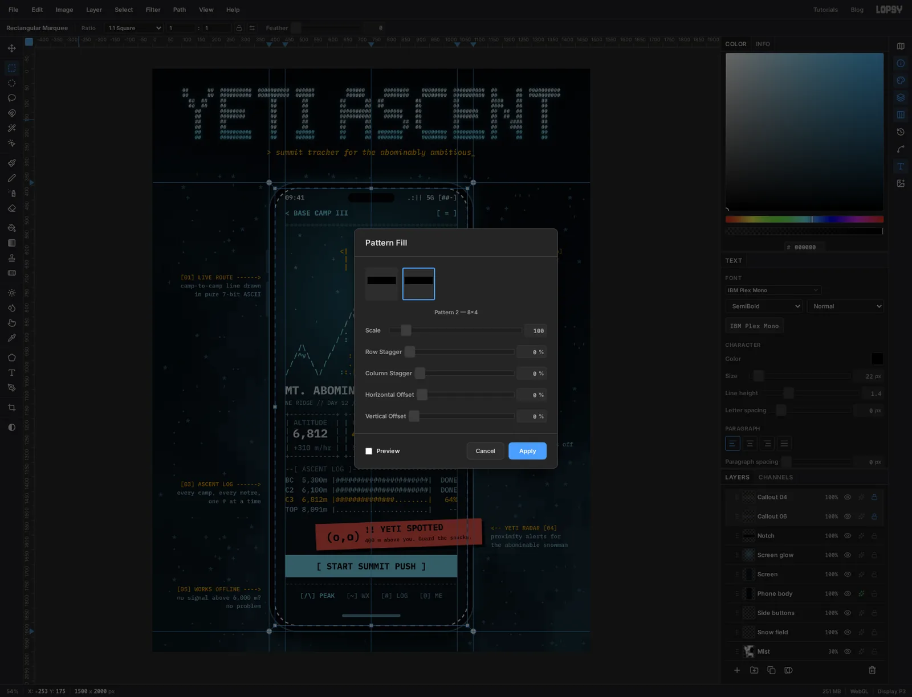

Hold [[Cmd]] and click the *Screen* thumbnail again to load its shape. With *Scanlines* still selected, choose **Edit → Fill with Pattern…**. Your tile is listed as an 8 × 4 pattern. Leave **Scale** at 100% and click **Apply**.

## Soften the scanlines

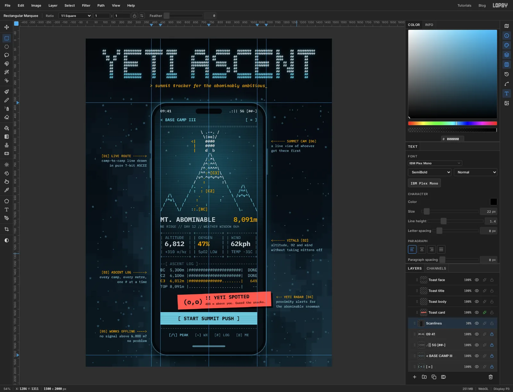

Deselect, then drop the *Scanlines* layer's opacity to **30%**. At full strength the lines eat the small text. At 30% you can still read every character, and the screen has a fine grain that shows best on the bright button.

## Add a glare to the glass

Add one more layer above *Scanlines* and call it *Glare*. Load the *Screen* selection once more.

With the **Gradient** tool set to **Linear**, edit the stops to white `#FFFFFF` at **16%** opacity, white at about **3%** in the middle, and white at **0%**. Drag from the screen's top-right corner down and to the left, to about the middle of the mountain. Deselect.

The sheen should be faint. Its only job is to make the screen look like glass.

## Hide the guides and export

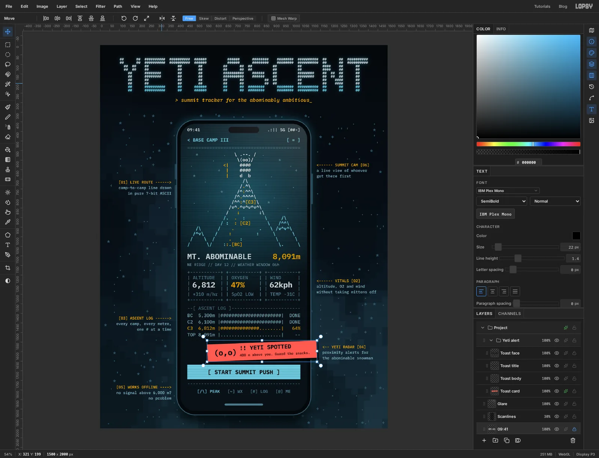

Choose **View → Show Guides** to hide the guides and look at the whole board. Check three things:

- Every line of screen text starts on the left margin, and the right-hand pieces all end on the right margin.
- The numbers sit inside their boxes without touching the borders.
- The alert card doesn't cover the chart or the button label.

Save with **File → Save Project**, then **File → Quick Export PNG**.

> **Tip:** Check the phone text at 100% zoom before you export. ASCII art only works if the characters stay sharp, so don't scale the board down afterward by more than half.
