Berlin Dada artists like Hannah Höch and Raoul Hausmann built pictures with scissors and paste. They cut photographs out of newspapers, stuck heads onto machines, and set type from whatever was lying around the print shop. In this tutorial you'll make a record sleeve the same way: a cat's head becomes a newsprint cut-out, its body is a boiler with a valve wheel, and a gramophone horn does the yowling.

The cover is 1800 × 1800 px. Everything on it is a flat piece of "paper" on its own layer, so the work is mostly cutting shapes with selections and deciding what overlaps what.

Along the way you'll use:

- the **Lasso** for scissor cuts, with **Select → Inverse** and [[Delete]] to throw away the rest of a photo
- **Filter → Halftone** to turn photographs and a gradient into newsprint dots
- the **Move** tool's handles to scale, squash and rotate pieces, on one layer and on several at once
- the **Brush** with **Radial Symmetry** for a valve wheel, and [[Shift]]-click for straight lines
- the **Pen** tool for pipes and for a curved path that text follows
- **groups**, so a whole figure can be rotated or moved as one piece
- seven typefaces from the font browser, **Letter spacing**, and a single letter in a second colour
- **Texture**, **Fibers**, **Add Noise** and a **Photo Filter** adjustment for the paper

The palette:

- Paper `#E7DCC2`, cream `#F4ECD8`
- Ink `#17130F`
- Red `#D4281C`
- Mustard `#DDA41E`
- Teal `#2C5F6E`

You'll also need a photo of a cat looking straight at the camera. Any sharp, front-facing photo works. The one used here is 1100 × 1300 px. If you open the project file, the photo is already in it.

> **Tip:** Positions are written as `x, y` in document pixels. The status bar at the bottom of the window shows where the cursor is, so you can hover to find a spot. None of the positions need to be exact. This is cut paper, and a few pixels either way only make it look more handmade. Key names are Mac keys. On Windows and Linux, use Ctrl for Cmd.

## Make the paper

Choose **File → New**, set the size to **1800 × 1800** px and click **Create**. Double-click `Layer 1` in the Layers panel and rename it `Paper`. Type `E7DCC2` into the Color panel's hex field, press [[Cmd+A]], choose **Edit → Fill**, then press [[Cmd+D]].

Flat colour looks like a screen, so rough it up. Choose **Filter → Texture**, pick **Rough**, set **Amount** to 14, **Size** to 4 and **Detail** to 70, and click **Apply**.

Click **Add Layer** at the bottom of the Layers panel and name the new layer `Fibres`. Choose **Filter → Fibers**, set **Variance** to 20 and **Strength** to 6, and apply. It fills the layer with grey streaks. Click the layer's effects button (the sparkle icon on its row), set the blend mode to **Multiply** and close the drawer. Then click the `100%` on the row and drag the slider down to about 14%. The streaks become the grain of the paper.

## Fold it in four

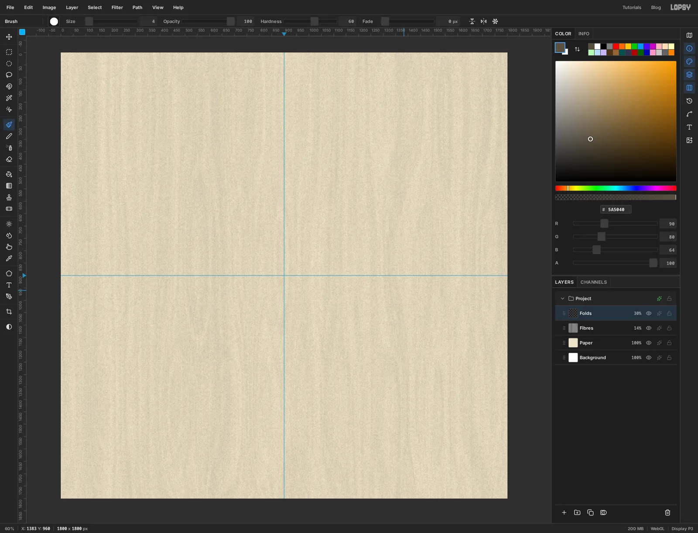

A record sleeve that has been in a drawer since 1920 has been folded. Hold [[Cmd]] and click the ruler along the top of the canvas near the middle. With Cmd held, the guide jumps to the nearest simple fraction, so it lands exactly on the half-way line. Do the same on the left ruler.

Add a layer called `Folds`. Pick the **Brush**, set **Size** to 4 and **Hardness** to 60, and set the colour to a grey-brown, `#5A5040`. Click once where the vertical guide meets the top edge, then hold [[Shift]] and click where it meets the bottom edge. Shift-click draws a straight line from the last click. Draw the horizontal crease the same way.

Choose **Filter → Gaussian Blur** with a **Radius** of 2, then lower the layer's opacity to about 30%. Choose **Edit → Clear Guides** when you're done.

## Drag a record

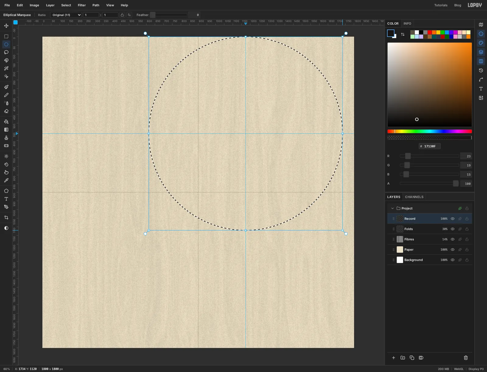

The record is the biggest shape on the cover, so it goes in first. Click the top ruler at about **1174** and the left ruler at about **560** to drop two guides. Where they cross is the centre of the record.

Add a layer called `Record`. Pick the **Elliptical Marquee**. Start dragging from the top edge of the canvas at about **614, 0**, then hold [[Cmd]] as you drag down and to the right to about **1734, 1120**. Cmd forces a perfect circle, and you'll want it for every circle on this cover. The circle should touch the top of the page and sit centred on the guides. If it's off, press [[Cmd+D]] and drag again.

Set the colour to ink `#17130F` and choose **Edit → Fill**, then press [[Cmd+D]].

## Add the label and the grooves

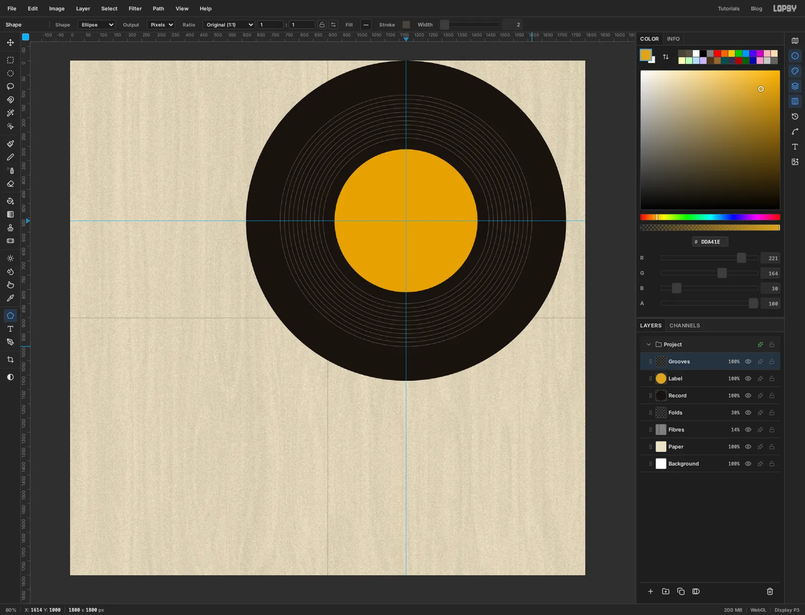

Add a layer called `Label`. With the Elliptical Marquee and [[Cmd]] held, drag a circle of about 500 px across, centred on the guides: from **924, 310** to **1424, 810**. Fill it with mustard `#DDA41E` and deselect.

Add a layer called `Grooves` and pick the **Shape** tool. Set **Shape** to **Ellipse**. Click the **Fill** swatch and choose **Remove fill**. Click the **Stroke** button, type `4A443B` for a dark grey, and set **Width** to 2.

A shape grows outward from the point where you press, and that point snaps to guides. So press exactly where the guides cross and drag outward, holding [[Cmd]] again to keep the ring round. Draw the first one just outside the label, about 290 px from the centre, then keep going outward in steps of about 15 px until you have eleven rings. The last one should stop about 120 px short of the record's edge. That empty band is where the text will go later.

Choose **View → Show Guides** to hide the guides for now.

## Cut a sheet of red paper

Add a layer called `Red paper`. Pick the **Lasso** and draw a big, slightly crooked rectangle by hand. Start just inside the top-left corner of the page, wobble along the top to a little left of centre (x about **780**), come down the right side to just past the horizontal fold, go straight back along the bottom, and return up the left side. Let the top and right edges shake a little as you go. The sheet should cover the left edge of the record.

Set the colour to red `#D4281C`, choose **Edit → Fill** and press [[Cmd+D]].

## Tear the bottom edge

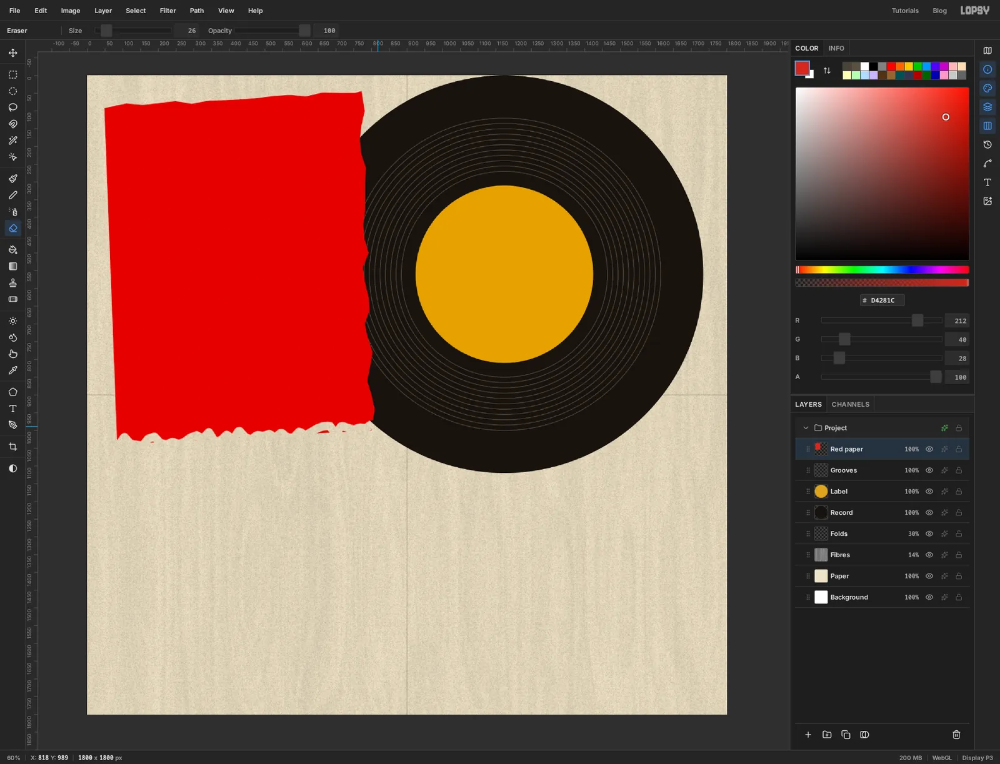

Three sides are scissor cuts. Make the fourth a tear. Pick the **Eraser** and set **Size** to about 26. Starting just left of the sheet's bottom corner, drag along the bottom edge in one go, jiggling the cursor up and down by 10 or 15 px as you travel. The eraser bites an uneven line out of the paper and leaves a few scraps hanging. If it looks too regular, press [[Cmd+Z]] and try again with a shakier hand.

Give the sheet some tooth with **Filter → Texture**: pick **Grain**, **Amount** 16, **Size** 3, **Detail** 60.

Now lift it off the page. Click the layer's effects button and tick **Drop Shadow**. Set **Offset X** to 9, **Offset Y** to 11, **Blur** to 4 and **Opacity** to 38, and set the **Shadow color** to the ink colour. Paper shadows are short and hard. A big soft shadow would make the sheet look like it's floating.

## Draw a pipe with the Pen

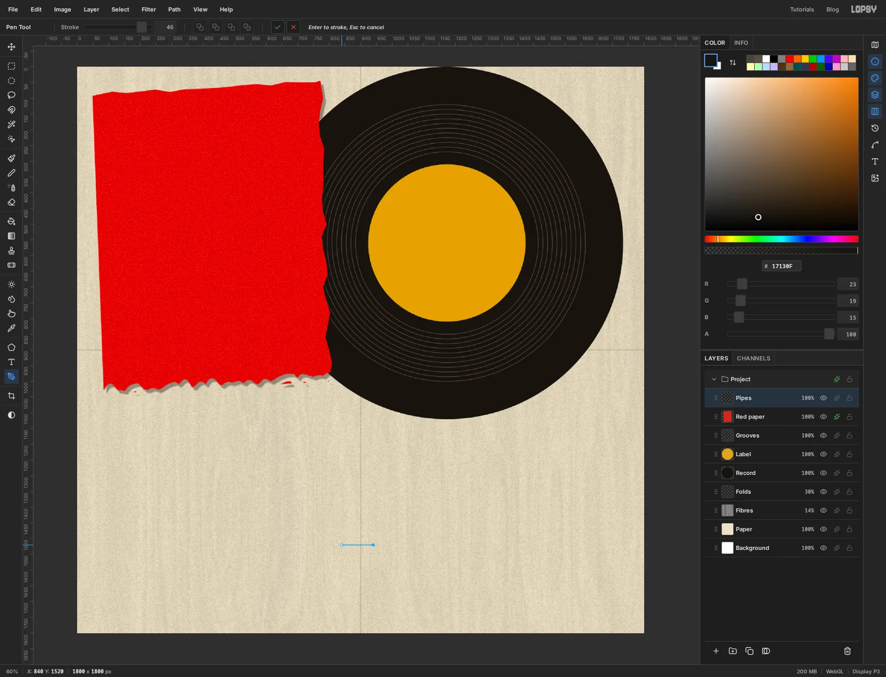

The machine starts with a stub of pipe. Add a layer called `Pipes`, set the colour to ink, and pick the **Pen** tool. Set **Stroke** to 46 in the options bar.

Click once at about **940, 1520** and once at **840, 1520**, then press [[Enter]]. Enter strokes the path with the current colour at the Stroke width, with rounded ends. The path's outline stays on screen afterwards. To clear it, click an empty part of the canvas with the Pen and then click the **Cancel path** ✗ in the options bar.

Add a collar where the pipe will meet the boiler: with the **Rectangular Marquee**, drag a small upright box across the pipe a little in from its right end, at about x **884** to **910**, and 76 px tall. Fill it with mustard. The boiler will cover the pipe to the right of it.

## Build the boiler

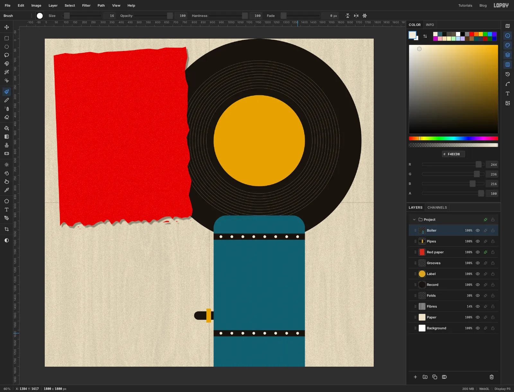

Add a layer called `Boiler`. Pick the **Shape** tool and set **Shape** to **Rectangle**. Click the **Fill** button and type `2C5F6E` for teal, click the **Stroke** swatch and choose **Remove stroke**, and set **Corner Radius** to 70.

Press at about **1174, 1420** and drag down and to the right until the cursor is well below the canvas, around **1424, 1870**. The body comes out 500 px wide with its top at about 970, and it runs off the bottom of the page.

Add the two bands with the Rectangular Marquee. Drag a strip 34 px tall right across the boiler at about y **1070** and fill it with ink. Do the same at about y **1600**.

For the rivets, pick the **Brush**, set **Size** to 16 and **Hardness** to 100, choose cream `#F4ECD8`, and click eight times along each band, about 60 px apart.

## Paint one spoke, get eight

Add a layer called `Valve wheel`. With the Brush still selected, set **Size** to 30 and click **Radial Symmetry** in the options bar. It starts at 8 segments, which is what you want.

Symmetry turns around a centre point that starts in the middle of the canvas. Move it by holding [[Cmd]] and clicking in the middle of the boiler, at about **1174, 1340**. A small crosshair marks the spot.

Now click about 30 px above the crosshair, hold [[Shift]] and click about 185 px above it. One straight spoke appears, and seven copies appear with it.

## Close the rim

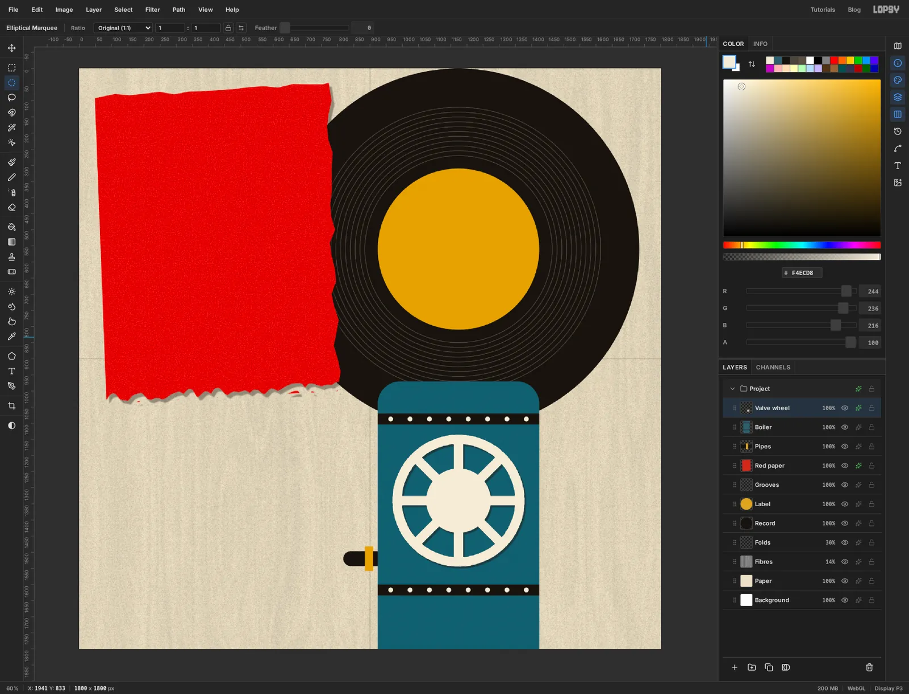

Starting at the top of the vertical spoke, drag a short arc to the right along the rim, as far as the next spoke. Each of the eight copies draws its own eighth of the circle, and together they close the rim. It doesn't have to be a perfect arc.

Click **Radial Symmetry** again to switch it off. This matters: while symmetry is on, a Cmd-click anywhere moves the centre point, whatever tool you're holding.

Give the wheel a hub. With the Elliptical Marquee and [[Cmd]] held, drag a circle about 200 px across over the middle of the wheel and fill it with cream.

Add a **Drop Shadow** to this layer too, but a tighter one: **Offset X** 5, **Offset Y** 6, **Blur** 2, **Opacity** 45. You'll use these same four numbers for every small piece from here on.

## Paste the photo

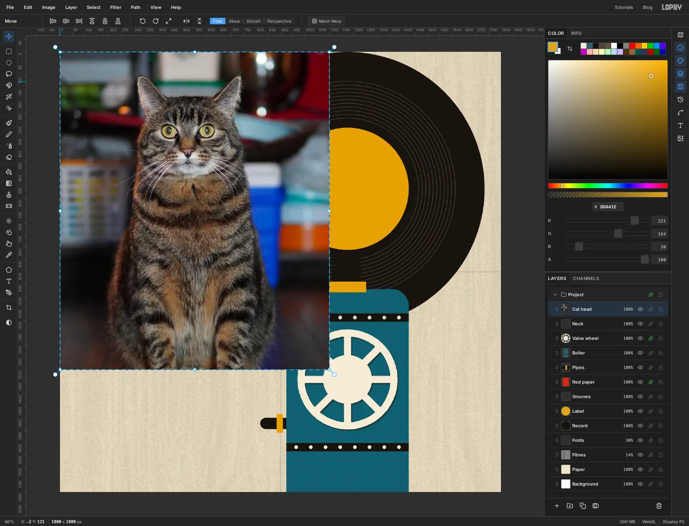

The head needs something to stand on first. Add a layer called `Neck`. With the Rectangular Marquee, drag an upright box about 116 px wide above the middle of the boiler, from **1112, 830** down to **1228, 980**, and fill it with ink. Then drag a wider, shorter collar across its base, from **1090, 940** to **1250, 984**, and fill it with mustard.

Now copy your cat photo to the clipboard. Opening it in a browser tab, right-clicking and choosing Copy Image is the quickest way. Back in Lopsy, press [[Cmd+V]].

The photo arrives as a new layer in the top left corner, already selected, and Lopsy switches to the Move tool. Rename the layer `Cat head`.

## Cut out the head

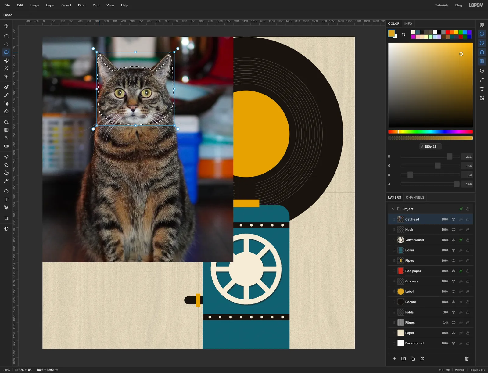

Pick the **Lasso** and draw around the head. Go up the outside of one ear, down into the dip between the ears, up and over the other ear, down the cheek, straight across under the chin, and back up the other cheek. Don't try to follow the fur. Cut it in straight snips the way you would with scissors, and cut the whiskers off.

## Throw away the rest and scale it up

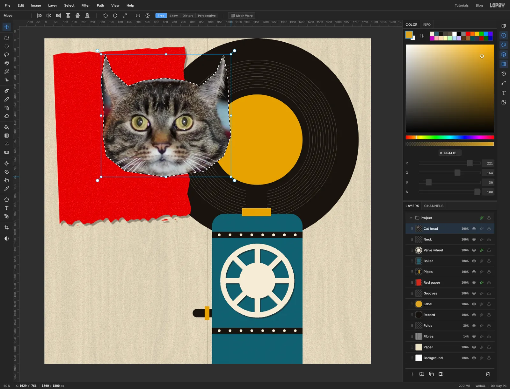

Press [[Cmd+Shift+I]] to invert the selection, press [[Delete]], then press [[Cmd+Shift+I]] again. The head is all that's left of the photo, and it's selected again.

Pick the **Move** tool. Hold [[Cmd]] and drag the bottom-right handle outward until the head is about 720 px wide. Cmd keeps the proportions. A cat's head that's far too big for its body is the look you want.

Press [[Cmd+D]] to finish.

## Move it into place and take the colour out

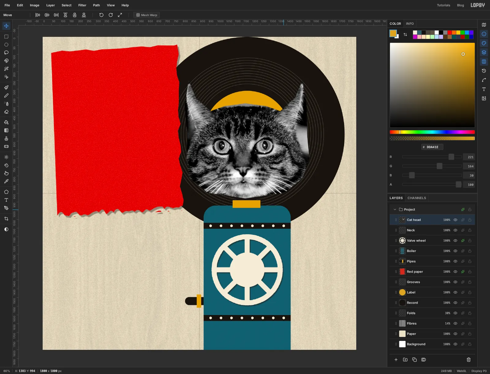

Still with the Move tool, drag the head over the record so that its chin overlaps the top of the black neck. Its top-left corner ends up near **816, 250**. The mustard label should show as an arch between the ears.

Choose **Filter → Desaturate**, then **Filter → Brightness/Contrast** with **Contrast** at 45. The harder the contrast, the better the next steps work.

## Put paper behind the head

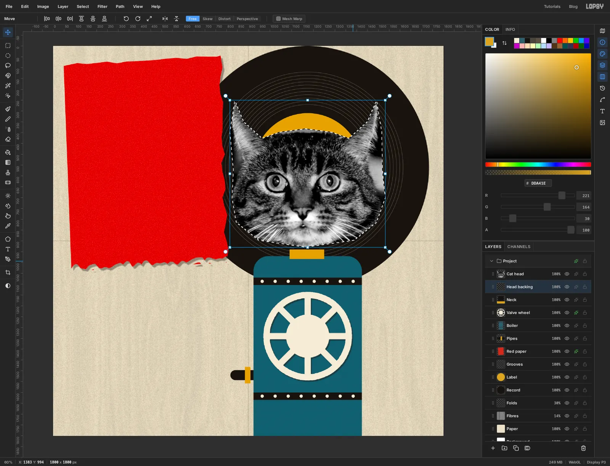

In a moment the photo becomes black dots with nothing between them. It needs paper to be printed on. Click the `Neck` layer and add a layer called `Head backing`, which lands just under the head.

Hold [[Cmd]] and click the `Cat head` layer's thumbnail. That loads the head's outline as a selection without changing which layer you're on. Fill it with cream and deselect.

Add a **Drop Shadow** to `Head backing` with the larger settings from the red paper: 9, 11, 4 and 38. The shadow goes on the backing because a shadow on the dots would put one under every dot.

## Cut a horn

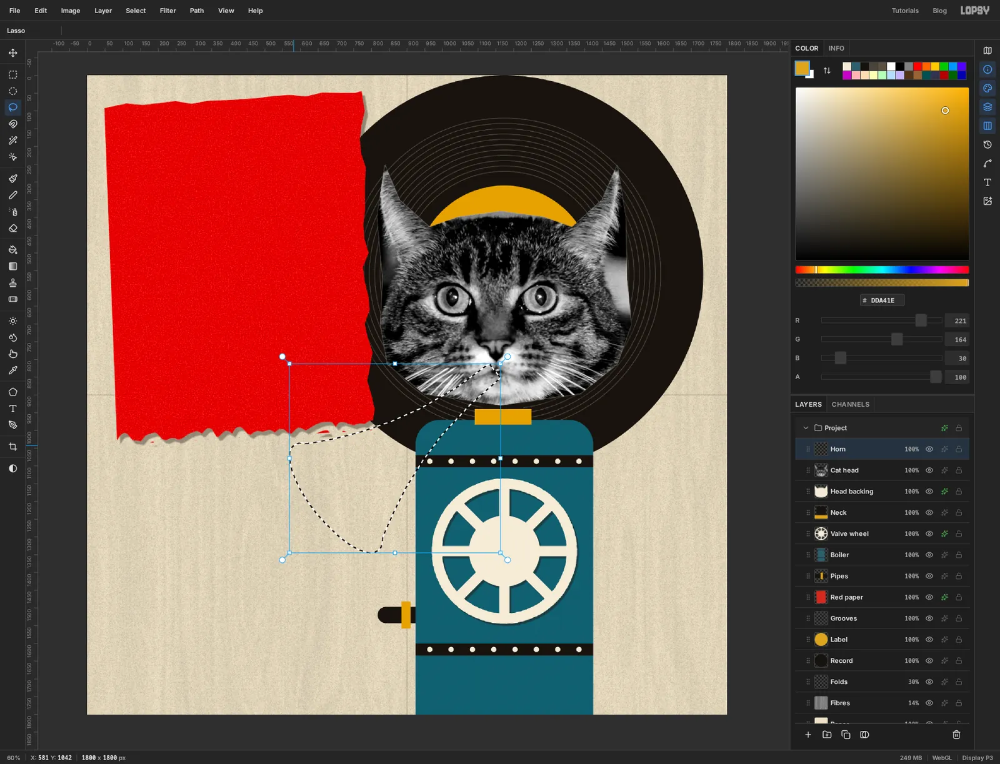

Click the `Cat head` layer and add a layer called `Horn` above it.

With the **Lasso**, draw a long cone. Start at the cat's mouth, about **1147, 832**, where it should be only 50 px wide. Run it down and to the left, flaring as it goes, until it's about 380 px wide where it ends near **700, 1190**.

Now hold [[Shift]] and lasso an oval over the wide end, about 380 px long and 140 px across, tilted to sit square on the end of the cone. Shift adds to the selection, so the cone gets a rounded mouth.

## Fill the horn and its bell

Fill the selection with mustard and deselect.

Lasso a slightly smaller oval inside the wide end and fill it with ink. That's the inside of the bell. Lasso a smaller oval again inside that one and fill it with cream. Something is going to look out of it.

Add the small **Drop Shadow** (5, 6, 2, 45) to the `Horn` layer.

## Borrow an eye

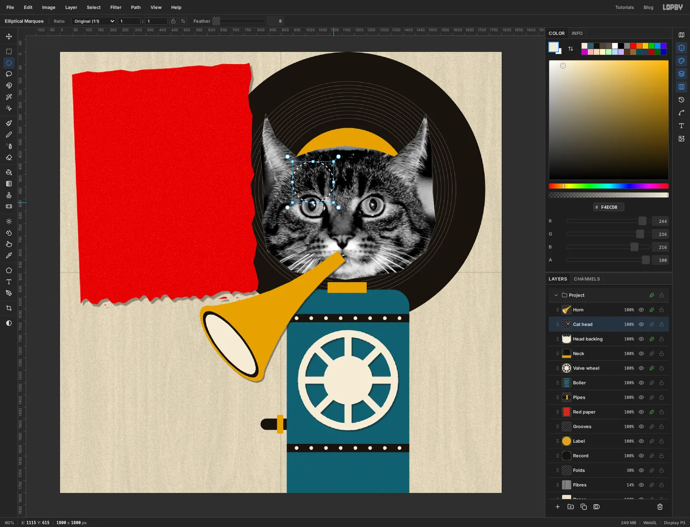

Dada montage repeats body parts at the wrong size in the wrong place. Click the `Cat head` layer, pick the **Elliptical Marquee**, and with [[Cmd]] held drag a circle about 170 px across around one of the cat's eyes. Press [[Cmd+C]].

Click the `Horn` layer, then press [[Cmd+V]]. The copy lands exactly where it came from, as a new layer above the horn. Rename it `Bell eye`.

## Squash it

The paste left you on the Move tool with handles around the eye. This time don't hold Cmd. Drag the bottom-right handle to the right and upward at the same time, until the circle is a flat oval about 290 px wide and 95 px tall. That's the eye seen at a steep angle, the way the horn's bell is.

Press [[Cmd+D]].

## Turn it to fit the bell

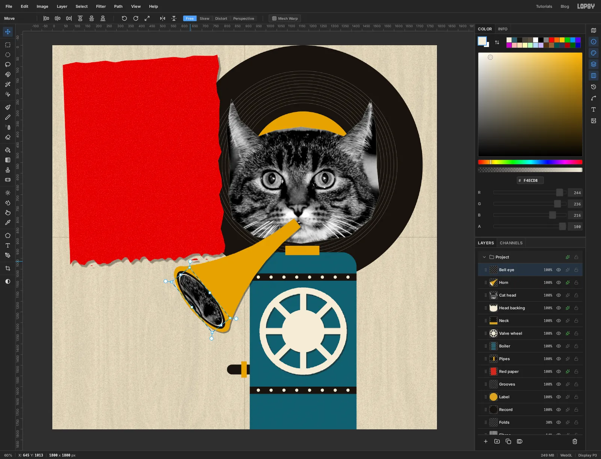

Drag the oval down onto the horn's bell. A plain pixel layer only shows handles around a selection, so drag a **Rectangular Marquee** loosely around the oval and switch back to the **Move** tool. Rotation handles are the round ones just outside each corner. Drag one clockwise by about 50° until the oval lines up with the cream oval in the bell.

Press [[Cmd+D]], then brighten it so it will print clearly: **Filter → Brightness/Contrast**, **Brightness** 30, **Contrast** 30.

## Put the other eye in the wheel

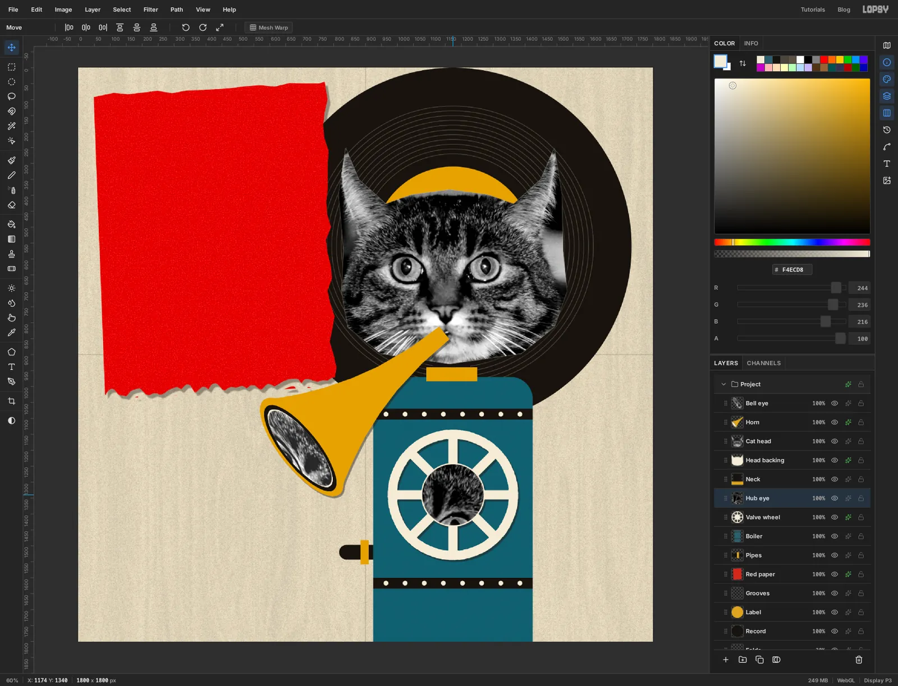

Do it again with the other eye. Click `Cat head`, marquee the second eye, press [[Cmd+C]], click the `Valve wheel` layer and press [[Cmd+V]]. Rename the new layer `Hub eye`.

Hold [[Cmd]] and drag a corner handle outward a little, until the circle is about 190 px across. Press [[Cmd+D]], then drag it onto the hub of the wheel.

## Print everything as newsprint

Now for the step that makes the photographs belong to 1920. Click the `Hub eye` layer and choose **Filter → Halftone**. Set **Dot Size** to 5, **Angle** to 30 and **Softness** to 0.6, and apply. Do the same on `Bell eye`. Then click `Cat head` and run it once more with **Dot Size** at 6.

Halftone turns each tone into a black dot of a matching size and leaves white empty. That's why the head needed a cream backing, and why the two eyes sit on cream shapes.

## Group the figure

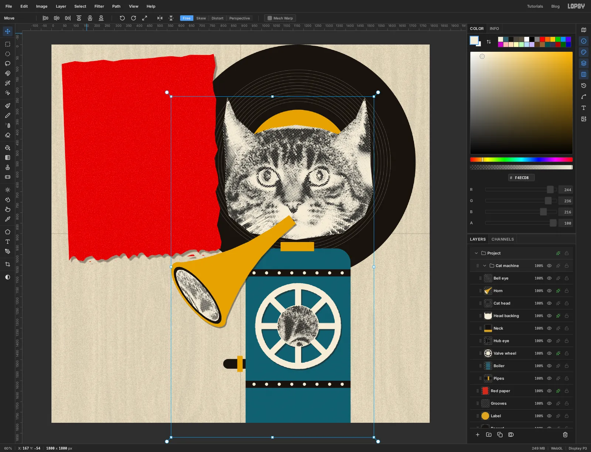

Click the `Bell eye` layer at the top, scroll down, hold [[Shift]] and click `Pipes`. Everything from the horn down to the pipe is selected. Choose **Layer → Group Layers**, then double-click the new group's name and call it `Cat machine`.

Click the group's row and pick the **Move** tool. The handles now frame the whole figure.

## Tip the whole thing over

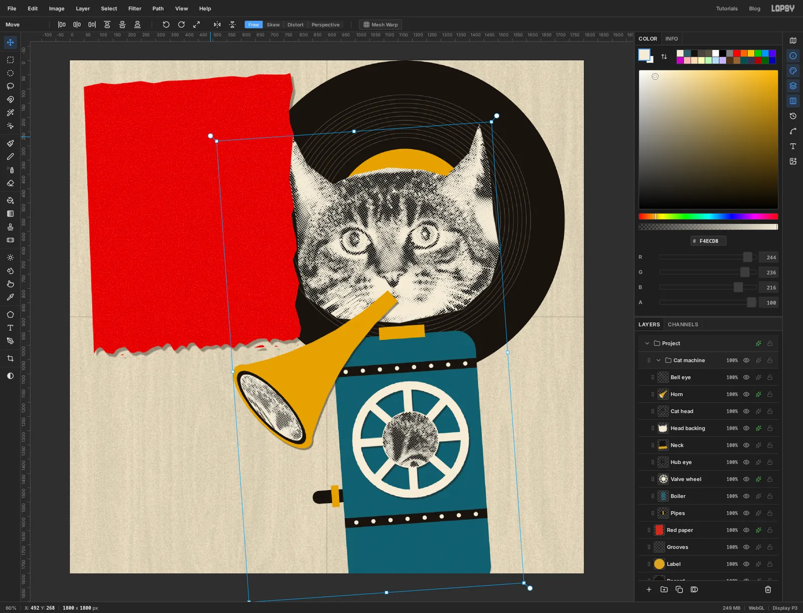

Drag a rotation handle to turn the figure about 4° anticlockwise. Every layer in the group turns together, shadows included. Press [[Cmd+D]].

A figure that stands straight looks like an illustration. One that leans looks like it was pasted down in a hurry.

## Add a pressure gauge

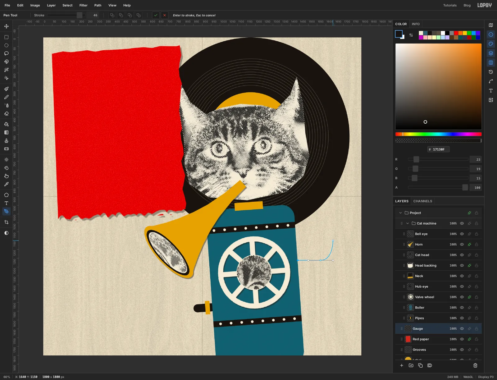

Click the `Red paper` layer, which sits just under the group, and add a layer called `Gauge`.

Pick the **Pen**, with ink as the colour and **Stroke** still at 46. Click on the boiler's right edge at about **1440, 1262**. For the second anchor, press at **1570, 1262** and drag about 70 px to the right before letting go. Dragging pulls out curve handles. Click a third time above and to the right, at **1640, 1150**. The path runs straight out of the boiler and bends upward. Press [[Enter]] to stroke it, then clear the outline with a click on empty canvas and **Cancel path**.

With the Elliptical Marquee and [[Cmd]] held, drag a circle about 250 px across at the top of the pipe, centred near **1640, 1062**, and fill it with ink. Drag a second circle about 220 px across inside it and fill that with cream. Add the small **Drop Shadow**.

## Cut a second, smaller cat

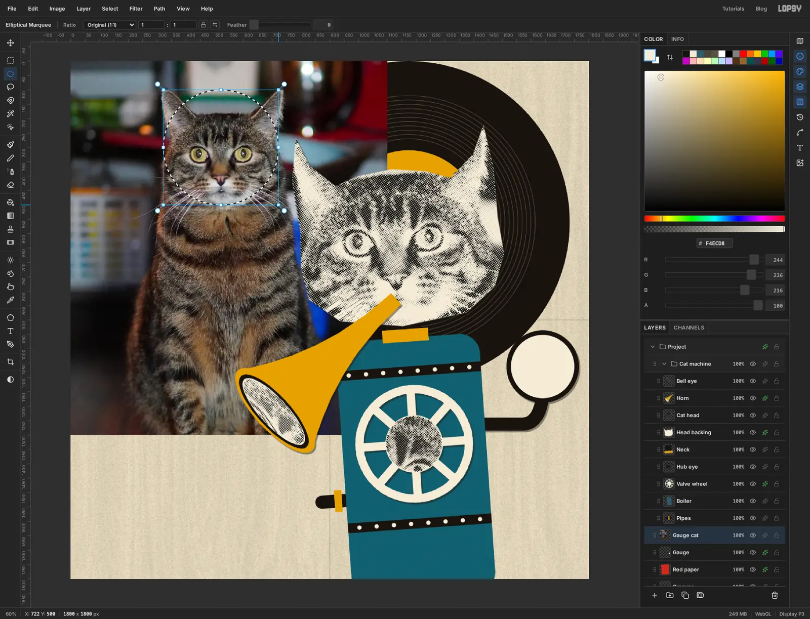

You've copied two eyes since the photo, so copy the cat photo to the clipboard again, then press [[Cmd+V]]. Rename the layer `Gauge cat`.

This time cut a circle. With the Elliptical Marquee and [[Cmd]] held, drag a circle about 400 px across around the face, taking in the eyes, nose and forehead. Press [[Cmd+Shift+I]], [[Delete]], [[Cmd+Shift+I]].

## Shrink it into the gauge

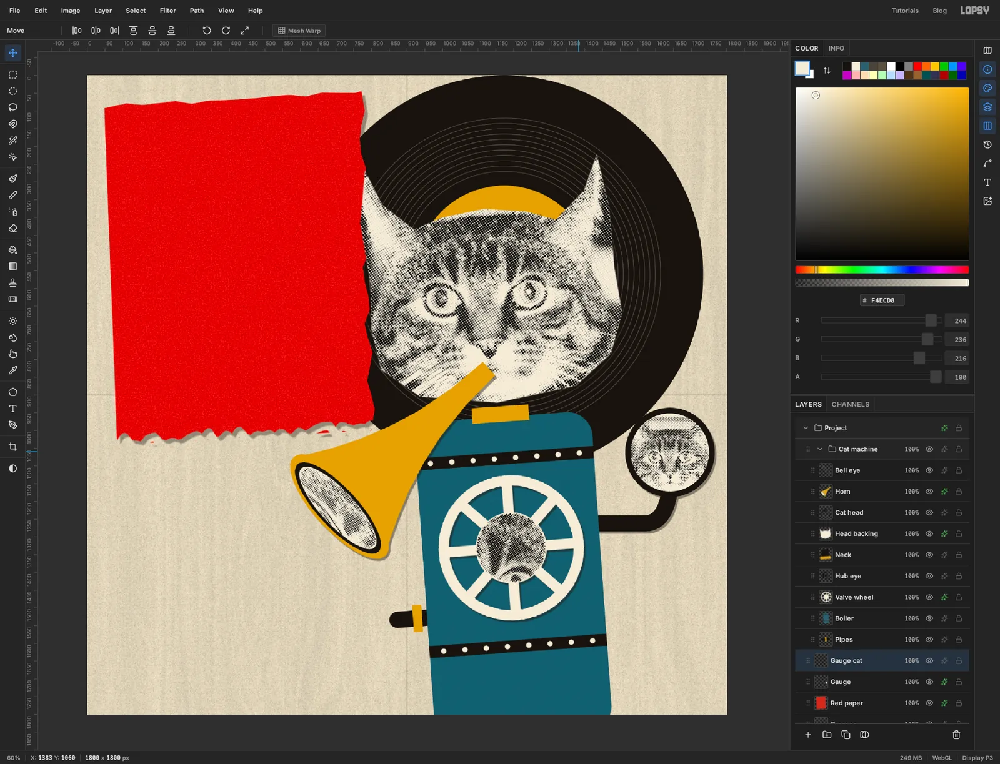

With the **Move** tool, hold [[Cmd]] and drag a corner handle inward until the disc is about 220 px across. Press [[Cmd+D]] and drag it onto the cream circle of the gauge.

Give it the same treatment as the big head: **Filter → Desaturate**, **Brightness/Contrast** with **Brightness** 5 and **Contrast** 50, then **Halftone** with **Dot Size** 4. The smaller dot keeps a small face readable.

The same cat now appears twice at very different sizes, which is exactly the kind of thing Höch did.

## Make a swatch of printer's dots

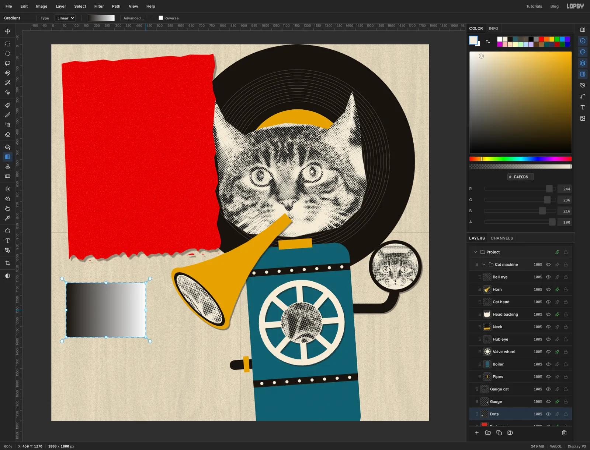

Click the `Red paper` layer again and add a layer called `Dots`. With the **Rectangular Marquee**, drag a box in the empty space under the red paper, from about **70, 1140** to **450, 1400**.

Pick the **Gradient** tool and click **Advanced…**. Set the left stop to ink `#17130F` and the right stop to white, and click **Done**. Drag from the left edge of the box to its right edge.

## Halftone it and cut it crooked

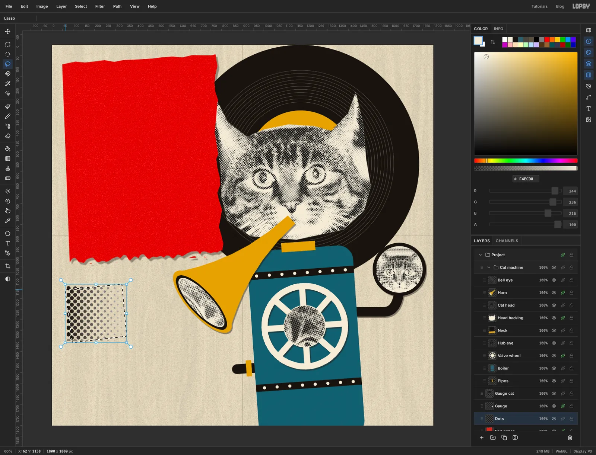

With the box still selected, choose **Filter → Halftone** and set **Dot Size** to 22, **Angle** to 45 and **Softness** to 0.5. The gradient becomes dots that shrink away to nothing. Press [[Cmd+D]].

A neat rectangle of dots looks computer-made. With the **Lasso**, draw a crooked four-sided shape over the left two-thirds of the dots. Press [[Cmd+Shift+I]], [[Delete]] and [[Cmd+D]]. Now it's a scrap someone cut from a printer's proof.

## Draw the yowl

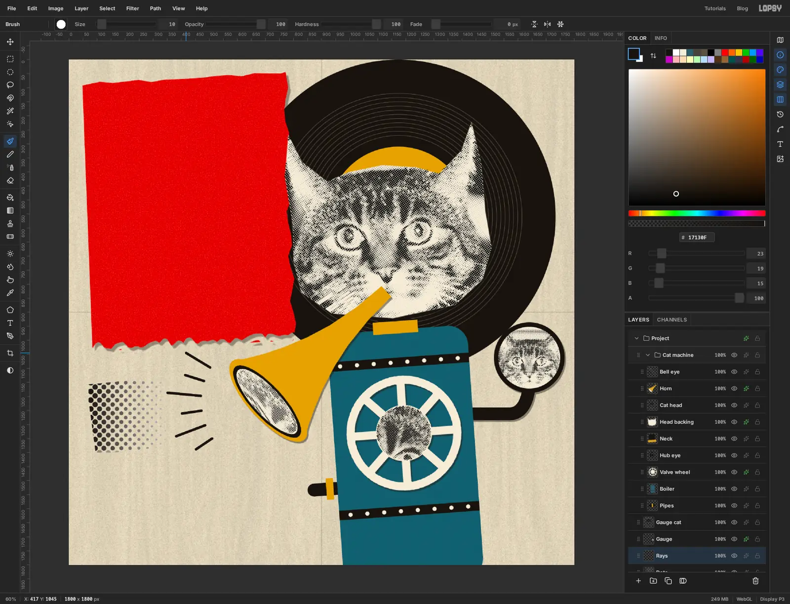

Add a layer called `Rays`. Pick the **Brush**, set **Size** to 10 with full hardness, and choose ink.

Draw six short lines fanning out to the left of the horn's bell. For each one, click a little way out from the bell, hold [[Shift]] and click 70 to 120 px further out. Alternate long and short. Keep them clear of the red paper above and of the space at the bottom, where the title goes.

## Set the first letter

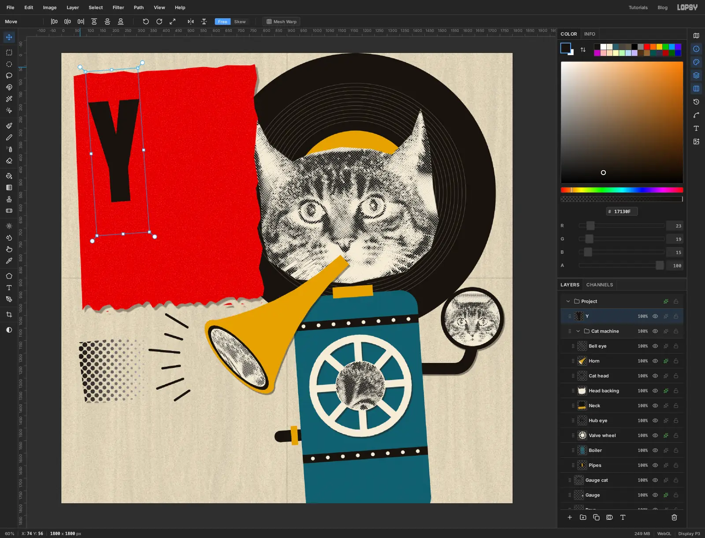

The title is four letters from four different type cases. Each one is its own layer.

Click the `Cat machine` group. Set the colour to ink, pick the **Text** tool and click in an empty area of paper. In the options bar set **Size** to 470 and open the font menu, search for **Anton** and pick it. Type `Y` and press [[Tab]] to commit.

The new layer lands inside the group, because the group was active. Drag its row by the grip on the left, up above `Cat machine` and a little to the left, and let go when the line appears above the group. It's now on top of the stack and out of the group.

With the **Move** tool, drag the Y onto the red paper near the top left, with its top at about y **190**. Then drag a rotation handle to tip it about 4° anticlockwise. A text layer keeps its handles without a selection, and stays editable after it's been turned.

> **Tip:** Always click in empty canvas to start new text. A click on an existing text layer edits that layer instead. Its box is taller than the letters, so "empty" means well clear of them.

## Finish the word

Make the other three letters the same way. Each time: set the colour, click in empty paper, set the size and font, type the letter, press [[Tab]], drag it into place and tilt it.

1. `O` in **Abril Fatface**, 470, cream, to the right of the Y and a little lower, tipped 5° clockwise
2. `W` in **Alfa Slab One**, 320, cream, under the Y with about 40 px of red to its left, tipped 3° anticlockwise
3. `L` in **Playfair Display**, weight **Black**, 400, ink, to the right of the W, tipped 6° clockwise

Leave about the same amount of red above the Y as below the W, and keep the L's foot clear of the W's serif.

Then add one more piece of type the same way: `No. 391` in **Anton** at 76, in ink, on the paper just under the red sheet, above the dots. 391 was the name of Francis Picabia's Dada magazine.

## Cut a bar for the second word

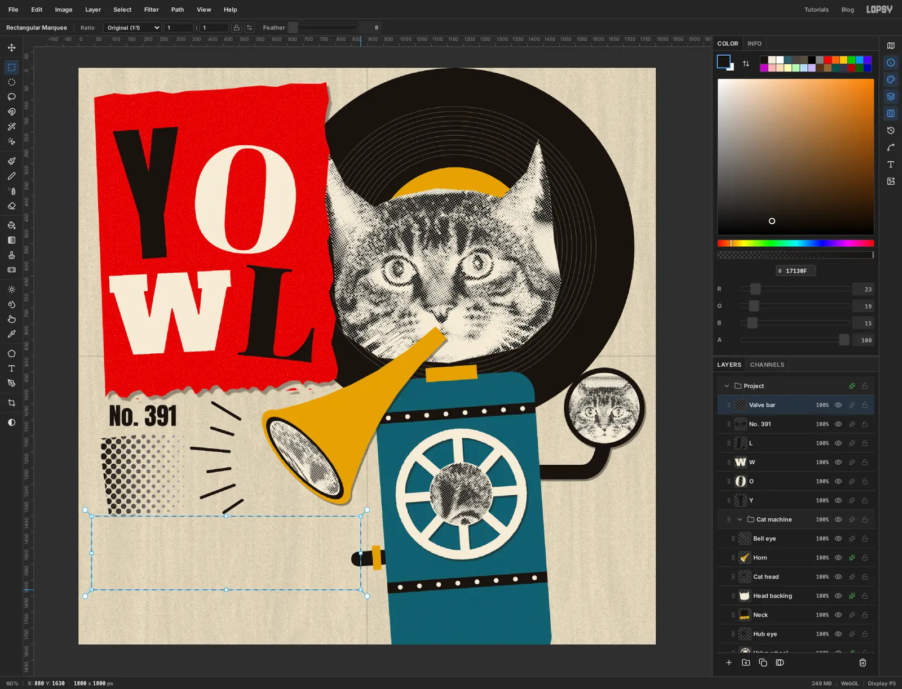

Add a layer called `Valve bar`. With the Rectangular Marquee, drag a bar from **40, 1400** to **880, 1630**. Fill it with ink, deselect, and add the small **Drop Shadow**.

Set the colour to cream. With the Text tool, click in empty paper, choose **Abril Fatface** at 215 and type `VALVE`. Press [[Tab]].

The word is narrower than the bar. Open the **Text** panel from the strip of panel buttons on the right edge of the window and set **Letter spacing** to 26. Then drag the word into the bar with the Move tool. Seat it carefully: the same gap above the capitals as below them, and the same gap at both ends.

## Make the V red

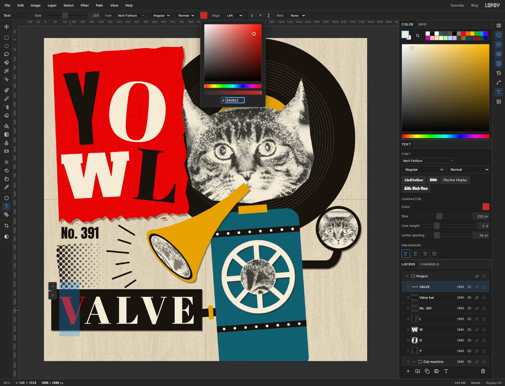

Pick the **Text** tool and click on the word to edit it. Press [[Home]] to jump to the start, then hold [[Shift]] and press the right arrow once to select the V.

Click the **Text color** swatch in the options bar, type `D4281C` and press [[Enter]]. Only the selected letter changes. Press [[Esc]] to close the picker and [[Tab]] to commit.

## Tilt the bar and the word together

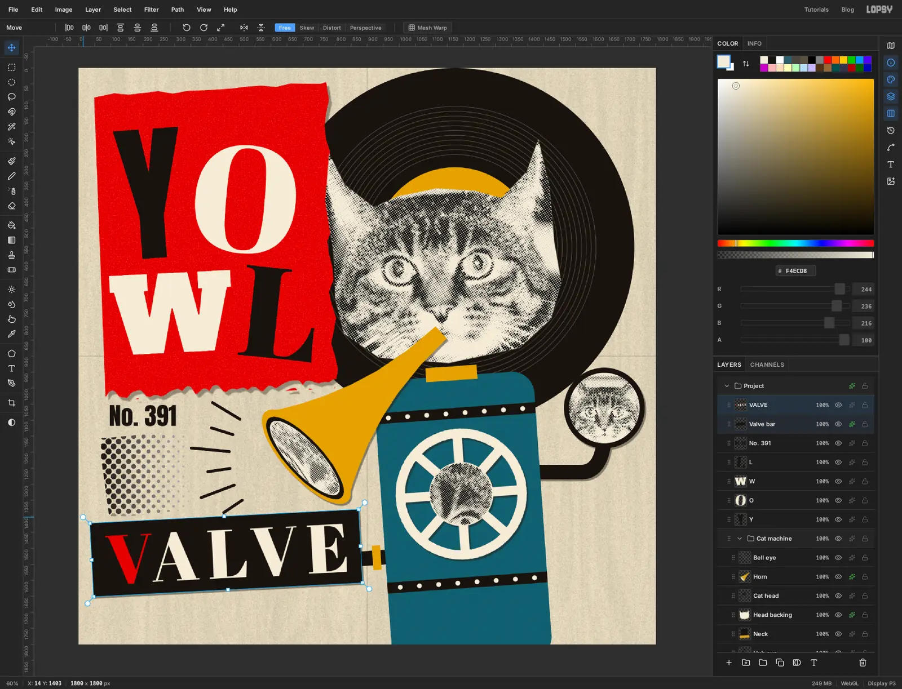

Click the `VALVE` layer, hold [[Shift]] and click `Valve bar`. With both selected and the **Move** tool active, one set of handles frames the pair. Drag a rotation handle about 3° anticlockwise, and press [[Cmd+D]].

Rotating them together is what keeps the word seated in the bar. If you turn them one at a time, you'll be nudging letters for ten minutes.

## Credit the band

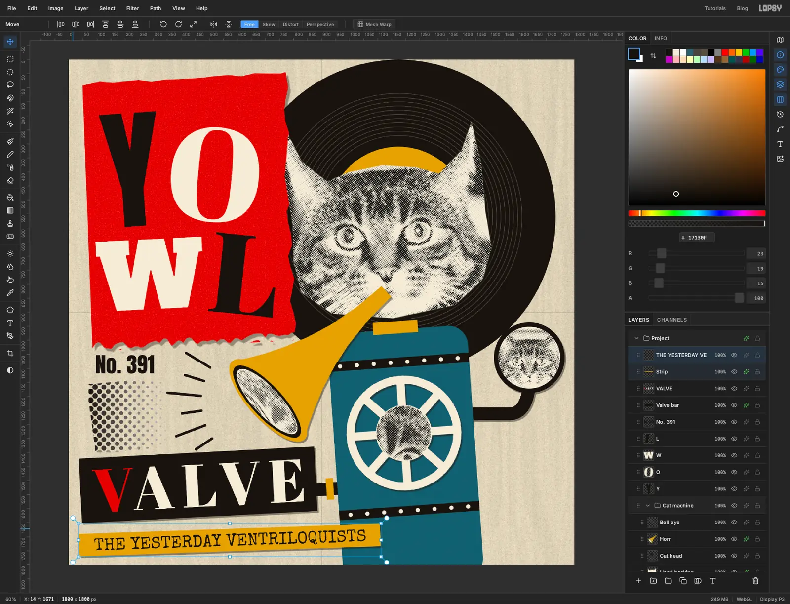

Add a layer called `Strip`. Drag a long, low marquee along the bottom, from **36, 1672** to **1110, 1752**, and fill it with mustard. It runs straight across the bottom of the boiler. That's deliberate: pieces in a montage cover each other. Add the small **Drop Shadow**.

The Text panel still remembers the 26 px of letter spacing from `VALVE`, and it picks the value up again every time that layer is selected. With `Strip` active, set **Letter spacing** back to 0 before you type anything new.

Set the colour to ink and create new text in **Special Elite** at 60: `THE YESTERDAY VENTRILOQUISTS`. Drag it into the strip and centre it by eye, with equal space at both ends and the capitals centred between the top and bottom edges.

Select the text layer and `Strip` together and rotate them about 2° anticlockwise, the same way as the bar.

## Stick on a speed label

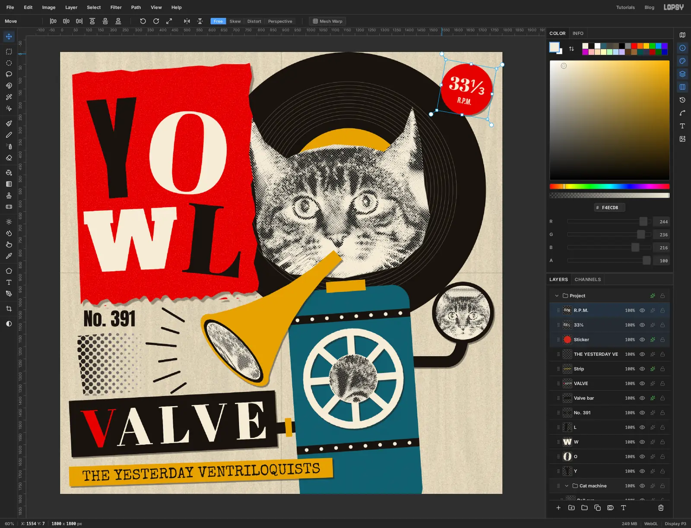

Add a layer called `Sticker`. With the Elliptical Marquee and [[Cmd]] held, drag a circle about 210 px across in the top right corner, centred near **1655, 152**, so it just overlaps the edge of the record. Fill it with red and add the small **Drop Shadow**.

Set the colour to cream and add two pieces of text:

1. `33⅓` in **Abril Fatface** at 74. The ⅓ isn't on most keyboards, so copy it from here and paste it while you're typing.
2. `R.P.M.` in **Bebas Neue** at 32

Place the number slightly above the middle of the sticker and the letters under it. Leave a clear gap between the two lines and at least 30 px of red on either side of the number.

Click the `R.P.M.` layer, Shift-click `Sticker` to select all three, and rotate them about 10° clockwise.

## Draw a path around the record

The empty band on the record is for a line of type that follows the curve. Pick the **Pen** tool.

You need three anchors on a circle about 100 px inside the record's edge. For each one, press at the point and drag about 170 px in the direction the curve is travelling, clockwise around the record:

1. Press at about **880, 209** and drag up and to the right
2. Press at about **1353, 138**, near the top of the record, and drag right and slightly down
3. Press at about **1631, 528**, on the right side, and drag almost straight down

Click the **Commit path** ✓ in the options bar. This saves the path without stroking it.

## Bind the text to the path

Set the colour to cream. With the **Text** tool, click in empty paper, choose **Bebas Neue** at 40 and type `THIRTY-THREE & A THIRD REVOLUTIONS OF NOTHING IN PARTICULAR`.

Before committing, open the **Path** menu at the right of the options bar and pick the last path in the list, `Path 3`. The line jumps onto the curve. Set **Align** to **Center** so it sits in the middle of the arc, then press [[Tab]]. The type settles into its final size and position once it's committed.

If the text runs off the end of the path, lower the Size by a point or two. Clear the path's outline the usual way: Pen tool, click on empty canvas, **Cancel path**. Set **Align** back to **Left** for the next piece of text.

## Paste in a track list

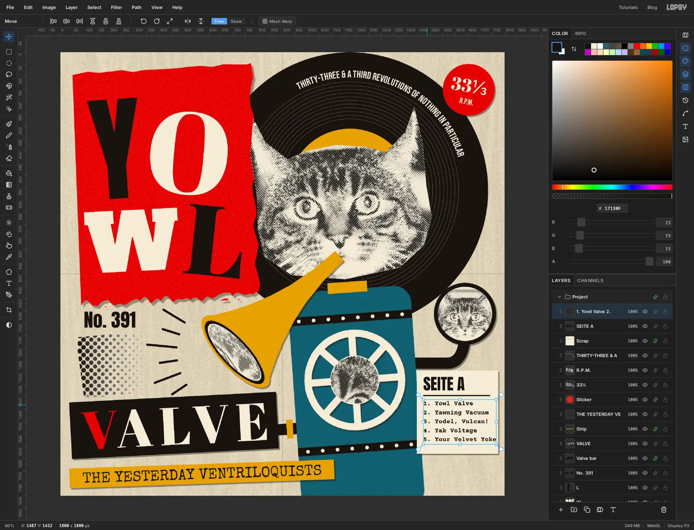

Add a layer called `Scrap`. Drag a marquee on the right-hand side from **1445, 1292** to **1775, 1630**, so it covers the edge of the boiler, and fill it with cream. Add the small **Drop Shadow**. With the Brush at **Size** 6, in ink, click and Shift-click a rule across the scrap about 100 px from its top.

Add two pieces of text in ink:

1. `SEITE A` in **Anton** at 64, above the rule. It's German for "Side A".
2. The track list in **Courier Prime**, weight **Bold**, at 26, pressing [[Enter]] between lines: *1. Yowl Valve*, *2. Yawning Vacuum*, *3. Yodel, Vulcan!*, *4. Yak Voltage* and *5. Your Velvet Yoke*

Line both up about 27 px in from the scrap's left edge. At 26 the longest track runs almost to the right edge of the scrap, which is too tight. With the track list layer active and the Text tool selected, lower **Size** to 23 so there's a clear margin on the right.

## Tilt the scrap and stamp the label

Click the track list layer, hold [[Shift]] and click `Scrap`. The heading between them is selected too. Rotate all three about 3° clockwise with the Move tool and press [[Cmd+D]].

Under the scrap, make a record-label stamp the same way you made the `VALVE` bar. Add a layer called `Label block`, drag a marquee from **1500, 1668** to **1770, 1754** and fill it with ink. Set the colour to cream, create the text `DADAPHON` in **Anton** at 50 in empty paper, and drag it into the block with an even margin all round. Then select the text layer and `Label block` together and rotate the pair about 5° anticlockwise.

## Group the type

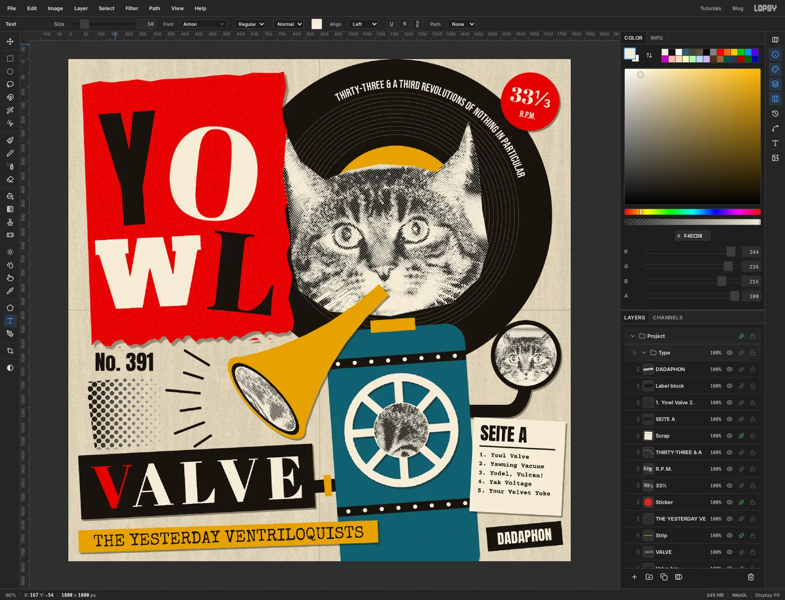

Click the top layer, scroll down and Shift-click the `Y` layer, then choose **Layer → Group Layers** and name the group `Type`.

With the group selected, the Move tool now shifts every piece of type at once, the curved line included, if you want to adjust how the type sits against the figure.

## Add grain

Click **Add Layer** and name it `Grain`. It lands inside the Type group, so drag its row up and to the left until it sits above the group.

Set the colour to mid-grey `#808080`, press [[Cmd+A]], choose **Edit → Fill** and press [[Cmd+D]]. Choose **Filter → Add Noise**, set **Amount** to 28, and pick **Mono** and **Gaussian**.

Open the layer's effects drawer and set the blend mode to **Overlay**, then lower its opacity to about 45%. Grey does nothing in Overlay, so only the speckle shows. It runs across every piece of paper and ties them together.

## Warm it up

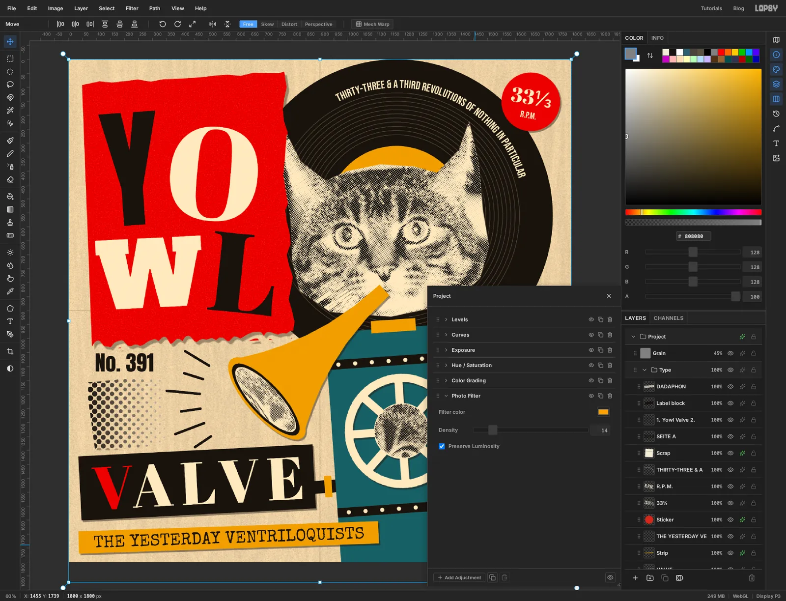

Old paper yellows. Choose **Layer → Adjustment Layer…**. The first time, a note explains that adjustments in Lopsy live on groups. Click **Got it**. The drawer that opens belongs to the `Project` group, which holds the whole document. It already lists Levels, Curves, Exposure, Hue / Saturation and Color Grading, all at neutral settings. Leave those alone.

Click **Add Adjustment** and choose **Photo Filter**. It starts with a warm orange. Lower **Density** to 14 so the whites turn the colour of an old paperback without the red going brown. Close the drawer.

Choose **File → Quick Export PNG** for the cover and **File → Save Project** to keep the layers.

From here you can swap in your own cat, your own band and your own five tracks. The method stays the same: cut it rough, print it in dots, paste it crooked.
