This tutorial builds a birthday card called **Yeti Xylophone** in a deconstructivist style. The card is 1500 × 2100 px, a 5 × 7 inch portrait at 300 ppi, so it prints as a real folded card.

Deconstructivist graphic design (Wolfgang Weingart's cracked grids, the Cranbrook layered pages, David Carson's *Ray Gun* spreads) breaks the rules of a tidy layout on purpose. Planes collide instead of sitting side by side. Type becomes part of the picture: it's stretched, turned on its side and run off the trim. Things are printed slightly out of register. The trick is to make every break look deliberate. Each cut is clean, each offset is a round number, and each tilted word lines up with something else on the card.

Along the way you'll use:

- ruler **guides**, **Show Grid** with snapping, and the **Pencil**'s [[Shift]]-click straight lines
- the **Lasso**, **Rectangular** and **Elliptical Marquee**, and intersecting a selection with a layer's own shape ([[Cmd]]-click a thumbnail, then [[Shift+Alt]]-drag)
- **Define Pattern** and **Fill with Pattern**
- **Merge Down**, cutting a layer into bands with the **Move** tool and arrow-key nudges
- **Cut**, **Paste**, scaling and rotating a selection with the transform handles
- **Stroke**, **Drop Shadow** and **Color Overlay**, with **Copy effects** / **Paste effects**
- **Group Layers**, then rotating and moving a whole group
- live **text**: stretching it, rotating it, **Rotate 90°**, recolouring part of a line, and **text on a path** drawn with the **Pen**
- the **Multiply** and **Overlay** blend modes, layer opacity, and the **Texture** filter

The palette:

- Paper `#EFEBE2`, ink `#141414`
- Ice plane `#8ED3E8`, lilac `#B9A3F0`, red `#E9502F`, acid yellow `#E2F04A`
- Fur `#FAFAF6`, fur shade `#BFD6E6`
- Face `#5E7FB0`, mouth `#2B1838`, tongue `#F27C8E`
- Grain base `#808080`

> **Tip:** Positions are given as `x, y` in document pixels. The status bar at the bottom left shows where your cursor is. Mac key names are used; on Windows and Linux use Ctrl for Cmd.

> **Tip:** "Fill" means set the foreground colour in the Color panel's hex field, then choose **Edit → Fill**. Press [[Cmd+D]] to drop a selection before you draw the next one.

> **Tip:** A new layer appears just above the active one. Each step says which row to click first. To rename a layer, double-click its name.

## Set up the paper and the guides

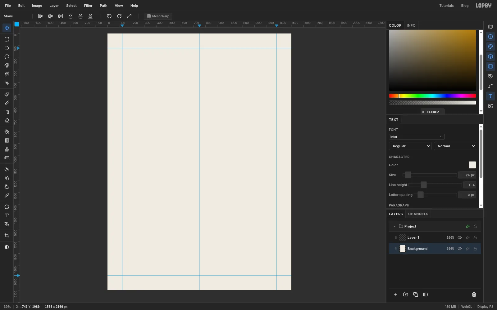

Create a new document `1500` × `2100` px. Click the `Background` row and fill it with paper `#EFEBE2`.

The rulers are on by default. Drop guides by clicking them: click the top ruler at x `120`, `750` and `1380`, then the left ruler at y `120` and `1980`. The outer four make a 120 px safe margin, and the middle one marks the centre. Later, some of the type breaks out of this margin on purpose. Having the margin drawn is what makes those breaks look intended rather than careless.

## Lasso the ice plane

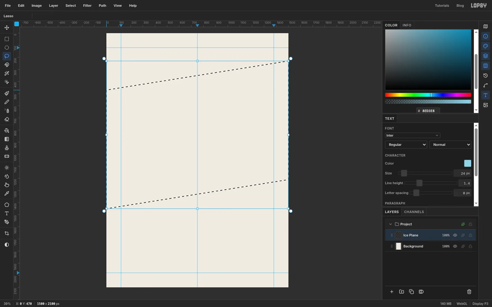

Double-click `Layer 1` and rename it `Ice Plane`. Pick the **Lasso** (`L`) and drag a four-sided band across the card. Go from the left edge at y `470` to the right edge at y `230`, down the right edge to y `1210`, back to the left edge at y `1450`, and up to where you started. The Lasso is freehand, so move the mouse in a straight line from one corner to the next. You can drag past the canvas edge, and anything outside the canvas is ignored. The two long edges climb about 9° to the right, and that angle comes back several times later.

Fill it with `#8ED3E8`.

## Cross it with two more planes

1. Click **Add Layer** and name it `Lilac Strip`. Lasso a steep strip that starts at the top edge between x `1010` and `1250` and ends at the bottom edge between x `550` and `790`. Fill it with `#B9A3F0`.
2. Open the layer's effects drawer (the ✦ on its row) and set **Blend Mode** to **Multiply**. Where the strip crosses the ice it now prints as a deeper blue, as two overprinted inks would. Close the drawer.
3. **Add Layer**, name it `Red Shard`, and lasso a triangle in the bottom-left corner: from the left edge at y `1560`, down to the bottom edge at x `1180`, and along the bottom back to the corner. Fill it with red `#E9502F`.

The three planes run at three different angles. That's the "broken grid" you'll build everything else on.

## Draw the construction lines and crop marks

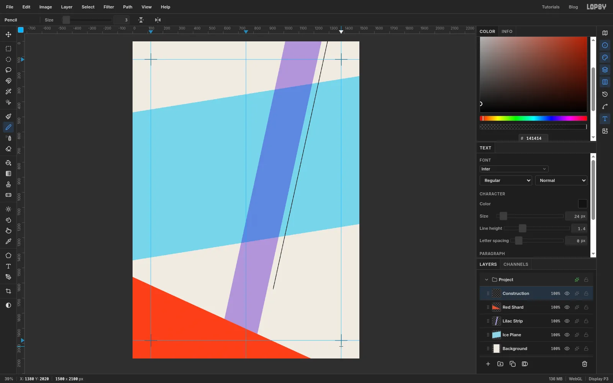

**Add Layer** and name it `Construction`. Pick the **Pencil** (`N`), set **Size** to `3`, and use ink `#141414`.

A Pencil click followed by a [[Shift]]-click draws a perfectly straight line between the two points.

1. Click at the top edge at about x `1290`, then [[Shift]]-click at about `930, 1640`. This runs parallel to the lilac strip's right edge and stops above where the xylophone will go.
2. At each corner where two outer guides cross, draw a small crop mark: an 80 px horizontal line and an 80 px vertical line crossing at the guide intersection.

Two more hairlines go in later, once the things they line up with exist.

## Make a hatch pattern

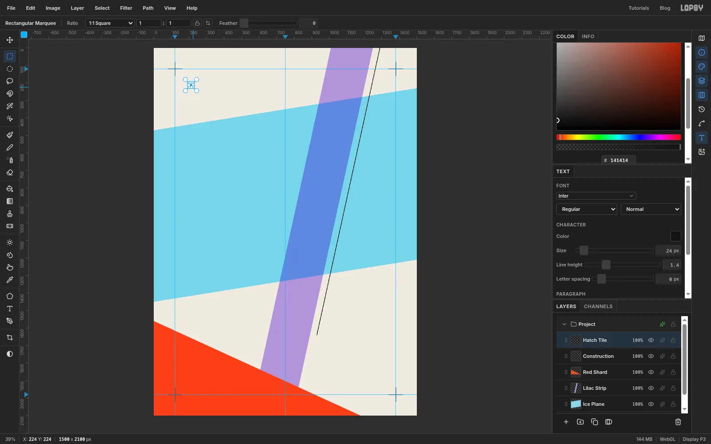

1. **Add Layer** and name it `Hatch Tile`. The tile will be the 24 × 24 px square from `200, 200` to `224, 224`, so zoom in on that spot.
2. With the Pencil at **Size** `4`, click at `194, 230` and [[Shift]]-click at `230, 194`. That's one diagonal running corner to corner through the square and a little past it.
3. Draw two short stubs the same way: `194, 206` to `206, 194`, and `218, 230` to `230, 218`. They're the bits of the neighbouring diagonals that cross the square's top-left and bottom-right corners, so the lines join up when the tile repeats.
4. Pick the **Rectangular Marquee** (`M`) and drag from `200, 200` to `224, 224`, watching the size in the status bar.
5. Choose **Edit → Define Pattern**, then [[Cmd+D]] and click **Delete Layer**. The pattern is stored. You don't need the tile layer any more.

## Lay the hatch into the lilac strip

1. Click `Lilac Strip`, then **Add Layer** and name it `Hatch`.
2. [[Cmd]]-click the `Lilac Strip` thumbnail. That loads the strip's shape as a selection.
3. With the Rectangular Marquee, hold [[Shift+Alt]] and drag a rectangle from just above the bottom of the cyan band down past the bottom of the card. [[Shift+Alt]] *intersects*, so only the part of the strip below the ice stays selected.

## Fill it with the pattern

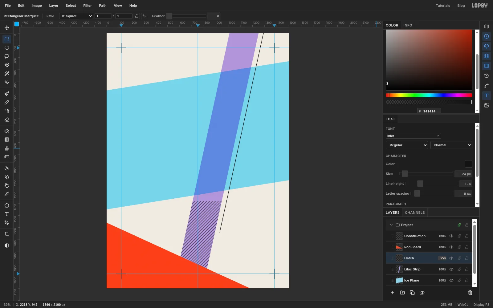

Choose **Edit → Fill with Pattern…**, leave your new pattern picked and click **Apply**. Press [[Cmd+D]]. Set the `Hatch` layer to **Multiply** and its opacity to `55%`, so it reads as a screen-printed tint rather than heavy black lines.

## Build the yeti's body

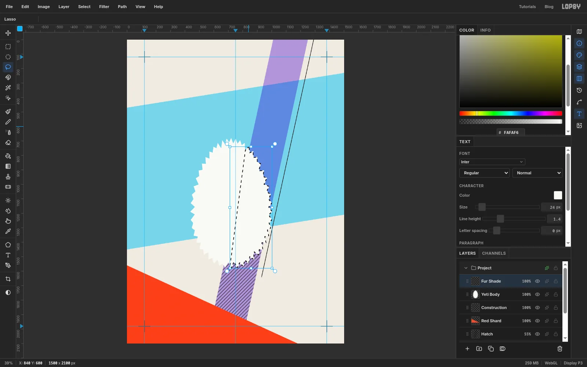

1. Click `Construction`, **Add Layer** and name it `Yeti Body`.
2. Plan the outline first. It's a gumdrop about 640 px wide and 900 px tall, centred on `720, 1130`. The top of the dome is at about `720, 680`, it's widest (about 640 px) around y `1250`, and the bottom edge is at about y `1580`, where the xylophone will hide it.
3. With the **Lasso**, trace that outline in a zigzag for fur: go out and back in by about 30 px every 20–30 px along the edge. The spikes don't have to be even. Fill it with `#FAFAF6`.
4. **Add Layer**, name it `Fur Shade`, and [[Cmd]]-click the `Yeti Body` thumbnail.
5. With the Lasso, hold [[Shift+Alt]] and drag a four-sided shape whose left edge runs as one straight diagonal from about `840, 600` down to `700, 1650`, enclosing everything to its right. Fill the result with `#BFD6E6`.

The shading is one flat facet with a hard edge, not a soft gradient. That keeps it graphic.

## Add the arms

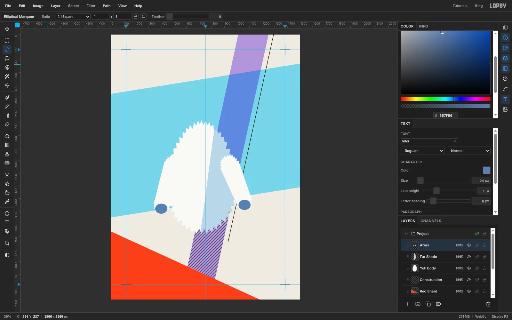

1. **Add Layer** and name it `Arms`.
2. Lasso the left arm: a long, round-ended shape about 150 px wide, from the shoulder at about `500, 1030` down and out to the hand at `400, 1360`. Zigzag the rounded ends a little for fur. Fill it with `#FAFAF6` and press [[Cmd+D]].
3. Lasso the right arm the same way, from `940, 1030` to a hand at `1060, 1330`. Fill it and press [[Cmd+D]].
4. Pick the **Elliptical Marquee** and draw a palm about 96 × 80 px over the end of each arm, slightly below the hand point. Fill each one with face blue `#5E7FB0`, then press [[Cmd+D]].

## Give the yeti a face

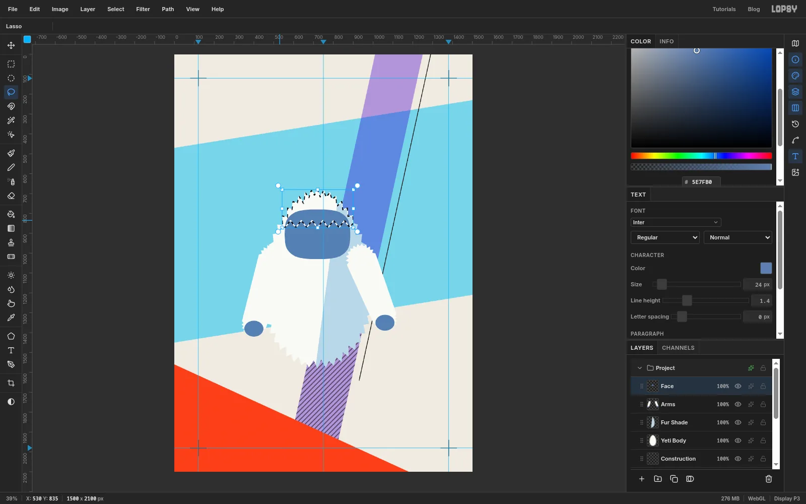

1. **Add Layer** and name it `Face`. Lasso a soft, rounded-square face about 330 × 250 px centred on `720, 905`, and fill it with `#5E7FB0`.
2. [[Cmd]]-click the `Yeti Body` thumbnail, then with the Lasso hold [[Shift+Alt]] and drag a band across the top of the face. Make its bottom edge a zigzag of points (alternating about y `835` and y `872`) and take its top edge well above the head. Intersecting with the body's shape keeps the fringe inside the head's outline, so nothing pokes out at the sides.
3. Fill the fringe with `#FAFAF6`.

## Eyes, grin and tongue

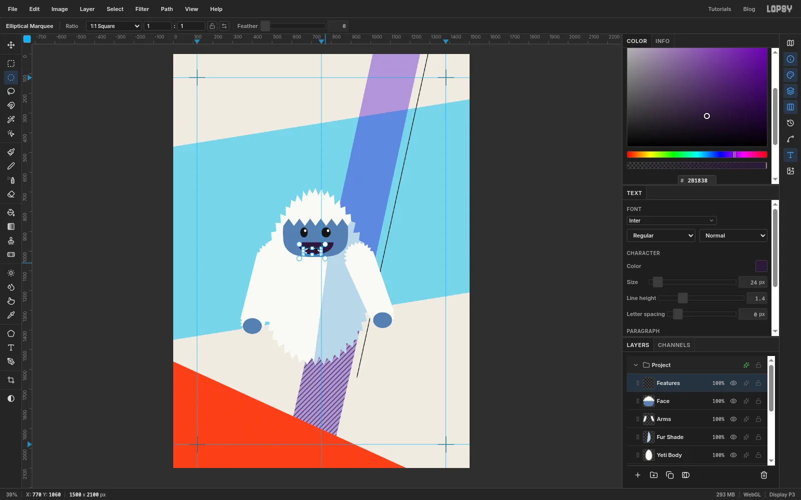

**Add Layer** and name it `Features`.

1. With the Elliptical Marquee, fill two eyes about 38 × 50 px in ink `#141414` at `662, 905` and `778, 905`. Add a 12 px catch-light in `#FAFAF6` near the top right of each.
2. Lasso a grin that's flat along the top and rounded below: about 184 px wide, centred on x `720`, with its top edge at y `955` and 62 px deep. Fill it with `#2B1838`.
3. [[Cmd]]-click the `Features` thumbnail, pick the Elliptical Marquee, hold [[Shift+Alt]] and drag an ellipse across the bottom of the grin, from about `650, 985` to `770, 1060`. Fill the intersection with tongue pink `#F27C8E`.

## Add the fangs

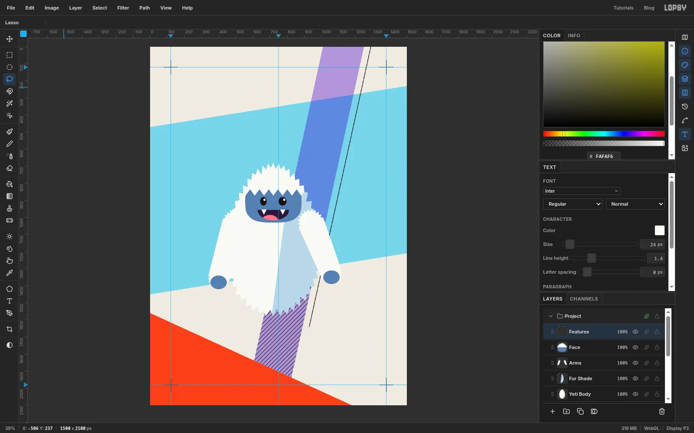

Lasso two small downward triangles, about 30 px wide, hanging from the top corners of the grin, and fill them with `#FAFAF6` for fangs.

## Put a party hat on it

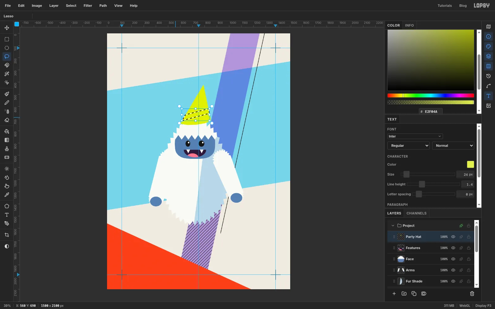

1. **Add Layer** and name it `Party Hat`. Lasso a cone with its base sitting on the fringe, from about `598, 742` to `852, 720`, and its tip leaning right to about `790, 420`. Fill it with acid yellow `#E2F04A`.
2. [[Cmd]]-click the hat's thumbnail, then lasso a slanted band across the bottom of the hat with [[Shift+Alt]] held. Fill it with red `#E9502F`.
3. Repeat for two more bands higher up, keeping the same slant and spacing. Each time, [[Cmd]]-click the hat thumbnail first so the band is cut to the cone.

## Top it with a pom-pom

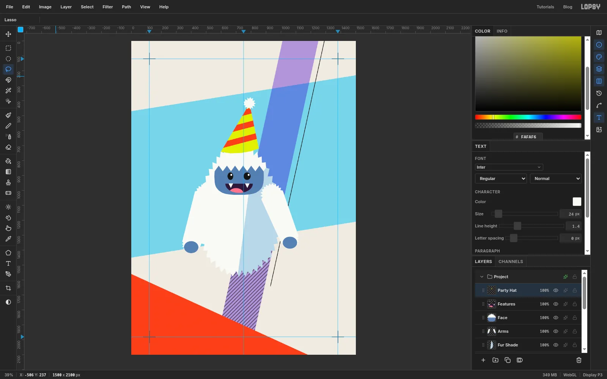

Lasso a small spiky circle, about 84 px across, on the tip and fill it with `#FAFAF6` for the pom-pom. Press [[Cmd+D]].

## Merge the yeti and cut it into bands

With `Party Hat` selected, choose **Layer → Merge Down** five times, until everything from `Party Hat` down to `Yeti Body` is one layer. Rename it `Yeti`.

Now break it. With the Rectangular Marquee, draw a band right across the yeti from y `980` to y `1150`, wider than the yeti on both sides. Pick the **Move** tool (`V`) and drag inside the selection 40 px to the right, watching the X readout in the status bar. Hold the drag level so it doesn't move up or down. Press [[Cmd+D]].

## Nudge the belly the other way

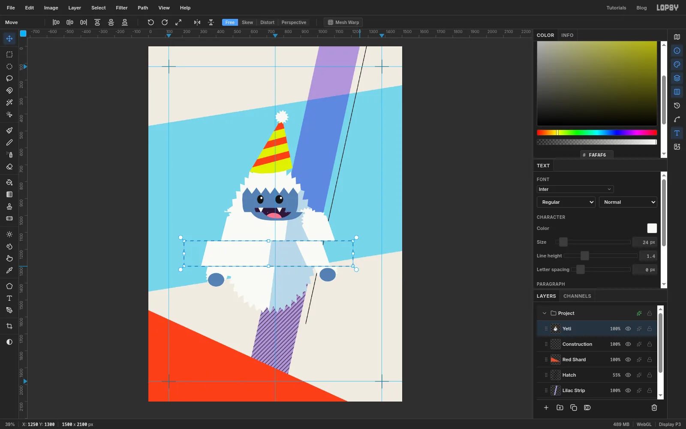

Switch back to the Rectangular Marquee (`M`) and draw a second band from y `1150` to y `1300`. Pick the Move tool again and press [[Shift+Left]] four times. Each press moves the selection 10 px. Press [[Cmd+D]].

## Open up the cut lines

A cut only looks deliberate when you can see it, so open a gap at each one. Draw a 6 px tall marquee across the yeti at each cut line (y `980`, `1150` and `1300`) and press [[Delete]] each time. The ice now shows through three clean, thin gaps.

## Lay the xylophone out on the grid

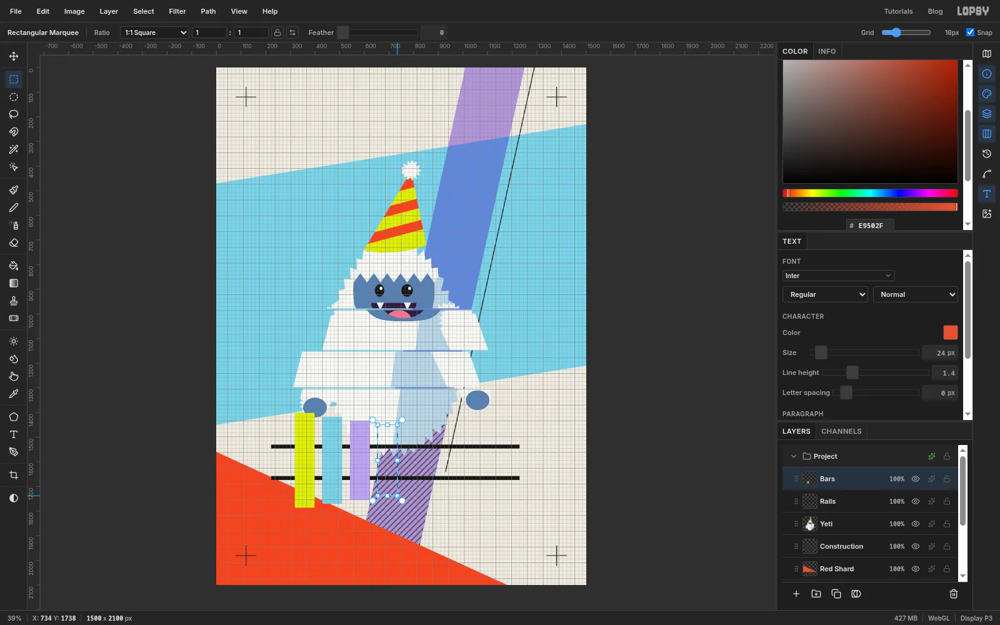

1. Click `Yeti`, **Add Layer** and name it `Rails`.
2. Choose **View → Show Guides** to hide the guides (they would pull the marquee away from the grid), then **View → Show Grid**. The grid is 16 px and **Snap** is on in the options bar.
3. Draw two rails 1008 × 16 px, both starting at x `222`: one at y `1530` and one at y `1650`. Fill them with ink.
4. **Add Layer** and name it `Bars`. Draw eight bars, each 80 px wide and 112 px apart (left edges at x `318`, `430`, `542` …), centred on y `1594`. The first is `384` px tall and each one is 32 px shorter than the last, down to `160`. Fill them in turn with acid `#E2F04A`, ice `#8ED3E8`, lilac `#B9A3F0` and red `#E9502F`, then repeat the four colours.

The grid is centred on the canvas, so its lines fall at 750 plus or minus multiples of 16 across, and 1050 plus or minus multiples of 16 down. Every number above is one of those lines, so the marquee snaps straight to it and the gaps come out identical without measuring.

## Screw the bars to the rails

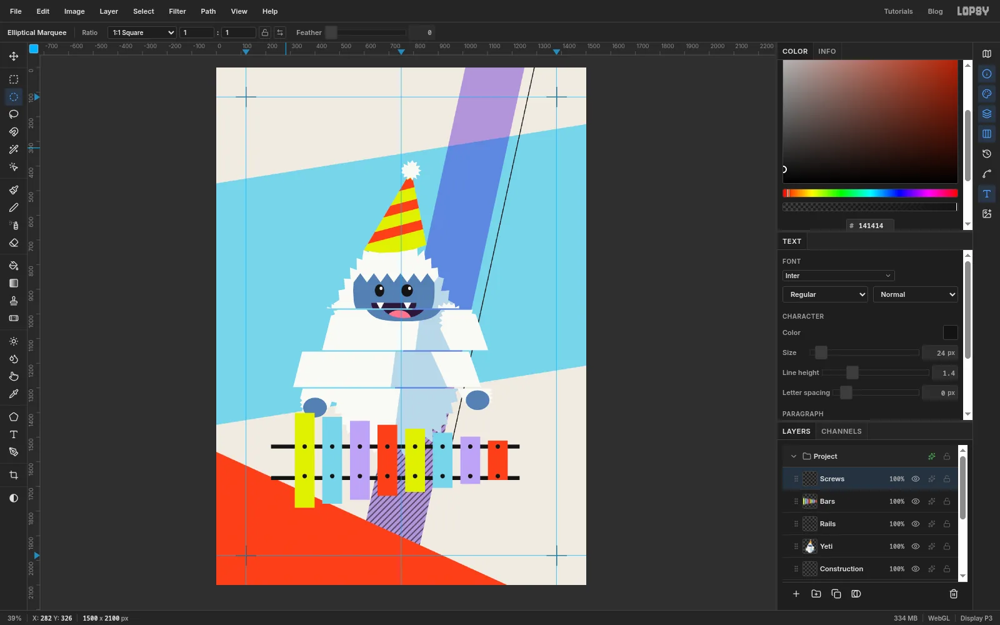

Choose **View → Show Grid** again to hide the grid, so small circles don't snap. **Add Layer**, name it `Screws`, and fill an 18 px ink circle where each bar crosses each rail. Turn the guides back on with **View → Show Guides**.

## Outline the bars

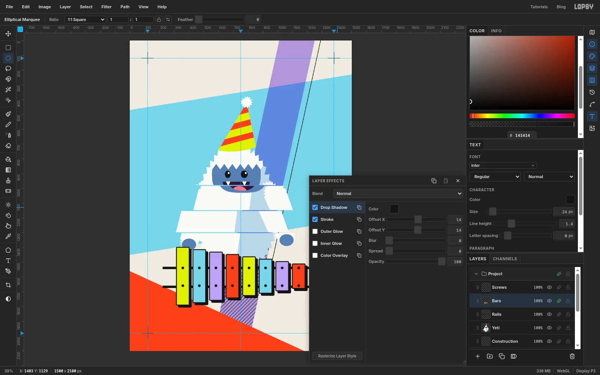

Click `Bars` and open its effects drawer.

- **Stroke**: **Width** `6`, colour `#141414`.
- **Drop Shadow**: **Offset X** `14`, **Offset Y** `14`, **Blur** `0`, **Opacity** `100`, colour `#141414`.

A blur of 0 gives a hard printed shadow rather than a soft glow. To compare, press [[Cmd+Z]] twice to see the bars without the effects, then [[Cmd+Shift+Z]] twice to put them back. Close the drawer.

## Knock one bar loose

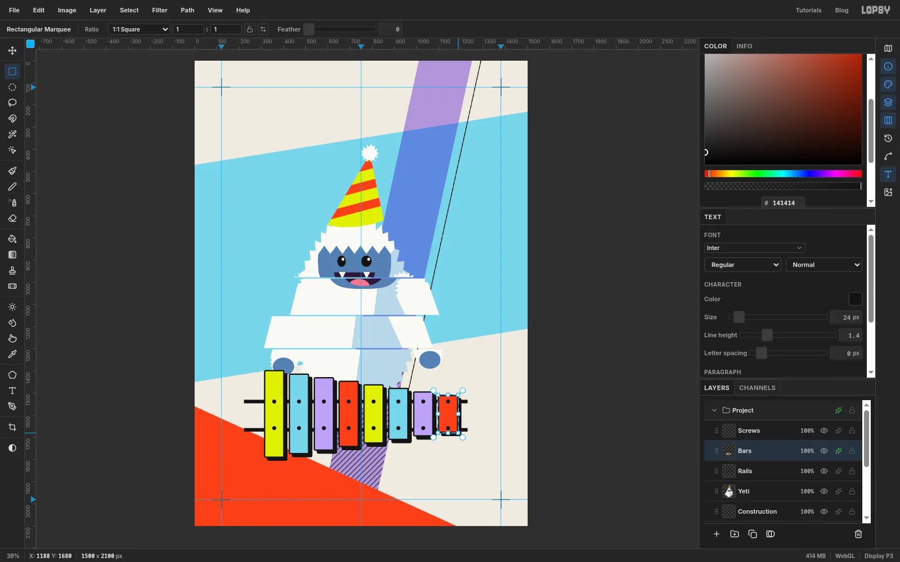

1. With `Bars` active, draw a marquee around the last (red) bar and press [[Cmd+X]].
2. Click `Screws`, draw the same marquee and press [[Delete]], so the bar's two screws go with it.
3. Still on `Screws`, press [[Cmd+V]]. The bar pastes back exactly where it was, on a new layer above `Screws`, already selected with the Move tool picked. Rename the layer `Loose Bar`.
4. Drag the bar up about 380 px, so it hangs just right of the yeti's right hand.

## Scale the loose bar up

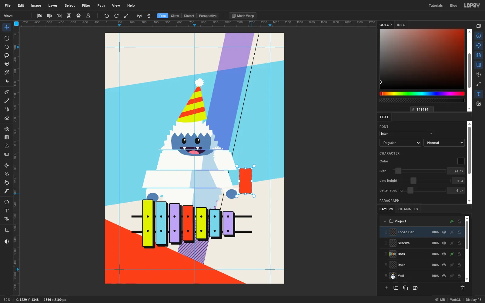

At its original size it's too small to read from across a room. Hold [[Cmd]] and drag the bottom-right corner handle out by about a third of its height. [[Cmd]] keeps the proportions. Press [[Enter]] to commit.

## Tip it back

[[Cmd]]-click the `Loose Bar` thumbnail to select it again, then drag one of the round rotation handles outside its corners to tip it back about 30°, as if it's been flung off. Press [[Enter]], then [[Cmd+D]].

## Copy the bar effects across

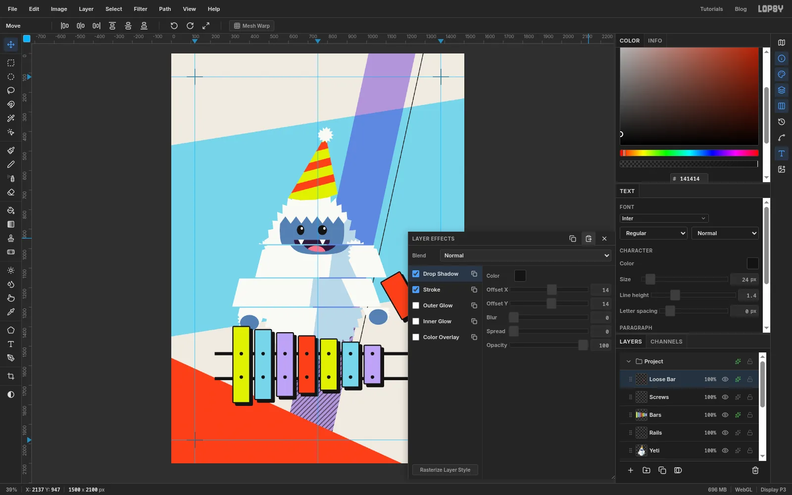

Click `Bars`, open its drawer and click **Copy effects** in the header. Click `Loose Bar`, open its drawer and click **Paste effects**. It now has exactly the same outline and shadow as the bars it came from.

## Group the instrument and tilt it

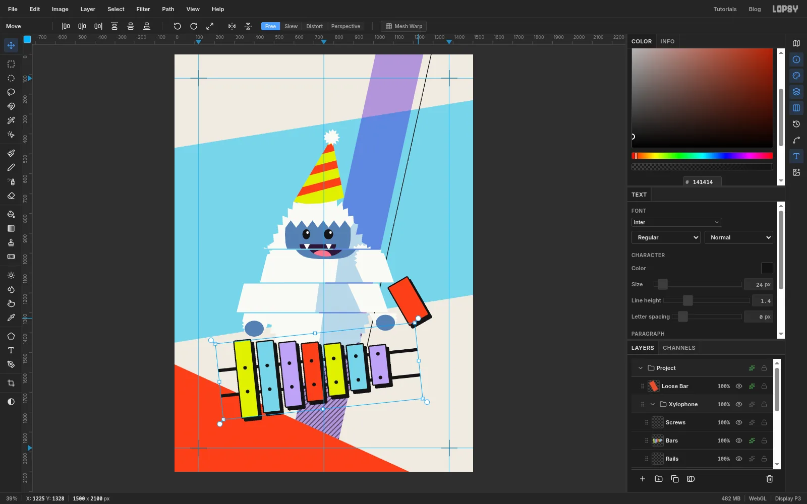

1. Click `Rails`, then [[Shift]]-click `Screws` to select `Rails`, `Bars` and `Screws`. Choose **Layer → Group Layers** and name the group `Xylophone`.
2. Press [[Cmd+D]] and pick the **Move** tool. With the group row active, the handles frame everything inside it.
3. Drag a corner rotation handle to tip the whole instrument about 6° down to the left, then press [[Enter]].

All three layers turn together, and the bar effects follow. If you nudge the group or drag it to a new spot, every layer moves as one, and a single [[Cmd+Z]] puts the whole group back.

## Give the yeti its mallets

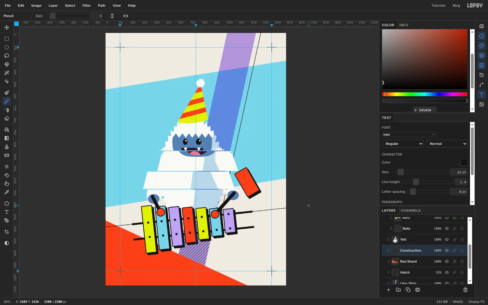

1. Click `Loose Bar`, **Add Layer** and name it `Mallets`.
2. With the Pencil at **Size** `12` in ink, click on the left palm and [[Shift]]-click on the second bar, a little below its top. Do the same from the right palm to the sixth bar.
3. With the Elliptical Marquee, draw a 60 px circle centred on the end of each stick and fill it with red `#E9502F` (**Edit → Fill**). Press [[Cmd+D]].
4. Open the `Mallets` effects drawer and turn on **Stroke** with **Width** `6` in ink.
5. Click `Construction`. With the Pencil back at **Size** `3`, click just outside the left edge of the card, level with the top rail's left end, and [[Shift]]-click just outside the right edge where the same tilted line would cross it (about 160 px higher). The line should run straight along the top rail. The rail's hairline now carries across the whole card. It only shows where the instrument and the yeti don't cover it.

## Set HAPPY huge

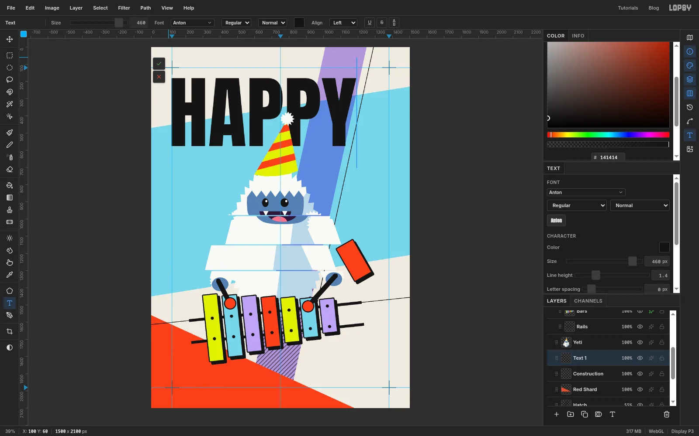

Click `Construction` (a picture layer, so the Text tool sets up a new layer instead of restyling one). New text lands just above it, under the yeti. Pick the **Text** tool (`T`) and set **Size** to `460`, the font to **Anton** and the colour to ink. Click near the top-left corner, at about `100, 60`, type `HAPPY` and press [[Tab]] to commit. Rename the layer `HAPPY`.

## Stretch HAPPY sideways

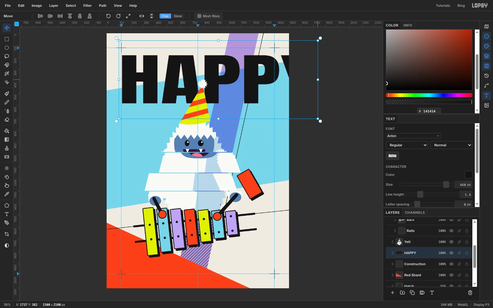

Pick the **Move** tool. Live text shows its own transform box, with no selection needed. Drag the **middle handle on the right edge** to the right until the word is about one and a half times as wide. Without [[Cmd]] the stretch only goes sideways, so the letters get fatter, not taller. The text stays live and editable.

## Tilt HAPPY and bleed it off both edges

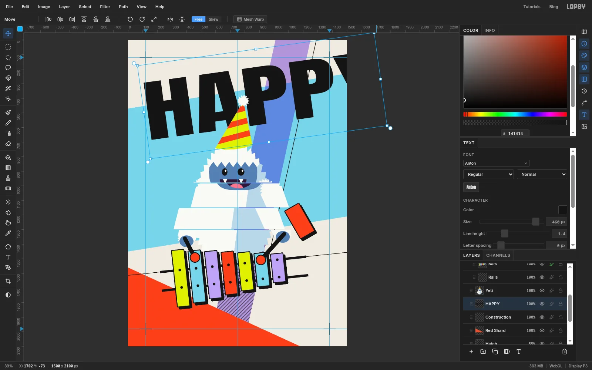

Drag a corner rotation handle so the word climbs about 8° to the right, nearly parallel to the ice band. Then nudge it with the arrow keys until it's centred across the card and the foot of the H sits at about y `640`. The H now runs off the left edge and the Y off the right. The yeti's hat overlaps the bottom of the first P, because HAPPY sits under the yeti. That overlap is what puts the type *in* the picture rather than above it.

## Print HAPPY slightly out of register

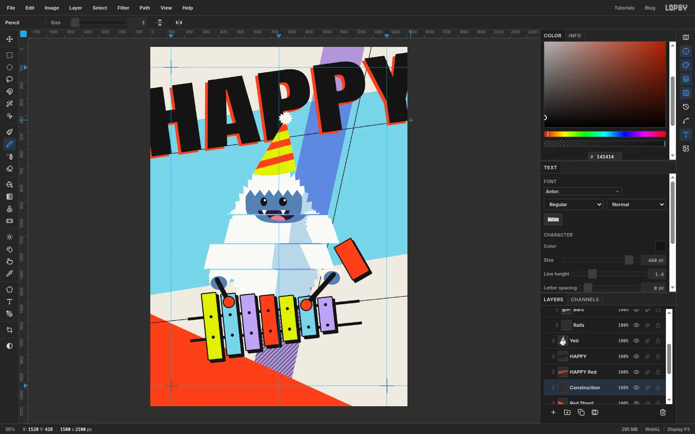

1. With `HAPPY` active, click **Duplicate Layer** and rename the copy `HAPPY Red`.
2. Pick the Text tool. With a committed text layer selected (and not being edited), the options-bar **Text color** swatch recolours the whole layer. Click it, type `E9502F` in the hex field and press [[Enter]], then [[Esc]].
3. In the Layers panel, drag the `HAPPY Red` row by its grip and drop it just below `HAPPY`.
4. With the Move tool, nudge it 16 px left and 14 px down: [[Shift+Left]] once and [[Left]] six times, then [[Shift+Down]] once and [[Down]] four times.

A red rim now shows on one side of every letter, like a two-colour print where the red plate slipped. To finish, click `Construction` and draw one more 3 px Pencil hairline (click, then [[Shift]]-click) just below the word's baseline, from edge to edge at the same tilt.

## Run BIRTH up the left edge

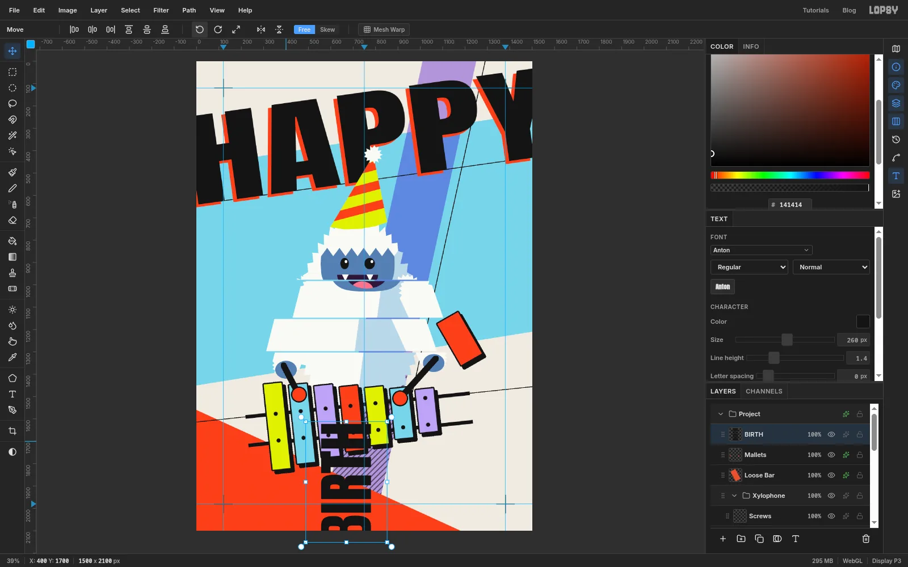

Click `Mallets` (a picture layer again). With the Text tool at **Size** `260`, **Anton**, ink, click on an empty part of the canvas, type `BIRTH` and press [[Tab]]. Rename it `BIRTH`.

Pick the Move tool and click **Rotate 90° CCW** in the options bar, so the word reads from bottom to top. Nudge it until the tops of the letters run 24 px off the left edge of the card and the bottom of the B sits at y `1440`, just above where the cyan band ends on the left edge. Cropping the cap tops at the trim is another deliberate break. The word is still perfectly readable.

## Run DAY down the right side

Make `DAY` the same way: click `Mallets` first, then use the same size, font and colour. This time click **Rotate 90° CW**, so it reads from top to bottom. The counter-rotation makes the two halves of "birthday" push against each other across the yeti. Turned clockwise, the tops of the letters face right. Nudge it until they sit at x `1360`, 20 px inside the right margin guide, and the D starts at y `660`.

## Add a caption with one red word

1. Click `Mallets`. With the Text tool, set **Size** `30`, the font to **Space Mono**, **Font weight** to **Bold** and **Align** to **Left**. Click an empty part of the canvas and type `ANOTHER YEAR, ANOTHER OCTAVE.` Don't commit yet.
2. Press [[Shift+Left]] seven times to select `OCTAVE.` Click the **Text color** swatch, type `E9502F` in the hex field, press [[Enter]], then [[Esc]] to close the picker. Only the selected characters change colour.
3. Press [[Tab]] to commit and rename the layer `Caption`. In the **Text** panel set **Letter spacing** to `4`.

## Turn the caption up the trim

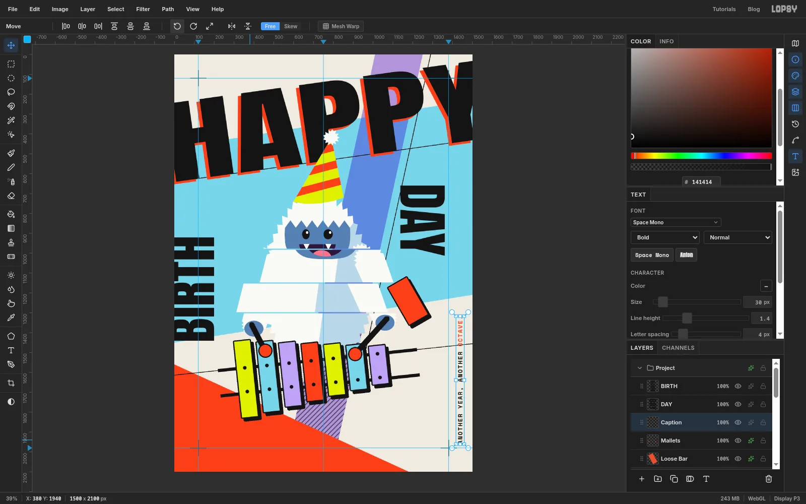

With the Move tool, click **Rotate 90° CCW**, so it reads upward with OCTAVE at the top. Nudge the caption until its right edge sits at x `1452` and its first letter starts at y `1960`. It runs up the outside of the right margin like the spine of a book, clear of the crop mark.

## Sing the scale along a curve

1. Pick the **Pen** (`P`). (A path isn't drawn on any layer, so it doesn't matter which row is active.)
2. Click at about `170, 1968` for the first anchor.
3. Press at about `760, 1922` and drag towards `1000, 1896` before letting go. Dragging pulls out handles and makes a smooth curve.
4. Click at about `1330, 1832` for the last anchor, then click the ✓ **Commit path** button in the options bar. This saves the path without painting it.

## Set the scale on the path

Click `Mallets` again and pick the Text tool. Set **Size** `40`, **Space Mono**, **Bold**, **Align** **Center** and ink. Click on an empty spot and type `do · re · mi · fa · so · la · ti · do ♪`. While you're still typing, choose **Path 1** from the **Path** menu in the options bar. The text jumps onto the curve, centred along it. Press [[Tab]] and rename the layer `Scale`.

If the last characters disappear, the line is longer than the path: Lopsy drops whatever runs off the end. Lower the size a little until the ♪ comes back.

## Add a misregistered ghost behind the yeti

1. Click `Yeti` and click **Duplicate Layer**. Rename the copy `Yeti Ghost` and drag its row down below `Yeti`.
2. In its effects drawer, turn on **Color Overlay** with `#B9A3F0`, then set **Blend Mode** to **Multiply**. Set the layer opacity to `85%`.
3. With the Move tool, nudge it 34 px right and 24 px up: [[Shift+Right]] three times and [[Right]] four times, then [[Shift+Up]] twice and [[Up]] four times.

It's the same move as the red HAPPY plate: a second colour that didn't quite land on the first. The repetition ties the type and the illustration together.

## Add paper tooth and export

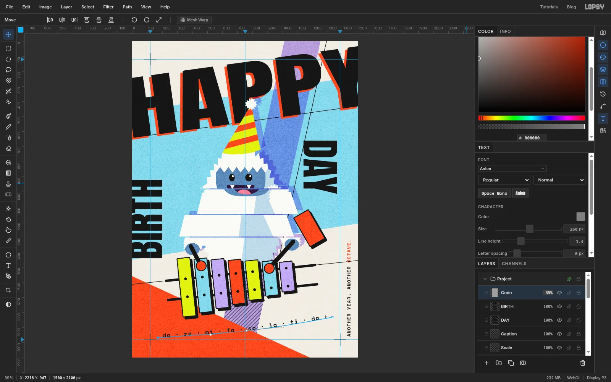

1. Click the top layer in the panel, **Add Layer** and name it `Grain`. Choose **Select → All**, fill with `#808080`, then [[Cmd+D]].
2. Choose **Filter → Texture…**, click **Rough**, and set **Amount** `50`, **Size** `4` and **Contrast** `25`. Click **Apply**.
3. Set `Grain` to **Overlay** at `35%` opacity.

Rough texture is uneven and ridged like cheap card stock, which fits a print-inspired design better than smooth film grain.

Choose **File → Save Project** to keep every layer, effect and live text layer editable, and **File → Quick Export PNG** for the finished card.

To push it further, try swapping BIRTH and DAY to red and keeping HAPPY black, or add a third plate shift in cyan behind the xylophone. Keep each new break lined up with something already on the card.
