Dieselpunk is the machine age with the dial turned up: streamlined steel, rivets, brass gauges, stencil lettering and the oily optimism of a 1930s travel poster. In this tutorial you'll design a landing page for the **Yukon Bullet**, a made-up diesel-electric streamliner that runs from Whitehorse to Dawson City, as a 1600 × 2400 px web comp.

The page has five parts, top to bottom: a riveted **nav bar**, a **hero** with the locomotive crossing a trestle at dusk, a **gauge band** with three dials, a **route** section with a ticket stub, and a **footer**. You'll draw the locomotive from scratch with selections and shapes, then set the type on top.

Along the way you'll use:

- **guides**, marquees that snap to them, **Edit → Fill** and the **Gradient** tool inside selections
- **Filter → Sunburst**, **Texture** (Grain, Streaks and Rough) and **Motion Blur**
- the **Lasso** with [[Shift]] to add shapes, and [[Cmd]]-clicking a layer thumbnail to reuse its outline
- the **Shape** tool for wheels, portholes, plates and buttons
- copy and paste, **Merge Down**, and the **Pencil** and **Brush** with [[Shift]]-click lines
- the **Brush** with **Radial Symmetry**, and the **Eraser**
- **Drop Shadow**, **Outer Glow**, **Inner Glow** and **Stroke** effects, plus **Screen**, **Soft Light** and **Overlay** blend modes
- **groups**, rotating a whole group with the **Move** tool, and a **Vignette** adjustment on the root group
- text in **Anton**, **Black Ops One** and **Barlow Condensed**

The palette:

- Soot `#15110E`, iron `#2A2724`, steel `#8A867C`, pale steel `#DDD6C2`
- Oxblood `#7A1F1A`, signal red `#C2361F`
- Brass `#C99A3B`, gold `#E9C46A`, lamp amber `#F2B552`
- Cream `#EFE3C8`, warm grey `#D9CFB6`
- Sky `#111E22` → `#2E3A39` → `#8A4A26` → `#F0B04A`
- Far range `#6A4A45`, lit rock `#C98A4A`, near range `#241917`
- Rust `#5A3220`, dark rust `#4A2A1C`

> **Tip:** Positions are written as `x, y` in document pixels. The status bar at the bottom of the window shows where the cursor is, so you can hover to find a spot. Key names are Mac keys. On Windows and Linux, use Ctrl for Cmd. Where a step gives several numbers for a shape, treat them as a guide: a locomotive that's a few pixels off is still a locomotive.

Two habits will save you time throughout:

- **New text needs an empty spot.** A Text-tool click inside an existing text's box edits that text instead of starting a new one, and changing the font or size while a text layer is selected restyles it. So before each new piece of type, click an ordinary pixel layer in the Layers panel, click the Text tool on an empty part of the page (the bottom is free until the footer), type, press [[Tab]] to finish, and then drag the text into place with the **Move** tool (**V**). Arrow keys nudge it 1 px, and [[Shift]]+arrow 10 px.
- **The Shape tool draws from the centre.** Press where the middle of the shape should be and drag out to a corner. Where a step gives a shape's edges, it also gives the centre to press on.
- **Finishing a transform.** After you rotate something with the Move tool's handles, press [[Cmd+D]]. It commits the transform as well as dropping any selection.

## Set up the page and guides

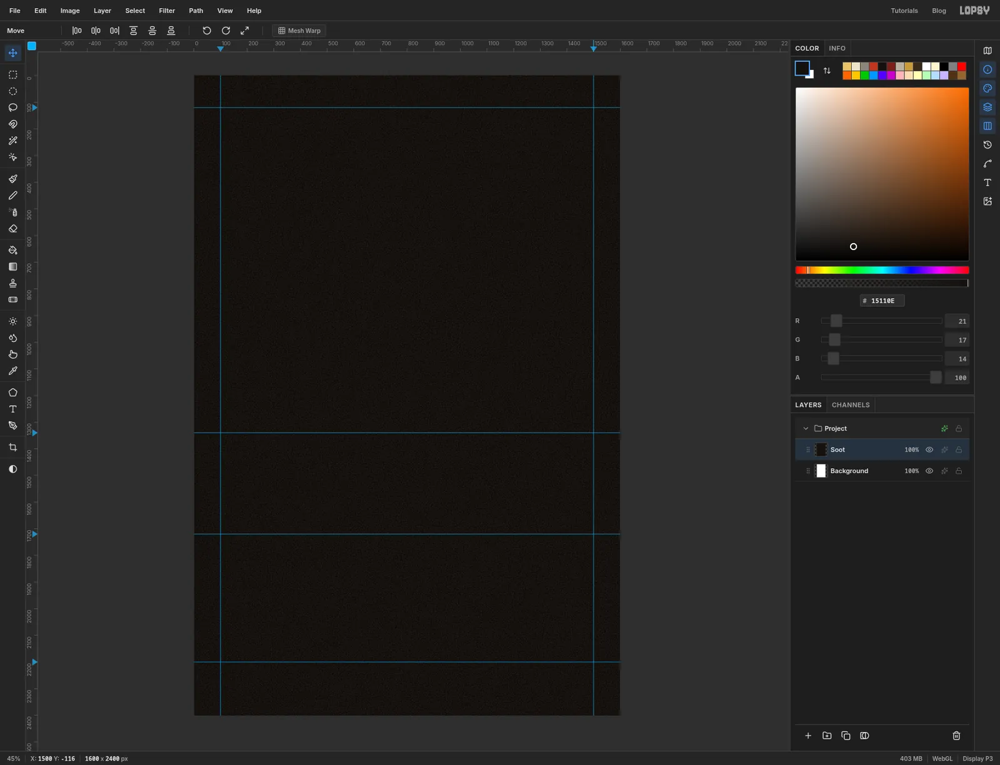

Choose **File → New**, set the size to **1600 × 2400** px and click **Create**. Double-click `Layer 1`'s name and rename it `Soot`. Set the foreground colour to `#15110E`, press [[Cmd+A]], choose **Edit → Fill** and press [[Cmd+D]].

A flat dark page looks like a screen. A little tooth makes it look like painted metal. Choose **Filter → Texture…**, leave **Type** on **Grain**, set **Amount** `14` and **Size** `2`, and click **Apply**.

Now the guides. Click the left ruler at **120** (bottom of the nav bar), **1340** (bottom of the hero), **1720** (bottom of the gauge band) and **2200** (top of the footer). Click the top ruler at **100** and **1500** for the page margins. Everything on the page lines up to those two margins.

## Paint the dusk sky

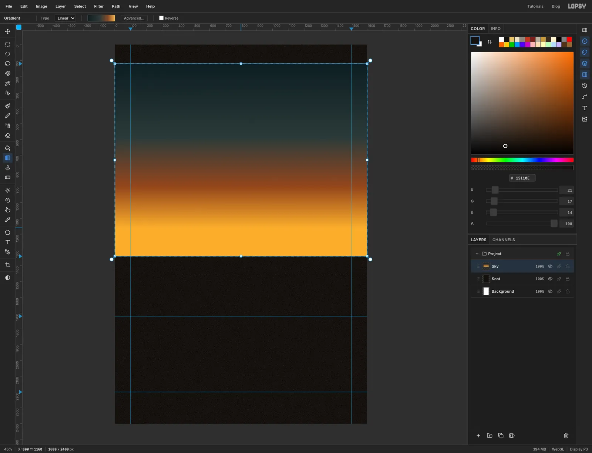

Click **Add Layer** at the bottom of the Layers panel and name it `Sky`. Pick the **Rectangular Marquee** (**M**) and drag from just off the left edge on the **120** guide to just off the right edge on the **1340** guide. The marquee snaps to both guides.

Pick the **Gradient** tool (**G**), leave **Type** on **Linear** and click **Advanced…** to open the Gradient Editor. Set four stops:

- `#111E22` at the far left
- `#2E3A39` at **45%**
- `#8A4A26` at **75%**
- `#F0B04A` at the far right

Click **Done**, then drag straight down from the top of the marquee to about **y 1160**. Ending the drag above the bottom of the marquee leaves a band of solid amber along the horizon. Keep the selection.

## Add the sunburst

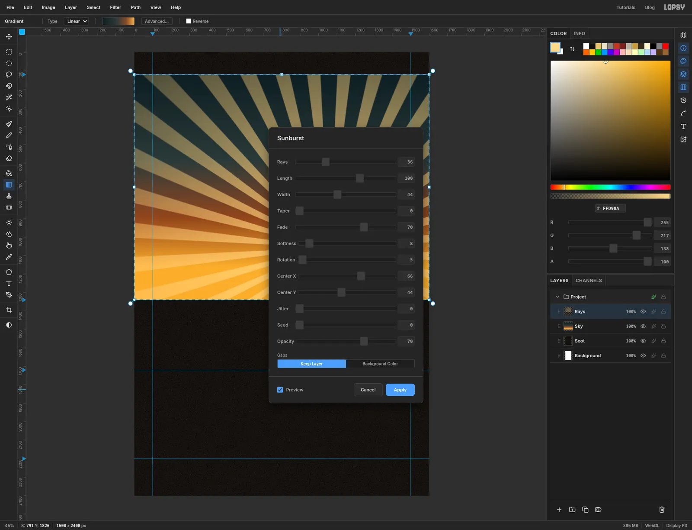

Click **Add Layer** and name it `Rays`. Set the foreground to `#FFD98A`. Sunburst paints in the foreground colour.

Choose **Filter → Sunburst…** and set:

- **Rays** `36`, **Width** `44`, **Fade** `70`, **Softness** `8`, **Rotation** `5`
- **Center X** `66` and **Center Y** `44`, which puts the sun at about **1056, 1056**, low on the horizon and right of centre
- **Opacity** `70`

Click **Apply** and press [[Cmd+D]]. The selection you kept confines the rays to the hero.

Click the **✦** button on the `Rays` row to open the effects drawer and change the blend mode to **Soft Light**. The rays turn from flat stripes into bands of light that take their colour from the sky behind them. Close the drawer.

Before you go on, open the **View** menu and untick **Snap to Guides**. From here you'll draw many small shapes near the margins, and you don't want them jumping onto a guide. Later steps still marquee full-width bands between guides. For those, either watch the **Y** readout in the status bar as you drag, or tick **Snap to Guides** for that one marquee and untick it again afterwards.

## Cut the mountains

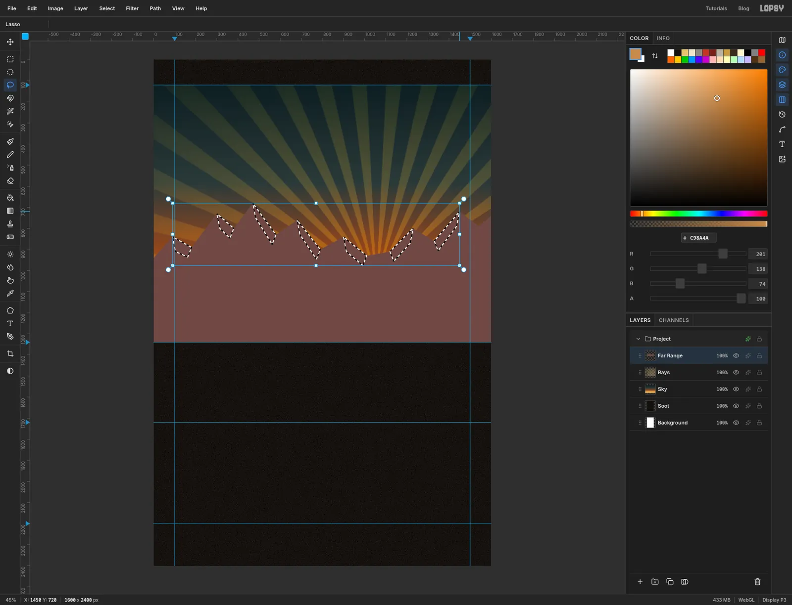

Click **Add Layer** and name it `Far Range`. Pick the **Lasso** (**L**) and draw a jagged range right across the hero: start off the left edge at about **y 940**, zigzag up and down across the page with peaks between **y 680** and **y 840** and valleys between **y 800** and **y 930**, dip to its lowest around **x 1050** where the sun sits, and finish off the right edge. Then run down the right side, along the **1340** guide and back up to the start. Fill with `#6A4A45` and press [[Cmd+D]].

Straight segments are what you want here. The poster look comes from flat, faceted shapes.

Now light the peaks. Each peak gets one bright face on the side that looks at the sun: the right side for peaks left of **x 1056**, the left side for peaks right of it. With the Lasso, draw a narrow four-sided sliver from a summit down its sunward slope to the valley. Hold [[Shift]] and draw the next one, and keep going until every peak has one. Fill them all at once with `#C98A4A` and press [[Cmd+D]].

## Add the near range

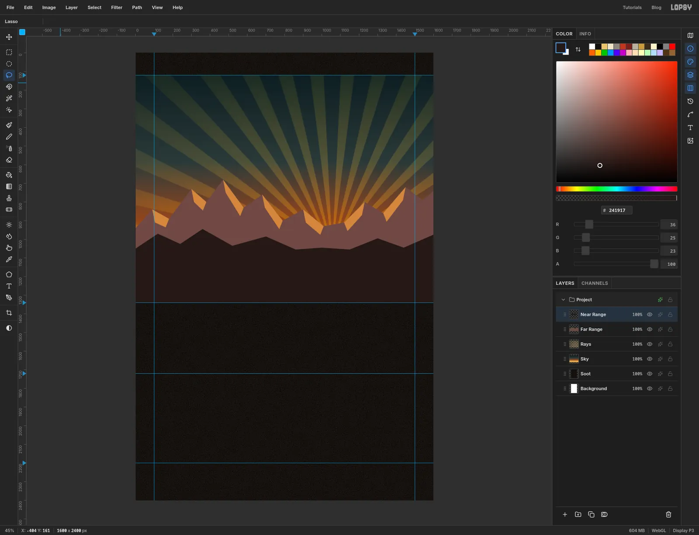

Click **Add Layer** and name it `Near Range`. Lasso a second, lower range in front of the first, with gentle peaks between **y 945** and **y 1055**, closing along the **1340** guide. Fill it with `#241917`.

Three values now do the work of depth: bright sky, mid-tone far range, dark near range. The train will sit against the dark one, which is why its steel will stand out.

## Build the trestle

Click **Add Layer** and name it `Trestle`. With the marquee, drag three full-width bars and fill each one:

- the rail, from **y 1210** to **1217**, in `#B9B1A0`
- the girder, from **y 1217** to **1257**, in rust `#5A3220`
- a highlight along the top of the girder, from **y 1217** to **1222**, in `#8C5A30`

Pick the **Brush** (**B**), set **Size** `14` and **Hardness** `100`, and set the foreground to dark rust `#4A2A1C`. Click at **100, 1257**, then [[Shift]]-click at **100, 1340**. Shift-click draws a straight line from the last point, so that's one post. Repeat every **200** px across the page, ending at **x 1500**.

Drop the **Size** to `6` and draw the bracing the same way: in each bay, click the top of one post and [[Shift]]-click the bottom of the next, then click the top of that next post and [[Shift]]-click the bottom of the first.

For the rivets, pick the **Pencil** (**N**) at **Size** `5`, set the foreground to brass `#C99A3B`, and click a dot every **40** px along **y 1240**.

## Draw one wheel truck

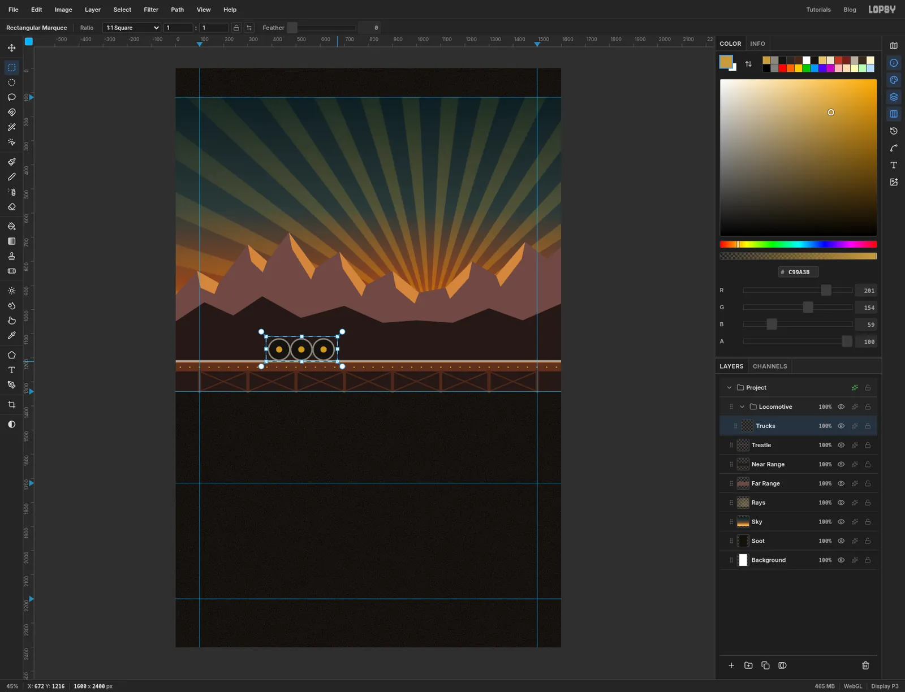

Click **New Group** in the Layers panel and name the group `Locomotive`. With the group selected, click **Add Layer** and name it `Trucks`. A new layer goes inside the selected group.

Pick the **Shape** tool (**U**) and set **Shape** to **Rectangle**. Click the **Fill** swatch and set it to `#2B2622`, leave **Stroke** off, and set **Corner Radius** `8`. Drag from the centre at **522, 1171** out to **658, 1192** for the truck frame.

Switch **Shape** to **Ellipse**. Set **Fill** to `#141210`, click the **—** next to **Stroke** to add a stroke, set its colour to steel `#8A867C` and **Width** `6`. Draw three wheels **88** px across, centred at **430, 1166**, **522, 1166** and **614, 1166**. Their bottoms rest on the rail.

Remove the stroke (click the Stroke swatch, then **Remove stroke**), set **Fill** to brass `#C99A3B`, and draw a **26** px hub in the middle of each wheel.

Now pick the **Rectangular Marquee** and drag around the whole truck, from about **376, 1112** to **672, 1216**.

## Paste two more trucks

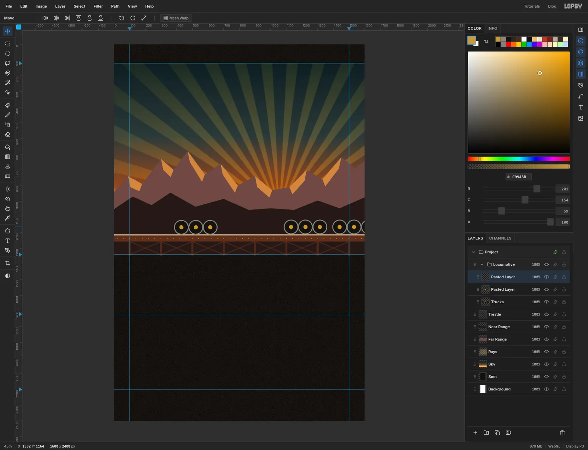

Press [[Cmd+C]], then [[Cmd+V]]. The copy arrives on its own `Pasted Layer`. Pick the **Move** tool (**V**) and drag it right, holding it level, until its left wheel starts at about **x 1083**. Check that its wheels still sit on the rail.

Press [[Cmd+V]] again and drag the second copy to **x 1393**. It hangs off the right edge of the page. That's the first truck of the coach, and letting the train run off the page makes it feel longer than the screen.

Press [[Cmd+D]]. With the top `Pasted Layer` selected, press [[Cmd+E]] twice to merge both copies down into `Trucks`.

## Shape and shade the body

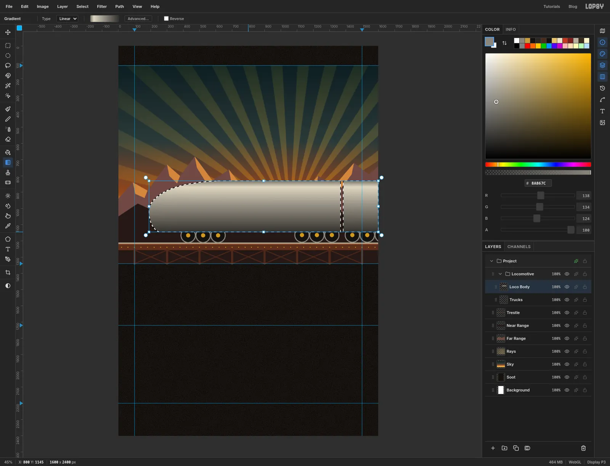

Click **Add Layer** and name it `Loco Body`. The engine is a long box, **315** px tall, with a bullet nose on the left: the front bulges forward to a blunt tip about halfway up, then leans back as it rises and flattens into the roof.

With the **Lasso**, start under the nose at about **250, 1145**. Curve up and out to the tip at about **190, 1000**, then sweep back up to the right so the line has levelled into the roof by **x 640**, at **y 830**. Run straight along the roof to **x 1368**, drop straight down to **y 1145** and come back along the bottom to where you started.

Take the nose slowly. It's the one curve on the page that has to be smooth. If it wobbles, press [[Cmd+Z]] and draw it again.

Add the coach: pick the **Rectangular Marquee**, hold [[Shift]] and drag from **1384, 830** to the right edge at **y 1145**. The narrow gap between the two is where the coupling goes.

Pick the **Gradient** tool, open **Advanced…** and set five stops: `#77736A` at the left, `#DDD6C2` at **12%**, `#9A958A` at **45%**, `#5A5750` at **80%** and `#34322F` at the right. Drag from the roof at **y 830** straight down to **y 1145**. The bright stop near the top is the highlight on a rounded roof, and the dark end tucks the belly into shadow.

With the selection still active, choose **Filter → Texture…**, click **Streaks**, set **Amount** `10` and **Size** `2`, and click **Apply**. Streaks at angle 0 run along the body like brushed steel. Keep the amount low. At high amounts it stops looking like metal and starts looking like wood grain. Press [[Cmd+D]].

The body covers the top of the wheels, which is what a streamliner's side skirts do.

## Paint the livery

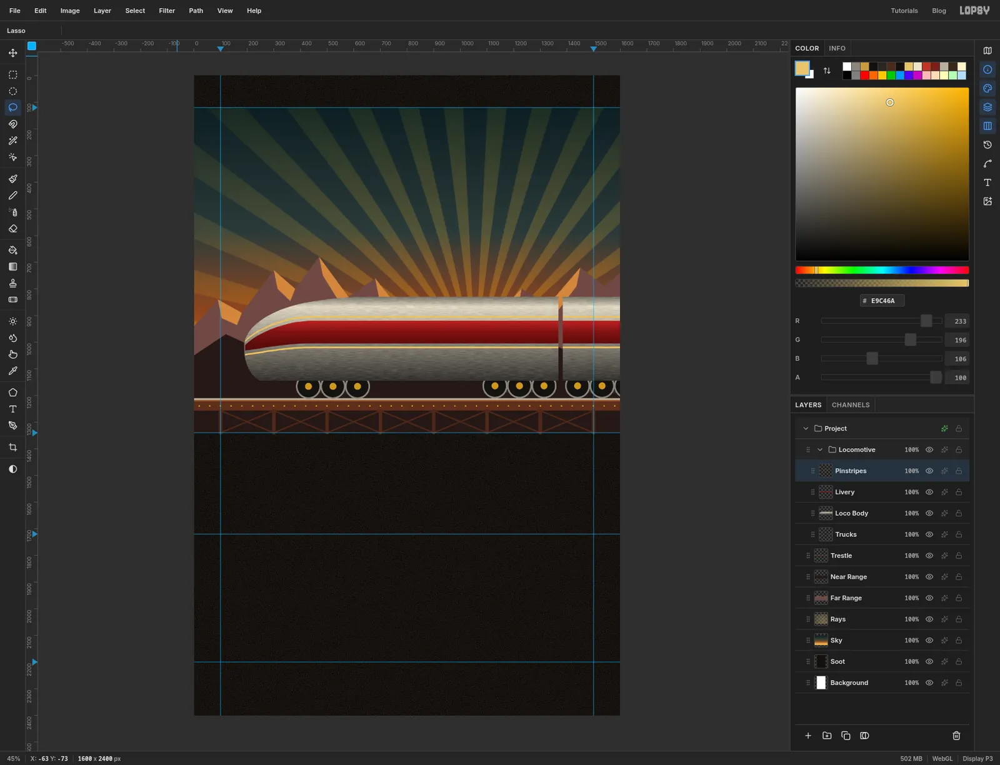

Click **Add Layer** and name it `Livery`. With the Lasso, draw a band that starts as a point on the nose at about **192, 1020**, opens out as it sweeps back, and settles into a straight stripe from **y 920** to **y 1005** by about **x 440**. Carry it right off the right edge of the page.

Pick the **Gradient** tool and set three stops: `#B0342B`, oxblood `#7A1F1A` at **45%**, and `#541410`. Drag from the top of the band to the bottom, then press [[Cmd+D]]. A lighter top edge makes the band look like it wraps around the body.

The band probably overshoots the nose and bridges the coupling gap. Trim it to the body: hold [[Cmd]] and click the `Loco Body` thumbnail to load its outline as a selection, click the `Livery` row, choose **Select → Inverse** and press [[Delete]]. Press [[Cmd+D]].

Click **Add Layer** and name it `Pinstripes`. Two thin gold stripes follow the band, one **18** px above its top edge and one **12** px below its bottom edge, each about **6** px deep. A freehand lasso won't hold a line that thin for 1,200 px, so build each stripe in two parts: drag a **Rectangular Marquee** for the long straight run from about **x 440** to the right edge, then pick the **Lasso**, hold [[Shift]] and add the short curved tail that follows the band down the nose. Add the second stripe to the same selection with [[Shift]] too. Fill with gold `#E9C46A` and trim to the body the same way as the band.

## Cut the roof

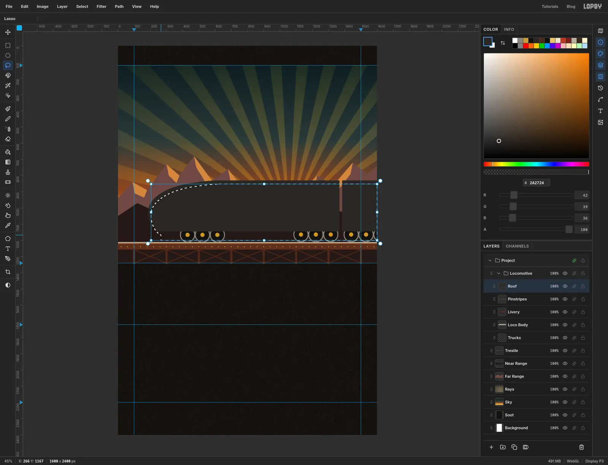

A dark roof that follows the curve of the nose is easy to get by subtraction. Click **Add Layer** and name it `Roof`. [[Cmd]]-click the `Loco Body` thumbnail, set the foreground to iron `#2A2724`, choose **Edit → Fill** and press [[Cmd+D]]. The whole train goes dark.

Now cut away everything except a strip along the top. With the Lasso, trace the top edge of the body again, but about **22** px lower and **16** px further right, from the nose to the right edge. Then loop down around the bottom of the train and back to the start. Press [[Delete]] and [[Cmd+D]].

## Finish the roof and stacks

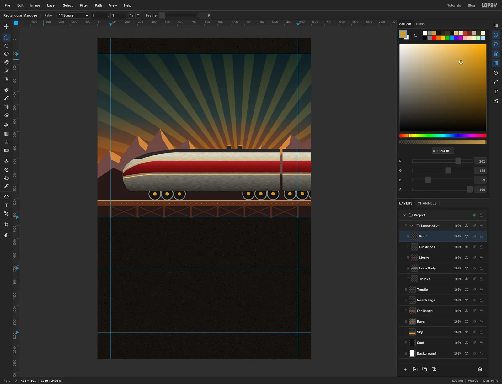

A thin dark edge is left running down the front of the nose. Remove it: drag a marquee over the nose below **y 905** and left of **x 440**, and press [[Delete]]. The roof now thins out to nothing as it comes over the cab.

Add two exhaust stacks on the same layer. Lasso a small trapezoid sitting on the roof, **34** px wide at the base and **26** px tall, at **x 968**, and [[Shift]]-lasso a second at **x 1048**. Fill with iron. Then marquee a **30 × 5** px cap on top of each and fill it with brass `#C99A3B`.

## Add seams and rivets

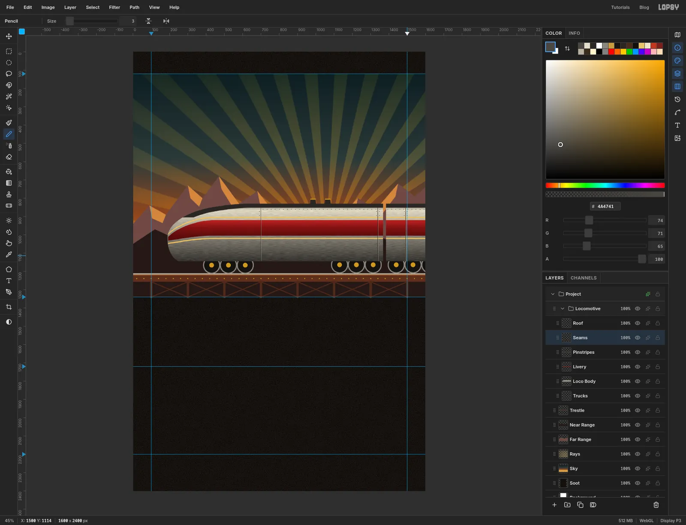

Flat steel reads as plastic. Seams and rivets say it was built in a shop. Click the `Pinstripes` row, click **Add Layer** and name it `Seams`, so it sits under the roof.

Pick the **Pencil** at **Size** `2` with the foreground on iron. Click the body just under the roof at **x 700** and [[Shift]]-click at the bottom edge for a vertical seam. Do the same at **x 1340** and **x 1492**. Then switch to **Size** `1` and `#E5DECB`, and draw a second line **2** px to the right of each. A dark line with a light one beside it looks like a lapped joint catching the light.

For the rivets, set **Size** `3` and the foreground to `#4A4741`, and click dots about **22** px apart:

- along the bottom of the body at **y 1134**
- under the roof at **y 861**, from the first seam back
- in a short column on each side of every seam, above and below the red band

It's a lot of clicking, and it's the cheapest detail on the page for what it adds.

## Fit the glass, grille and pilot

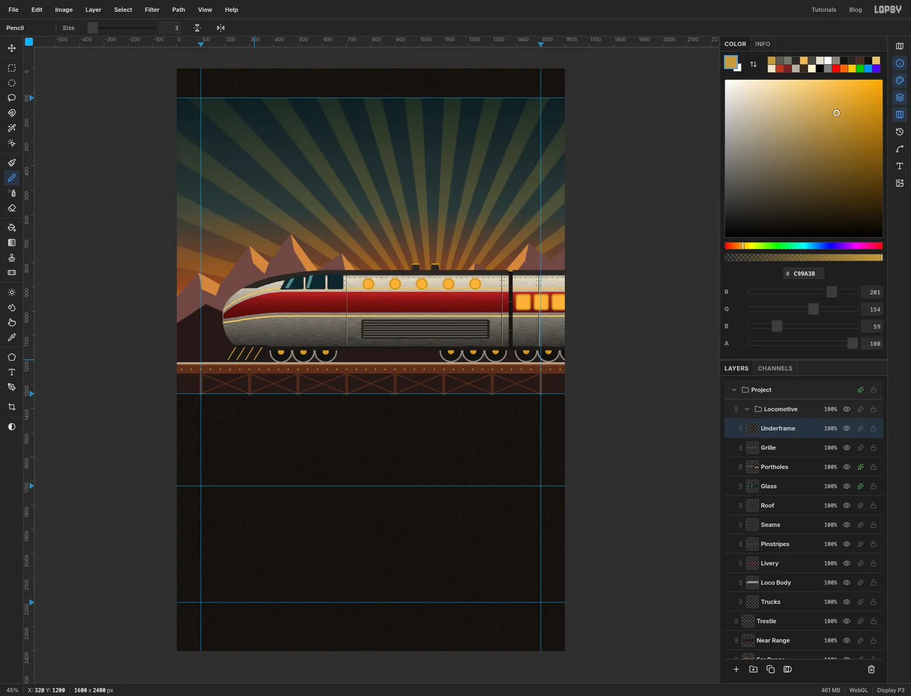

Each of these goes on its own layer inside `Locomotive`, above `Roof`.

- **`Glass`.** Lasso three cab windows between **y 846** and **y 908**: a windscreen that slants forward at the front, from about **x 430** to **520**, then two upright panes ending at **x 684**. Fill with `#14262B`. Lasso two thin slanted slivers inside the front panes and fill them with `#5E8A8C` for reflections. Open the effects drawer, tick **Stroke** and set **Width** `3` in iron.
- **`Portholes`.** With the **Shape** tool on **Ellipse**, fill lamp amber `#F2B552` and stroke brass at **Width** `6`, draw five **42** px portholes centred on **y 887** at **x 790, 900, 1010, 1120** and **1230**. Switch to **Rectangle** with **Corner Radius** `8` and stroke **Width** `5`, and draw three coach windows inside the red band, each about **56 × 60** px, centred on **y 962** at **x 1428, 1502** and **1576**. The last one runs off the page. Open the effects drawer, tick **Outer Glow** and set **Size** `14`, **Opacity** `60` and the colour to `#FFB347`.
- **`Grille`.** Draw a rectangle in iron, radius `8`, that spans **x 760–1290** and **y 1034–1114**: press at its centre, **1025, 1074**, and drag to the bottom-right corner. Then with the **Pencil** at **Size** `3` in `#77736A`, [[Shift]]-click seven horizontal slats across it, **10** px apart.
- **`Underframe`.** Marquee and fill a soot-dark `#1B1816` skirt along the bottom of the body from **y 1145** to **1161**, and fill the coupling gap between the engine and coach with `#171412`.

For the pilot, stay on `Underframe` and lasso a wedge under the nose: about **140** px wide where it meets the body at **y 1140**, kicking forward to the left as it drops, and **180** px wide where it meets the rail. Fill it with `#1B1816`, then pencil four slanted brass bars across it at **Size** `3`.

## Light the headlight

Click **Add Layer** and name it `Nose Plate`. Draw a **100 × 50** px rounded rectangle centred at **336, 1081**, low on the nose, filled oxblood with a gold `#E9C46A` stroke at **Width** `4`. Set the type on it: `No. 9` in **Black Ops One** at **24** in cream `#EFE3C8`, centred on the plate. Then set `YUKON  BULLET` (two spaces) in **Black Ops One** at **46** in cream and centre it in the red band above the grille.

Click **Add Layer**, name it `Headlight`, and draw a **52** px ellipse centred at **240, 967**, filled `#FFF3C9` with a brass stroke at **Width** `7`. In the effects drawer tick **Outer Glow** and set **Size** `50`, **Opacity** `95` and the colour to `#FFD36B`.

Click **Add Layer** and name it `Beam`. Lasso a wedge that starts narrow at the lamp and opens out to the left edge of the page, from about **y 830** to **y 1110** there. Choose **Select → Feather…** and enter `16`. In the Gradient Editor, set both stops to `#FFE9A8`. Each stop's colour picker has an **Opacity** slider under the hue bar: set the first stop to about **90%** and the second to about **5%**. Drag from the lamp to the left edge, and press [[Cmd+D]]. Set the layer's blend mode to **Screen** so the beam only ever lightens what's behind it.

## Trail the exhaust

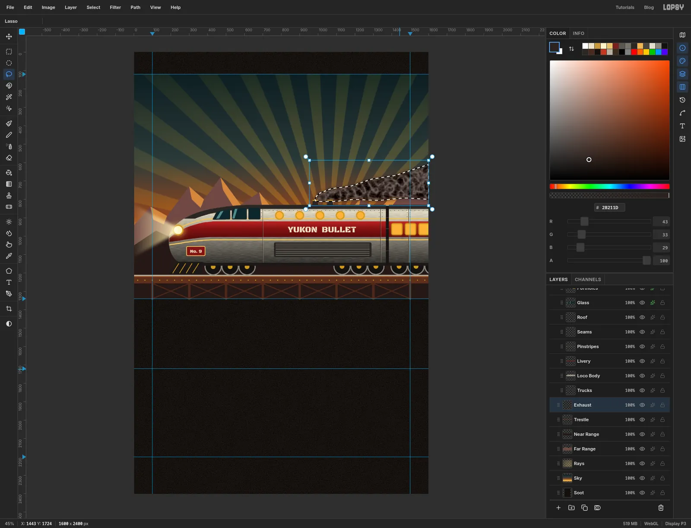

The smoke goes behind the train. Click the `Trestle` row, click **Add Layer** and name it `Exhaust`. Lasso a plume that starts at the stacks and widens as it trails up and to the right, reaching from about **y 610** to **y 800** at the right edge. Make its top edge lumpy. Choose **Select → Feather…** and enter `22`.

Fill it with `#2B211D`. Then choose **Filter → Texture…**, click **Rough**, and set **Amount** `45`, **Size** `40` and **Detail** `60`. Rough at a large size breaks the flat fill into billows.

## Blur the smoke

Press [[Cmd+D]] and choose **Filter → Motion Blur…** with **Angle** `0` and **Distance** `50`. The smoke streaks back along the direction of travel. Click the opacity percentage on the `Exhaust` row and set it to **85%**.

Dark, dirty smoke is the difference between this and a travel poster. Deco is clean. Dieselpunk has soot on it.

## Set the headline

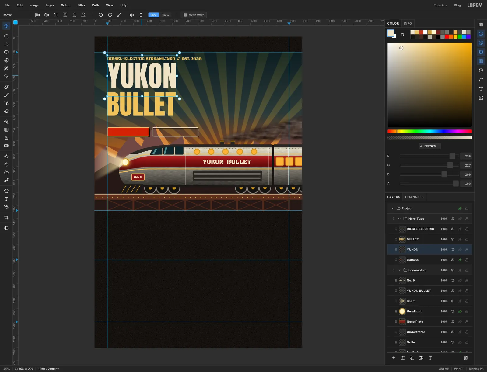

Click the `Locomotive` group, click **New Group** and name it `Hero Type`. It lands inside `Locomotive`, because that's the group you had selected. Drag it by the grip at the left of its row up onto the top edge of the `Locomotive` row, so it sits on its own above it. You'll do the same for every section group from here on. Inside it, add a layer named `Buttons`. You'll draw on it shortly, and it gives you an ordinary layer to click before each new text.

Set three lines of type, all with their left edge on the **100** guide:

- `DIESEL-ELECTRIC STREAMLINER  //  EST. 1938` in **Black Ops One** at **30**, gold, with the top of the letters at **y 158**
- `YUKON` in **Anton** at **226**, cream, with the letters from **y 200** to **y 398**
- `BULLET` in **Anton** at **210**, gold, starting at **y 428**

The two sizes are different on purpose. `YUKON` has five letters and `BULLET` has six, so at the same size the lines end raggedly. At **226** and **210** both come out about **527** px wide and the headline locks up into one block.

## Finish the hero type

Click `YUKON`, open its effects drawer, tick **Drop Shadow** and set **Offset X** `8`, **Offset Y** `8`, **Blur** `0`, **Opacity** `100` and the colour to oxblood. With zero blur the shadow is a solid offset copy, like a second ink on a poster. Give `BULLET` the same shadow.

Set the sub-copy: `WHITEHORSE TO DAWSON CITY IN SIX HOURS FLAT.` in **Barlow Condensed** at **40**, cream, left edge on the guide, top of the letters at **y 640**.

Click `Buttons` and draw two rounded rectangles with **Corner Radius** `8`:

- the main button, **320 × 68** px with its left edge on the **100** guide and its top at **y 700** (centre **260, 734**), filled signal red `#C2361F` with a gold stroke at **Width** `4`
- a second one beside it, **354** px wide and the same height (centre **623, 734**), with no fill and a cream stroke at **Width** `3`

Give `Buttons` a **Drop Shadow** with **Offset X** `6`, **Offset Y** `6`, **Blur** `0` in soot.

Set `BOOK PASSAGE` in **Black Ops One** at **30** in `#FFF3C9` and `SEE THE TIMETABLE` at **26** in cream. Centre each in its button: equal space left and right, and equal space above and below the capitals. There's **60** px of clear sky between the buttons and the roof of the train, so nothing crowds.

## Build the fare seal

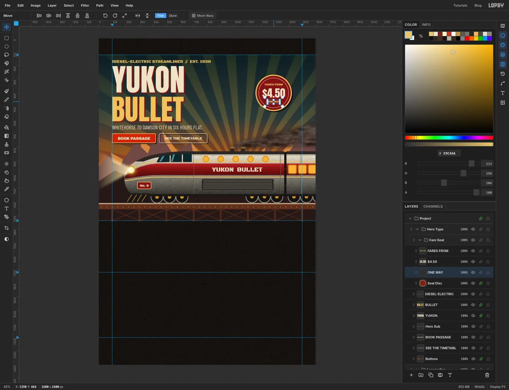

Click the `Hero Type` group, click **New Group** and name it `Fare Seal`. It nests inside `Hero Type`, which is where you want it. Add a layer named `Seal Disc`.

With the **Shape** tool on **Ellipse**, draw a **260** px disc centred at **1290, 400**, filled oxblood with a gold stroke at **Width** `8`. Then, with no fill and a cream stroke at **Width** `2`, draw a **220** px ring on the same centre. Give the layer a hard **Drop Shadow**: `8`, `8`, **Blur** `0`, soot.

Set three centred lines inside the ring:

- `FARES FROM` in **Black Ops One** at **20**, gold, near the top
- `$4.50` in **Anton** at **78**, cream, dead centre
- `ONE WAY` in **Black Ops One** at **20**, gold, near the bottom

Check the price against the inner ring. Text in a circle has less room than it seems, because the ring closes in above and below the middle. At **78** the `$` and the last `0` clear the ring by about **25** px on each side.

## Tilt the seal

Click the `Fare Seal` group so the whole group is selected, and make sure nothing is selected on the canvas ([[Cmd+D]]). Pick the **Move** tool. Handles appear around everything in the group. Drag just outside a corner to rotate, and turn the seal about **10°** anticlockwise, so the price climbs to the right. The disc, the ring and all three lines of text turn together, and the text stays editable. Press [[Cmd+D]] to commit the turn.

A tilted seal on a square grid looks stamped on afterwards, which is the point.

## Rivet the nav bar

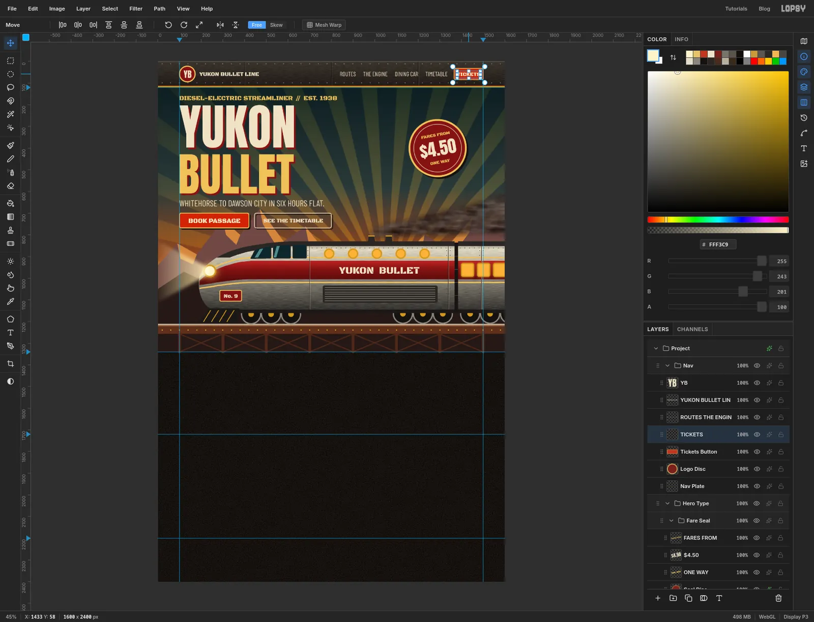

Click the `Hero Type` group, click **New Group**, name it `Nav` and drag it out above `Hero Type`, to the top of the stack. Inside it, add a layer named `Nav Plate`.

Marquee the strip above the **120** guide. Fill it with a two-stop gradient from `#3A342E` at the top to `#1E1A17` at the bottom, then apply **Filter → Texture…** with **Streaks**, **Amount** `6` and **Size** `1.5`. Press [[Cmd+D]].

Dress the plate, all on the same layer:

- a brass bar along the bottom from **y 113** to **120**, with a **2** px oxblood line just above it, and a **2** px `#5A544C` highlight along the very top
- three vertical plate seams with the Pencil at **x 400**, **800** and **1200**: a **2** px soot line with a **1** px `#5A544C` line beside it
- rivets at **Size** `4` in `#77736A`, every **40** px along **y 12** and **y 100**

Add a layer named `Logo Disc` and draw a **72** px oxblood disc with a gold stroke at **Width** `5`, with its left edge on the **100** guide and centred on **y 58**. Then set the type, all centred on **y 58**:

- `YB` in **Anton** at **40**, cream, centred in the disc
- `YUKON BULLET LINE` in **Black Ops One** at **26**, cream, starting at **x 192**
- `ROUTES      THE ENGINE      DINING CAR      TIMETABLE` (six spaces between each) in **Barlow Condensed** at **28**, cream, ending about **30** px short of where the button will go

Add a layer named `Tickets Button`, draw a signal-red rounded rectangle, **134 × 52** px with its right edge on the **1500** guide (centre **1433, 58**), with a gold stroke at **Width** `3`, and centre `TICKETS` in it in **Black Ops One** at **24**.

Look at where the plate seams fall. In the screenshot the seam at **x 1200** runs through the end of `DINING CAR`. A seam through a word looks like a mistake, so select the links and nudge them left with the arrow keys, about **18** px, until that seam sits in the gap before `TIMETABLE`.

## Build the gauge band and paint the ticks

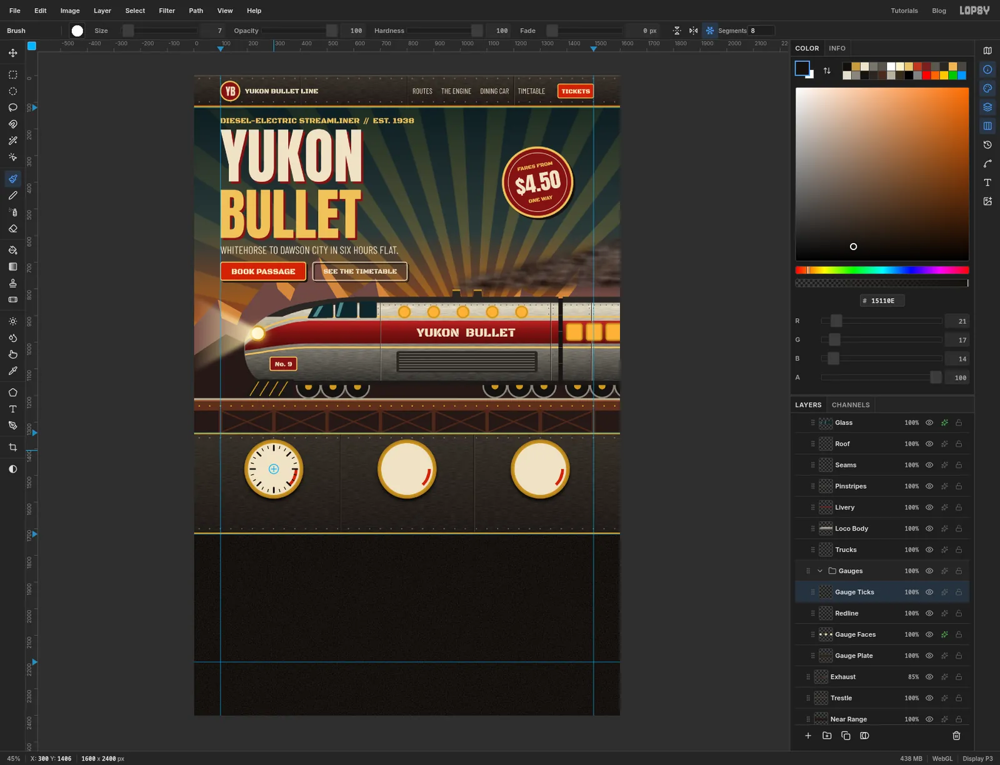

Click the `Exhaust` row, click **New Group** and name it `Gauges`. Add a layer named `Gauge Plate`, marquee the band between the **1340** and **1720** guides, and repeat what you did for the nav plate:

1. Fill the marquee with a two-stop gradient from `#37312B` at the top to `#1F1B18` at the bottom.
2. Apply **Filter → Texture…** with **Streaks**, **Amount** `6` and **Size** `1.5`, then press [[Cmd+D]].
3. Marquee a **6** px bar along the very top of the band and another along the very bottom, and fill both with brass.
4. With the Pencil, draw plate seams from bar to bar at **x 550** and **x 1050**: a **2** px soot line with a **1** px `#5A544C` line beside it. They fall between the dials.
5. Click rivets at **Size** `4` in `#77736A` every **40** px, in one row **20** px below the top bar and one **14** px above the bottom bar.

Add a layer named `Gauge Faces`. With the **Shape** tool on **Ellipse**, fill cream and stroke brass at **Width** `14`, draw three **208** px dials centred at **300, 1476**, **800, 1476** and **1300, 1476**. In the effects drawer tick **Inner Glow** (**Size** `26`, **Opacity** `55`, colour `#3A2A1A`) and **Drop Shadow** (**Offset Y** `10`, **Blur** `18`, **Opacity** `80`, black). The inner glow shades the rim so the face sits down inside the bezel.

Add a layer named `Redline`. Lasso a short curved band just inside the rim of each dial, from the 3 o'clock position round to between 4 and 5 o'clock, and fill all three with signal red.

Add a layer named `Gauge Ticks`. Pick the **Brush** at **Hardness** `100` with the foreground on soot, and click **Radial Symmetry** in the options bar. A **Segments** field appears. For each dial:

1. [[Cmd]]-click the centre of the dial. That moves the symmetry centre there without painting.
2. Set **Segments** `24` and **Size** `4`, and paint one short stroke at 12 o'clock, from **88** px above the centre down to **79** px above it. Twenty-four minor ticks appear.
3. Set **Segments** `8` and **Size** `7`, and paint a longer stroke from **88** to **70** px above the centre for the major ticks.

Click **Radial Symmetry** again to turn it off.

## Erase the bottom of each scale

A real gauge has a gap at the bottom. Pick the **Eraser** (**E**) at **Size** `30`, stay on `Gauge Ticks`, and wipe a short arc across the bottom of each dial, between about 5 and 7 o'clock. Leave the major ticks at lower left and lower right. Those are zero and full scale.

The red arc now sits under the last two major ticks, where a redline should be.

## Number the scales

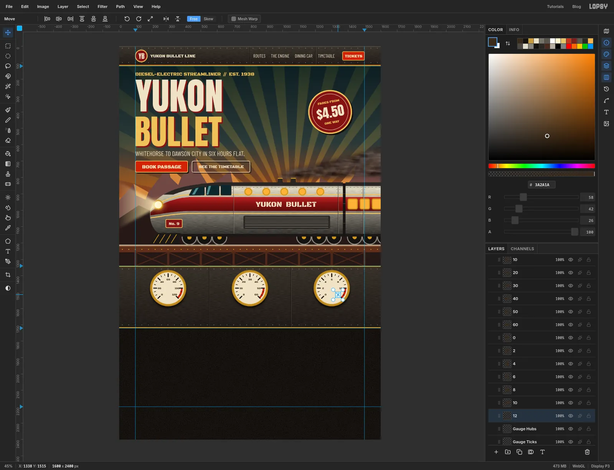

Add a layer named `Gauge Hubs` above `Gauge Ticks`. You'll draw on it in the next step, and for now it's the layer to click before each numeral.

Each dial has seven major ticks, so each gets seven numbers, set in **Black Ops One** at **15** in `#3A2A1A` and placed just inside its tick:

- first dial: `0`, `20`, `40`, `60`, `80`, `100`, `120`
- second dial: `0`, `10`, `20`, `30`, `40`, `50`, `60`
- third dial: `0`, `2`, `4`, `6`, `8`, `10`, `12`

Zero goes at lower left and the numbers climb clockwise. Then set a unit label in the gap at the bottom of each face, in **Black Ops One** at **18** in oxblood: `MPH`, `HP x 100` and `HOURS`.

Twenty-one tiny text layers is tedious, but numerals are what turn three clocks into three instruments.

## Turn the needles

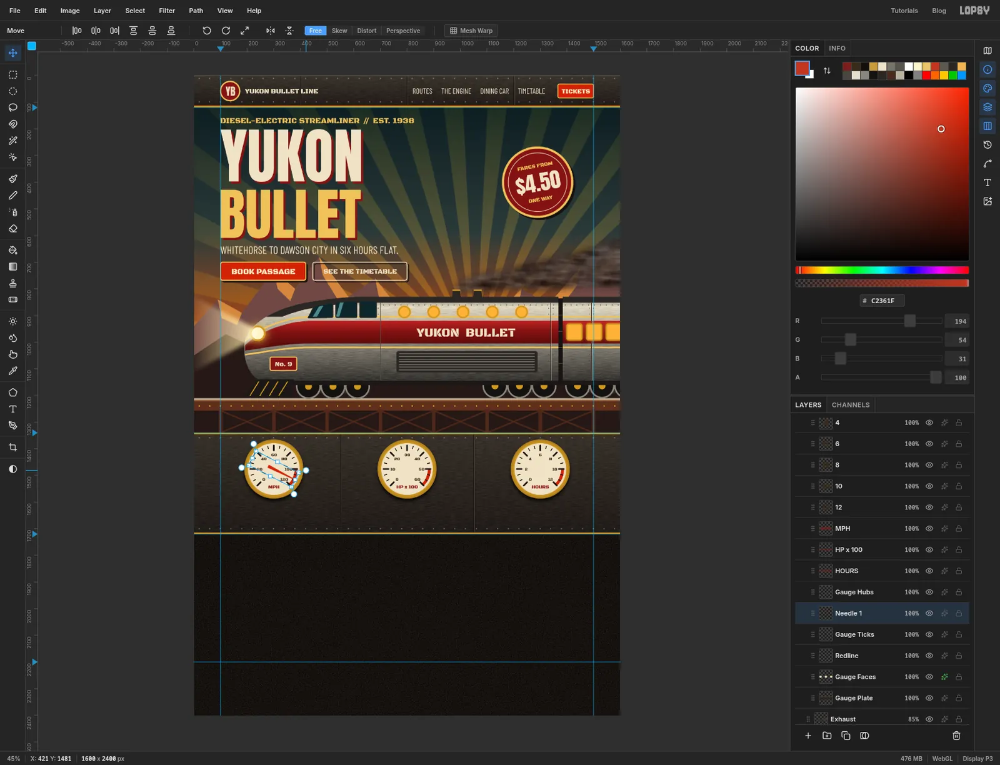

Click `Gauge Ticks`, add a layer and name it `Needle 1`. On the first dial, lasso a long thin needle pointing straight up: about **12** px wide at a tail **24** px below the centre, tapering to a point **80** px above it. Fill with signal red.

Now drag a **Rectangular Marquee** around the needle that's centred on the dial's centre: from **270, 1386** to **330, 1566**. The Move tool rotates a selection around the middle of the marquee, so centring the marquee on the hub makes the needle pivot where it should.

Pick the **Move** tool and drag just outside a corner of the box to swing the needle clockwise, past 3 o'clock, until its tip sits a little short of the `120` tick, well into the red. That's 112 on a 0–120 scale. Press [[Cmd+D]].

Make `Needle 2` and `Needle 3` the same way on the other two dials, each on its own layer and each with a marquee centred on its own hub. Turn the second clockwise until it points just past the `40` tick, and leave the third pointing straight up at `6`. Give each needle a soft **Drop Shadow**: **Offset X** `2`, **Offset Y** `3`, **Blur** `4`, **Opacity** `50`.

## Cap the hubs and caption the gauges

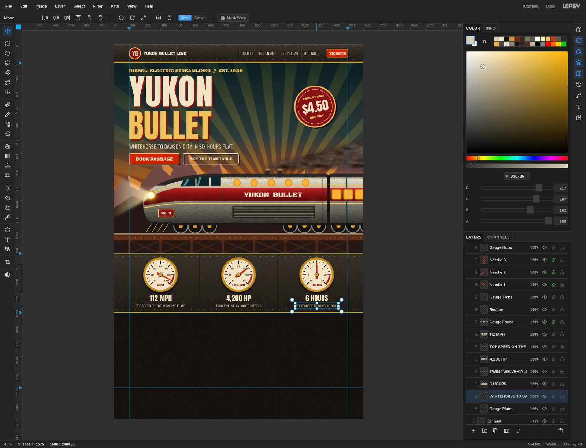

Click `Gauge Hubs` and draw a **24** px brass disc with a soot stroke at **Width** `3` on the centre of each dial. The needle layers were added above `Gauge Ticks`, which puts them under `Gauge Hubs`, so the discs cap the needles. If yours ended up the other way round, drag `Gauge Hubs` above `Needle 3`.

Under each dial, centred on it, set two lines:

- the figure in **Anton** at **46**, cream, with the top of the letters at **y 1606**: `112 MPH`, `4,200 HP`, `6 HOURS`
- a caption in **Barlow Condensed** at **26** in warm grey `#D9CFB6`, at **y 1666**: `TOP SPEED ON THE KLONDIKE FLATS`, `TWIN TWELVE-CYLINDER DIESELS`, `WHITEHORSE TO DAWSON, DAILY`

Thin condensed type on a textured plate needs a light colour. A mid grey would disappear here.

## Lay out the route

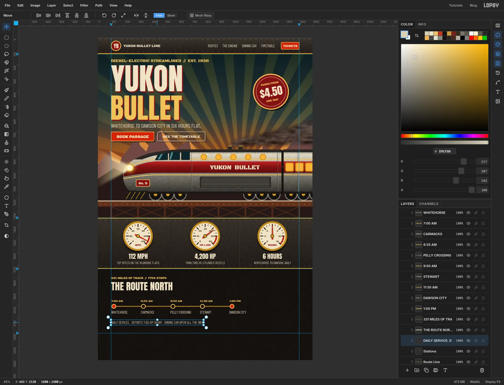

Click the `Gauges` group, click **New Group**, name it `Route` and drag it out above `Gauges`. Add a layer named `Route Line`. Pick the **Brush** at **Size** `6`, **Hardness** `100`, in brass. Click at **120, 2000** and [[Shift]]-click at **1000, 2000**.

Add a layer named `Stations`. With the **Shape** tool on **Ellipse** and a gold stroke at **Width** `5`, draw five **30** px dots on the line at **x 120, 340, 560, 780** and **1000**. Fill the first and last with signal red and the three between with soot.

Set the type:

- above each dot, the time in **Black Ops One** at **20**, gold: `7:00 AM`, `8:25 AM`, `9:50 AM`, `11:30 AM`, `1:00 PM`
- below each dot, the stop in **Barlow Condensed** at **28**, cream: `WHITEHORSE`, `CARMACKS`, `PELLY CROSSING`, `STEWART`, `DAWSON CITY`
- `331 MILES OF TRACK  //  FIVE STOPS` in **Black Ops One** at **22**, gold, at **y 1780**
- `THE ROUTE NORTH` in **Anton** at **72**, cream, at **y 1818**
- `DAILY SERVICE.  DEPARTS 7:00 AM SHARP.  DINING CAR OPEN ALL THE WAY.` in **Barlow Condensed** at **28**, warm grey, at **y 2110**

Line up each time and stop name with the left edge of its dot, not its centre. The first dot's left edge is on the **100** guide, so the whole section hangs from the same margin as the headline.

## Punch the ticket

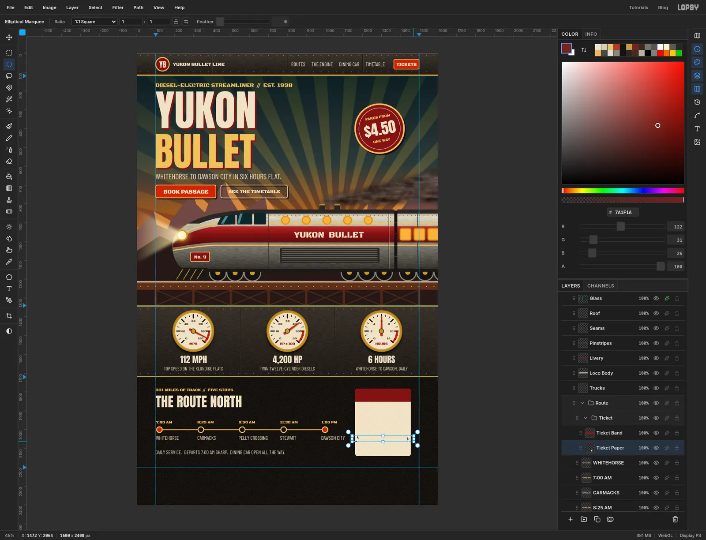

Click the `Route` group, click **New Group** and name it `Ticket`. Add a layer named `Ticket Paper`.

Draw a cream rounded rectangle with **Corner Radius** `12`, **296 × 358** px, centred at **1308, 1961**. Its left edge is at **x 1160** and its top at **y 1782**. Apply **Filter → Texture…** with **Grain**, **Amount** `12` and **Size** `2` for a card-stock tooth.

Add a layer named `Ticket Band`. Marquee the top **70** px of the ticket and fill it oxblood. Its square corners poke out past the ticket's round ones, so trim it: [[Cmd]]-click the `Ticket Paper` thumbnail, click `Ticket Band`, choose **Select → Inverse**, press [[Delete]] and then [[Cmd+D]].

Click `Ticket Paper`. Pick the **Elliptical Marquee** and set **Ratio** to **1:1 Square** in the options bar so it draws circles. Drag a **32** px circle that straddles the ticket's left edge, centred on **y 2048**, about three-quarters of the way down. Hold [[Shift]] and drag a matching circle on the right edge. Press [[Delete]] to punch both notches, then [[Cmd+D]].

## Print the ticket

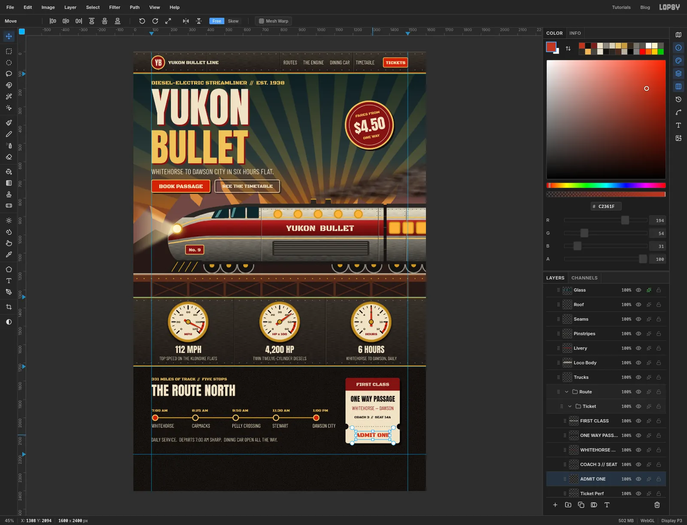

Give `Ticket Paper` a **Drop Shadow** with **Offset X** `10`, **Offset Y** `10`, **Blur** `0`, **Opacity** `70`, black.

Add a layer named `Ticket Perf` above the band. With the **Pencil** at **Size** `4` in steel, click a row of dots **12** px apart from one notch to the other.

Set five centred lines on the ticket:

- `FIRST CLASS` in **Black Ops One** at **26**, cream, in the middle of the band
- `ONE WAY PASSAGE` in **Anton** at **36**, soot
- `WHITEHORSE — DAWSON` in **Barlow Condensed** at **28**, oxblood
- `COACH 3  //  SEAT 14A` in **Black Ops One** at **18**, soot
- `ADMIT ONE` in **Black Ops One** at **32**, signal red, in the middle of the stub below the perforation

Keep at least **28** px between the widest line and the edges of the ticket. `ONE WAY PASSAGE` is the one to watch.

## Tilt the ticket

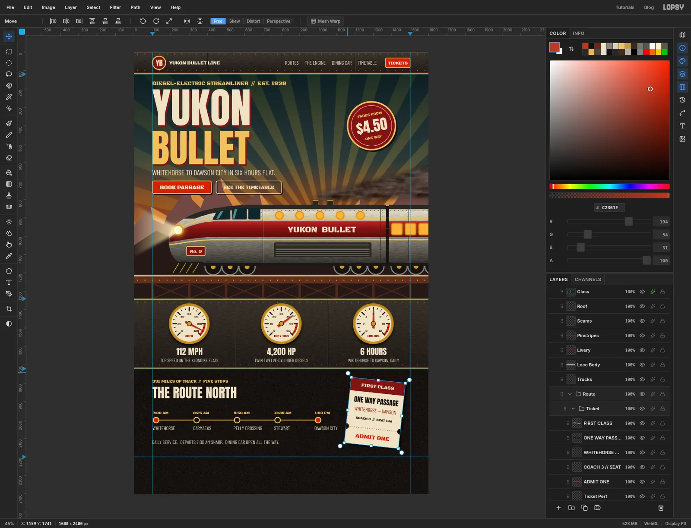

Click the `Ticket` group, press [[Cmd+D]] and pick the **Move** tool. Rotate the group about **6°** clockwise. Paper, band, notches, perforation and all five lines turn as one. Press [[Cmd+D]] to commit.

After the turn, the ticket's corners should stay inside the **1500** guide and clear of the brass bar above, and there should be a comfortable gap between `DAWSON CITY` and the ticket. If the ticket crowds either one, select the `Ticket` group and drag it with the Move tool.

## Stripe the footer

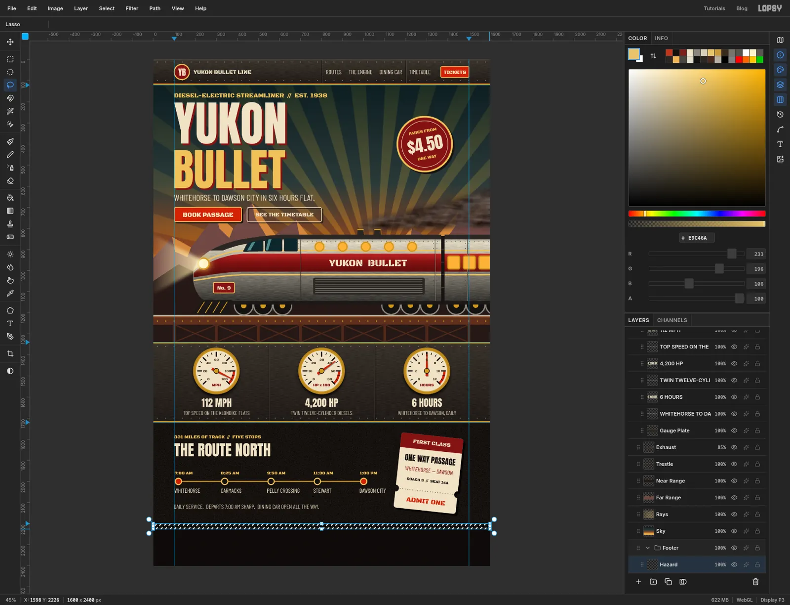

Click the `Soot` row, click **New Group** and name it `Footer`. Add a layer named `Footer Plate`, marquee from the **2200** guide to the bottom of the page and fill it with `#0E0B09`.

Add a layer named `Hazard`. Marquee a full-width band from **y 2200** to **2226** and fill it with soot. Then pick the **Lasso** and draw a slanted bar across the band: **22** px wide and leaning to the right, so its top is **26** px further right than its bottom. Hold [[Shift]] and draw the next one **44** px along. Keep going right across the page. Let each bar overshoot the band a little above and below. There are about three dozen bars, and they don't need to be identical: a hand-painted hazard stripe never is. If your wrist gives out, fill the first six, marquee that run, press [[Cmd+C]] and [[Cmd+V]], drag the copy along with the Move tool, and repeat, then merge the copies down with [[Cmd+E]].

Fill them all with gold. Then marquee the strip just above the band and press [[Delete]], and do the same just below it, to trim the overshoot to clean edges.

## Set the footer

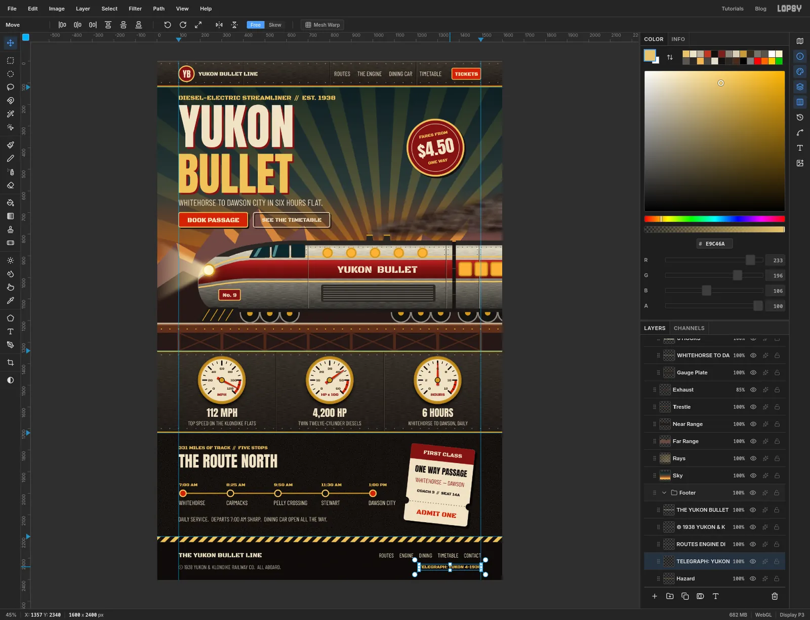

Set four lines in the footer, two on each margin:

- `THE YUKON BULLET LINE` in **Black Ops One** at **30**, cream, left edge on the **100** guide, at **y 2276**
- `© 1938 YUKON & KLONDIKE RAILWAY CO.  ALL ABOARD.` in **Barlow Condensed** at **26** in `#B9B1A0`, below it at **y 2332**
- `ROUTES     ENGINE     DINING     TIMETABLE     CONTACT` in **Barlow Condensed** at **26**, cream, level with the wordmark, with its right edge on the **1500** guide
- `TELEGRAPH: YUKON 4-1938` in **Black Ops One** at **20**, gold, level with the copyright line, right edge on the guide

There's no right-align needed for the last two. Set each one, then drag it until its last letter touches the guide.

## Darken the corners

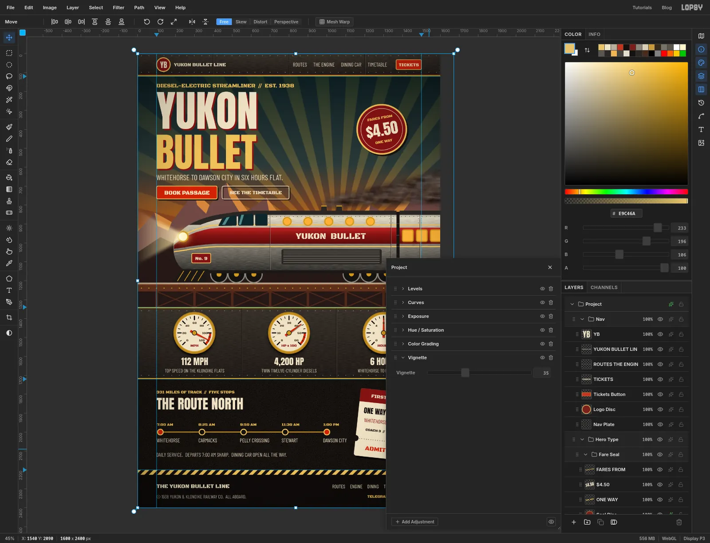

Click the **✦** button on the `Project` row at the very top of the Layers panel. On a group, the drawer shows adjustments, and on `Project` they apply to the whole page. Click **Add Adjustment**, choose **Vignette** and set it to `35`. The corners sink back and the eye stays on the headline and the headlight. Close the drawer.

## Add the grime

One last layer ties every section together. Add a layer named `Grime` and drag it to the very top of the stack, above `Nav`. Set the foreground to mid grey `#808080`, press [[Cmd+A]], choose **Edit → Fill** and press [[Cmd+D]].

Choose **Filter → Texture…**, click **Rough**, and set **Amount** `55`, **Size** `70` and **Detail** `70`. Then choose **Filter → Add Noise…** with **Amount** `6`. The page disappears behind grey marble for a moment.

Set the layer's blend mode to **Overlay** and its opacity to **24%**. Mid grey does nothing in Overlay, so only the lighter and darker patches show: steel, paint, type and sky all pick up the same uneven wear, as if the whole page had been through a few winters. Raise the opacity and it gets grubbier. Above about 35% the mountains start to look like marble, so stop before that.

Save your work with **File → Save Project**, and export with **File → Quick Export PNG**.

> **Tip:** To turn this comp into a page for a different machine, such as an airship line, a motor coach or a steamship, keep the nav, gauges, route line, ticket and footer as they are. Redraw only the vehicle in the hero and change the figures on the gauges.
