The **northern gannet** is Britain's biggest seabird. It fishes by folding
its wings and dropping head first into the sea at around sixty miles an
hour. The largest colony in the world is on **Bass Rock**, an island in the
Firth of Forth that turns white every summer with around 150,000 birds.

This tutorial turns a photo of one into a t-shirt print in the style of an
old **etching**. An engraver had no grey to work with. Every tone was a
line: lines that are thick and close together read as dark, and thin, widely
spaced lines read as light. Screen printers love the look for the same
reason. It prints with a few flat inks and no halftone.

The design is 1800 × 2250 px, which is a 12 × 15 inch print area at 150 dpi.
It has an arched window holding an engraved sky, a vermilion sun and a
broken-line sea. A gannet banks across the sun into its dive. A curved title
runs over the top, and a ribbon and a Latin caption sit underneath.

The bird uses a trick called a **line screen**. Lay soft stripes over a grey
photo at half opacity and run **Threshold**. Where the photo is dark, the
stripes swell into heavy lines. Where it's light, they thin out or vanish.

The tools you'll use:

- **guides**, the **Elliptical** and **Rectangular Marquee** with [[Shift]] and [[Alt]], and their exact-size dialog
- **Edit → Define Pattern** and **Fill with Pattern** for engraving lines
- **layer masks** painted with radial and linear gradients from the **Gradient Editor**
- **Filter → Sunburst**, **Gaussian Blur**, **Desaturate**, **Brightness/Contrast** and **Threshold**
- the **Pencil** with [[Shift]]-click straight lines, the **Lasso**, and the **Magic Wand** with Contiguous on and off
- [[Cmd]]-click on a layer thumbnail, including [[Cmd]]+[[Shift]]+[[Alt]]-click to intersect, and **Select → Grow**
- the **Move** tool's scale and rotate handles, **Flip Horizontal**, and moving a whole group
- **Duplicate Layer**, **Merge Down**, **Group Layers**, the **Multiply** blend mode and the **Stroke** effect
- the **Pen** tool, and type set on its path in **IM Fell English SC**, plus **IM Fell English** italic
- the **Spray** and **Eraser** tools, for wear that looks like a washed print

The palette is four inks on an oatmeal shirt:

- Shirt `#E9DFC9`, cream ink `#F6EEDC`
- Navy ink `#1B2230`
- Vermilion `#C9432B`, ribbon tails `#8E2A1C` / `#5E1A12`
- Ochre `#E2A13A` (the gannet's head)

You'll need one photo:
[Morus bassanus -flight-8.jpg](https://commons.wikimedia.org/wiki/File:Morus_bassanus_-flight-8.jpg)
by Cj Hughson on Wikimedia Commons, licensed **CC BY 2.0**. It shows a
gannet from below against a plain blue sky, which makes it easy to cut out.
Download the 1280 px version. If you print or sell the shirt, credit the
photographer.

Two habits will save you trouble throughout:

- New layers appear just above whichever layer is selected, so the steps
  tell you which layer to click first.
- The marquee's exact-size dialog opens when you click once on the canvas
  with **nothing** selected. If something is selected, the first click just
  deselects it, so press [[Cmd+D]] before you click.

## Set up the shirt and the guides

Choose **File → New** and make a document **1800** wide and **2250** high.
Lopsy wraps every new document's layers in a **Project** group. Leave it
there: everything you add goes inside it. Delete the empty **Layer 1**
with the bin button at the bottom of the Layers panel. Then click the
**Background** layer, set the foreground colour to the shirt colour
`#E9DFC9` and choose **Edit → Fill**.

Now drop guides by clicking the rulers. Hold [[Cmd]] and click the top ruler
near the middle: the guide snaps to exactly half way (900). Click the top
ruler again at about 340 and 1460 for the sides of the arch. Then click the
left ruler at about 900 (where the round top of the arch begins), 1440 (the
horizon) and 1880 (the bottom of the arch).

## Draw the arched window

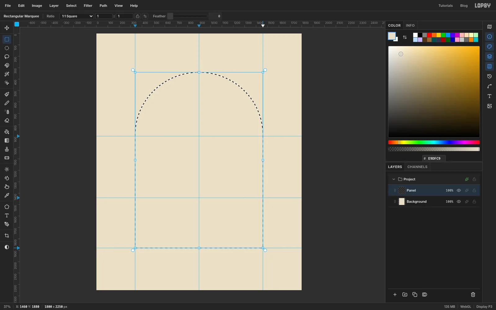

Add a new layer and name it **Panel**. Pick the **Elliptical Marquee** and
click once on the canvas to open the exact-size dialog. Enter From `340, 340`
To `1460, 1460` and click **Select**. That's a 1120 px circle whose middle
sits on the 900 guide.

Switch to the **Rectangular Marquee**, hold [[Shift]] and drag from where the
left guide meets the 900 guide down to where the right guide meets the 1880
guide. The corners snap to the guides, and [[Shift]] adds the rectangle to
the circle. Together they make one arch-shaped selection. Set the colour to
cream `#F6EEDC`, choose **Edit → Fill** and press [[Cmd+D]].

## Make two engraving patterns

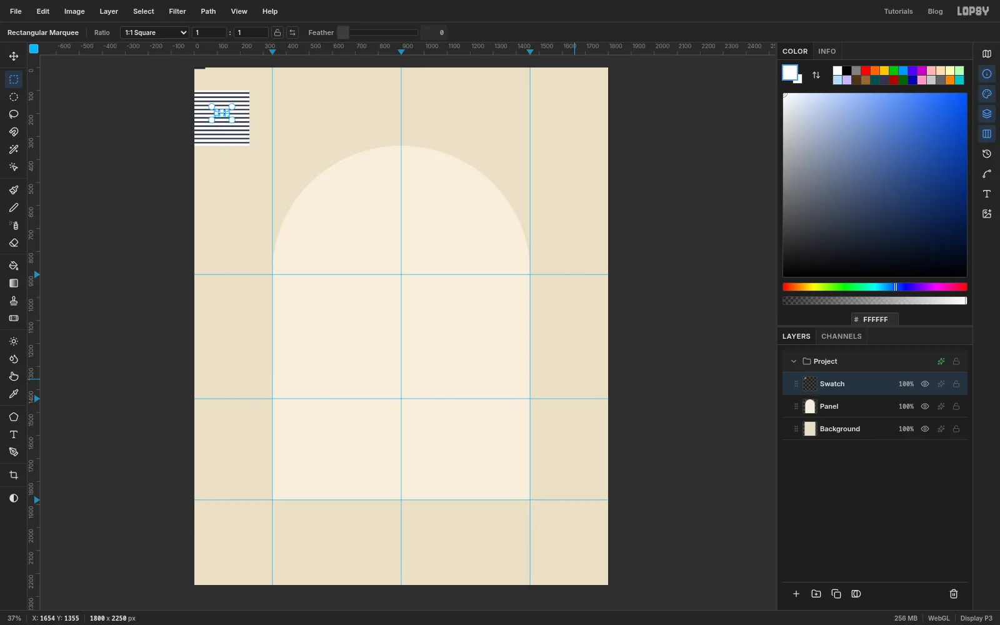

Engravings need lines, and a pattern makes them fast. Add a layer called
**Swatch**. With the **Rectangular Marquee**, click once to open the dialog
and enter From `0, 0` To `48, 6`. Fill it with navy `#1B2230`. Press
[[Cmd+D]], open the dialog again for `0, 0` to `48, 18`, then choose
**Edit → Define Pattern**. That's **Pattern 1**: a 6 px line with a 12 px gap.

The bird needs a softer stripe:

1. Press [[Cmd+D]] and select a larger square below the first, `0, 100` to
   `240, 340`.
2. Set the colour to white and fill it.
3. Choose **Edit → Fill with Pattern…**, pick Pattern 1 and click **Apply**.
4. Press [[Cmd+D]] and run **Filter → Gaussian Blur** with a radius of `3`.
5. Select one 48 × 18 tile from the middle of the blurred stripes
   (`96, 190` to `144, 208`) and choose **Define Pattern** again. That's
   **Pattern 2**.

Delete the Swatch layer. The patterns stay.

## Rule the sky

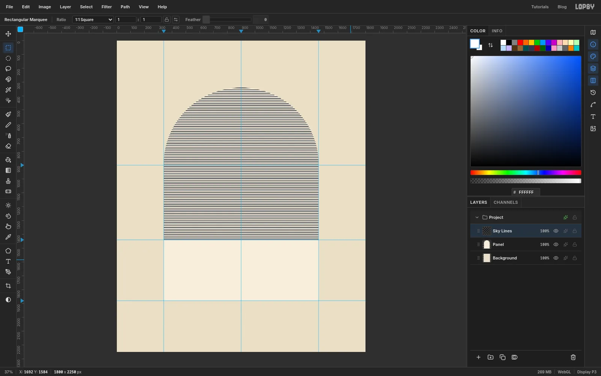

Click **Panel** and add a layer above it called **Sky Lines**.
[[Cmd]]-click the Panel thumbnail to load the arch as a selection. With the
**Rectangular Marquee**, hold [[Alt]] and drag a box from the horizon guide
down past the bottom of the arch to take the sea out of it.

Choose **Edit → Fill with Pattern…**, pick **Pattern 1** and set **Scale**
to `70`. That gives about 4 px lines every 13 px, fine enough to look
engraved. Press [[Cmd+D]].

## Build a hard-edged gradient

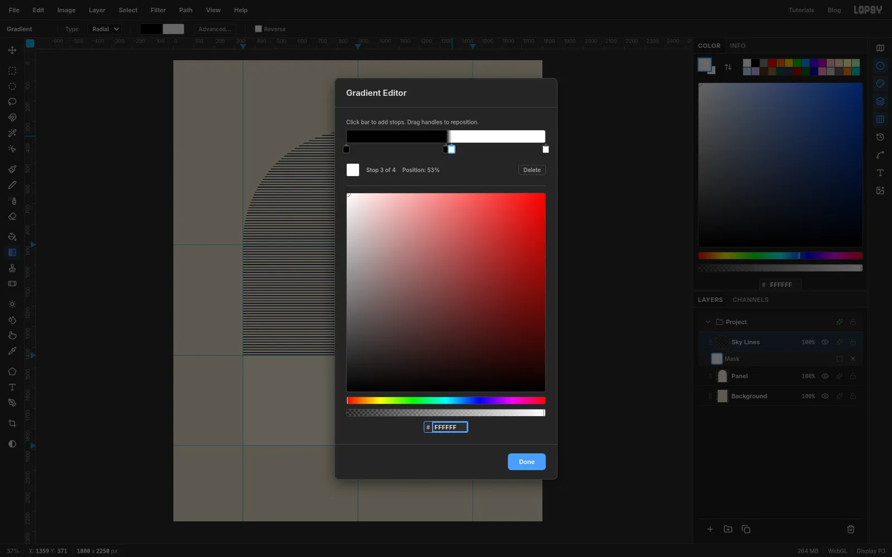

You want the lines to stop in a clean circle around the sun, not fade away
to grey, because a screen printer can't print grey. A gradient with a very
short jump does that.

Click **Add Mask** at the bottom of the Layers panel. A **Mask** row appears
under Sky Lines; click it so you paint on the mask. Pick the **Gradient**
tool, set **Type** to **Radial**, and click **Advanced…** to open the
Gradient Editor:

1. Click the left stop and type `000000` in the hex field.
2. Click the right stop and type `FFFFFF`.
3. Click the bar at 50 % to add a stop and make it black.
4. Click the bar just to the right, at 53 %, and make that stop white.

Click **Done**.

## Clear a space for the sun

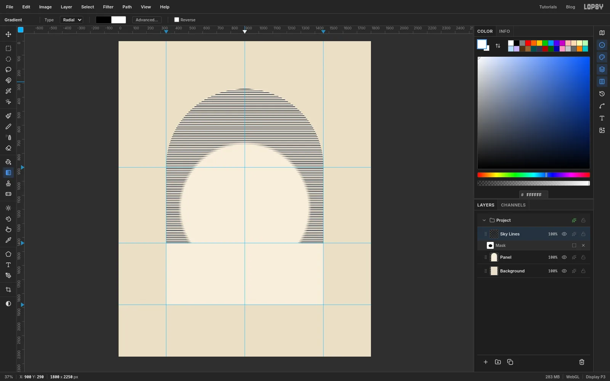

Drag from the sun's centre, where the middle guide meets y 1190, straight up
about 900 px. The black half of the gradient hides the lines in a circle
round the sun, and the edge of the circle is crisp. Click the **Sky Lines**
row (not its Mask row) to go back to painting pixels.

## Fan out the rays

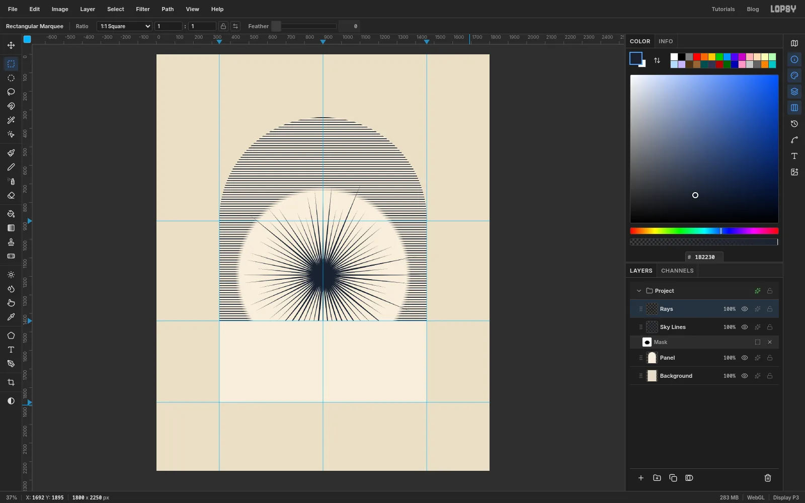

With **Sky Lines** selected, add a layer called **Rays**. Load the sky
selection again: [[Cmd]]-click the Panel thumbnail, then [[Alt]]-drag away
the sea. Keep the foreground navy. Choose **Filter → Sunburst…** and set:

- **Rays** `64`, **Length** `36`, **Width** `22`
- **Taper** `100`, so each ray narrows to a point like an engraved line
- **Center Y** `53`, which puts the burst on the sun
- **Jitter** `40`, so the rays come out uneven, as if cut by hand
- **Fade** `0` and **Opacity** `100`, so the rays print as solid ink rather than grey

Press [[Cmd+D]].

## Paint the sun

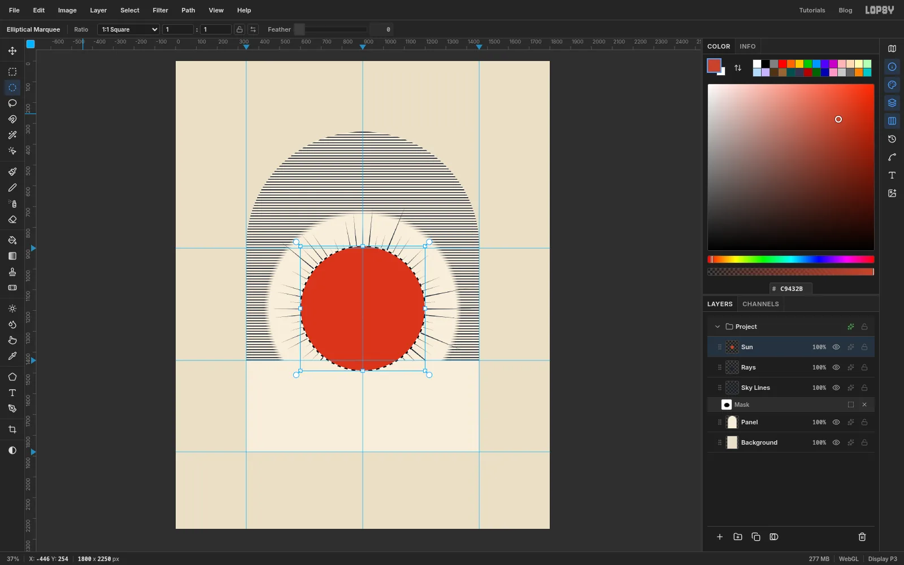

Add a layer called **Sun**. Pick the **Elliptical Marquee**, click once to
open the dialog, and enter `600, 890` to `1200, 1490`, a 600 px circle.
Fill it with vermilion `#C9432B`. Keep the selection.

## Engrave the sun

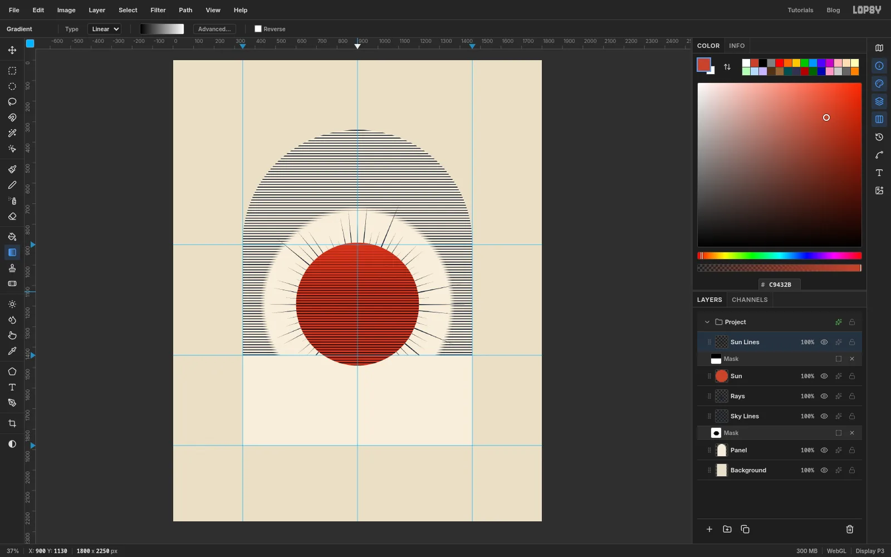

Add a layer called **Sun Lines** and fill the same selection with Pattern 1
at Scale 70. Press [[Cmd+D]]. Open the layer's effects with the sparkle icon
on its row and set the blend mode to **Multiply**, so the navy lines sit on
the red like ink over a wash.

Add a mask and click its row. In the Gradient Editor, set a plain
black-to-white gradient with **Type** **Linear**, then drag from near the top
of the sun down to a little above its centre. The lines fade out at the top
and leave a clean red cap.

## Draw the sea

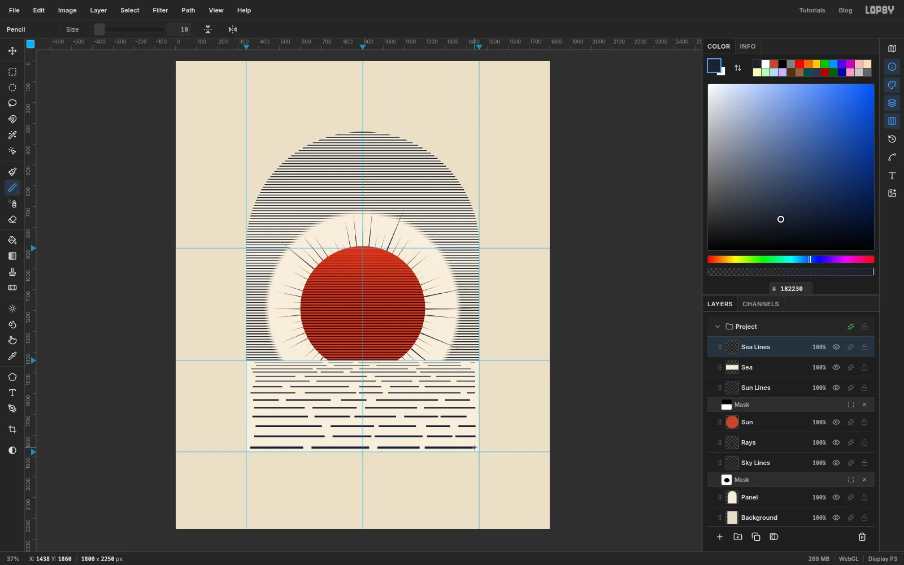

Click **Sun Lines** and add a layer called **Sea**. [[Cmd]]-click the Panel
thumbnail, then hold [[Shift]]+[[Alt]] and drag a box from the horizon down
past the bottom of the arch. That keeps only the overlap: the bottom of the
arch. Fill it with cream. It trims the bottom of the sun, so the sun now
sits on the horizon.

Add a layer called **Sea Lines** and pick the **Pencil** with navy. Each
wave line is a row of broken dashes: click where a dash starts and
[[Shift]]-click where it ends, leave a gap of 20–60 px, and start the next
one. Make dashes anything from 90 to 350 px long so they don't line up.
Draw 14 rows:

- Rows 1–5 just under the horizon, about 13–20 px apart, with a 2–4 px pencil
- Rows 6–10, about 25–40 px apart, with a 5–7 px pencil
- Rows 11–14, about 45–55 px apart, with an 8–10 px pencil, down to the bottom of the arch

The rows spread out and thicken as they come towards you, which makes the
water lie flat. Keep every dash about 20 px inside the arch's sides.

## Reflect the sun

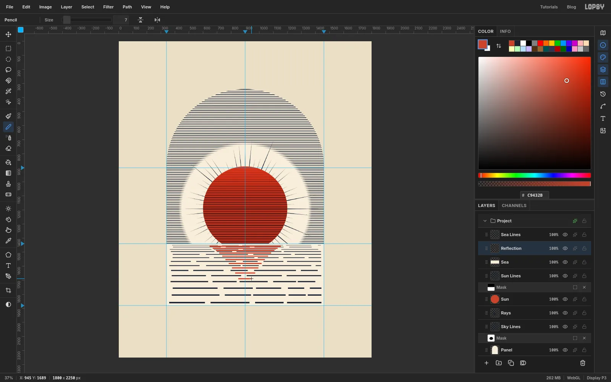

Click **Sea** and add a layer above it called **Reflection**, so it sits
under the wave lines. With a 7 px vermilion pencil, draw one dash in the
gap between each pair of wave rows, centred under the sun. Start about
500 px wide just under the horizon and make each dash a little shorter as
you go down, ten dashes in all.

## Raise Bass Rock

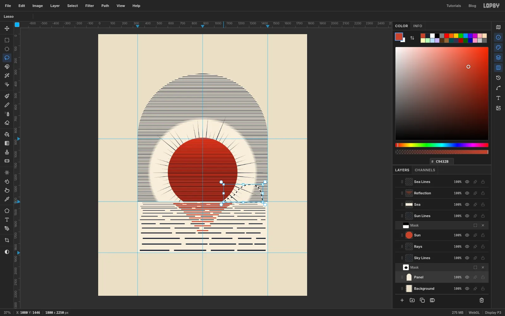

Click **Sea Lines** and add a layer called **Bass Rock**. Draw the island
with the **Lasso**, finishing on the horizon about 40 px short of the
frame. Give it a low ledge on the left, then a steep rise to a rounded top
at about y 1295. Bring it back down to the horizon on the right.

[[Cmd]]+[[Shift]]+[[Alt]]-click the Panel thumbnail. With all three keys
held, the click keeps only the part of the lasso that's inside the arch.

## Hatch the rock and add the lighthouse

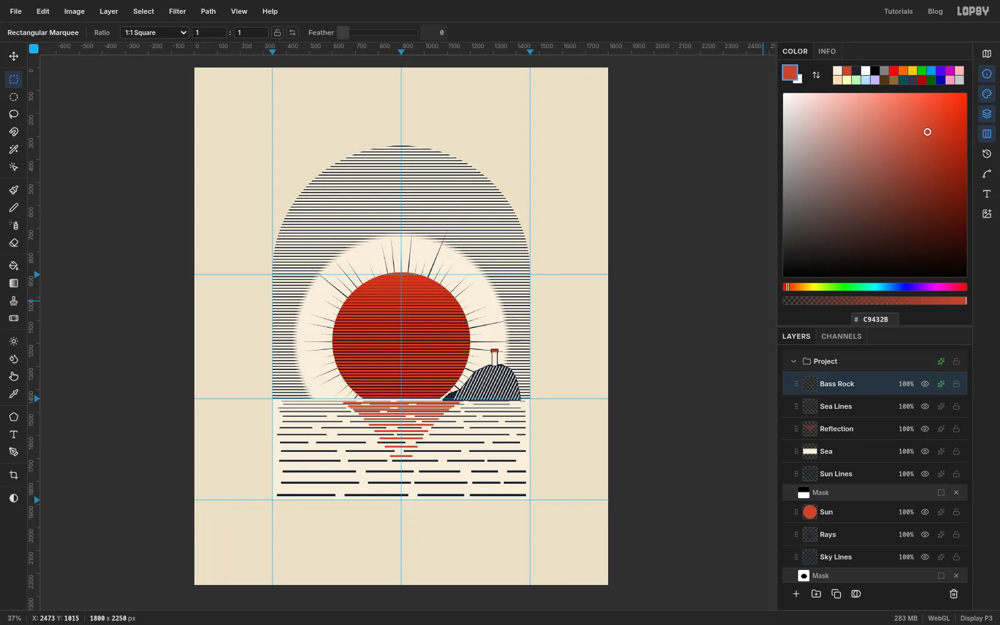

Fill the selection with navy. Then pick the **Pencil**, set it to 3 px and
cream, and draw diagonal hatching across the rock with click and
[[Shift]]-click, about 13 px apart. The selection keeps every stroke inside
the rock. Press [[Cmd+D]].

For the lighthouse, use the rectangle dialog. Make a cream tower from
`1296, 1236` to `1316, 1296` on the peak, then press [[Cmd+D]] and make a
vermilion lamp from `1292, 1226` to `1320, 1238`. Finish with a 3 px navy
**Stroke** effect on the layer to outline the rock and the tower.

## Bring in the gannet

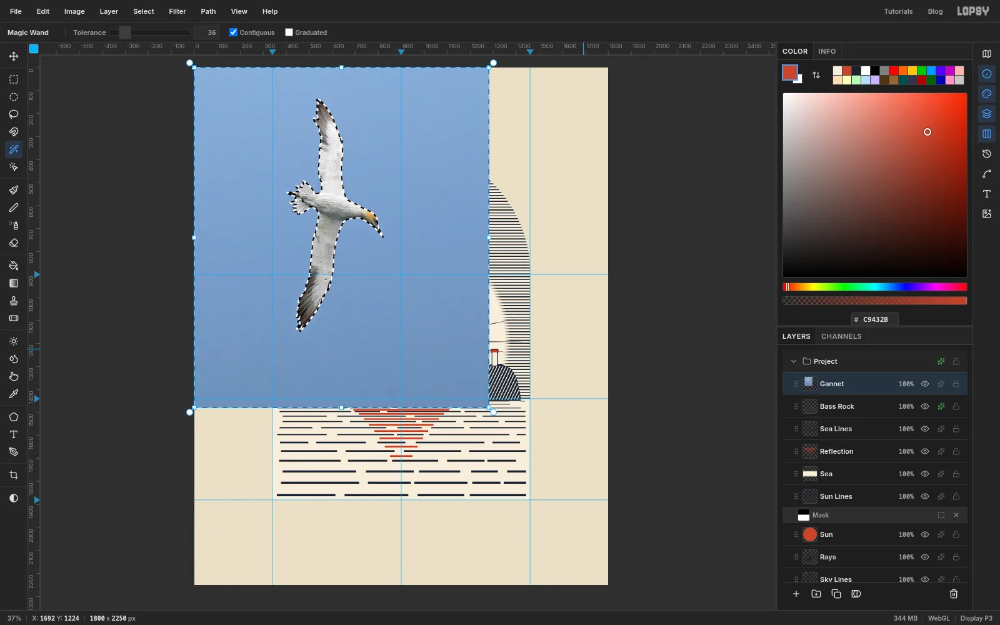

With **Bass Rock** selected, drag the gannet photo from your downloads onto
the canvas. It lands as a new layer in the top-left corner. Press [[Cmd+D]]
and rename the layer **Gannet**.

Pick the **Magic Wand**, set **Tolerance** to `36` and leave **Contiguous**
on. Click the sky. The blue gets darker towards the bottom of the photo, so
hold [[Shift]] and click a dozen more spots around the bird to add the rest.
Keep the tolerance low: the shaded underside of the wing is only a little
greyer than the sky, and a higher tolerance eats into it. Choose
**Select → Grow…** `1` px to catch the fringe, press [[Delete]], then
[[Cmd+D]].

## Turn the bird into a dive

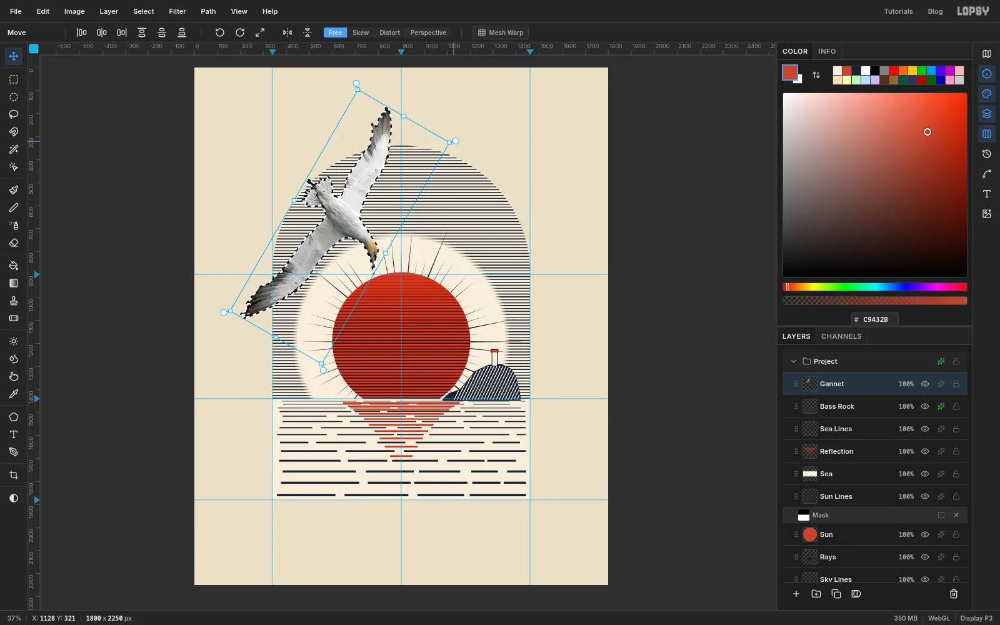

[[Cmd]]-click the Gannet thumbnail to select the bird and switch to the
**Move** tool. Hold [[Cmd]] and drag the bottom-right handle outwards about
10 % to scale it up evenly. Then grab just outside a corner and rotate the
box about 30° clockwise, so the bill points down at the water. Press
[[Cmd+D]] to finish.

## Place the gannet over the sun

Drag the bird so its body crosses the upper left of the sun and its bill
ends just above the horizon, a little right of centre. The long wings now
run corner to corner across the sun, which gives the whole picture its
movement.

## Lay a line screen over the photo

With **Gannet** selected, choose **Filter → Desaturate**, then
**Filter → Brightness/Contrast…** with Brightness `-10` and Contrast `45`.
More contrast makes the black wingtips print as solid ink.

Choose **Layer → Duplicate Layer** and rename the copy **Gannet Lines**.
Rename the original **Gannet Base**. You'll need it later.

Click **Gannet Lines** and add a layer above it called **Line Screen**.
[[Cmd]]-click the Gannet Lines thumbnail, fill the selection with
**Pattern 2** (the soft stripe) at Scale 100, and press [[Cmd+D]]. Set the
layer's opacity to `50`.

## Threshold the stripes into engraving

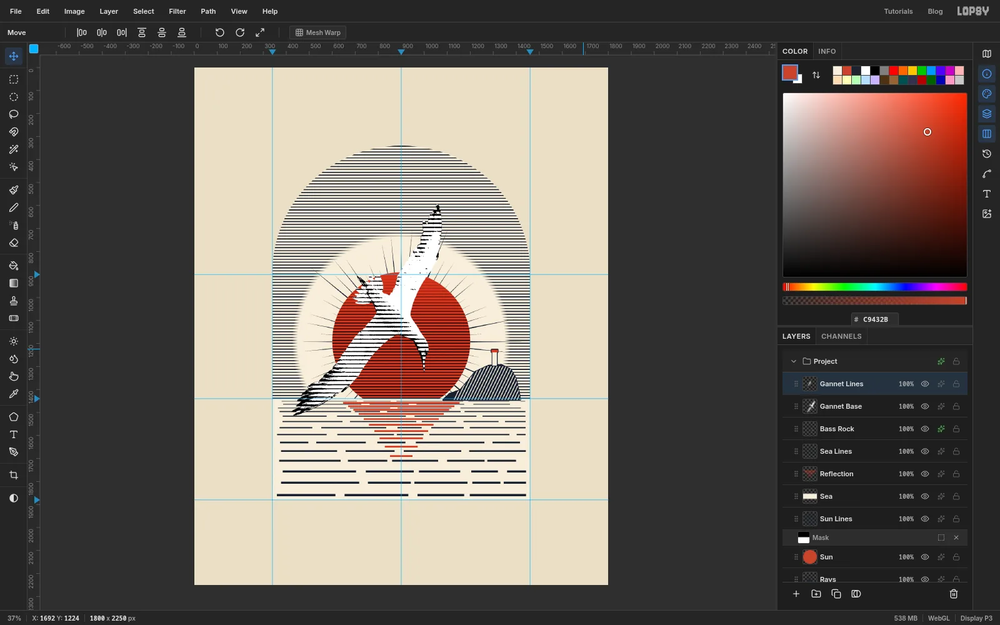

Choose **Layer → Merge Down** to merge the stripes into Gannet Lines, then
**Filter → Threshold…** at level `128`. Every pixel goes black or white.
Wherever the photo was dark, the stripe dipped below the threshold for
longer, so the line comes out thicker. The bird is now an engraving.

## Knock out the white

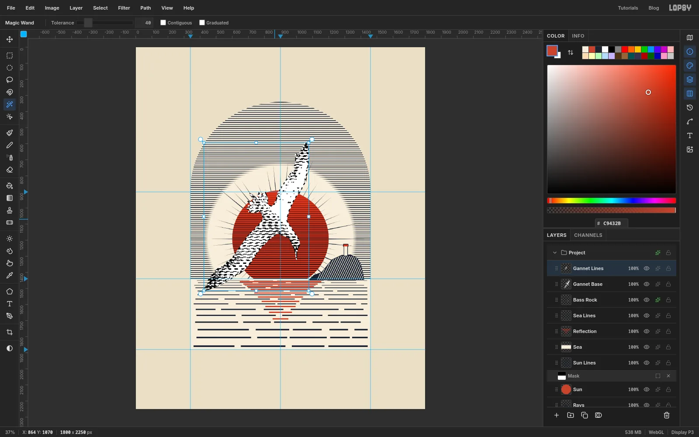

Pick the **Magic Wand**, untick **Contiguous**, set Tolerance to `40` and
click a white part of the body. With Contiguous off, one click selects every
white pixel on the layer, not just the patch you clicked. Press [[Delete]].

## Ink the lines navy

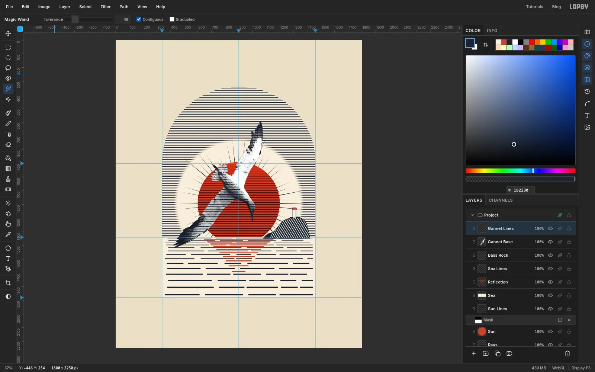

[[Cmd]]-click the Gannet Lines thumbnail to select what's left, the lines,
and fill them with navy. Press [[Cmd+D]], and tick **Contiguous** again so
the wand behaves normally next time.

## Fill the body and select the head

Click **Gannet Base**, [[Cmd]]-click its thumbnail and fill it with cream,
so the grey photo becomes a solid cream shape under the lines. Press
[[Cmd+D]]. Add a navy **Stroke** effect, Width `5`, for an engraved outline.

Add a layer above it called **Head Wash**. Lasso loosely round the head,
then [[Cmd]]+[[Shift]]+[[Alt]]-click the Gannet Base thumbnail so the
selection stops at the bird's edge.

## Colour the head ochre

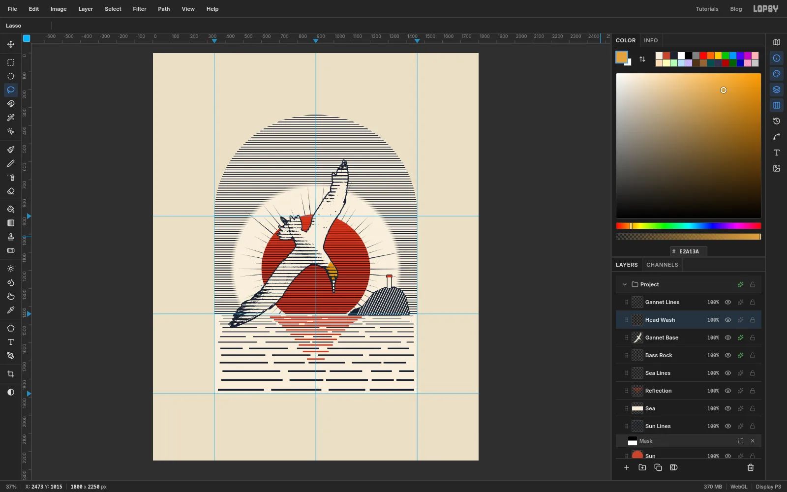

Fill the selection with ochre `#E2A13A`, press [[Cmd+D]], and set the layer
to **Multiply**. The engraved lines on Gannet Lines run straight over it,
the way a colourist's wash sits under the printed lines.

## Group the bird and make a distant copy

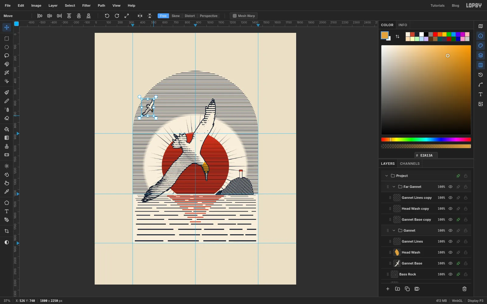

Click **Gannet Base** and [[Shift]]-click **Gannet Lines** to select all
three bird layers. Choose **Layer → Group Layers** and name the group
**Gannet**.

With the group selected, choose **Layer → Duplicate Layer** and name the copy
**Far Gannet**. Switch to the **Move** tool: the transform box now wraps the
whole group. Hold [[Cmd]] and drag the bottom-right handle in until the bird
is about a sixth of its size. Click **Flip Horizontal** in the options bar,
drag the little bird up into the sky on the left, and press [[Escape]].

## Simplify the far birds

At this size the engraving clogs into grey, so keep the far bird simple.
Inside the Far Gannet group, select **Gannet Lines copy** and delete it,
then delete **Head Wash copy**. Select **Gannet Base copy** and change its
Stroke **Width** to `2`. That leaves a clean cream bird with a fine outline.

Select the **Far Gannet** group and duplicate it again. Scale the new copy
down by about a third, flip it back, move it a little lower and to the right,
and press [[Escape]]. Two birds of different sizes read as one far off and
one closer.

## Cut the ripples

Click **Bass Rock** and add a layer called **Ripples**. Use the ellipse
dialog for a wide, flat ellipse centred about 280 px below the bill, roughly
380 × 80 px. Fill it with cream to clear the wave lines there.

Each ring takes two moves:

1. Press [[Cmd+D]] and use the dialog for a slightly smaller ellipse, the
   ring's outer edge.
2. Hold [[Alt]] and drag a second ellipse about 10 px inside it, which cuts
   out the middle and leaves a thin ring. Fill it with navy.

Make three rings, each about two thirds the size of the last.

## Grow a frame round the arch

Click **Ripples** and add a layer called **Frame**. It sits under the Gannet
group, so the bird is drawn over the frame wherever they meet. Build the
frame in two passes, each a fill then a cut:

1. [[Cmd]]-click the Panel thumbnail, choose **Select → Grow…** `26` and
   fill with navy.
2. Load the Panel again, **Grow** `22` and press [[Delete]]. That leaves a
   4 px hairline 22 px out from the arch.
3. Load the Panel, **Grow** `10` and fill again.
4. Load the plain Panel and press [[Delete]]. That leaves a heavy 10 px rule
   on the arch's edge. Press [[Cmd+D]].

## Draw an arc for the title

Pick the **Pen** tool. You'll draw a shallow arc with three anchors. For
each one, press and drag in the direction the curve is travelling to pull
out handles:

1. On the left, level with the shoulder of the arch and about 130 px
   outside it, drag up and to the right.
2. Above the middle of the arch, about 80 px over the frame, drag
   straight right.
3. On the right, mirror the first anchor, dragging down and to the right.

Click **Commit path** (the tick) in the options bar.

## Set the title on the path

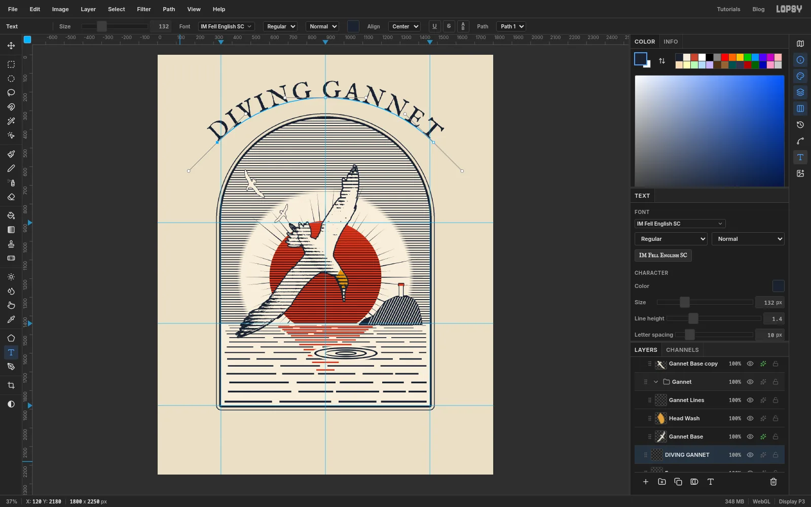

When a text layer is selected, the Text tool's options restyle it, so click
a picture layer first. **Frame** is fine. Pick the **Text** tool and set
**Size** to `132`, the font to **IM Fell English SC** and the colour to
navy. Click an empty part of the canvas, type `DIVING GANNET` and press
[[Tab]] to commit. In the **Text** panel, set **Letter spacing** to `10`.

In the options bar, choose your arc in the **Path** menu, then set
**Align** to **Center**. The title bends along the curve with an even gap
above the frame.

## Make the ribbon tails

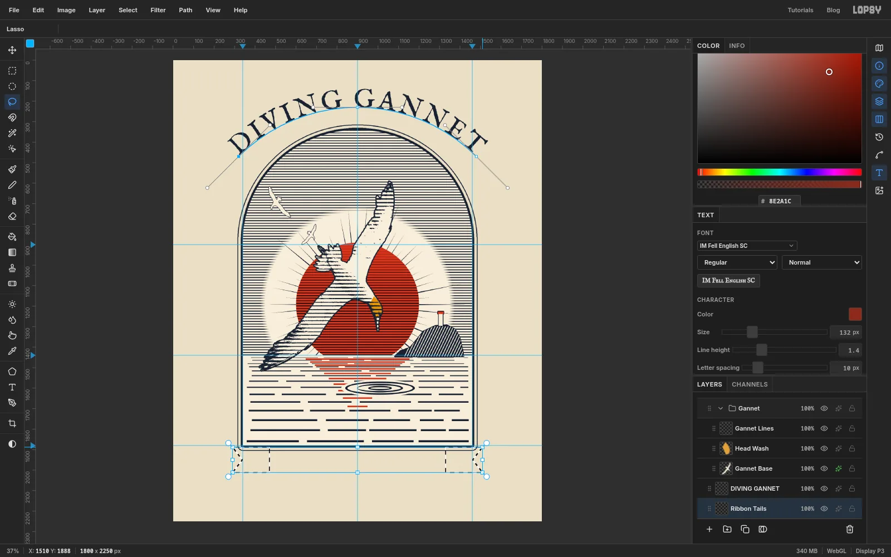

Click **Frame** and add a layer called **Ribbon Tails**. Each tail runs from
about 25 px outside the frame to about 130 px inside it, between y 1888 and
2012. Its outer end has a V cut into it that comes in about 50 px.

With the **Lasso**, click and drag round the left tail: top-left corner,
top-right, bottom-right, bottom-left, then in to the point of the V and back
to the start. Hold [[Shift]] and draw the matching tail on the right. A
slow, steady drag keeps the edges straight. Fill both with `#8E2A1C`.

Press [[Cmd+D]]. With `#5E1A12`, lasso a small triangle at the inner bottom
corner of each tail and fill it. These are the folds where the ribbon turns
behind itself. Add a 4 px navy **Stroke** effect.

## Letter the ribbon

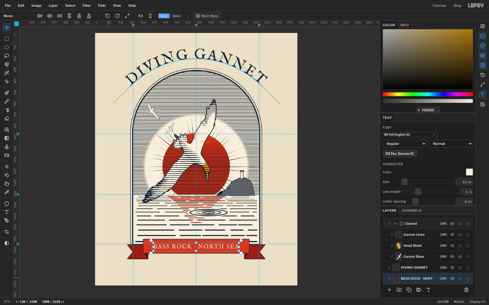

Add a layer called **Ribbon** and select `430, 1838` to `1370, 1962` with the
rectangle dialog. Fill it with vermilion, press [[Cmd+D]], and give it the
same 4 px navy stroke. It covers the bottom of the frame, so the arch looks
as though it stands on the banner.

With **Ribbon** still selected, pick the **Text** tool. Set IM Fell English
SC at **Size** `52` in cream, click an empty part of the canvas and type
`BASS ROCK · NORTH SEA`. The middle dot is [[Alt+Shift+9]] on a Mac. Press
[[Tab]] and set letter spacing to `6`.

Switch to the **Move** tool and nudge the text with the arrow keys
([[Shift]] moves 10 px) until it's centred in the red band both ways.
All-capital text has no descenders, so centring the letters themselves
looks right. That leaves about 100 px of red at each end.

## Add the caption

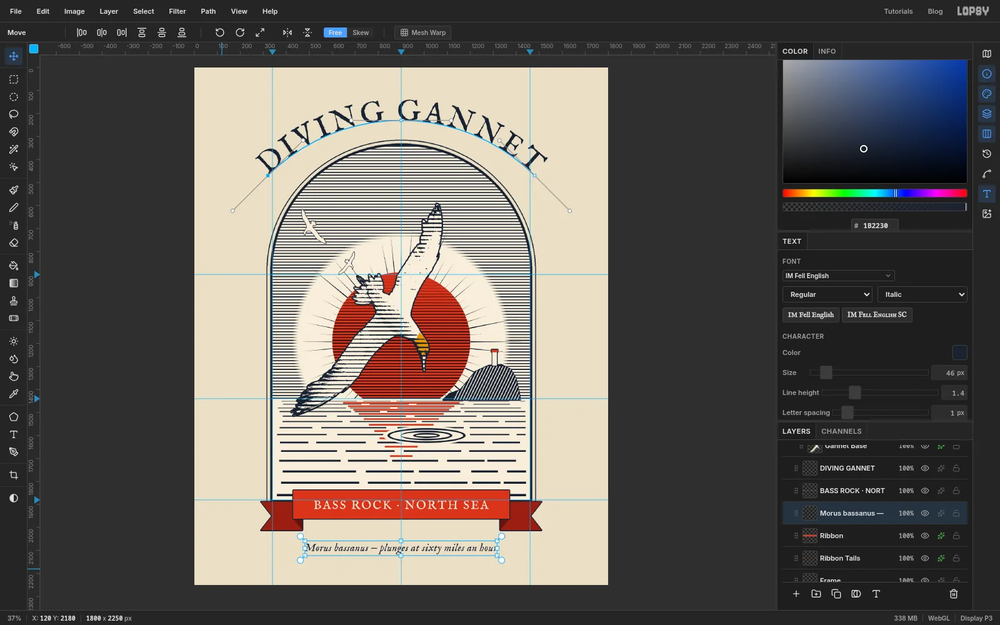

Click **Ribbon** again so the next text doesn't restyle the ribbon text.
Pick the **Text** tool and set **IM Fell English** at size `46`, **Style**
**Italic**, in navy. Click an empty spot and type
`Morus bassanus — plunges at sixty miles an hour`, then press [[Tab]].
Centre it under the ribbon with the Move tool, about halfway between the
ribbon and the bottom of the page.

Now tidy up. Click the **DIVING GANNET** layer, [[Shift]]-click
**Ribbon Tails** to select the three text layers and both ribbon layers, and
choose **Layer → Group Layers**. Name the group **Lettering**.

## Line the bird up with the ripples

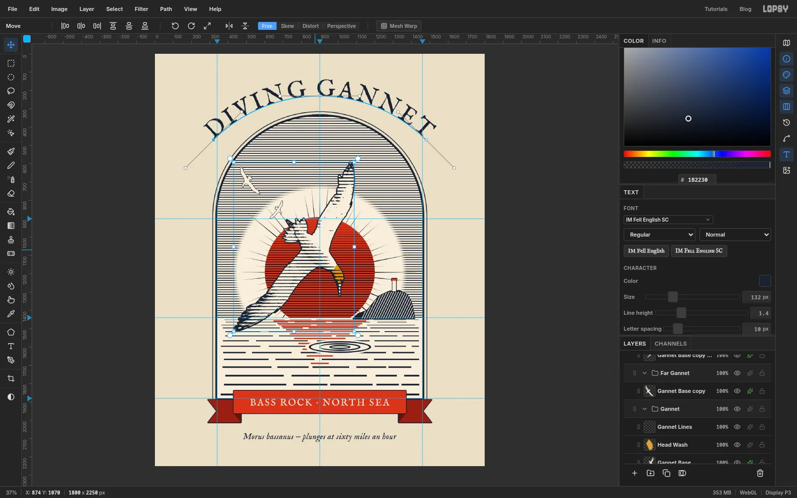

Click the **Gannet** group itself in the Layers panel. With the **Move**
tool, dragging anywhere moves all three bird layers at once. Nudge the bird
a few pixels right until the bill points at the centre of the ripples, then
press [[Escape]].

## Wear the print in

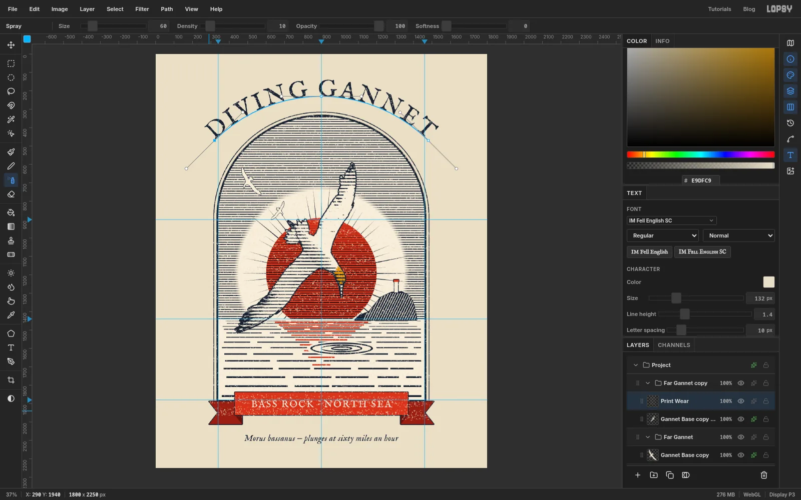

A brand new screen print looks flat and digital. Click the top layer in the
Layers panel, add a layer called **Print Wear** and pick the **Spray** tool.
Set:

- **Size** `60`, **Density** `10`, **Opacity** `100`
- **Softness** `0`, for hard specks rather than soft blobs

Use the shirt colour, `#E9DFC9`, and sweep back and forth across the whole
design, a row at a time. Where the specks land on ink they look like spots
where the ink didn't take. On the bare shirt they disappear.

The italic caption is too fine to survive that, so pick the **Eraser** at
140 px and wipe the wear off the caption line.

Choose **File → Quick Export PNG**. The result is a mockup on the shirt
colour. When you hand it to a printer, tell them the shirt-coloured specks
are knock-outs, not a fifth ink, so they leave those spots unprinted.
