Lanternfish are small, big-eyed fish that live hundreds of metres down and carry rows of light organs, called *photophores*, along their bellies. There are so many of them that they show up on ships' sonar as a "false bottom" that rises towards the surface every night. This tutorial turns one into the cover of an imaginary science-fiction novel, *Lanternfish* by Mira Odhali, as if the fish had just swum past a deep-sea camera that was losing its signal.

Glitch art can bury the subject quickly. The rules that keep this cover readable are:

- **Keep the eye and the title readable.** The eye is how you know it's a fish, and the title is how you know what the book is. The blocks go on the body, and the tears run just below the eye, never through it.
- **Glitch on a grid.** Real video corruption happens in square blocks of pixels, so the pixelated patches and the sideways tears all snap to a 64 px grid.
- **Use three colours and stick to them.** Cyan is the screen, lime is the light, and magenta only shows up as a thin colour fringe.

The document is **1200 × 1800 px**, a 2:3 ebook cover.

The photo is [Electrona risso specimen](https://commons.wikimedia.org/wiki/File:Electrona_risso_specimen.jpg) by HulloThere on Wikimedia Commons, licensed [CC BY-SA 4.0](https://creativecommons.org/licenses/by-sa/4.0/). Credit the photographer if you publish your cover, and share it under the same licence. The fish lies on a ruled measuring card, so you'll cut it out with the Lasso.

The palette:

- Abyss `#0B2342` → `#06142A` → `#02050C`
- Sonar map `#03091A` → `#0A4F6E` → `#2FD9CB` → `#F4FFE8`
- Photophore lime `#C6FF3A`, glow `#B8FF2E`
- Sonar cyan `#3CF2E0`
- Title white `#EAFBF5`
- Glitch magenta `#FF2E88`
- Tagline teal `#8FD8CF`
- Marine snow `#BFEFE8` / `#E4FFFA`

Two habits save trouble throughout:

- **[[V]] then a handle.** Only the Move tool moves or transforms pixels. Make a selection, press [[V]], then drag inside it to move what's selected, or drag outside a corner to rotate. Press [[⌘D]] when you're done, which also commits the change.
- **Click a plain layer before you type.** If a text layer is active, changing the font or size in the options bar restyles *that* layer. Before each new piece of text, click a raster layer in the Layers panel, then click the canvas with the Text tool.

## Fill the abyss and set the margins

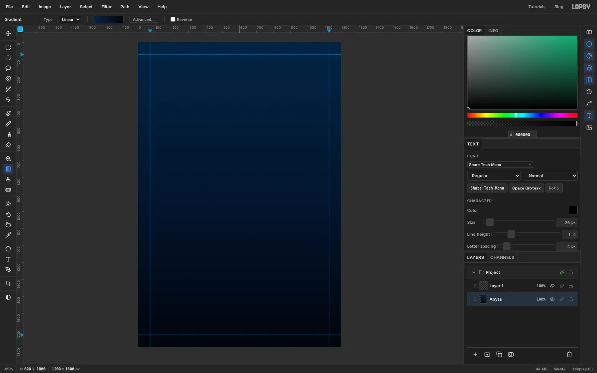

1. Create a **1200 × 1800** document with a **White** background.
2. A new document comes with an empty **Layer 1** above **Background**, and Layer 1 is active. Click **Background**, then double-click its name and rename it **Abyss**. Leave Layer 1 empty; you'll use it for the sonar rings later.
3. Pick the **Gradient** tool with **Type** set to **Linear**. Click **Advanced…** and set three stops: `#0B2342` on the left, `#06142A` a little past the middle, and `#02050C` on the right. Click **Done**.
4. Drag from the top edge of the canvas straight down to the bottom edge. The water should be lightest at the top, like the last of the daylight.
5. Click the top ruler at **72** and **1128**, and the left ruler at **72** and **1728**. These four guides are your margins. All the type will line up on them later.

## Drop in the lanternfish

1. Click **Layer 1**, the empty layer, so the photo lands above the abyss.
2. Drag the lanternfish photo from your file browser onto the canvas. Lopsy shrinks it to the width of the page, centres it, and calls the layer **Pasted Layer**.

## Lasso around the fish

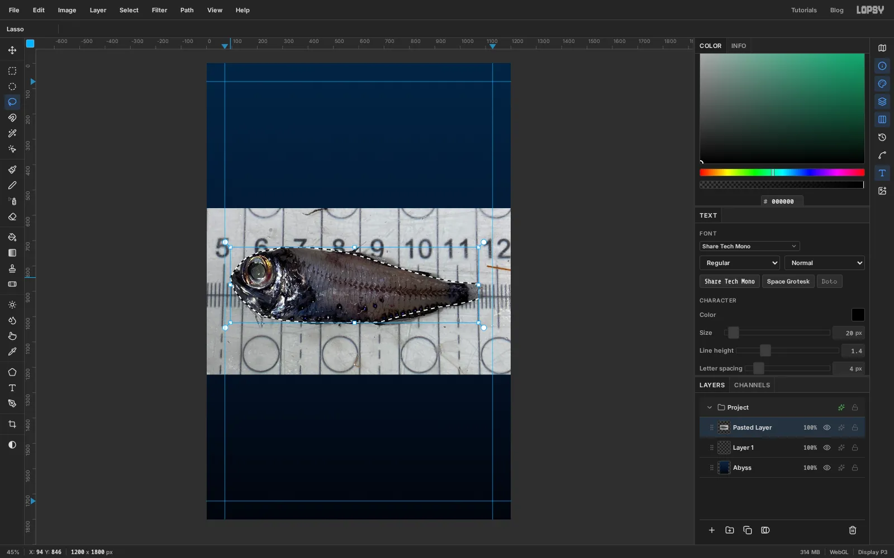

The card behind the fish is covered in black lines and numbers, so the Magic Wand gives up. A hand-drawn outline works better.

1. Press [[⌘D]] to drop the selection the paste made.
2. Press [[L]] for the **Lasso**. Starting at the tip of the jaw, drag slowly round the outline: up over the eye, along the back, down to where the dark tail ends, then back along the belly and under the gill. Stay just inside the edge so no white card sneaks in. Let go near where you started and the outline closes itself.
3. Leave out the pale, see-through tail fin. It's mostly card showing through and it would come out as a grey rectangle.

> **Tip:** The Lasso has no Feather slider of its own, but it borrows the **Feather** value from the marquee tools. If your lasso comes out blurry, press [[M]] and check that **Feather** in the options bar is 0.

## Cut the fish out

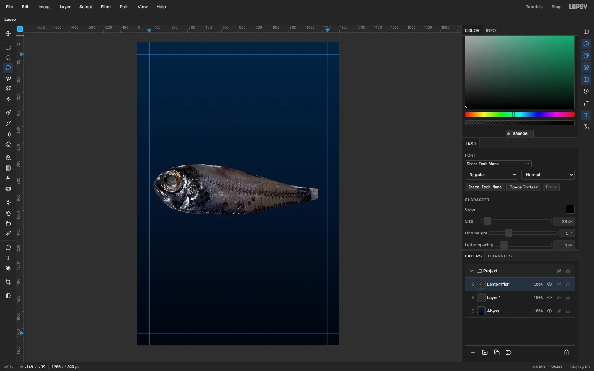

1. Choose **Select → Feather…** with **1** px. That softens the cut edge just enough that it doesn't look jagged.
2. Choose **Select → Inverse**, press [[Delete]] and then [[⌘D]].
3. Rename the layer **Lanternfish**.

## Tilt the fish upwards

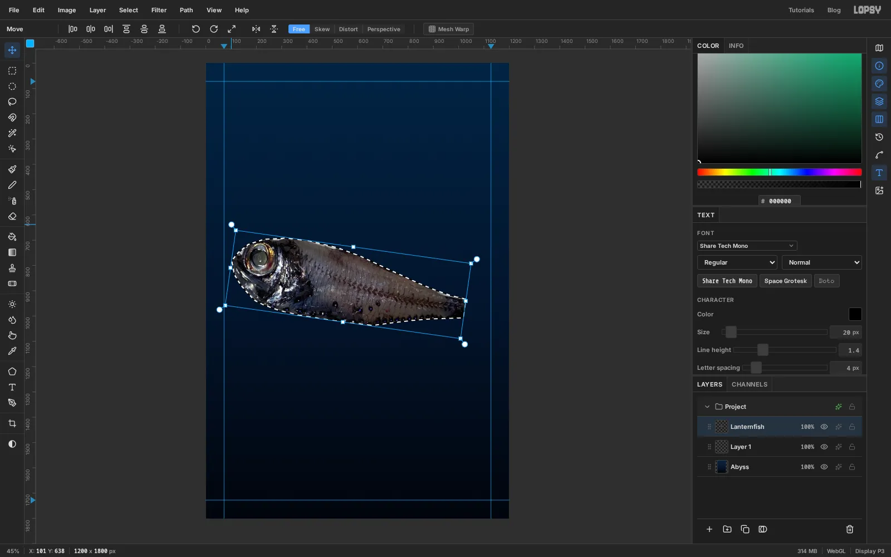

A fish lying flat looks like a specimen in a museum drawer. Tilting it nose-up makes it look like it's swimming towards the light.

1. [[⌘]]-click the **Lanternfish** thumbnail to select the fish's outline.
2. Press [[V]]. Move the pointer just outside the top-left corner of the box until it turns into a curved arrow, then drag clockwise until the fish is tilted about 8°, with the head higher than the tail.
3. Drag from the middle of the fish to move it up and to the right, so the snout clears the left guide and the body sits in the upper middle of the page, just above centre.
4. Press [[⌘D]] to commit.

## Darken the pupil

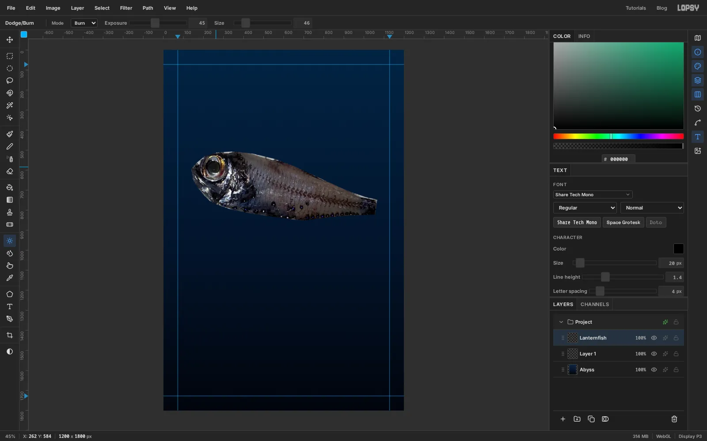

The colour map in the next step turns every tone into a shade of cyan. The pupil in this photo is a fairly light grey-green, so it would vanish into the rest of the head. Darken it first so the eye stays the darkest thing on the fish.

1. Pick the **Dodge / Burn** tool and set **Mode** to **Burn**, **Exposure** to **45** and **Size** to **46**.
2. Paint two small circles inside the pupil, keeping off the silver rim.

## Map the fish to sonar colours

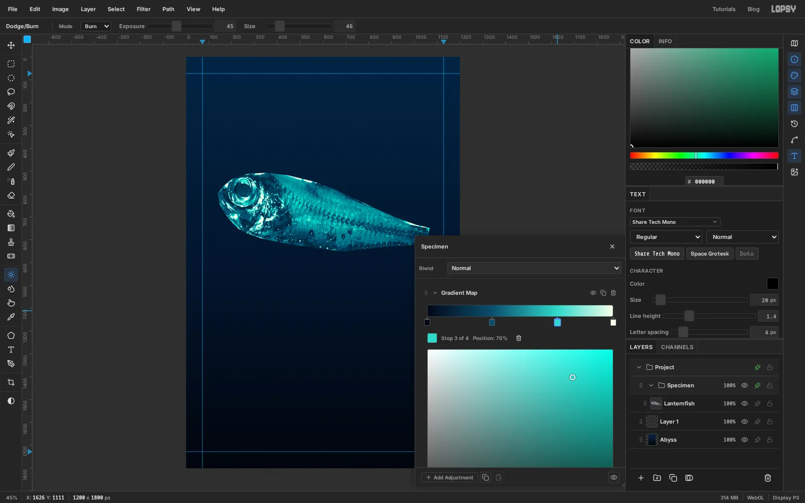

A gradient map swaps every tone in the photo for a colour from a gradient: shadows take the left end, highlights the right. It makes the fish look like it was picked up by a sensor rather than photographed.

1. With **Lanternfish** active, run **Filter → Brightness/Contrast…** with **Brightness** 30 and **Contrast** 35. The photo is quite dark, and the map needs a full range of tones to work with.
2. Choose **Layer → Group Layers**. Rename the new group **Specimen**.
3. Click the **effects** button on the **Specimen** row. A group's drawer shows adjustments instead of layer effects. Click **Add Adjustment** and choose **Gradient Map**.
4. Click the left stop under the bar and type `03091A` in the hex field. Click the right stop and type `F4FFE8`.
5. Click the bar about a third of the way along to add a stop and make it `0A4F6E`. Click it again at about 70% and make that stop `2FD9CB`.
6. Close the drawer. The eye should now read as a dark lens with a bright cyan rim.

## Paint the photophores

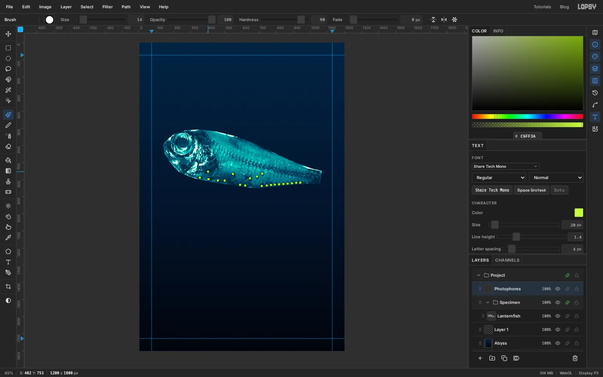

1. Click the **Specimen** row and click **+** at the bottom of the Layers panel. The new layer lands inside the group. Rename it **Photophores**.
2. Drag the **Photophores** row by its grip up above the **Specimen** row, so the gradient map doesn't recolour it.
3. Pick the **Brush** with **Size** 14 and **Hardness** 90, and set the foreground colour to `#C6FF3A`.
4. Click once on each dark round light organ on the fish. There's a row running along the bottom edge of the belly from the gill to the tail, and a loose second row of six or seven above it. Look at the original photo if you lose track.

## Make the photophores glow

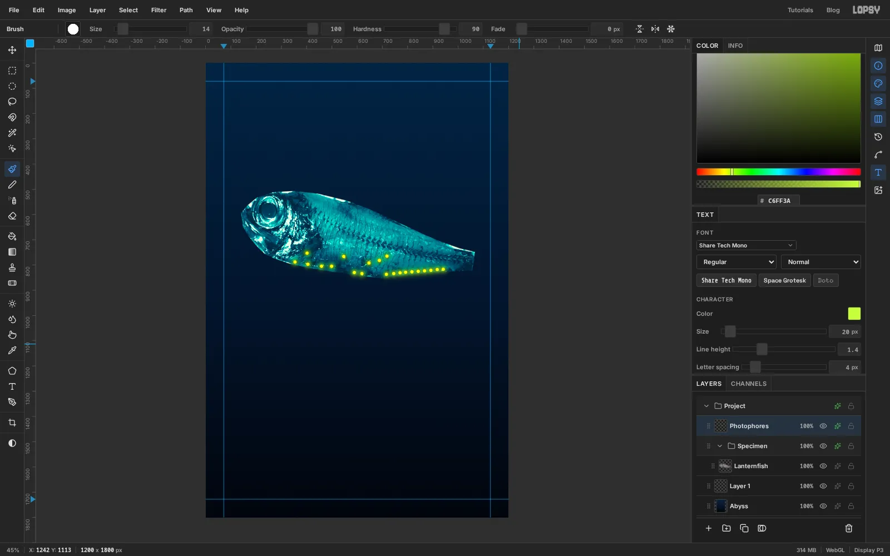

1. Click the **effects** button on **Photophores**, tick **Outer Glow**, and set **Size** 26, **Spread** 8, **Opacity** 90 and the colour `#B8FF2E`. Close the drawer.
2. Run **Filter → Bloom…** with **Threshold** 20, **Soft Knee** 60, **Radius** 22 and **Intensity** 160. Bloom spreads the brightest pixels outwards, so the dots look like they're glowing rather than painted on.

## Mark out the macroblocks

When a video stream drops data, the picture breaks into square blocks called macroblocks. Snapping to a grid gives you the same look.

1. Click the **Lanternfish** layer inside **Specimen**.
2. Choose **View → Show Grid**. In the options bar, drag the **Grid** slider to **64px** and check that **Snap** is ticked.
3. Press [[M]] and drag a marquee three cells wide and one cell tall on the middle of the back. Hold [[Shift]] and drag two more two-cell blocks: one on the rear of the body near the tail, and one on the belly just behind the gill. Keep all of them off the head.

## Pixelate the blocks

1. Run **Filter → Pixelate…** with **Block Size** 32. Each 64 px cell turns into four flat squares, like data that arrived late.
2. Press [[⌘D]].

## Tear the upper body sideways

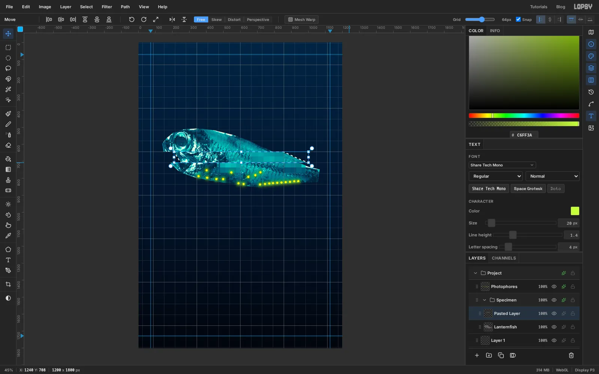

A signal tear is a band of the picture that arrives out of step with the rest. You'll cut the band out and paste it onto its own layer, so you can tone it down or delete it later.

1. With **Lanternfish** still active, press [[M]] and drag a marquee one grid cell tall across the whole width of the page, running through the upper back just below the eye. The grid snaps it.
2. Press [[⌘X]], then [[⌘V]]. The band pastes back in exactly the same place, on a new layer, with the Move tool active.
3. Press [[→]] once. While the grid is showing, each arrow press moves a full grid cell, so the band jumps 64 px to the right.
4. Press [[⌘D]] and rename the new layer **Slice upper**.

## Tear the belly the other way

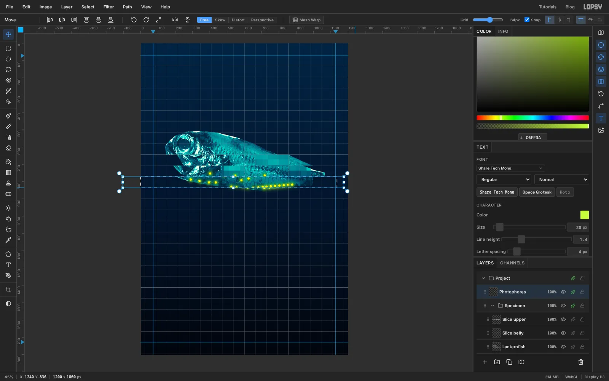

1. Click **Lanternfish** again, press [[M]] and marquee a one-cell band across the whole page, through the belly and the bottom row of lights. Press [[⌘X]], [[⌘V]], then [[←]] once. Press [[⌘D]] and rename the layer **Slice belly**.
2. The lights have to move with the belly or they'll float in the water. Click **Photophores**, press [[M]] and drag a full-width marquee over the same grid row (the grid snaps it to the same lines), then press [[V]], [[←]] once and [[⌘D]].
3. Choose **View → Show Grid** again to hide the grid.

## Select the fish's outline

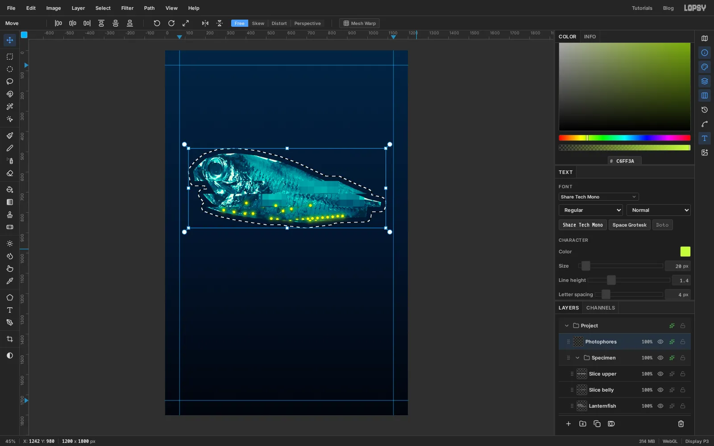

Next you'll split the colour channels. That needs a merged copy of the fish, and selecting just the fish (rather than a rectangle) keeps the copy from leaving straight edges in the water.

1. [[⌘]]-click the **Lanternfish** thumbnail. Then [[⌘+Shift]]-click the **Slice upper** and **Slice belly** thumbnails to add them to the selection.
2. Choose **Select → Grow…** with **24** px, so the selection has room for the colour fringes.

## Split the colour channels

1. Click the **eye** on the **Photophores** row to hide it, so the lights stay pure lime and don't get fringed. Then click the **Photophores** row to make it active. A paste lands just above the active layer, so this keeps the copy out of the **Specimen** group, where the gradient map would recolour it.
2. Choose **Edit → Copy Merged**, then press [[⌘V]]. Press [[⌘D]] and rename the new layer **RGB Split**.
3. Click the eye on **Photophores** again to show it.
4. With **RGB Split** active, run **Filter → Chromatic Aberration…** with **Amount** 12 and **Direction** 0.
5. Set the blend mode of **RGB Split** to **Lighten** and drag its row just below **Photophores**. Lighten only lets the brighter fringes through, so the fish underneath stays sharp.

## Draw sonar rings round the eye

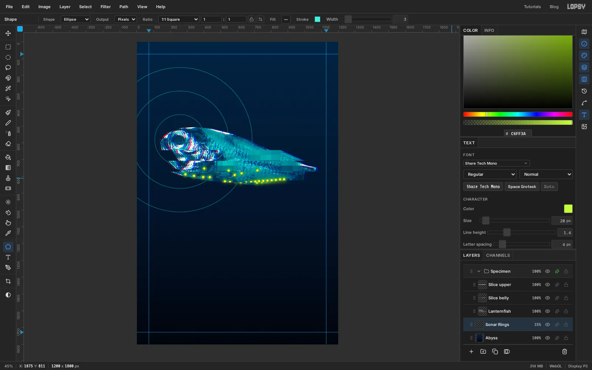

1. Click **Layer 1**, the empty layer under the fish, and rename it **Sonar Rings**.
2. Pick the **Shape** tool, set **Shape** to **Ellipse** and **Output** to **Pixels**. Click the **Fill** swatch and choose **Remove fill**, then click **Stroke** and set it to `#3CF2E0` with **Width** 3.
3. Shapes grow outwards from where you press. Hold [[⌘]] (so you get circles) and drag from the centre of the eye three times, making circles with a radius of about 150, 290 and 430 px.
4. Set the layer to **Screen** at **35%**. The rings should be a hint, not a target.

## Add a sonar sweep

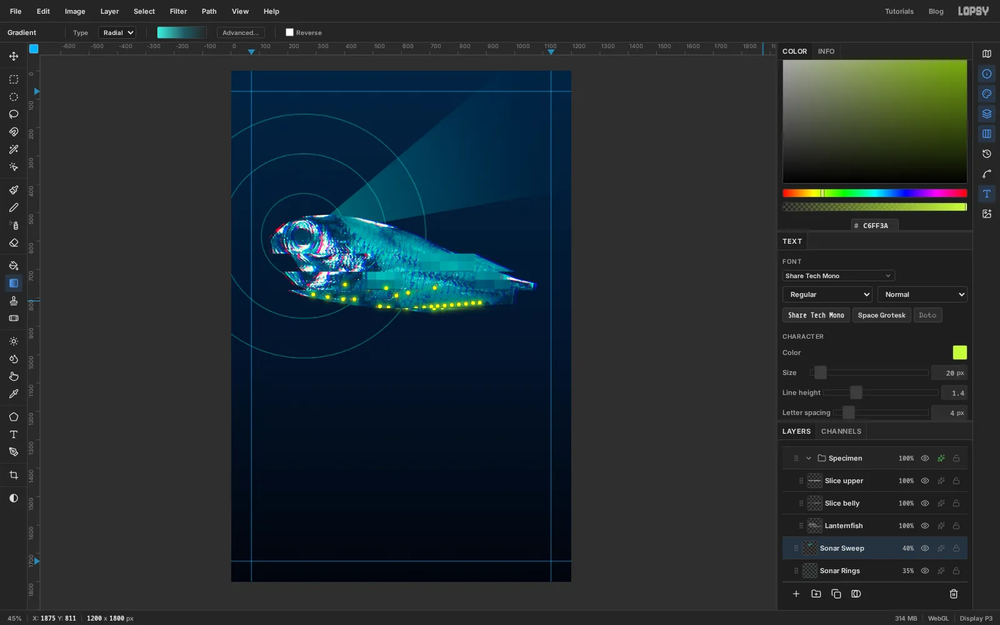

1. Add a layer called **Sonar Sweep**.
2. Press [[L]] and drag a narrow wedge that starts at the eye and fans out past the top-right edge of the page, about 30° wide where it leaves the canvas.
3. Pick the **Gradient** tool, set **Type** to **Radial** and click **Advanced…**. Set the stops to `#3CF2E0` on the left, `#1A8FA0` at 50% opacity in the middle and `#0A2A40` at 0% opacity on the right.
4. Drag from the eye about 1000 px to the right. Press [[⌘D]].
5. Set the layer to **Screen** at **40%**.

## Scatter marine snow

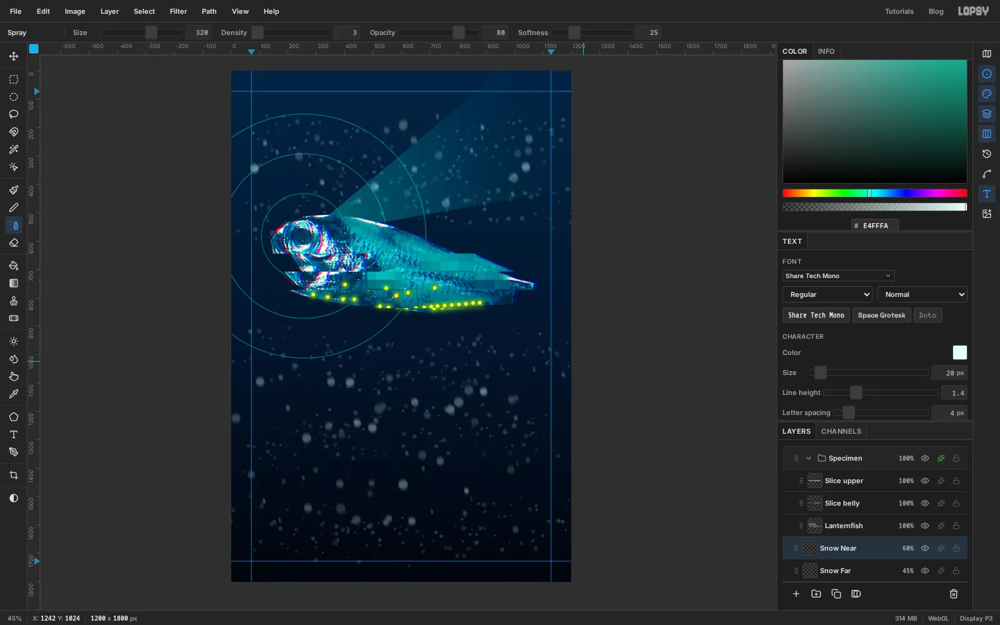

Marine snow is the dust of dead plankton that drifts down through the deep sea. Two layers at different sizes give the water depth.

1. Add a layer called **Snow Far**. Pick the **Spray** tool with **Size** 200, **Density** 8, **Opacity** 60 and **Softness** 60, and set the foreground to `#BFEFE8`.
2. Make five slow horizontal passes across the page at different heights. Run **Filter → Gaussian Blur…** with **Radius** 2, and set the layer to **45%** opacity.
3. Add a layer called **Snow Near**. Set the Spray to **Size** 320, **Density** 3, **Opacity** 80 and **Softness** 25, with the foreground `#E4FFFA`, and make three passes.
4. Run **Filter → Motion Blur…** with **Angle** 80 and **Distance** 16, and set the layer to **60%**. The near flakes now look like they're falling slowly past the lens.

## Set the dot-matrix title

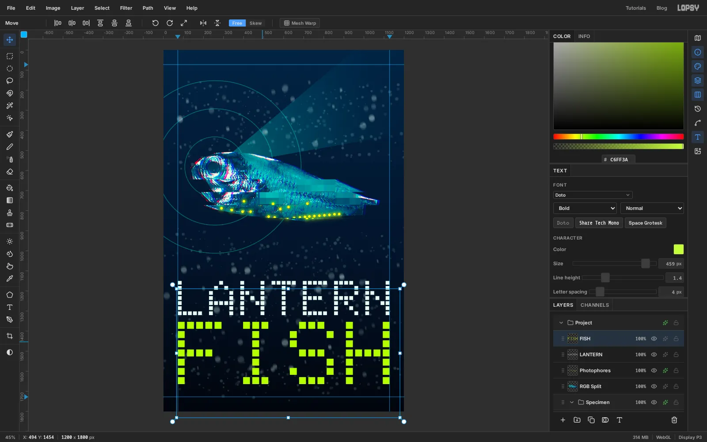

The title is set in **Doto**, a dot-matrix typeface. Its square dots look like the pixels of an old LED readout, and they echo the rows of lights on the fish.

1. Click **Photophores**. Set the foreground to `#EAFBF5`, press [[T]] and click in the empty water below the fish.
2. While the text cursor is blinking, choose **Doto** in the font list, set the weight to **Bold** and the size to **253**, and type **LANTERN**. Press [[Tab]] to finish.
3. Press [[V]] and drag the text so its first dot sits on the left guide. At this size it runs exactly to the right guide.
4. Click **Photophores** again, set the foreground to `#C6FF3A`, and make a second text layer, **FISH**, in **Doto Bold** at **459**. Drag it so it sits just under LANTERN, with about one dot's height between the two words. It should also run from guide to guide.

## Give the title a misregistered edge

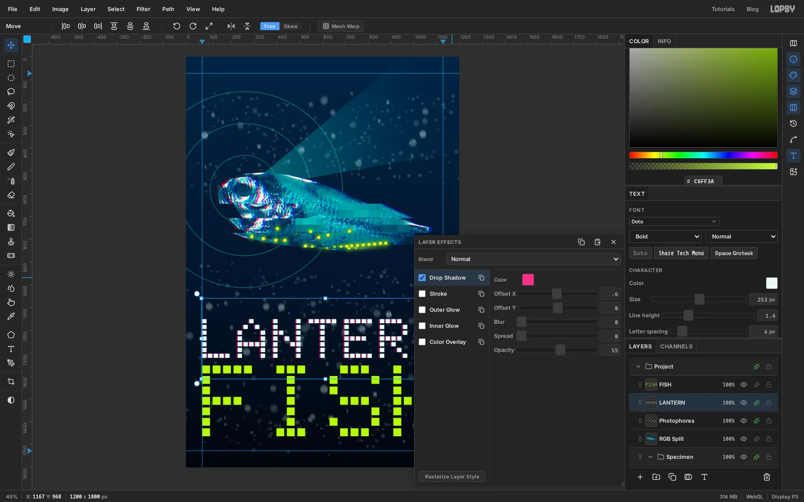

A hard coloured shadow, offset sideways, looks like the red channel has slipped. Keep it subtle. This is the one place magenta appears outside the fish.

1. Open the effects for **LANTERN** and tick **Drop Shadow**. Set **Offset X** −6, **Offset Y** 0, **Blur** 0, **Opacity** 55 and the colour `#FF2E88`.
2. Click **Copy effects** at the top of the drawer, open the effects for **FISH** and click **Paste effects**.

## Fade FISH from lime to cyan

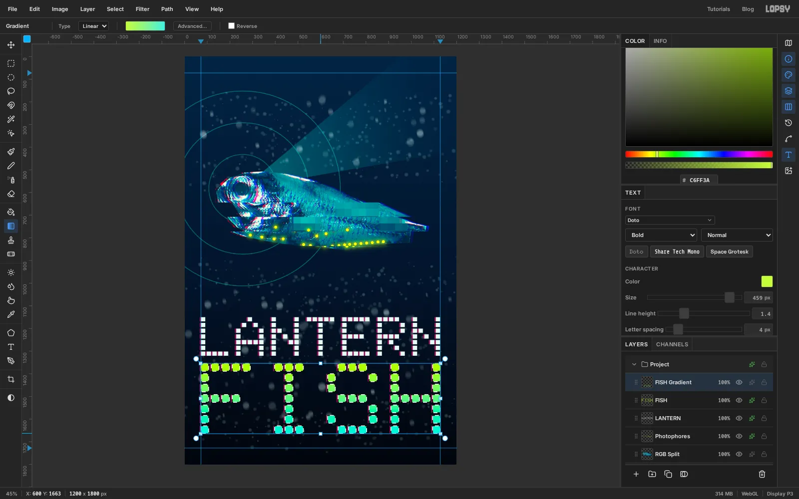

1. [[⌘]]-click the **FISH** thumbnail to select the letters.
2. Add a layer called **FISH Gradient**.
3. Pick the **Gradient** tool, set **Type** to **Linear**, click **Advanced…** and set three stops: `#C6FF3A` on the left, `#7DF59A` at the 60% position, and `#3CF2E0` on the right.
4. Drag from the top of the letters to the bottom. The gradient only fills the selected dots. Press [[⌘D]].

## Add the author and tagline

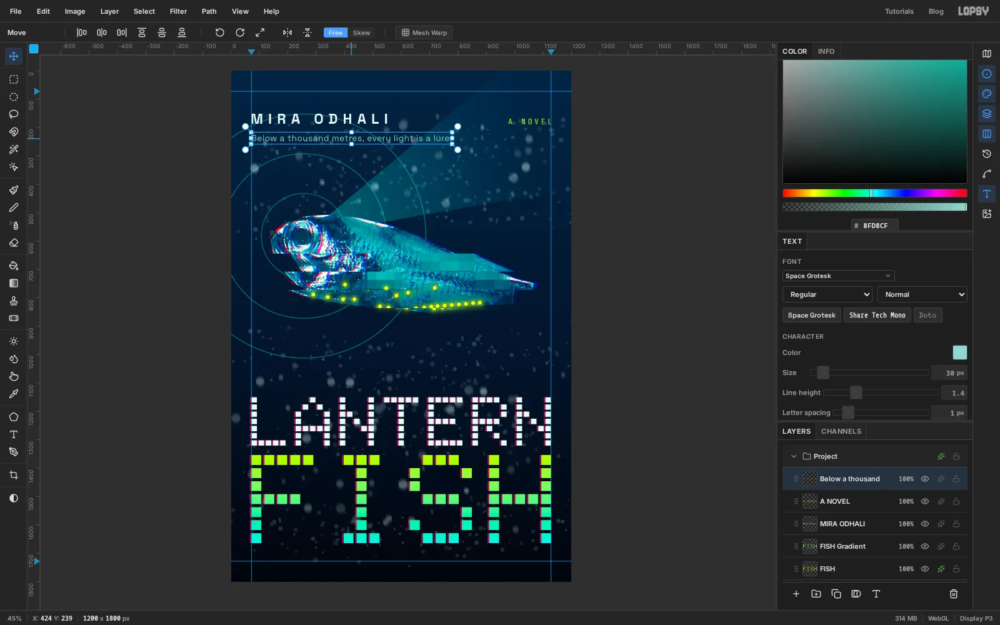

1. Click the **FISH Gradient** layer, set the foreground to `#EAFBF5`, and make a text layer **MIRA ODHALI** in **Space Grotesk Bold** at **50**. In the **Text** panel, set **Letter spacing** to **18**.
2. Drag it so its left edge sits on the left guide and its top is about 150 px down. That lifts it out of the corner and into the empty water above the fish.
3. Make **A NOVEL** in **Share Tech Mono** at **28**, colour `#C6FF3A`, with letter spacing **8**. Drag it to the right guide, with its bottom lined up with the bottom of MIRA ODHALI, so both sit on one baseline.
4. Make the tagline, **Below a thousand metres, every light is a lure.**, in **Space Grotesk Regular** at **30**, colour `#8FD8CF`, with letter spacing **1**. Drag it to the left guide, about 40 px under the author's name.

## Run a sonar caption up the margin

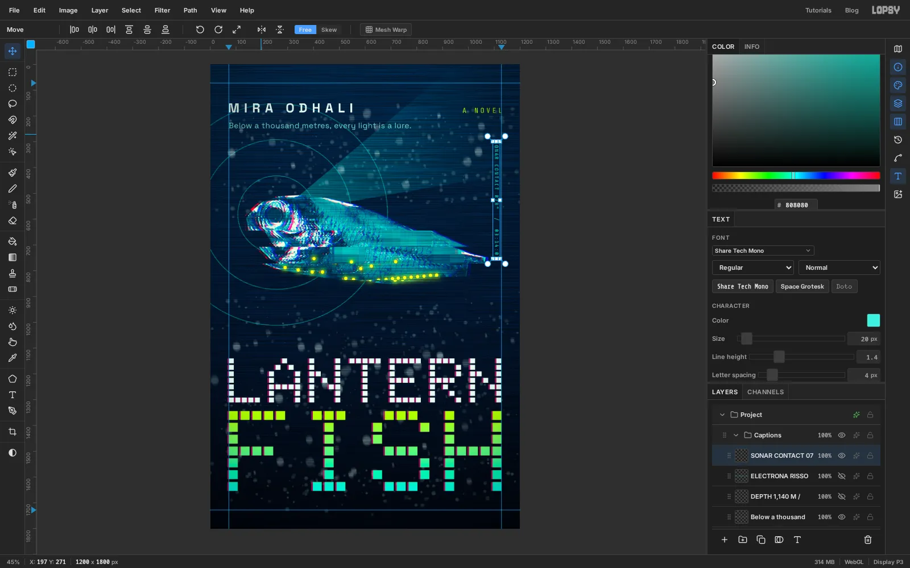

1. Make a text layer **SONAR CONTACT 078°  /  03:14:07** (two spaces either side of each slash) in **Share Tech Mono** at **20**, colour `#3CF2E0`, letter spacing **4**. Make it anywhere there's room. You'll move it.
2. Press [[V]]. Handles appear around the text. Drag just outside a corner to rotate it **90°** clockwise, so it reads from top to bottom. Hold [[⌘]] while you drag to snap the angle in 15° steps, which makes 90° easy to hit. Text stays editable after a rotation.
3. Drag it to the right margin, just inside the right guide, starting about 300 px from the top. It ends level with the fish's tail, in the gap between the tail and the page edge.

## Add the bottom readout

1. Make **DEPTH 1,140 M  /  4.2°C  /  SIGNAL LOST** in **Share Tech Mono** at **24**, colour `#3CF2E0`, letter spacing **3**. Drag it onto the left guide with its baseline just above the bottom guide.
2. Make **ELECTRONA RISSO** with the same settings, which is the species name, and drag it so it ends on the right guide.
3. Line the two up by their baselines, not by the bottom of the comma in "1,140". Zoom in and use the arrow keys to nudge **ELECTRONA RISSO** 1 px at a time until the bottoms of the capitals match.

## Group the type and settle the title

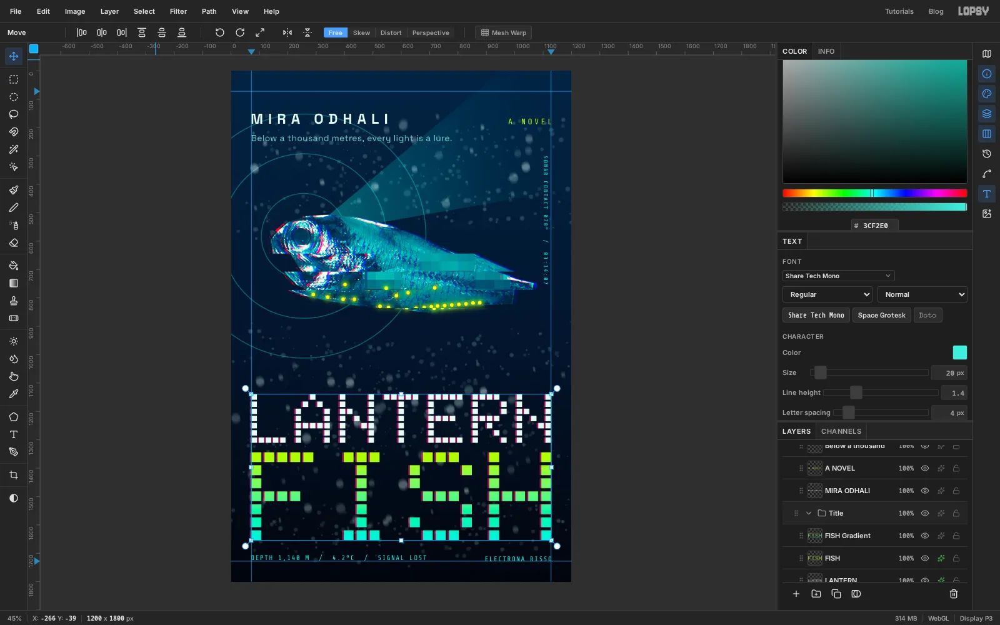

1. Click the vertical caption's row, then [[Shift]]-click **MIRA ODHALI** to select all six caption layers. Choose **Layer → Group Layers** and name the group **Captions**.
2. Do the same for **FISH Gradient**, **FISH** and **LANTERN**, and name that group **Title**.
3. Click the **Title** group, press [[V]] and press [[Shift+↑]] once. The whole title block, including the gradient layer, moves up 10 px together, leaving an even gap above the bottom readout.

## Add signal noise

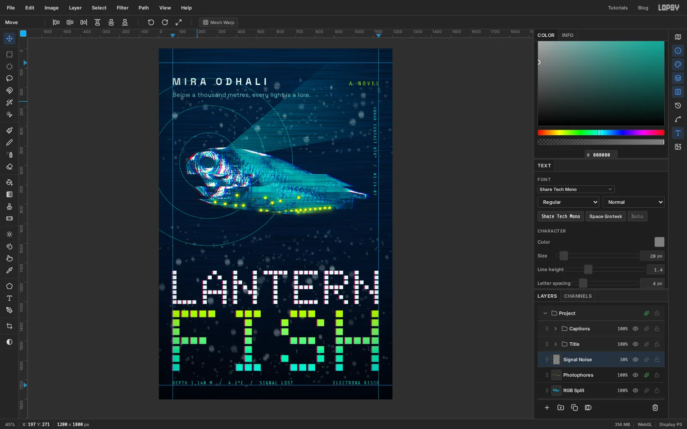

1. Click **Photophores** and add a layer called **Signal Noise** above it. Set the foreground to `#808080`, press [[⌘A]], choose **Edit → Fill**, and press [[⌘D]].
2. Run **Filter → Texture…**. Click **Streaks** and **Mono**, and set **Amount** 70, **Size** 1.5, **Detail** 60, **Stretch** 20, **Angle** 0 and **Contrast** 35. That stretches the noise into thin horizontal lines.
3. Set the layer to **Overlay** at **30%**. Mid-grey disappears in Overlay, so only the streaks show. Because the layer sits below the **Title** and **Captions** groups, the type stays crisp.

## Darken the corners

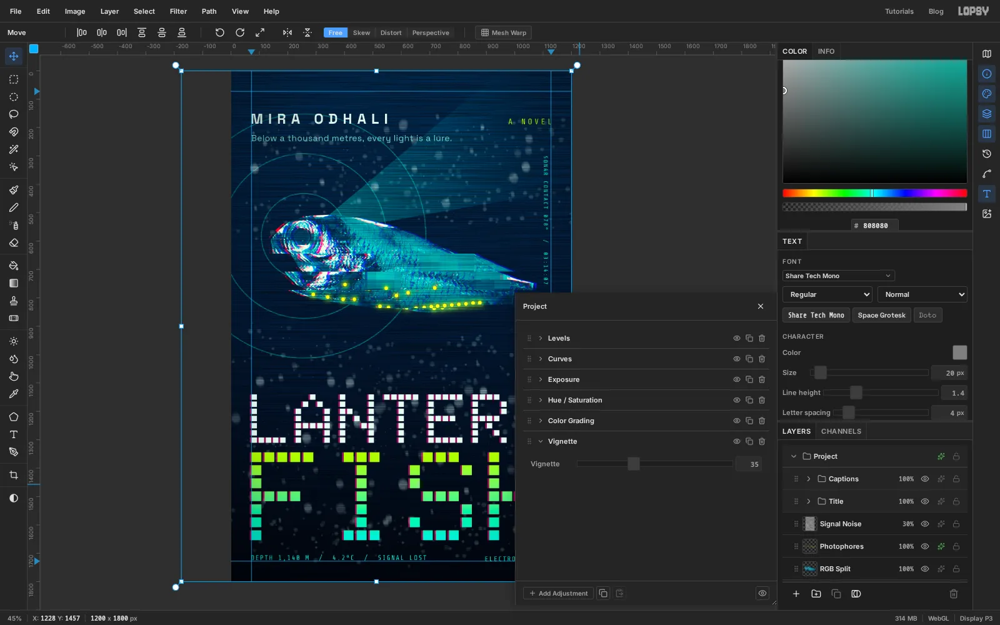

1. Choose **Layer → Adjustment Layer…**. Lopsy opens the adjustments for the whole document (click **Got it** if a short explainer appears first). Click **Add Adjustment**, choose **Vignette**, and set it to **35**.
2. Close the drawer, hide the guides with **View → Show Guides**, and export with **File → Quick Export PNG**. Save the project with **File → Save Project**.

Try the same treatment on any deep-sea animal with a strong silhouette, like a hatchetfish, a viperfish or a squid. Keep the eye readable and let the body take the damage.
