Glitch art borrows the look of broken digital images: a frame torn into horizontal strips, colour channels sliding apart, rows of pixels smeared sideways, stuck pixels left behind. It's a good fit for a pirate radio station, an unlicensed broadcaster that lives somewhere in the static between the real stations.

In this tutorial you'll design an iron-on patch for a made-up station called **Pirate Radio 88.6 FM**. The twist is that the glitches have to look *stitched*. Embroidery can't do soft blurs or rainbow fringes, so every effect here uses hard edges and the patch's own thread colours: cyan and magenta offsets instead of a lens-style chromatic aberration, sharp sliced strips, and square dead pixels snapped to a grid.

The design has:

- a denim backdrop and a round black twill patch with a raised merrowed (overlocked) border
- broadcast rings with one band smeared by **Pixel Stretch**
- a Jolly Roger in headphones: a skull, an eyepatch and crossbones
- two glitch slices and a hard RGB split
- the station name set along curved paths
- scanlines and a satin sheen that make it read as thread

The canvas is **1500 × 1500** px. You don't need any photos.

The tools you'll use:

- the **Elliptical** and **Rectangular Marquee** and the **Lasso**, with [[Shift]] to add and [[Alt]] to subtract
- [[Cmd]]-click on a layer thumbnail to load a shape as a selection, plus **Select → Grow** and **Select → Inverse**
- the **Move** tool's rotate, scale and edge handles, and **Flip Horizontal**
- the **Shape** tool's rounded rectangles with fill and stroke
- the **Pen** tool, the **Paths** panel and text bound to a path
- **Copy**, **Paste**, arrow-key nudges and **Merge Down**
- **Texture**, **Add Noise** and **Pixel Stretch**
- the **Gradient** tool, the **Grid** and ruler **Guides**
- the Google fonts **Rubik Glitch** and **Silkscreen**
- layer effects (**Drop Shadow**, **Inner Glow** and **Stroke**), the **Multiply** and **Overlay** blend modes, and groups

The palette is a dark twill ground with two broadcast colours and one bone colour:

- Denim `#2B3B5E`, vignette `#0B1226`
- Twill `#141220`, ink `#07060B`
- Bone `#EFE6CF`
- Signal cyan `#19E3F2`
- Signal magenta `#FF2D8A`
- Dead-pixel yellow `#E8C547`
- Border shade `#3A0018`, border edge `#5A0A2C`

Some habits that will save you trouble:

- To set a colour, type its hex code into the **Hex** field of the Color panel.
- The patch is a circle centred on the canvas, so almost every shape is a circle or ring around the centre point (750, 750). Watch the **X** and **Y** readout in the status bar while you drag, and zoom in for small pieces.
- To make a **ring**, drag a circle with the **Elliptical Marquee**, then hold [[Alt]] and drag a smaller circle with the same centre to cut out the middle. Whenever a step says "a ring from 600 to 470", that means an outer radius of 600 px and an inner radius of 470 px.
- Press [[Cmd+D]] to deselect after every fill, so the next tool isn't clipped by an old selection.
- New layers appear directly above the active layer. Click the right layer before you click **Add Layer**.
- Layer effects live behind the effects button (✦) on each layer's row.

> **Note:** Shortcuts are written for a Mac. On Windows use [[Ctrl]] wherever it says [[Cmd]].

## Make the denim backdrop

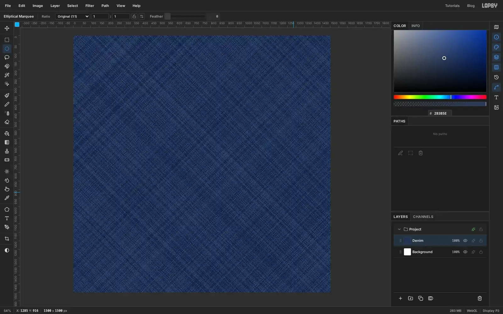

Choose **File → New**, set **1500 × 1500** px with a **White** background, and click **Create**.

Double-click *Layer 1* in the Layers panel and rename it *Denim*. Set the foreground to `#2B3B5E`, press [[Cmd+A]] to select everything and choose **Edit → Fill**. Deselect.

Now give it a weave. Choose **Filter → Texture…**, pick the **Canvas** type and set **Amount 45**, **Size 5**, **Detail 60** and **Angle 45**. The angle turns the threads diagonally, like the twill of a pair of jeans. Click **Apply**, then add a little fuzz with **Filter → Add Noise…** at **Amount 8**, **Mono**.

## Add a vignette and centre guides

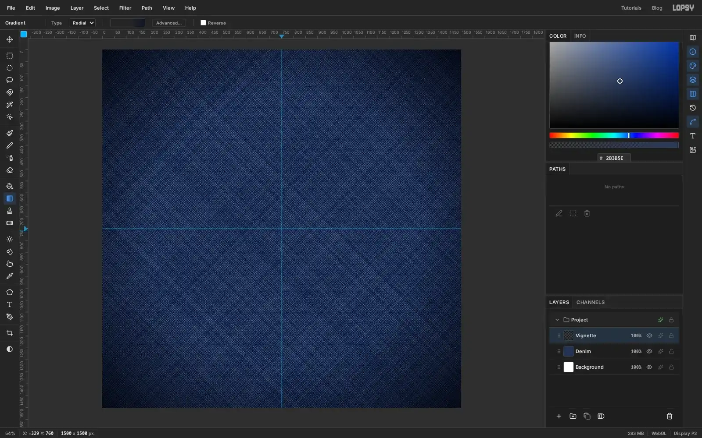

Click **Add Layer** and name the new layer *Vignette*. Pick the **Gradient** tool, set the type to **Radial** and click **Advanced…** to open the Gradient Editor. Set up three stops, all in `#0B1226`: fully transparent at the left end, fully transparent again at **55%**, and **85%** opacity at the right end. Click **Done**.

Drag from the centre of the canvas straight down to just past the bottom edge. Open the layer's effects drawer and set the blend mode to **Multiply**, so the corners sink into shadow and the patch will pop forward.

Then add two guides through the middle. Hold [[Cmd]] and click the top ruler near the middle: with [[Cmd]] held, the guide snaps to the exact half. Do the same on the left ruler.

## Lay down the twill disc

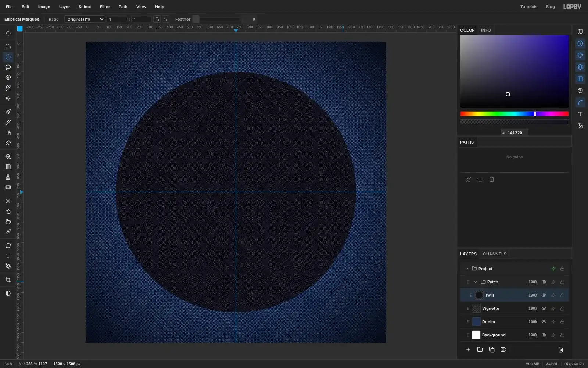

Click **New Group** in the Layers panel and rename it *Patch*. Everything that belongs to the patch goes inside this group. With the group active, click **Add Layer** and name the layer *Twill*.

Pick the **Elliptical Marquee** and draw a 1200 px circle: start the drag at X 150, Y 150 and release at X 1350, Y 1350. Fill it with `#141220` and deselect.

Run **Filter → Texture…** again with the **Canvas** type, **Amount 40**, **Size 3**, **Detail 50** and **Angle 135**. The finer weave at the opposite angle reads as the stiff twill that patches are stitched onto.

## Select the broadcast rings

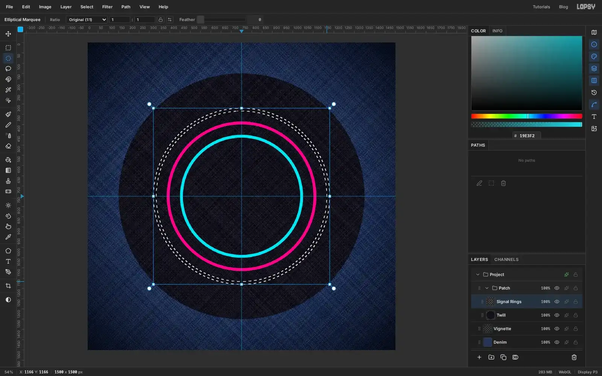

Add a layer named *Signal Rings*. The rings are radio waves spreading out from the skull, so they share the patch's centre. Each one is 14 px thick:

1. Cyan `#19E3F2`: a ring from 300 to 286.
2. Magenta `#FF2D8A`: a ring from 365 to 351.
3. Cyan again: a ring from 430 to 416.

For each ring, set the colour, draw the outer circle with the **Elliptical Marquee**, then hold [[Alt]] and draw the inner circle. Choose **Edit → Fill**. The screenshot shows the last ring selected, just before the fill.

## Glitch the rings with Pixel Stretch

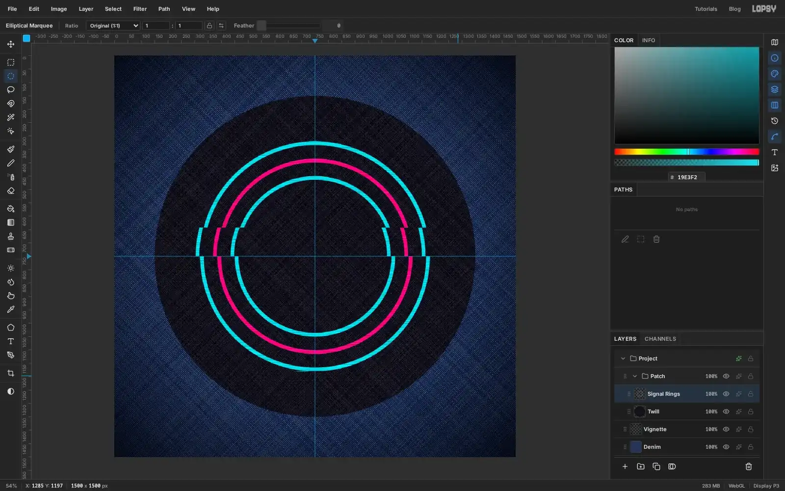

Deselect, then choose **Filter → Pixel Stretch…** and set **Amount 60**, **Bands 14**, **Seed 7** and **RGB Split 0**. Pixel Stretch slides horizontal bands of the layer sideways by random amounts. Here it catches the rings around the middle and shoves them out of line, like a radio signal dropping out.

Leave **RGB Split** at 0. Its colour separation is soft, with red, green and blue fringes, and thread can't reproduce that. You'll make a hard, two-colour split by hand later.

Finish the rings with **Filter → Texture…** using the **Streaks** type and **Relief** mode: **Amount 55**, **Size 2**, **Detail 50**, **Stretch 6**, **Angle 0**. Streaks are noise stretched in one direction, and Relief lights them like a surface, so you get the look of satin-stitch threads.

## Build a bone from a bar and four circles

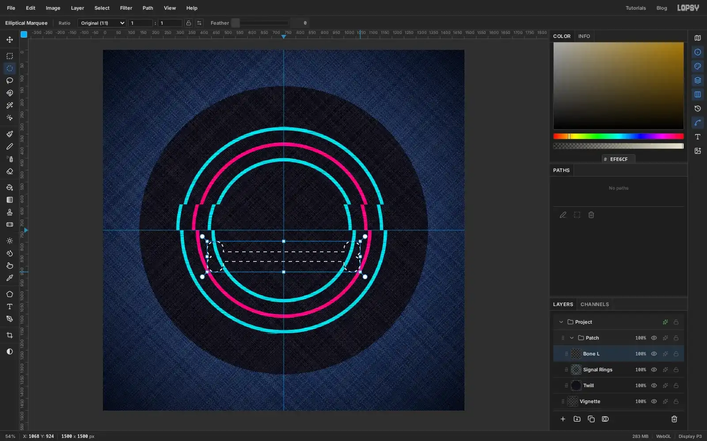

Add a layer named *Bone L* and set the foreground to bone `#EFE6CF`.

With the **Rectangular Marquee**, draw a bar 560 px long and 40 px tall, centred below the middle of the patch (from X 470, Y 840 to X 1030, Y 880). For exact sizes like this, click once on the canvas without dragging while nothing is selected: the **Rectangular Selection** dialog opens, and you can type the **From** and **To** corners. Switch to the **Elliptical Marquee**, hold [[Shift]] and add four 68 px circles: two stacked at the left end of the bar and two at the right end, each one overlapping the bar by about half. Together they make the knuckles.

Choose **Edit → Fill** and deselect.

## Give the bone threads and an outline

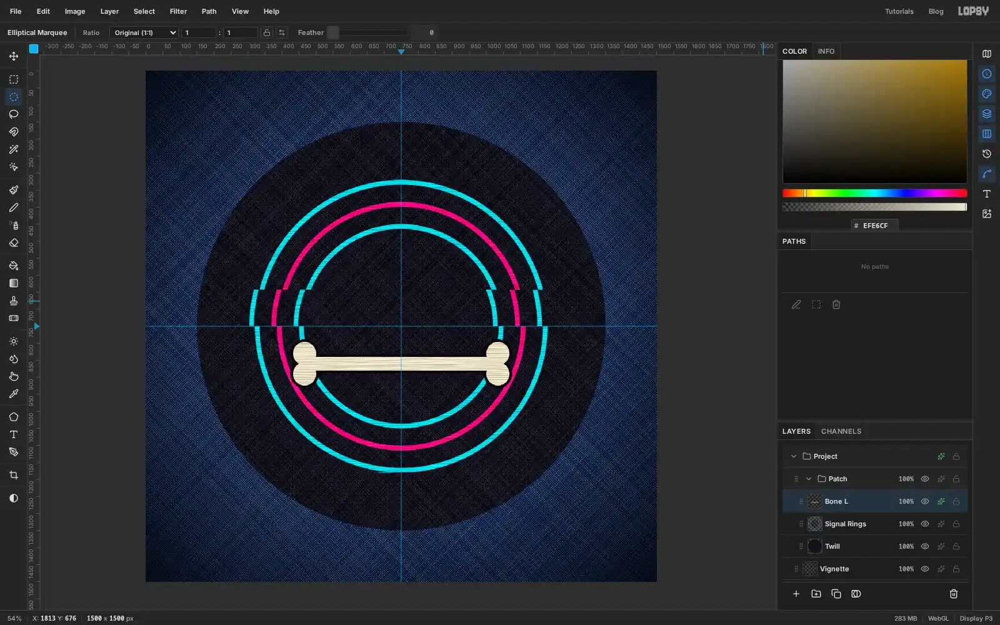

Run the same **Texture** **Streaks / Relief** settings as the rings, with **Amount 45**. Then open the layer's effects and turn on **Stroke**: **8 px**, colour ink `#07060B`. The outline is what makes the shapes read on a busy patch. Real embroidered patches outline almost everything with a dark satin stitch.

## Rotate the bone

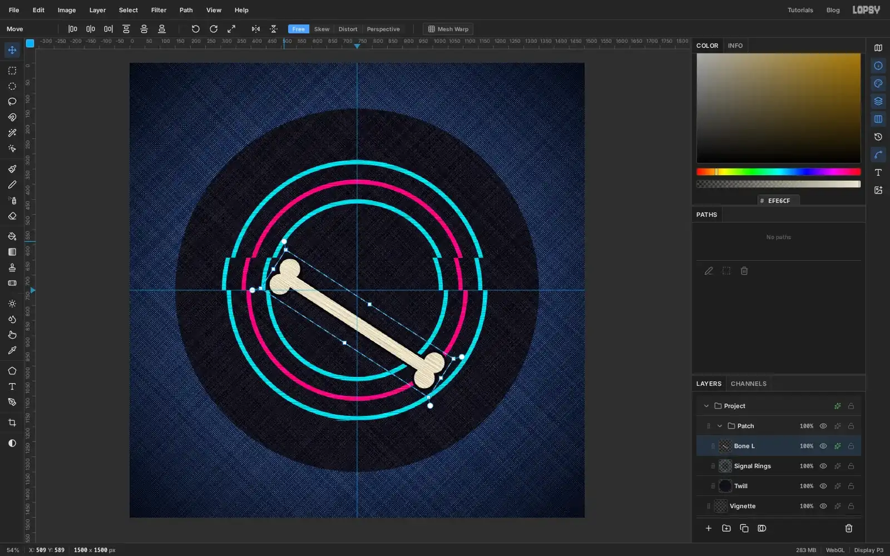

Draw a **Rectangular Marquee** loosely around the whole bone, outline included. Pick the **Move** tool: handles appear around the selection. Grab the round rotation handle just outside the top-left corner and drag it clockwise until the bone tilts about **30°**, running down to the right. Hold [[Cmd]] while you drag to snap the angle in 15° steps. Press [[Cmd+D]] to commit.

## Mirror it into crossbones

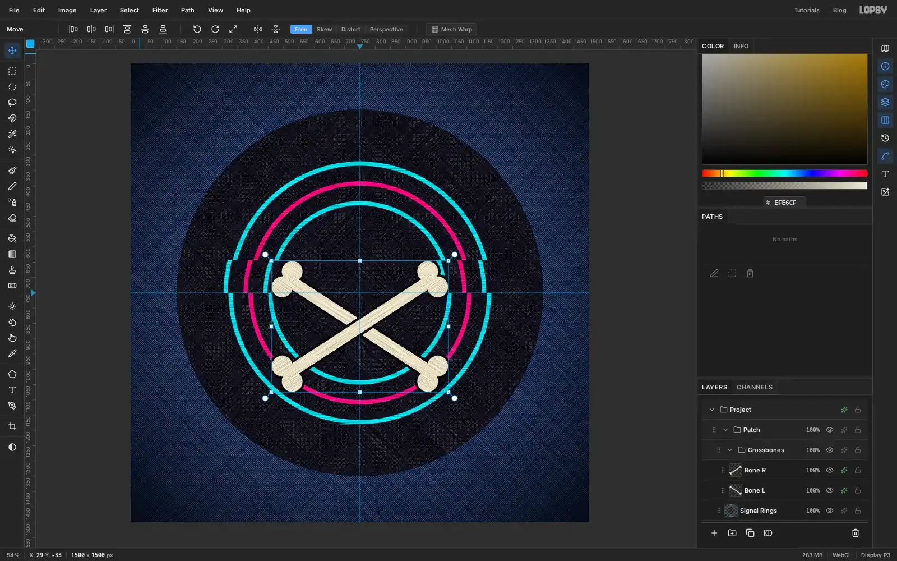

Choose **Layer → Duplicate Layer** and rename the copy *Bone R*. The copy sits exactly on top of the original. Press [[Cmd+A]], pick the **Move** tool and click **Flip Horizontal** in the options bar. The bone mirrors across the canvas centre, so the two make a symmetrical X. Deselect.

Click *Bone R*, [[Shift]]-click *Bone L*, and choose **Layer → Group Layers**. Rename the group *Crossbones*.

## Stretch the crossbones wider

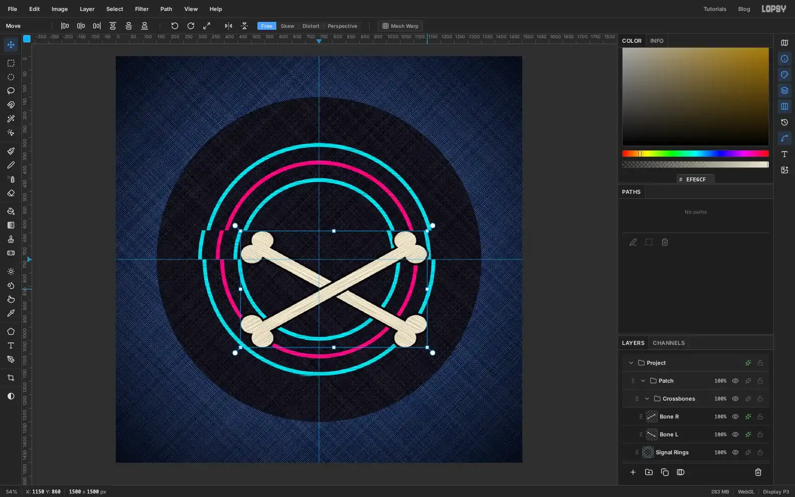

Pirate crossbones look best wide and flat, peeking out at both sides of the skull. With the *Crossbones* group active and the **Move** tool selected, a box appears around both bones. Drag the handle in the middle of the box's right edge outward by about 110 px. Both bones stretch together, and the X flattens out.

## Move the group into place

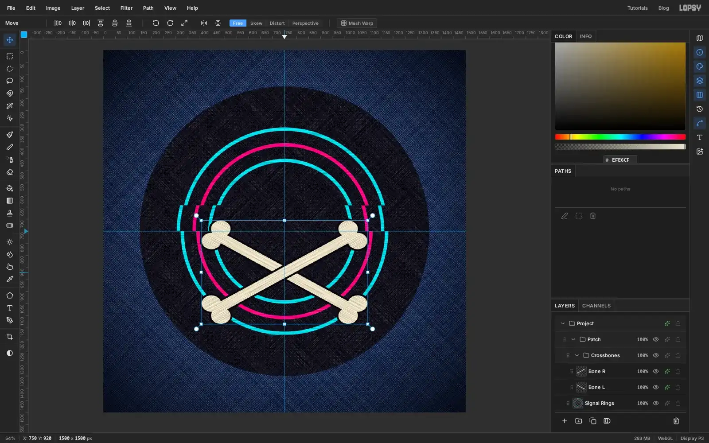

Press [[Cmd+D]] to commit the stretch. Then drag the group so that the crossing point sits on the vertical guide, about 60 px lower than before. The skull's jaw will sit in the top of the X, and the knuckles should still poke out on each side. Deselect.

## Select the skull

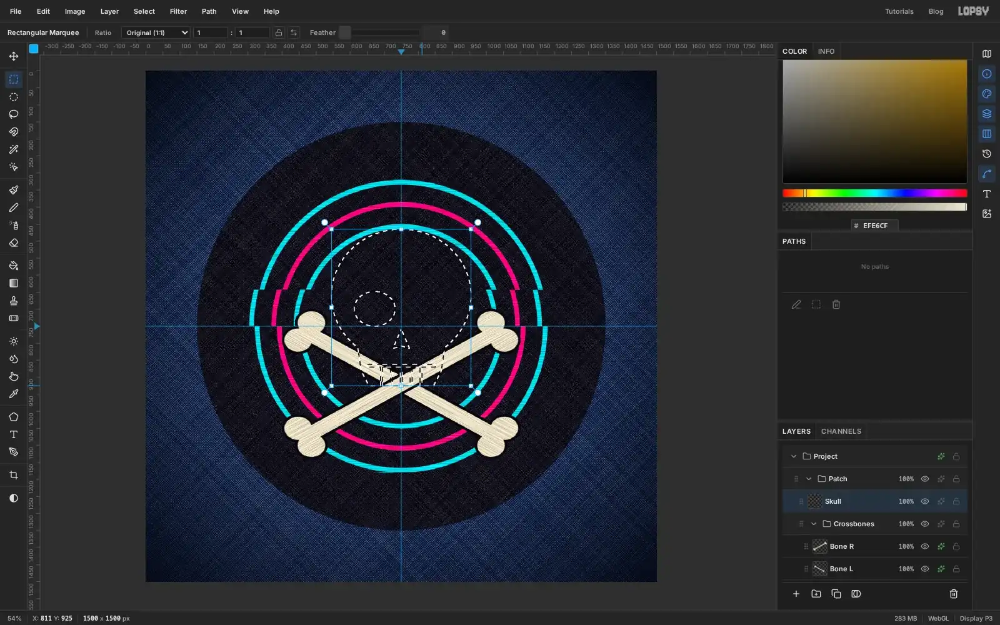

Click **Add Layer**, then drag the new layer's row above the *Crossbones* group in the Layers panel and name it *Skull*. Set the foreground to bone `#EFE6CF`.

Build the skull from parts, watching the X and Y readout in the status bar as you go:

1. **Cranium:** an **Elliptical Marquee** 410 px wide and 390 px tall, centred on the vertical guide with its centre at Y 660.
2. **Jaw:** with the **Lasso** and [[Shift]] held, add a jaw shape below it: straight across at Y 760, from X 615 to X 885, narrowing down to a flat chin about 190 px wide at Y 925.
3. **Eye:** with [[Alt]] held, subtract a 120 × 108 px oval for the eye socket on your left, centred at about X 672, Y 702. Leave the other eye solid, because the eyepatch covers it.
4. **Nose:** [[Alt]]-lasso a small triangle with its point at about X 750, Y 758 and its base about 48 px wide at Y 812.
5. **Mouth:** [[Alt]]-drag a thin rectangle for the mouth line from X 650 to X 850 at about Y 862–870. Then [[Alt]]-drag five 6 px wide gaps for the teeth, running from the mouth line down to Y 925, spaced about 29 px apart and centred on the guide.

Fill and deselect. Run the **Streaks / Relief** texture on it with **Amount 45**.

## Back the skull with an ink outline

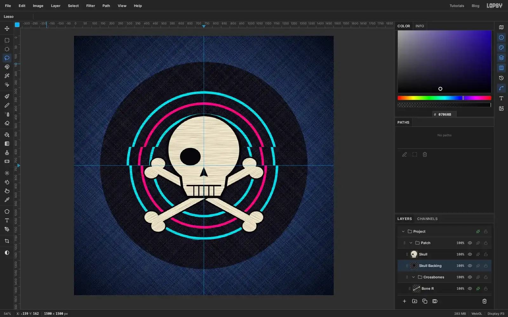

A Stroke effect would also trace the inside of the eye and mouth. For a clean outline around the silhouette only, make a backing layer instead.

Add a layer named *Skull Backing*. Redraw just the cranium ellipse and the [[Shift]]-added jaw, with no holes. Choose **Select → Grow…** and grow it by **14 px**. Fill with ink `#07060B`, deselect, and drag the row below *Skull*.

## Add the eyepatch

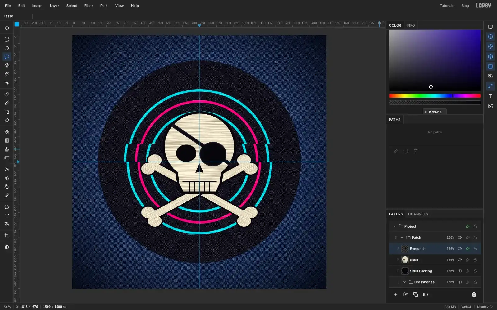

Click *Skull* and add a layer named *Eyepatch*. In ink `#07060B`, select an oval about 164 × 144 px over the solid eye, centred at about X 828, Y 704. Then [[Shift]]-lasso a thin strap, about 20 px thick, running from the upper left of the skull down across the patch and off past the right side. Fill and deselect.

The strap overshoots the skull, so trim it: [[Cmd]]-click the *Skull Backing* thumbnail to load its shape, click the *Eyepatch* layer, choose **Select → Inverse** and press [[Delete]]. Deselect.

Give the eyepatch a satin sheen with an **Inner Glow**: **Size 16**, **Opacity 70%**, colour `#5E5880`.

## Put headphones on the skull

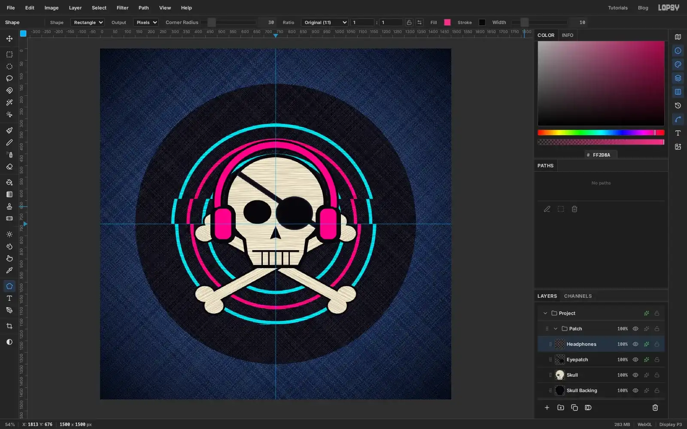

Add a layer named *Headphones* and set the foreground to magenta `#FF2D8A`.

**The band** is the top half of a ring. Select a ring from 262 to 236, centred on the vertical guide with its centre at Y 660, just like the broadcast rings. Then, with [[Alt]] held, drag a **Rectangular Marquee** over everything below Y 680 to remove the bottom half. Fill and deselect.

**The ear cups** are rounded rectangles. Pick the **Shape** tool and set **Shape** to **Rectangle** and **Corner Radius** to **30**. Click the **Fill** swatch and set it to magenta. Click the **Stroke** swatch, set it to ink, and set **Width** to **10**. Shapes grow out from where you press, so press at the centre of each cup and drag 40 px right and 80 px down to make an 80 × 160 px cup. The centres are at about X 525 and X 975, both at Y 740, just outside the cheeks.

Finally, give the layer a **Stroke** effect, **9 px** in ink, so the band gets the same outline as the cups.

## Merge the skull and mark a glitch slice

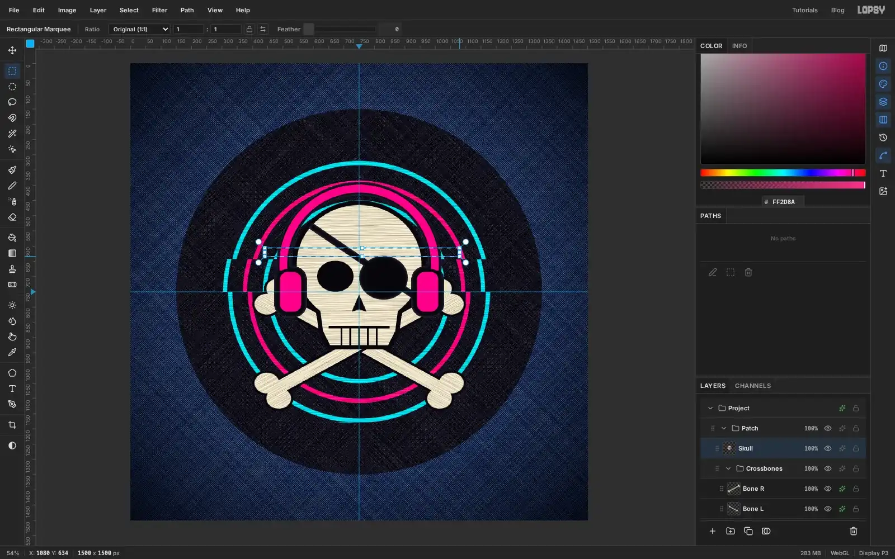

To slice the skull as one image, merge its parts. Click *Headphones* and press [[Cmd+E]] three times. Each press is a **Merge Down**: headphones into eyepatch, into skull, into the backing. Merge Down bakes the layer effects in as it goes. Rename the result *Skull*.

Now draw a **Rectangular Marquee** across the forehead: a strip from Y 606 to Y 634, a little above the ear cups, running from X 440 to X 1080 so it's wider than the headphones on both sides. Keep the slices clear of the ear cups and eyes, so the character stays readable.

## Drag the slice sideways

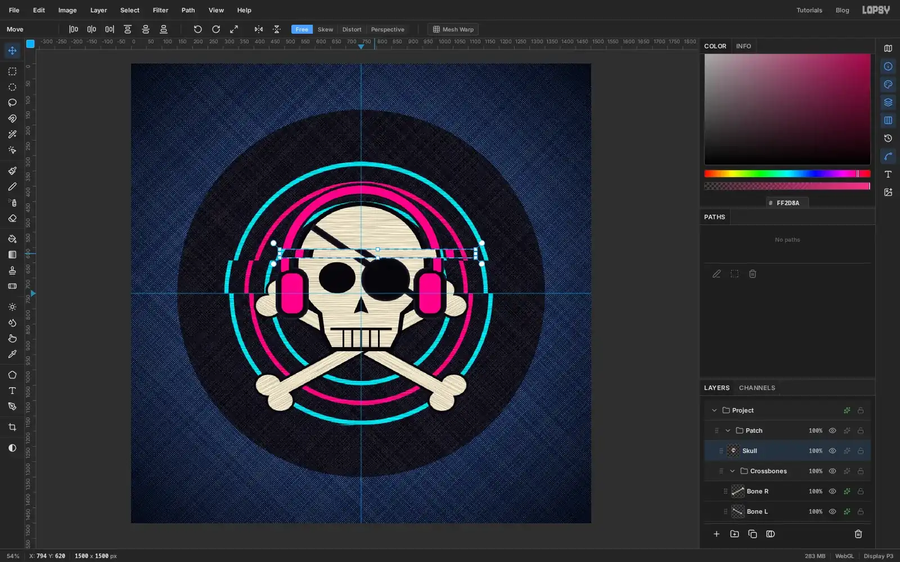

With the **Move** tool, drag inside the selection about 44 px to the right, then deselect. It's the classic glitch: one strip of the frame shows up in the wrong place.

Make a second slice through the teeth: a strip from Y 866 to Y 896, the same width, dragged 30 px to the **left**. Opposite directions keep it from looking like a simple shear. Deselect.

## Split the skull's colour channels

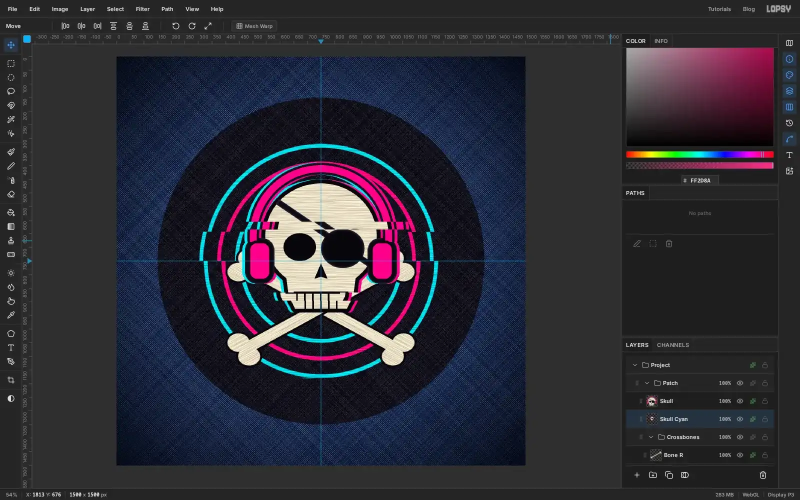

Open *Skull*'s effects and turn on **Drop Shadow**: **Offset X 10**, **Offset Y 0**, **Blur 0**, **Spread 0**, **Opacity 100%**, colour magenta. With no blur, the shadow is a hard copy of the shape sitting 10 px to the right.

Choose **Layer → Duplicate Layer**, rename the copy *Skull Cyan*, and change its drop shadow to **Offset X −10** in cyan. Drag *Skull Cyan* below *Skull*. Now every edge shows cyan on the left and magenta on the right, which is an RGB split in two thread colours.

## Add the lettering band and merrowed border

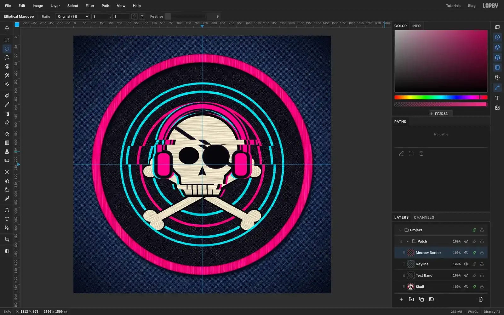

Click *Skull* and add three layers above it, each a ring around the canvas centre:

- *Text Band*: a ring from 600 to 470 in twill `#141220`. Run the **Canvas** texture on it again (Amount 40, Size 3, Detail 50, Angle 135). It hides the ends of the rings that Pixel Stretch pushed outward, and gives the lettering a clean ground.
- *Keyline*: a ring from 478 to 466 in cyan. A keyline is a fine outline that separates the lettering band from the artwork inside it. Give it the **Streaks / Relief** texture too (Amount 50).
- *Merrow Border*: a ring from 642 to 596 in magenta. This is the overlocked edge that real patches have.

Make the border look rolled and raised:

1. Run **Texture** with **Streaks / Relief**, **Amount 75**, **Size 2**, **Detail 60**, **Stretch 8** and **Angle 90**, for tight stitches running across the edge.
2. Add an **Inner Glow**: **Size 16**, **Opacity 65%**, colour `#3A0018`. This shades the edges of the ring so it looks rounded.
3. Add a **Stroke**: **3 px** in `#5A0A2C`, for the cut edge.
4. Add a **Drop Shadow**: **Offset X 8**, **Offset Y 16**, **Blur 26**, **Spread 6**, **Opacity 85%**, colour `#03030A`. This lifts the whole patch off the denim.

## Draw the two arc paths

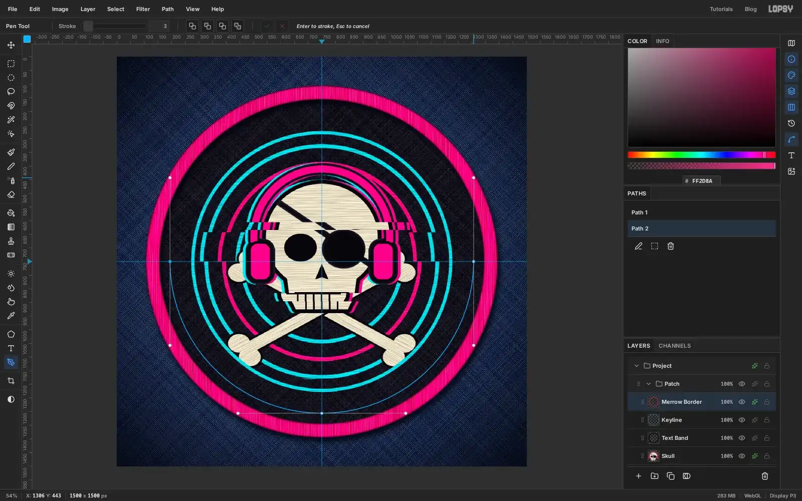

The lettering follows curved paths. Pick the **Pen** tool. Each arc is three anchors, and you drag at each one to pull out handles. A handle about 0.55 times the radius gives a near-perfect circle. Think of a clock face: each arc starts at 9 o'clock, passes through 12 (or 6 for the bottom arc), and ends at 3.

**The top arc**, radius 500, drawn left to right:

1. Press at X 250, Y 750 and drag straight **up** about 275 px.
2. Press at the top, X 750, Y 250, and drag to the **right** about 275 px.
3. Press at X 1250, Y 750 and drag straight **down** about 275 px.
4. Click **✓ Commit path** in the options bar.

**The bottom arc**, radius 556, also drawn left to right: press at X 194, Y 750 and drag **down**; press at the bottom, X 750, Y 1306, and drag **right**; press at X 1306, Y 750 and drag **up**. Commit.

Draw both from left to right. Text runs along a path in the direction it was drawn, so this keeps both lines reading upright.

## Set the title on the top arc

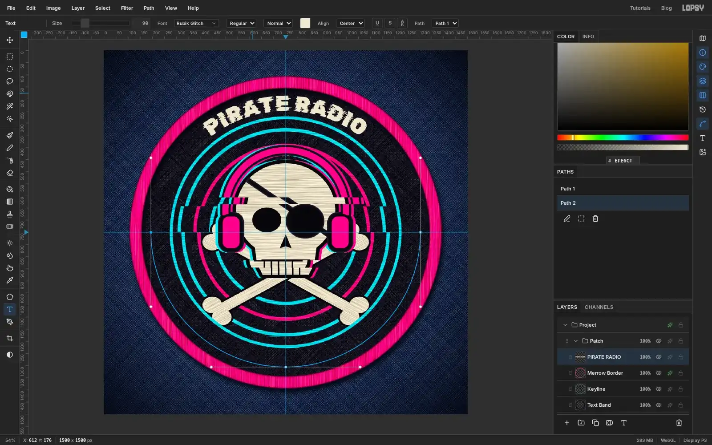

Click *Merrow Border* so the text lands above it, and set the foreground to bone. Pick the **Text** tool and click somewhere empty on the canvas. While the cursor is blinking, choose the font **Rubik Glitch** and set **Size** to **90**. Rubik Glitch has cracks and offsets cut into its letters, so it fits the theme. Type **PIRATE RADIO** and press [[Tab]] to commit.

In the options bar, set **Align** to **Center**, then open the **Path** dropdown and choose **Path 1**. The text jumps onto the arch, centred at its top.

## Open up the letter spacing

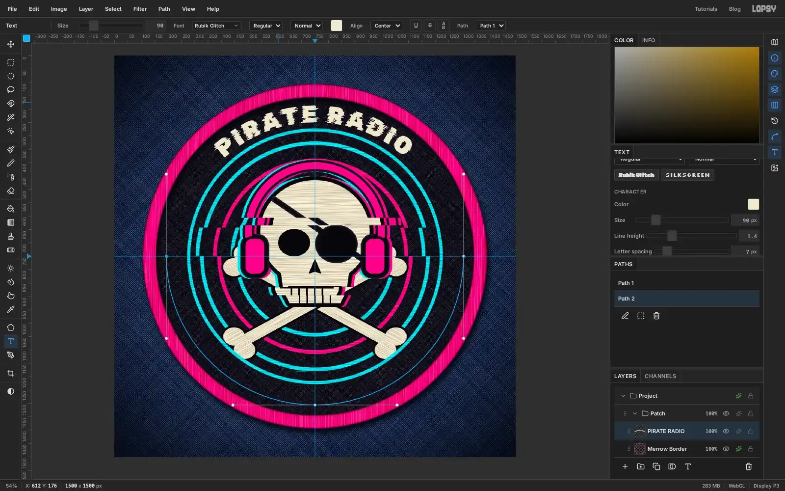

On a curve, the gaps between letters close up and the word space almost disappears. Open the **Text** panel from the right-hand dock and set **Letter spacing** to **7 px**. PIRATE and RADIO now read as two words.

## Give the title the same RGB split

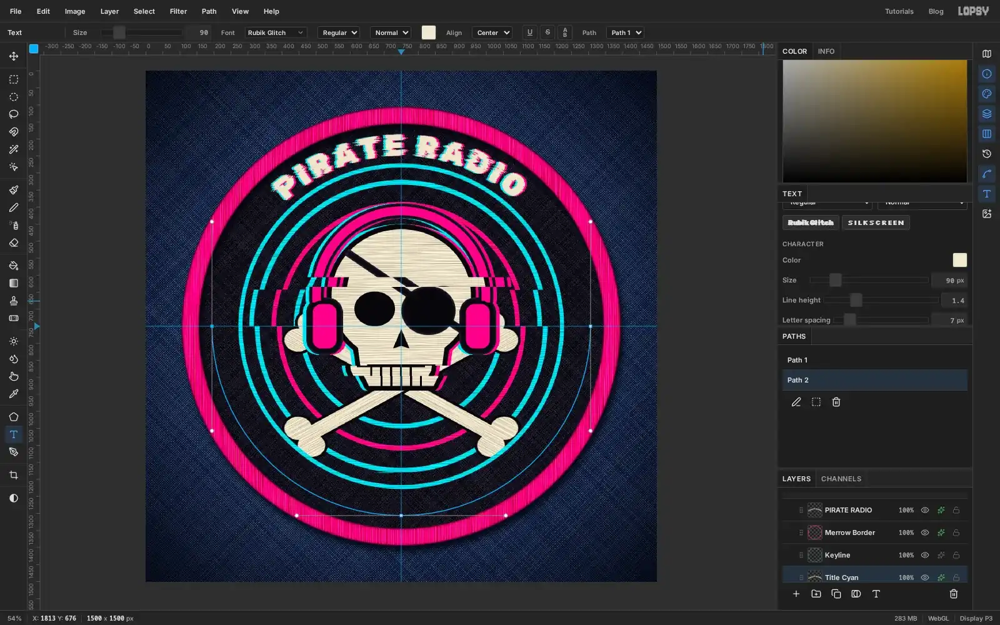

Repeat the colour split from the skull, slightly smaller for the type. On *PIRATE RADIO*, add a **Drop Shadow** with **Offset X 6**, **Offset Y 0**, **Blur 0** and **Opacity 100%** in magenta. Also add a faint **Inner Glow**: **Size 6**, **Opacity 45%**, colour `#8C7F66`, which rounds the letters like padded satin.

Duplicate the layer, rename the copy *Title Cyan*, change its shadow to **Offset X −6** in cyan, and drag it below *PIRATE RADIO*.

## Set the frequency on the bottom arc

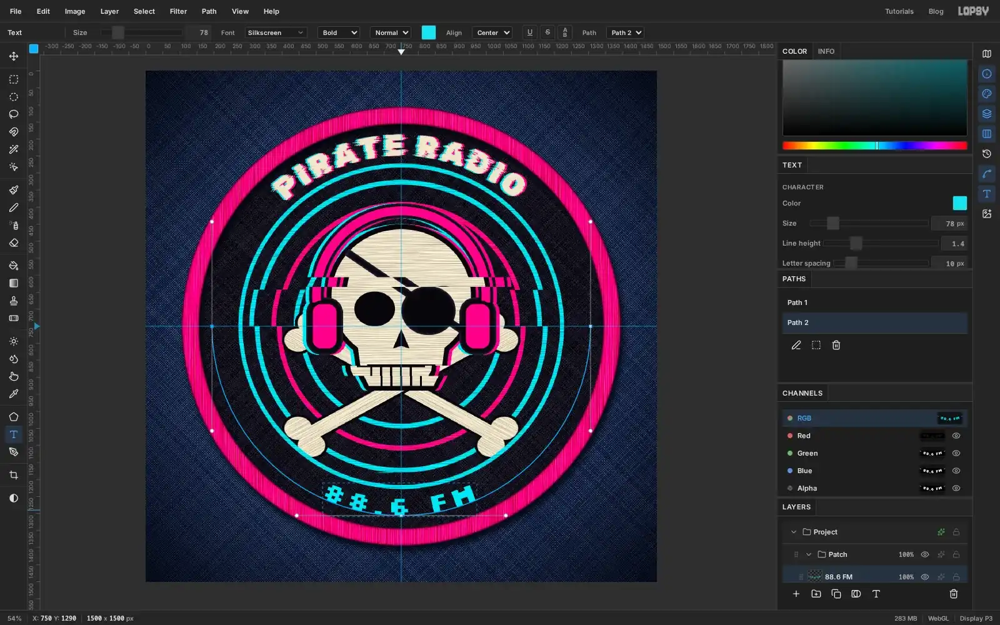

Click *PIRATE RADIO*, set the foreground to cyan, and click an empty spot on the canvas with the **Text** tool. Choose **Silkscreen**, set the weight to **Bold** and the size to **78**. A pixel font is a nod to digital displays, and the bold weight is thick enough to stitch. Type **88.6 FM** and press [[Tab]].

Set **Align** to **Center** and **Path** to **Path 2**. In the Text panel, set **Letter spacing** to **10 px**. New text keeps the last letter spacing you used (7 px from the title), so check it.

Keep the bottom line short. A full tagline at this size would wrap halfway up the sides of the patch, and at a smaller size it would be too thin to embroider.

## Seat the type in its band

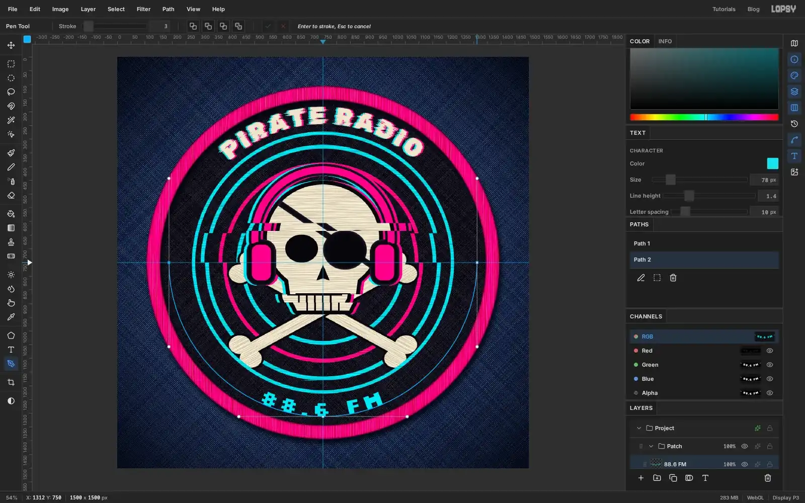

Zoom in and look at each line. The title sits closer to the keyline than to the border, and so does the bottom line. Each line should sit midway in the band, with the same gap on both sides.

Text on a path follows its path live, so fix it by moving the paths. Zoom to 200% first, because 5 px is only a few screen pixels at fit size. Click *Path 1* in the **Paths** panel, pick the **Pen** tool, and drag each of its three anchors about 5 px **outward**: the top anchor up, and the side anchors out to the left and right. Do the same for *Path 2*, about 6 px. The title is pushed up and the frequency is pushed down, until both have even margins.

## Snap dead pixels to the grid

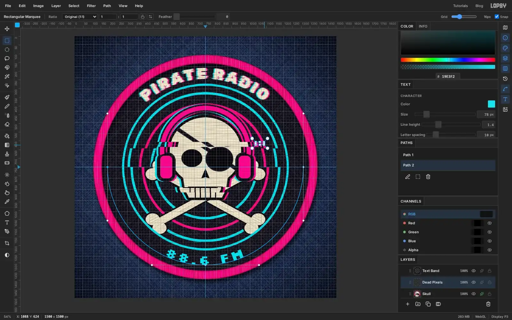

Click *Skull* and add a layer named *Dead Pixels*. Choose **View → Show Grid**. The grid is 16 px, and showing it turns on **Snap**, so marquees land exactly on grid cells. That gives you crisp square "pixels".

Draw a **Rectangular Marquee** three cells wide and one cell tall at the right-hand end of the forehead slice, and fill it with cyan.

## Finish the dead-pixel clusters

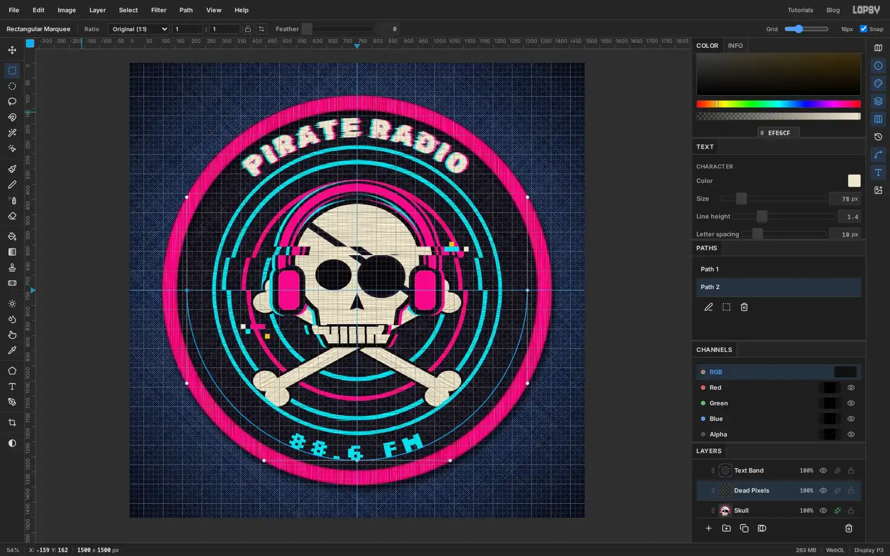

Add three or four more one-cell blocks around it, in magenta, yellow `#E8C547` and bone. Then make a second cluster at the left end of the teeth slice.

Keep the blocks clustered where the slices break. Scattered at random, they'd look like dirt on the patch. Placed here, they read as the debris the glitch left behind. Choose **View → Show Grid** again to hide the grid.

## Build scanlines by copy and paste

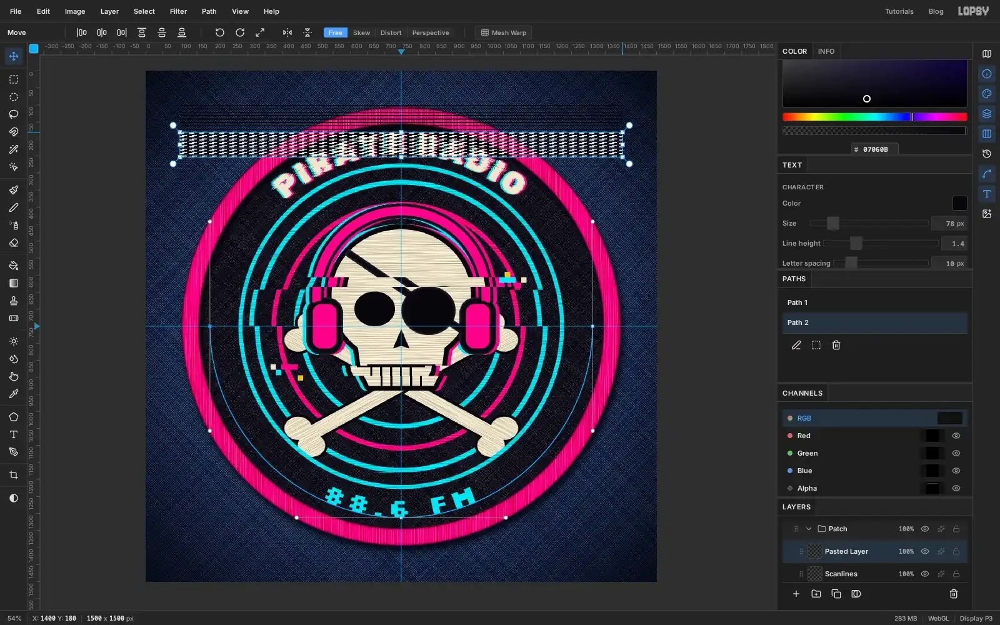

Click *88.6 FM* and add a layer named *Scanlines*. Near the top of the canvas, fill a strip **3 px** tall in ink, running the full width of the patch: from X 100, Y 100 to X 1400, Y 103 in the Rectangular Selection dialog.

Now double it over and over. It's quicker than drawing 128 lines, though the last rounds take a lot of key presses (about 127 [[Shift+Down]] presses in total):

1. With the Rectangular Selection dialog, select from X 100, Y 100 to X 1400, Y 110.
2. Press [[Cmd+C]] then [[Cmd+V]]. The paste lands in place and is selected, with the Move tool active.
3. Press [[Shift+Down]] once to nudge the copy down 10 px.
4. Press [[Cmd+D]], then [[Cmd+E]] to merge the copy into *Scanlines*.

Repeat with a selection twice as tall each time (to Y 120, 140, 180…), nudging down twice as far ([[Shift+Down]] 2, 4, 8 times…). After seven rounds you have 128 evenly spaced lines covering the whole patch.

## Blend the scanlines

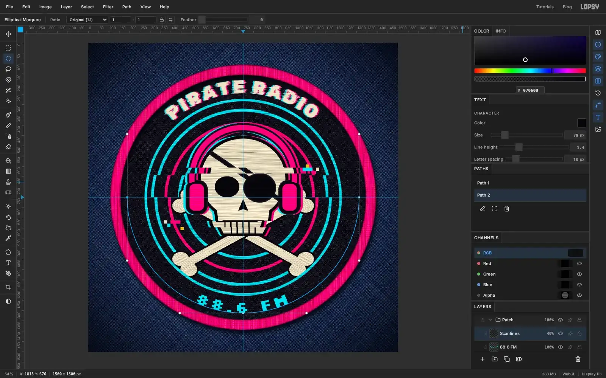

Trim the lines to the patch: select a circle of radius 642 around the canvas centre (the outside edge of the border), choose **Select → Inverse**, press [[Delete]] and deselect.

Set the layer's blend mode to **Overlay** and its opacity to **40%**. The lines darken the colours under them without turning anything grey, like the line structure of an old CRT screen woven into the fabric.

## Add a thread sheen

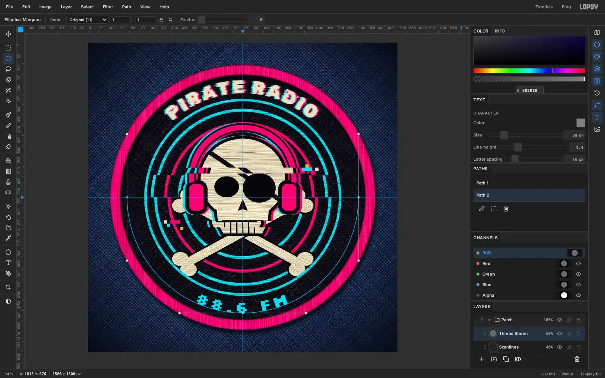

Add a layer named *Thread Sheen*. Fill a circle of radius 596 (the inside of the border) with mid-grey `#808080`. Run **Texture** with **Streaks / Relief**, **Amount 80**, **Size 2**, **Detail 70**, **Stretch 5** and **Angle 35**.

Set the layer to **Overlay** at **50%**. Mid-grey disappears in Overlay mode, so only the light and dark streaks are left, giving a diagonal shimmer across all the threads at once.

## Check it and export

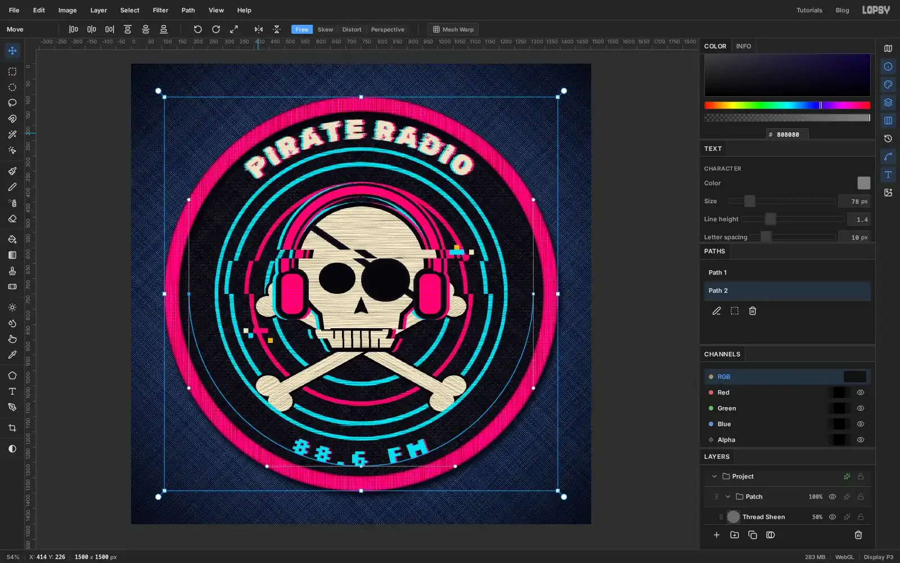

Press [[Cmd+0]] to fit the canvas and check the whole patch. Look at the edges of the slices, the gaps around the type, and anything poking through the border.

Because everything sits in the *Patch* group, you can move the whole patch at once. Click the group and drag with the **Move** tool to try it off-centre on the denim, then press [[Cmd+Z]] to put it back.

Choose **File → Quick Export PNG** to save the image, and **File → Save Project** to keep the layers. To make a variation, try a different frequency, or swap the magenta and cyan for a station with its own colours.
