"Lo-fi" started as a recording style and turned into a whole look: soft
colours, a bit of grain, a slightly faded photo, and the cosy feeling of
those *beats to study to* streams. It suits embroidered patches well,
because a patch is already a little imperfect. Thread has texture, colours are
limited, and every shape gets a thick outline.

In this tutorial you'll make **Lemon Soda**, a 2000 × 2000 px iron-on patch
with the tagline *beats to sip to*, shown as a photo of the patch on a denim
jacket. The finished piece has:

- a raspberry **twill** field with a **halftone** dot vignette
- a **lemon slice** with eight segments, built from a single segment by duplicating and rotating it
- a tapered **glass of soda** with bubbles and a straw that shows through the soda, using a **layer mask**
- **LEMON SODA** set on an arc with the Pen and the Text tool
- a mint **ribbon** with folded tails, drawn with the grid turned on
- a **merrowed edge** that follows the ribbon, so the patch is die-cut in one piece
- **stitch textures** that run in a different direction on each shape, a shadow, grain and a light leak

Everything is drawn in Lopsy. You don't need any photos or downloads.

The tools you'll use:

- **Filter → Texture…** (Canvas and Streaks, with Relief), **Halftone**, **Gaussian Blur** and **Add Noise**
- the **Elliptical** and **Rectangular Marquee**, the **Lasso**, the **Magic Wand**, **Grow** and **Shrink**
- the **Gradient**, **Pencil** and **Brush** tools
- **Duplicate Layer**, **Merge Down**, **Group Layers**, and the **Move** tool's scale and rotate handles
- the **Pen** and the **Text** tool on a path, with **Shrikhand** and **Chewy** from the font picker
- **Stroke**, **Drop Shadow**, **Inner Glow** and **Color Overlay** effects, a **layer mask**, and the **Multiply**, **Soft Light** and **Screen** blend modes
- **guides**, the **grid** and **Snap to Grid**

The palette:

- Denim `#3A5577`, patch shadow `#0E1726`
- Twill pink `#EE6F8B`, halftone raspberry `#C2405F`
- Merrow plum `#2E1F3B`, merrow sheen `#7E5E93`, cream thread `#F7EBCB`
- Lemon rind `#F4D832`, lemon flesh `#FFEC7A`
- Glass `#D6F1E7`, soda `#FFD95C` → `#F29B2E`, meniscus `#FFF6D2`
- Ribbon mint `#7CCBB0`, tails `#4E9E86`, folds `#2F8F78`
- Light leak `#FF9A4D`

> **Tip:** Positions are written as `x, y` in document pixels from the top-left corner. Watch the status bar at the bottom left as you move the pointer. The patch is a circle with its centre at **1000, 940** and a radius of **700**. For an exact circle or rectangle, press [[Cmd+D]] so nothing is selected, then **click once** with a marquee tool and type the **From** and **To** corners into the dialog that opens.

> **Tip:** Key names are Mac keys. On Windows and Linux, use Ctrl for Cmd. Filter dialogs open with their default values every time, so set every value a step lists, even if it repeats an earlier one.

## Make the denim backdrop

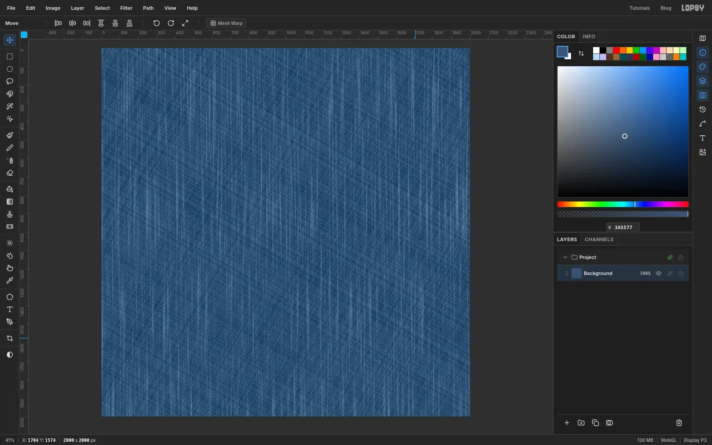

Open [Lopsy](/). In the **New Document** dialog, set **Width** and **Height** to `2000` and click **Create**. Delete the empty `Layer 1` with the bin button at the bottom of the Layers panel. Everything sits inside a group called `Project`. That's the document's root group, and every layer you add goes inside it, so you can ignore it.

1. Click **Background**, set the foreground colour to `#3A5577` and choose **Edit → Fill**.
2. Choose **Filter → Texture…**. Click **Canvas**, then set **Amount** `45`, **Size** `5`, **Detail** `60` and **Angle** `30`. Click **Apply**. This gives you the woven threads.
3. Open **Filter → Texture…** again. Click **Streaks** and **Lighten**, then set **Amount** `25`, **Size** `9`, **Detail** `80`, **Stretch** `4` and **Angle** `90`. Click **Apply**.

The second pass only ever lightens, so it adds the pale, worn streaks you see on washed denim without darkening the weave.

## Draw the patch circle

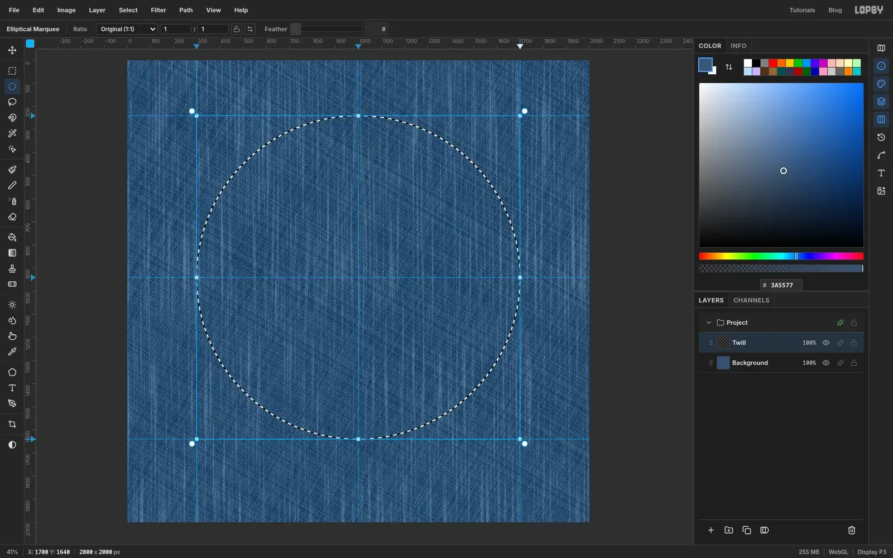

1. Click the top ruler at `1000`, `300` and `1700` to drop three vertical guides. Click the left ruler at `940`, `240` and `1640` for three horizontal guides. The middle pair crosses at the centre of the patch and the others mark its edges.
2. Add a new layer with the **+** button and double-click its name to rename it `Twill`.
3. Pick the **Elliptical Marquee** and drag from where the top-left guides cross to where the bottom-right guides cross. The marquee snaps to the guides, so you get a perfect circle 1400 px across.

## Fill the twill field

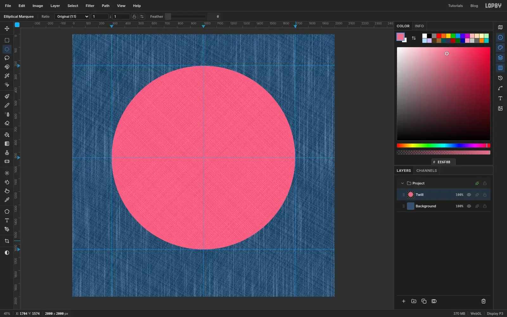

1. Set the foreground to `#EE6F8B`, choose **Edit → Fill** and press [[Cmd+D]].
2. **Filter → Texture…**: click **Canvas** and set **Amount** `30`, **Size** `2`, **Detail** `30`, **Angle** `45`. Click **Apply**.

Most patches are embroidered onto a twill backing, and the fine 45° weave makes the pink look like fabric rather than a flat fill.

## Shade a gradient for the halftone

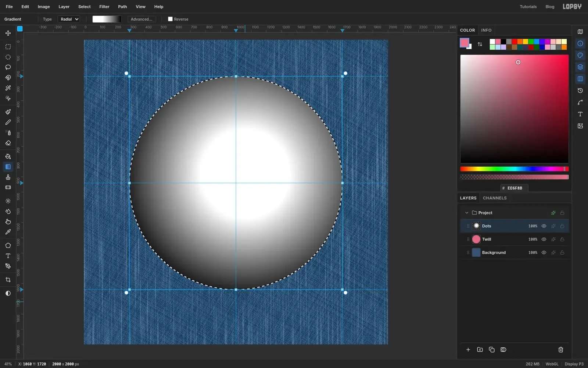

The halftone filter turns dark areas into big dots and light areas into small ones. A gradient that's white in the middle and black at the rim gives you dots that only appear near the edge.

1. Add a layer named `Dots`.
2. [[Cmd]]-click the `Twill` thumbnail to select the circle.
3. Pick the **Gradient** tool, set the type to **Radial** and click **Advanced…**. Set the left stop to `#FFFFFF` and the right stop to `#000000`. Click the bar at about a third of the way along to add a stop, and make that one `#FFFFFF` too. Click **Done**.
4. Drag from a little above and right of the centre, at about `1060, 880`, straight down to just past the bottom of the circle.

## Turn it into halftone dots

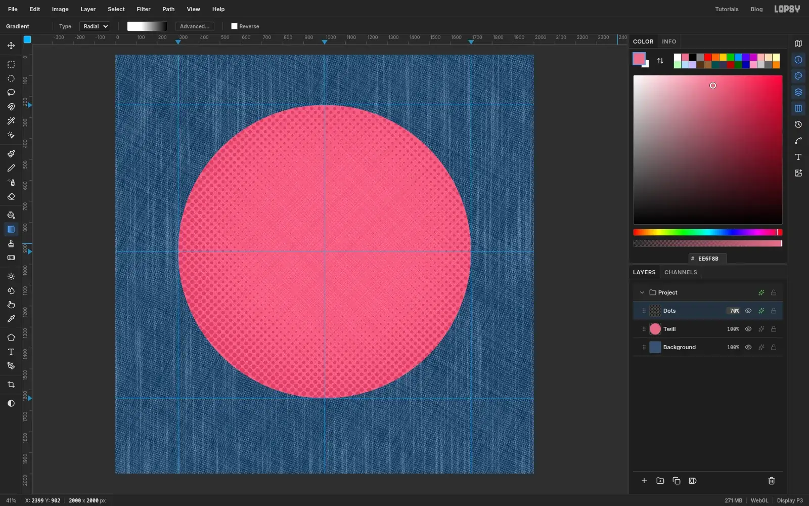

1. Choose **Filter → Halftone…** and set **Dot Size** `26`, **Angle** `45` and **Softness** `1`. Click **Apply**, then press [[Cmd+D]].
2. Open the layer's effects with the ✦ button on its row, turn on **Color Overlay** and set its colour to `#C2405F`. Close the effects drawer.
3. Click the opacity on the `Dots` row and set it to **70%**.

Color Overlay recolours the black dots without touching their shapes, so you can try other colours later without redoing the halftone.

## Start the lemon slice

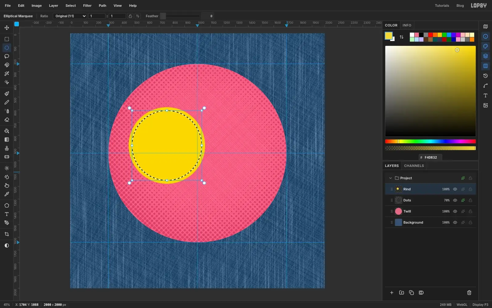

1. Add a layer named `Rind`. Press [[Cmd+D]], click once with the **Elliptical Marquee** and enter `460, 580` to `1060, 1180`. That's a circle 600 px across.
2. Fill it with `#F4D832`.
3. Choose **Select → Shrink…** and enter `26`. Keep the selection.
4. Add a layer named `Pith`, fill the smaller circle with cream `#F7EBCB` and deselect.

The yellow ring left showing around the cream is the rind.

## Draw one segment

1. Add a layer named `Segments` and set the foreground to `#FFEC7A`.
2. With the **Lasso**, draw one wedge. Start near the rim of the pith, follow the curve of the rim for about an eighth of the way round, then bring both sides in to a point just short of the centre of the slice. Leave a little cream between the wedge and the rind.
3. Fill it and deselect.

You only draw one segment. The other seven are copies of it.

## Rotate copies to make eight segments

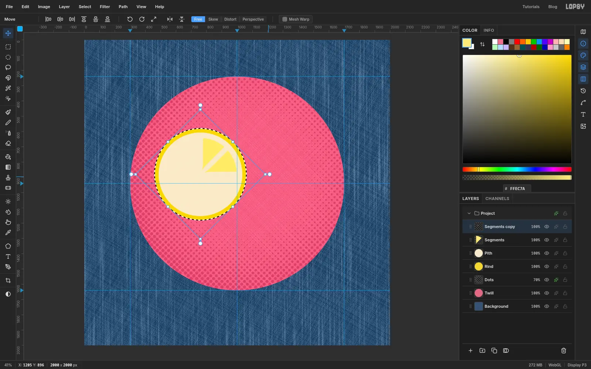

The trick is to rotate each copy around the **centre of the slice**, not the centre of the wedge. A selection the same size as the slice puts the rotation point exactly where you need it.

1. Choose **Layer → Duplicate Layer**.
2. Press [[Cmd+D]], click once with the **Elliptical Marquee** and enter `460, 580` to `1060, 1180` again.
3. Switch to the **Move** tool. Hold [[Cmd]] and drag one of the round rotation handles outside a corner. Holding Cmd snaps the angle to 15° steps, so stop at **45°**. Press [[Enter]] and then [[Cmd+D]].
4. Press [[Cmd+E]] to merge the copy down into `Segments`. You now have two segments.
5. Repeat steps 1 to 4 with a turn of **90°** to get four segments, then with **180°** to get eight.

## Outline and scale the lemon

1. Click `Rind`, open its effects and turn on **Stroke**: **Width** `12`, colour `#2E1F3B`. Close the drawer.
2. Click `Segments`, [[Shift]]-click `Rind` so all three lemon layers are selected, and choose **Layer → Group Layers**. Rename the group `Lemon`.
3. With the **Move** tool, a box appears around the whole group. Hold [[Cmd]] and drag the bottom-right corner handle up and to the left by about 90 px. That makes the lemon about 85% of its size.

Holding Cmd while you drag a corner keeps the lemon round.

## Tilt the lemon and move it into place

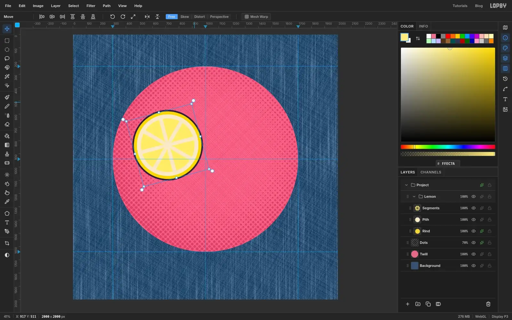

1. Still with the **Move** tool, hold [[Cmd]] and drag a rotation handle anticlockwise by one step, **15°**. Tilting the slice stops the segments looking stiff and symmetrical.
2. Drag the middle of the box so the lemon's centre sits at about `770, 905`, a little left of and below the centre guide.
3. Press [[Enter]], then [[Escape]].
4. Click the arrow beside `Lemon` in the Layers panel to collapse the group.

Collapsing the group matters for the next step. A new layer added while a collapsed group is selected goes above the group, not inside it.

## Draw the glass

1. With `Lemon` selected, add a layer named `Glass`.
2. The glass is a simple tumbler: about 490 px wide at the rim, narrowing to about 360 px at the base, with the two bottom corners cut off at an angle so the base looks rounded. It has straight sides, so draw it with the **Pen** rather than the freehand Lasso. Click (don't drag) to place six corner points: the rim from `935, 650` to `1425, 650`, down the right side to `1360, 1240`, across the bottom through `1330, 1270` and `1030, 1270`, and up to `1000, 1240`. Click the first point again to close the shape.
3. In the **Paths** panel, click **Path to Selection**, then **Delete Path** so the blue outline goes away.
4. Fill the selection with `#D6F1E7` and deselect.
5. Open its effects with the ✦ button and turn on **Stroke**: **Width** `12`, colour `#2E1F3B`. Close the drawer.

The glass overlaps the right side of the lemon, so the slice looks like it's leaning against it.

## Pour the soda

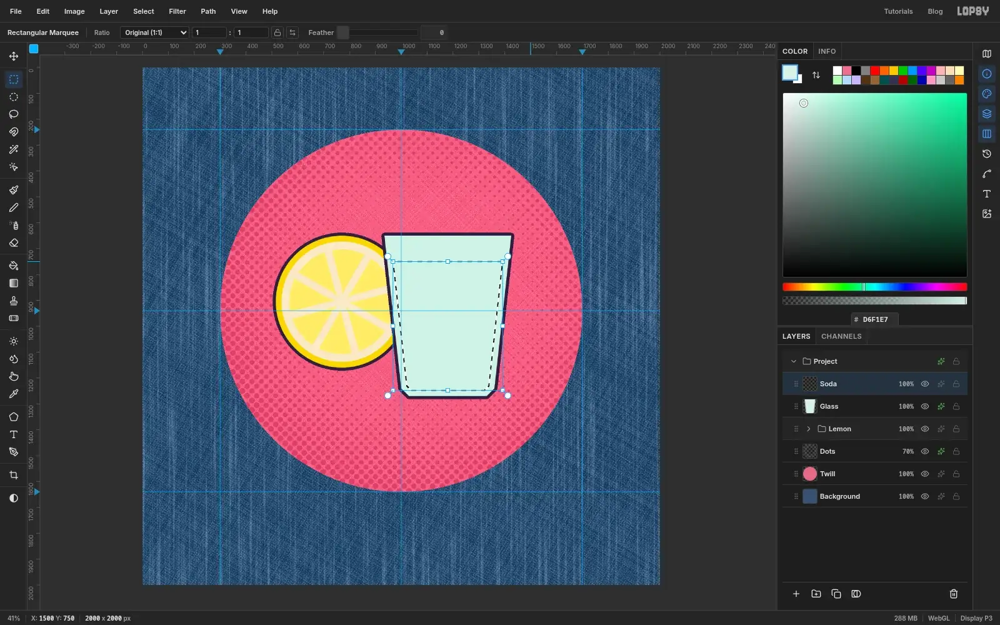

1. Add a layer named `Soda`. [[Cmd]]-click the `Glass` thumbnail, then choose **Select → Shrink…** `22`. That leaves a gap for the glass wall.
2. Pick the **Rectangular Marquee**, hold [[Option]] and drag a box over the top of the glass from above the rim down to `y 750`. Holding Option subtracts it, so only the lower part of the glass stays selected.
3. Pick the **Gradient** tool, set it to **Linear** and use **Advanced…** to set two stops: `#FFD95C` and `#F29B2E`. Drag from the top of the selection straight down to the bottom of the glass. Deselect.
4. Pick the **Pencil**, set **Size** to `10` and the foreground to `#FFF6D2`. Click at the left end of the soda's surface, then [[Shift]]-click at the right end to draw a straight meniscus line.

The amber soda is warmer and darker than the lemon, so the two yellows stay separate where they overlap.

## Make a striped straw

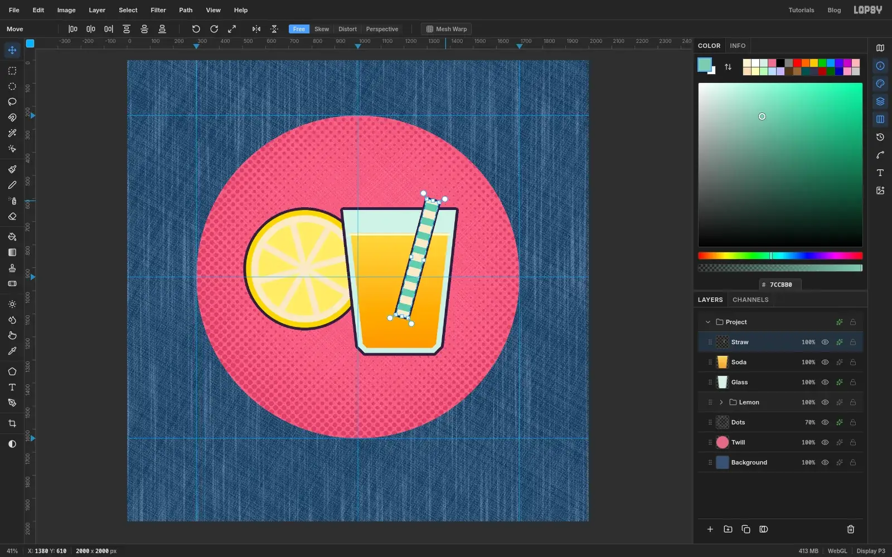

1. Add a layer named `Straw`. Click once with the **Rectangular Marquee** and enter `1230, 600` to `1286, 1120`. Fill it with cream `#F7EBCB` and deselect.
2. Set the foreground to mint `#7CCBB0`. With the **Rectangular Marquee**, drag a thin band across the straw near its top, about 30 px tall and exactly as wide as the straw. Hold [[Shift]] and drag more bands below it, about every 64 px, all the way down. Fill and deselect.
3. Open the layer's effects (✦) and add a **Stroke** of **Width** `8` in `#2E1F3B`.
4. [[Cmd]]-click the `Straw` thumbnail. With the **Move** tool, hold [[Cmd]] and drag a rotation handle clockwise one step, **15°**. Press [[Enter]] and deselect.

## Let the straw show through the soda

The straw is on top of the soda, so right now it looks like it's in front of the glass. A layer mask fixes that.

1. With `Straw` selected, click the **Add Mask** button at the bottom of the Layers panel, then click the mask thumbnail on the row to edit the mask.
2. Click once with the **Rectangular Marquee** and enter `1080, 762` to `1480, 1300`. That covers everything below the surface of the soda.
3. Fill it with mid grey `#6E6E6E` and deselect. Grey in a mask means "partly hidden", so the straw fades where it's under the soda.
4. Click the layer's own thumbnail to go back to editing pixels.
5. Add a layer named `Shine`. With the **Lasso**, draw a thin sliver down the left side of the glass, about 25 px wide at the top and narrowing towards the bottom. Fill it with white, deselect and set the layer to **55%**.

## Add bubbles

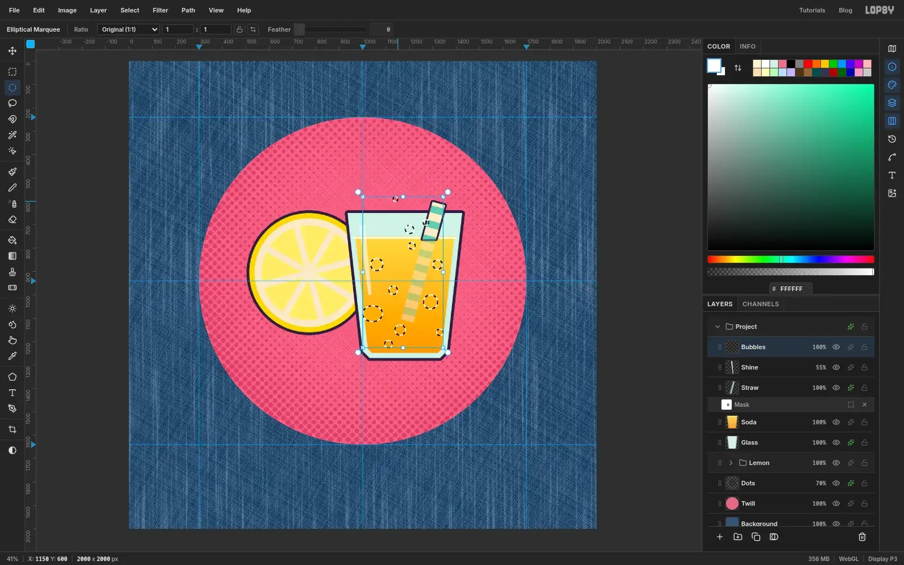

1. Add a layer named `Bubbles` and pick the **Elliptical Marquee**.
2. Drag a small circle inside the soda. Then hold [[Shift]] and drag about eleven more, from about 20 px to 70 px across. Make them smaller near the top, and let a few rise into the empty part of the glass. Put one tiny one just above the rim too; you'll see why in a moment.
3. Fill with cream `#F7EBCB`.
4. Choose **Select → Shrink…** `6` and press [[Delete]]. Each disc becomes a ring.

## Delete a stray bubble with the Magic Wand

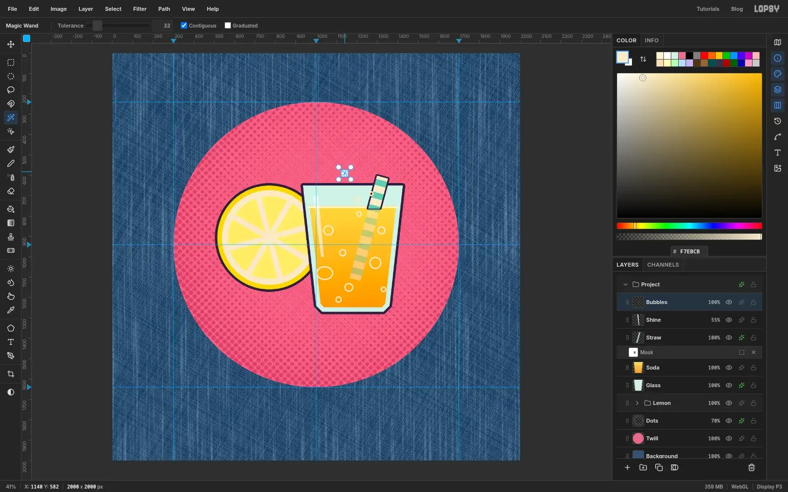

A bubble floating outside the glass looks like a mistake once you see it at full size, so take the one above the rim out again. This is how you'd tidy up any shape you don't want on a busy layer.

1. Press [[Cmd+D]], pick the **Magic Wand** and click on the ring of the bubble above the rim. Only that ring is selected.
2. Press [[Delete]] and deselect.

The Magic Wand is the quickest way to pick one small shape out of a layer with lots of them on it.

## Draw an arc for the title

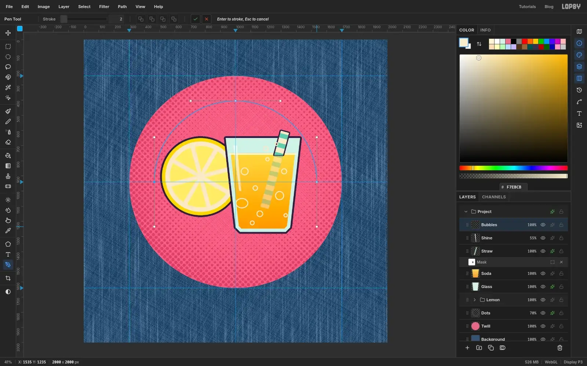

The title follows a half circle that has the same centre as the patch, so it sits evenly inside the rim.

1. Pick the **Pen**.
2. Press at `465, 940`, the left end of the arc, and drag straight up about 295 px before you let go.
3. Press at `1000, 405`, the top of the arc, and drag to the right about 295 px.
4. Press at `1535, 940`, the right end, and drag straight down about 295 px.
5. Click the ✓ **Commit path** button in the options bar.

Dragging each handle about 55% of the radius gives a very close match to a real circle.

## Set the title on the path

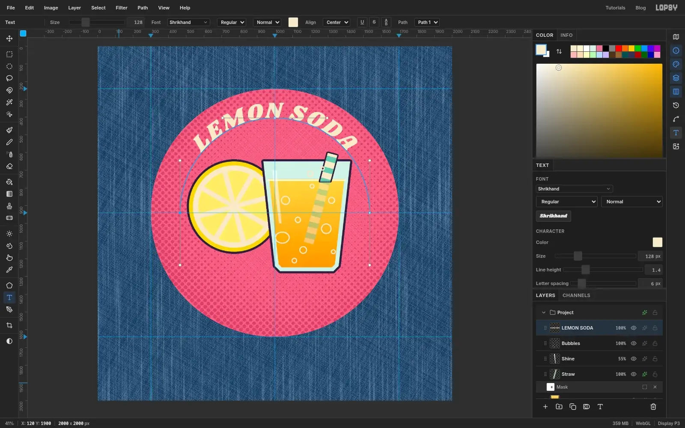

1. Pick the **Text** tool. Set **Size** to `128` and choose **Shrikhand** in the font picker. Set the foreground to cream `#F7EBCB`.
2. Click on an empty part of the denim, outside the patch, and type `LEMON SODA`. Press [[Tab]] to finish.
3. In the **Text** panel, set **Letter spacing** to `6`.
4. In the options bar, choose your arc in the **Text path** menu and set the alignment to **Center**.

The text jumps onto the arc and centres itself on it.

## Outline the title

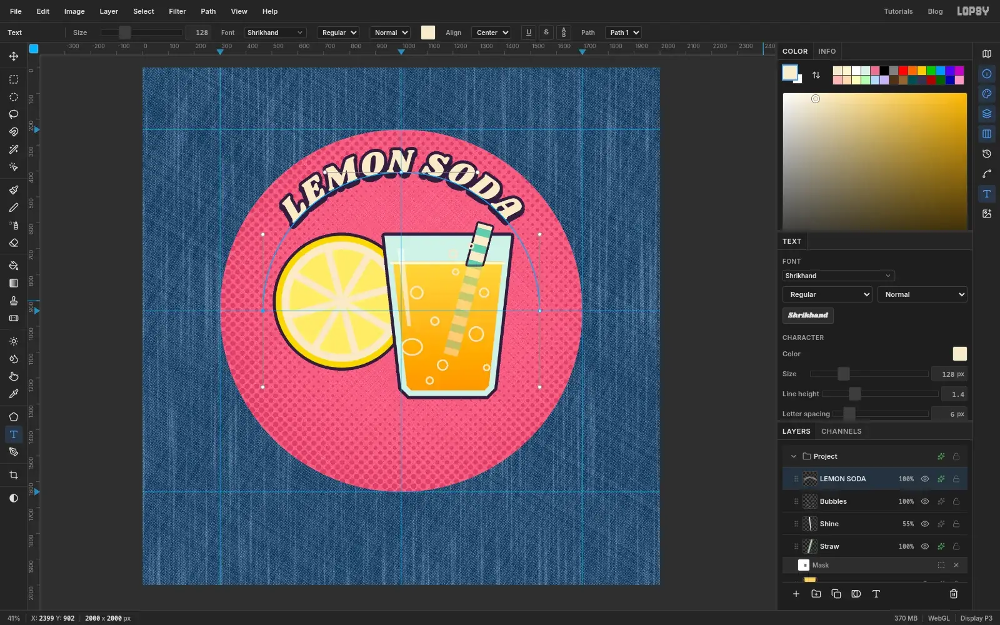

1. Open the title's effects and turn on **Stroke**: **Width** `12`, colour `#2E1F3B`.
2. Turn on **Drop Shadow**: **Offset X** `0`, **Offset Y** `12`, **Blur** `0`, **Opacity** `100`, colour `#2E1F3B`.

A drop shadow with no blur gives a solid, cut-out shadow. Embroidered lettering often has a raised, chunky look like this.

## Cut the ribbon tails

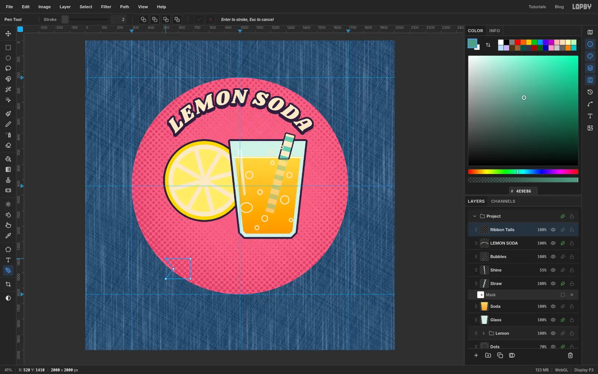

The ribbon is a straight band with two flag-shaped tails behind it. Each tail is about 160 × 130 px with a V-shaped notch cut into its outer end, and it sits a little lower than the band so it looks like the ribbon wraps around behind. Small darker triangles where each tail meets the band are the folds, where the ribbon turns under itself.

1. With the title selected, add a layer named `Ribbon Tails` and set the foreground to `#4E9E86`.
2. With the **Pen**, click the five corners of the left tail and click the first one again to close it: `520, 1410`, `680, 1410`, `680, 1540`, `520, 1540`, and `570, 1475` for the point of the notch. Open the **Paths** panel, click **Path to Selection** and fill. Then click **Delete Path** and deselect.
3. Draw the right tail the same way, mirrored: `1480, 1410`, `1320, 1410`, `1320, 1540`, `1480, 1540`, and `1430, 1475` for the notch. Fill, delete the path and deselect.
4. Set the foreground to `#2F8F78`. With the Pen, draw a small triangle at the inner end of each tail for the fold: `616, 1496`, `680, 1496`, `680, 1540` on the left, and `1384, 1496`, `1320, 1496`, `1320, 1540` on the right. Fill each one the same way.
5. Open the layer's effects (✦) and add a **Stroke** of **Width** `12` in `#2E1F3B`.

## Draw the ribbon band on the grid

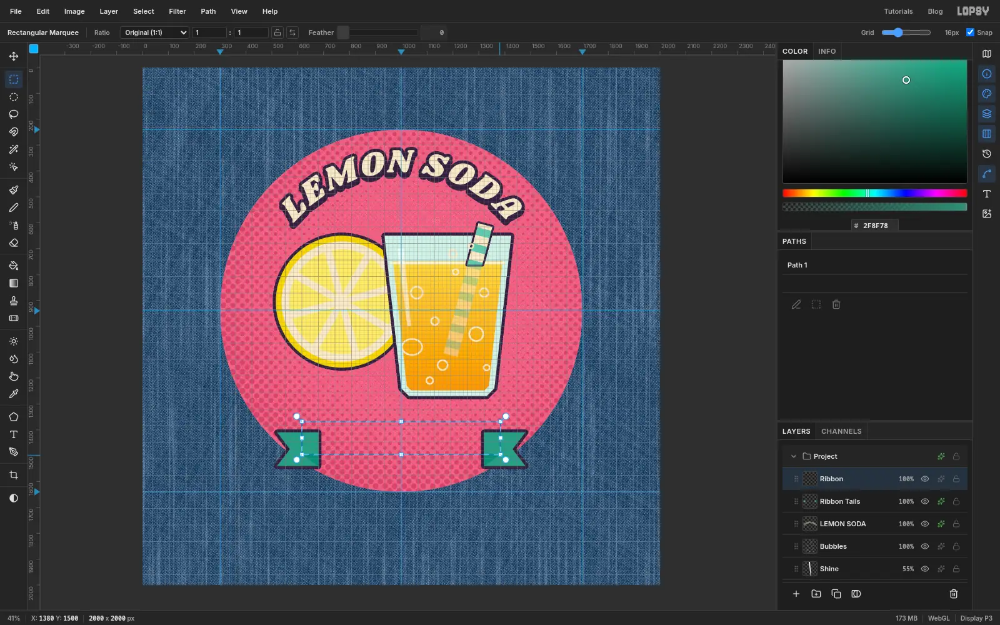

1. Add a layer named `Ribbon`.
2. Press [[Cmd+']] to show the grid. Turning on the grid also turns on **Snap to Grid**.
3. Press [[Cmd+D]], then drag a **Rectangular Marquee** from about `620, 1370` to `1380, 1500`. The grid is 16 px and centred on the canvas, so the corners snap to `616, 1368` and `1384, 1496`, the same distance either side of the centre line.
4. Press [[Cmd+']] again to hide the grid.
5. Fill with mint `#7CCBB0` and deselect.
6. Open the effects (✦), add a **Stroke** of **Width** `12` in `#2E1F3B`, and a **Drop Shadow** with **Offset X** `0`, **Offset Y** `10`, **Blur** `12`, **Opacity** `45` in the same plum.

The soft shadow lifts the band off the tails, so they look tucked behind it.

## Letter the tagline

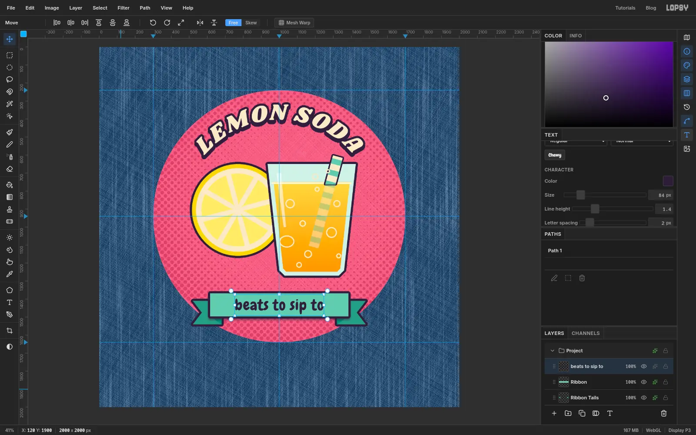

1. Pick the **Text** tool, set **Size** to `84`, choose **Chewy** and set the foreground to plum `#2E1F3B`.
2. Click on the denim outside the patch, type `beats to sip to` and press [[Tab]]. Set **Letter spacing** to `2` in the Text panel.
3. With the **Move** tool, drag the text into the ribbon. Then use the arrow keys to centre it. Aim for equal space at the left and right ends, and check the "p" descender sits well inside the band.

Lowercase text has a descender, so the words will look centred if you put them a few pixels lower than the true middle of the band.

## Select the die-cut shape

Real patches are cut out in one piece, and the merrowed edge goes round the ribbon ends as well as the circle.

1. Click `Ribbon` and add a layer named `Merrow`.
2. [[Cmd]]-click the `Twill` thumbnail. Then [[Cmd+Shift]]-click the `Ribbon` thumbnail and the `Ribbon Tails` thumbnail. The Shift adds each shape to the selection.

## Sew the merrowed edge

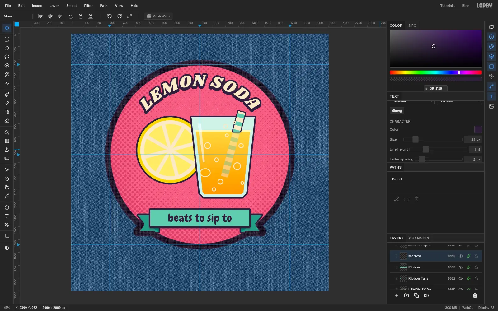

1. Choose **Select → Grow…** `36`, fill with plum `#2E1F3B`.
2. Make the die-cut selection again (the three thumbnail clicks from the last step), then choose **Select → Shrink…** `8` and press [[Delete]]. Deselect.
3. **Filter → Texture…**: click **Canvas** and **Relief**, then set **Amount** `70`, **Size** `4`, **Detail** `40`. Click **Apply**.
4. Open the effects (✦) and turn on **Inner Glow**: **Size** `10`, **Opacity** `70`, colour `#7E5E93`.

Growing by 36 and cutting out a selection shrunk by 8 gives a ring that overlaps the edge of the patch by 8 px, so there's no gap between the border and the fabric. The light inner glow makes the edge look rolled and padded.

## Add a running stitch

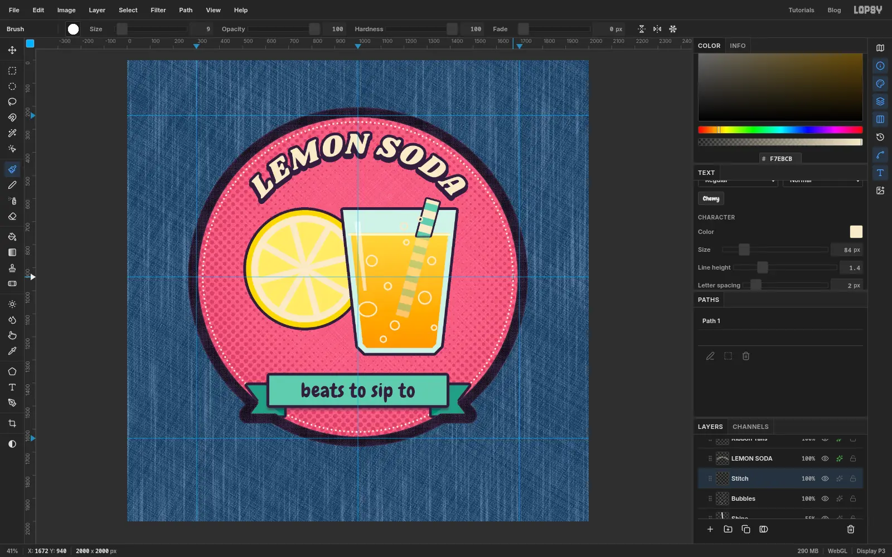

1. Click `Bubbles` and add a layer named `Stitch`. It goes under the title and the ribbon.
2. Pick the **Brush** and click the brush-tip thumbnail at the left of the options bar to open the **Brushes** window. Set **Size** `9`, **Hardness** `100` and **Spacing** `200` (the maximum). Close the window and set the foreground to cream `#F7EBCB`.
3. Zoom out so the whole patch fits on screen. Press about 28 px inside the merrowed edge at the top of the patch and drag slowly all the way round, following the edge, until you're back where you started. Use the guides at the top, bottom and sides as checkpoints: the line should pass about 28 px inside each one.

With **Spacing** at 200%, the brush leaves a gap the size of a dot between dots instead of a solid line, which looks like a hand-sewn running stitch. It doesn't have to be a perfect circle. Real running stitches wobble a little too.

## Group the patch

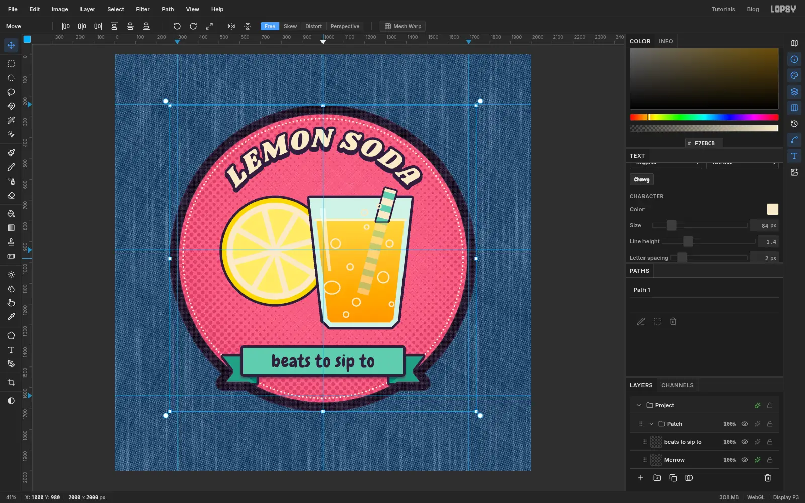

1. Click the top layer, `beats to sip to`, then [[Shift]]-click `Twill` to select everything that makes up the patch. Choose **Layer → Group Layers** and name the group `Patch`.
2. With the **Move** tool, drag the patch down by about 40 px so it sits just below the middle of the canvas. Press [[Escape]].
3. Collapse the `Patch` group.

Now the whole patch moves as one piece.

## Give each shape its own stitch direction

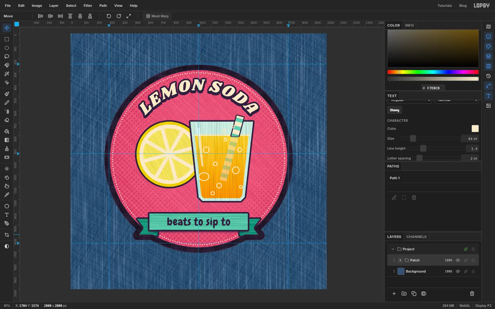

On a real patch, the thread runs a different way on each shape. You can fake this with the Texture filter's **Streaks** and **Relief**, changing the **Angle** for each layer.

Expand `Patch` and `Lemon`. For each layer below, click it, open **Filter → Texture…**, click **Streaks** and **Relief**, set **Amount** `35`, **Size** `2.5`, **Detail** `30`, **Stretch** `10` and the angle shown, and click **Apply**:

- `Twill`: **Angle** `45`
- `Segments`: **Angle** `60`
- `Rind`: **Angle** `150`
- `Glass` and `Soda`: **Angle** `90`
- `Ribbon` and `Ribbon Tails`: **Angle** `0`

Collapse `Patch` again when you're done.

## Cast the patch's shadow

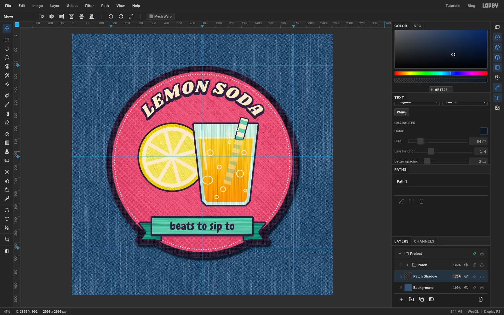

1. Click `Background` and add a layer named `Patch Shadow`. It goes under the `Patch` group.
2. Expand `Patch`, [[Cmd]]-click the `Merrow` thumbnail and collapse the group again. That selects the border ring, not a solid disc, but the ring is 44 px wide and the shadow only moves about 20 px, so once it's blurred and offset nobody can tell.
3. Fill with `#0E1726` and deselect.
4. **Filter → Gaussian Blur…**: **Radius** `16`. Click **Apply**.
5. With the **Move** tool, nudge it 14 px right and 22 px down with the arrow keys. [[Shift]]+arrow moves 10 px at a time.
6. Set the blend mode to **Multiply** and the opacity to **75%**.

## Add grain and a light leak

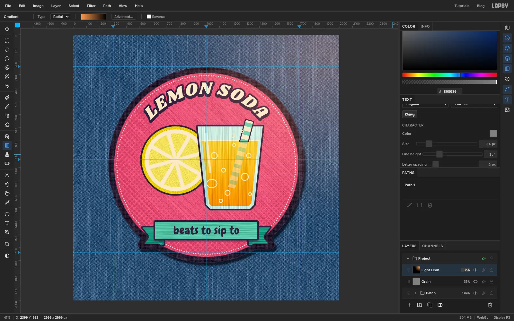

This is what makes it lo-fi: the whole picture should look like a slightly faded phone photo.

1. Click `Patch` and add a layer named `Grain`. It goes above the group. Fill it with `#808080`.
2. **Filter → Add Noise…**: **Amount** `30`, **Mono**, **Gaussian**. Click **Apply**.
3. Set **Soft Light** at **35%**.
4. Add a layer named `Light Leak`. With the **Gradient** tool on **Radial**, set the stops to `#FF9A4D` and `#000000` and drag from the top-right corner of the canvas towards the middle of the patch.
5. Set **Screen** at **35%**. In Screen mode black disappears, so only the warm glow is left.
6. Press [[Cmd+;]] to hide the guides. Save with **File → Save Project**, then **File → Quick Export PNG**.

Step back and look at it small, the way it would look on a jacket. The title should read first, then the glass. If the halftone dots or the grain start to compete with the lemon, lower the opacity of `Dots` or `Grain`.
