Record covers from the late 1950s sold space-age exotica with flat cut-paper
shapes, sunbursts, boomerang stars and a cheerful mix of script and geometric
sans type. The colours were few, the printing was a little off-register, and
everything had a fine grain from the paper and the halftone screen.

In this tutorial you'll make the cover of **Atomic Xanadu**, an imaginary 1959
LP by The Kubla Khan Quintet. Kubla Khan's pleasure-dome becomes the nucleus
of an atom: an onion dome with three orbiting rings, under a sunburst sky. The
finished cover has:

- a teal **sunburst sky** that radiates from the dome, faded with a **layer mask** and textured with **halftone dots**
- a mustard **sun** with halftone shading
- an **onion dome** cut from Lasso selections, with stripes printed slightly **out of register**
- two minarets and a distant tower made with **copy, paste and scale**
- three **orbit rings** made from one ring, duplicated and **rotated**, grouped into an atom
- four-point **atomic stars** and a **scalloped edge** between the sky and the title band
- a **type lockup** in Yellowtail, Jost and Josefin Sans, with a pencil hairline
- a **HI-FI badge** with its small print set **on a curved path**
- overall **grain** and a warm **Photo Filter** to make it feel printed

You don't need any photos: everything is drawn in Lopsy.

The tools you'll use:

- **Rulers and guides**, with Cmd-click to drop a guide on the centre
- the **Rectangular** and **Elliptical Marquee**, the **Lasso**, [[Shift]] to add, [[Alt]] to subtract and [[Shift]]+[[Alt]] to intersect
- **Select → Shrink**, **Edit → Fill**, **Copy**, **Paste** and **Duplicate Layer**
- the **Gradient**, **Shape**, **Pen**, **Pencil** and **Text** tools
- **Filter → Sunburst, Halftone** and **Add Noise**
- **layer masks**, **groups**, the **Move** tool's rotate and scale handles, and arrow-key nudges
- **Drop Shadow**, **Stroke** and **Color Overlay** effects, **Copy effects** and **Paste effects**
- the **Multiply** and **Overlay** blend modes and the **Photo Filter** group adjustment

The palette:

- Paper `#EEE3C7`, ink `#2A2420`
- Sky `#3A8A80` → `#1F5E5A` → `#143A3F`
- Rays `#F2D58A`
- Sun `#F4C04A` → `#E3762C`
- Dome cream `#F7EEDB`, vermilion `#D4572A`, mustard `#E3A72F`
- Minarets `#E9A69A`, far tower `#2E5F5B`
- Electrons `#F4C04A`
- Photo filter `#E8901C`

> **Tip:** Positions are written as `x, y` in document pixels from the top-left corner. Watch the X and Y readout in the status bar at the bottom left as you move the pointer. The landmarks are the **horizon** at `y 950`, and the **margins** at `x 100` and `x 1400`. The dome sits left of the `x 750` centre guide on purpose, to balance the sun on the right.

> **Tip:** Every blend mode and effect in this tutorial is set from the layer's **Layer effects** button (the sparkle icon on its row in the Layers panel). The blend-mode menu is at the top of that drawer. Opacity is the percentage on the layer's row: click it and drag the slider.

> **Tip:** Key names are Mac keys. On Windows and Linux, use Ctrl for Cmd. Filter dialogs open with their default values each time, so set every value a step lists.

## Set up the document and guides

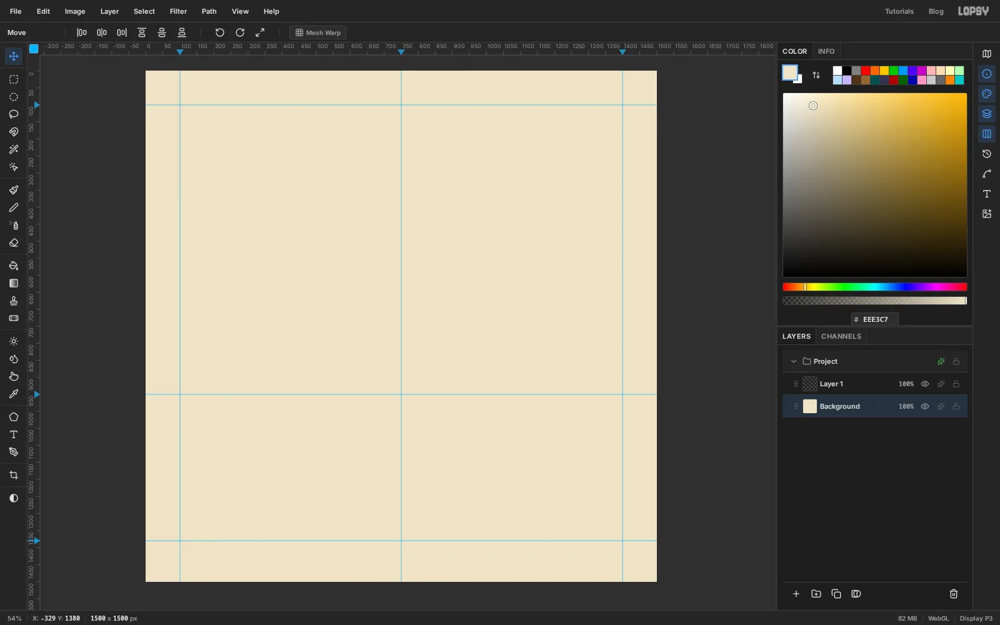

1. Open [Lopsy](/). In the **New Document** dialog, set **Width** and **Height** to `1500`, then click **Create**.
2. Click the **Background** layer, set the foreground colour to `#EEE3C7` and choose **Edit → Fill**.
3. If you can't see rulers along the top and left, choose **View → Show Rulers**.
4. Click the top ruler at `100` and again at `1400` to drop two vertical margin guides. Hold Cmd and click the top ruler near the middle: the guide snaps to exactly half the width, `750`.
5. Click the left ruler at `100`, `950` and `1380` to drop three horizontal guides. The one at `950` is the horizon, and the one at `1380` is where the bottom line of type will sit.

A square 1500 px canvas is a 12-inch LP sleeve at 125 dpi, which is plenty for a cover you'll share online.

## Paint the sky with a radial gradient

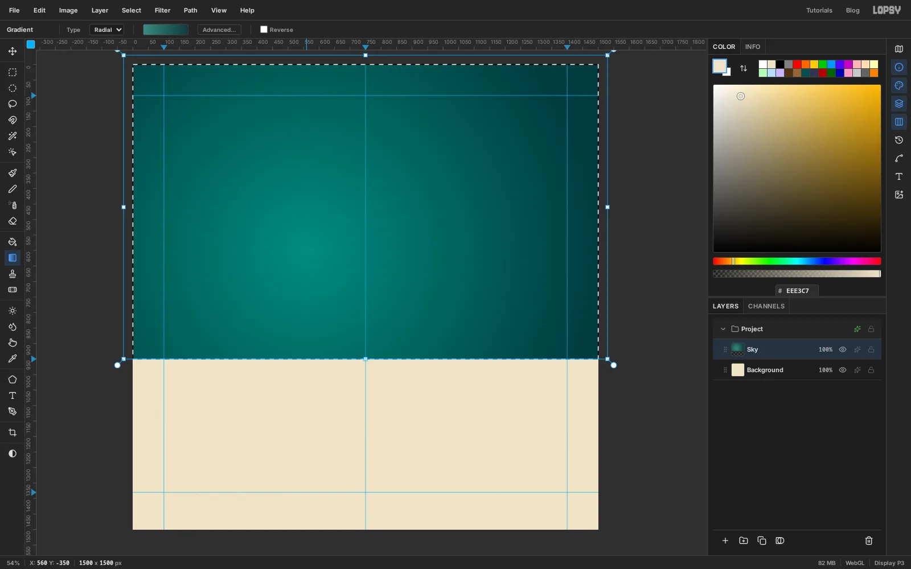

1. Double-click **Layer 1** in the Layers panel and rename it `Sky`.
2. Pick the **Rectangular Marquee** (`M`) and drag from just outside the top-left corner of the canvas down to the right edge, ending on the horizon guide at `y 950`. The marquee snaps to the guide when you get close.
3. Pick the **Gradient** tool, set **Type** to **Radial** and click **Advanced...** to open the Gradient Editor. Set three stops: `#3A8A80` at the left end, `#1F5E5A` in the middle and `#143A3F` at the right end. Click **Done**.
4. Drag from about `560, 600`, where the middle of the dome will be, straight up past the top of the canvas.

The bright spot behind the dome is subtle, but it pulls the eye to the centre of the cover before anything is drawn there.

## Fan sunburst rays out from the dome

1. Keep the sky selection active. Click **Add Layer** at the bottom of the Layers panel and rename the new layer `Rays`.
2. Set the foreground colour to `#F2D58A`.
3. Choose **Filter → Sunburst...** and set **Rays** `32`, **Length** `110`, **Width** `45`, **Taper** `0`, **Fade** `60`, **Rotation** `0`, **Center X** `37.33`, **Center Y** `38.33` and **Opacity** `30`. Click **Apply**.
4. Press [[Cmd+D]] to deselect.

The centre is set as a percentage of the canvas, so `37.33` and `38.33` put it at `560, 575`, the middle of the atom you'll draw later. A length over 100% makes sure the rays reach every corner.

## Fade the rays with a layer mask

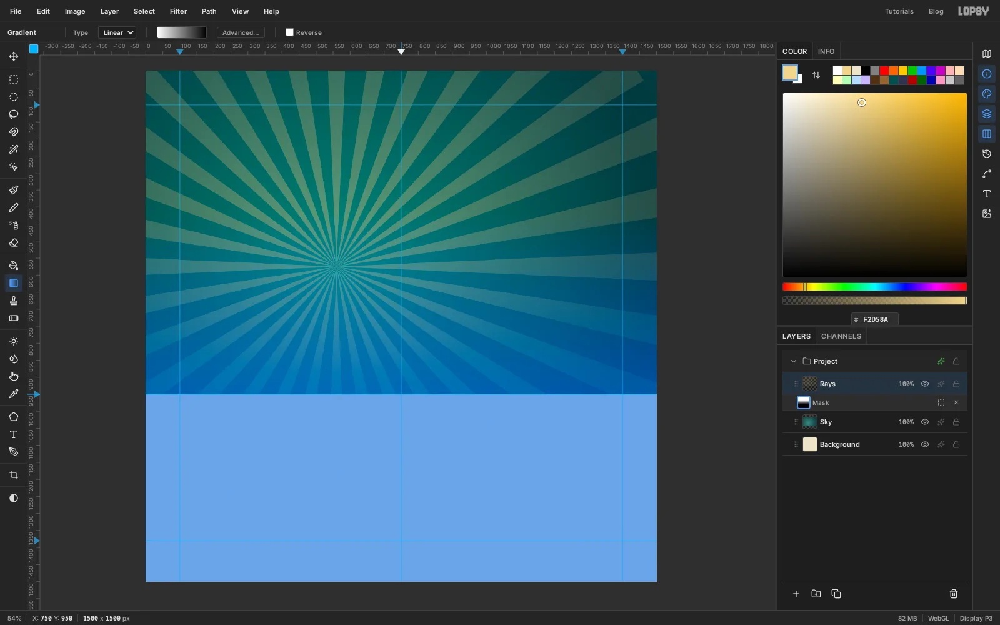

1. With **Rays** selected, click **Add Mask** at the bottom of the Layers panel. Lopsy switches to editing the mask.
2. Pick the **Gradient** tool, set **Type** to **Linear**, open **Advanced...** and set the stops to white `#FFFFFF` on the left and black `#000000` on the right.
3. Drag from `750, 420` straight down to the horizon at `750, 950`.
4. Click the **Rays** layer name to leave mask editing.

Black in a mask hides and white shows, so the rays now fade out before they reach the buildings. The blue tint only shows while you're editing the mask.

## Add a halftone texture to the sky

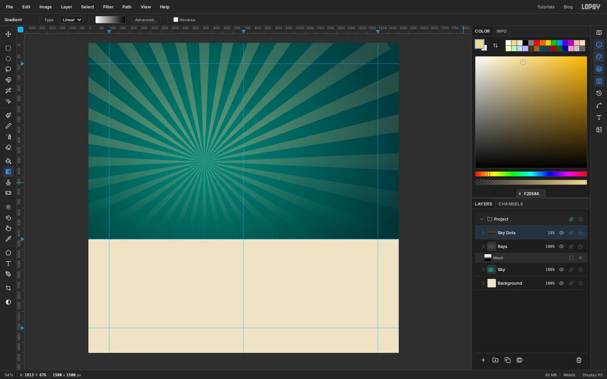

1. Click **Add Layer** and rename it `Sky Dots`.
2. With the Rectangular Marquee, select the sky again, from the top-left corner down to the horizon guide.
3. With the **Gradient** tool still set to white and black, drag from `750, 150` down to `750, 950`. Press [[Cmd+D]].
4. Choose **Filter → Halftone...** and set **Dot Size** `10`, **Angle** `45` and **Softness** `0.4`. Click **Apply**.
5. Set the **Sky Dots** blend mode to **Multiply** and its opacity to `18%`.

Halftone turns the grey gradient into dots that grow as it darkens. Multiply makes the white disappear, so only the dots darken the sky, a little more near the horizon.

## Draw the sun

1. Click **Add Layer** and rename it `Sun`.
2. Pick the **Elliptical Marquee** and drag a circle from `1020, 140` to `1320, 440`.
3. With the **Gradient** tool set to **Linear**, open **Advanced...** and set the stops to `#F4C04A` and `#E3762C`.
4. Drag from the top of the circle straight down to the bottom of it.

Keep the selection: you'll use the same circle for the shading in the next step.

## Shade the sun with halftone dots

1. Click **Add Layer** and rename it `Sun Dots`. The circle is still selected.
2. Use the **Gradient** tool with white and black stops again, and drag from just above the middle of the sun down to its bottom edge.
3. Choose **Filter → Halftone...** and set **Dot Size** `12`, **Angle** `45` and **Softness** `0.4`. Click **Apply**, then press [[Cmd+D]].
4. Set the **Sun Dots** blend mode to **Multiply** and its opacity to `30%`.

## Draw the onion dome

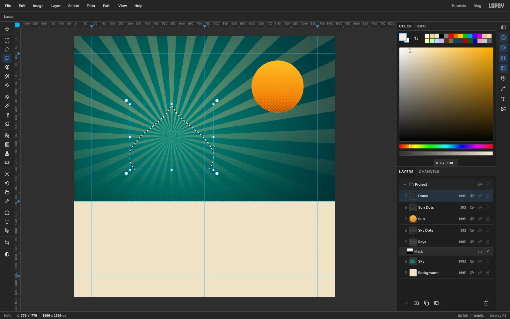

1. Click **Add Layer** and rename it `Dome`.
2. Pick the **Lasso** (`L`). Start at the bottom-left of the dome at about `350, 770` and draw the outline in one stroke:
   - bulge out slightly to the left, to about `x 325` at `y 700`
   - curve in toward the top, so the dome is about half as wide at `y 580`
   - narrow into a sharp point at `560, 390`
   - come back down the right side as a mirror image to `770, 770`, and release
3. Set the foreground colour to `#F7EEDB`, choose **Edit → Fill** and press [[Cmd+D]].

Take your time with the Lasso and redo it with [[Cmd+Z]] if one side looks lopsided. The classic onion shape is fattest about a quarter of the way up.

## Cut the stripes with Alt-subtract

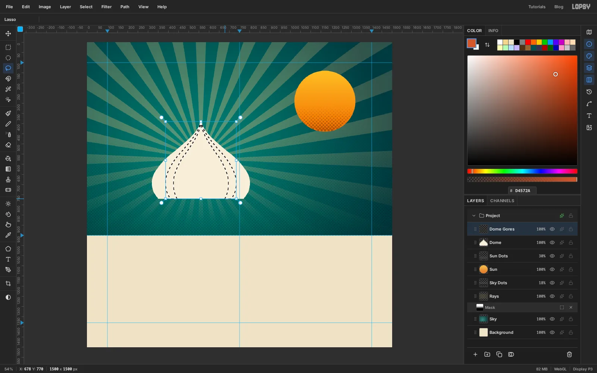

1. Click **Add Layer** and rename it `Dome Gores`.
2. With the **Lasso**, draw a narrower onion inside the dome, about three-quarters as wide, sharing the same point at the top and the same base.
3. Hold [[Alt]] and draw an even narrower onion inside that one, about half the dome's width. Holding Alt subtracts it, leaving two curved stripes.
4. Set the foreground colour to `#D4572A`, choose **Edit → Fill** and press [[Cmd+D]].
5. Repeat for a thin pair of stripes near the centre: draw an onion about a third of the dome's width, hold [[Alt]] and subtract one about a sixth of the width, then fill.

These curved segments are called gores. Because every stripe shares the dome's point, they wrap around it like the panels of a real onion dome.

## Print the stripes out of register

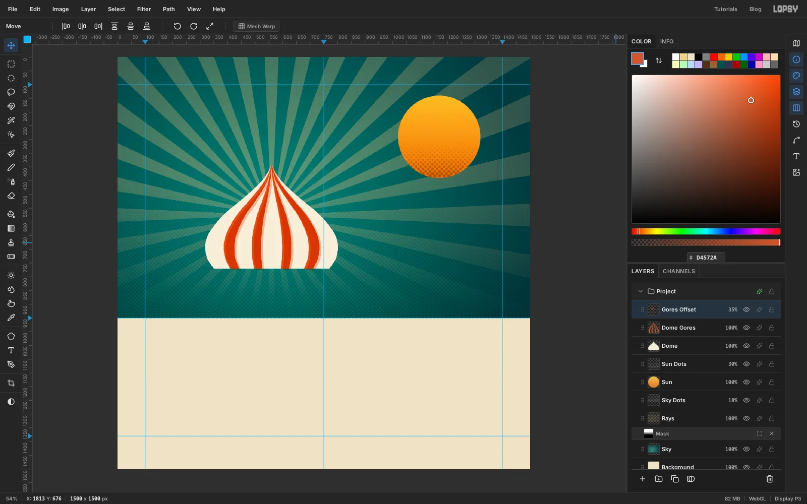

1. With **Dome Gores** selected, choose **Layer → Duplicate Layer** and rename the copy `Gores Offset`.
2. Pick the **Move** tool (`V`) and press [[→]] seven times and [[↓]] five times to nudge the copy.
3. Set the **Gores Offset** blend mode to **Multiply** and its opacity to `35%`.

Real 1950s covers were printed one colour at a time, and the plates rarely lined up perfectly. A faint offset copy gives the same handmade feel.

## Build the drum, cornice, plinth and finial

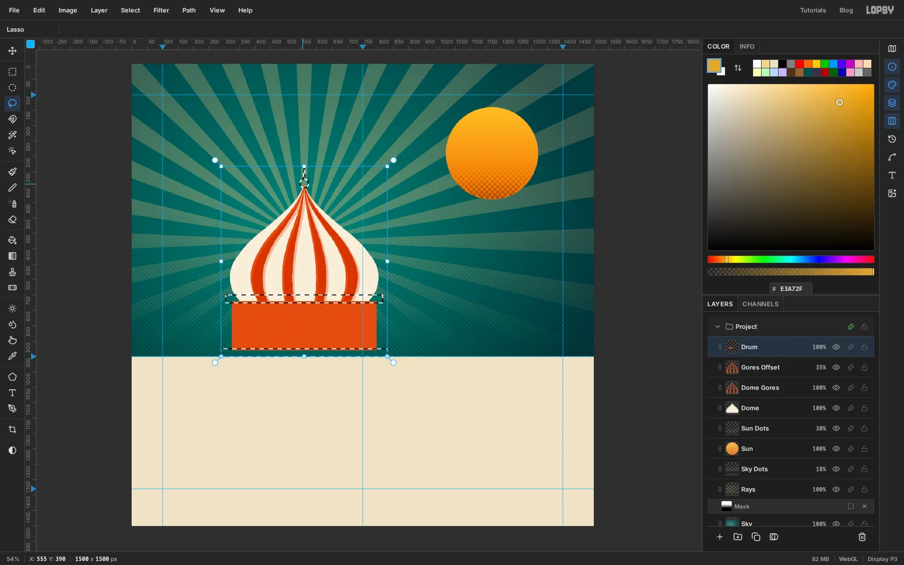

1. Click **Add Layer** and rename it `Drum`.
2. With the **Rectangular Marquee**, select a box from `325, 770` to `795, 930`, fill it with `#D4572A` and deselect.
3. Set the foreground colour to `#E3A72F`. Draw the cornice as a wider band from `305, 750` to `815, 776`.
4. Hold [[Shift]] and add the plinth, a band from `290, 925` to `830, 950` that sits on the horizon guide.
5. Switch to the **Elliptical Marquee**, hold [[Shift]] and add a small circle about 28 px across on the dome's point, centred at `560, 388`.
6. Switch to the **Lasso**, hold [[Shift]] and add a thin spike from the ball up to about `560, 332`.
7. Choose **Edit → Fill** and press [[Cmd+D]].

Adding all four pieces to one selection means a single fill. The plinth gives the building something to stand on, so it doesn't look cropped by the horizon.

## Cut the arched windows

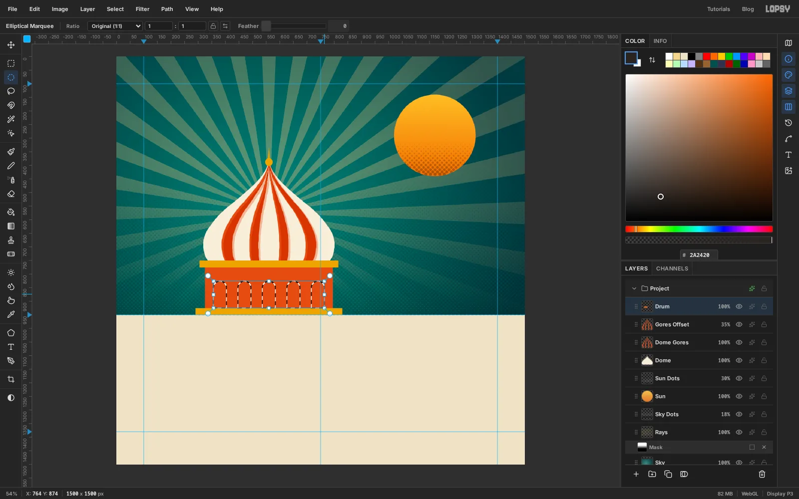

1. Choose **View → Snap to Guides** to turn guide snapping off. Otherwise the window nearest the centre guide snaps to it and comes out narrower.
2. With the **Rectangular Marquee**, select a 48 px wide window from `356, 850` to `404, 925`.
3. Switch to the **Elliptical Marquee**, hold [[Shift]] and add a 48 px circle from `356, 826` to `404, 874` on top of it to round the arch.
4. Repeat for four more windows, 90 px apart, centred at `x 470`, `560`, `650` and `740`, holding [[Shift]] for every one.
5. Set the foreground colour to `#2A2420`, choose **Edit → Fill**, press [[Cmd+D]] and turn **View → Snap to Guides** back on.

## Raise the minarets

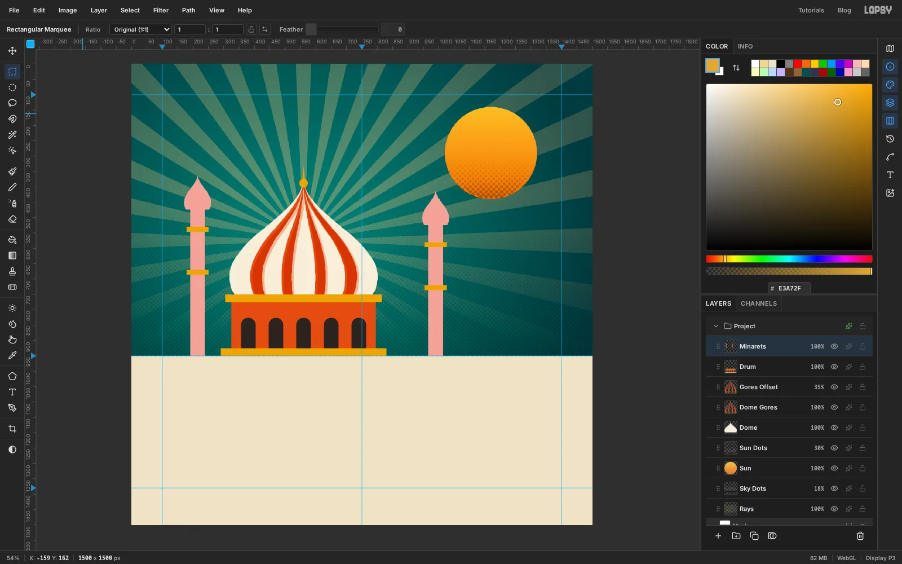

1. Click **Add Layer** and rename it `Minarets`.
2. With the **Rectangular Marquee**, select a 48 px wide tower centred at `x 215`, from `y 470` down to the horizon. Hold [[Shift]] and use the **Lasso** to add a small onion cap on top, about 76 px wide and 110 px tall.
3. Hold [[Shift]] and add a second tower the same way, centred at `x 990` with its top at `y 520`.
4. Fill with `#E9A69A` and deselect.
5. Set the foreground colour to `#E3A72F` and add two balconies to each tower: a 72 px wide, 16 px tall band 60 px below the top of the shaft and another 200 px below the top of the shaft. Hold [[Shift]] to add each one, then fill and deselect.

The towers stay well clear of the dome and of the orbits you'll add later, so nothing collides.

## Copy, paste and scale a distant tower

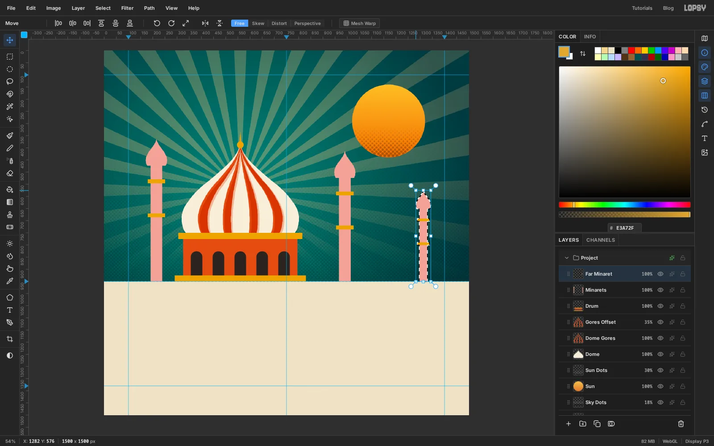

1. With **Minarets** selected, use the **Rectangular Marquee** to draw a box around the right minaret and its cap. Press [[Cmd+C]] and then [[Cmd+V]]. The copy is pasted in place on a new layer, still selected.
2. Rename the new layer `Far Minaret`.
3. Pick the **Move** tool and drag inside the selection about 310 px to the right, so the tower sits near `x 1300`.
4. Hold Cmd and drag the top-left corner handle down and to the right until the tower is about three-quarters of its size. Cmd keeps the proportions locked, and the opposite corner stays put, so the base stays on the horizon by itself.
5. Press [[Cmd+D]] to commit.

## Turn the copy into a silhouette

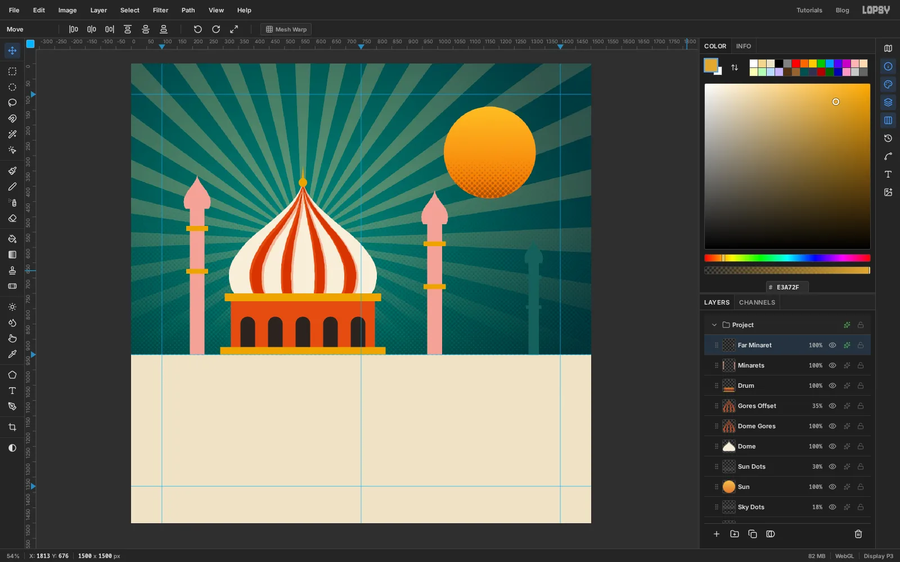

1. Click the **Layer effects** button on the **Far Minaret** row.
2. Turn on **Color Overlay** and set its colour to `#2E5F5B`. Close the effects drawer.

A darker, cooler shape with no detail reads as far away. This is an old stage-flat trick that gives a flat illustration depth.

## Draw the first orbit ring

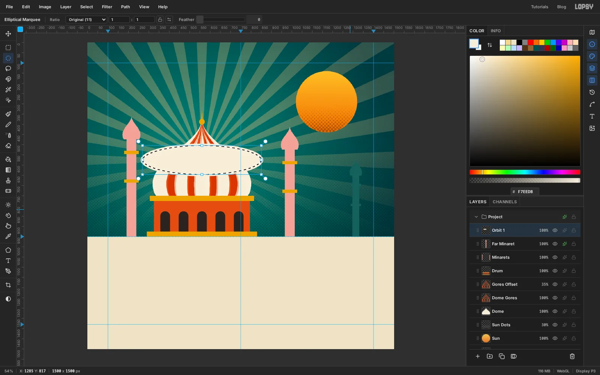

1. Click **Add Layer** and rename it `Orbit 1`.
2. With the **Elliptical Marquee**, drag a wide, flat ellipse around the dome from `260, 495` to `860, 655`. Fill it with `#F7EEDB`.
3. Choose **Select → Shrink...**, enter `9` and click **Apply**.
4. Press [[Delete]] to clear the middle, leaving a 9 px ring, then press [[Cmd+D]].

## Give the ring a hard print shadow

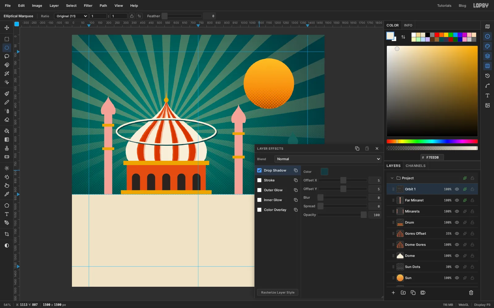

1. Open the **Layer effects** for **Orbit 1** and turn on **Drop Shadow**.
2. Set **Offset X** `5`, **Offset Y** `5`, **Blur** `0`, **Spread** `0`, **Opacity** `100` and the shadow colour `#143A3F`. Close the drawer.

A hard shadow with no blur looks like a second ink colour printed slightly off, which suits the period far better than a soft glow.

## Duplicate and rotate the orbits

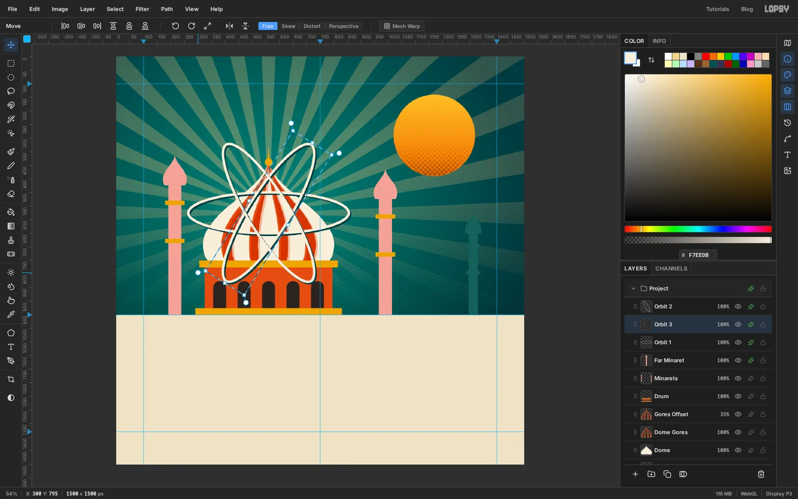

1. Choose **Layer → Duplicate Layer** and rename the copy `Orbit 2`. The copy keeps the drop shadow.
2. With the **Rectangular Marquee**, draw a box around the ring, from `256, 491` to `864, 659`.
3. Pick the **Move** tool, grab the round rotation handle just outside the top-left corner and drag clockwise. Stop when the ring is steep, about 58°: its upper end should be over the left side of the dome's point and its lower end just past the right end of the drum. Press [[Cmd+D]].
4. Click **Orbit 1**, duplicate it again and rename the copy `Orbit 3`. Box the ring with the Rectangular Marquee in the same way and rotate it counter-clockwise by the same amount, so it mirrors Orbit 2.

All three rings share a centre, so together they make the classic atom symbol around the dome.

## Add the electrons and group the atom

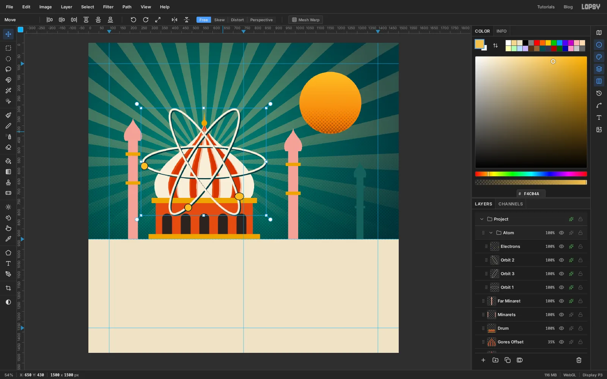

1. Select **Orbit 2** and click **Add Layer**. Rename the new layer `Electrons`.
2. With the **Elliptical Marquee**, draw a 32 px circle on the left end of the flat ring. Hold [[Shift]] and add one on the lower right of one tilted ring and one near the bottom of the other.
3. Fill with `#F4C04A`, deselect, then add a **Stroke** effect of width `3` in `#2A2420`.
4. With **Electrons** selected, Shift-click **Orbit 1** so all four layers are selected, and choose **Layer → Group Layers**. Rename the group `Atom`.

Now you can move the whole atom by selecting the group and dragging with the Move tool. Try it, then press [[Cmd+Z]] to put it back.

## Scatter four-point atomic stars

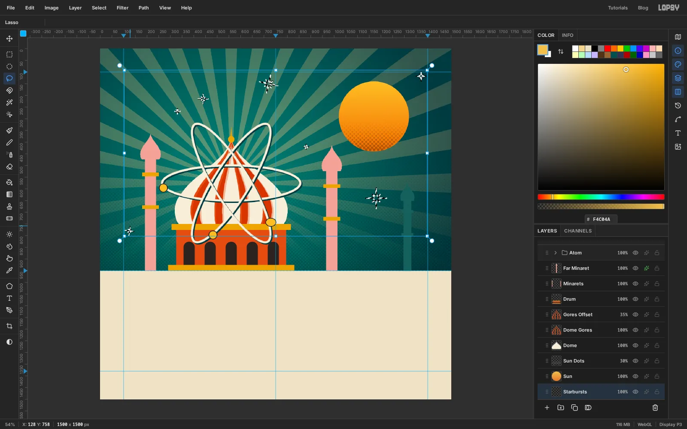

1. Click **Sky Dots** in the Layers panel, then click **Add Layer** and rename it `Starbursts`. It sits under the sun and the buildings.
2. Turn off **View → Snap to Guides**.
3. Zoom in to 200% or more so the stars are big enough to draw. With the **Lasso**, draw a four-point star by clicking from point to point: long, thin points up, down, left and right, and short points on the diagonals. Hold [[Shift]] and add six more stars of different sizes, from about 40 px across to about 100 px. The two biggest are at about `720, 150` and `1180, 640`. Leave the top-left corner empty for the badge.
4. Choose **View → Fit to Screen** to see the whole cover again.
5. Fill with `#F7EEDB`, deselect and turn **Snap to Guides** back on.

These sparkles were everywhere in 1950s design, on boomerang tables and atomic clocks alike. Keep them sparse so they decorate the sky without cluttering it.

## Add a scalloped edge

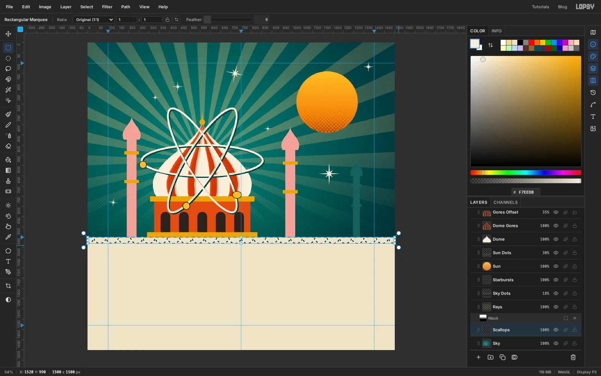

1. Click **Sky**, then click **Add Layer** and rename it `Scallops`.
2. Turn off **Snap to Guides** and zoom in on the horizon. With the **Elliptical Marquee**, draw the first 60 px circle from `-30, 920` to `30, 980`, so its centre sits on the left edge of the canvas at the horizon. Hold [[Shift]] and add the next circle from `30, 920` to `90, 980`, and keep going every 60 px. It takes 26 circles to reach the right edge.
3. Switch to the **Rectangular Marquee**, hold [[Shift]]+[[Alt]] and drag a band from just left of the canvas at `y 950` to just right of it at `y 990`. Shift+Alt intersects, so only the lower half of each circle is left.
4. Fill with `#143A3F`, deselect and turn **Snap to Guides** back on.

The scallops look like the awning of a drive-in or a hi-fi showroom, and they make a decorative border between the picture and the title band.

## Set the title

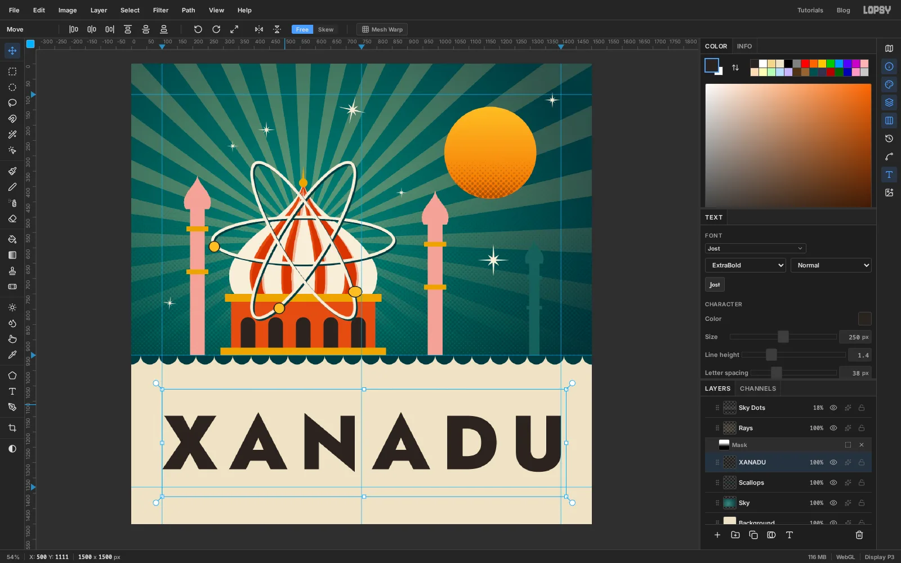

1. Set the foreground colour to `#2A2420` and pick the **Text** tool (`T`).
2. Click in the empty cream space near the bottom of the canvas. Before you type, set **Size** to `250` in the options bar and pick **Jost** from the font list, with weight **ExtraBold**.
3. Open the **Text** panel (the **T** button on the right-hand toolbar) and set **Letter spacing** to `38`.
4. Type `XANADU` and press [[Tab]] to commit.
5. Pick the **Move** tool and drag the word up so its left edge sits on the `x 100` guide and its bottom is at `y 1330`. Use the arrow keys for the last few pixels.

The text layer lands just above **Scallops** in the Layers panel, because that layer was selected. That's fine: nothing above it in the stack overlaps the title band.

With 38 px of letter spacing the word runs from margin to margin. If yours falls short or overshoots, adjust the letter spacing in the Text panel.

## Add the band name and catalogue number

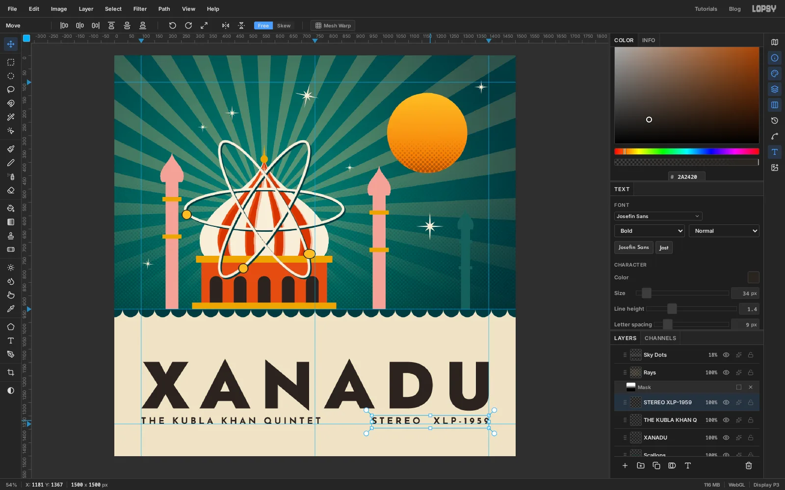

1. With the **Text** tool, click in empty space below the title. Set **Size** `34`, font **Josefin Sans**, weight **Bold** and **Letter spacing** `9`. Type `THE KUBLA KHAN QUINTET` and press [[Tab]].
2. Move it so its left edge is on the `x 100` guide and the bottoms of the letters sit on the `y 1380` guide.
3. Click in empty space again and type `STEREO  XLP-1959` (two spaces after STEREO). The size, font and spacing carry over. Press [[Tab]].
4. Move it so its right edge is on the `x 1400` guide and it sits on the same baseline.

Lining both lines up with the title's edges and leaving 120 px below them gives the band a firm, deliberate bottom edge.

## Write Atomic in script and tilt it

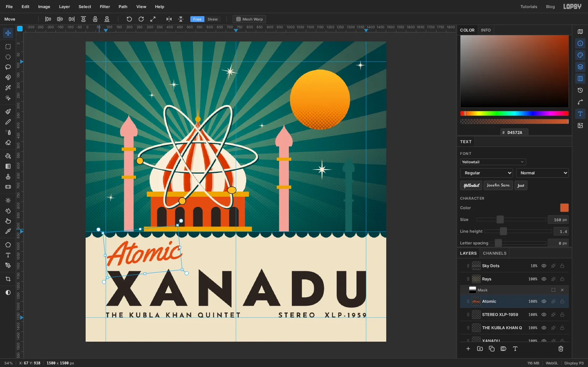

1. Set the foreground colour to `#D4572A`. With the **Text** tool, click in empty space and set **Size** `160`, font **Yellowtail**, weight **Regular** and **Letter spacing** `0`. Type `Atomic` and press [[Tab]].
2. With the **Move** tool, drag it so its left edge sits on the `x 100` guide, above the X of XANADU.
3. Drag the round rotation handle at the top-left corner of its box counter-clockwise by about 6°, so the script climbs to the right. Press [[Cmd+D]].
4. The script is a little too tall for the gap between the scallops and XANADU. In the Text panel, lower **Size** to `142`. The rotation is kept, so you can resize live text at any time. Nudge the word so it sits about 20 px above XANADU and clear of the scallops.
5. Open its **Layer effects** and add a **Drop Shadow** with **Offset X** `6`, **Offset Y** `6`, **Blur** `0`, **Spread** `0`, **Opacity** `100` and colour `#143A3F`.

Letter spacing carries over from the last text layer you made, so setting it back to `0` in step 1 matters: connected script falls apart with any extra space between the letters.

## Add the tagline and a pencil hairline

1. Set the foreground colour to `#2A2420`. With the **Text** tool, click in empty space and set **Size** `24`, **Josefin Sans Bold**, **Letter spacing** `6`. Type `EXOTIC SOUNDS FOR THE ATOMIC AGE` and press [[Tab]].
2. Move it so its right edge is on the `x 1400` guide and the bottoms of its letters sit at about `y 1085`, level with the lower half of Atomic.
3. Select **Atomic**, click **Add Layer** and rename it `Rule`.
4. Pick the **Pencil** (`N`) and set **Size** to `3`. Click just after the c of Atomic, level with the middle of the tagline's letters. Then hold [[Shift]] and click just before the E of EXOTIC to draw a straight line between the two points.

The hairline fills the gap between the script and the tagline, so the two read as one line. It's a classic mid-century lockup.

## Draw the HI-FI badge

1. Click **Far Minaret** in the Layers panel, then click **Add Layer** and rename it `Badge`.
2. Pick the **Shape** tool (`U`) and set **Shape** to **Ellipse**. Click the **Fill** swatch and enter `#D4572A`. Click the **Stroke** swatch, enter `#F7EEDB` and set **Width** to `7`.
3. Shapes grow from where you press, so press at `196, 196`, the centre of the badge, and drag out to `292, 292`.
4. Set the foreground colour to `#F7EEDB`. With the **Text** tool, click in empty sky, set **Size** `54`, font **Righteous**, **Letter spacing** `2`, type `HI-FI` and press [[Tab]].
5. Move it into the badge so it is centred left to right and sits a little above the middle.

## Draw a curved path for the small print

1. Pick the **Pen Tool** (`P`).
2. Click just inside the badge's left edge, a little below the middle, at about `131, 207`.
3. At the bottom of the badge, at about `196, 262`, press and drag about 40 px to the right before releasing. This makes a smooth anchor, so the path curves.
4. Click the matching point on the right, at about `261, 207`.
5. Click the **✓ Commit path** button in the options bar. The path is saved as **Path 1**.

## Set LONG PLAYING on the path

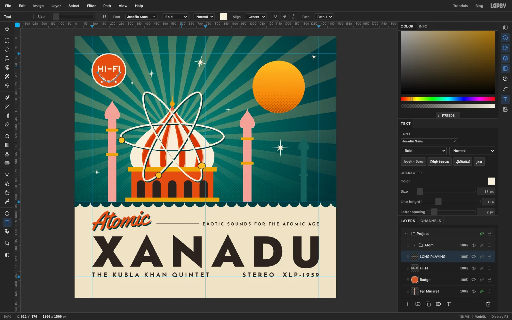

1. With the **Text** tool, click in empty sky, set **Size** `15`, **Josefin Sans Bold**, **Letter spacing** `2`, type `LONG PLAYING` and press [[Tab]].
2. With the new text layer still selected, open the **Path** dropdown in the options bar and pick **Path 1**. The letters jump onto the curve.
3. Set **Align** to **Center** so the words sit evenly along the arc.

> **Tip:** If the last letters go missing, the text is longer than the path. Text on a path is cut off at the path's end, so draw a longer arc or make the type smaller.

## Group the badge and give it a shadow

1. Select **LONG PLAYING**, Shift-click **Badge**, and choose **Layer → Group Layers**. Rename the group `HiFi Badge`.
2. Open the **Layer effects** for **Atomic** and click the copy button on the **Drop Shadow** row (**Copy Drop Shadow effect**). Close the drawer.
3. Click the arrow beside **HiFi Badge** to expand the group, open the **Layer effects** for **Badge** and click **Paste effects**. Only the drop shadow is pasted, with the same settings as Atomic.

## Add film grain over everything

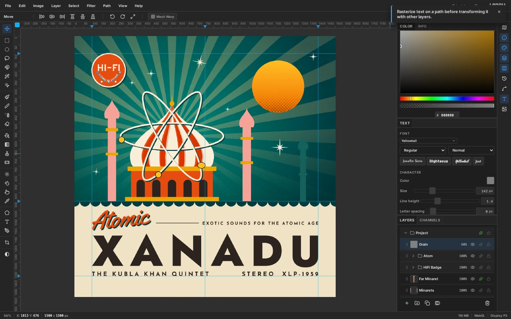

1. Select the **Atom** group and click **Add Layer**. Rename the new layer `Grain`. It sits at the top of the stack.
2. Set the foreground colour to mid-grey `#808080`, press [[Cmd+A]], choose **Edit → Fill** and press [[Cmd+D]].
3. Choose **Filter → Add Noise...**, set **Amount** to `30` and click **Mono** and **Gaussian**. Click **Apply**.
4. Set **Grain** to the **Overlay** blend mode at `60%` opacity.

Overlay leaves mid-grey invisible, so only the noise shows. It roughens every flat colour at once, like ink on uncoated board.

## Warm it up with a Photo Filter

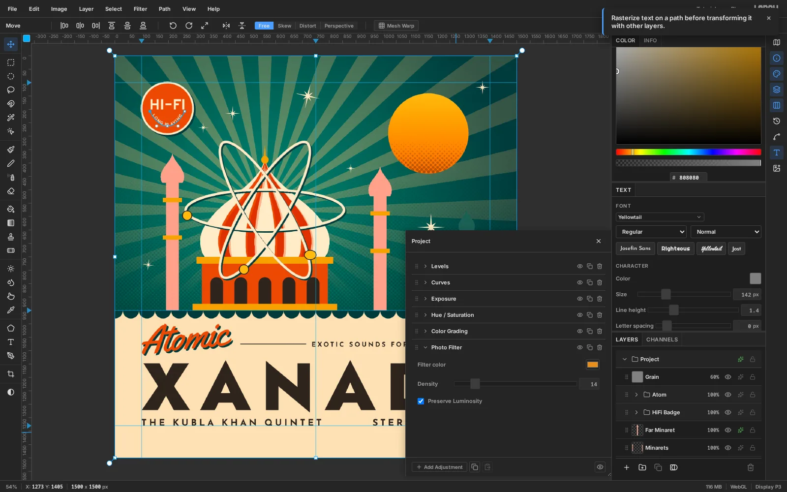

1. Choose **Layer → Adjustment Layer…**. Lopsy explains that adjustments live on the Project group and opens the **Group Adjustments** drawer. Click **Got it**.
2. Click **Add Adjustment** and choose **Photo Filter**.
3. Set the **Filter color** to `#E8901C` and **Density** to `14`. Close the drawer.

The warm filter yellows the cream and nudges the teal toward green, like an old sleeve that has sat in the sun.

## Pick out STEREO in orange

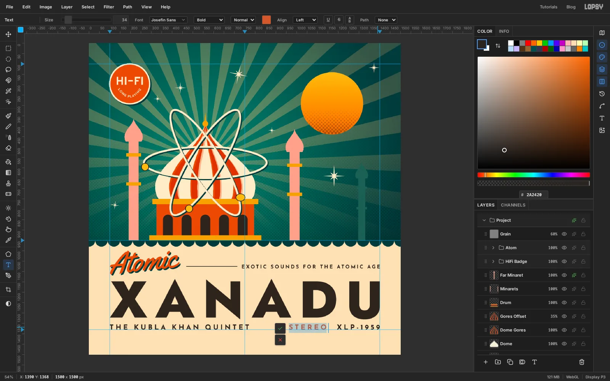

1. With the **Text** tool, click inside the `STEREO  XLP-1959` line to edit it.
2. Press [[Home]], then hold [[Shift]] and press [[→]] six times to select the word STEREO.
3. Click the **Text color** swatch in the options bar and enter `#D4572A`. Press [[Esc]] to close the picker, then [[Tab]] to commit.

Only the selected letters change colour. The orange echoes Atomic at the top of the band and ties the two corners together.

## Export the cover

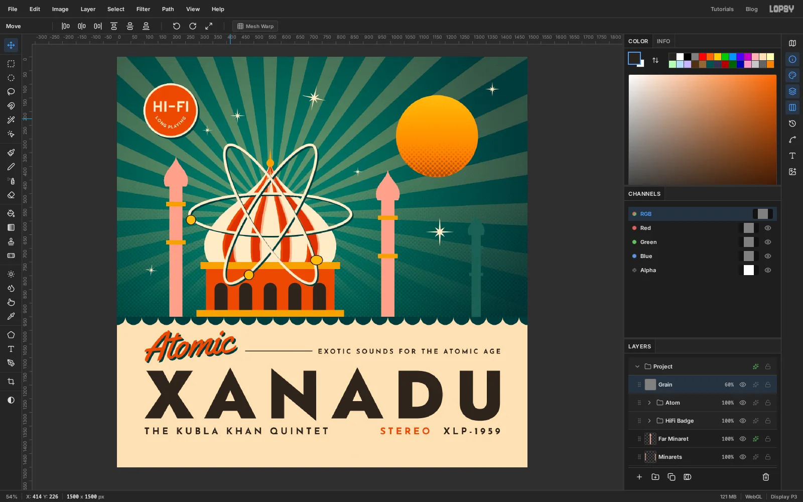

1. Turn off **View → Show Guides** to check the cover without them.
2. Choose **File → Quick Export PNG** to save a 1500 × 1500 PNG.
3. Choose **File → Save Project** to keep a `.lopsy` file with every layer, mask, path and live text layer, so you can change the band name or the colours later.

For a different record, change the words and keep the structure: a single strong symbol radiating light, a scalloped edge, and a script-plus-capitals lockup on a paper band.
