A neon sign is just a few glass tubes, but it lights up the whole wall around it. To fake one convincingly you need three things: a tube that's almost white in the middle, a saturated halo around it, and a wall that's dark enough for the glow to show.

This tutorial builds an opening-night invitation for *Seahorse Hideaway*, a made-up seaside cocktail bar, as a neon sign on a brick wall. It's a 1200 × 1600 px portrait (4 × 5.3 inches at 300 dpi). Nothing is imported: even the bricks come from a single brick you draw and repeat.

The tools you'll use:

- **Edit → Define Pattern** and **Fill with Pattern…** with **Row Stagger** for a brick bond
- **Filter → Texture…**, **Clouds…**, **Bloom…** and **Add Noise…**
- the **Shape** tool for a rounded frame, and the **Eraser** with [[Shift]]-click to cut it
- the **Pen** tool, with **Enter** to stroke a path into a tube
- **Inner Glow**, **Drop Shadow** and **Outer Glow** stacked into one neon recipe, plus **Copy / Paste effects**
- **Group Layers**, and moving, scaling and rotating a whole group with the **Move** tool
- copy and paste, **Merge Down** and **Copy Merged**
- live text in **Neonderthaw** and **Tilt Neon**

The palette:

- Wall `#0C0913`, brick `#30242B`
- Pink tube `#FFE3F2`, pink edge `#FF66B8`, pink glow `#FF2E9A`
- Cyan tube `#E2FFFF`, cyan edge `#5CEBFF`, cyan glow `#00E1FF`
- Violet tube `#EEDFFF`, violet edge `#B07BFF`, violet glow `#8E3BFF`
- Teal tube `#D6FFF2`, teal edge `#5FF5CF`, teal glow `#15E0B0`
- Amber tube `#FFE9C2`, amber edge `#FFB65C`, amber glow `#FF9A1F`
- Clips `#3B3946`, unlit glass `#3A3046`

Every tube is drawn in its pale **tube** colour. The saturated colours only ever come from the effects, and that's what makes the lines read as lit glass and not paint.

> **Note:** Shortcuts are written for a Mac. On Windows use [[Ctrl]] for [[Cmd]]. Positions are x, y in document pixels. Read them off the rulers, or watch the X / Y readout in the status bar as you move the pointer. They're only there so your result matches the screenshots, so a few pixels either way won't matter.

## Set up the document and guides

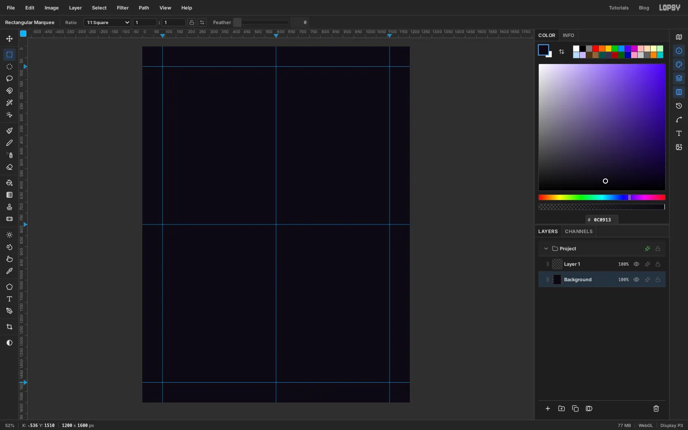

Choose **File → New** and make a document **1200** wide and **1600** high.

A new document comes with an empty *Layer 1* above the *Background*. You can leave it where it is; it stays empty and invisible. Click the *Background* layer, set the foreground colour to `#0C0913` (the dark mortar colour) and choose **Edit → Fill**.

Now add some guides. In Lopsy you **click** a ruler to drop a guide; you don't drag one out. Click the top ruler at **90**, **600** and **1110**, then click the left ruler at **90**, **800** and **1510**. The outer four mark where the frame tube will run, 90 px in from every edge. The middle two cross at the centre of the page.

## Draw a single brick

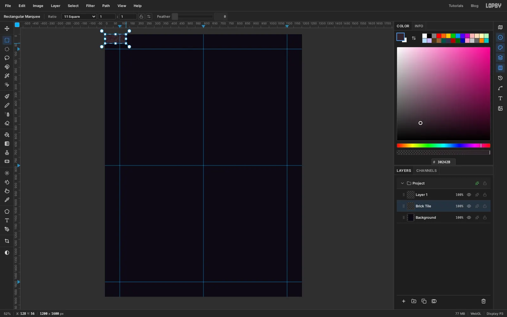

The wall is made from one brick that you turn into a pattern. A brick plus half the mortar on each side is 128 × 56 px.

1. Click **Add Layer** at the bottom of the Layers panel and rename the new layer *Brick Tile* (double-click its name).
2. Zoom in on the top left corner. With the **Rectangular Marquee** ([[M]]), drag from **3, 3** to **125, 53**, which leaves a 3 px border all round.
3. Set the foreground to `#30242B` and choose **Edit → Fill**.
4. Choose **Filter → Texture…**, leave **Type** on **Grain**, set **Amount 9**, **Size 9** and **Detail 55**, and click **Apply**. The speckle stops every brick looking like plastic.
5. Press [[Cmd+D]], then drag a new marquee from the very corner **0, 0** to **128, 56**. That's the brick and its mortar.
6. Choose **Edit → Define Pattern**.

Press [[Cmd+D]] to deselect, then press [[Delete]] to delete the *Brick Tile* layer. The pattern is saved, so you don't need the layer any more.

## Tile the wall with Fill with Pattern

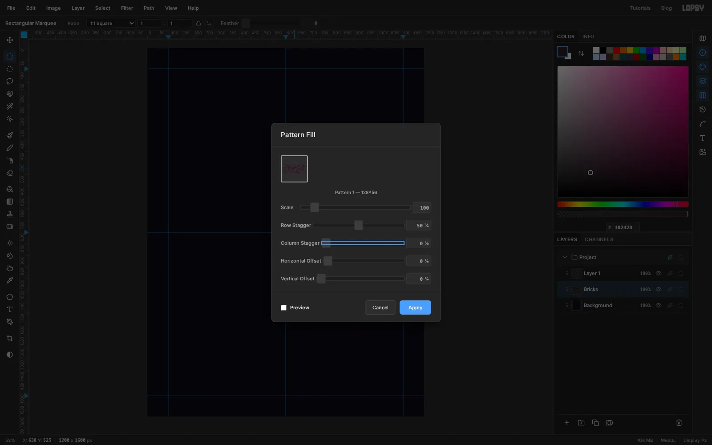

Add a new layer called *Bricks* and choose **Edit → Fill with Pattern…**.

Click the brick thumbnail, set **Row Stagger** to **50%** and click **Apply**. Row Stagger shifts every other row by half a tile, which gives you a proper running bond, not a grid. The gaps in the tile are transparent, so the dark background shows through as mortar.

## Age the bricks

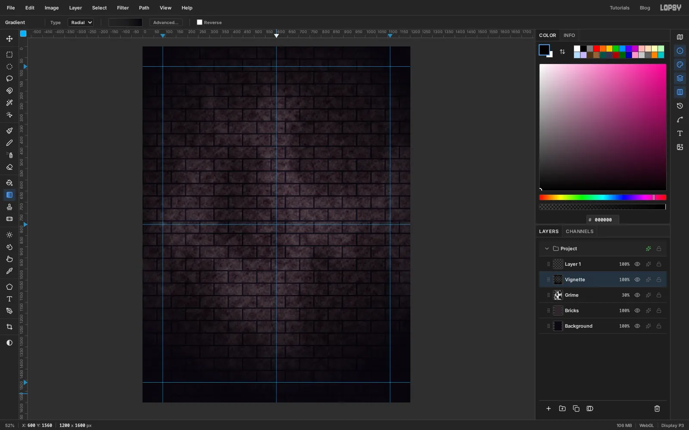

Brand new bricks look fake, and a bright wall would drown out the glow. Knock it back in three passes:

1. With *Bricks* still selected, run **Filter → Texture…** again with **Amount 10**, **Size 30** and **Detail 60**. Bigger features this time, so whole bricks vary in tone.
2. Add a layer called *Grime*, set the foreground to black, and choose **Filter → Clouds…** with **Scale 6**. Click the effects button on the layer to open the Effects drawer, set **Blend Mode** at the top to **Soft Light**, then click the layer's opacity percentage in the Layers panel and drag it down to **30%**. Every blend mode change in this tutorial is made the same way, in the Effects drawer.
3. Add a layer called *Vignette*. Choose the **Gradient** tool, set the type to **Radial**, and open the gradient editor. Make the left stop black at **0%** opacity, add a stop in the middle that's black at about **25%**, and make the right stop `#05030A` at about **92%**. Drag from a little above the middle of the page (**600, 720**) down to the bottom edge. The corners and the bottom go nearly black, which gives the neon somewhere to glow.

## Draw the frame tube with the Shape tool

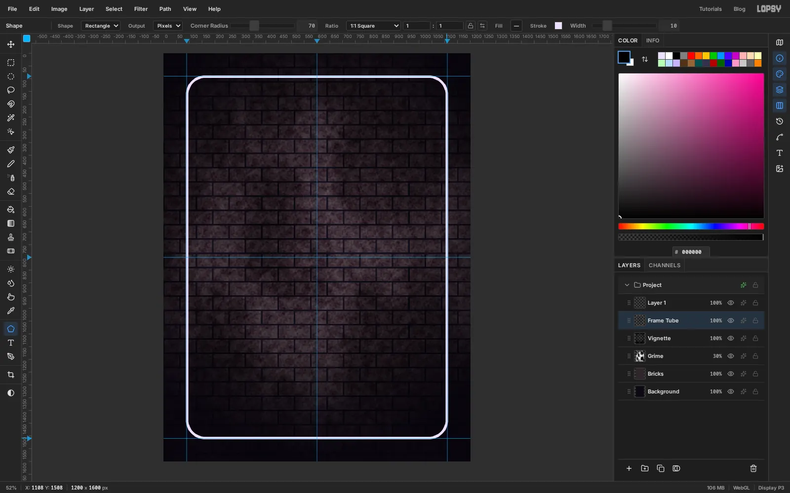

Add a layer called *Frame Tube* and turn on **View → Snap to Guides**.

Choose the **Shape** tool ([[U]]) and set it up in the options bar:

- **Shape**: Rectangle, **Output**: Pixels, **Corner Radius**: 70
- **Fill**: click the swatch and choose **Remove fill**
- **Stroke**: add one and set it to `#EEDFFF`, with **Width 10**

The Shape tool grows from its **centre**. Press where the two middle guides cross (**600, 800**) and drag out to the bottom right corner where the guides meet (**1110, 1510**). Snapping pulls each edge onto its guide, and you get a rounded tube 90 px in from every edge.

## Cut a gap at the top

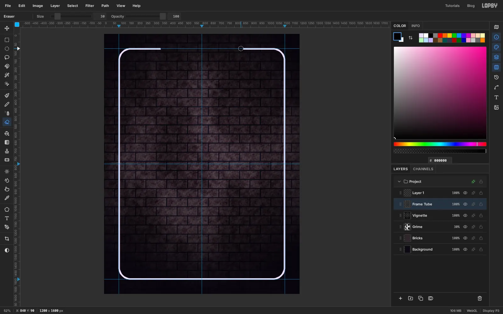

Neon is made from separate tubes, and a gap at the top gives the first line of text somewhere to sit.

Choose the **Eraser** ([[E]]), set **Size** to **30**, and click on the top tube at **360, 90**. Hold [[Shift]] and click at **840, 90**. Shift-click draws a straight line from your last click, so the eraser cuts a clean gap with rounded ends.

## Make it glow: the neon recipe

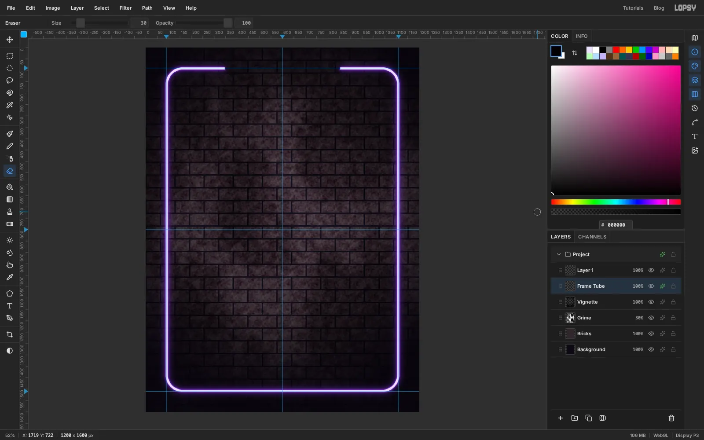

Click the effects button on the *Frame Tube* row to open the Effects drawer. You'll use this same three-effect stack on every tube:

1. **Inner Glow**, colour `#B07BFF`, **Size 5**, **Opacity 90**. It tints the edge of the tube and leaves the middle pale, like the hot core of real glass.
2. **Drop Shadow**, colour `#8E3BFF`, **Offset X 0**, **Offset Y 0**, **Blur 10**, **Spread 20**, **Opacity 100**. With no offset, a drop shadow becomes a tight, bright halo hugging the tube.
3. **Outer Glow**, colour `#8E3BFF`, **Size 40**, **Spread 8**, **Opacity 85**. This is the wide, soft light that spills onto the bricks.

Close the drawer. From here on, "the neon recipe in *colour*" means these three effects, using that colour's **edge** for the Inner Glow and its **glow** for the other two.

## Draw the seahorse with the Pen

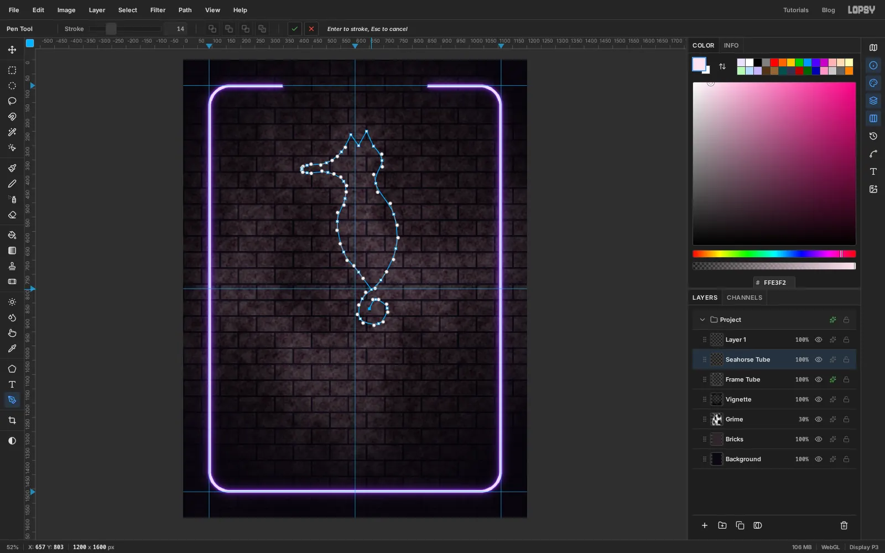

The seahorse is a single continuous tube, the way a neon bender would make it. Add a layer called *Seahorse Tube*, set the foreground to the pink tube colour `#FFE3F2`, choose the **Pen** tool ([[P]]) and set **Stroke** in the options bar to **14**.

To place an anchor, click for a sharp corner or press and drag for a smooth curve. Drag in the direction the line is travelling, about a sixth of the way to the next anchor. Plan on about 27 anchors in all: six round the tail curl, five up the back, four for the crown, five for the forehead and snout, and seven down the belly. Once a smooth anchor has handles, its handle ends show as small white dots too, so the outline looks busier on screen than it is. Work round the outline in this order:

1. Start in the **middle of the tail curl** (around **650, 870**) with a click, then drag smooth anchors that spiral outwards, round the bottom of the curl (about **680, 920**), and up the back of the tail.
2. Carry on up the **back**, which bulges out to the right to about **x 740** at mid-height, then curves in at the neck below the head.
3. At the top of the head, **click** four corner anchors to make two crown spikes, the tallest reaching about **640, 250**.
4. Drag smooth anchors down the forehead and out along the **top of the snout** to its tip at about **x 415**. Round the tip with two or three small drags, then come back along the underside.
5. Drag down the **throat and belly**, which bulges to the left. Finish with a click just where the belly line meets the back of the tail, so the tube looks closed.

Don't press anything else yet. Check that the shape looks right first.

## Stroke the seahorse and light it

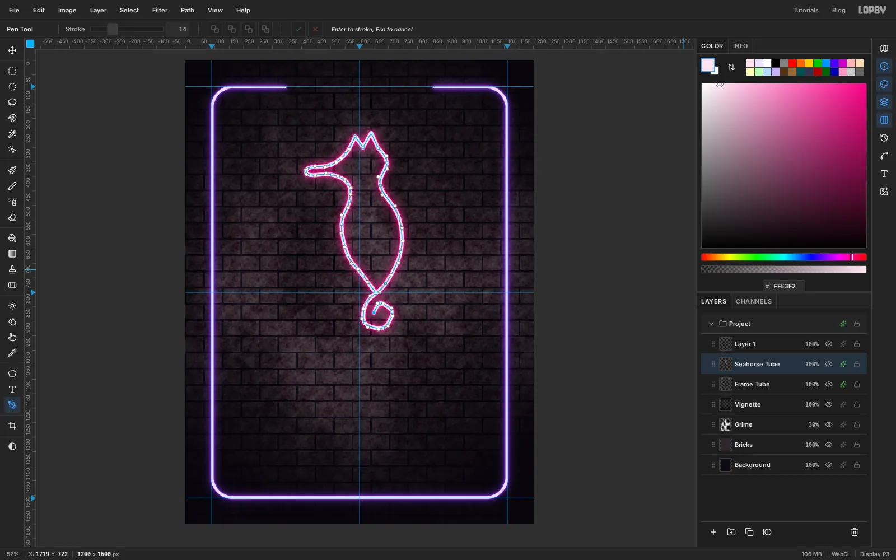

Press [[Enter]]. The Pen strokes the path with the foreground colour at the Stroke width, so the seahorse becomes a 14 px tube with round ends.

Open its effects and apply **the neon recipe in pink**: Inner Glow `#FF66B8`, Drop Shadow and Outer Glow `#FF2E9A`, with the Outer Glow at **Size 46**.

## Add a cyan fin

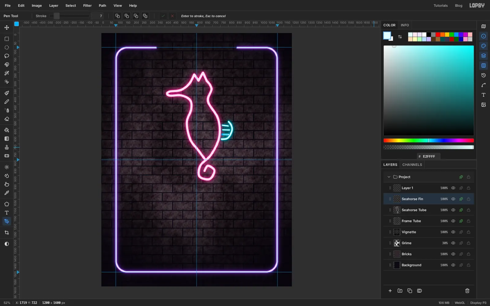

A second colour makes the sign look like it was made from more than one tube. Add a layer called *Seahorse Fin* and set the foreground to `#E2FFFF`.

With the Pen at **Stroke 10**, start with a click just right of the back at about **752, 552**. Drag smooth anchors out to about **824, 608** and back, then end with a click at **758, 670**. Leave a few pixels of dark wall between the fin and the pink back, because separate tubes never touch. Press [[Enter]].

Set **Stroke** to **7** and draw three short ribs across the fan. Each one is two clicks and [[Enter]]. Apply **the neon recipe in cyan**, with the Outer Glow at **Size 40** and the Inner Glow at **Size 4**.

## Add the eye and belly ridges, and copy the effects

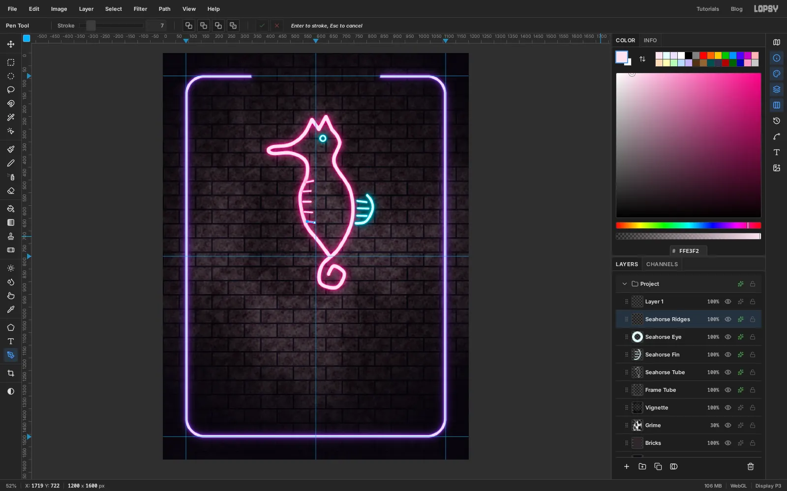

**Eye:** Add a layer called *Seahorse Eye*. With the **Elliptical Marquee**, drag a 28 px circle centred on about **628, 336**. Fill it with `#E2FFFF`, choose **Select → Shrink…** with **6** px, and press [[Delete]]. That leaves a ring.

You don't need to rebuild the effects. Open the *Seahorse Fin* effects, click **Copy effects**, then open the *Seahorse Eye* effects and click **Paste effects**.

**Ridges:** Add a layer called *Seahorse Ridges* and set the foreground back to `#FFE3F2`. With the Pen at **Stroke 7**, draw five short two-click lines, about 30 px long, going inwards from the belly edge and spaced down the chest. Then copy the effects from *Seahorse Tube* and paste them onto *Seahorse Ridges*.

## Group the sign and move it

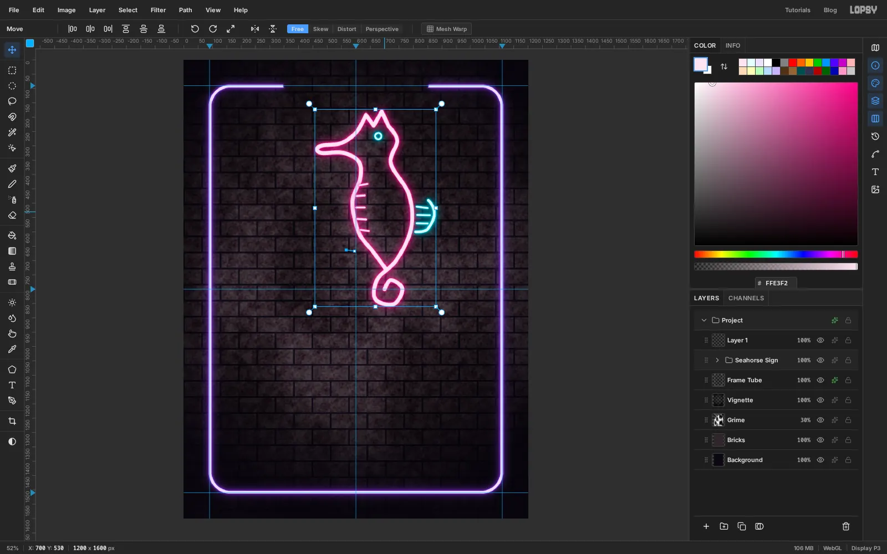

Click *Seahorse Tube* in the Layers panel, then [[Shift]]-click *Seahorse Ridges* to select all four seahorse layers. Choose **Layer → Group Layers**, rename the group *Seahorse Sign*, and click its arrow to collapse it.

Press [[Cmd+D]] so nothing is selected on the canvas, and choose the **Move** tool ([[V]]). With the group active, the handles frame all four layers together. Drag from inside the seahorse to move the whole sign up and a little to the right, so there's room for the title underneath.

## Scale the whole sign down

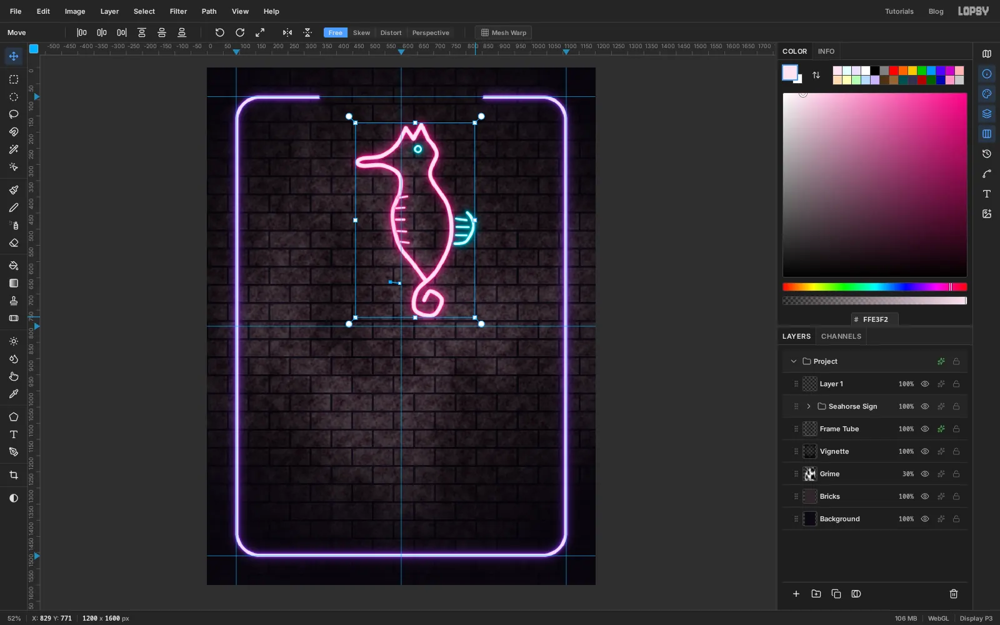

The seahorse is a little large for the space above the title. Hold [[Cmd]] and drag the **bottom right** corner handle up and in until the sign is roughly 85% of its size, with the tail ending a little above the middle guide. [[Cmd]] keeps the proportions. Press [[Enter]] to apply it.

All four layers scale as one, and their effects come along with them.

## Tilt it slightly

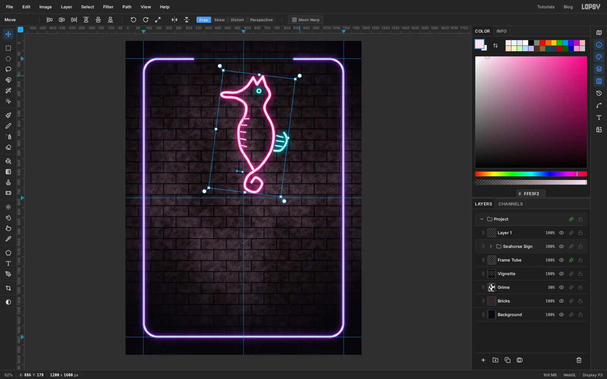

A slight tilt makes the seahorse look like it's swimming, not standing to attention. Move the pointer just outside the **top right** corner until it turns into the rotate cursor, then drag clockwise by a few degrees (about 7° here; the tilt is meant to be subtle). Press [[Enter]].

Press [[Cmd+D]] and drag the group back so the seahorse is centred on the middle guide, with its crest well below the top of the frame.

## Let the light spill onto the bricks

Real neon lights the wall it hangs on. Click the *Vignette* layer and add a layer above it called *Pink Spill*.

Choose the **Brush** ([[B]]) and set **Size 520**, **Hardness 0** and **Opacity 22**. Set the foreground to `#FF2E9A` and click four or five times behind the seahorse, from its crown down to its tail. In the Effects drawer, set its **Blend Mode** to **Screen**.

Add a *Cyan Spill* layer the same way, in `#00E1FF` at **Size 460** and **Opacity 14**. Click once up near the snout, where the bubbles will go, and twice lower down, where the title will go. Set its blend mode to **Screen** too.

## Make one bubble ring

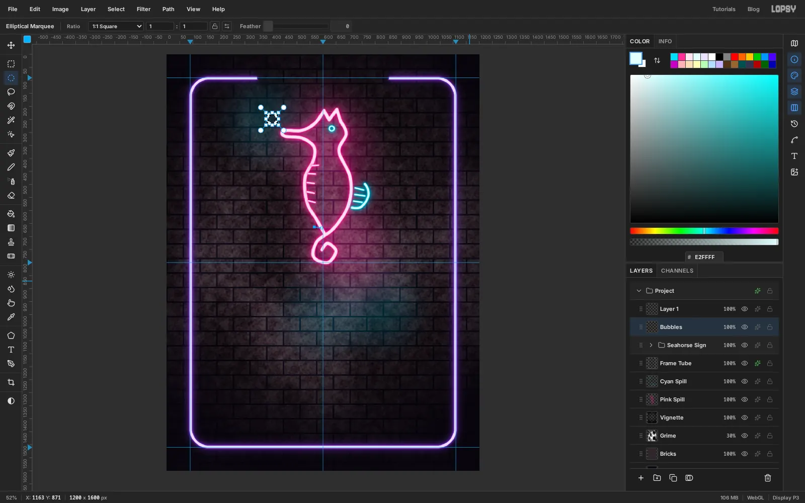

Click the *Seahorse Sign* group. Because it's collapsed, a new layer goes above it, not inside it. Add a layer called *Bubbles*.

Make a ring the same way as the eye: a 48 px circle just up and to the left of the snout tip, filled with `#E2FFFF`, then **Shrink** by **7** and [[Delete]]. Press [[Cmd+D]].

[[Cmd]]-click the *Bubbles* thumbnail to load the ring as a selection, then press [[Cmd+C]] to copy it.

## Paste and scale the smaller bubbles

Press [[Cmd+D]], then [[Cmd+V]]. The ring pastes onto its own layer in the same place. Rename it *Bubble 2* and, with the Move tool, drag it up and slightly left, so it sits above the first bubble with a small gap.

[[Cmd]]-click its thumbnail again. That loads the ring as a selection, so the transform handles hug the ring and not the whole layer. [[Cmd]]-drag a corner handle inwards until the ring is about two-thirds the size of the first bubble, then press [[Enter]].

Paste again for *Bubble 3*. Move it higher and back to the right, and scale it to about half the size of the first bubble. Bubbles get smaller as they rise, and the zigzag makes them look like they're drifting.

Select *Bubble 3* and choose **Layer → Merge Down** twice, to merge all three into *Bubbles*. Apply **the neon recipe in cyan** with the Inner Glow at **Size 4** and the Outer Glow at **Size 36**.

## Set the script title

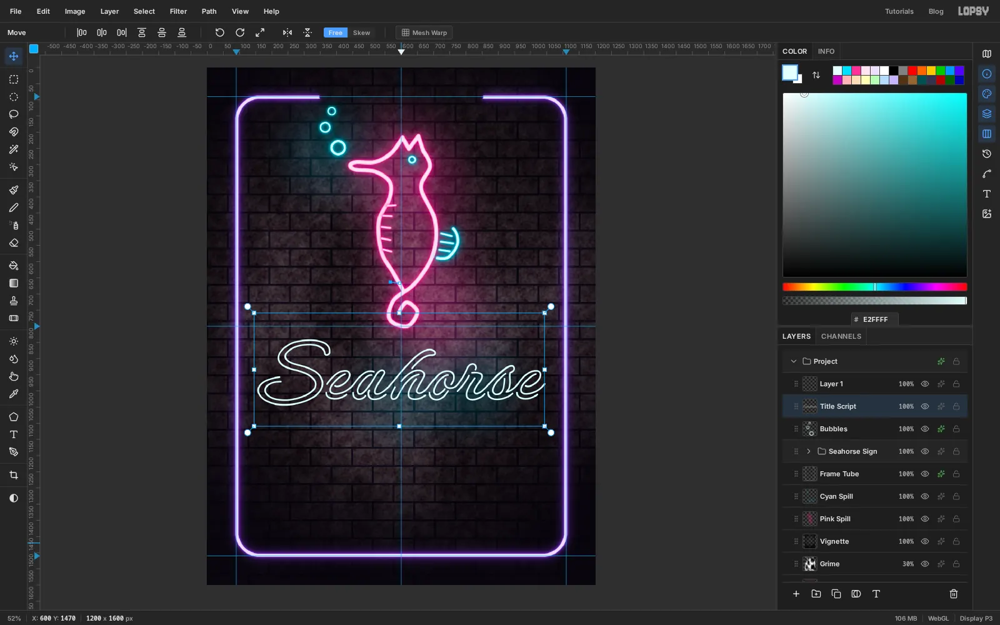

Make sure a **non-text** layer such as *Bubbles* is selected, then choose the **Text** tool ([[T]]). This matters later: if a text layer is selected when you change the font, Lopsy restyles that layer instead of setting up the next one.

In the options bar, choose **Neonderthaw** from the font menu, set **Size** to **250** and **Align** to **Center**, and set the foreground to `#E2FFFF`. Click an empty part of the wall, type *Seahorse*, and press [[Tab]] to commit. Rename the layer *Title Script*.

Neonderthaw is drawn as a double line, so it already looks like a bent tube. With the Move tool, use the arrow keys ([[Shift]] moves 10 px) to centre it on the middle guide, a little way below the tail. The top of the *S* should sit just below the tail curl without touching it.

## Add HIDEAWAY in a second neon colour

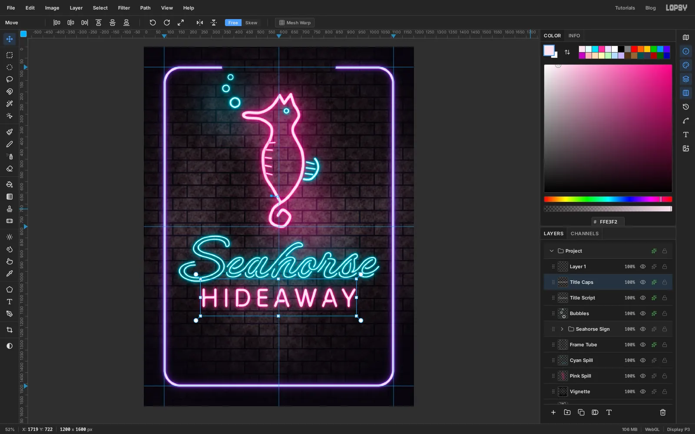

Apply **the neon recipe in cyan** to *Title Script*, with the Inner Glow at **Size 3** and the Outer Glow at **Size 44**.

Click *Bubbles* again, so no text layer is selected, and choose the Text tool. Pick **Tilt Neon**, set **Size 118** and the foreground to `#FFE3F2`, click an empty area and type *HIDEAWAY*. Press [[Tab]] and rename the layer *Title Caps*.

Open the **Text** panel and set **Letter spacing** to **18 px**. Spaced capitals read as separate tube letters. Centre the word about 30 px below the script, and apply **the neon recipe in pink** with the Inner Glow at **Size 4** and the Outer Glow at **Size 44**.

## Bend a wave with the Pen

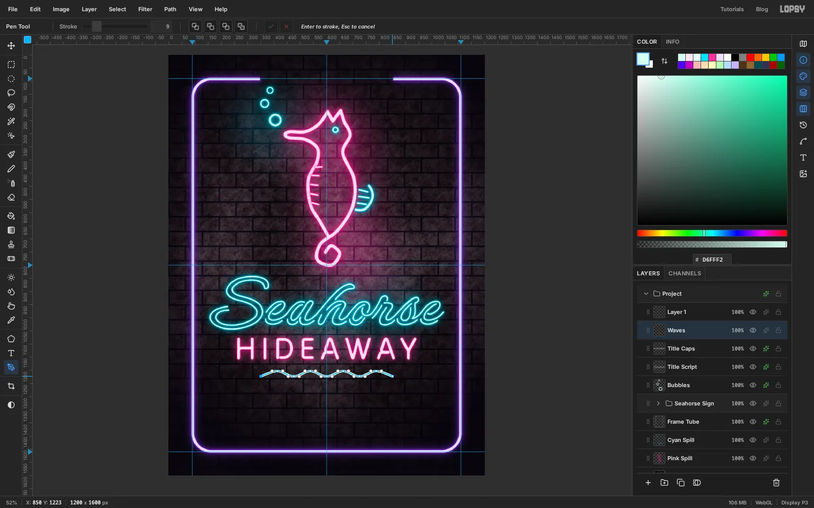

Add a layer called *Waves* and set the foreground to `#D6FFF2`. With the Pen at **Stroke 9**, click a little in from the left end of *HIDEAWAY* to start, halfway between it and where the details will go. Then drag smooth anchors at even steps across to the right end of the word, alternating a little above and below the line: four low, gentle crests in all. Finish with a click and press [[Enter]].

The path's anchors stay on screen while the Pen is the active tool. They aren't part of the picture, and they disappear when you switch tools.

Apply **the neon recipe in teal**: Inner Glow `#5FF5CF` at **Size 3**, and Drop Shadow and Outer Glow `#15E0B0`, with the glow at **Size 36**.

## Set the invitation line and the details

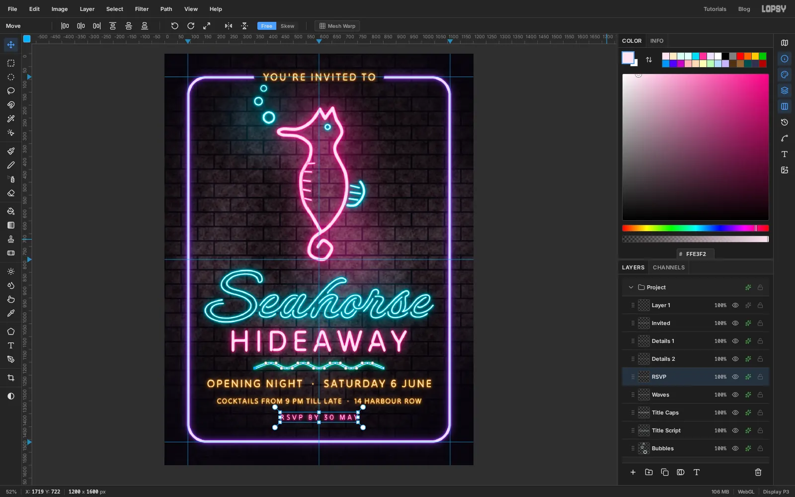

All four lines use **Tilt Neon**, centred on the middle guide. Remember to click a non-text layer before you change the font each time, and rename each layer as you go.

1. ***YOU'RE INVITED TO*** (layer *Invited*): **Size 40**, `#FFE9C2`, letter spacing **6**. At this size it's about 430 px wide, which fits the 510 px gap with room to spare. Centre it vertically on the top tube's line, in the gap you erased, so the space to each tube end is the same. Apply **the neon recipe in amber** with smaller numbers so it doesn't overpower the title: Inner Glow `#FFB65C` **Size 2**, Drop Shadow `#FF9A1F` **Blur 6**, Outer Glow `#FF9A1F` **Size 26**.
2. ***OPENING NIGHT  ·  SATURDAY 6 JUNE*** (layer *Details 1*): **Size 42**, `#FFE9C2`, letter spacing **0**, with the same amber effects. Place it so the gap above and below the wave comes out about equal.
3. ***COCKTAILS FROM 9 PM TILL LATE  ·  14 HARBOUR ROW*** (layer *Details 2*): **Size 28**, `#FFE9C2`, letter spacing **3**, about 40 px below the date. Copy the effects from *Details 1* and paste them here. At this size it stays well inside the frame, about 110 px clear of each side.
4. ***RSVP BY 30 MAY*** (layer *RSVP*): **Size 28**, `#FFE3F2`, letter spacing **8**, about 40 px below that. Paste the effects from *Title Caps*, then turn its Outer Glow down to **Size 24**, **Spread 6**, **Opacity 80** so the small type doesn't blur.

> **Tip:** The middle dot · is [[Option+Shift+9]] on a Mac. On Windows hold [[Alt]] and type 0183 on the number pad. Put two spaces either side of it.

## Add clips and unlit tube ends

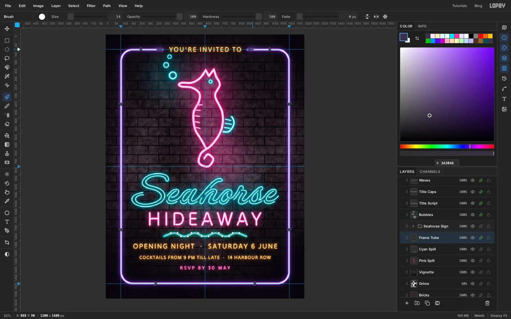

These small hardware details are what sell the sign as a real object.

**Clips:** Click *RSVP* and add a layer called *Tube Clips*. Set the foreground to `#3B3946` and use the Rectangular Marquee to fill small rectangles across the tube. Make them 26 × 12 px across each side tube at **y 420** and **y 1180**, and 12 × 26 px across the bottom tube at **x 300** and **x 900** and across the top tube at **x 210** and **x 990**. You can [[Shift]]-drag to add every rectangle to one selection and fill them all at once. Give the layer a black **Drop Shadow** (**Offset 3, 5**, **Blur 6**, **Opacity 80**) and an **Inner Glow** in `#D8D4E6` at **Size 3** for a little metal highlight.

**Tube ends:** Real neon is painted out where the glass bends back into the wall. Click the *Frame Tube* layer and choose the **Brush** at **Size 14**, **Hardness 100**, **Opacity 100**, in `#3A3046`. Click on the left tube end at about **338, 90**, then [[Shift]]-click about 26 px further out. Do the same on the right end, from **862, 90**.

## Bloom and grain to finish

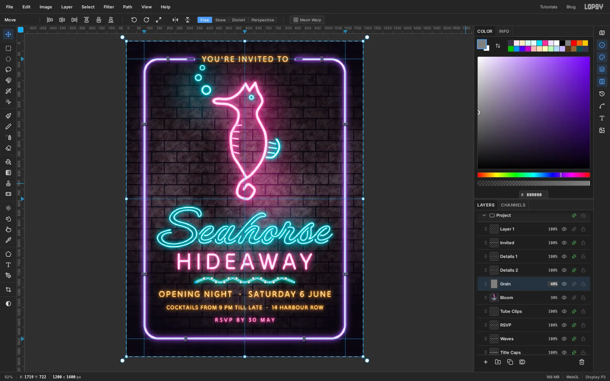

**Bloom:** Click the *Tube Clips* layer and press [[Cmd+A]]. Choose **Edit → Copy Merged**, press [[Cmd+D]], then [[Cmd+V]], and rename the pasted layer *Bloom*. Run **Filter → Bloom…** with **Threshold 55**, **Radius 40** and **Intensity 120**. Then set its blend mode to **Screen** and its opacity to **45%**. Only the hottest parts of the tubes bloom, which adds the slight overexposure you see in photos of real neon.

Do this last. *Bloom* is a flattened copy, so if you move anything after this, the bloom stays where the old version was.

**Grain:** Add a layer called *Grain*, fill it with `#808080`, and run **Filter → Add Noise…** with **Amount 14** and **Mono** on. Set it to **Overlay** at **40%**. The fine grain stops the smooth glows from looking too digital.

Choose **File → Save Project** to keep the layers, and **File → Quick Export PNG** for the finished invitation.

> **Tip:** Try swapping the palette. Hide the cyan tubes, change the glow colours in each layer's effects, and the same sign works for a winter cocktail night in icy blues and white.
