Neon is three things stacked up: a thin, almost white tube, a tight band of
saturated colour around it, and a wide soft wash on whatever is behind. Get
those three right and anything you draw looks like bent glass. This tutorial
uses them on a menu for a made-up late-night noodle bar, **Jade Lantern**.

The whole thing is drawn in Lopsy. There are no photos: the wall is a brick
you draw once and tile, and the sign is shapes, pen curves and live text.

Along the way you'll use:

- **Define Pattern** and **Fill with Pattern** for the wall, with the Texture and Clouds filters
- the Shape tool with a stroke and no fill, and the Pen tool, to draw tubes
- brush symmetry, [[Shift]]-click lines and a wide-spaced brush for dotted leaders
- Gaussian Blur, the Screen blend mode, Outer Glow and **Select → Shrink** for the glow
- text on a path, multi-line point text and right-aligned prices
- selections that add and subtract, Copy and Paste, and the Move tool's scale, flip and rotate handles
- a Color Dodge layer for light on the bricks, groups, and a group adjustment

The palette is three tube colours on a dark wall. Each tube colour has a pale
"core" version for the hot centre of the glass:

- Mortar `#070D0C`
- Bricks `#13211F`, `#182A27`, `#0F1B1A`
- Jade `#1DF2A4`, jade core `#D9FFF0`
- Coral `#FF4A3D`, coral core `#FFE1DA`
- Amber `#FFB22E`, amber core `#FFF1CF`
- Warm white `#F4FFF9`, header pink `#FFCDC4`
- Leader dots `#A6F7D9`, cord `#2C3A37`

New layers appear above whichever layer is selected, so each step says which
layer to select first. It matters at the end, when the layers are grouped.

## Fill the canvas with mortar

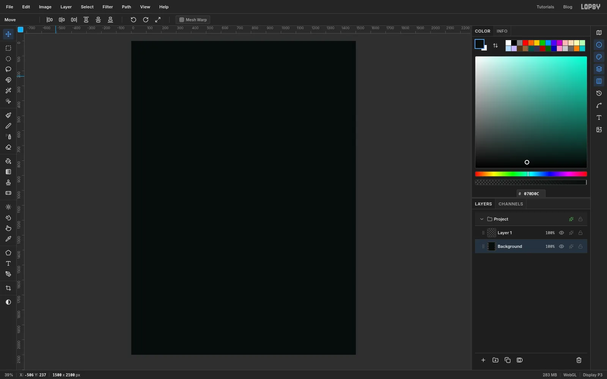

Open [Lopsy](/). In the **New Document** dialog set **Width** to `1500` and
**Height** to `2100`, then click **Create**.

Select the **Background** layer, set the foreground colour to `#070D0C` and
choose **Edit → Fill**. This is the mortar. The bricks go on a layer above
it, so the gaps between them show this colour through.

## Draw one repeat of the brickwork
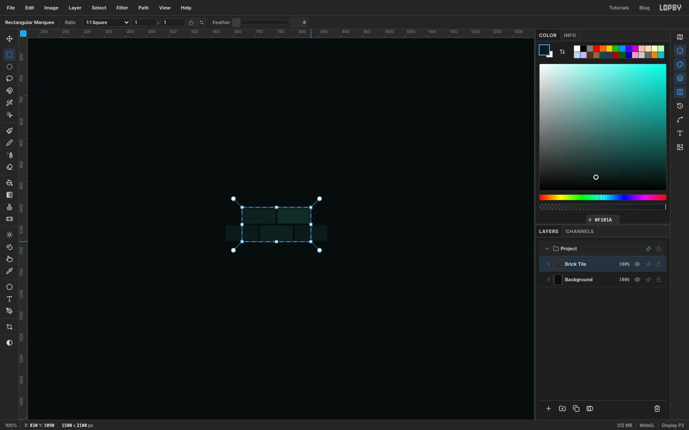

You only need to draw five bricks. Select **Layer 1** and rename it
**Brick Tile**, then choose **View → Actual Size**. Zoom in further if you
like: the status bar shows the pointer's position, and here the sizes need to
be right to the pixel or the wall will show seams.

1. With the **Rectangular Marquee**, drag a box 76 px wide and 36 px tall near the middle of the canvas. Set the foreground to `#13211F` and choose **Edit → Fill**.
2. Make a second box the same size, starting 4 px to the right of the first, and fill it with `#182A27`. That's the top course.
3. For the course below, leave a 4 px gap and shift everything half a brick (40 px) to the left. Fill three bricks: `#0F1B1A`, `#13211F`, `#0F1B1A`. The two outer ones stick out past the top course, and they must be the same colour because they're the two halves of one brick.
4. Drag a marquee 160 px wide and 80 px tall that starts 2 px left of and 2 px above the first brick. It cuts the outer bricks of the lower course in half.
5. Choose **Edit → Define Pattern**, then press [[Cmd+D]].

> **Tip:** The bricks are deliberately close in colour. On the finished wall you want to notice the light, not the masonry.

## Tile the wall

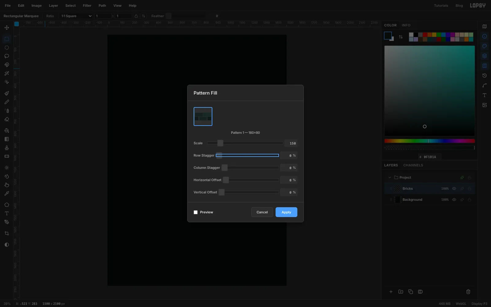

The tile has done its job. Click **Delete Layer** to remove **Brick Tile**
and choose **View → Fit to Screen**.

1. Select **Background**, click **Add Layer** and name the new layer **Bricks**.
2. Choose **Edit → Fill with Pattern...**.
3. Set **Scale** to `150` so the bricks are a comfortable size for a wall this big, and click **Apply**.

## Roughen the bricks and add grime

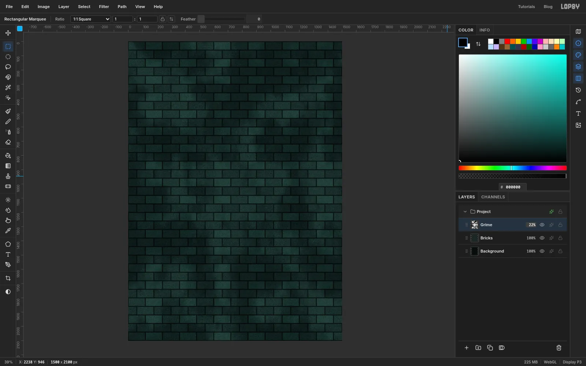

Flat bricks look like wallpaper. Two filters fix that.

1. With **Bricks** selected, choose **Filter → Texture...**. Click **Rough**, set **Amount** to `12` and **Size** to `3`, and click **Apply**.
2. Add a layer named **Grime**. Set the foreground colour to black and choose **Filter → Clouds...** with **Scale** at `9`.
3. Open the layer's effects (the sparkle button on its row) and set the blend mode to **Soft Light**. Close the drawer and lower the layer's opacity to **22%**.

Keep the grime faint. If you can see cloud shapes, it will read as smoke
later, when the neon is on.

## Darken the edges
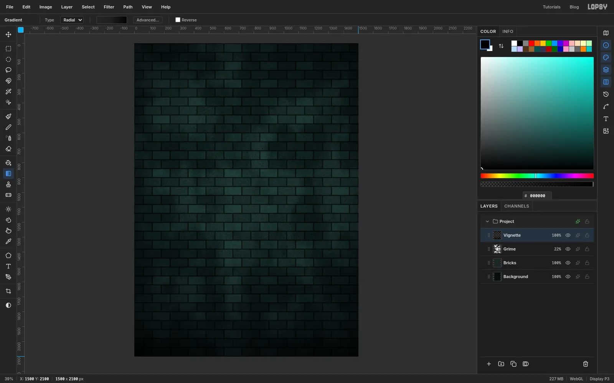

A sign is brightest in the middle of a dark wall. Add a layer named
**Vignette** and choose the **Gradient** tool.

1. Set **Type** to **Radial** and click **Advanced...** to open the Gradient Editor.
2. Click the left stop under the bar. Type `000000` in the hex field and click the far left of the opacity strip, so the stop is fully transparent.
3. Click the right stop, set it to `000000` too, and leave its opacity nearly full, at about 90%.
4. Click the bar a little left of its middle to add a third stop. Make it `000000` at about 15% opacity. Click **Done**.
5. Drag from a little above the middle of the canvas to the bottom-right corner.

The centre of the gradient is clear, so only the edges of the wall darken.

## Drop the guides

Click the top ruler at **120**, **750** and **1380** for the two margins and
the centre line. Click the left ruler at **372** and **950**. The lantern
hangs where the centre line crosses 372, and the menu frame starts at 950.

A label follows the pointer along the ruler, so you can see the position
before you click.

## Draw the lantern from three ellipses

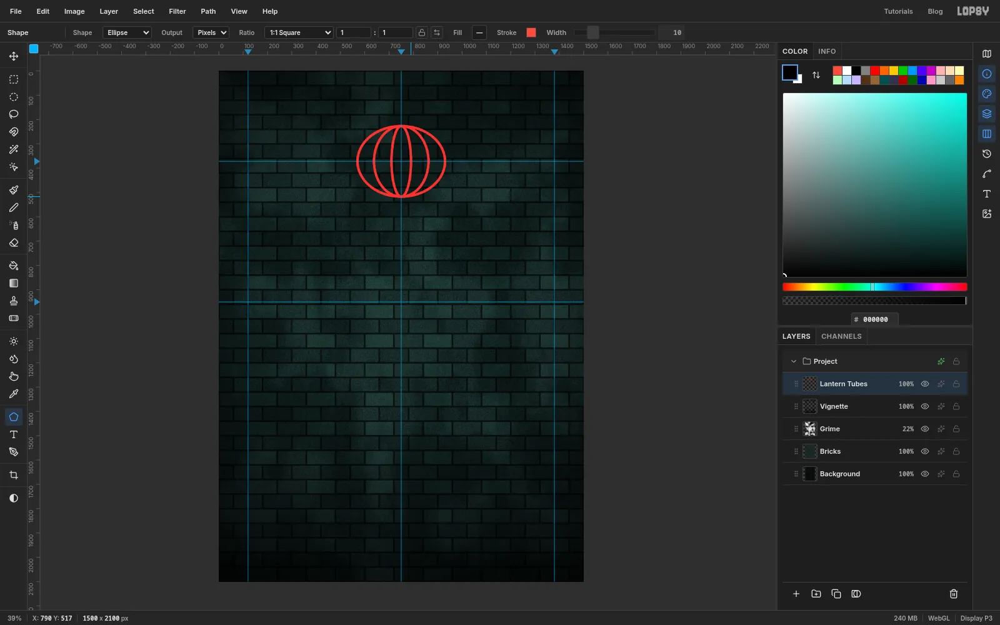

Add a layer named **Lantern Tubes** and choose the **Shape** tool.

1. Set **Shape** to **Ellipse**. Click the **Fill** swatch and choose **Remove fill**. Click the **Stroke** button and set the colour to `#FF4A3D`, then set **Width** to `10`.
2. Shapes grow from their centre. Press on the crossing of the centre guide and the 372 guide and drag down and to the right until the ellipse is about 360 px wide and 290 px tall.
3. Press on the same crossing and drag out a narrower ellipse of the same height, about 225 px wide. Then a third, about 80 px wide.

Three ellipses with one centre and one height read as the ribs of a round
paper lantern.

## Clear room for the collars

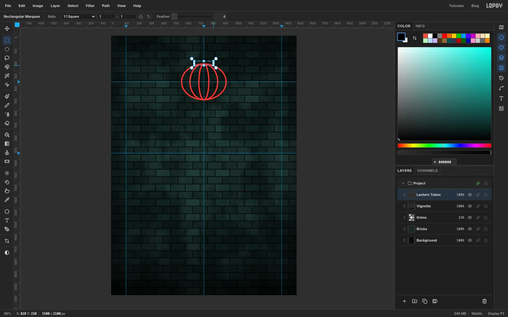

The ribs all meet at the top and bottom. A real lantern hides that under a
collar, so cut the crossings away first.

1. With the **Rectangular Marquee**, drag a box about 155 px wide and 35 px tall over the very top of the lantern, centred on the guide.
2. Press [[Delete]].
3. Do the same at the bottom, then press [[Cmd+D]].

## Add the collars, the hook and the cord

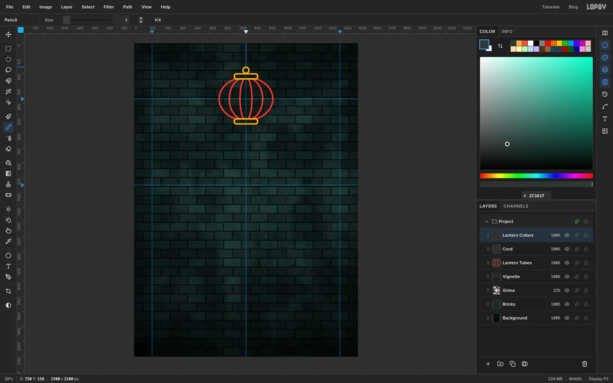

Add a layer named **Lantern Collars**.

1. In the Shape tool set **Shape** to **Rectangle**, **Corner Radius** to `14` and the stroke colour to `#FFB22E`.
2. Drag from the middle of the top gap until the rounded box covers it. Repeat on the bottom gap.
3. Switch **Shape** back to **Ellipse**. Hold [[Cmd]] and drag a small ring, about 40 px across, sitting just above the top collar.
4. Select **Lantern Tubes** and add a layer named **Cord**. Choose the **Pencil**, set **Size** to `5` and the colour to `#2C3A37`. Click the centre guide at the top edge of the canvas, then [[Shift]]-click at the top of the ring.

The cord runs along the centre guide, so you won't see much of it until the
guides are hidden. It stays unlit: it's the one thing on the wall that isn't
glass.

## Paint the tassel with symmetry

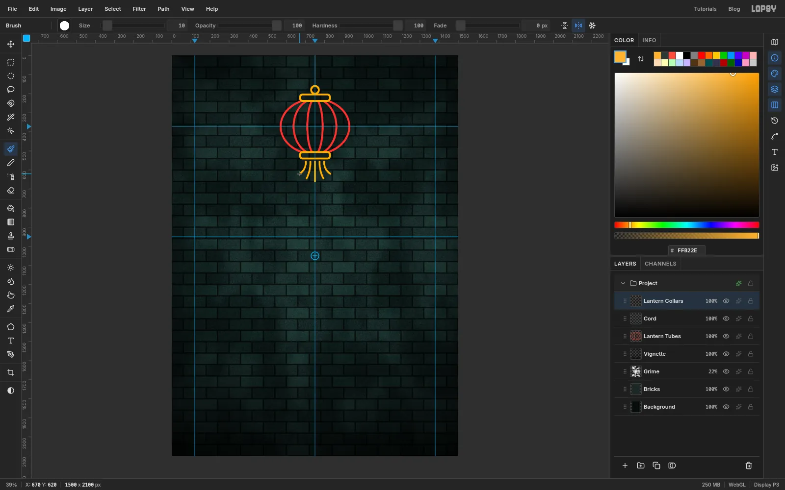

Select **Lantern Collars** again and choose the **Brush**. Click
**Open brush presets** and set **Size** to `10`, **Hardness** to `100` and
**Spacing** to `5`, then close the window. Set the colour to `#FFB22E`.

1. Click on the centre guide just under the bottom collar, then [[Shift]]-click about 100 px below it. That's the middle strand.
2. Turn on **Symmetry Vertical** in the options bar.
3. Starting a little left of the middle strand, paint a strand that drops straight and then curls outwards. Its mirror image appears on the right as you paint.
4. Paint a shorter one further out, then turn symmetry off again.

## Start the glow with a blurred copy

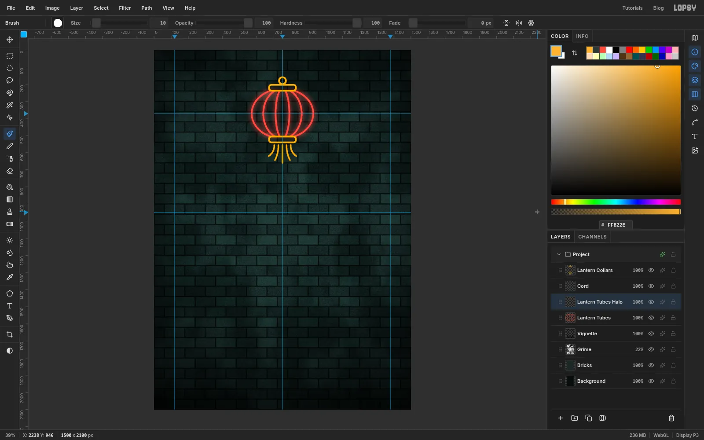

Now the neon. Every tube in this piece gets the same three steps, so it's
worth doing slowly once.

1. Select **Lantern Tubes** and choose **Layer → Duplicate Layer**. Rename the copy **Lantern Tubes Halo**.
2. Choose **Filter → Gaussian Blur...**, set **Radius** to `40` and click **Apply**.
3. Open the layer's effects and set the blend mode to **Screen**.

This is the wide wash, the light that reaches the wall.

## Add the tight glow

Select **Lantern Tubes** itself and open its effects.

1. Tick **Outer Glow**.
2. Set the glow colour to `#FF4A3D`, **Size** to `26`, **Spread** to `6` and **Opacity** to `90`.

Close the drawer. This is the band of pure colour right next to the glass.

## Put a hot core down the middle

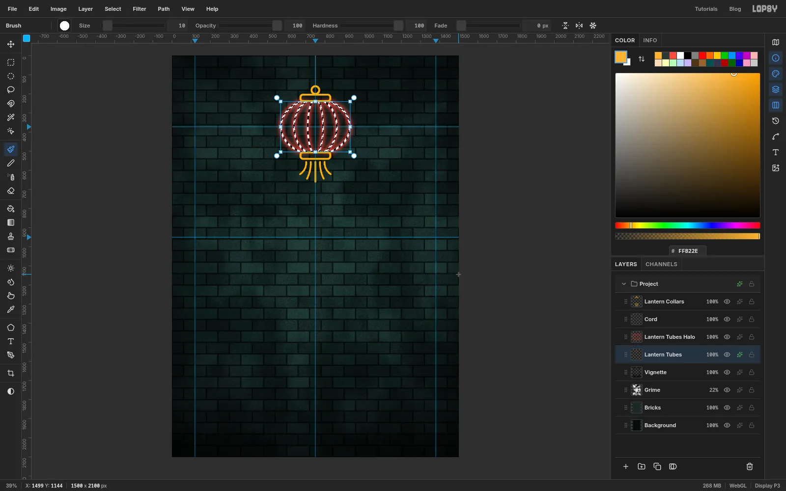

The centre of a lit tube is nearly white.

1. Hold [[Cmd]] and click the **Lantern Tubes** thumbnail to select its pixels.
2. Choose **Select → Shrink…**, set the amount to `3` and click **Apply**. The selection is now a thin line down the middle of each tube.
3. Add a layer named **Lantern Tubes Core**, set the foreground to `#FFE1DA` and choose **Edit → Fill**.
4. Press [[Cmd+D]].

## Light the collars the same way
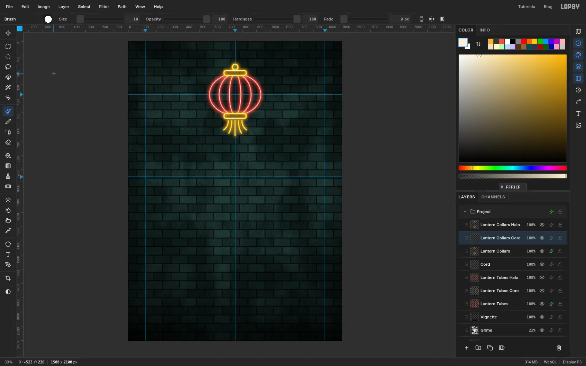

Repeat the three steps on **Lantern Collars**, in the same order:

1. Duplicate it, rename the copy **Lantern Collars Halo**, blur it by `40` and set it to **Screen**.
2. On **Lantern Collars**, tick **Outer Glow** with the colour `#FFB22E`, **Size** `26`, **Spread** `6` and **Opacity** `90`.
3. [[Cmd]]-click its thumbnail, shrink the selection by `3`, add a layer named **Lantern Collars Core** and fill it with `#FFF1CF`.

Make the copy before you add the Outer Glow, so the halo is a plain blur of
the bare tube.

> **Tip:** If a glow looks flat, the core is usually missing or too wide. Shrink by one more pixel.

## Draw an arch with the Pen tool
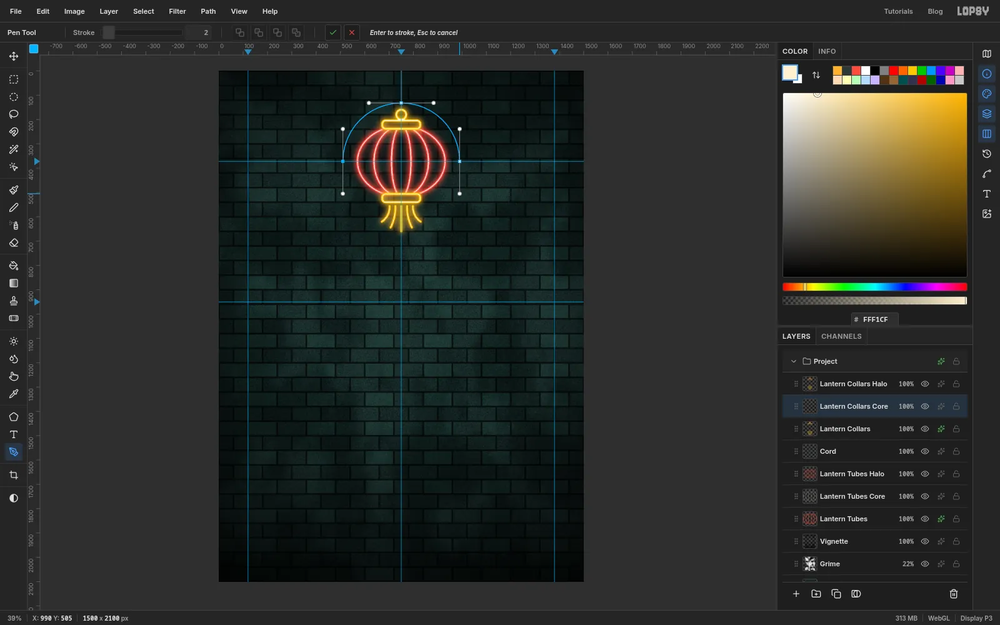

The tagline will curve over the lantern, so it needs a path to sit on: half a
circle with the lantern at its centre. Choose the **Pen** tool.

1. Press on the 372 guide a little outside the lantern's left edge, about a third of the lantern's width away from it. Drag straight up until the pointer is level with the top collar, then let go. Dragging pulls out curve handles.
2. Press on the centre guide above the ring, leaving about as much room over the ring as you left beside the lantern. Drag to the right by the same amount you dragged up.
3. Press on the 372 guide to the right of the lantern, mirroring the first anchor, and drag straight down.
4. Click the ✓ **Commit path** button in the options bar.

Don't press [[Enter]] here. With the Pen tool that strokes the path with
paint, and this path is only a guide for the text.

The blue outline stays on screen while the path is selected. It never
exports. To hide it, open the **Paths** panel and click the path's row.

## Set the tagline on the arch
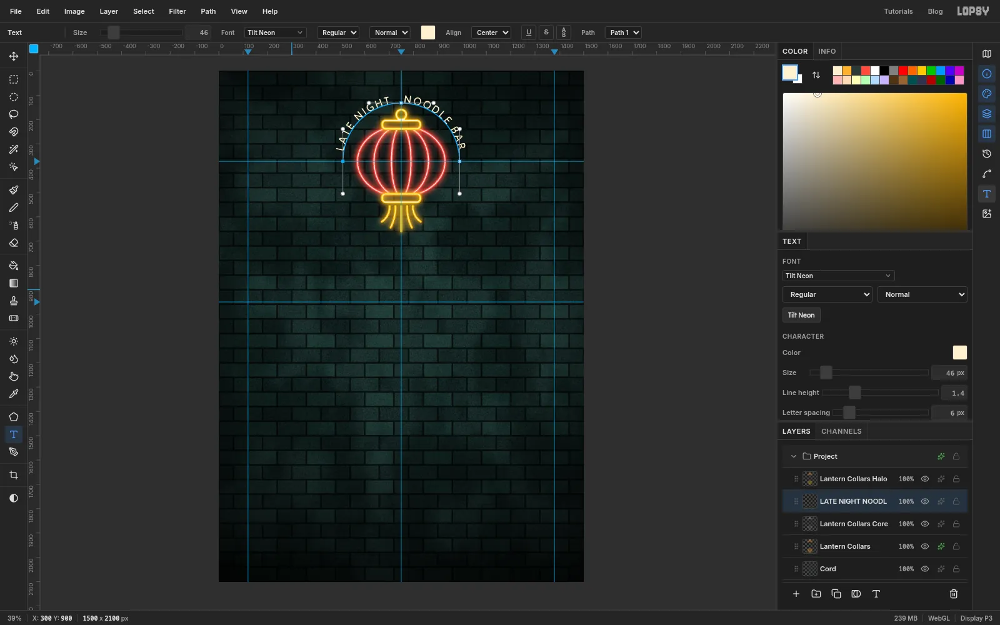

Select **Lantern Collars Halo**, the top layer, then choose the **Text**
tool.

1. Set **Size** to `46`, pick **Tilt Neon** in the font list and set the colour to `#FFF1CF`.
2. Click anywhere on an empty bit of wall and type `LATE NIGHT   NOODLE BAR`, with three spaces in the middle.
3. In the options bar set **Path** to **Path 1** and **Align** to **Center**. The text jumps onto the arch.
4. Press [[Tab]] to commit, then open the **Text** panel and set **Letter spacing** to `6`. Rename the layer **Tagline**.

The three spaces leave a gap at the top of the arch for the cord.

> **Tip:** If the last letter goes missing, the line is longer than the path. Lower the size or the letter spacing until it comes back.

## Light the tagline
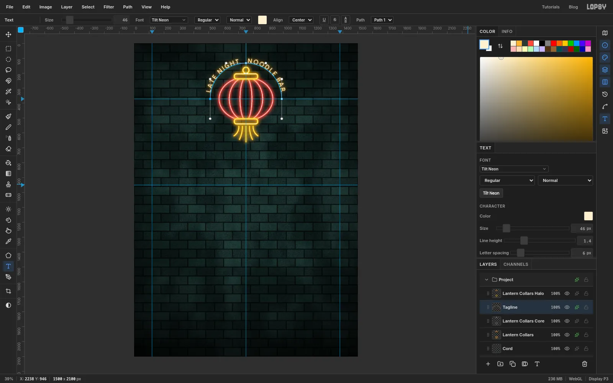

Text stays editable, so it gets its glow from two effects instead of extra
layers. Open the **Tagline** layer's effects:

1. Tick **Outer Glow**: colour `#FFB22E`, **Size** `14`, **Spread** `4`, **Opacity** `95`.
2. Tick **Drop Shadow**: colour `#FFB22E`, **Offset X** and **Offset Y** `0`, **Blur** `46`, **Opacity** `80`.

A shadow with no offset is just a second, wider glow. The pale text colour is
the core.

Every piece of type from here on gets this same pair. Only the colour and two
numbers change, so the steps give them as "glow `14` / `46`": the Outer Glow
**Size** first, then the Drop Shadow **Blur**. Keep **Spread** at `4`, the
Outer Glow's **Opacity** at `95`, both offsets at `0` and the shadow's
**Opacity** at `80`.

## Type the name
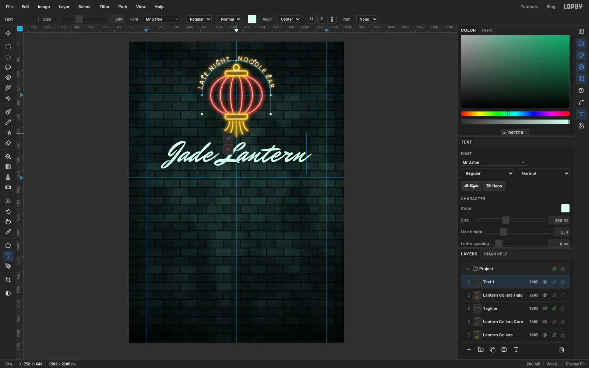

Select **Lantern Collars Halo** again before you pick up the Text tool.

> **Tip:** While a text layer is selected, the Text tool's options restyle that layer instead of setting up the next one. Always select an ordinary layer first.

1. In the Text tool set **Size** to `200`, the font to **Mr Dafoe** and the colour to `#D9FFF0`. In the Text panel set **Letter spacing** back to `0`, or the script's letters won't join.
2. **Align** is still **Center**. Click on the centre guide a little below the tassel and type `Jade Lantern`.
3. Press [[Tab]] and rename the layer **Title**.

## Centre and light the title
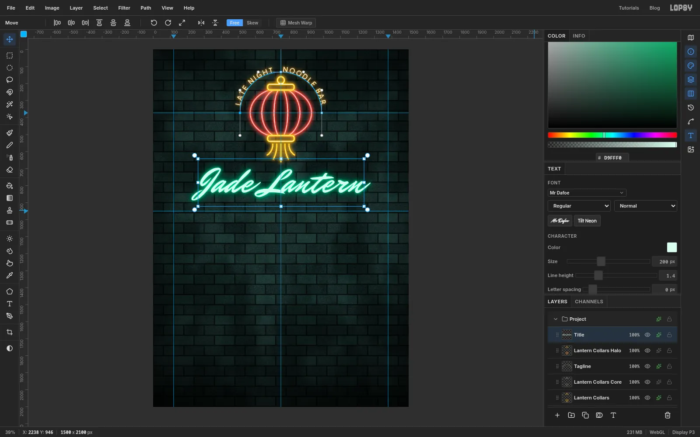

The script has a long swash on the J, so the text box is centred but the ink
isn't. Choose the **Move** tool and tap the arrow keys until the lettering
looks even either side of the centre guide.

Then light it in `#1DF2A4` with glow `20` / `80`. It's bigger than the
tagline's because this is the brightest thing on the wall.

## Draw the menu frame and cut a gap

Select **Title** and add a layer named **Frame**.

1. In the Shape tool choose **Rectangle**, set **Corner Radius** to `40`, the stroke colour to `#1DF2A4` and **Width** to `8`.
2. Press on the centre guide about a third of the way up from the bottom of the canvas and drag out until the right edge snaps to the right margin guide and the top edge reaches the 950 guide.
3. With the **Rectangular Marquee**, drag a box about 185 px wide across the middle of the bottom edge and press [[Delete]], then [[Cmd+D]].

The gap is where the steam will come up from the bowl.

## Cap the ends and light the frame
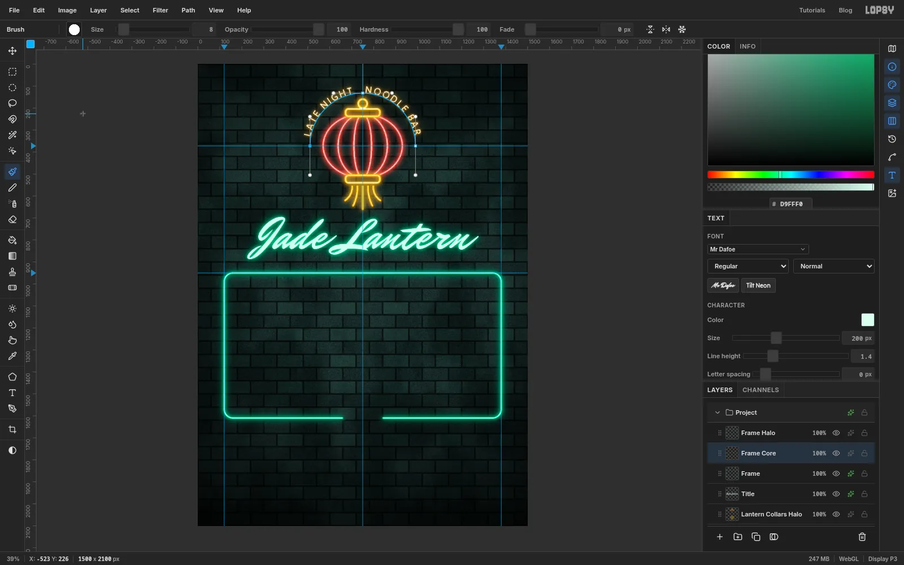

A cut tube has square ends, and glass doesn't. Choose the **Brush** at
**Size** `8` with the colour `#1DF2A4` and click once on each cut end to
round it off.

Then light the frame like the lantern:

1. Duplicate **Frame**, name the copy **Frame Halo**, blur it by `50` and set it to **Screen**.
2. On **Frame**, add an **Outer Glow** in `#1DF2A4`: **Size** `22`, **Spread** `6`, **Opacity** `90`.
3. [[Cmd]]-click the **Frame** thumbnail, shrink the selection by `2`, add a layer named **Frame Core** and fill it with `#D9FFF0`.

## Type the first section
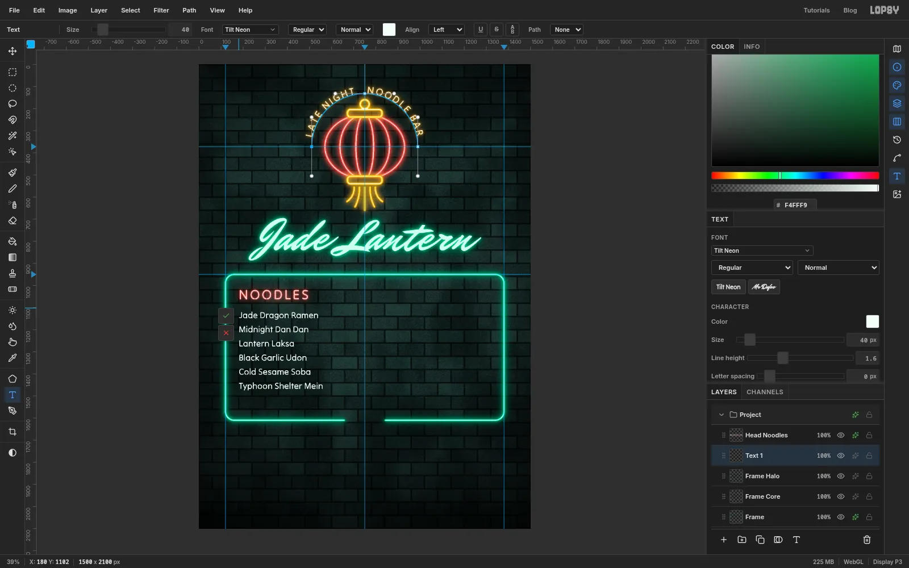

All the menu text sits above **Frame Halo**. Select that layer before each
new piece of text, and rename each text layer as you finish it.

1. For the header, set **Size** `62`, **Align** **Left**, colour `#FFCDC4` and, in the Text panel, **Letter spacing** `8`. Click inside the frame near its top-left corner, leaving a generous margin, and type `NOODLES`. Press [[Tab]] and name the layer **Head Noodles**.
2. Light it in `#FF4A3D` with glow `12` / `44`.
3. Select **Frame Halo**. For the dishes, set **Size** `40`, colour `#F4FFF9`, **Letter spacing** `0` and **Line height** `1.6`. Click under the header, level with its left edge, and type the six dishes, pressing [[Enter]] after each: Jade Dragon Ramen, Midnight Dan Dan, Lantern Laksa, Black Garlic Udon, Cold Sesame Soba, Typhoon Shelter Mein. Press [[Tab]] and name the layer **Noodles**.
4. Light the dishes more gently, so they stay easy to read: `#1DF2A4` with glow `6` / `24`.

## Add the prices
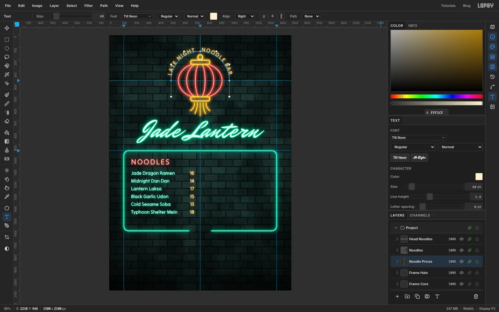

Prices go in their own text layer so they can line up on the right.

1. Select **Frame Halo**. In the Text tool set **Align** to **Right** and the colour to `#FFF1CF`. Keep the size and line height from the dishes.
2. Click level with the first dish, just left of the centre guide, and type `16`, `14`, `17`, `15`, `13`, `18` with [[Enter]] between them. Press [[Tab]] and name the layer **Noodle Prices**.
3. Light them in `#FFB22E` with glow `8` / `28`.

Both layers use the same size and line height. If the rows don't match, the
two clicks were at different heights: nudge the prices up or down with the
Move tool and the arrow keys.

## Fill the second column
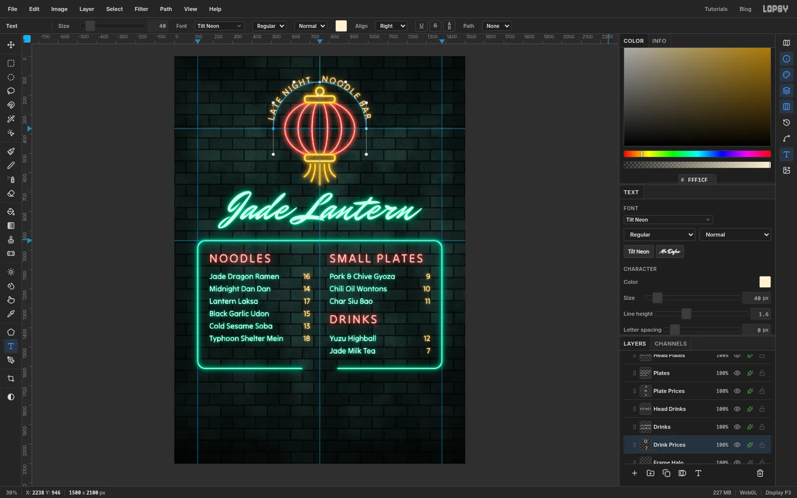

The right column repeats the last two steps: a header, a block of names and a
block of prices for the plates, then the same for the drinks. That's six more
text layers, each started from **Frame Halo** and each with the settings and
glow of its twin on the left. Mirror the left column's margins: names start
just right of the centre guide, and prices end as far inside the frame's
right edge as NOODLES starts inside its left.

1. Type the header `SMALL PLATES` level with NOODLES. Name it **Head Plates**.
2. Type three dishes under it, level with the first three noodles: Pork & Chive Gyoza, Chili Oil Wontons, Char Siu Bao. Name the layer **Plates**.
3. Add their prices, right-aligned: `9`, `10`, `11`. Name the layer **Plate Prices**.
4. Skip two rows. Type the two drinks, Yuzu Highball and Jade Milk Tea, starting on the **sixth** row, level with Typhoon Shelter Mein. Name the layer **Drinks**, and add **Drink Prices**: `12` and `7`.
5. Type the header `DRINKS` in the space you skipped, closer to the drinks than to the plates. Name it **Head Drinks**.

Lining the drinks up with row six keeps both columns on the same baselines.

## Draw the dotted leaders

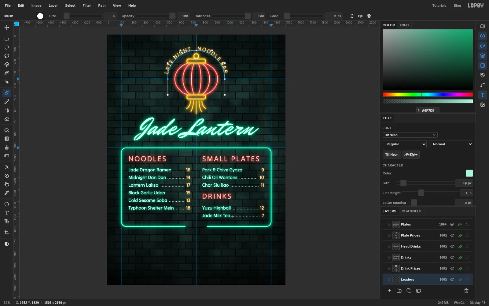

Leaders are just a brush with its spacing opened up. Select **Frame Halo**
and add a layer named **Leaders**.

1. Choose the **Brush** and open the presets window. Set **Size** `6`, **Hardness** `100` and **Spacing** `200`, the maximum, then close it. Set the colour to `#A6F7D9`.
2. On the first row, click just left of the price, level with the middle of the lowercase letters.
3. [[Shift]]-click just right of the dish name. A row of evenly spaced dots joins the two.
4. Repeat for each row.

Start at the price every time. The dots are spaced from the first click, so
the gap before each price comes out the same.

## Select half an ellipse for the bowl

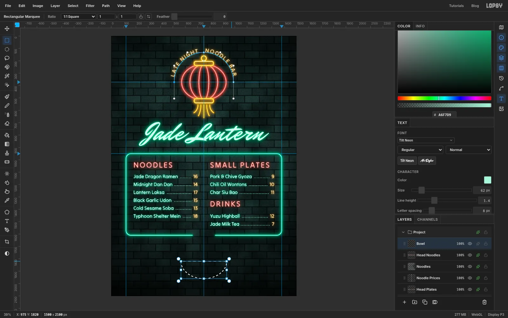

Select **Head Noodles**, the top layer, and add one named **Bowl**.

1. With the **Elliptical Marquee**, drag an ellipse about 370 px wide and 280 px tall, centred on the guide, in the space under the frame.
2. Switch to the **Rectangular Marquee**, hold [[Alt]] and drag a box over the top half of the ellipse. [[Alt]] subtracts, and a half-moon is left.

## Hollow the bowl and give it a foot

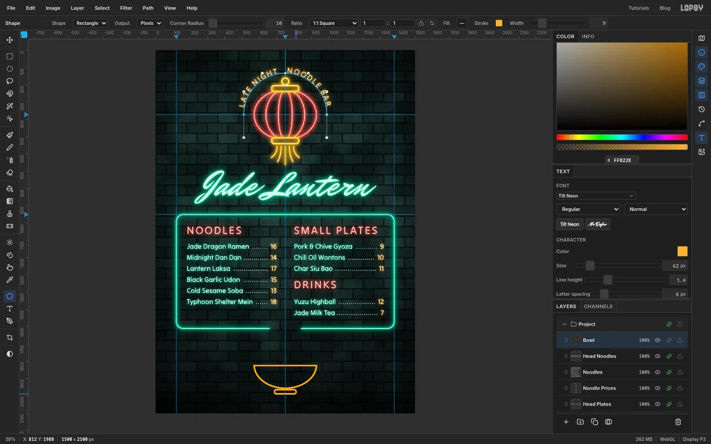

1. Set the foreground to `#FFB22E` and choose **Edit → Fill**.
2. Choose **Select → Shrink…** with the amount at `9`, click **Apply** and press [[Delete]]. What's left is a 9 px outline: fill, shrink and delete is a quick way to stroke any selection.
3. Press [[Cmd+D]].
4. With the Shape tool (**Rectangle**, **Corner Radius** `10`, stroke `#FFB22E`, **Width** `9`) drag a small flat foot under the bowl.

## Rotate a pair of chopsticks

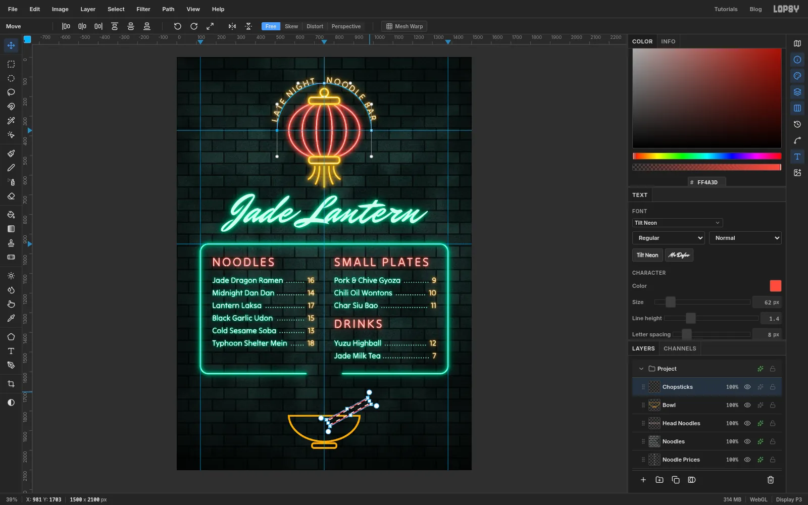

With **Bowl** selected, add a layer named **Chopsticks**. With the **Brush**
at **Size** `9`, **Spacing** `5` and the colour `#FF4A3D`, click and [[Shift]]-click two
level lines about 230 px long and 30 px apart, to the right of the centre
guide.

1. Hold [[Cmd]] and click the layer's thumbnail to select the lines.
2. Choose the **Move** tool. Handles appear around the selection.
3. Move the pointer just outside a corner until it turns into the rotate cursor, and drag anticlockwise by about 30°, until the low ends dip into the bowl.
4. Press [[Cmd+D]].

## Draw a wisp of steam with the Pen tool
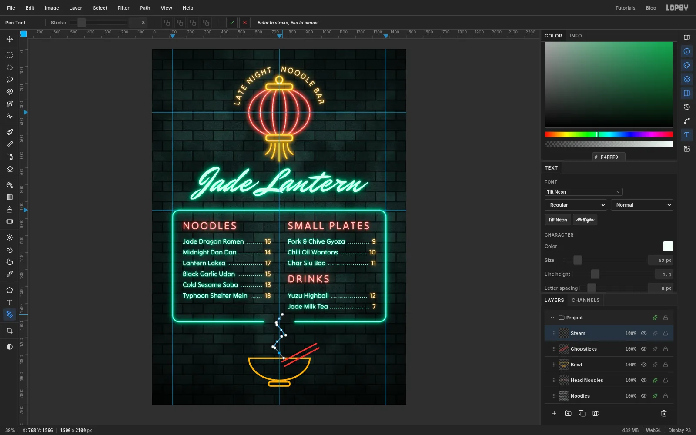

Add a layer named **Steam** above **Chopsticks**. Choose the **Pen** tool,
set **Stroke** to `8` and the foreground to `#F4FFF9`.

The wisp is four anchors spaced evenly between the bowl and the gap in the
frame. Each one is a press and a short drag, and the drags alternate so the
line snakes.

1. Press just above the bowl's rim on the centre guide and drag up and a little to the left.
2. Press a third of the way up, slightly left of the guide, and drag up and to the right.
3. Press two thirds of the way up, slightly right of the guide, and drag up and to the left.
4. Press on the guide level with the gap in the frame and drag up and a little to the right.
5. Press [[Enter]]. This time you do want the paint.

## Copy, shrink and flip the steam
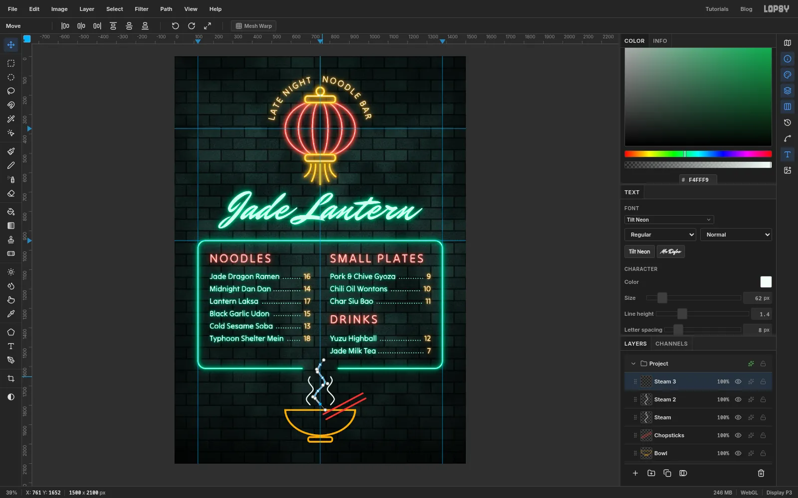

One wisp is drawn. The other two are copies.

1. Drag a marquee around the wisp and press [[Cmd+C]].
2. Press [[Cmd+V]]. The copy arrives on its own layer, already selected, with the Move tool active and handles around it.
3. Hold [[Cmd]] and drag the top-right handle down and in until the copy is about three-quarters of its size. Holding [[Cmd]] keeps its proportions, and the bottom stays put. Press [[Cmd+D]].
4. Tap the left arrow key until the copy clears the first wisp.
5. Paste again. This time click **Flip Horizontal** in the options bar first, then shrink it the same way and move it to the right by the same amount.
6. Select the top copy and choose **Layer → Merge Down** twice, so the three wisps are one layer again. Rename it **Steam**.

> **Tip:** Flip before you scale. Flipping while a handle drag is still pending puts the copy back to full size.

## Light the bowl, the chopsticks and the steam
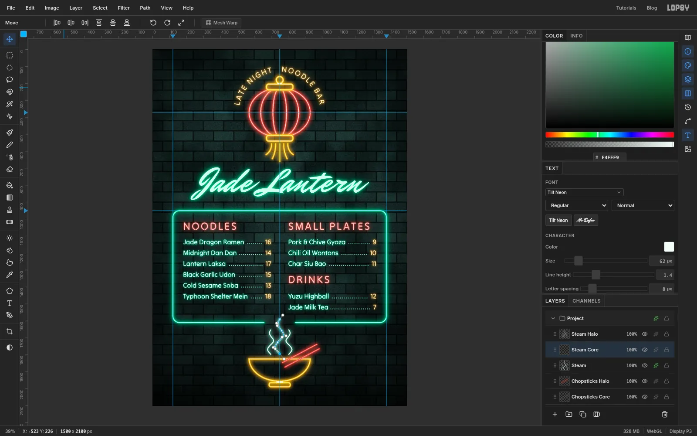

Three more rounds of the lantern's recipe. For each layer: duplicate it and
name the copy with **Halo** on the end, blur the copy by `40` and set it to
**Screen**; add an **Outer Glow** to the original with **Spread** `6` and
**Opacity** `90`; then [[Cmd]]-click its thumbnail, shrink, and fill a new
**Core** layer.

- **Bowl**: glow `#FFB22E` at **Size** `26`, shrink by `3`, core `#FFF1CF`
- **Chopsticks**: glow `#FF4A3D` at **Size** `26`, shrink by `3`, core `#FFE1DA`
- **Steam**: glow `#1DF2A4` at **Size** `20`, shrink by `2`, core `#F4FFF9`

The steam's core is the colour it was stroked in, so it changes nothing you
can see. It's there so every tube is built the same way and you can warm or
cool the steam later by refilling one layer.

Work up the stack in that order and **Steam Halo** ends up as the top layer.

## Build the OPEN sign and tilt it
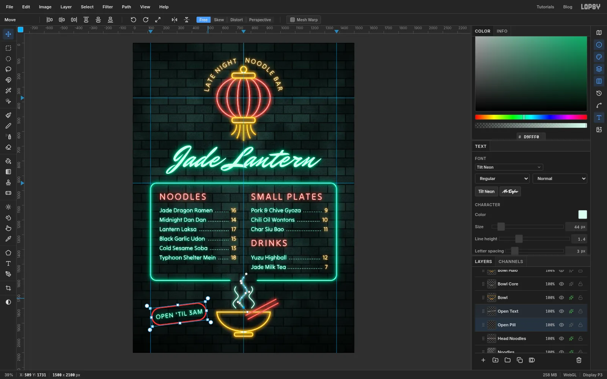

Select **Head Noodles** and add a layer named **Open Pill**. That puts the
sign just above the menu text and under the bowl's layers.

1. With the Shape tool (**Rectangle**, **Corner Radius** `58`, stroke `#FF4A3D`, **Width** `8`) drag a pill about 370 px wide and 115 px tall, left of the bowl.
2. With **Open Pill** still selected, choose the Text tool: **Size** `44`, **Align** **Center**, colour `#D9FFF0`, **Letter spacing** `3`. Click in the middle of the pill, type `OPEN 'TIL 3AM` and press [[Tab]]. Rename the layer **Open Text** and light it in `#1DF2A4` with glow `10` / `36`.
3. With the Move tool and the arrow keys, seat the text in the middle of the pill: the same space left and right, and the same above the capitals as below them.
4. Click **Open Pill**, then [[Cmd]]-click **Open Text** so both are selected. With no marquee, the Move tool frames them together.
5. Drag just outside a corner to rotate the pair about 7° anticlockwise.

Now light the pill: an **Open Pill Halo** copy blurred by `34` on **Screen**,
an **Outer Glow** in `#FF4A3D` (**Size** `22`, **Spread** `6`, **Opacity**
`90`), and an **Open Pill Core** layer filled with `#FFE1DA` after shrinking
the selection by `2`. Doing this after the rotation means the glow is made
from the tilted pixels.

## Add the address and the add-ons
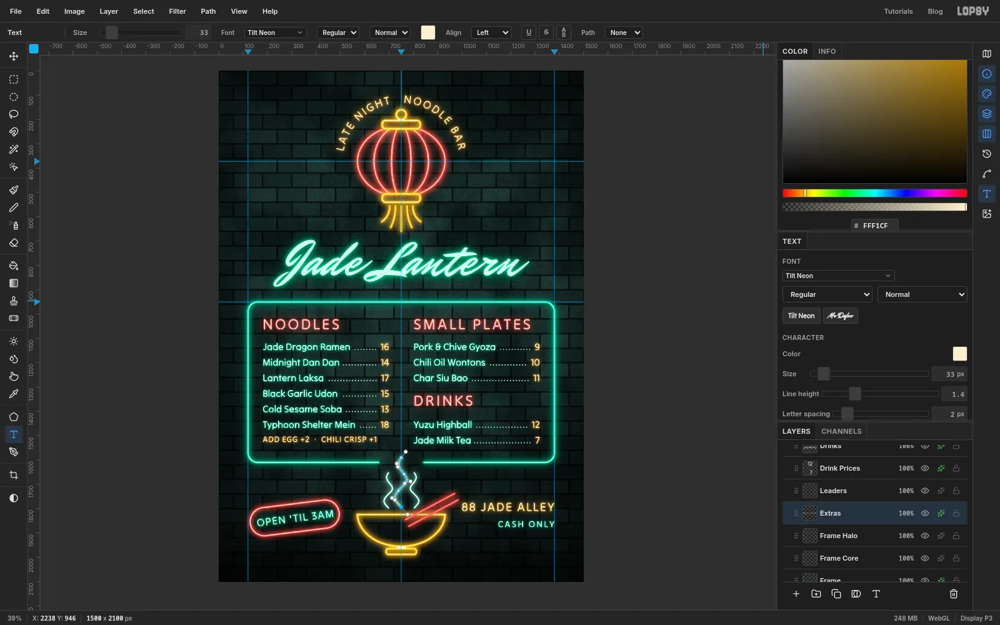

Three short lines finish the type.

1. Select **Steam Halo**, the top layer. In the Text tool set **Align** **Right**, **Size** `50`, **Letter spacing** `5` and the colour `#FFF1CF`. Click on the right margin guide, level with the top of the bowl, and type `88 JADE ALLEY`. Name the layer **Address** and light it in `#FFB22E` with glow `12` / `40`.
2. Select **Steam Halo** again. At **Size** `36` with **Letter spacing** `6` and the colour `#F4FFF9`, click on the same guide a line lower and type `CASH ONLY`. Name it **Small Print** and light it in `#1DF2A4` with glow `8` / `26`.
3. Select **Frame Halo**. Set **Align** **Left**, **Size** `33`, **Letter spacing** `2` and the colour `#FFF1CF`. Click under the last noodle dish, level with Jade Milk Tea, and type `ADD EGG +2  ·  CHILI CRISP +1`. Name it **Extras** and light it in `#FFB22E` with glow `7` / `24`.

Both columns now end on the same row.

## Dab light onto the wall

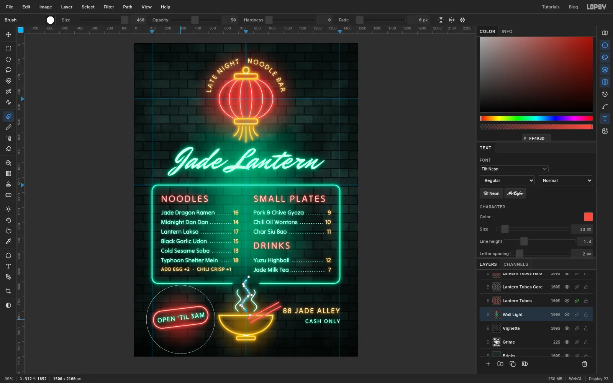

The tubes glow, but the bricks behind them are still unlit. Select
**Vignette** and add a layer named **Wall Light**, so it sits under the sign.

Choose the **Brush**, open the presets window and set **Hardness** to `0` and
**Opacity** to `50`. Then click once or twice with a big brush behind each
part of the sign, in its own colour:

1. **Size** `760`, `#FF4A3D`: two clicks on the middle of the lantern.
2. **Size** `1000`, `#1DF2A4`: one click on the title and one on the middle of the menu.
3. **Size** `520`, `#FFB22E`: one click on the bowl.
4. **Size** `460`, `#FF4A3D`: one click on the OPEN sign.

It looks like fog at this point. That's fine.

## Blend the light into the bricks

Open the layer's effects, set the blend mode to **Color Dodge** and lower the
opacity to **85%**.

Color Dodge brightens what's underneath in proportion to how bright it
already is. The brick faces pick up the colour and the dark mortar stays
dark, which is what light raking across a real wall does.

## Group the layers
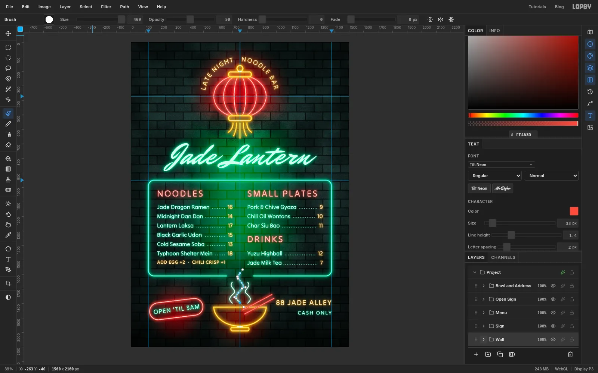

There are more than forty layers now. Tidy them into five groups. For each
one, click the first layer, [[Shift]]-click the last, choose
**Layer → Group Layers** and rename the group. Working from the bottom of
the panel up:

- **Wall**: from Bricks up to Wall Light
- **Sign**: from Lantern Tubes up to Title
- **Menu**: from Frame up to Head Noodles
- **Open Sign**: from Open Pill up to Open Text
- **Bowl and Address**: from Bowl up to Address

Click the arrow beside each group's name to collapse it. If a layer has
ended up in the wrong place, drag it into its group by the grip at the left
of its row.

## Knock the wall back with a group adjustment

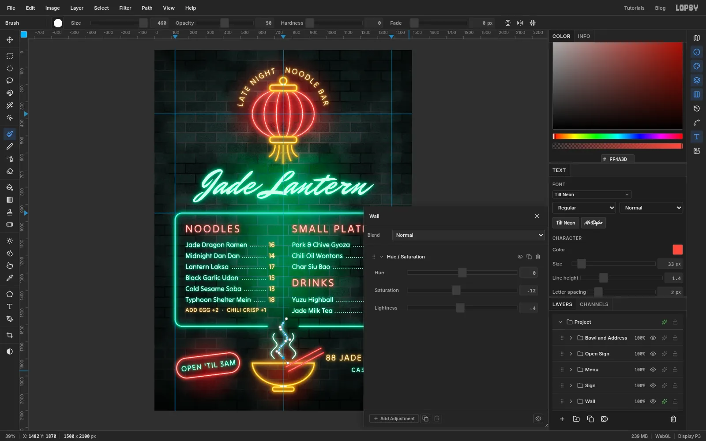

The wall is a little too colourful for a backdrop. Rather than repaint it,
adjust the whole group.

1. Click the effects button on the **Wall** group's row.
2. Click **Add Adjustment** and choose **Hue / Saturation**.
3. Set **Saturation** to `-12` and **Lightness** to `-4`, then close the drawer.

The adjustment sits on the group, so the layers inside are untouched and you
can change your mind later.

## Nudge the OPEN sign as a group

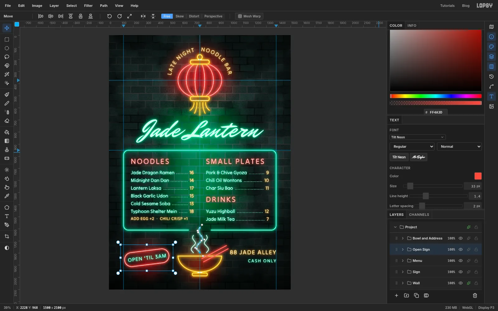

Click the **Open Sign** group's row and choose the **Move** tool. One box frames
everything in the group. Drag it down a few pixels until the sign sits level
with the middle of the bowl. The pill, its core, its halo and the live text
all move together.

## Hide the guides and export

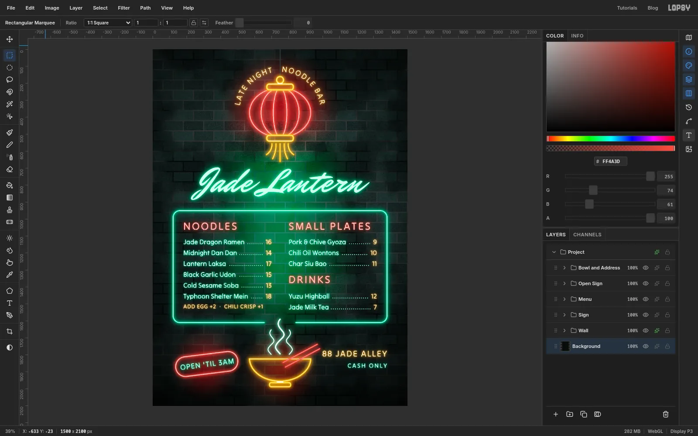

Choose **View → Show Guides** to hide the guides and look at the wall as a
whole. Squint: the name should be the brightest thing, then the lantern, then
the frame. If a path outline is still showing over the steam, click its row
in the **Paths** panel to deselect it. Paths never appear in an export either
way.

Choose **File → Quick Export PNG** for the menu, and **File → Save Project**
to keep the layers.
