Noir covers work in three colours: **black**, a pale **bone white** and **one
red**. The palette below is longer than that, but every entry is a shade of one of the three. The red goes on the one thing you want the reader to look at. Everything
else is shape and shadow. The classic move is to put a dark figure in front of
a big light shape, so the figure reads as a silhouette even at thumbnail size.

In this tutorial you'll make the cover for **Rooftop Tango**, an imaginary
crime novel by an imaginary author, Vera Thorne. A couple dance on the edge of
a roof in front of a full moon, with a water tower on one side, a TV antenna on
the other and the city far below. Her dress is the only red in the picture,
and the title picks the red up again.

The dancers aren't drawn. You'll cut them out of a 1914 photo of Irene and
Vernon Castle demonstrating the tango, which is in the public domain. Download
it from Wikimedia Commons before you start:
[TangoOfTo-Day.jpg](https://commons.wikimedia.org/wiki/File:TangoOfTo-Day.jpg)
(use the original file, 1125 × 1764 px).

The finished cover is **1200 × 1800 px** (a 2:3 book cover) and has:

- a **moon** with soft cloudy shading and a glow, crossed by **cloud wisps** you draw once and then copy, paste and resize
- a **skyline** with lit windows made from noise, Pixelate and Threshold
- a **water tower**, antenna and chimney drawn with the Lasso, Brush and Pencil
- two **dancers** cut from the photo with the Magic Wand and Lasso, with the woman's dress in red
- a dark **stone wall** under the ledge made with the Texture filter
- a **title** set in Oswald and Playfair Display, and a finish of **grain** and a **vignette**

The tools you'll use:

- **rulers and guides**, including [[Cmd]]-clicking a ruler to drop a guide at the centre
- the **Gradient**, **Brush**, **Pencil**, **Eraser** and **Text** tools, and **Edit → Fill**
- the **Elliptical** and **Rectangular Marquee**, the **Lasso** and the **Magic Wand**, with [[Shift]] to add, [[Shift+Alt]] to intersect and **Select → Inverse**
- **Select → Feather**, and [[Cmd]]-clicking a layer thumbnail to load its shape as a selection
- **Filter → Clouds, Gaussian Blur, Motion Blur, Add Noise, Pixelate, Threshold** and **Texture**
- **Copy**, **Paste**, **Merge Down**, **Duplicate Layer** and **Group Layers**
- the **Move** tool's handles to scale and move a group, and arrow-key nudges
- the **Inner Glow**, **Outer Glow**, **Color Overlay** and **Drop Shadow** effects, the **Multiply**, **Screen** and **Overlay** blend modes, and a **Vignette** adjustment
- the **Text** panel for weight, style and letter spacing

The palette:

- Sky `#55545C` → `#26272E` → `#101116` → `#060709`
- Moon `#E9E1CF`, shading `#6E675C`, glow `#D9D2C2`
- Clouds and roof ink `#0C0D11`, `#060608`
- Skyline `#17191F`, parapet `#111216`
- Roof `#24252B` → `#0E0F12` → `#050506`
- Rim light `#BDB6A6`, ledge highlight `#9C968A`
- Dress and title red `#C41E26`
- Bone type `#E9E1CF`, quote `#CFC8B8`, tagline `#D9D2C2`

> **Tip:** Key names are Mac keys. On Windows and Linux, use Ctrl for Cmd. Positions are written as `x, y` in document pixels from the top-left corner; the status bar at the bottom left shows where the pointer is. The most important line is the **top of the roof ledge** at `y 1150`.

## Set up the document and guides

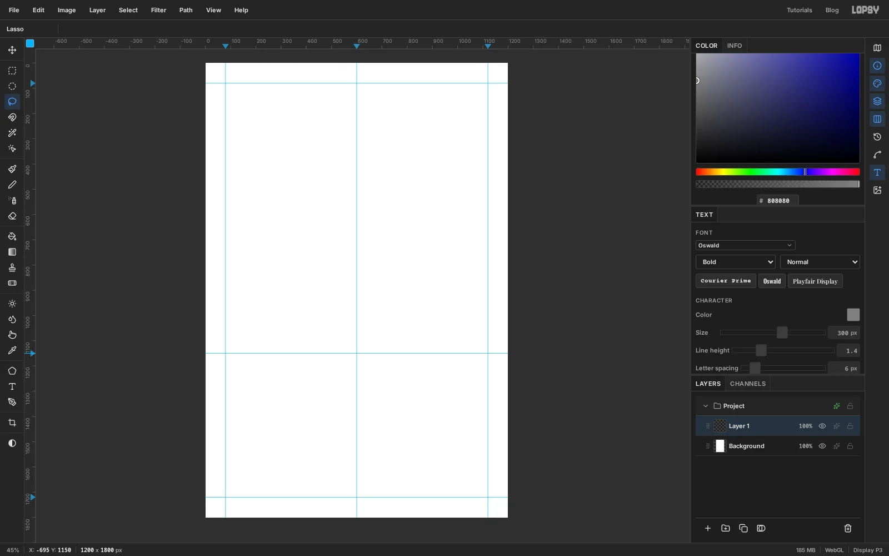

1. Open [Lopsy](/). In the **New Document** dialog, set **Width** to `1200` and **Height** to `1800`, choose a **White** background and click **Create**.
2. Hold [[Cmd]] and click the ruler along the top. The guide snaps to the nearest simple fraction, so clicking near the middle drops a guide exactly at the centre, `x 600`.
3. Without [[Cmd]], click the top ruler at `80` and at `1120` for the side margins, and click the left ruler at `80` and `1720` for the top and bottom margins.
4. Click the left ruler once more at `1150`. This is where the top of the roof ledge will sit.

The margins keep the type off the trim edge, and the ledge guide gives the scene a fixed floor so the dancers and the rooftop clutter all stand on the same line.

## Paint the night sky

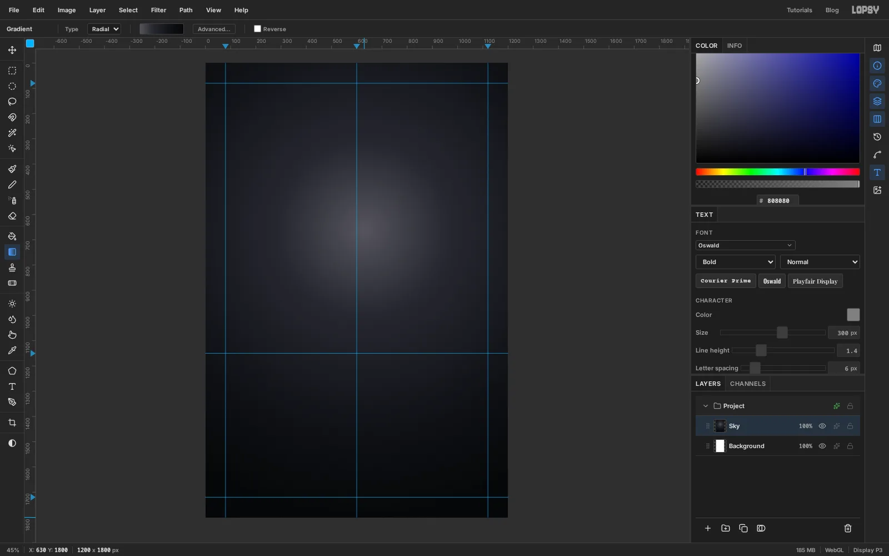

1. Double-click **Layer 1** in the Layers panel and rename it `Sky`.
2. Pick the **Gradient** tool, set the type to **Radial** in the options bar and click the gradient swatch to open the Gradient Editor. Set four stops: `#55545C` at 0%, `#26272E` at 30%, `#101116` at 70% and `#060709` at 100%.
3. Drag from `630, 660` (where the moon will be) straight down to the bottom edge.

A radial gradient centred on the moon makes the sky brighten around it, as if the moonlight is lighting the air.

## Draw the moon

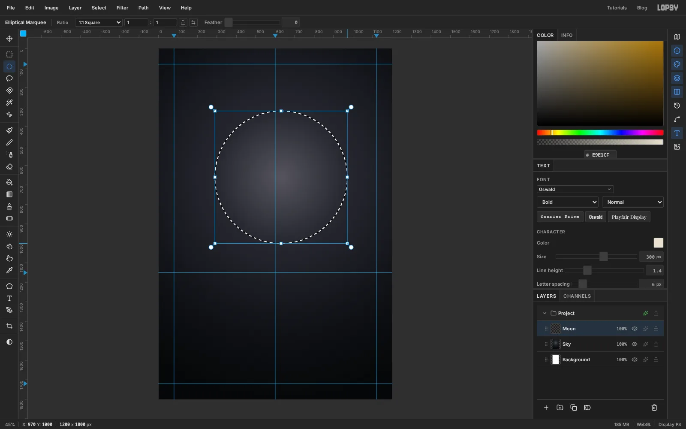

1. Click **Add Layer** in the Layers panel and name the new layer `Moon`.
2. Pick the **Elliptical Marquee** and hold [[Cmd]] while you drag to draw a perfect circle. Make it 680 px across, from `290, 320` to `970, 1000`.
3. Set the foreground colour to `#E9E1CF` and choose **Edit → Fill**.

Keep the selection: you'll use it in the next step.

## Shade the moon and give it a glow

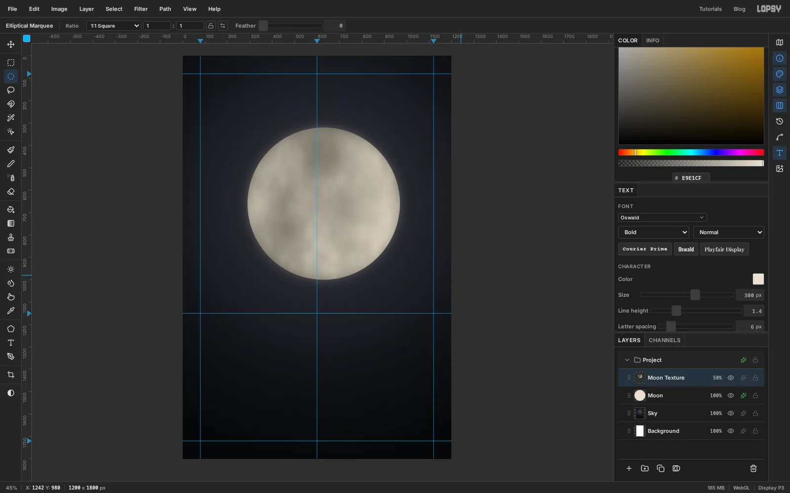

1. Add a layer named `Moon Texture` above `Moon`. With the circle still selected, choose **Filter → Clouds...**, set **Scale** to `2` and click **Apply**. Press [[Cmd+D]] to deselect.
2. Open the effects drawer for `Moon Texture` and set the blend mode to **Multiply**. Set the layer's opacity to `50%`. Multiply lets only the darker parts of the clouds through, so they read as shading on the moon's face.
3. Open the effects for `Moon`. Turn on **Inner Glow** with **Size** `90`, **Opacity** `55` and the colour `#6E675C`. This darkens the rim and makes the disc feel round.
4. Turn on **Outer Glow** with **Size** `160`, **Opacity** `30` and the colour `#D9D2C2` for the halo.

> **Tip:** A small **Scale** in the Clouds filter gives fine mottling. Large values give big blotches that look like a smudge rather than a moon.

## Draw a cloud wisp

1. Add a layer named `Clouds`.
2. Pick the **Lasso** and drag out a long, thin, tapered sliver across the lower left of the moon, about 520 px long and 20 px thick at its widest. Thin at both ends, a little fatter in the middle, slightly tilted.
3. Set the foreground colour to `#0C0D11`, choose **Edit → Fill** and deselect.
4. Choose **Filter → Gaussian Blur...** with **Radius** `5`, then **Filter → Motion Blur...** with **Angle** `0` and **Distance** `70`.

The horizontal motion blur stretches the soft edges sideways, which is what thin clouds look like when they drift across the moon.

## Copy, paste and resize the wisp

1. Draw a **Rectangular Marquee** around the wisp and press [[Cmd+C]], then [[Cmd+V]]. The copy is pasted as a new layer exactly on top of the original, with the Move tool and its handles already active.
2. Drag the copy down and to the right so it crosses the lower right part of the moon.
3. Drag the right-hand middle handle inwards to make this copy about a fifth shorter. Press [[Cmd+D]] to commit.

Clouds that are all the same length look stamped. Changing the length of each copy is quick and makes them look natural.

## Add a third wisp and merge them

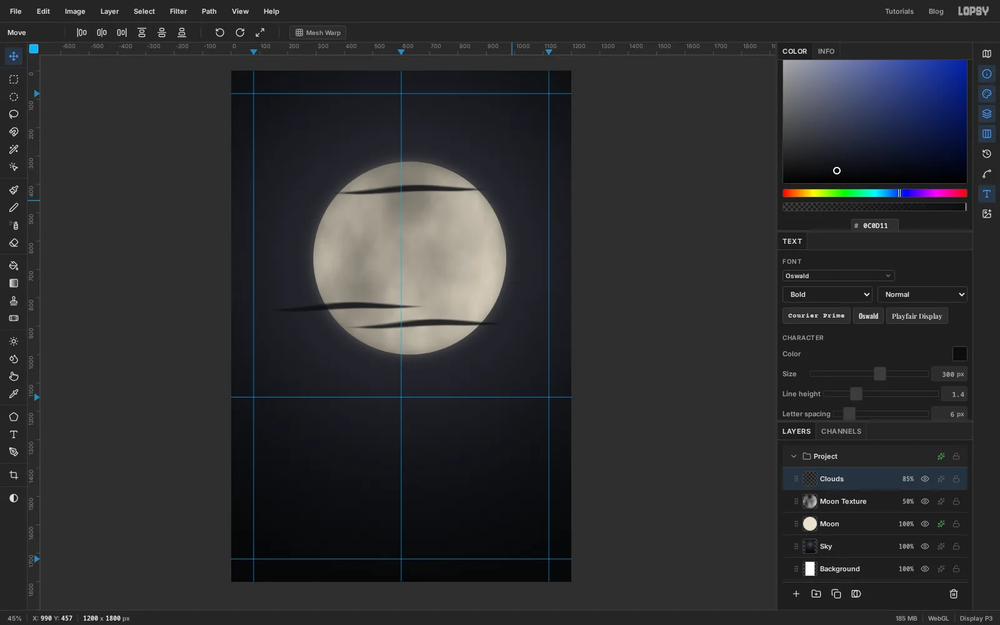

1. Press [[Cmd+V]] again to paste a third copy. Drag it up to the upper right of the moon, letting it run off the moon's right edge. Keep the area above the moon's centre fairly clear: the dancers' heads will go there.
2. Hold [[Cmd]] and drag the bottom-right corner handle inwards to shrink it evenly, to about two-thirds of its size. Press [[Cmd+D]].
3. Press [[Cmd+E]] twice to merge the two pasted layers down into `Clouds`. Rename the result `Clouds` if needed, and set its opacity to `85%`.

> **Tip:** If you drop a copy in the wrong place, press [[Cmd+Z]] a few times to step back through the moves and the paste, then try again.

## Draw the skyline

1. Add a layer named `Skyline`.
2. With the **Lasso**, drag out a city skyline: start below the ledge guide on the left, run along a row of flat rooftops of different heights between about `y 950` and `y 1060`, and come back down below the ledge guide on the right. Make one tall, stepped tower on the right with a thin spire on top, rising to about `y 720`.
3. Set the foreground colour to `#17191F`, choose **Edit → Fill** and deselect.

> **Tip:** The Lasso is freehand: it follows your drag and joins the end back to the start with a straight line when you let go. Go slowly at the corners, and finish below the ledge guide so the closing line is hidden behind the roof later.

Keep the buildings low and flat. They are far away, and the moon should stay the biggest shape in the picture.

## Make the lit windows

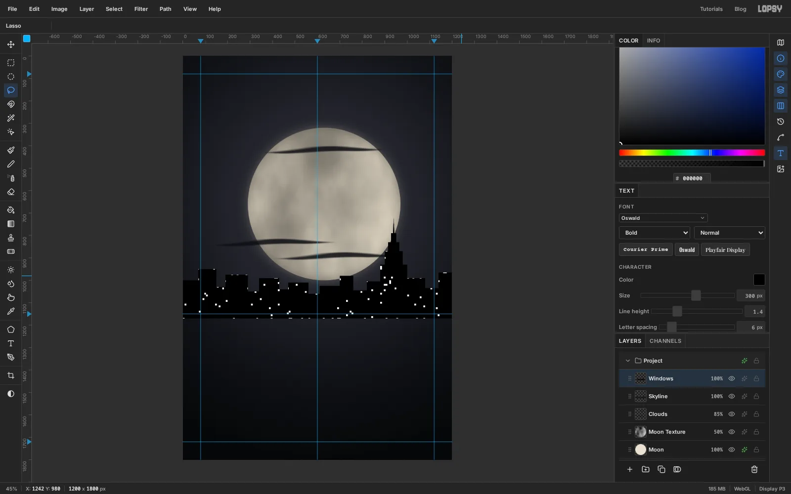

1. Add a layer named `Windows`.
2. Hold [[Cmd]] and click the `Skyline` layer's thumbnail. This loads the skyline's shape as a selection. Click the `Windows` layer again to make it active.
3. Set the foreground colour to black and choose **Edit → Fill**. Then choose **Filter → Add Noise...**, pick **Mono** and **Uniform**, set **Amount** to `100` and click **Apply**.
4. Choose **Filter → Pixelate...** with **Block Size** `8`. The noise turns into little grey squares, like windows.
5. Choose **Filter → Threshold...** with **Level** `17`. Only the brightest squares stay white; the rest go black. Press [[Cmd+D]].

The Threshold level decides how many windows are lit. Try a few values with Preview on: you want a sparse scatter, not a checkerboard.

## Clear out the black and tint the windows

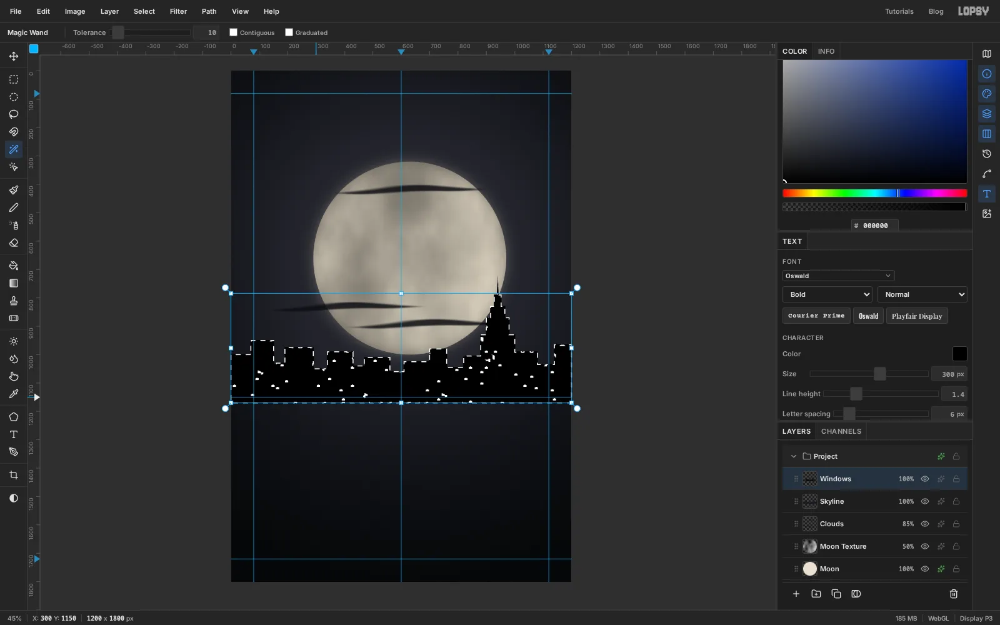

1. Pick the **Magic Wand**. In the options bar, untick **Contiguous** and set **Tolerance** to `10`.
2. Click any black area on the `Windows` layer. Because Contiguous is off, every black pixel on the layer is selected at once. Press [[Delete]] and deselect.
3. Open the effects for `Windows`, turn on **Color Overlay** and set its colour to `#E9E1CF`, the same bone as the moon. Set the layer's opacity to `55%`.

Using the moon's colour for the windows keeps the palette to black, bone and red.

## Add haze over the city

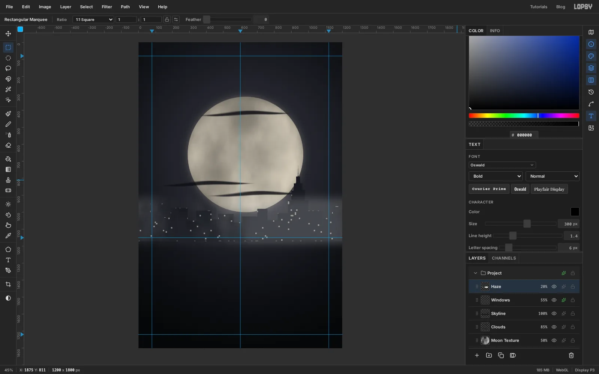

1. Add a layer named `Haze`.
2. Draw a **Rectangular Marquee** right across the canvas from `y 900` to `y 1200`. Choose **Select → Feather...** and set it to `60`.
3. Choose **Filter → Clouds...** with **Scale** `3`, then deselect.
4. Set `Haze` to the **Screen** blend mode and `15%` opacity.

Screen only ever lightens, so the clouds become a faint mist that sits between the far buildings and the roof.

## Draw the water tower tank

1. Add a layer named `Water Tower`.
2. With the **Lasso**, drag out the tank: a cone-shaped roof with a small stub on top, a barrel that bulges very slightly at the sides, and a gently curved bottom. Make it about 250 px wide, with the roof tip at `y 520` and the bottom of the barrel at about `y 870`. Let its left side run about 30 px off the left edge of the canvas, and keep its right side well clear of the moon.
3. Set the foreground colour to `#060608` and choose **Edit → Fill**.

> **Tip:** Either clear an edge by a good margin or run off it decisively. Shapes that nearly touch the edge of the cover, or nearly touch each other, look like mistakes.

## Add the legs and bracing

1. Pick the **Brush**, set **Size** to `11` and **Hardness** to `100`, with the foreground colour `#060608`.
2. For each of the four legs, click under the tank and then [[Shift]]-click on the ledge guide at `y 1150` to draw a straight line. Splay the outer legs outwards a little.
3. Set **Size** to `5`. In each of the three gaps between the legs, draw two Xs, one above the other, with [[Shift]]-clicks. Then draw two horizontal rails across all four legs, one a third of the way down and one two-thirds of the way down.
4. Set **Size** to `3` and draw a thin ladder rail up the right side of the tank.

## Add hoops and a rim light

1. Pick the **Pencil** at **Size** `3` with the colour `#22232A`, and [[Shift]]-click four horizontal lines across the barrel for the metal hoops.
2. Choose **Layer → Duplicate Layer** and rename the copy `Tower Rim`. Give it a **Color Overlay** in `#BDB6A6`.
3. Drag `Tower Rim` below `Water Tower` in the Layers panel.
4. With the **Move** tool, press the right arrow 4 times and the up arrow 2 times to nudge it. Set its opacity to `45%`.

Only a thin sliver of the pale copy shows past the black tower, on the side facing the moon. It's a cheap rim light, and it stops the black shape from looking flat.

## Group the water tower

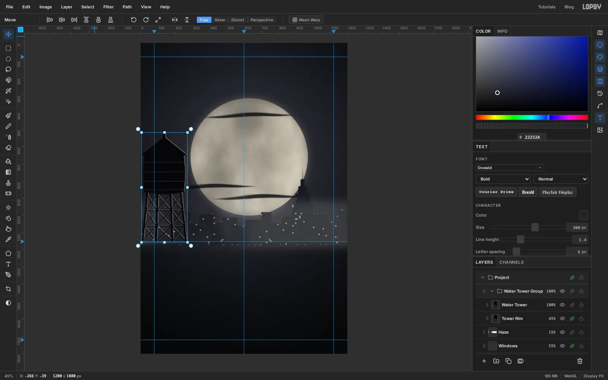

1. Click `Water Tower`, then [[Shift]]-click `Tower Rim` to select both.
2. Choose **Layer → Group Layers** and name the group `Water Tower Group`.

Now the tower moves as one piece. Try it: with the group selected, drag the tower with the Move tool, press [[Cmd+Z]] to undo and [[Cmd+Shift+Z]] to redo. The tower and its rim should jump back and forth together, exactly.

## Build the roof and parapet

1. Collapse `Water Tower Group`, click its row and add a layer named `Roof`. It goes above the group, not inside it. (A new layer goes into a group when a layer inside the group is active.)
2. Draw a **Rectangular Marquee** from `y 1200`, where the parapet will end, down to the bottom of the canvas, as wide as the canvas.
3. With the **Gradient** tool set to **Linear**, set the stops to `#24252B` at 0%, `#0E0F12` at 35% and `#050506` at 100%, and drag from the top of the selection to the bottom. Deselect.
4. Add a layer named `Parapet`. Marquee a 50 px tall strip from the ledge guide at `y 1150` down to `y 1200`, across the whole canvas. Set the foreground colour to `#111216` and choose **Edit → Fill**. Keep the strip selected for the next two steps.
5. Pick the **Pencil** at **Size** `3` with `#9C968A`. Click at the left end of the ledge guide, then [[Shift]]-click at the right end to draw the highlight along the top of the ledge.
6. At **Size** `2` with `#2C2D33`, draw a second line 10 px lower. Then run **Filter → Add Noise...** at **Amount** `12`, **Mono** and **Gaussian** to rough up the concrete, and press [[Cmd+D]].

A pencil line drawn with [[Shift]]-click is perfectly straight and crisp, which is exactly what a lit stone edge looks like.

## Paste in the dancers photo

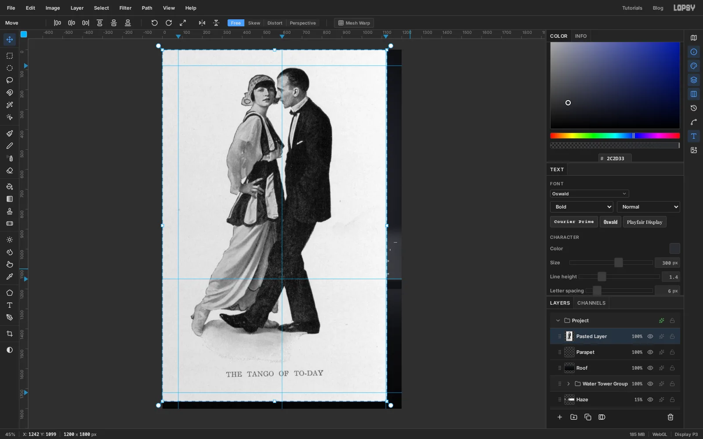

1. Open the downloaded photo in your image viewer and copy it, then click the `Parapet` layer in Lopsy and press [[Cmd+V]].
2. The photo is smaller than the canvas, so it comes in at full size at the top left, as a new layer. Press [[Cmd+D]] and rename the layer `Tango Photo`.
3. Choose **Filter → Gaussian Blur...** with **Radius** `1.5`.

The photo is an old halftone print. A tiny blur smooths out the dots, so the Magic Wand in the next step makes clean edges instead of speckled ones.

## Select the paper around the dancers

1. Pick the **Magic Wand**. Tick **Contiguous** and set **Tolerance** to `28`.
2. Click the plain paper in the top left. Then hold [[Shift]] and click more patches of paper to add them: the right side, the gap between their legs, the area behind the man's back and the bottom of the page.
3. With the **Rectangular Marquee**, [[Shift]]-drag a box over the caption and the lower part of the floor shadow at the bottom of the photo to add those to the selection too.

## Turn the selection around and tidy it

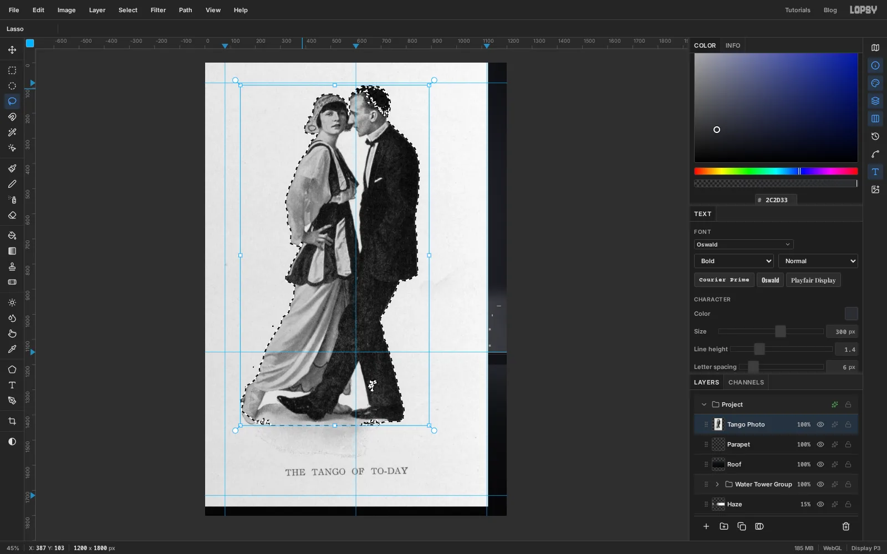

1. Choose **Select → Inverse** (or press [[Cmd+Shift+I]]). Now the dancers are selected, along with any specks of paper the wand missed.
2. Pick the **Lasso**, hold [[Shift+Alt]] and draw a loose outline around the couple, well outside their edges. Holding [[Shift+Alt]] keeps only what's inside both selections, so stray specks outside the couple disappear.

## Fill the silhouette

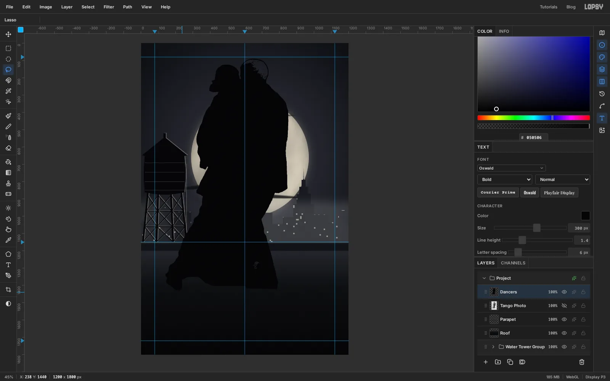

1. Add a layer named `Dancers`, set the foreground colour to `#050506` and choose **Edit → Fill**. Deselect.
2. Click the eye on `Tango Photo` to hide it. You'll use it again as a reference, so don't delete it.
3. The bit of floor shadow right under the soles is still attached to the shoes. With the **Lasso**, draw around the black slab under the feet, following the soles and keeping the shoes, and press [[Delete]].

## Fill the gaps in his head

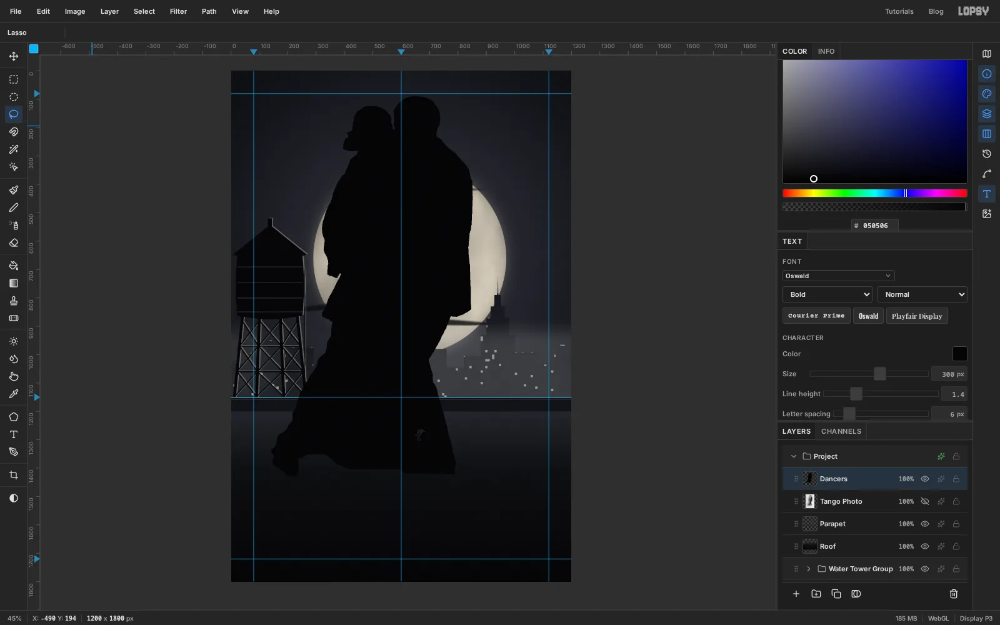

The shine on the man's slicked-back hair was as light as the paper, so the wand took bites out of his head.

1. On the `Dancers` layer, drag the **Lasso** around the outline of his head, just inside the edge you can see.
2. Choose **Edit → Fill** (the foreground is still `#050506`) and deselect. Check the rest of the silhouette for small holes in the same way.

## Fill her figure in red

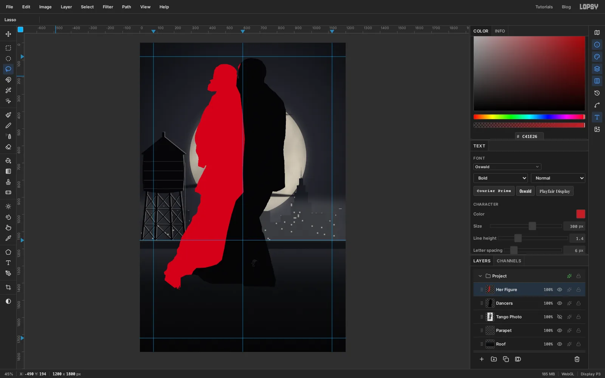

1. Click the eye on `Tango Photo` to show it again, and set the `Dancers` layer's opacity to about `40%`, so you can see where she ends and he begins.
2. Hold [[Cmd]] and click the `Dancers` thumbnail to load the whole silhouette as a selection.
3. Pick the **Lasso**, hold [[Shift+Alt]] and draw around the woman only: follow the line where her body meets his, then go wide around her outside edge. The intersection is her exact outline.
4. Add a layer named `Her Figure`, set the foreground colour to `#C41E26` and choose **Edit → Fill**. Deselect.
5. Set `Dancers` back to `100%` and hide `Tango Photo` again.

Starting from the silhouette and intersecting means the red follows her real edge exactly, instead of a hand-drawn line that wobbles off it.

## Scale the couple down

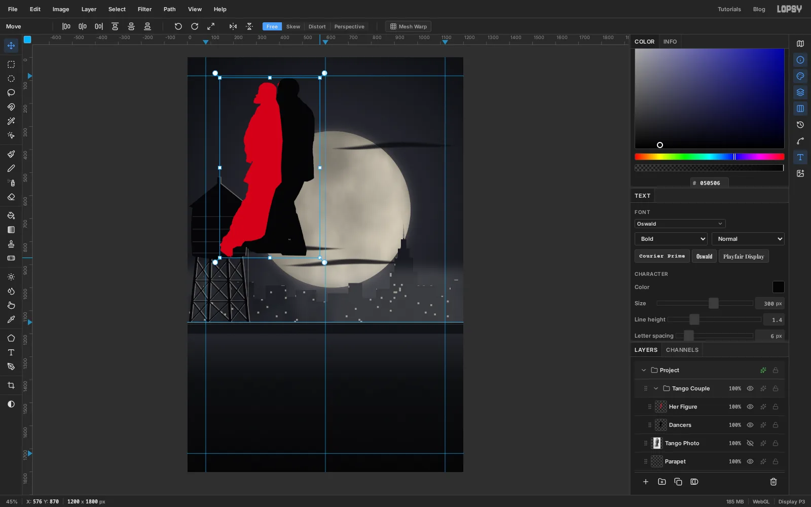

1. Click `Her Figure`, [[Shift]]-click `Dancers` and choose **Layer → Group Layers**. Name the group `Tango Couple`.
2. With the group selected, press [[Cmd+D]] and pick the **Move** tool. Handles appear around both layers together.
3. Hold [[Cmd]] and drag the bottom-right corner handle up and to the left until the couple is a little over half their size, about 780 px tall.

Holding [[Cmd]] keeps the proportions, so the dancers don't get stretched.

## Stand them on the ledge

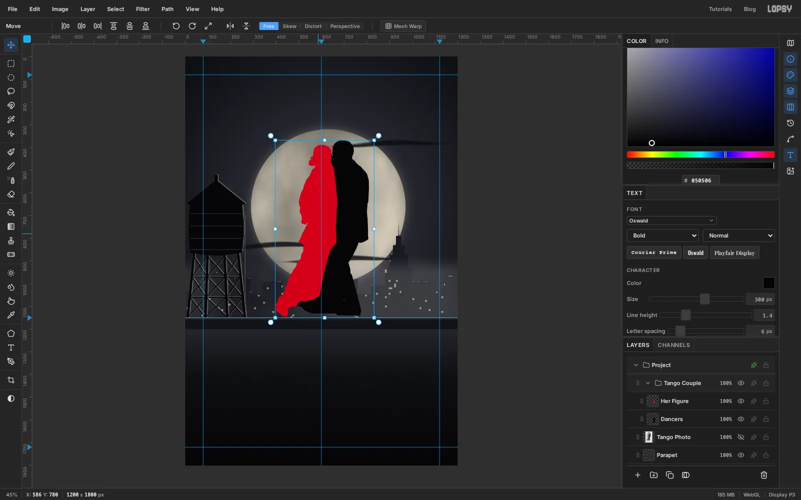

1. Drag inside the handles to move the couple so their feet rest on the ledge line at `y 1150` and their heads sit against the top third of the moon.
2. Press [[Cmd+D]] to commit.

Put the heads where the moon is brightest. Two dark profiles against a pale disc is the strongest shape on the cover.

## Add an antenna and chimney

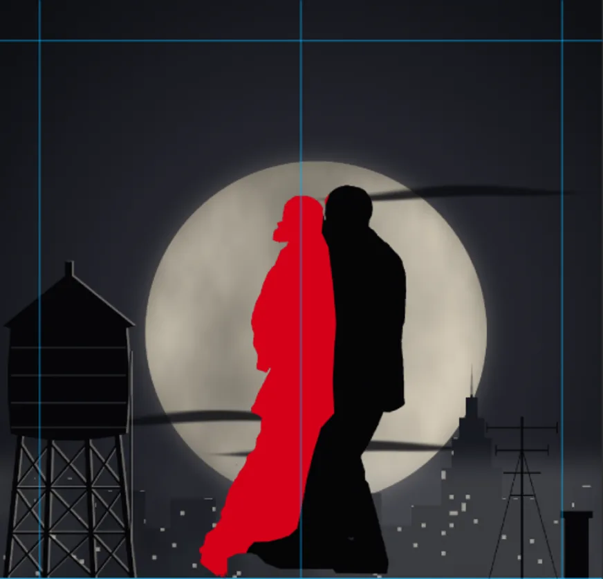

1. Click `Parapet` and add a layer named `Antenna`.
2. With the **Brush** at **Size** `6` and `#060608`, click on the ledge at `x 1040` and [[Shift]]-click at `y 830` for the mast.
3. At **Size** `4`, add four crossbars that get shorter towards the bottom. At **Size** `2`, run two guy wires from the mast down to the ledge on either side.
4. With the **Lasso**, drag out a short chimney with a lip at the top near the right edge, and fill it with `#060608` using **Edit → Fill**.

The antenna balances the water tower on the other side, and both say "rooftop" without any words.

## Check the heads against the clouds

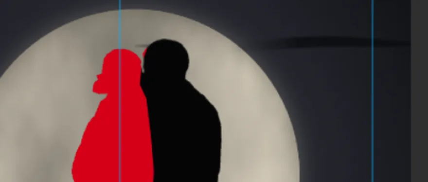

Now that the couple is in place, look at where the wisps cross them. A cloud running through a head breaks up the silhouette, so move it.

1. Click `Clouds`. Draw a marquee around the part of the top wisp that crosses the man's head and drag it up and to the right with the **Move** tool until it clears his head. Deselect.
2. Moving only part of the wisp leaves a hard cut end on the piece you moved. Pick the **Eraser**, set **Size** to `70` and **Opacity** to `60%`, and brush over that cut end. Lower the opacity to `40%` and then `25%` and brush a little further along each time, so the wisp fades in softly.

## Make only the dress red

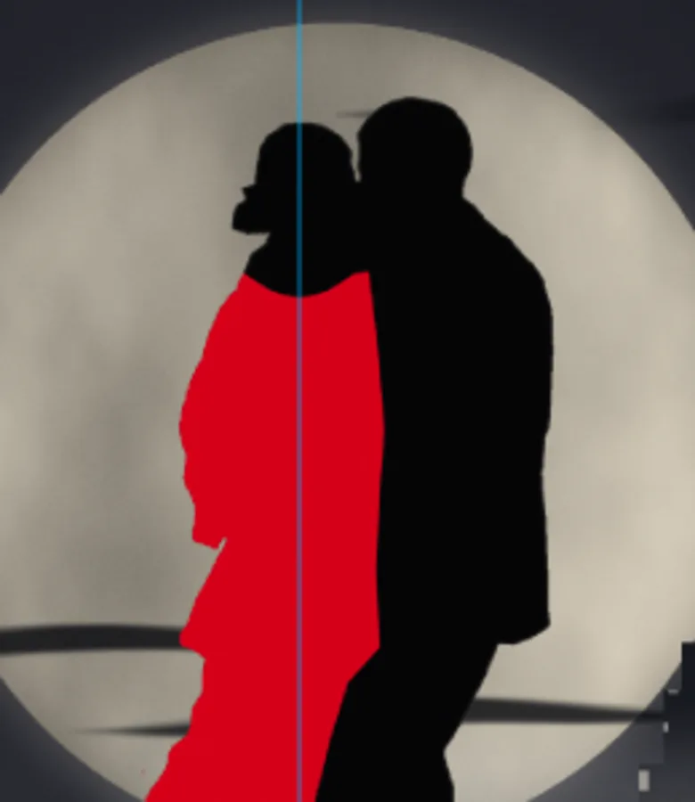

Zoom out and look at the couple as a whole. A red woman next to a black man reads like a red ghost; in noir the people are black shapes and the red is a piece of clothing. So keep the red for the dress.

1. Click `Her Figure`. With the **Lasso**, drag around her head and neck, ending just above her shoulders, and press [[Delete]]. The black silhouette underneath shows through.
2. Drag a shallow curve across the top of the red with the **Lasso** and delete above it, to make a scooped neckline instead of a straight cut.

## Give them shoes

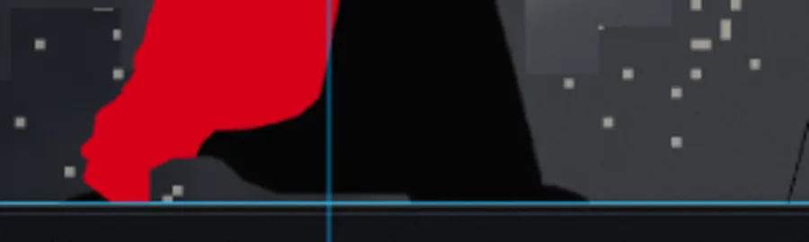

1. Click `Dancers`. With the **Lasso**, drag out a small pointed pump peeking out from under her hem, sitting on the ledge.
2. Hold [[Shift]] and drag a rounded toe in front of his front foot to add it to the selection. Set the foreground colour to `#050506` and choose **Edit → Fill**. Deselect.
3. Open the effects for `Dancers` and add an **Inner Glow** with **Size** `5`, **Opacity** `45` and `#BDB6A6`. This puts a thin moonlit edge around his figure and her head.

Feet that touch the ledge make the couple stand on the roof instead of floating in front of it.

## Turn the roof wall into stone

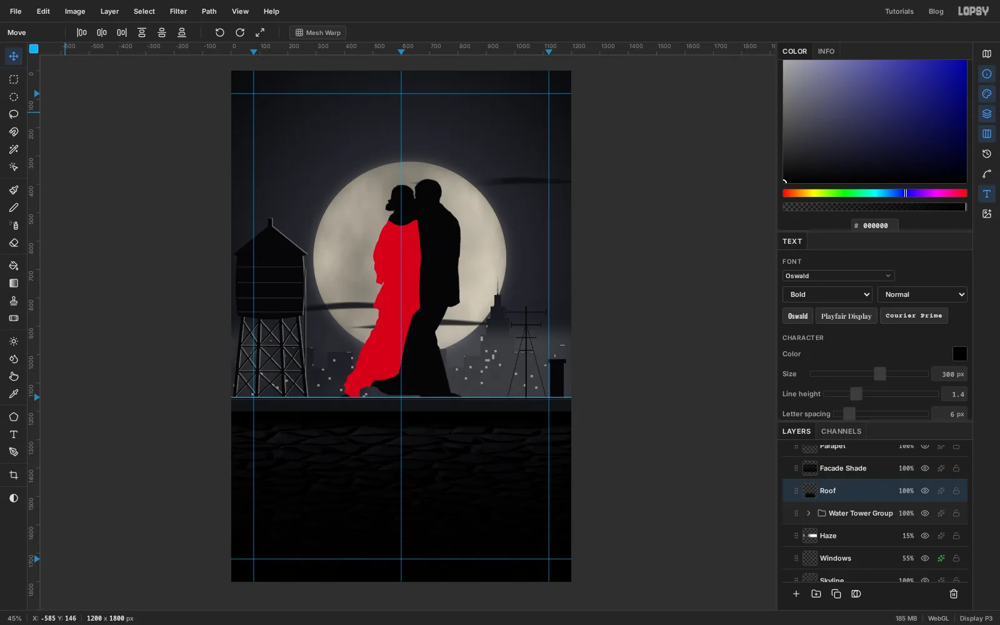

1. Click `Roof` and marquee the wall below the parapet, from `y 1200` to the bottom.
2. Choose **Filter → Texture...** and set **Type** to **Cells**, **Mode** to **Relief** and **Color** to **Mono**. Set **Amount** `22`, **Size** `30`, **Detail** `15`, **Stretch** `5`, **Angle** `0`, **Contrast** `10` and **Seed** `7`. Turn on **Preview** to check it, then click **Apply**.
3. Add a layer named `Facade Shade` above `Roof`. Marquee the same area again. In the Gradient Editor, set both stops to black, then click each stop and set its opacity in the colour picker: `45%` for the left stop and `90%` for the right. Drag the **Linear** gradient from the top of the selection to about `y 1700`.
4. Marquee a strip from `y 1185` to `y 1255` and choose **Select → Feather...** with `25`. Set the foreground colour to black, choose **Edit → Fill**, and deselect. This gives a soft shadow under the ledge.

**Stretch** pulls the cells sideways into long, low stones, so it reads as a wall rather than cobbles seen from above. The dark gradient pushes the texture back, so the title in front of it stays easy to read.

## Check the edges

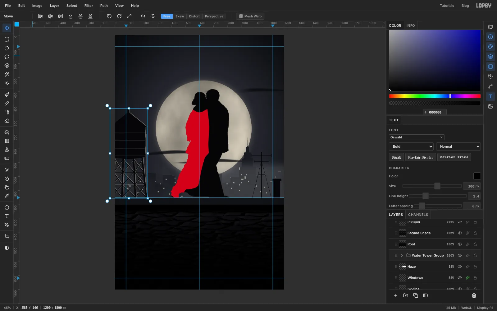

Before the type goes on, look around the edges of the picture. If your water tower ended up with its edge just a few pixels inside the canvas, it will look as though it is touching the frame by accident, and it risks being trimmed when the cover is printed.

1. Click `Water Tower Group`, press [[Cmd+D]] and pick the **Move** tool.
2. Drag the tower left until its left side clearly runs off the canvas, about 30–40 px.

Moving the group moves the tower and its rim light together, so they stay lined up.

## Set the author name

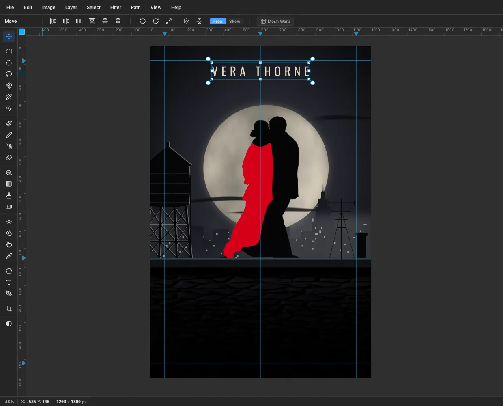

1. Collapse the `Tango Couple` group and click its row, so the text layer you're about to make goes above the group rather than inside it.
2. Pick the **Text** tool, click in the empty sky near the top, and type `VERA THORNE`. While you're typing, set the font to **Oswald**, **Size** `64` and colour `#E9E1CF`. Press [[Tab]] to commit.
3. In the **Text** panel, set the weight to **Regular**, the style to **Normal** and **Letter spacing** to `20`.
4. With the **Move** tool, click **Align center horizontally** in the options bar. Then move it so the tops of the letters sit about 110 px from the top edge.

> **Tip:** Letter spacing adds space after every letter, including the last one, so the text can look slightly off to the right after centring. Nudge it left a few pixels with the arrow keys until it looks centred.

## Add a review quote

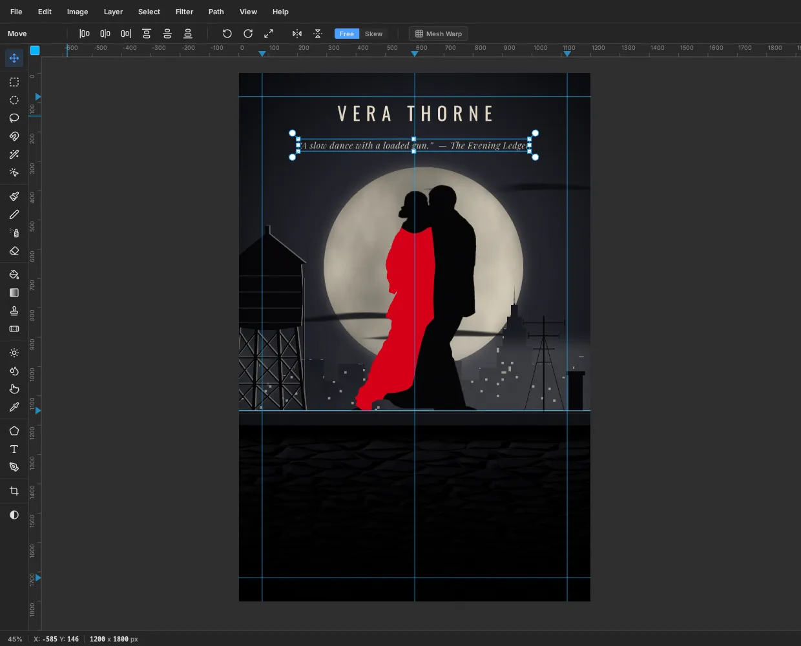

1. With the **Text** tool, click in empty sky and type `“A slow dance with a loaded gun.”  — The Evening Ledger`.
2. Set it in **Playfair Display**, **Size** `30`, colour `#CFC8B8`. In the Text panel choose **Italic** and set **Letter spacing** to `1`.
3. Centre it and place it about 70 px below the author name.

> **Tip:** A new text layer starts with the Text panel's current settings. After the author name, it would have inherited 20 px letter spacing, so always check spacing, weight and style on each new line.

## Set ROOFTOP

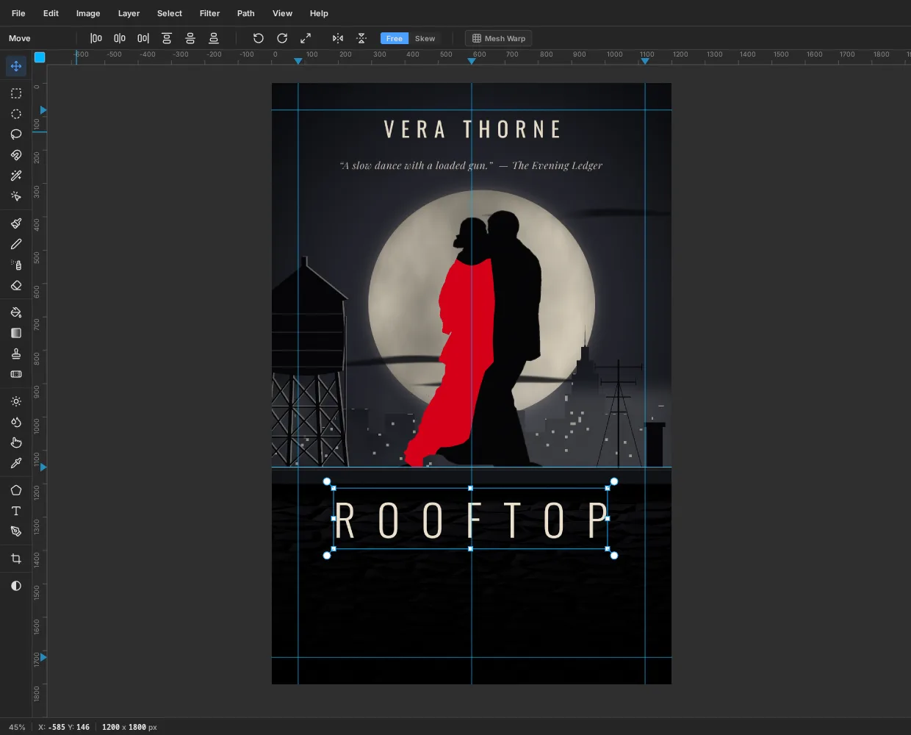

1. With the **Text** tool, click in empty space below the ledge and type `ROOFTOP`, in **Oswald** at **Size** `130`, colour `#E9E1CF`.
2. In the Text panel, choose the **Light** weight and **Normal** style, and set **Letter spacing** to `64`.
3. Centre it and place the tops of the letters at `y 1255`, about 55 px below the bottom of the parapet.

## Set TANGO

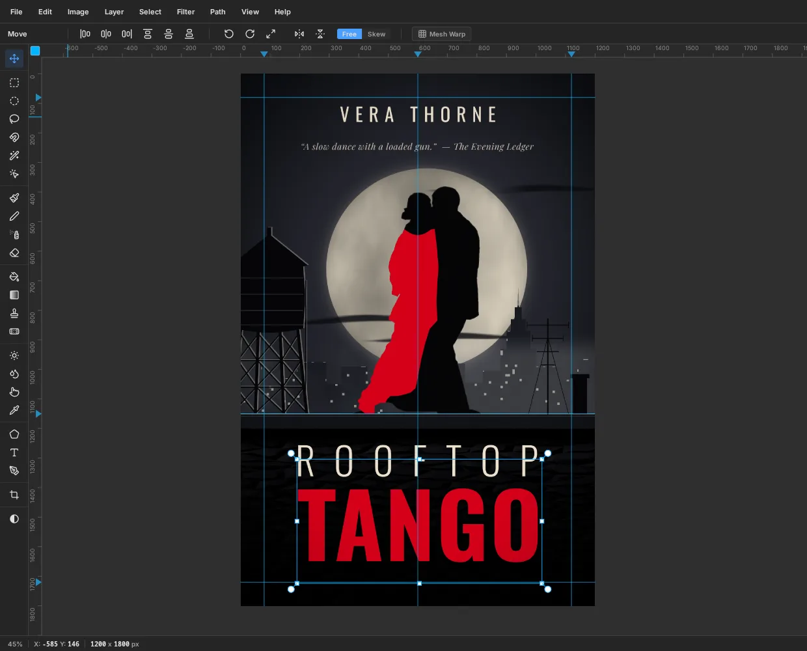

1. With the **Text** tool, click in empty space and type `TANGO`, in **Oswald** at **Size** `300`, colour `#C41E26`. Choose the **Bold** weight and set **Letter spacing** to `6`.
2. Centre it and place the top of the letters about 45 px below the bottom of ROOFTOP.
3. Check that the left and right edges of ROOFTOP and TANGO line up. Compare the letters themselves, not the transform boxes: letter spacing adds space after the last letter. If they don't, change ROOFTOP's letter spacing a little until they do.
4. Open the effects for `TANGO` and add a **Drop Shadow** in black with **Offset X** `0`, **Offset Y** `10`, **Blur** `18` and **Opacity** `75`.

Thin and wide over heavy and red gives the title two voices, a whisper and a shout, while the matching width holds them together as one block.

## Add the tagline

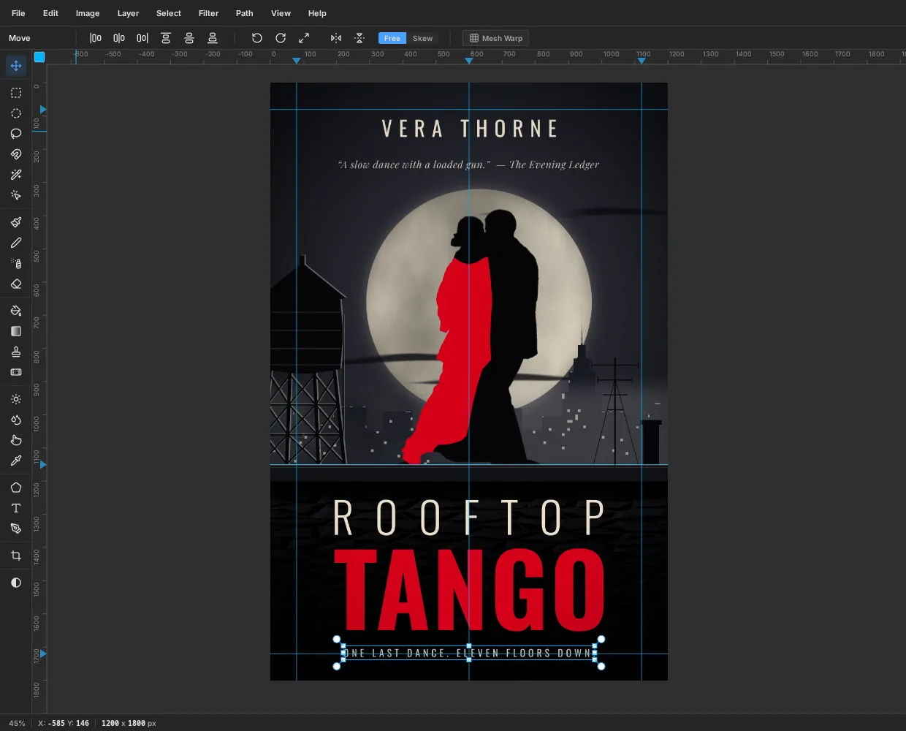

1. With the **Text** tool, click in empty space and type `ONE LAST DANCE. ELEVEN FLOORS DOWN.` in **Oswald** **Regular**, **Size** `30`, colour `#D9D2C2`, with **Letter spacing** `9`.
2. Centre it and place it about 50 px below TANGO. Its capitals sit across the bottom margin guide, about 70 px from the bottom edge. Small type like this can go a little past the margin; the guide is there to keep the big shapes off the trim.

Using Oswald again keeps the cover to two typefaces: Oswald for the voice of the book and Playfair Display only for the quote.

## Finish with grain and a vignette

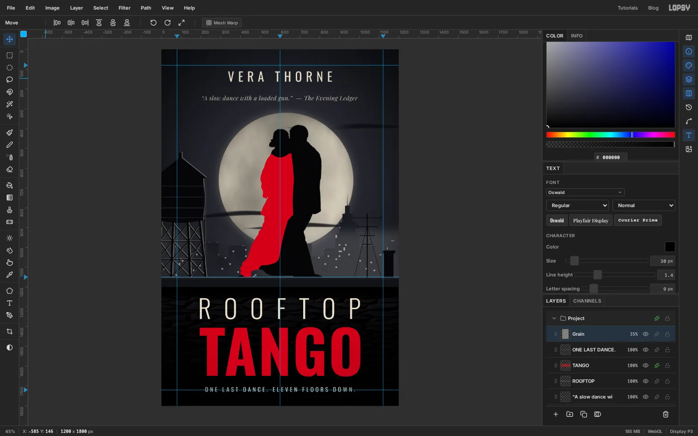

1. Click the top text layer and add a layer named `Grain`. Make sure it is at the very top of the Layers panel, above all the text.
2. Set the foreground colour to `#808080`, press [[Cmd+A]] and choose **Edit → Fill**, then press [[Cmd+D]]. Choose **Filter → Add Noise...** with **Mono**, **Gaussian** and **Amount** `45`.
3. Set `Grain` to the **Overlay** blend mode and `35%` opacity. Mid-grey disappears in Overlay, so only the speckle is left.
4. Click the **Group effects** button on the `Project` row, choose **Add Adjustment → Vignette** and set it to `35`.

The grain ties the clean vector-like shapes and the photo cut-out together, as if they were printed on the same paper.

## Export and save

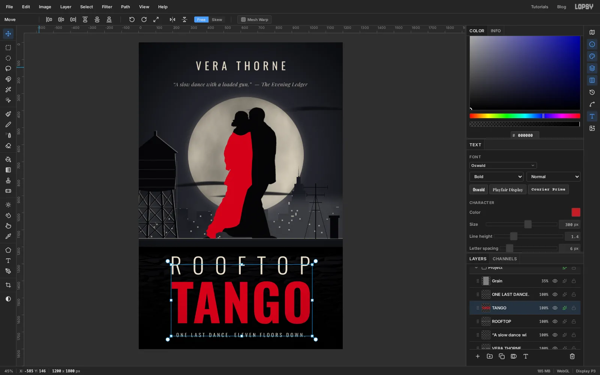

1. Press [[Cmd+;]] to hide the guides and look at the cover without them.
2. Choose **File → Quick Export PNG** to save the cover as an image.
3. Choose **File → Save Project** to keep a `.lopsy` file with every layer, group and effect still editable.

To make it your own, swap the title and author, and keep the red to the dress and one word of the title. If you use a different photo, pick one where the people stand against a light, plain background: the Magic Wand needs that contrast to make a clean cut.
