In the 1980s and 90s, mobile cinemas in Ghana advertised their films with
posters painted by hand on flour sacks. The posters were loud and bright, the
monsters were bigger and angrier than anything in the film, the lettering was
painted, and the sacks were folded and carried from town to town. This
tutorial borrows that outsider art spirit for a made-up B-movie,
**Pufferfish Uprising**. A spiky fish rises out of the sea and swallows a
fishing village.

The poster is 1200 × 1800 px. Positions below are in document pixels: watch
**X** and **Y** in the status bar as you move the pointer. Freehand shapes
like the huts, the spikes and the swimmers only need to be close.

You'll draw the fish from a reference photo. This one works well:
[Inflated pufferfish](https://commons.wikimedia.org/wiki/File:Inflated_pufferfish.jpg)
by Dotun55 on Wikimedia Commons (CC BY-SA 4.0). Download it before you start.

When a step says to fill something with a colour, set that colour as the
foreground colour and choose **Edit → Fill**.

Along the way you'll use:

- **Edit → Define Pattern** and **Fill with Pattern…** for the border
- **Texture** (Canvas and Streaks), **Clouds** and **Gaussian Blur** for the sack, the sky and the sea
- the **Gradient** tool's **Advanced…** stop editor, including transparent stops, and a gradient on a **layer mask**
- the **Lasso** and shift-added marquees, **Show Grid**, and the **Brush**, **Pencil**, **Spray** and **Smudge** tools
- a dropped-in reference photo, **groups**, a **group mask**, and scaling and moving a whole group at once
- **Copy** and **Paste**, rotating several layers together, and dragging layers to reorder them
- **Text** in Knewave, Londrina Solid and Caveat Brush, with **Stroke** and **Drop Shadow** effects and a live rotation
- the **Shape** tool's rounded rectangle, and a **Photo Filter** adjustment on the whole poster

The palette:

- Sack `#E6CF9C`, border red `#B3211B`, border yellow `#F4C21D`, ink `#14100C`
- Sky `#5E0F18` → `#B8281C` → `#EC7A22` → `#F8D04A`, storm `#2A0B22`
- Sea `#2F6FD8` → `#1A3E9E` → `#0A1644`, waves `#F2F7FF` / `#BFE0FF`
- Village `#2B0F1E`, windows `#FFC94A`
- Fish `#FFF4B8` → `#FFD640` → `#F5A21E` → `#C8601A`, spots `#B5531A` / `#7A3010`, spikes `#F0A72A`
- Mouth `#3A0A12`, tongue `#C42234`, lips `#E9788C`, eyes `#F06A12`
- Canoe `#EAD7AE`, stripes `#D2261C` / `#1E8A3C` / `#F2C21D`, skin `#4A2414`
- Title `#FFD21F`, title shadow `#C8161E`, subtitle `#38C8E8`, banner `#F3E4C2`, showtime `#1A3E9E`
- Fin `#F2B83A`, teeth `#FFF8E8`, eye whites `#FBF3DF`, pupils `#120806`, stipple `#FFF8DC`
- Horror burst `#D81E1E`, action burst `#FFD21F`
- Outlines `#120A06` / `#1E1206` / `#2E1A06`

## Set up the sack and the guides

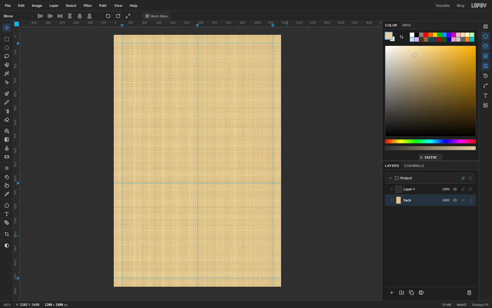

1. Choose **File → New**, set **Width** `1200` and **Height** `1800`, and click **Create**.
2. Click the top ruler at `x 60`, `x 600` and `x 1140`. Click the left ruler at `y 60`, `y 1060` (the horizon) and `y 1740`. The outer guides mark the inside edge of the border.
3. Every Lopsy document keeps its layers inside a top-level group called `Project`. Double-click **Background** in the Layers panel and rename it `Sack`. Set the foreground colour to `#E6CF9C` and choose **Edit → Fill**.
4. Choose **Filter → Texture…**, click **Canvas**, and set **Amount** `38`, **Size** `3.5` and **Detail** `55`. Click **Apply**. You now have plain burlap to paint on.

## Paint one pattern tile

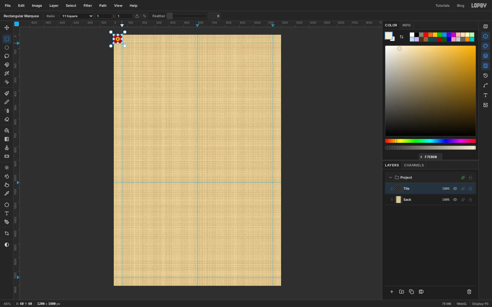

Outsider artists often fill a border with one small motif repeated over and over. You'll paint the motif once and let Lopsy repeat it.

1. Open the **View** menu and make sure **Snap to Guides** is unticked. Otherwise the small marquees jump to the guides at `x 60` and `y 60`.
2. Click **Layer 1** and rename it `Tile`.
3. With the **Rectangular Marquee** (`M`), drag a 60 × 60 px square in the top-left corner of the canvas. Fill it with `#B3211B` (**Edit → Fill**), then press [[Cmd+D]].
4. With the **Elliptical Marquee**, drag a circle 28 px across, centred on `(30, 30)`, and fill it with `#F4C21D`.
5. Now the black dots. Drag a 16 px circle on the top-left corner of the tile, then hold [[Shift]] and add one on each of the other three corners and a 10 px dot in the centre. Fill them all at once with `#14100C`.
6. Add four tiny cream `#F7EBD0` dots, 6 px across, on the yellow ring at the top, bottom, left and right.
7. Drag the **Rectangular Marquee** around the tile again, from `(0, 0)` to `(60, 60)`, and choose **Edit → Define Pattern**. Then press [[Cmd+D]] and delete the `Tile` layer.

## Fill the border with the pattern

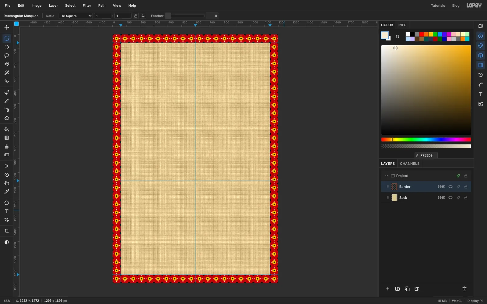

1. Click `Sack`, click **Add Layer**, and rename the new layer `Border`.
2. Press [[Cmd+A]] to select the whole canvas. With the **Rectangular Marquee**, hold [[Alt]] and drag from the top-left guide corner `(60, 60)` to the bottom-right one `(1140, 1740)`. That subtracts the middle and leaves a 60 px frame selected.
3. Choose **Edit → Fill with Pattern…**. Your tile is already picked. Leave **Scale** at 100% and click **Apply**, then press [[Cmd+D]].

## Paint the sunset sky

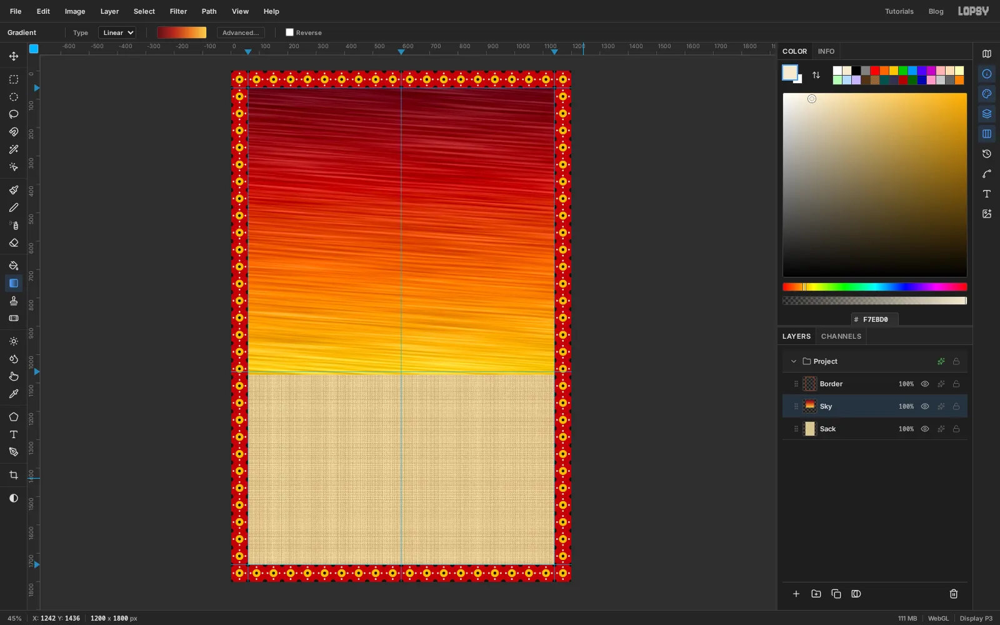

1. Click `Sack`, then **Add Layer**, and rename it `Sky`.
2. With the **Rectangular Marquee**, drag from the top-left guide corner down to just below the horizon on the right, about `(1140, 1070)`.
3. Pick the **Gradient** tool, set **Type** to **Linear** and click **Advanced…**. Set the left stop to `#5E0F18` and the right stop to `#F8D04A`. Click the bar at about 35% and 68% to add `#B8281C` and `#EC7A22`. Click **Done**.
4. Drag straight down from the top guide to the horizon guide, then press [[Cmd+D]].
5. Choose **Filter → Texture…**, click **Streaks**, and set **Amount** `20`, **Size** `8`, **Detail** `60`, **Stretch** `4` and **Angle** `4`. Click **Apply**. The sky now looks painted with a wide, dry brush.

## Brew some storm clouds

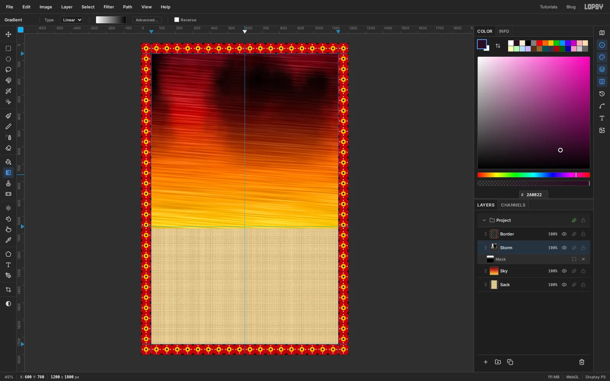

1. Click **Add Layer** and rename it `Storm`. Set the foreground colour to `#2A0B22`.
2. Drag the same marquee as the sky and choose **Filter → Clouds…** with **Scale** `4`. Click **Apply** and press [[Cmd+D]].
3. Open the layer's **Layer effects** drawer (the sparkle icon on its row) and set **Blend** to **Multiply**. Close the drawer.
4. Click **Add Mask** at the bottom of the Layers panel. Pick the **Gradient** tool and set its stops to white on the left and black on the right in **Advanced…**.
5. Drag down the centre guide from `y 200` to `y 760`. The clouds hang over the top of the sky and fade out above the sunset.

## Lay in the sea and the waves

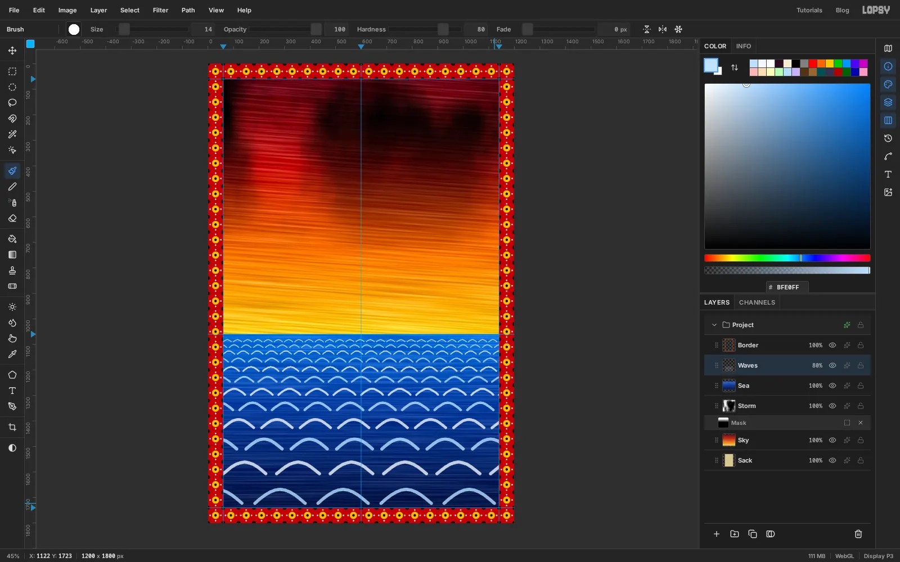

1. Click **Add Layer** and rename it `Sea`. Drag a marquee from the horizon on the left `(60, 1060)` to the bottom-right guide corner `(1140, 1740)`.
2. Set a **Linear** gradient with the stops `#2F6FD8`, `#1A3E9E` (at about 40%) and `#0A1644`. Drag from the horizon straight down to the bottom guide and press [[Cmd+D]].
3. Run **Filter → Texture…** again with **Streaks**, **Amount** `14`, **Size** `6`, **Detail** `50`, **Stretch** `5` and **Angle** `0`.
4. Click **Add Layer** and rename it `Waves`. Pick the **Brush** (`B`) and set **Hardness** `80` and **Opacity** `100`.
5. Paint rows of little arches, like a child's drawing of the sea. Start just under the horizon with arches 40 px wide at **Size** `4`, in `#F2F7FF`. Drag each one as a small hump, left to right.
6. Work down the sea in about a dozen rows. Each row starts about half an arch lower, with arches about a fifth wider and a size or so thicker (stop at **Size** `14`). Alternate the colour between `#F2F7FF` and `#BFE0FF`, and shift every other row by half an arch so the humps interlock.
7. Set the layer's opacity to `80`.

## Draw the huts with the grid on

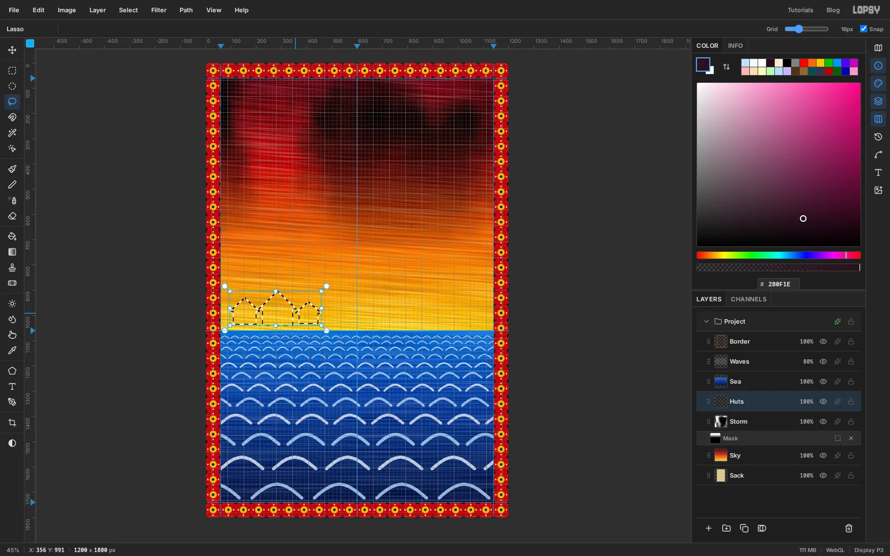

1. Click `Storm`, then **Add Layer**, and rename it `Huts`. It sits under the sea, so the stilts will look as if they stand in the water.
2. Choose **View → Show Grid**. The grid makes it easy to keep the walls upright.
3. With the **Lasso** (`L`), draw three huts on the left of the horizon: a small one from `x 110` to `x 200`, a big one from `x 225` to `x 345`, and a small one from `x 370` to `x 445`. Draw each wall box first, then hold [[Shift]] and add a pointed roof that overhangs the walls by about 14 px on each side. The bottoms of the walls sit about 25 px above the horizon.
4. Set the foreground colour to `#2B0F1E`, choose **Edit → Fill** and press [[Cmd+D]]. Choose **View → Show Grid** again to hide the grid.

## Add stilts, windows and palms

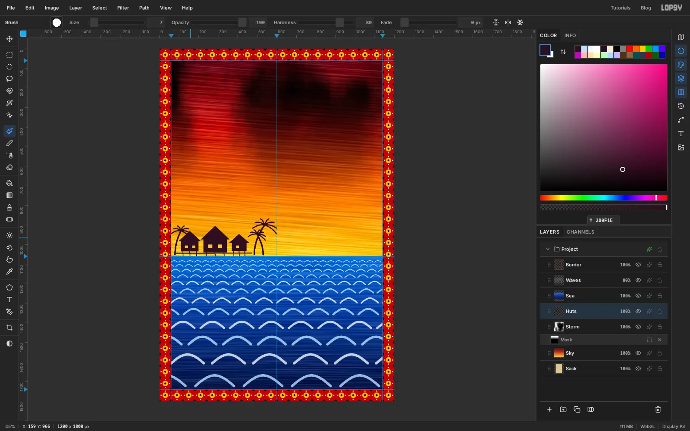

1. Pick the **Pencil** (`N`) at **Size** `4`. Under each hut, click at the bottom of a wall and [[Shift]]-click at the horizon to draw a stilt. Give each hut three stilts.
2. At **Size** `5`, click at `(90, 1046)` and [[Shift]]-click at `(470, 1044)` for a boardwalk joining the huts.
3. With the **Rectangular Marquee**, drag a small window on the first hut, then hold [[Shift]] and add four more across the huts. Fill them with `#FFC94A` and deselect.
4. Pick the **Brush** with the foreground colour back on `#2B0F1E`. For each palm, drag a gently curving trunk upward at **Size** `9`, then drag seven drooping fronds out from the top at **Size** `7`. Put a tall palm and a short one at `x 485` and `x 530`, just right of the huts, and a third at `x 80`.

## Bring in the pufferfish reference

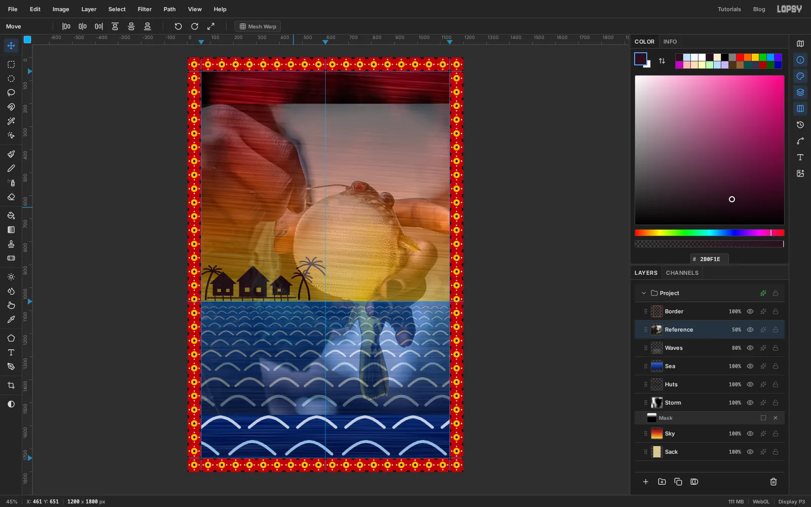

The fish will be cartoony, but tracing proportions from a real one keeps it believable: a near-perfect ball with the eyes on top and a small mouth in front.

1. Click `Waves`, then drag the reference photo from your desktop onto the canvas. It lands on a new layer, scaled to fit. Rename it `Reference`.
2. With the **Move** tool active, hold [[Cmd]] (in Lopsy it keeps the proportions) and drag the bottom-right corner handle outward until the fish's body is about 460 px across. Press [[Cmd+D]] to commit the transform.
3. Drag the photo so the body sits in the middle of the sky, centred around `(690, 825)`.
4. Set the layer's opacity to `50` so you can see the poster through it.

## Shape the body

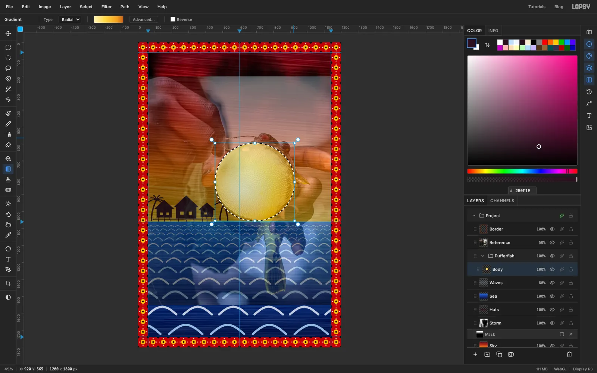

1. Click `Waves` and click **New Group**. Rename the group `Pufferfish`. Every part of the fish goes inside this group.
2. Click **Add Layer** and rename it `Body`. With the **Elliptical Marquee**, drag a circle over the reference body, from `(455, 595)` to `(925, 1055)`.
3. Set the **Gradient** tool to **Radial** and load four stops: `#FFF4B8`, `#FFD640` at about 40%, `#F5A21E` at about 78%, and `#C8601A`. Drag from a point a little below and left of the centre, about `(620, 875)`, out past the top-right edge, about `(920, 565)`. The highlight sits low on the left and the edge darkens toward the top right.
4. Press [[Cmd+D]]. Open **Layer effects**, tick **Stroke**, and set **Width** `6` and the colour `#1A0E04`. A painted poster outlines everything.

## Spot and stipple the skin

1. Hide `Reference` with its eye icon.
2. Click `Body`, click **Add Layer**, and rename it `Spots`. Pick the **Brush** at **Hardness** `90` and **Opacity** `100`.
3. Click about two dozen spots over the top and the left side of the body, 16 to 34 px across. Change **Size** between clicks and keep them apart. Use `#B5531A` for most and `#7A3010` for every fourth one.
4. Click **Add Layer** and rename it `Stipple`. Pick the **Spray** tool (`J`) at **Size** `160` and **Density** `30` with `#FFF8DC`, and drag four passes from left to right across the lower half of the body. Set the layer's opacity to `60`.

## Cut out the spikes

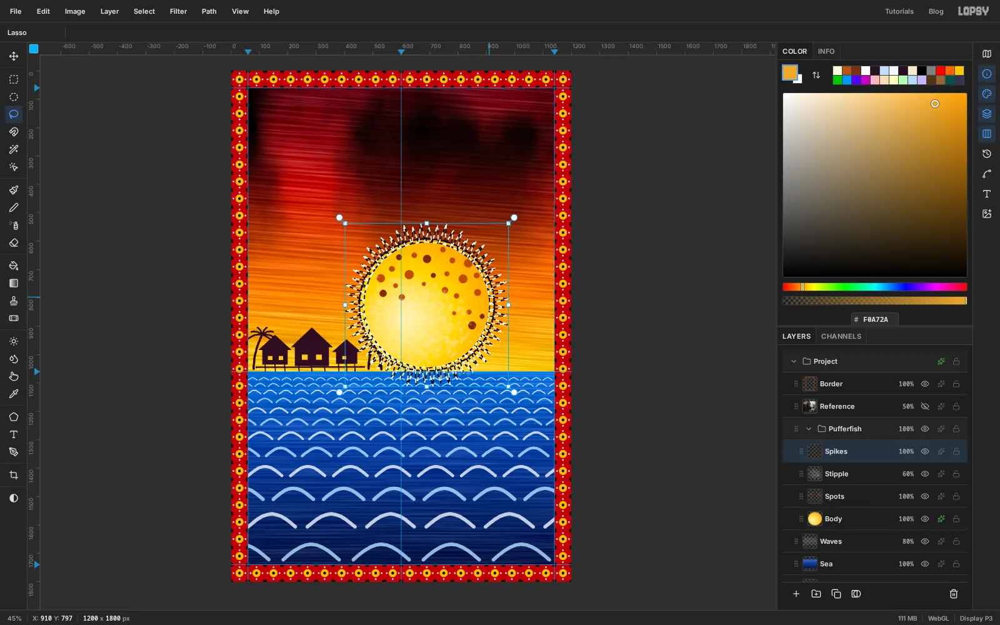

1. Click **Add Layer** and rename it `Spikes`. Set the foreground colour to `#F0A72A`.
2. With the **Lasso**, draw a thin triangle sticking out from the body's edge. Start its base just inside the outline, so no gap shows, and let the tip reach 45 to 65 px beyond the edge.
3. Hold [[Shift]] and add more triangles all the way around until you have about sixty. Vary the lengths a little. Working round the ball one quarter at a time keeps the spacing even.
4. Choose **Edit → Fill** and press [[Cmd+D]]. Give the layer a **Stroke** of **Width** `3` in `#2E1A06`.

## Tuck the spikes behind the body

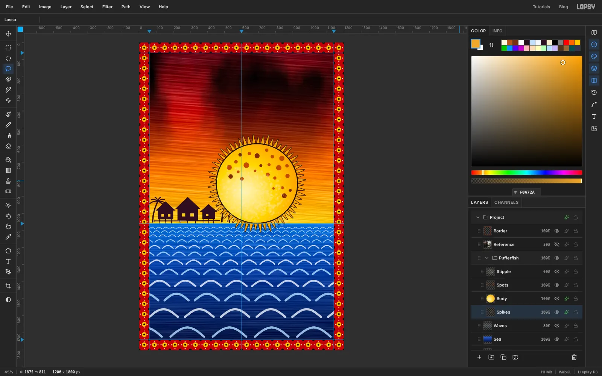

The spikes should grow out from behind the ball, not sit on top of it.

1. Drag `Spikes` by its grip (the dotted handle on the left of the row) down past `Body` and drop it in the lower half of the `Body` row.
2. If the drop line shows at the group's outer level, nudge the pointer slightly to the right before you let go so the layer stays inside the `Pufferfish` group.

## Paint the mouth and the fin

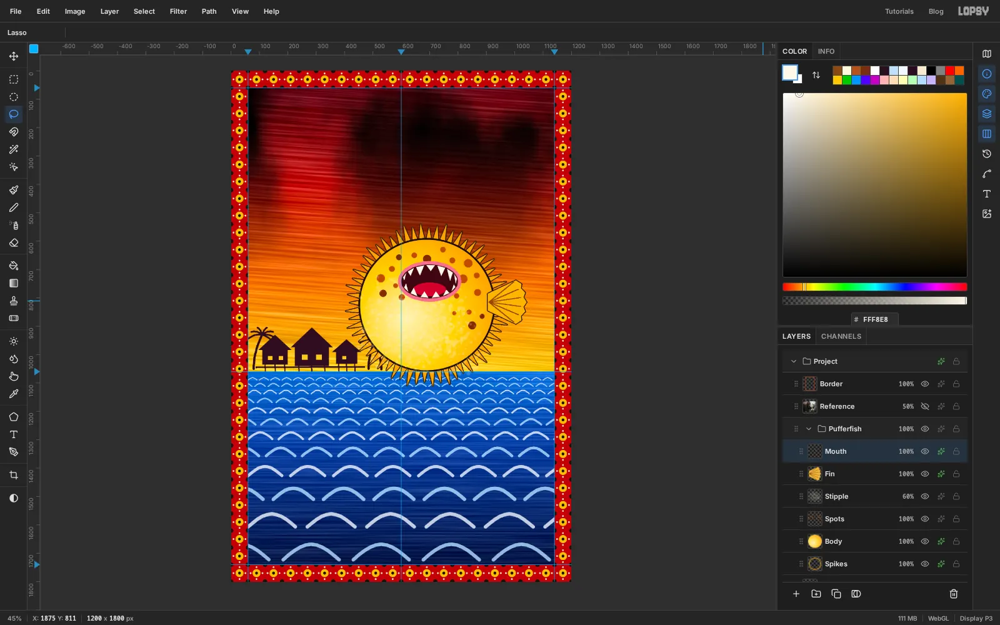

1. Click `Stipple`, then **Add Layer**, and rename it `Fin`. With the **Lasso**, draw a fan on the right of the body, about 120 px long with a scalloped outer edge. Fill it with `#F2B83A`.
2. Pick the **Pencil** at **Size** `3` with `#8A4A12`. Click at the base of the fin and [[Shift]]-click out to the edge to draw each ray. Give the fin a **Stroke** of `3` in `#2E1A06`.
3. Click **Add Layer** and rename it `Mouth`. Lasso a wide oval centred under where the eyes will go, about `(700, 742)`, 200 px wide and 120 px tall. Fill it with `#3A0A12`.
4. Lasso a smaller flat oval in the lower half of the mouth and fill it with `#C42234` for the tongue.
5. Lasso seven triangles hanging from the top lip and six pointing up from the bottom one, using [[Shift]] to add each one. Make the lengths uneven, between about 16 and 38 px. Fill them with `#FFF8E8`.
6. Add a **Stroke** of **Width** `12` in `#E9788C`. It becomes a thick pair of lips.

## Give it angry eyes

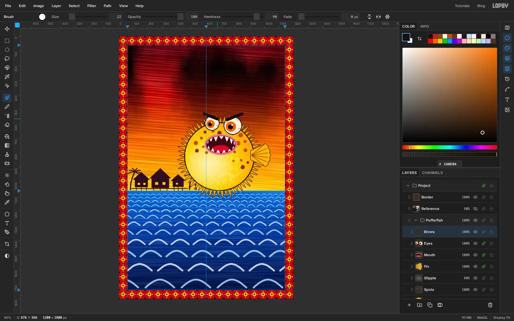

1. Click **Add Layer** and rename it `Eyes`. With the **Elliptical Marquee**, drag a circle 116 px across centred on `(782, 612)`, then hold [[Shift]] and add a smaller one, 92 px across, centred on `(640, 596)`. The eyes break the top of the outline, as they do on a real pufferfish. Fill them with `#FBF3DF`.
2. In each eye, fill an orange `#F06A12` iris a little below and left of centre, a black `#120806` pupil inside it, and a tiny white catchlight at the top right of the pupil.
3. With the **Pencil** at **Size** `2` and `#C81E1E`, draw five short veins in from the edge of each eye with click and [[Shift]]-click.
4. Give the layer a **Stroke** of `5` in `#1E1206`.
5. Click **Add Layer** and rename it `Brows`. With the **Brush** at **Size** `22` and `#1A0E04`, drag two thick brows above the eyes, each slanting down toward the middle. That slant does most of the acting.

## Shade it into a ball

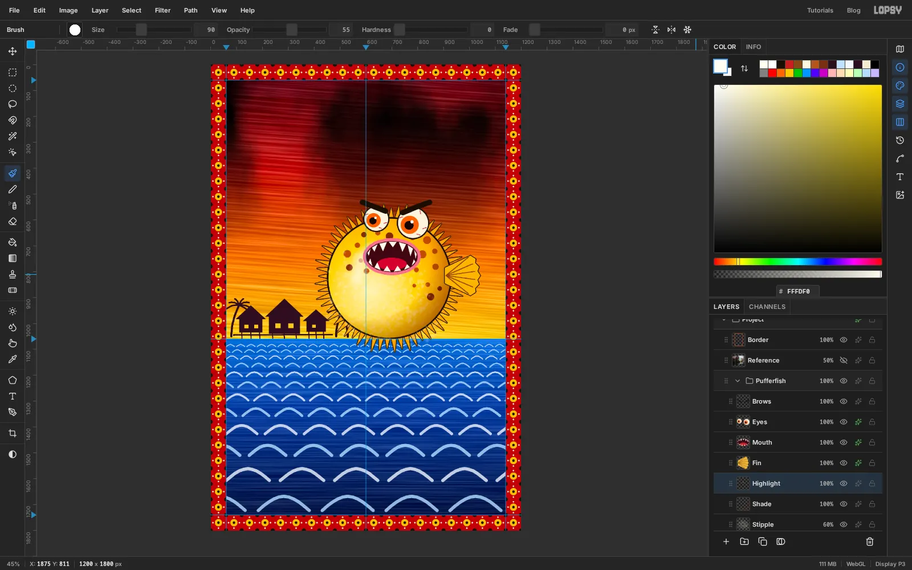

1. [[Cmd]]-click the `Body` thumbnail to select the ball.
2. Click `Stipple`, then **Add Layer**, and rename it `Shade`. Load a **Radial** gradient with three stops: `#6B2A08` at 0% opacity on the left, the same colour at 0% opacity at about 55%, and `#4A1A04` at 80% opacity on the right. Use the **Opacity** bar under each stop's colour.
3. Drag from a little above and left of the centre out past the bottom-right edge. Press [[Cmd+D]] and set the layer's **Blend** to **Multiply**.
4. Click **Add Layer** and rename it `Highlight`. With a soft **Brush** (**Size** `90`, **Hardness** `0`, **Opacity** `55`) and `#FFFDF0`, paint a short curve on the upper-left of the body. Set **Blend** to **Screen**.

## Scale the whole fish up

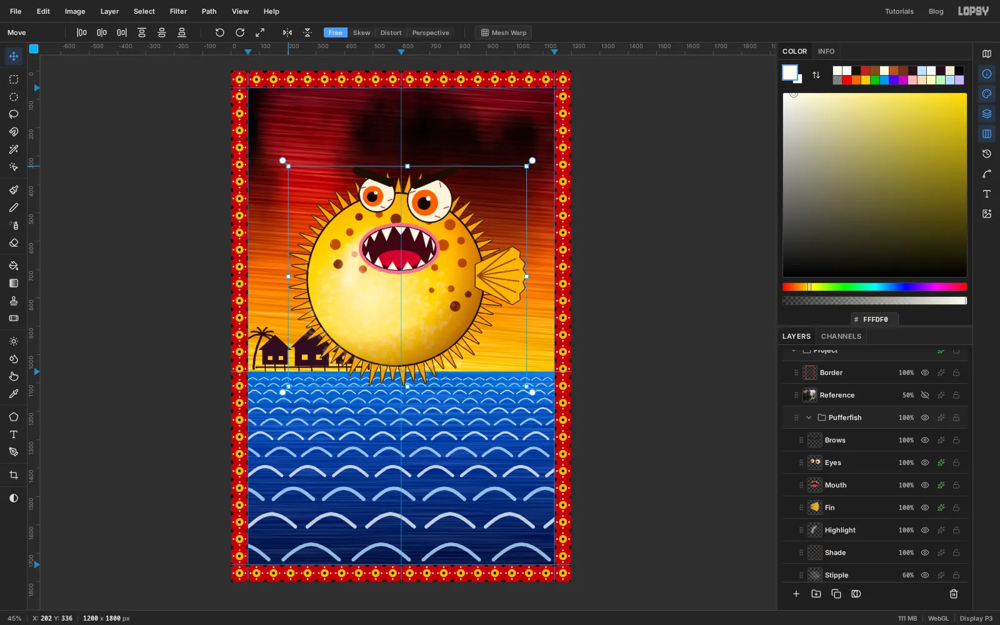

Grouping the fish pays off now. You can resize every part of it at once.

1. Press [[Cmd+D]], then click the `Pufferfish` group row. With the **Move** tool (`V`), handles appear around the whole fish.
2. Hold [[Cmd]] and drag the top-left handle up and to the left by about 200 px. The fish grows by about a third, and every layer in the group scales with it.
3. Press [[Cmd+D]] to commit the scale. Then click the group again and drag the fish down and slightly to the left, so the body is centred near `(585, 880)` and its lower part drops below the horizon.

## Sink the fish into the sea

1. With the `Pufferfish` group selected, click **Add Mask**.
2. With the **Lasso**, draw a gentle wavy line across the whole poster at about `y 1130`, then go down past the fish and back to close the shape.
3. Fill it with `#000000` and press [[Cmd+D]]. A group mask hides everything inside the group below the waterline, so the fish now rises out of the water.

## Splash the waterline

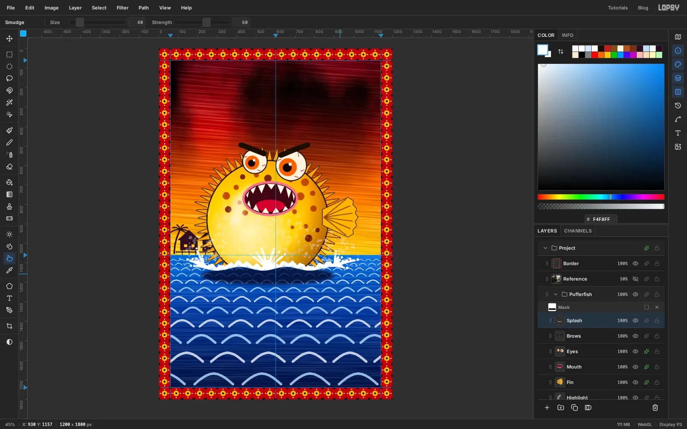

1. Click `Waves`, click **Add Layer**, and rename it `Reflection`. Fill an elliptical selection about 680 by 96 px just under the fish with `#081032`. Run **Filter → Gaussian Blur…** with **Radius** `22`, set **Blend** to **Multiply** and opacity to `80`.
2. Click the `Pufferfish` group and click **Add Layer**. The new layer goes inside the group, so the mask trims it at the waterline. Rename it `Splash`.
3. With the **Brush** at **Hardness** `85`, drag short humps of foam along the waterline from one side of the fish to the other: first at **Size** `26` in `#CFE6FF`, then at **Size** `18` in white, slightly higher.
4. Add three bursts of splash on the left, middle and right of the fish. In each burst, drag seven short strokes fanning upward and outward, between **Size** `8` and `16`, and click a droplet just past the end of each one.
5. Spray fine droplets either side of the fish with the **Spray** tool (**Size** `200`, **Density** `30`, `#F4FAFF`). Then pick the **Smudge** tool (`R`) at **Size** `40` and **Strength** `60` and drag a few short pulls through the foam to soften it.

## Copy a hut into the sky

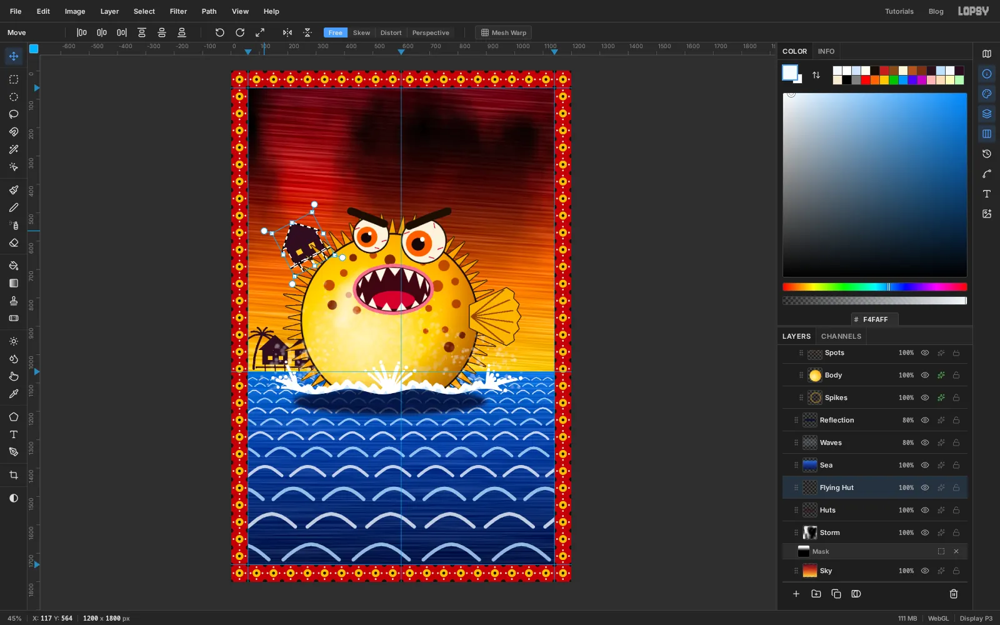

The poster promises that the fish swallows a whole village, so show it happening.

1. The fish now hides most of the village. Hide the `Pufferfish` group with its eye icon, click `Huts`, and drag a **Rectangular Marquee** around the big middle hut, roof and stilts included.
2. Press [[Cmd+C]] and then [[Cmd+V]]. The copy pastes in place on a new layer, already selected, with the **Move** tool active. Rename the layer `Flying Hut` and show the `Pufferfish` group again.
3. Drag the hut up about 380 px into the sky, to the left of the fish's face.
4. Drag the round rotation handle outside a corner to tilt it about 28° anticlockwise, as if it is tumbling. Press [[Cmd+D]].

## Pull the hut in front of the fish

The pasted hut sits next to `Huts`, behind the fish. It needs to fly in front.

1. Click the arrow on the `Pufferfish` group row to collapse it. That shortens the list.
2. Drag `Flying Hut` by its grip up to the top half of the `Pufferfish` row and drop it. The hut now crosses in front of the spikes.

## Launch a canoe and its fisherman

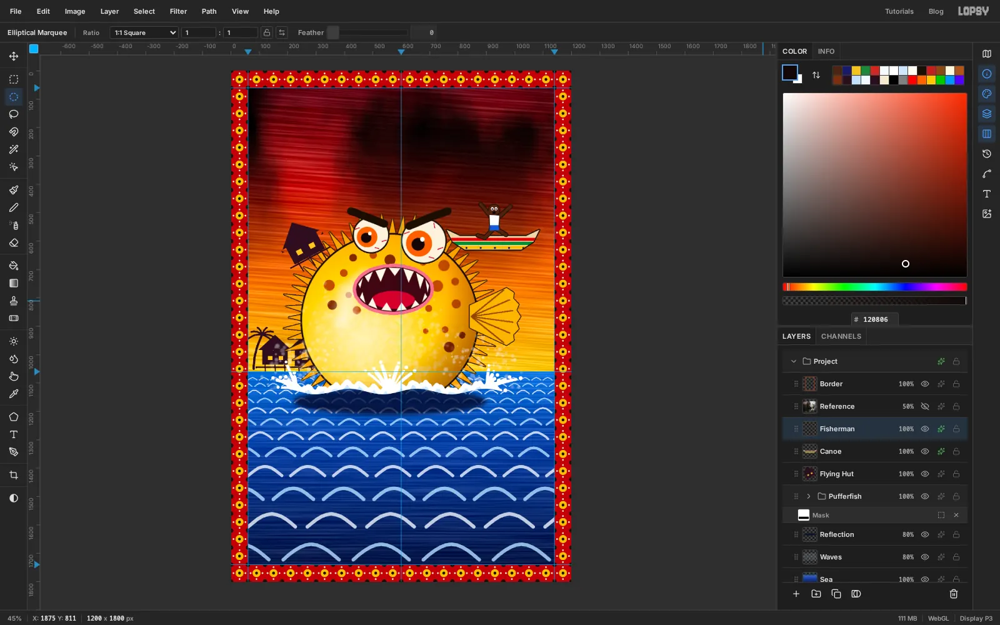

1. With `Flying Hut` selected, click **Add Layer** and rename it `Canoe`. In the empty sky on the right, lasso a long dugout canoe about 330 px long with pointed, raised ends, and fill it with `#EAD7AE`.
2. [[Cmd]]-click the `Canoe` thumbnail to select the hull. With the **Brush** at **Size** `12` and **Hardness** `95`, paint three stripes along it with click and [[Shift]]-click, one in each of `#D2261C`, `#1E8A3C` and `#F2C21D`. The selection keeps the stripes inside the hull. Dot a row of `#1B1B6A` along the bottom stripe at **Size** `8`, then press [[Cmd+D]] and give the layer a **Stroke** of `4` in `#1E1206`.
3. Click **Add Layer** and rename it `Fisherman`. With the **Brush** at **Size** `12` and `#4A2414`, paint two arms thrown up and two bent legs. With the **Elliptical Marquee**, drag a 38 px circle above the body and fill it with `#4A2414`.
4. Lasso a short boxy shirt across the shoulders and fill it white, then a pair of shorts below it in `#2B5BD7`. Add two white eyes with black pupils and a small black open mouth. Give him a **Stroke** of `3` in `#1E1206`.

## Tip the canoe toward the mouth

1. Click `Fisherman`, then [[Shift]]-click `Canoe` so both are selected. The **Move** tool's handles frame both layers.
2. Drag the rotation handle about 22° anticlockwise. The canoe now dives bow-first toward the mouth, and the fisherman rotates with it.
3. Press [[Cmd+D]]. With both still selected, nudge them up and to the right with the arrow keys ([[Shift]] moves 10 px at a time) until the canoe clears the fish's brow.

## Draw the suction

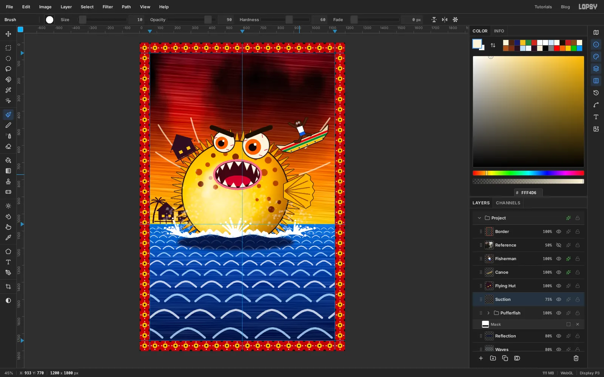

1. Click the `Pufferfish` group, click **Add Layer**, and rename it `Suction`.
2. With the **Brush** at **Size** `10`, **Hardness** `60` and **Opacity** `90`, in `#FFF4D6`, drag five curved strokes that start near the edges of the sky and sweep toward the mouth. Stop each one before it reaches the fish, so the face stays clean.
3. Set the layer's opacity to `75`.

## Add the swimmers

1. Click `Flying Hut`, then **Add Layer**, and rename it `Swimmers`.
2. Paint three swimmers in the open sea below the splash, around `(440, 1245)`, `(760, 1230)` and a slightly bigger one at `(600, 1345)`. For each one, drag a pale `#DCEEFF` ripple ring first, then two raised arms in `#4A2414`, then fill a round head on top with the **Elliptical Marquee**.
3. Give each head two white eyes and a small black open mouth, and add a **Stroke** of `3` in `#1E1206` to the layer.

## Set the title

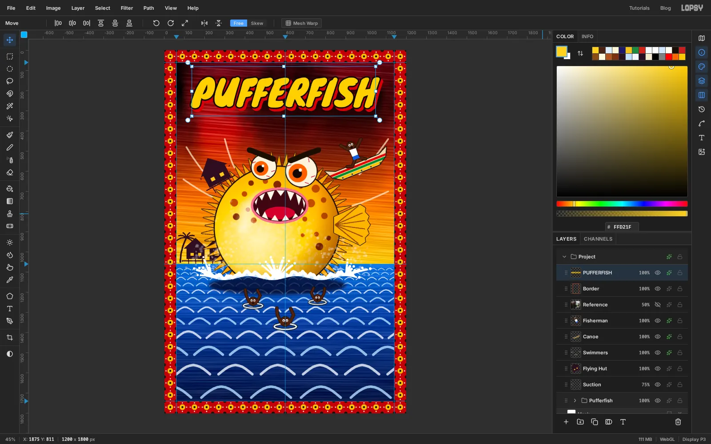

1. Click `Border` so the title goes near the top of the stack. Set the foreground colour to `#FFD21F`.
2. Pick the **Text** tool (`T`) and click in the top-left of the sky. Set **Size** to `176` and the font to **Knewave**, type `PUFFERFISH` and press [[Tab]] to finish editing.
3. Press `V` and click **Align center horizontally** in the options bar.
4. Add a **Stroke** of **Width** `7` in `#120A06`, then a **Drop Shadow** with **Offset X** `10`, **Offset Y** `12`, **Blur** `0` and **Opacity** `100` in `#C8161E`. A hard shadow with no blur looks painted, not printed.

## Add a tilted subtitle

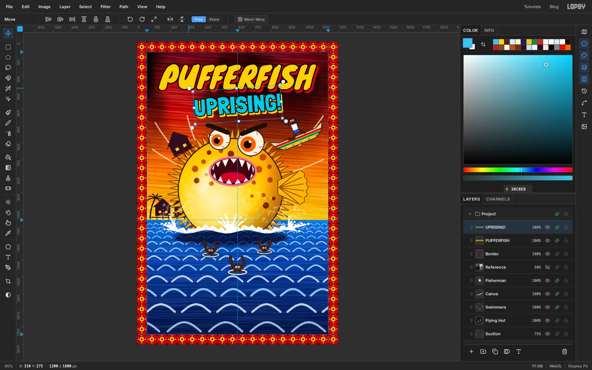

1. Set the foreground colour to `#38C8E8`. With the **Text** tool, click in empty sky away from the title so you start a new layer, set **Size** `140` and the font **Londrina Solid**, type `UPRISING!` and press [[Tab]] to finish editing.
2. Press `V`, click **Align center horizontally**, and drag the text up until the tops of its letters sit about 35 px below the red shadow of PUFFERFISH.
3. Add a **Stroke** of `6` in `#120A06` and a **Drop Shadow** with **Offset X** `8`, **Offset Y** `10` and **Blur** `0` in `#FFD21F`. Reversing the colours makes the two lines feel like a pair.
4. Drag the rotation handle to tilt the text about 4° anticlockwise. The text stays editable. Check that the left end still clears the fish's brows.

## Paint the title letters by hand

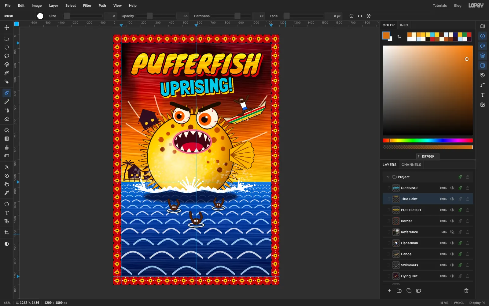

Flat type looks digital. Sign painters lay colour on with visible strokes.

1. [[Cmd]]-click the `PUFFERFISH` thumbnail to select the letter shapes, then click **Add Layer** and rename it `Title Paint`.
2. With the **Brush** at **Size** `70` and **Hardness** `70`, drag three slightly wobbly strokes the full width of the word: `#FFE14A` across the top third, `#FFC21F` across the middle and `#F59A18` across the bottom.
3. Drop to **Size** `8` and **Opacity** `35` and drag nine short streaks across the letters, alternating `#FFF6C8` and `#D9700F`.
4. Run **Filter → Texture…** with **Streaks**, **Amount** `25`, **Size** `3`, **Detail** `60`, **Stretch** `6` and **Angle** `0`, then press [[Cmd+D]].

## Paint the billing banner

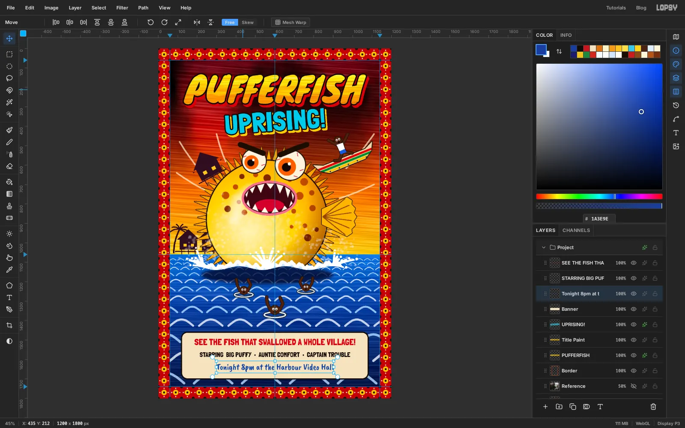

1. Click `UPRISING!`, then **Add Layer**, and rename it `Banner`.
2. Pick the **Shape** tool (`U`). Set **Shape** to **Rectangle** and **Corner Radius** to `30`. Click the **Fill** swatch and type `F3E4C2`. Add a **Stroke** colour of `120A06` and set **Width** to `6`.
3. Shapes grow from the centre. Press at `(600, 1580)` and drag to `(1080, 1700)`. That gives a banner from `x 120` to `x 1080`, 240 px tall.
4. Add three lines of text, each clicked into empty space on the banner and then centred with **Align center horizontally**:
   - `SEE THE FISH THAT SWALLOWED A WHOLE VILLAGE!` in **Londrina Solid** at `46`, `#C8161E`
   - `STARRING  BIG PUFFY  •  AUNTIE COMFORT  •  CAPTAIN TROUBLE` in **Londrina Solid** at `34`, `#120A06`
   - `Tonight 8pm at the Harbour Video Hall` in **Caveat Brush** at `44`, `#1A3E9E`
5. Space them evenly. Select each line and nudge it with the arrow keys until the gaps between the lines match the space above the first line and below the descenders of the last one. Leave a comfortable cream margin either side of the red tagline.

## Stamp two starbursts

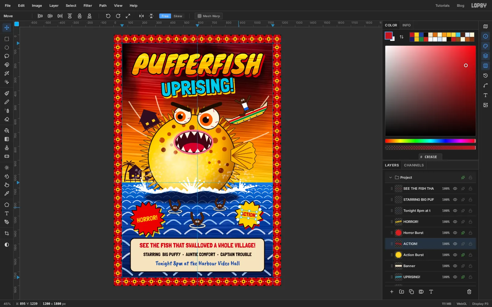

Give the two badges different sizes, colours and tilts so they don't look like a mirrored pair.

1. Click `Banner`, then **Add Layer**, and rename it `Horror Burst`. As a guide, drag an **Elliptical Marquee** circle about 244 px across in the sea on the left, centred near `(240, 1320)`, and note its edge. Then, with the **Lasso**, zig-zag around it: tips just on the circle, dips about a quarter of the way in. Sixteen points is plenty. Fill it with `#D81E1E`.
2. Add a **Stroke** of `5` in `#120A06` and a **Drop Shadow** with **Offset X** `6`, **Offset Y** `8` and **Blur** `0` in `#FFD21F`.
3. Type `HORROR!` in **Londrina Solid** at `46` in `#FFD21F`, clicked into empty sea. With the **Move** tool, drag the text until it sits in the middle of the star, then drag its rotation handle to tilt the text about 9° anticlockwise.
4. Do the same for `Action Burst`: a twelve-point star on the right, about 196 px across and centred near `(968, 1290)`, filled `#FFD21F`, with a `#C8161E` shadow. Add `ACTION!` at `38` in `#C8161E`, centred and rotated about 8° clockwise.
5. The red burst's shadow nearly touches the banner. Click `Horror Burst`, [[Cmd]]-click `HORROR!` in the Layers panel to select both, and nudge them up with the arrow keys until the shadow clears the banner.

## Hand-draw the frame

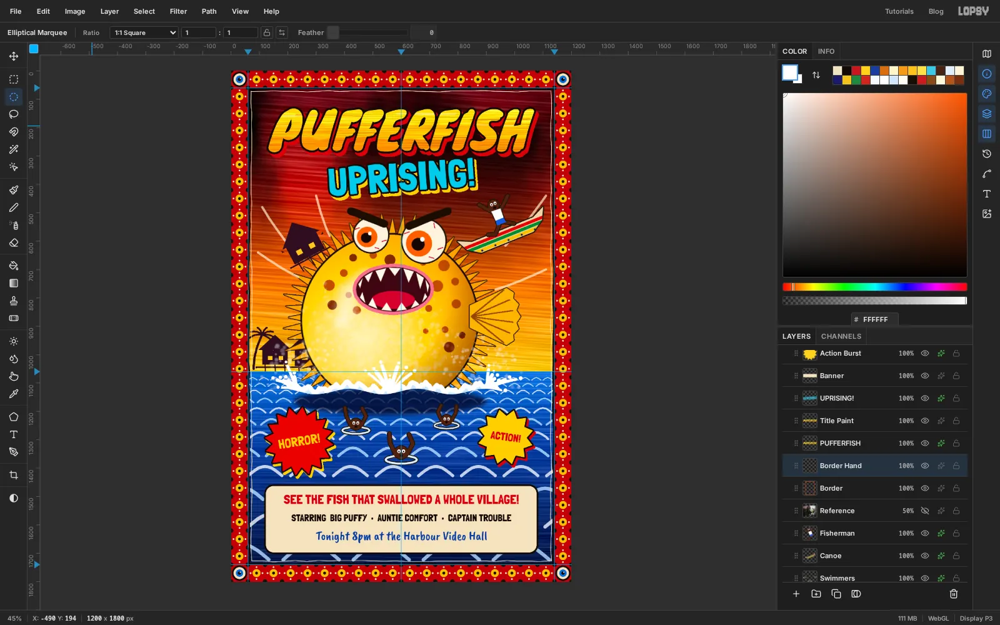

1. Click `Border`, then **Add Layer**, and rename it `Border Hand`.
2. With the **Brush** at **Size** `7` and **Hardness** `90` in `#120A06`, draw a slightly wobbly line along the inside edge of the border, about 3 px in from the guides, all the way round. Use several short drags rather than one perfect one.
3. Draw a thinner line inside it at **Size** `3` in `#F3E4C2`.
4. In each corner of the border, fill stacked circles centred 30 px from both edges: black 54 px across, cream 42, blue `#2F6FD8` 26 and black 12, plus a tiny white catchlight. Four staring eyes watch over the picture, a typical outsider art touch.

## Weave in the burlap

The poster should look as if it was painted on a flour sack, so the weave has to show through the paint.

1. Click the top layer in the Layers panel, click **Add Layer**, and rename it `Sack Weave`. Fill it with `#808080`.
2. Run **Filter → Texture…** with **Canvas**, **Amount** `80`, **Size** `4`, **Detail** `70` and **Contrast** `30`.
3. Pick the **Pencil** at **Size** `3` and draw about fourteen long, straight threads with click and [[Shift]]-click: some across, some down, in `#5A5A5A` and `#A8A8A8`. These are the thicker slubs you see in real sacking.
4. Set **Blend** to **Overlay** and the opacity to `50`. Mid-grey disappears in Overlay, so only the weave remains.

## Fold it and wear it

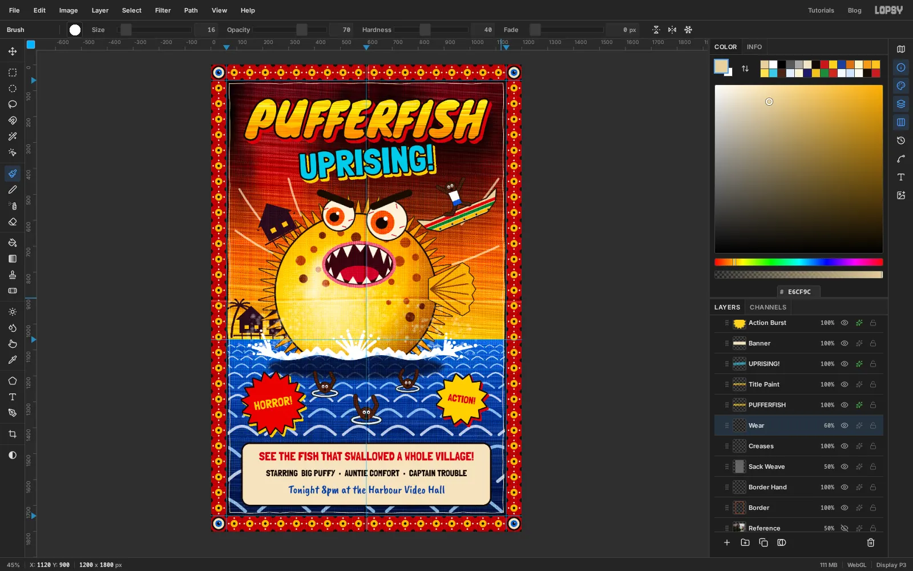

1. Click **Add Layer** and rename it `Creases`. With the **Brush** at **Hardness** `20` and **Opacity** `80`, drag a gently wobbly line down the whole poster at about `x 598` at **Size** `12` in black.
2. Drag a matching line across at about `y 902`.
3. Switch to white at **Size** `8` and drag the same two lines again, about 9 px to the right and below. A dark valley beside a light ridge reads as a fold. Set **Blend** to **Overlay**.
4. Click **Add Layer** and rename it `Wear`. With a soft **Brush** (**Hardness** `40`, **Opacity** `70`) in the sack colour `#E6CF9C`, dab a worn patch where the folds cross, about 34 px across with a couple of smaller dabs around it. Add a few small ones where the folds meet the border. Set the layer's opacity to `60`.

## Warm it up and export

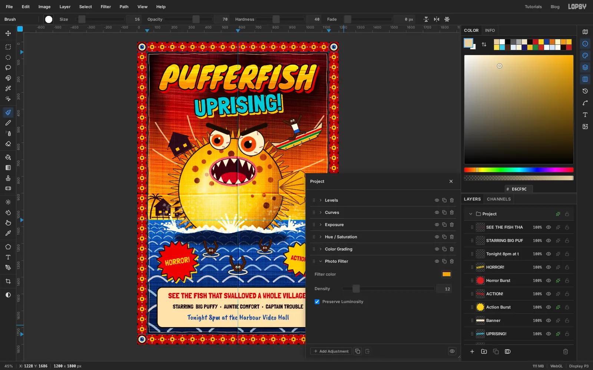

1. Click the **Group effects** button on the top `Project` row. The drawer already lists five neutral adjustments that come with every new document; leave them alone. Click **Add Adjustment → Photo Filter**. Keep the orange filter colour and set **Density** to `12`. Close the drawer. It adds a warm cast, like paint that has sat in the sun.
2. Delete the `Reference` layer. You no longer need it, and the project file gets smaller.
3. Choose **File → Save Project** to keep an editable copy, then **File → Quick Export PNG**.

> **Tip:** Grouping each subject early is what made the fish easy to resize, move and mask. Do the same for any figure you might want to adjust later.
