*Outsider art* is art made by people with no formal training, often over decades and often all over their own homes and gardens. Think of Howard Finster's Paradise Garden in Georgia, or the backyard bottle trees of the American South. It has a few habits you can borrow for graphic design:

- **every surface gets decorated**: borders of dots, stars and stripes, painted on with enamel paint
- **lettering is painted by hand**, with uneven shapes, chunky outlines and sayings squeezed into the gaps
- **pictures are flat and naive**: smiling suns, lollipop trees, and objects drawn as simple shapes
- **found materials**: bottle caps, hubcaps and plywood signs nailed up wherever they fit

In this tutorial you'll use all four for **Yard Visions**, a made-up tour app for Brother Vern's backyard of folk art. The left column is the pitch. The middle phone shows a map of the yard laid out like a crazy-paving mosaic. A second, tilted phone shows one stop on the tour with a little painting of a bottle tree. The board is **1600 × 1200 px**, and everything is drawn in Lopsy. You don't need any photos.

The tools you'll use:

- **Add Noise**, **Oil Paint** and **Fibers** to make a plywood board
- the **Brush** with **Spacing** for rows of perfect dots, and the **Star** tip for stamps
- the **Pen** tool to stroke a smooth wavy line
- **Text** in four Google fonts, per-letter colour, and the Move tool's handles to scale and rotate type
- the **Shape** tool for phones, cards, buttons and 18-sided bottle caps
- **Spray**, **Voronoi** and the **Pencil** for a mosaic map
- **Lasso** and **Elliptical Marquee** with selection modifiers, and **Select → Shrink**
- the **Burn** and **Clone Stamp** tools
- **Copy** and **Paste** to make copies, each moved, scaled, rotated and recoloured with **Hue/Saturation**
- groups, a whole-group rotation, layer effects (**Drop Shadow**, **Stroke**), a **Multiply** layer with a gradient mask, and a group adjustment

The palette is house-paint bright on dark plywood:

- Plywood `#2B2119`, ink `#1A1612`
- Barn red `#C8372D`, mustard `#F2C230`, cream `#F3EAD3`
- Pink `#EE8FB0`, mint `#8FD3B6`, orange `#E8772E`
- Sky blue `#3D7DCA`, grass green `#4E9A4B`
- Mosaic greens `#2F6B36` → `#6FB35A` → `#9BC254`, mosaic mint `#8FD3B6`
- Path `#E3C58F`, footprints `#8A6A3C`, tree bark `#5A3A22`, nails `#5A4A3C`
- Phone body `#0F0D0B`, card `#FFF8E8`, grey text `#6B5A48`, quiet waveform `#BFAF94`
- Sign outline `#8E2A22`, cap ring `#7A1E18`, map grout `#1E3F25`, glass `#9CC7EE`, glint `#FFFFFF`
- Bottles `#1F4FB8`, `#2E9B6B`, `#3D7DCA`, `#8FD3B6`

The type is four Google fonts: **Londrina Solid** for the title, headings and buttons, **Permanent Marker** for the "BROTHER VERN'S" sign, **Rock Salt** for hand-lettered sayings, and **Patrick Hand** for sentences.

> **Note:** Shortcuts are written for a Mac. On Windows use [[Ctrl]] wherever it says [[Cmd]].

> **Tip:** Shapes grow out from where you first press, so to place one, press at its centre and drag out to a corner. If you'd rather type exact sizes, click once with the **Shape** tool without dragging: a dialog asks for the Width and Height, and the shape is centred where you clicked.

> **Tip:** A click with the Text tool inside an existing line of text edits that line instead of starting a new one. Each line's box reaches a little below its letters, so when lines are stacked close together, type them from the bottom up. Your click marks the top of the line's box, and the capital letters sit a little below it, so to centre a label in a button, click about half the text size above the button's middle. If it's a pixel or two out, nudge it with the arrow keys and the Move tool.

## Paint the plywood board

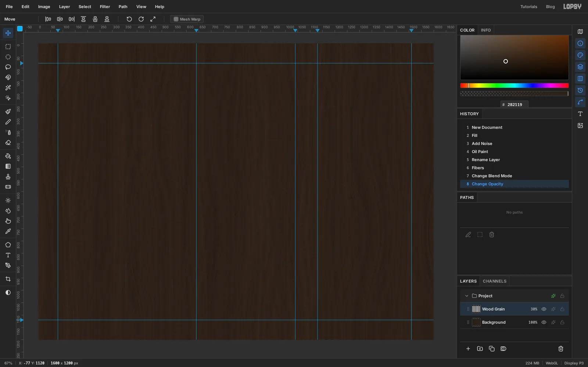

Choose **File → New** and make a document **1600** wide and **1200** high. Every new document keeps its layers inside a group called *Project*, with a *Background* layer and an empty *Layer 1*.

Click the *Background* layer, set the foreground to plywood `#2B2119` and choose **Edit → Fill**. Then add some texture: **Filter → Add Noise…** with **Amount 18**, and then **Filter → Oil Paint…** with its default settings. Oil Paint smears the noise into soft, blotchy strokes, like paint rolled onto rough wood.

For the grain, click the empty *Layer 1*, rename it *Wood Grain* and choose **Filter → Fibers…** with **Variance 24** and **Strength 40**. Fibers draws long vertical streaks. Set the layer's blend mode to **Overlay** and its opacity to **30%**, so the streaks only lighten and darken the brown underneath.

Finally drop some guides. Click the top ruler at **80**, **640**, **1040**, **1130** and **1510**, and the left ruler at **80** and **1120**:

- **80** and **640** frame the left column of type.
- **640** and **1040** are the edges of the first phone.
- **1130** to **1510** is roughly where the second, tilted phone goes.
- The two horizontal guides mark a margin 80 px inside the top and bottom of the board.

Shape and marquee edges snap to a guide when you drag close to one, which makes lining things up much easier.

## Frame it in red with a yellow pinstripe

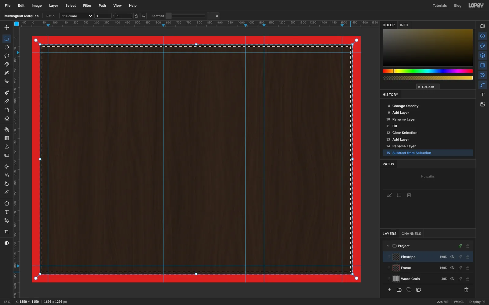

Add a layer called *Frame*. Set the foreground to barn red `#C8372D`, press [[Cmd+A]] and choose **Edit → Fill**. The whole canvas turns red. Now draw a marquee 40 px in from every edge of the canvas, and press [[Delete]]. That leaves a red band around the board.

Add a layer called *Pinstripe*. Draw the same marquee again, then hold [[Alt]] and draw a second marquee 10 px further in on every side. Holding Alt takes the second marquee away from the first, so you're left with a 10 px ring. Set the foreground to mustard `#F2C230`, fill it, and press [[Cmd+D]] to deselect.

> **Tip:** Watch the status bar while you drag. It shows the pointer's X and Y in document pixels, so you can land a marquee exactly.

## Run a row of dots around the frame

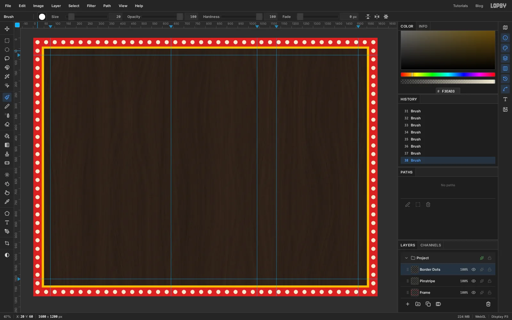

Painted borders of dots are the most recognisable outsider-art habit, and the Brush can make them perfectly even.

Add a layer called *Border Dots* and pick the **Brush**. Click the brush preset button at the left of the options bar, choose **Hard Round**, then open the **Shape** tab. Set **Size 20**, **Hardness 100** and **Spacing 200%**. At 200%, each dab lands two brush widths after the last one, so a line comes out as a row of separate dots, 40 px apart. Close the brush panel.

Set the foreground to cream `#F3EAD3`. The middle of the red band is 20 px in from the canvas edge. Click there in the top-left corner (**20, 20**), then [[Shift]]-click along the top, one dot short of the top-right corner (**1540, 20**). Shift-click draws a straight line from your last click.

Do the same for the other three sides, going clockwise: click in the middle of the band at each corner, then Shift-click along that side to one dot short of the next corner.

The corner dots are 1560 px apart across the board and 1160 px apart down it. Both divide evenly by 40, so every side ends exactly on a corner, and no dots pile up there.

## Paint the "BROTHER VERN'S" sign

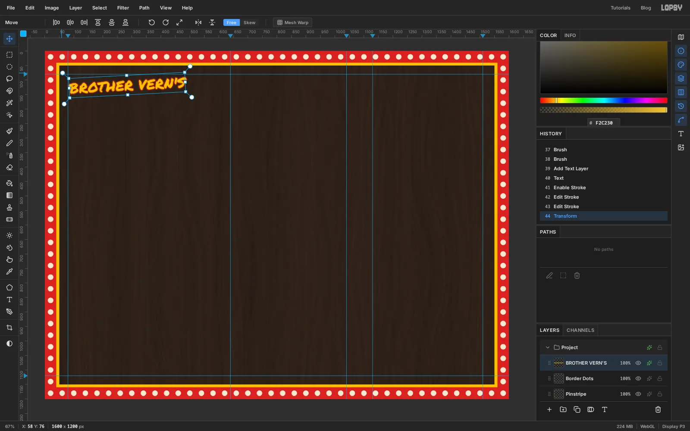

Set the foreground to mustard, pick the **Text** tool and click near the top-left corner of the board, just inside the first guide. Choose **Permanent Marker**, set **Size 48** and type `BROTHER VERN'S`. Press [[Tab]] to finish.

Open the layer's effects with the sparkle button on its row, tick **Stroke** and set **Width 3** with colour `#8E2A22`, a darker red. Sign painters outline their letters like this, so they stand out from a busy background.

Now give it a tilt. Pick the **Move** tool: handles appear around the text. Drag a round handle outside a corner of the box upwards by a few degrees, to about **-3°**. Text stays editable after you rotate it, so you can still fix a typo later. Press [[Cmd+D]] to finish the rotation.

## Draw a wavy underline with the Pen

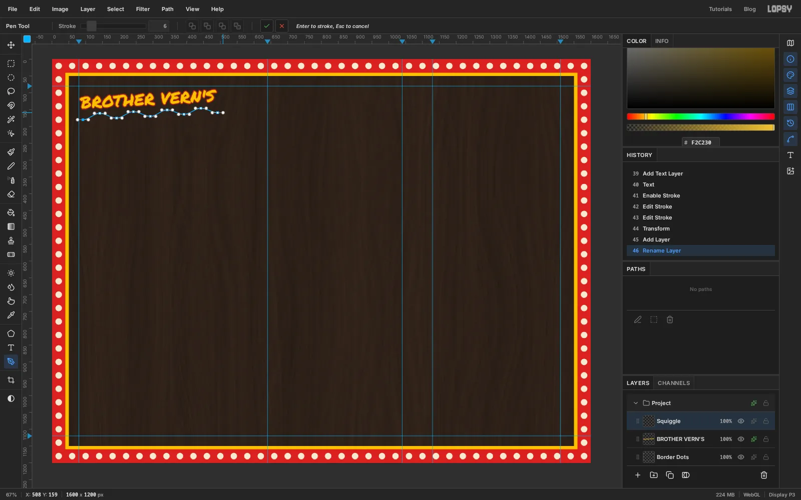

Add a layer called *Squiggle* and pick the **Pen** tool. Set its **Stroke** to **6** in the options bar. The stroke uses the foreground colour, so keep the mustard.

Under the sign, place nine anchor points from left to right, about 50 px apart, alternating a little above and below a line that rises gently to match the sign's tilt. Instead of just clicking each point, press and drag about 15 px to the right before you let go. That pulls out smooth handles, so the line curves through each point instead of making a sharp zigzag.

Press [[Enter]]. Lopsy saves the path to the **Paths** panel and strokes it onto the layer.

## Add a dotted line underneath

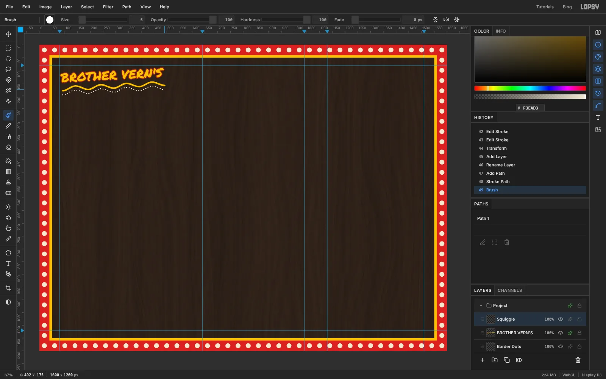

Pick the **Brush** again. Keep **Hard Round** and **Spacing 200%**, but set **Size 5**. Set the foreground to cream and paint one stroke that follows the squiggle about 15 px below it. The dots will be spaced evenly however fast you move.

The path is still selected, so its blue outline stays on screen. Open the **Paths** panel and click *Path 1* to deselect it.

## Set the title

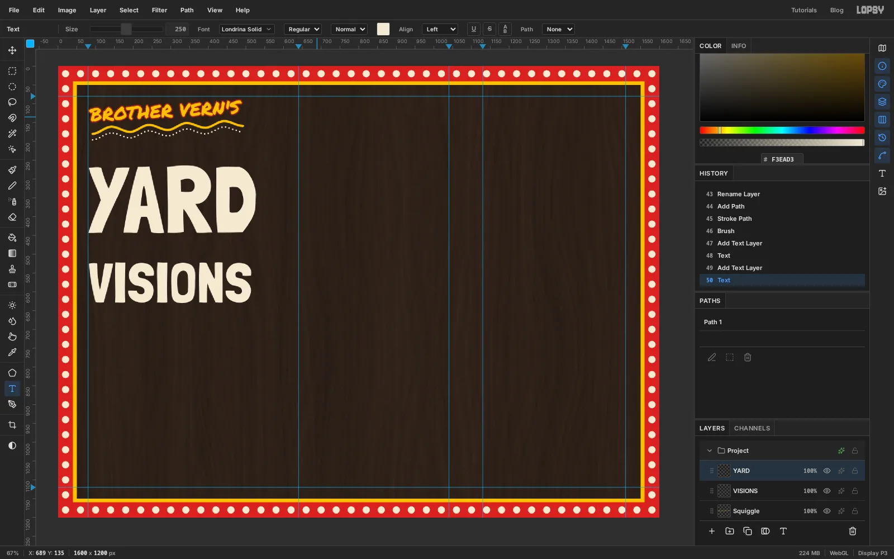

The two title words are big and stacked close together, so type the lower one first.

Set the foreground to cream. Pick the **Text** tool, choose **Londrina Solid** and **Size 150**, click just inside the first guide about halfway down the canvas, and type `VISIONS`. Press [[Tab]].

Click in clear space above it, just inside the first guide and a little below the dotted line, set **Size 250** and type `YARD`. Press [[Tab]].

## Paint each letter of YARD a different colour

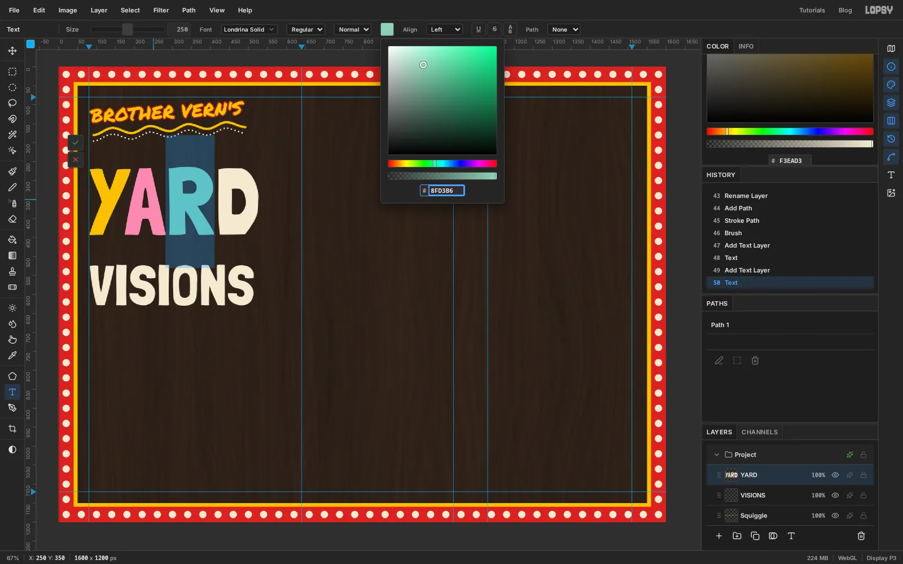

Outsider painters rarely stick to one colour per word. Click inside YARD with the Text tool to edit it, and press [[Home]] to put the cursor before the Y.

Press [[Shift+Right]] to select the Y. Click the **Text color** swatch in the options bar and type `F2C230` into the hex field. Only the selected letter changes. Press [[Esc]] to close the picker, then [[Right]] to move past the letter.

Repeat for the next three letters: A in pink `#EE8FB0`, R in mint `#8FD3B6` and D in orange `#E8772E`. Press [[Tab]] when you're done.

## Scale both words up

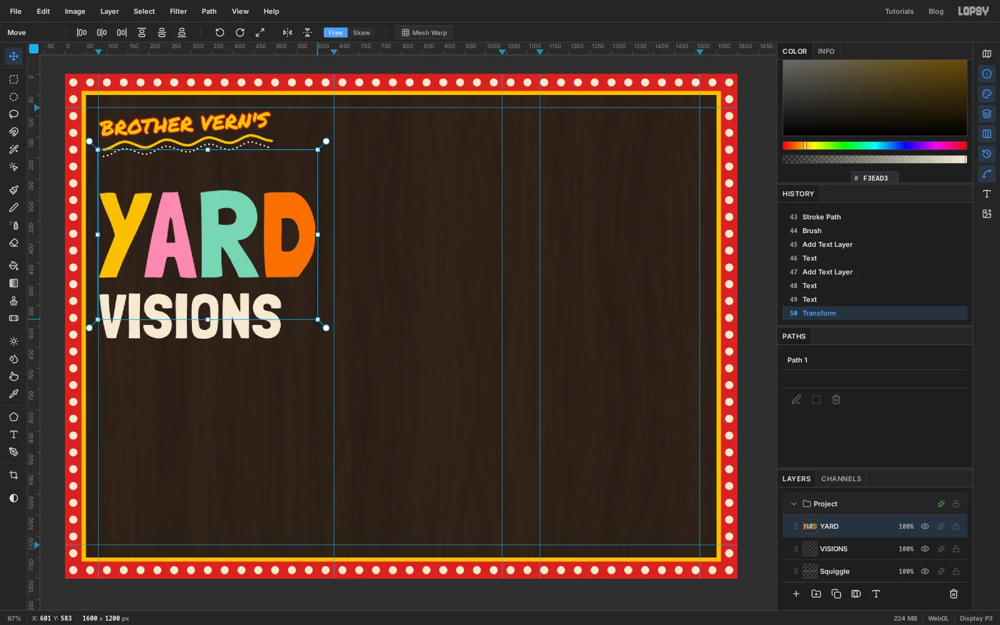

Both words should fill the left column. With *YARD* selected, pick the **Move** tool. Hold [[Cmd]] and drag the bottom-right corner handle out until the right edge of the D is just short of the second guide. Holding Cmd keeps the proportions locked. Press [[Cmd+D]] to finish.

Click *VISIONS* in the Layers panel and do the same, stretching it until it's as wide as YARD. Text keeps its scale as live text, just like the rotation earlier.

## Move both words together

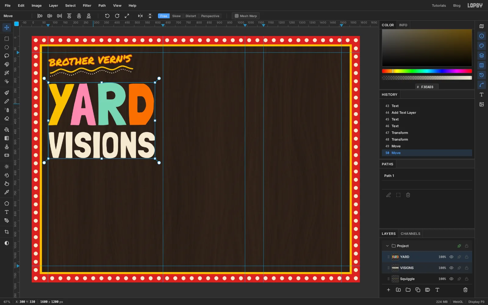

There's too much space between the sign and the title. Click *YARD* in the Layers panel and [[Shift]]-click *VISIONS*. With two layers selected, the Move tool's box goes around both.

Drag them up together until YARD sits just under the dotted line, about 50 px higher. If VISIONS ended up too far below YARD, select it on its own and drag it up so the two words nearly touch.

## Give the letters a sign painter's shadow

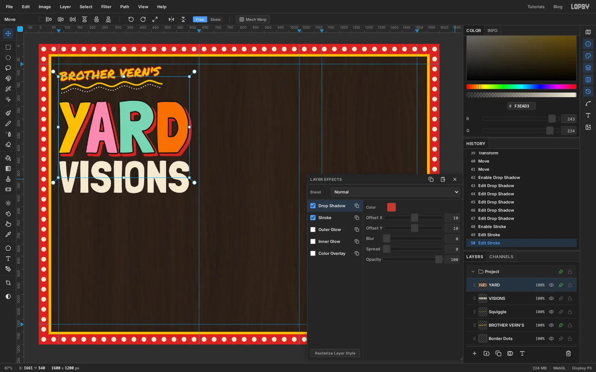

Open the effects for *YARD*. Tick **Drop Shadow** and set the colour to barn red, **Offset X 10**, **Offset Y 10**, **Blur 0**, **Spread 0** and **Opacity 100**. With no blur, the shadow becomes a solid red copy of each letter, offset to the side, like a painted 3D sign. Then tick **Stroke**, set the colour to ink `#1A1612` and the **Width** to **5**.

Click **Copy effects** at the top of the drawer. Open the effects for *VISIONS* and click **Paste effects**. Both effects are copied across at once.

## Rough up the paint and add a row of dots

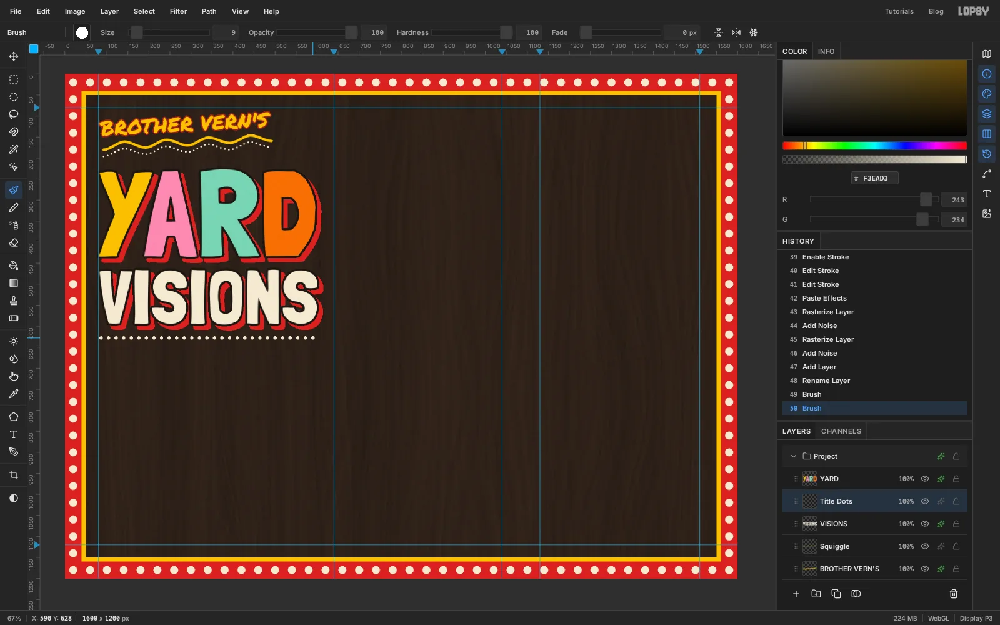

Flat type looks too clean for house paint. Click *YARD* and click **Rasterize Layer** at the bottom of the Layers panel, which turns the text into ordinary pixels. Then choose **Filter → Add Noise…** with **Amount 12**. Do the same for *VISIONS*. The effects stay on both layers.

Add a layer called *Title Dots*. Pick the **Brush** with **Hard Round**, **Size 9** and **Spacing 200%**, and the foreground set to cream. Click under the V of VISIONS, about 30 px below the shadow, and [[Shift]]-click under the S so the dots run straight across the column.

> **Tip:** Rasterizing is permanent: you can't edit the words afterwards. Make sure the spelling and size are right first.

## Write the tagline

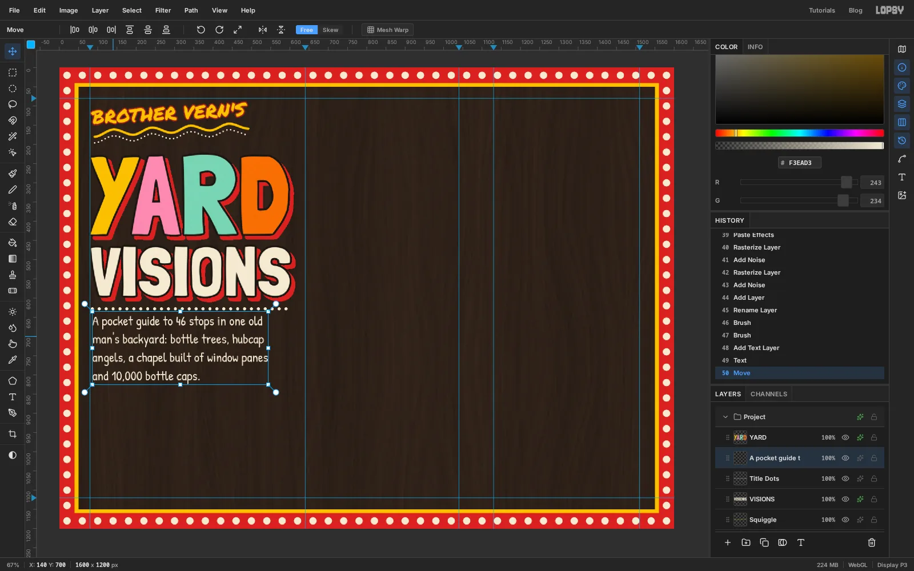

Set the foreground to cream and pick the **Text** tool. Instead of clicking, drag a box across the column, from the first guide to just short of the second one, below the row of dots. That makes *area text*, which wraps inside the box's width.

Choose **Patrick Hand**, **Size 34**, and type:

`A pocket guide to 46 stops in one old man's backyard: bottle trees, hubcap angels, a chapel built of window panes and 10,000 bottle caps.`

Press [[Tab]]. If the paragraph sits too close to the dots or too far below them, use the Move tool to drag it so there's about one line's gap above it.

## Nail up a plank sign

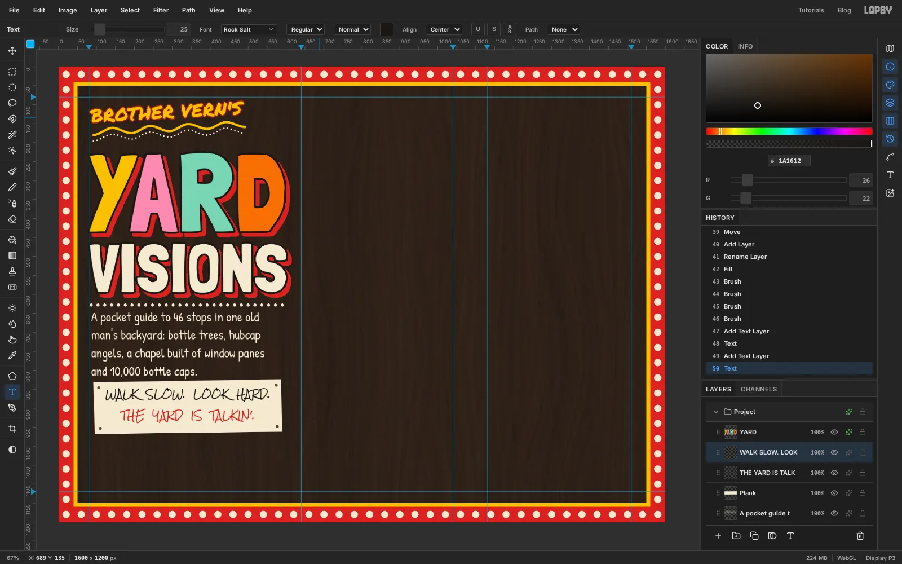

Add a layer called *Plank*. Set the foreground to cream and pick the **Lasso** tool. Draw a slightly wonky rectangle under the tagline, from the first guide to the second, about 140 px tall. Drag one corner a few pixels out of line so it doesn't look machine-cut. Choose **Edit → Fill** and deselect.

For nails, pick the **Brush** with **Hard Round**, **Size 9**, set the foreground to `#5A4A3C` and click once in each corner, about 12 px in from both edges.

Now the lettering. Pick the **Text** tool, choose **Rock Salt**, **Size 25** and **Align: Center**. With centre alignment, your click becomes the middle of the line. Set the foreground to barn red, click in the middle of the plank about halfway down, and type `THE  YARD  IS  TALKIN'.` with two spaces between words. Rock Salt's own word gaps are very narrow, so the extra space helps it read. Then set ink `#1A1612`, click in the middle of the plank near its top, and type `WALK  SLOW.  LOOK  HARD.` Check that both lines clear the nails.

## Tilt the sign

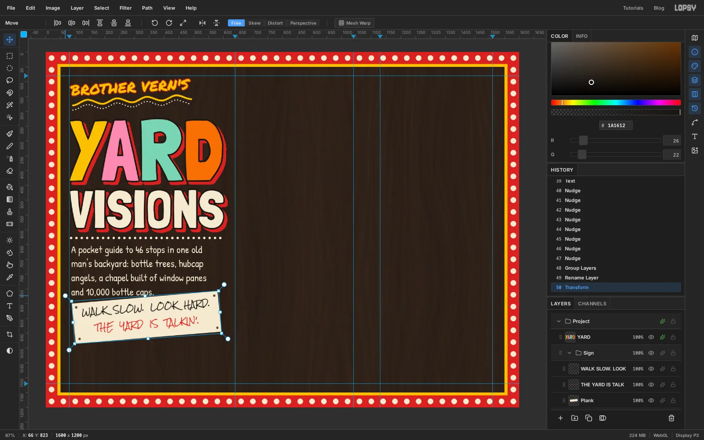

A nailed-up board is never quite straight. In the Layers panel, click the *WALK SLOW. LOOK* layer and [[Shift]]-click *Plank*, so all three layers are selected. Choose **Layer → Group Layers** and name the group *Sign*.

With the group selected, pick the **Move** tool. Drag the rotation handle beside a corner of the box to turn it about **4°** anticlockwise, then press [[Cmd+D]]. The plank and the text turn together, by the same amount.

Press [[Shift+Down]] twice and [[Down]] twice to nudge the sign down 22 px, leaving a little more space under the tagline.

## Scorch the edges

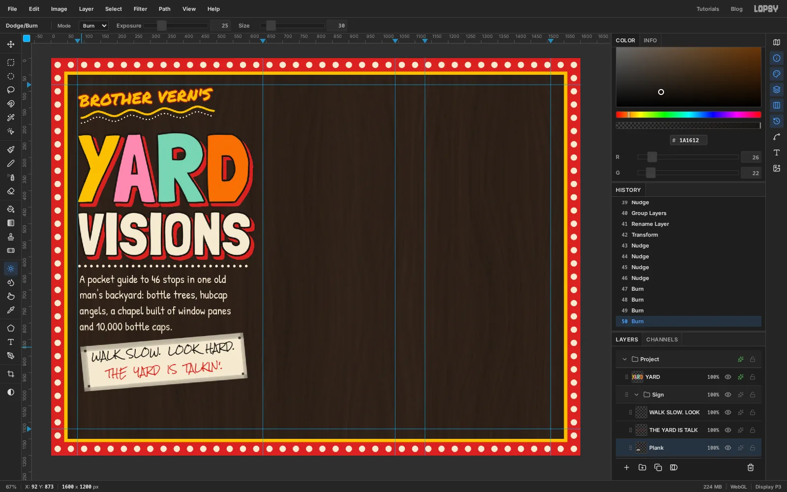

Click the *Plank* layer inside the group. Pick the **Dodge** tool, set the mode to **Burn** in the options bar, with **Exposure 25** and **Size 30**.

Make one stroke along each of the four edges of the plank, following its tilt. Burn darkens what you paint over, and the brush only touches the plank's own pixels, so it won't stain the board underneath. One pass on each edge is enough.

## Add the call to action

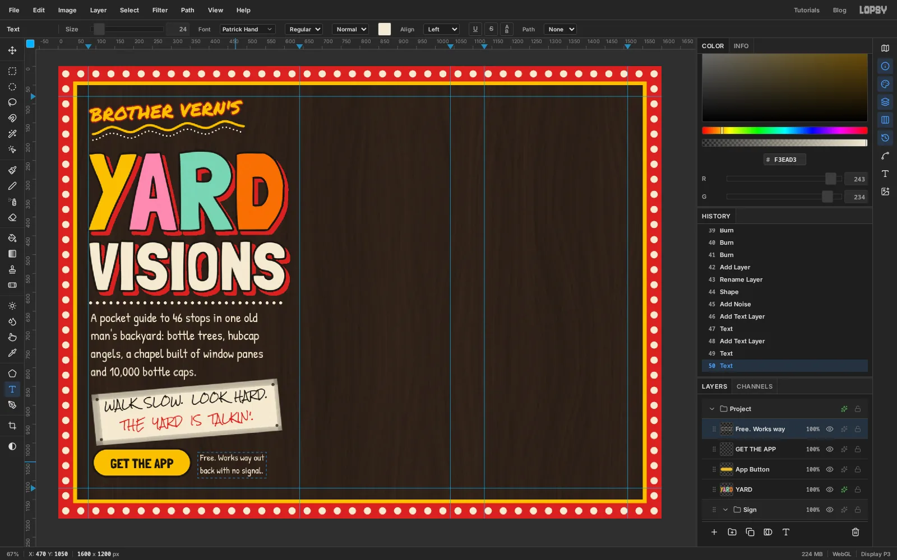

Click *YARD* so new layers go above the title, and add a layer called *App Button*.

Pick the **Shape** tool, set **Shape** to **Rectangle**, fill mustard, stroke ink, stroke **Width 5** and **Corner Radius 37**. The button is 260 × 74 px, with its left end on the first guide and about 90 px under the sign. Press where its centre should go and drag out to a corner, or click once there and type the size into the dialog. A corner radius of half the height makes the ends fully round. Add **Filter → Add Noise…** with **Amount 10**, so the button has the same grain as the title.

Pick the **Text** tool with **Londrina Solid**, **Size 36**, **Align: Center** and the foreground set to ink. Click in the middle of the button, about half the text size above centre (see the tip at the start), and type `GET THE APP`.

To the right of the button, drag a narrow text box up to the second guide and type `Free. Works way out back with no signal.` in **Patrick Hand**, **Size 24**, in cream, left-aligned.

## Build the first phone

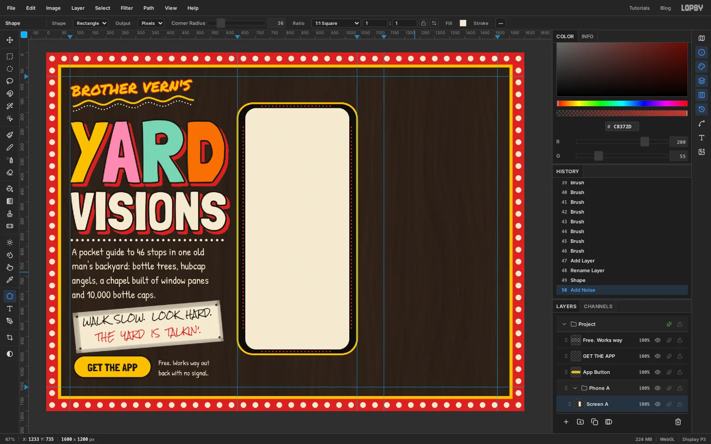

Click *YARD* and click **New Group** under the Layers panel. Name the group *Phone A*. Layers you add now go inside it.

Add a layer called *Body A*. With the **Shape** tool, set a black `#0F0D0B` fill, a mustard stroke of **Width 6** and **Corner Radius 52**. Press halfway between the 640 and 1040 guides, a little above the middle of the canvas (at about 840, 590), and drag out towards the 1040 guide. The edge snaps onto it, giving a 400 × 840 px phone whose sides sit exactly on the two guides.

Painted objects in outsider art get decorated too, so give the bezel some dots. Pick the **Brush** with **Hard Round**, **Size 6**, **Spacing 200%** and barn red. Click and [[Shift]]-click down the middle of the left side of the bezel, then the right side, then along the top and bottom.

Add a layer called *Screen A*. Draw a cream rectangle with no stroke and **Corner Radius 36**, 348 × 808 px, from the same centre. Use the click-to-size dialog here, so the screen's edge doesn't snap to the guides too. Give it **Filter → Add Noise…** at **Amount 6**. That's just enough grain to make the screen look painted on the same board.

## Spray paint the yard

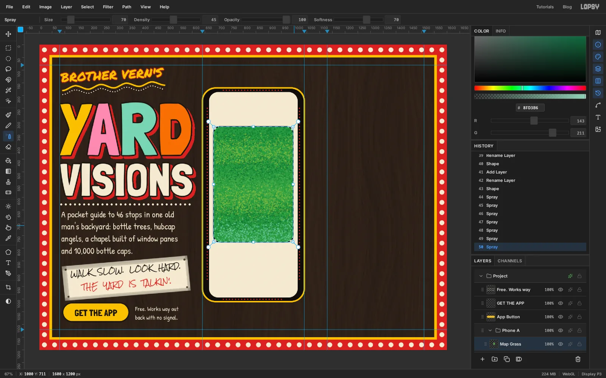

The map sits under a heading, so leave about 130 px at the top of the screen.

Add a layer called *Map Grout*. With the **Shape** tool, draw a dark green `#1E3F25` rectangle with an ink stroke of **Width 4** and **Corner Radius 26**, 312 × 454 px, centred left to right on the phone with its top about 135 px below the top of the screen. Above it, add a layer called *Map Grass* and draw the same rectangle again from the same centre, filled grass green `#4E9A4B`, with no stroke.

[[Cmd]]-click the *Map Grass* thumbnail in the Layers panel to select its pixels. Pick the **Spray** tool and set **Size 70**, **Density 45** and **Opacity 100**. Then spray zigzags across the map, switching between four greens as you go: dark `#2F6B36`, mid `#6FB35A`, light `#9BC254` and mint `#8FD3B6`. The selection keeps the paint inside the map.

## Break it into a mosaic

With the selection still active, choose **Filter → Voronoi…** and set **Cells 26**, **Edge Width 2.5** and **Seed 7**. Click **Apply**, then press [[Cmd+D]].

Voronoi splits the image into irregular cells and fills each one with a single colour picked from it. The sprayed speckles become tiles in many shades of green, like the broken-tile paths in folk gardens. The darker *Map Grout* layer shows through around the edge like grout.

> **Tip:** The **Seed** picks a different layout of cells. Try a few until you like how the tiles fall.

## Draw the path, the pond and the chapel

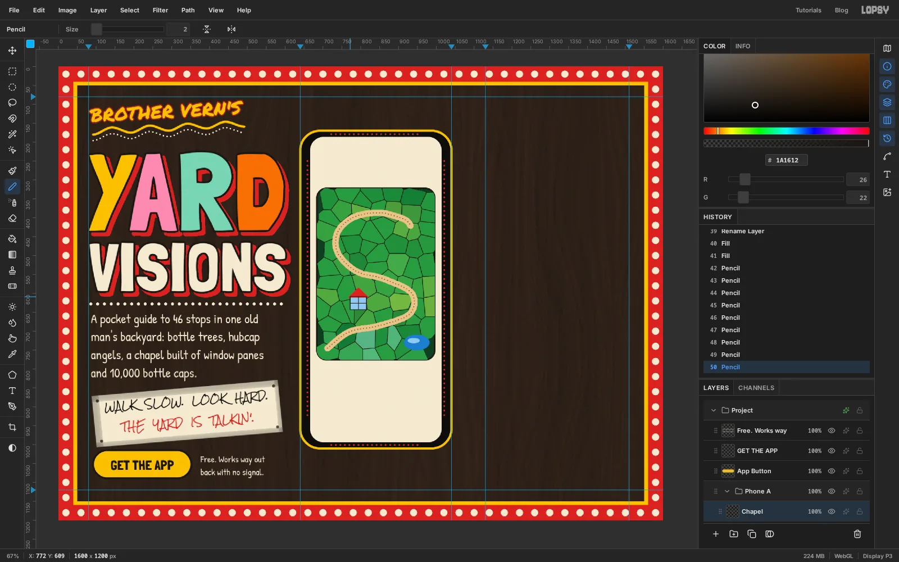

Add a layer called *Footpath*. Pick the **Brush** with **Hard Round**, **Size 18**, **Hardness 90**, set **Spacing** to **5%** for a smooth line, and choose sandy `#E3C58F`. Paint one smooth S-shaped stroke from the bottom-left of the map up to the top-right.

Add a layer called *Footsteps*. Set the brush to **Size 4** and **Spacing 200%**, choose brown `#8A6A3C`, and trace along the middle of the path. That gives a dotted line, like footprints.

Add a layer called *Pond* and use the **Elliptical Marquee** to fill a blue `#3D7DCA` oval at the bottom right, then a smaller pale `#9CC7EE` oval near its top-left for a reflection.

Add a layer called *Chapel*. In the empty space left of the path, fill a 44 × 34 px marquee with glass blue `#9CC7EE`, then use the **Lasso** to fill a barn-red triangle on top for the roof. Pick the **Pencil**, set **Size 2** and ink. Click at one corner of the chapel and [[Shift]]-click round the other three corners and back to the first for an outline. For the window bars, click at the middle of the top edge and Shift-click the middle of the bottom edge, then do the same from left to right.

## Number the stops

Add a layer called *Stop Markers*. With the **Shape** tool set to **Ellipse**, a red fill and a cream stroke of **Width 3**, hold [[Cmd]] and drag a 32 px circle at each of six points along the path. Cmd keeps them perfectly round.

Stop 7 is where you're heading, so make it stand out. Switch to a mustard fill with an ink stroke of **Width 4** and draw a bigger, 44 px circle at the end of the path.

Pick the **Text** tool with **Londrina Solid**, **Size 22** and **Align: Center**. Set the foreground to cream and click just above the middle of each red circle to type its number, 1 to 6. Then set ink, **Size 28**, and type the `7` in the yellow circle.

## Add the next-stop card and the header

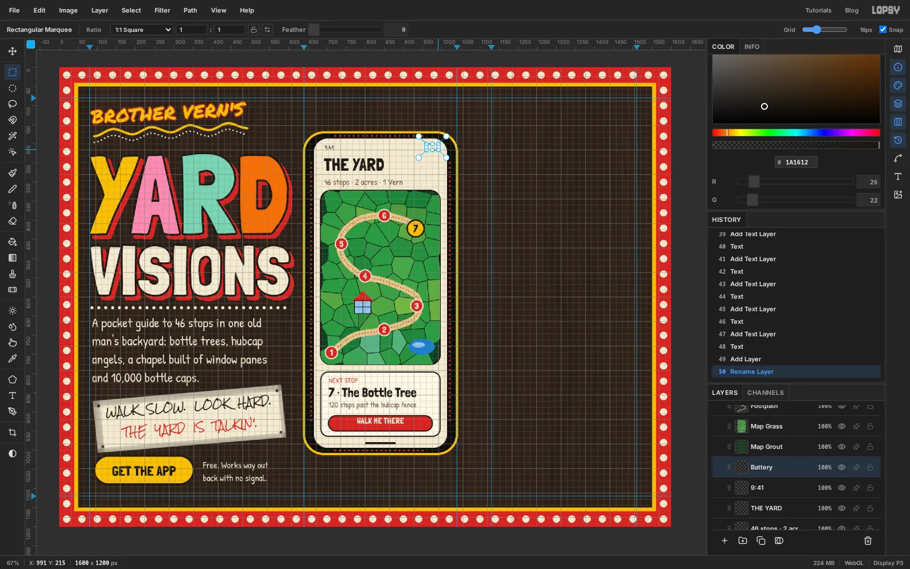

Click *Screen A* and add a layer called *Card A*. With the **Shape** tool, draw an off-white `#FFF8E8` card with an ink stroke of **Width 3** and **Corner Radius 20**, 312 × 168 px, in the space under the map. Keep its sides in line with the map's.

Inside it, near the bottom, draw a red button with an ink stroke of **Width 3** and **Corner Radius 22**, 272 × 40 px, leaving about 14 px of card below it. Then draw a tiny 80 × 6 px ink pill with no stroke, centred near the bottom of the screen. That's the home bar.

Add the card's text from the bottom up, all with the Text tool:

1. `WALK ME THERE` in **Londrina Solid**, **Size 22**, cream, **Align: Center**, clicked in the middle of the button.
2. `120 steps past the hubcap fence` in **Patrick Hand**, **Size 20**, grey `#6B5A48`, **Align: Left**.
3. `7 · The Bottle Tree` in **Londrina Solid**, **Size 34**, in ink.
4. `NEXT STOP` in **Patrick Hand**, **Size 18**, in red.

Line up the left edges of the last three with the button.

Then the header at the top of the screen, about 25 px in from its left edge, again from the bottom up: `46 stops · 2 acres · 1 Vern` in **Patrick Hand**, **Size 22**, grey; `THE YARD` above it in **Londrina Solid**, **Size 46**, ink; and `9:41` at the very top in **Patrick Hand**, **Size 18**.

Small icons are easier to draw on a grid. Add a layer called *Battery* and choose **View → Show Grid**. Showing the grid turns on snapping, so marquee corners land on grid lines. The grid starts at 16 px cells. Level with the 9:41, near the right edge of the screen, drag a marquee two cells wide and one cell tall.

## Finish the battery

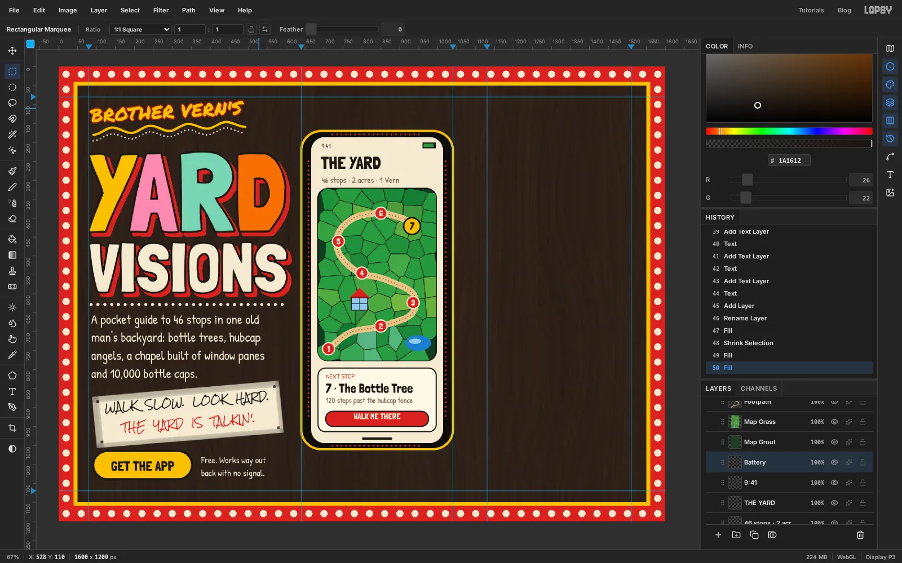

Fill the marquee with ink. Choose **Select → Shrink…** with **3** px and fill the smaller selection grass green, then deselect.

Choose **View → Show Grid** again to hide the grid and turn its snapping off. Now fill a tiny 3 × 6 px marquee against the middle of the battery's right end for its tip.

## Build the second phone

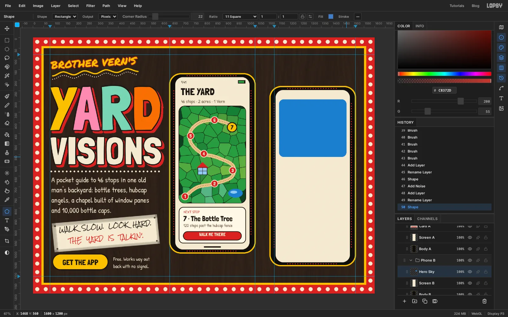

Click *YARD* again and click **New Group**, naming it *Phone B*. Clicking *YARD* first makes the new group sit beside *Phone A* instead of inside it.

Add layers called *Body B* and *Screen B* and build them exactly as before: a 400 × 840 black body with a mustard outline and red bezel dots, and a 348 × 808 cream screen with a little noise. Centre this phone 60 px lower than the first (at about 1310, 650), and drag the body out to the 1510 guide. The staggered heights keep the two phones from lining up like a grid.

Add a layer called *Hero Sky* and draw a sky-blue rectangle with **Corner Radius 22**, 316 × 270 px, near the top of the screen, leaving room above it for a status bar.

## Paint the ground

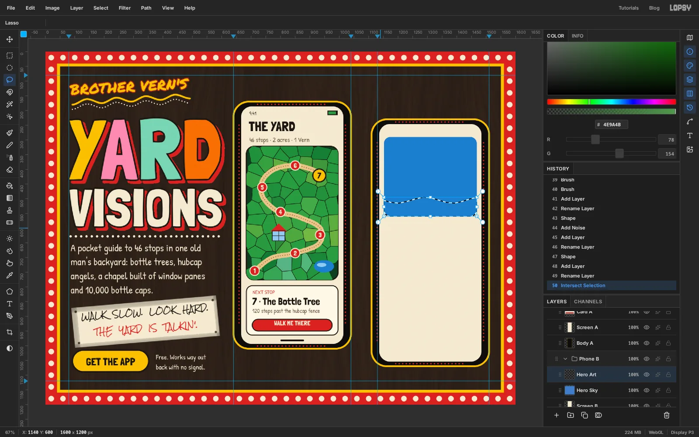

Add a layer called *Hero Art*. [[Cmd]]-click the *Hero Sky* thumbnail to select the picture area.

Pick the **Lasso**, hold [[Shift+Alt]] and draw a shape whose top edge is a gentle wave across the lower third of the picture, with its other sides well outside the picture. Shift+Alt keeps only the overlap of the two selections, so you get a ground shape with rounded bottom corners that match the picture exactly.

Fill it grass green and deselect.

## Paint a smiling sun

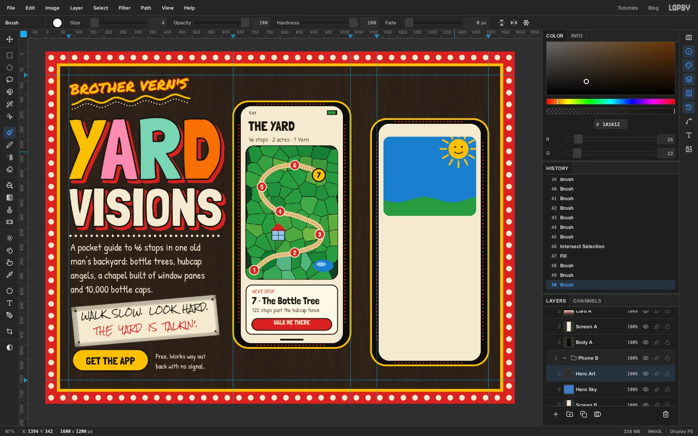

[[Cmd]]-click the *Hero Sky* thumbnail again, so nothing you paint can spill outside the picture.

Pick the **Brush** with **Hard Round**, **Size 7**, **Spacing 5%** and mustard. Paint twelve short rays around a point in the top-right corner, like the numbers on a clock. Then, with the **Elliptical Marquee**, hold [[Shift+Alt]] and drag a circle in the middle of the rays. Shift+Alt keeps only the part of the circle inside the picture selection. Fill it mustard.

Deselect, pick the **Brush** with ink, and click twice for eyes. Drop to **Size 4** for a curved smile.

## Hang bottles on the tree

Select the picture again with a [[Cmd]]-click on *Hero Sky*. With the **Brush**, paint a trunk in bark `#5A3A22` at **Size 16**, from the ground up to the middle of the sky. At **Size 8**, add six branches that fan out and up from it.

For stars, open the brush presets, pick **Star**, and set **Size 22** and **Spacing 100%**. With the foreground set to cream, click a few times in the empty sky. Each click stamps one star.

Add a layer called *Bottles*. With the **Shape** tool set to **Rectangle**, an ink stroke of **Width 2** and **Corner Radius 7**, drag a small 18 × 32 px bottle hanging from the tip of each branch. Use blue `#1F4FB8`, green `#2E9B6B`, sky `#3D7DCA` and mint `#8FD3B6`. Finish with a glint: switch the brush back to **Hard Round** at **Size 3** and paint a short white `#FFFFFF` stroke down the left side of each bottle.

## Add the player and buttons

Add a layer called *UI B*. With the **Shape** tool, draw these in order from the bottom of the screen up. Every stroke is ink, **Width 3**:

- an 80 × 6 px **Rectangle** home bar in ink with no stroke and **Corner Radius 3**, centred near the bottom of the screen
- a 236 × 52 px **Rectangle** pill in grass green with a stroke and **Corner Radius 26**, near the bottom left, above the home bar
- a 52 px pink **Ellipse** beside it, centred on the same line as the pill. Hold [[Cmd]] while you drag so it stays round.
- a 316 × 164 px off-white `#FFF8E8` **Rectangle** quote card with a stroke and **Corner Radius 18**, above the buttons
- a 56 px red **Ellipse** for a play button, with a stroke, on the left a little under halfway down (hold [[Cmd]] again)

Use the **Lasso** to fill a cream triangle inside the play button.

For the waveform, pick the **Pencil** at **Size 5**. For each bar, click above the play button's middle line and [[Shift]]-click the same distance below it. Make 26 bars, 9 px apart, with uneven heights. Paint the first ten red, for the part already played, and the rest in beige `#BFAF94`.

Add a layer called *Battery B* and fill a battery at the top right of the screen as before.

## Letter the stop

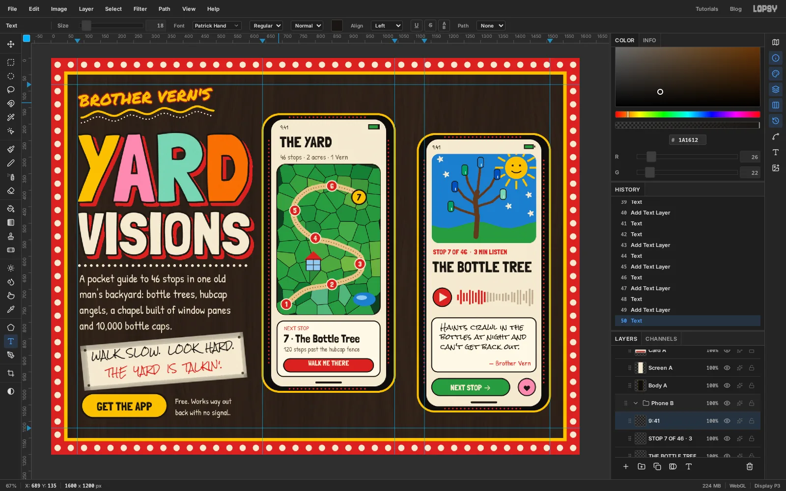

As before, type from the bottom of the screen up:

1. `NEXT STOP →` in **Londrina Solid**, **Size 24**, cream, **Align: Center**, clicked in the middle of the green pill, with one space before the arrow.
2. `♥` at **Size 22** in ink, centred in the pink circle. To type the heart, paste it, or insert it from your system's emoji and symbols picker.
3. `— Brother Vern` in **Patrick Hand**, **Size 22**, red, **Align: Right**, clicked about 16 px in from the card's right edge, near its bottom.
4. The quote in **Rock Salt**, **Size 21**, ink, **Align: Left**. Press [[Enter]] for each new line: `Haints crawl in the`, `bottles at night and`, `can't get back out.`
5. `THE BOTTLE TREE` in **Londrina Solid**, **Size 46**, in ink, under the picture.
6. `STOP 7 OF 46  ·  3 MIN LISTEN` in **Londrina Solid**, **Size 21**, red, just above the title. A heavier face keeps such small red text readable on cream.
7. `9:41` in **Patrick Hand**, **Size 18**, at the top left.

## Rotate the whole phone

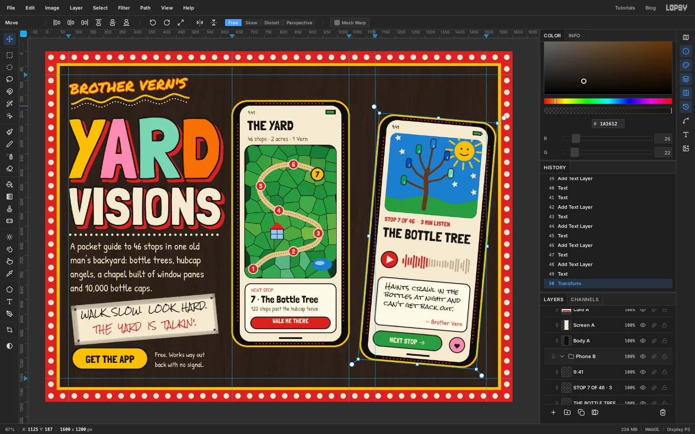

Click the *Phone B* group in the Layers panel and press [[Cmd+D]] to make sure there's no selection. Pick the **Move** tool. The transform box now goes around everything in the group.

Drag the rotation handle beside a corner of the box to turn the phone about **5°** clockwise. Every layer turns about the same centre, including the text, which stays editable. Press [[Cmd+D]] to finish.

The tilted phone now reaches a little too far right. Press [[Shift+Left]] once and [[Left]] eight times to move it 18 px left.

> **Tip:** The group's box can be wider than the phone itself. Grab the round rotation handle just outside a corner of the box. If you press inside the box, you'll move the phone instead.

## Lift the phones off the board

Open the effects for *Body A*. Tick **Drop Shadow**, set the colour to black, **Offset X 14**, **Offset Y 16**, **Blur 22**, **Spread 0** and **Opacity 70**. Click **Copy effects**, open the effects for *Body B* and click **Paste effects**.

The shadow only needs to be on the bodies. Everything else on each phone sits on top of the body, so the whole phone appears to float.

## Make a bottle cap

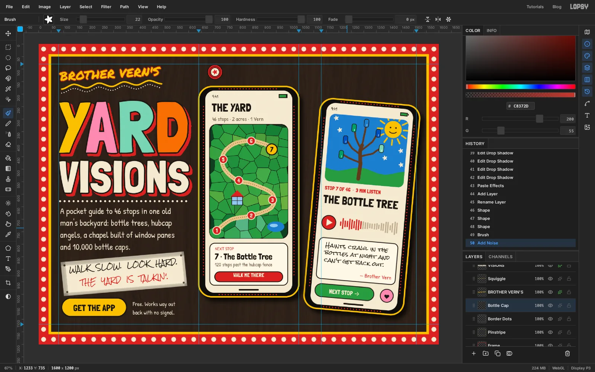

Click *Border Dots* and add a layer called *Bottle Cap*. Putting it this low in the stack means caps can tuck behind the phones.

Pick the **Shape** tool and set **Shape** to **Polygon**, **Sides 18**, a red fill and an ink stroke of **Width 3**. Hold [[Cmd]] and drag a 60 px polygon in the gap above the first phone. Eighteen sides is just enough to look like a crimped edge.

Switch to **Ellipse**, click **Remove fill** in the fill swatch, and set a dark red `#7A1E18` stroke of **Width 3**. Drag a 44 px ring from the same centre. Click the fill's **—** button to turn the fill back on, set it to cream, and set an ink stroke of **Width 2**. Draw a 34 px circle in the middle. With the **Brush** set to the **Star** tip at **Size 22**, stamp a red star in the centre.

Finish with **Filter → Add Noise…** at **Amount 14**. The speckle reads as wear and rust.

## Copy, paste and move a cap

Draw a marquee around the cap and press [[Cmd+C]], then [[Cmd+D]].

Press [[Cmd+V]]. The copy lands on a new layer exactly on top of the original, already selected, with the Move tool active. Drag it to a new spot.

## Scale a cap

Real bottle caps vary in size. While the pasted cap is still selected, hold [[Cmd]] and drag a corner handle outwards to make it about 10% bigger, or inwards to make the next one smaller.

## Rotate a cap and change its colour

Drag the rotation handle beside a corner to turn the cap by 15° to 25°. You can see it in the star. Press [[Cmd+D]] to finish.

To change the colour, choose **Filter → Hue/Saturation…** and drag **Hue**. With no selection, the filter changes the whole layer, which is just this one cap. Hue goes from **-180** to **180**. Starting from red, about **60** gives yellow, **120** green, **180** cyan, and somewhere between **-120** and **-140** blue.

## Scatter the caps

Repeat [[Cmd+V]], move, scale or rotate, and change the hue until you've made ten copies, eleven caps in all. Avoid a neat grid:

- along the top, stagger them up and down and mix the sizes
- tuck one half behind the right edge of the first phone, so it looks wedged in
- put a few in the empty strip below the phones, clear of the button text and the frame

Check the colours too. I ended up with three cyan caps, so I clicked two of them and ran **Hue/Saturation** again, turning them blue and magenta. When you're happy, click the top *Pasted Layer* and press [[Cmd+E]] repeatedly to merge each cap down until they're all on *Bottle Cap*. Rename it *Bottle Caps*.

## Fill the gaps with hand lettering

Outsider artists squeeze sayings into every gap. Pick the **Text** tool with **Rock Salt**, **Align: Center**:

- In cream at **Size 17**, in the gap between BROTHER VERN'S and the first phone, type `OPEN DAWN` then [[Enter]] and `'TIL DARK`.
- In mustard at **Size 22**, in the strip under the first phone, click in the middle and type `STAY  ON  THE  PATH!` with double spaces. Use the arrow keys to nudge it until it's centred under the phone.

Leave a little breathing room around each saying, so it doesn't touch the caps or the phones.

Add a layer called *Stars* and stamp a few small stars with the **Brush**'s **Star** tip at **Size 20**, in cream and mustard, in the gutters between the phones and beside the plank.

## Age the corners

Click *Border Dots* and add a layer called *Grime*. Choose **Filter → Clouds…** with **Scale 6**. Set the layer's blend mode to **Multiply** and its opacity to **45%**. Multiply only darkens, so the cloudy greys smudge everything under them.

The middle of the board should stay clean and dark, so keep the grime to the corners. Click **Add Mask**, then pick the **Gradient** tool. Set **Type** to **Radial**, open **Advanced…** and set three stops: black at **0%**, black at **55%** and white at **100%**. Drag from the centre of the canvas to the bottom-right corner. Black in a mask hides the layer, so the grime fades out of the middle and stays in the corners.

The canvas is tinted blue while you're editing a mask. Click the *Grime* layer's name to leave mask editing and see the real colours.

## Clone a couple more stars

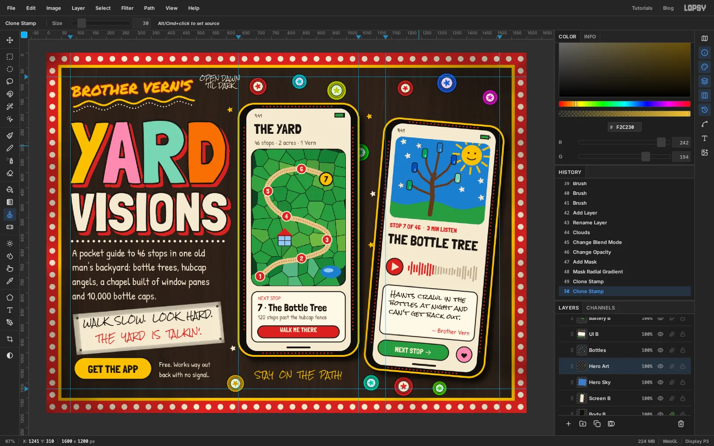

The sky in the bottle-tree picture looks a little empty. Click *Hero Art* and pick the **Clone Stamp** at **Size 30**. [[Alt]]-click the middle of one star to set it as the source, then click once in an empty patch of sky. A copy of the star appears there.

The Clone Stamp keeps the same distance between the source and where you paint. To place another star somewhere else, [[Alt]]-click the star again first.

## Tone it down slightly

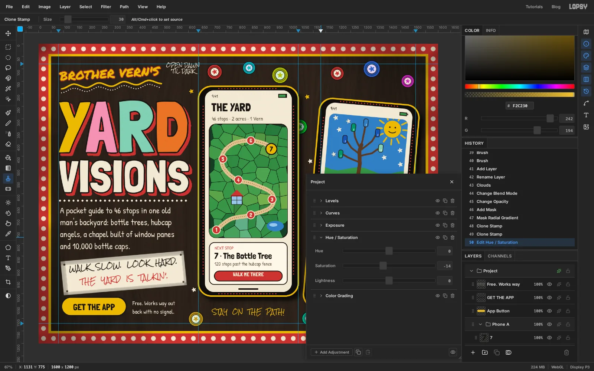

House paint is bright, but a full-strength screen glare isn't. Click the *Project* group and choose **Layer → Adjustment Layer…**. The first time, a note explains how group adjustments work: click **Got it**. Lopsy opens the group's adjustments, which apply to everything inside the group without changing any layer's pixels.

Expand **Hue / Saturation** and set **Saturation** to **-14**. The colours settle a little, like paint that has had a few summers of sun. You can switch it off or change it at any time.

Save with **File → Save Project**, and export a PNG with **File → Quick Export PNG**.
