Before you cut a spray stencil you have to *separate* the picture. That means
deciding which shapes go on which colour plate. Stencil artists often
photograph each plate and proof as they go, and a page of those little frames
is a handy record of how the design was built. In photography that page is a
*contact sheet*.

In this tutorial you'll make **Zebra Finch**, an 1800 × 1200 px contact sheet
for an imaginary three-plate stencil. Two black 35mm film strips hold six
frames: the source photo, three cut kraft-board plates (grey, warm and a black
*key*), a good sprayed proof circled in grease pencil, and a reject where the
key plate slipped off register. On the right, a *maquette* is taped up. It's
a photomontage made from the same photo, with a red sun, a torn halftone band
and a slogan in cut-paper strips: zebra finches learn their song by copying a
tutor, so **every song is a copy**.

The bird comes from a photo:
[Zebrafink (Taeniopygia guttata)](https://commons.wikimedia.org/wiki/File:Zebrafink_%28Taeniopygia_guttata%29.jpg)
by HLI-Photography on Wikimedia Commons. It is released under **CC0**, so
you can use it freely. Download the 1920 × 1280 px version from the file
page.

Two ideas keep the build manageable:

- **The plates are designed once, at full size**, on top of the cut-out
  bird. Then they're grouped and scaled down into a frame together, so the
  three colours stay in register.
- **Frames repeat every 354 px across and 360 px down**, so a copy can be
  moved to the next frame with arrow keys. [[Shift]]+arrow moves 10 px at a
  time.

Along the way you'll use:

- ruler **guides**, **Snap to Guides**, **Define Pattern** and **Fill with Pattern**
- the **Lasso**, **Magic Wand** (Contiguous on and off) and **Rectangular Marquee** with [[Shift]] and [[Alt]], the **Elliptical Marquee**, **Grow**, **Shrink**, **Feather** and **Select → Inverse**
- **Quick Mask** to paint a selection
- **Threshold**, **Desaturate**, **Brightness/Contrast**, **Halftone**, **Texture** and **Clouds**
- **Group Layers**, **Duplicate Layer** and scaling and rotating several layers at once with the **Move** tool
- the **Spray**, **Brush**, **Gradient** and **Shape** tools
- layer effects (**Drop Shadow**, **Inner Glow**, **Stroke**) and the **Multiply** blend mode
- **Text** in Big Shoulders Stencil, Space Mono and Reenie Beanie, including recolouring one word
- undo and redo

The palette:

- Photo paper `#E2DCCF`, film `#141312`, edge print `#D8C9A2`
- Bench `#2A2622`, kraft board `#B48F5E`, proof paper `#F3EFE4`
- Plate grey `#8C8E8F`, warm orange `#E2772C`, key black `#1B1A19`
- Maquette cream `#F3E6C6`, sun red `#D2352A`, leaf teal `#3E6B6A`
- Grease pencil `#C8302A`, captions `#3A3631`, credit `#5A554D`, tape `#E6DCBC`

## Set up the sheet and the guides

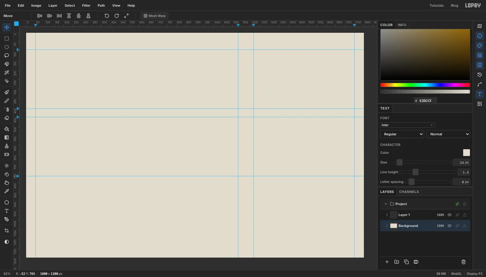

1. Choose **File → New**, set **Width** `1800` and **Height** `1200` px with a **White** background, and click **Create**.
2. Click the **Background** layer, set the foreground colour to `#E2DCCF` and choose **Edit → Fill**.
3. Click the top ruler at `50`, `1130`, `1212` and `1750` to drop four vertical guides. The first two bound the film strips. The second two bound the maquette.
4. Click the left ruler at `90`, `405`, `450` and `765` to drop four horizontal guides, the top and bottom of each film strip.
5. Make sure **View → Snap to Guides** is ticked.

Each strip is 315 px tall: a 45 px *rebate* (the border with the sprocket holes) at the top and bottom, and a 225 px frame between them.

The film has no lines between frames, so here's where they sit. Each frame window is **336 × 225 px**. Across, they start at x `68`, `422` and `776`, which is 18 px in from the strip's end and 18 px apart. Down, the top row runs from y `135` to `360` and the bottom row from `495` to `720`. I number them 01–03 along the top strip and 04–06 along the bottom.

## Give the paper some tooth and a fixer stain

1. With **Background** still active, choose **Filter → Texture…**, leave the type on **Grain**, and set **Amount** `8`, **Size** `1.5`, **Detail** `40`. Click **Apply**.
2. Click **Layer 1** and rename it `Fixer Stain` (double-click the name).
3. Set the foreground to a dull brown, `#9A8058`, and choose **Filter → Clouds…** with **Scale** `3`.
4. Open the layer's effects (the sparkle button on its row), set the blend mode to **Multiply** and close the drawer. Click the row's opacity and drag it down to `14%`.

## Lay down the film strips

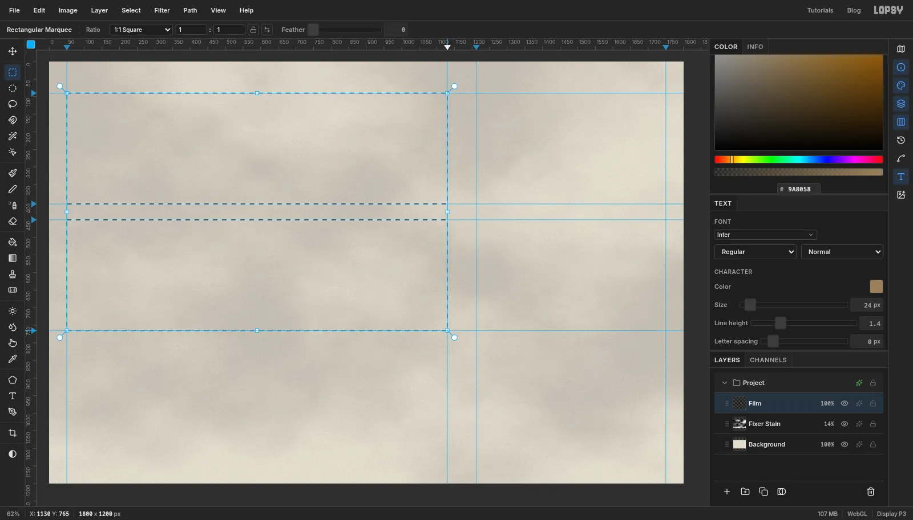

1. Click **Add Layer** at the bottom of the Layers panel and name the layer `Film`.
2. Pick the **Rectangular Marquee** and drag from where the first vertical guide meets the `90` guide down to where the second vertical guide meets the `405` guide. The marquee snaps to the guides.
3. Hold [[Shift]] and drag the second strip between the guides at `450` and `765`.
4. Set the foreground to film black, `#141312`, choose **Edit → Fill** and press [[Cmd+D]].

## Make a sprocket hole tile

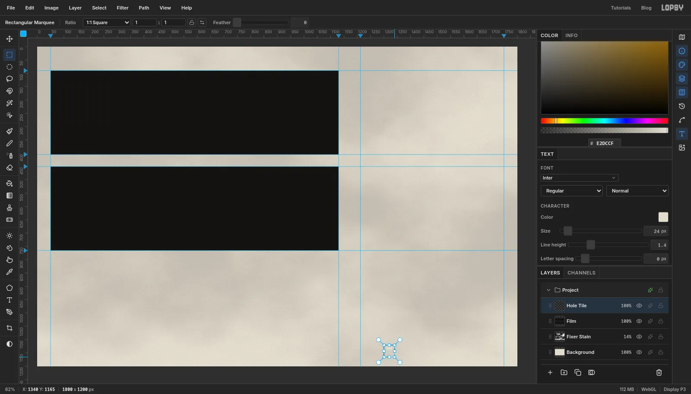

A pattern fills tiles out from the top-left corner of the canvas. Both strips start at a multiple of 45 px (90 and 450), and so do their bottom rebates (360 and 720). That means a 45 px tall tile lands in exactly the same place in every rebate.

1. Add a layer called `Hole Tile`.
2. Somewhere empty near the bottom-right corner of the sheet, well away from the guides, draw a small **22 × 12 px** rectangle and fill it with the paper colour `#E2DCCF`. The Info panel shows the size as you drag.
3. Draw a **40 × 45 px** marquee around it, with the hole centred left to right and sitting **6 px** below the marquee's top edge.
4. Choose **Edit → Define Pattern**.
5. Press [[Cmd+A]] and [[Backspace]] to clear the layer, then [[Cmd+D]].

## Select the four rebates

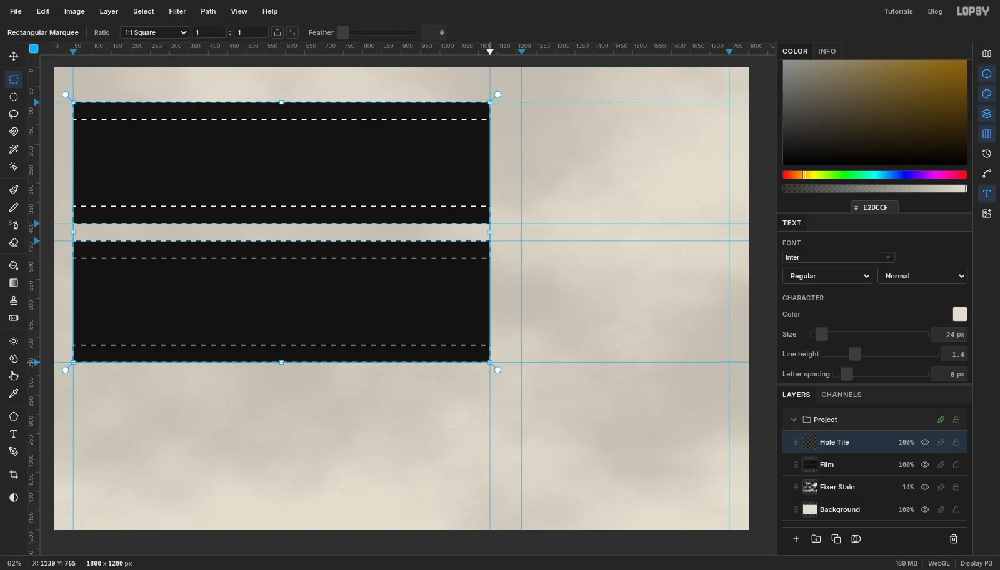

1. Stay on **Hole Tile**. With the **Rectangular Marquee**, drag across the top 45 px of the first strip, from guide to guide.
2. Hold [[Shift]] and add the bottom 45 px of the first strip, then the top and bottom 45 px of the second strip.
3. Choose **Edit → Fill with Pattern…**. Your new tile is already picked, so click **Apply**. A row of cream holes appears in every rebate. Press [[Cmd+D]].

## Punch the holes through the film

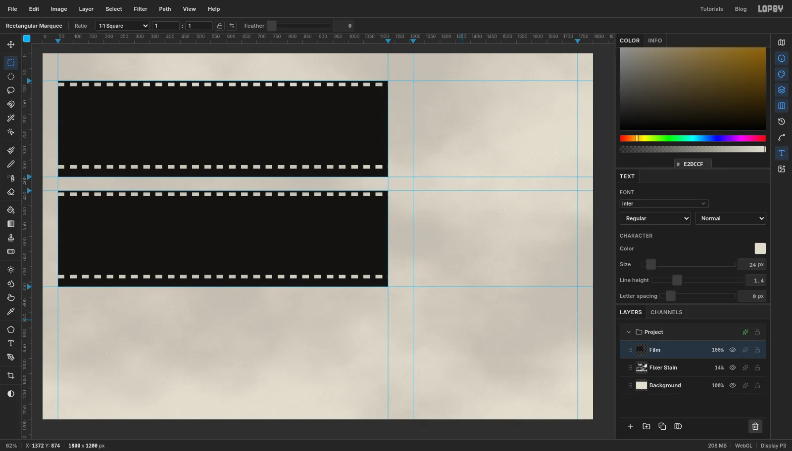

1. [[Cmd]]-click the **Hole Tile** thumbnail to select all the holes.
2. Click the **Film** row and press [[Backspace]]. The holes are now real gaps, and the paper and its stain show through them.
3. Press [[Cmd+D]], click **Hole Tile** and click **Delete Layer**.

## Drop in the photo

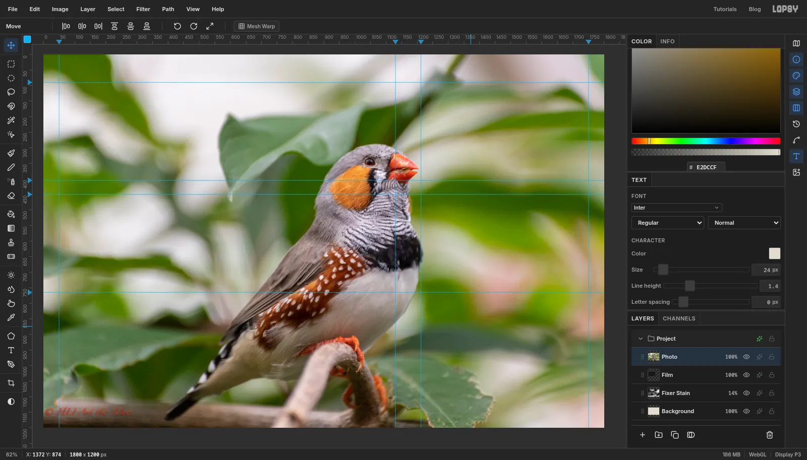

Click the **Film** row so the photo lands above it. Drag the downloaded photo from your desktop onto the canvas. It is a little bigger than the sheet, so Lopsy shrinks it to fit. Rename the new layer `Photo`. A drop selects the photo's pixels, so press [[Cmd+D]] to clear that.

## Shrink a copy into the first frame

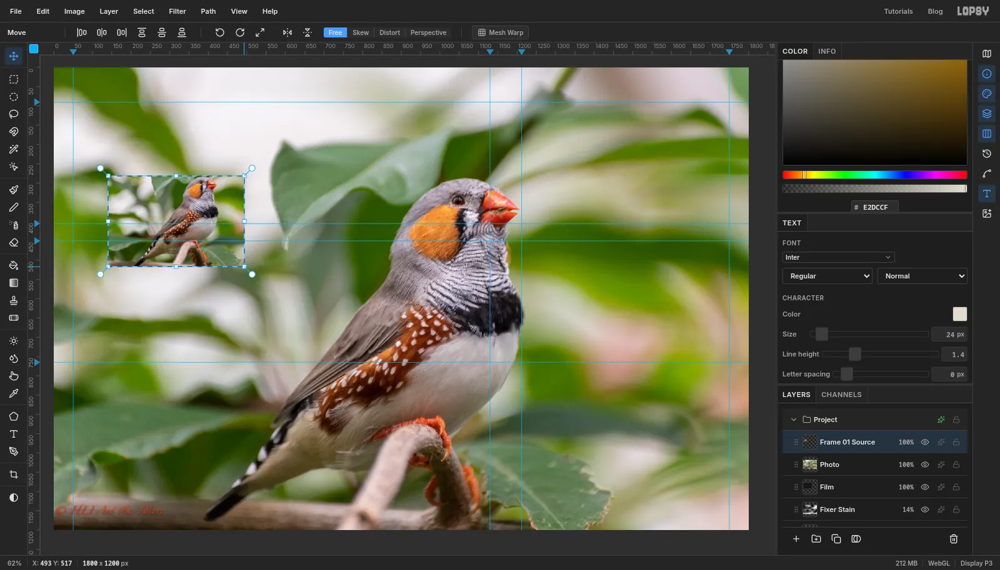

1. With the **Rectangular Marquee**, drag a wide box around the whole bird, from just left of its tail to just right of its beak, keeping roughly a 3:2 shape.
2. Press [[Cmd+C]] then [[Cmd+V]]. The copy pastes in place on a new layer and the **Move** tool is picked for you. Rename it `Frame 01 Source`.
3. Hold [[Cmd]] and drag the bottom-right corner handle up and to the left until the copy is a touch bigger than one frame, about 345 px wide.
4. Drag it into the first frame of the top strip. Arrow keys nudge it 1 px at a time.

## Trim the copy to its frame

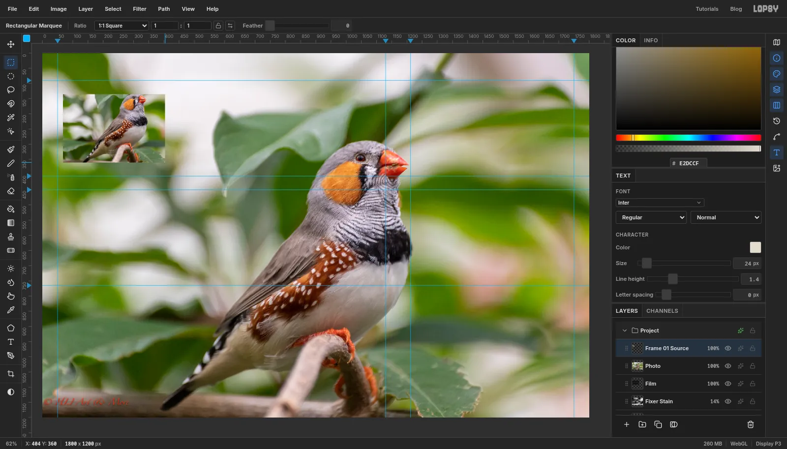

1. Press [[Cmd+D]]. With the **Rectangular Marquee**, select the first frame window: 336 × 225 px, from x `68`, y `135`.
2. Choose **Select → Inverse** and press [[Backspace]]. The overhang is gone. Press [[Cmd+D]]. The full photo still covers the sheet for now. You'll hide it once the finch is cut out.

## Cut out the finch

1. Click the **Photo** row and pick the **Lasso**.
2. Trace around the bird. Take in the beak and the black-and-white tail, but stay just above the branch and leave the feet out. Go slowly round the head and the belly, where the background is pale.
3. Choose **Select → Shrink…** `2` and then **Select → Feather…** `1`. That pulls the edge in off the background and softens it a touch.
4. Press [[Cmd+C]] and [[Cmd+V]], and rename the new layer `Finch`.
5. Press [[Cmd+D]] and click the eye on the **Photo** row to hide it.

Every plate is designed on top of this full-size cut-out.

## Threshold the key plate

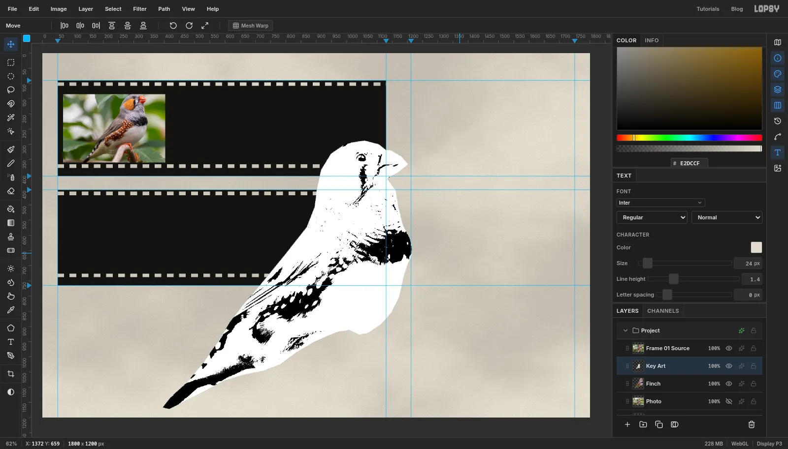

The key is the darkest plate, sprayed last: the eye, the tear stripe, the breast band and the tail bars.

1. Click **Finch** and choose **Layer → Duplicate Layer**. Rename the copy `Key Art`.
2. Choose **Filter → Desaturate**, then **Filter → Threshold…** with **Level** `60`.
3. Pick the **Magic Wand**, set **Tolerance** `40` and untick **Contiguous**. Click the white belly. Every white pixel is selected. Press [[Backspace]].

## Clean the key up

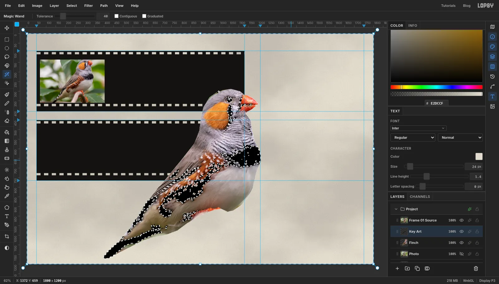

A knife can't cut single-pixel specks, so remove them.

1. Press [[Cmd+D]] and [[Cmd]]-click the **Key Art** thumbnail.
2. Choose **Select → Shrink…** `1`, then **Select → Grow…** `1`. Anything too small to survive the shrink doesn't come back.
3. Choose **Select → Inverse** and press [[Backspace]].
4. Thresholding the soft cut-out edge leaves a hairline ring around the bird. To trim it, [[Cmd]]-click the **Finch** thumbnail, **Shrink** `3`, **Select → Inverse**, click **Key Art** and press [[Backspace]]. Press [[Cmd+D]].

The key ends up sparse: the eye and tear stripe, the breast band and the tail bars. The thin zebra bars on the throat are too fine to cut at this size.
5. Hide **Key Art** for now.

## Select the warm colours

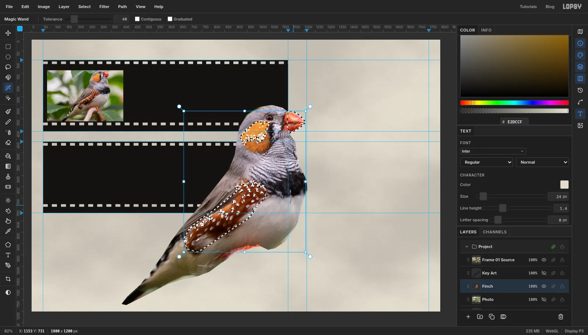

1. Click the **Finch** row. Keep the **Magic Wand** at **Tolerance** `40`, tick **Contiguous** and click the orange cheek.
2. Pick the **Lasso**, hold [[Shift]] and trace round the beak to add it.
3. Still holding [[Shift]], draw a loop around the spotted chestnut flank. Simplify it into one smooth shape, since the wand can't tell the chestnut from its own shadow.
4. Back on the **Magic Wand**, untick **Contiguous**, hold [[Alt]] and click the white belly. That subtracts every bright white, including the spots inside the flank.
5. Add a layer called `Warm Art`, fill it with `#E2772C` and press [[Cmd+D]].
6. Plates shouldn't overlap, so knock the warm shapes out of the key: show **Key Art** again, [[Cmd]]-click **Warm Art**, click **Key Art**, press [[Backspace]] and [[Cmd+D]]. Then hide **Key Art** and **Warm Art**.

## Select the grey body

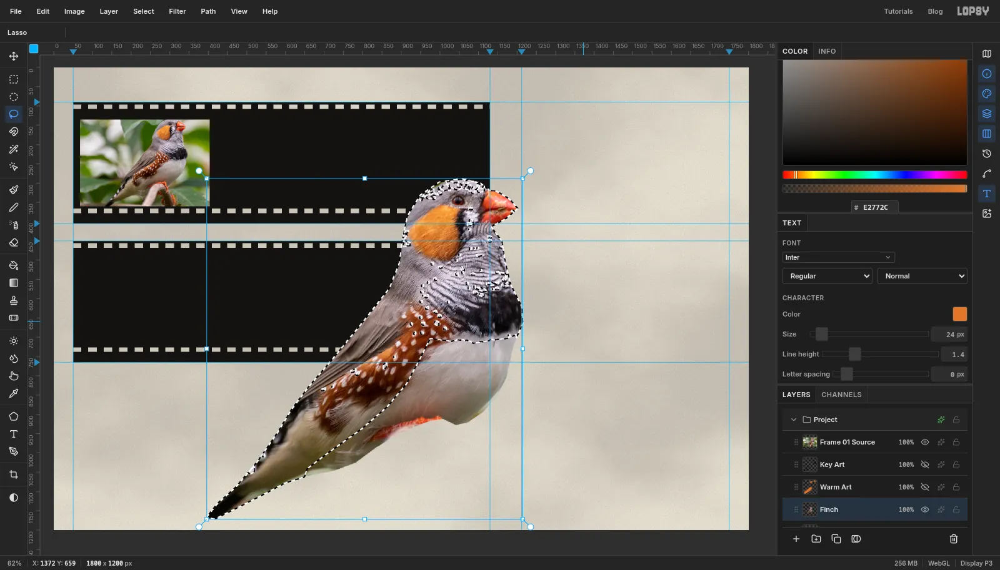

1. [[Cmd]]-click the **Finch** thumbnail and click the **Finch** row.
2. With the **Magic Wand** (Contiguous off, **Tolerance** `40`), [[Alt]]-click the white belly.
3. The shaded part of the belly is too grey for the wand. Pick the **Lasso**, hold [[Alt]] and draw around the whole belly and the pale undertail to cut them out by hand.
4. Choose **Grow…** `2` and then **Shrink…** `2`. This closes up the tiny pinholes the wand left.
5. Add a layer called `Grey Art` and fill it with `#8C8E8F`. Press [[Cmd+D]].

## Paint the spots in Quick Mask

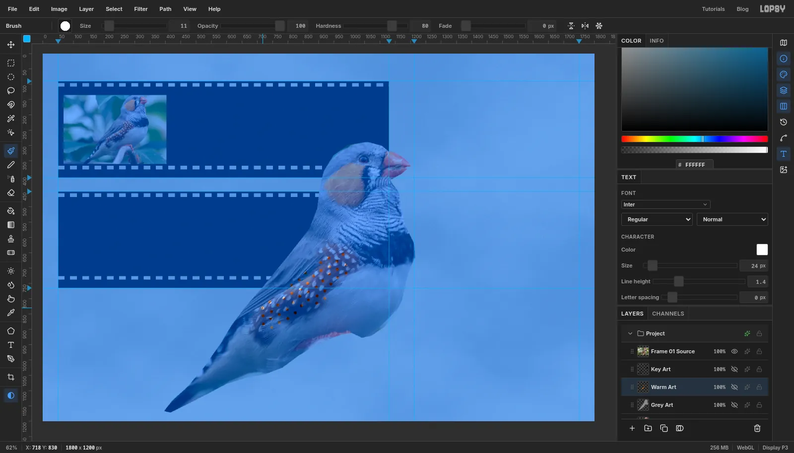

A finch's flank spots come in tidy rows. Painting them is easier than selecting them.

1. Hide **Grey Art** (Key Art and Warm Art are hidden already) so the photo's spots show through, and click **Warm Art**.
2. Press [[Q]] to enter **Quick Mask**. Everything turns blue, which means nothing is selected.
3. Pick the **Brush**, set **Size** `11` and a white foreground, and click one dot for each spot on the photo. Each click clears a little round hole in the blue. Follow the rows along the flank and keep away from its edge.
4. Press [[Q]] again. The dots become a selection.

## Punch the spots out

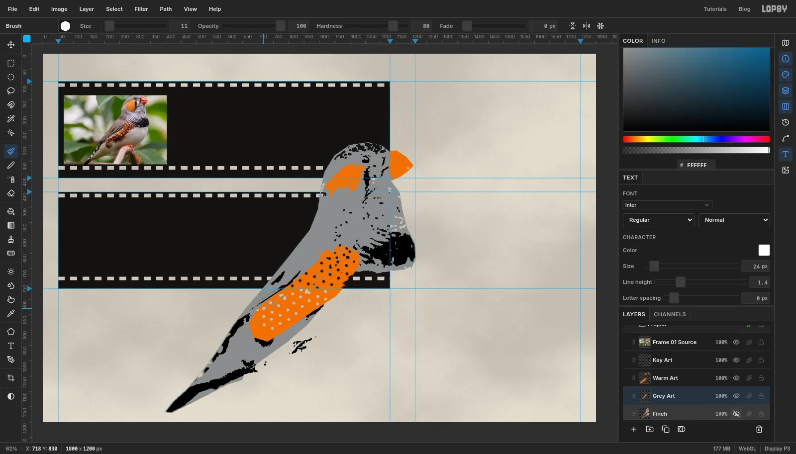

1. With **Warm Art** active, press [[Backspace]].
2. Click **Grey Art** and press [[Backspace]] again, so the spots go right through to the paper. Press [[Cmd+D]].
3. Show **Key Art**, **Grey Art** and **Warm Art**, and hide **Finch**. The three plates now stack up into a sprayed-looking finch.

## Scale the plates into the proof frame

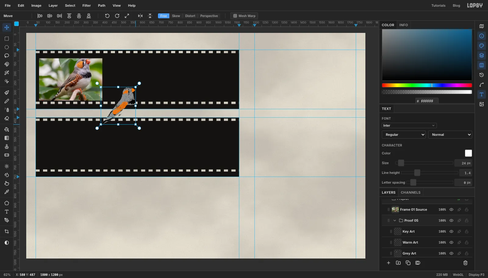

1. Click **Key Art** and [[Shift]]-click **Grey Art** to select all three. Choose **Layer → Group Layers** and name the group `Proof 05`.
2. Pick the **Move** tool. One box frames all three layers. Hold [[Cmd]] and drag the bottom-right corner up and to the left until the finch is about 200 px tall.
3. Drag the finch into the middle frame of the bottom strip, press [[Escape]], and nudge it until it's centred in the frame.

Because the three layers scaled together, they're still in register.

## Spray grain and a rejected proof

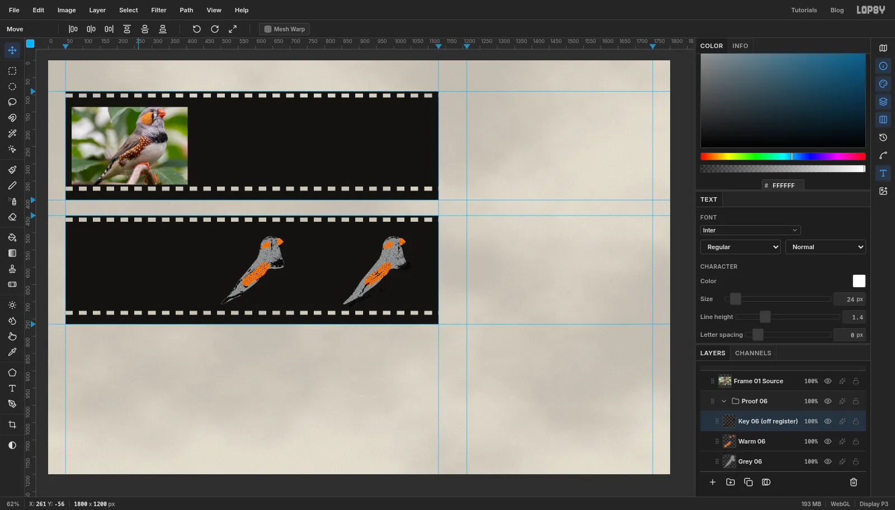

1. Click each of the three layers in **Proof 05** in turn and apply **Filter → Texture…** with **Amount** `35`, **Size** `1.5`, **Detail** `70`. Spray paint is never flat.
2. Click the **Proof 05** group and choose **Layer → Duplicate Layer**. Rename the copy `Proof 06`.
3. With the **Move** tool, press [[Shift+Right]] 35 times and [[Right]] 4 times. That's 354 px, exactly one frame along.
4. Expand **Proof 06**. Rename its layers `Grey 06` and `Warm 06`, then click its key layer, rename it `Key 06 (off register)` and nudge it **14 px right and 9 px down**. That's your rejected proof.

## Bench, kraft board and proof paper

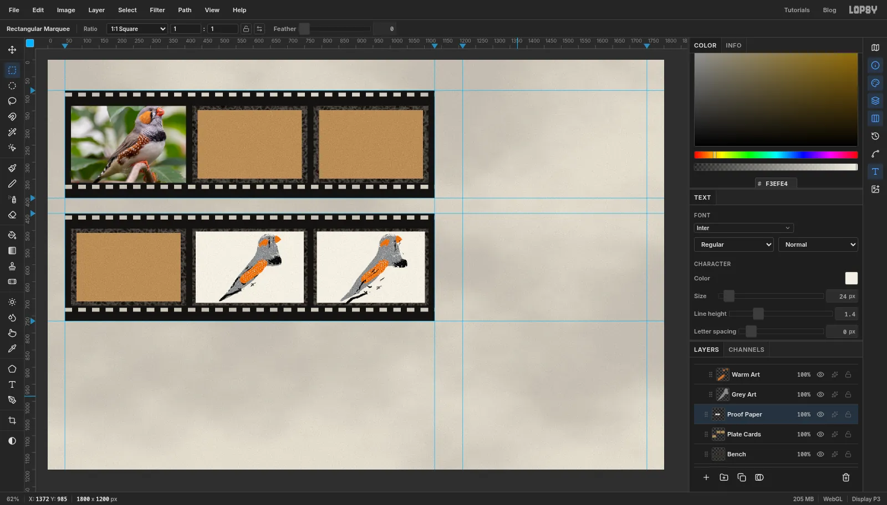

1. Click the **Finch** row so the new layers land below the art. Add a layer called `Bench`.
2. Marquee the five empty frame windows, using [[Shift]] to add each one, and fill with `#2A2622`. Apply **Filter → Texture…**, click **Rough**, and set **Amount** `30`, **Size** `12`, **Detail** `70`. Press [[Cmd+D]].
3. Add a layer called `Plate Cards`. Marquee a card inside each of frames 02, 03 and 04, about 16 px in from the sides and 12 px from the top and bottom. Fill with kraft `#B48F5E` and apply **Texture** at **Amount** `12`, **Size** `1.5`, **Detail** `60`.
4. Add a layer called `Proof Paper`. Marquee frames 05 and 06 about 10 px in, fill with `#F3EFE4` and apply a gentle **Texture** (**Amount** `8`, **Size** `1`).

## Cut the plates

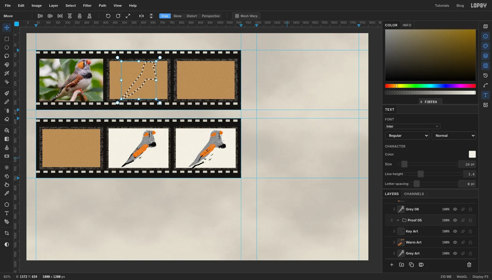

Each plate is cut with its own colour's shape, borrowed from a copy of the proof.

1. Click the **Proof 05** group and choose **Layer → Duplicate Layer**. Name it `Plate Guide`. With the **Move** tool, press [[Shift+Up]] 36 times so the copy moves 360 px, up into frame 02.
2. [[Cmd]]-click the thumbnail of the guide's grey layer, then delete the **Plate Guide** group. The selection stays.
3. The white spots would leave loose islands of card that fall out of a real plate, so close them up with **Grow** `3` and **Shrink** `3`.
4. Click **Plate Cards** and press [[Backspace]]. Press [[Cmd+D]].
5. The warm plate goes in frame 03. Duplicate **Proof 05** again, name it `Plate Guide`, and press [[Shift+Up]] 36 times, then [[Shift+Right]] 35 times and [[Right]] 4 times. [[Cmd]]-click its warm layer's thumbnail, delete the group, **Grow** `3` and **Shrink** `3`, click **Plate Cards** and press [[Backspace]].
6. The key plate goes in frame 04, one frame left of frame 05. Duplicate **Proof 05** once more, press [[Shift+Left]] 35 times and [[Left]] 4 times, [[Cmd]]-click its key layer's thumbnail and delete the group. Skip the Grow and Shrink: the key has no islands to close. Click **Plate Cards** and press [[Backspace]], then [[Cmd+D]].

## Overspray the cards

A used plate wears the paint that went through it.

1. [[Cmd]]-click the **Plate Cards** thumbnail so the paint only lands on card, never in the holes.
2. Pick the **Spray** tool: **Size** `44`, **Density** `50`, **Opacity** `55`.
3. In a darker grey, `#6F7172`, trace round just outside the bird-shaped hole in frame 02. Do the same in `#C9631F` around the holes in frame 03.
4. Drop the **Opacity** to `25` and trace round the key holes in frame 04 in black. Press [[Cmd+D]].

## Knock the cards askew

Nobody lays a card down perfectly square.

1. With **Plate Cards** active, marquee a box just around the first card.
2. Pick the **Move** tool and drag the round rotation handle outside a corner, turning the card about 2° anticlockwise. Press [[Cmd+D]].
3. Turn the second card about 1.5° clockwise and the third about 1° anticlockwise the same way.

## Give the cards some thickness

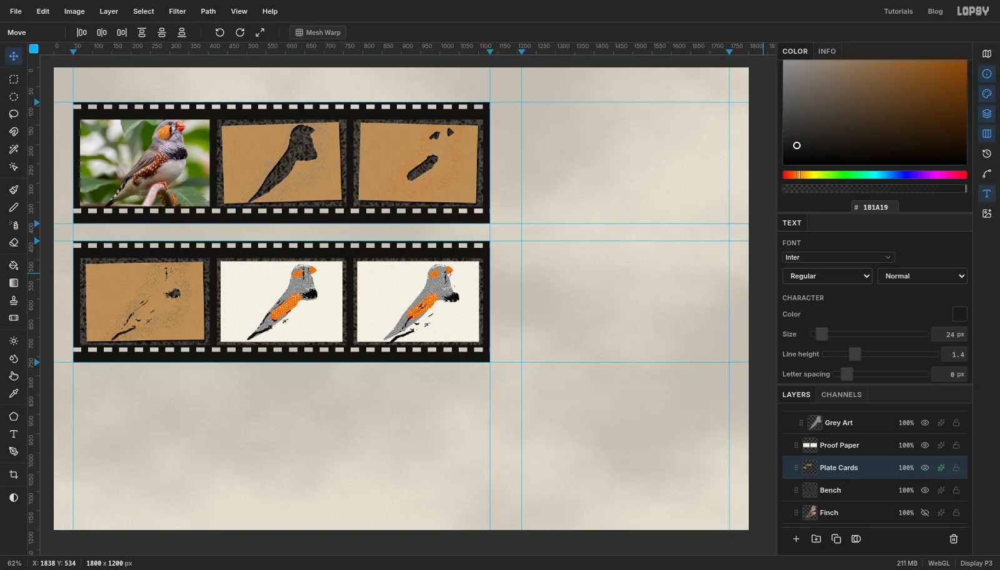

Open **Plate Cards**' effects:

1. Turn on **Drop Shadow**: **Offset X** `3`, **Offset Y** `4`, **Blur** `5`, **Opacity** `75`. The shadow falls on the bench through every cut.
2. Turn on **Inner Glow** with a pale board colour, `#F0DCB0`, **Size** `3`, **Opacity** `55`. It reads as the bevel of a fresh knife cut.

## Start the maquette

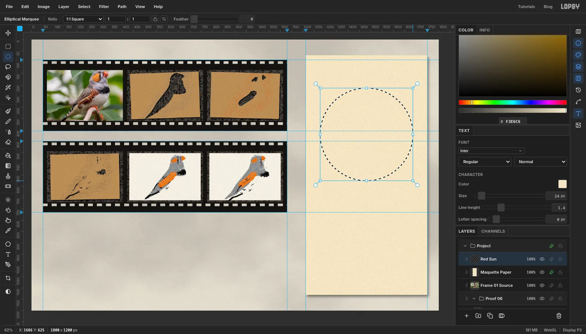

1. Click the **Frame 01 Source** row and add a layer called `Maquette Paper`.
2. Marquee the tall panel between the two right-hand guides, from about 70 px below the top of the sheet to 70 px above the bottom. Fill it with cream `#F3E6C6` and apply **Texture** (**Amount** `10`, **Size** `2`, **Detail** `60`). Press [[Cmd+D]].
3. Give it a **Drop Shadow**: **Offset** `6` / `9`, **Blur** `16`, **Opacity** `45`.
4. Add a layer called `Red Sun`. With the **Elliptical Marquee**, hold [[Cmd]] and drag a circle about 410 px across in the top half of the sheet.
5. Fill it with `#D2352A`, add a light **Texture** (**Amount** `14`) and deselect.

## Turn some leaves into halftone

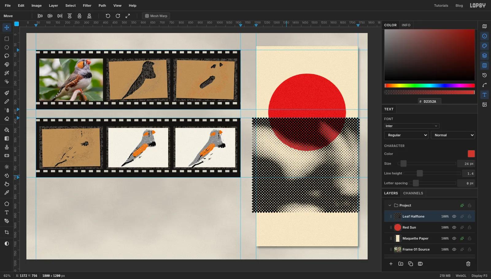

1. Click **Photo** (it can stay hidden). With the **Rectangular Marquee**, select the dark leaves to the right of the bird, from the top of its chest down to the bottom of the photo.
2. Press [[Cmd+C]], click **Red Sun** and press [[Cmd+V]]. Rename the paste `Leaf Halftone`.
3. With the **Move** tool, drag it into the lower half of the maquette and press [[Cmd+D]].
4. Choose **Filter → Desaturate**, then **Brightness/Contrast…** with **Brightness** `-35` and **Contrast** `40`.
5. Choose **Filter → Halftone…** with **Dot Size** `10` and **Angle** `45`.

## Tint it teal and tear a band with leaves

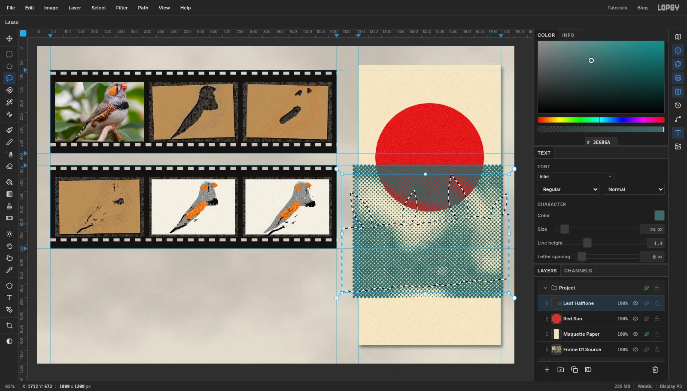

1. Choose **Filter → Threshold…** at `128` to make every dot crisp.
2. With the **Magic Wand** at **Tolerance** `20` and **Contiguous** off, click the white between the dots and press [[Backspace]].
3. [[Cmd]]-click the **Leaf Halftone** thumbnail, fill with teal `#3E6B6A` and deselect.
4. Pick the **Lasso** and draw a wide band across the maquette, about 250 px tall and tilting up slightly to the right. Wobble the top and bottom edges so they look torn.
5. Hold [[Shift]] and draw four pointed leaf shapes growing up out of the band's top edge, leaning in different directions. One can reach up into the sun.

## Throw away the rest of the halftone

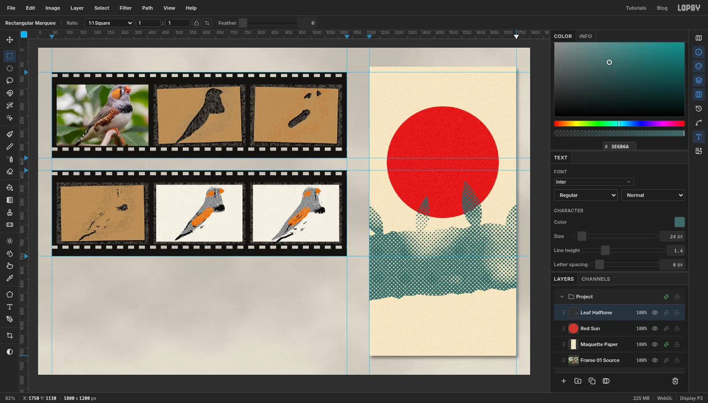

1. Choose **Select → Inverse** and press [[Backspace]].
2. Marquee the maquette sheet guide to guide, **Select → Inverse**, and press [[Backspace]] again so nothing hangs off the paper. Press [[Cmd+D]].

## Paste the finch in as a photo

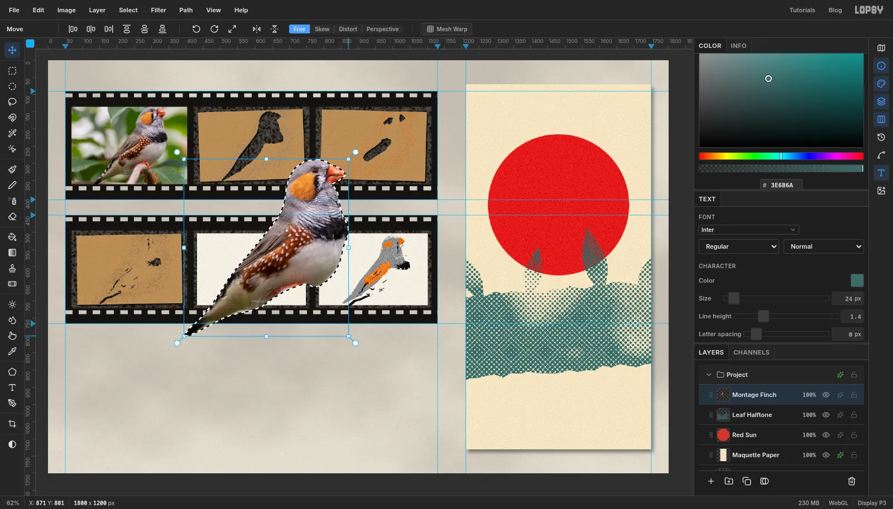

This is the photomontage part. The real bird is pasted onto the graphic shapes.

1. [[Cmd]]-click the **Finch** thumbnail, click the **Finch** row and press [[Cmd+C]].
2. Click **Leaf Halftone** and press [[Cmd+V]]. Rename the paste `Montage Finch`.
3. Hold [[Cmd]] and drag the bottom-right corner handle in until the bird is a little under 60% of its size.
4. Drag it so its head sits on the right edge of the sun and its tail runs down into the band.

## Give it a scissor edge and a hard shadow

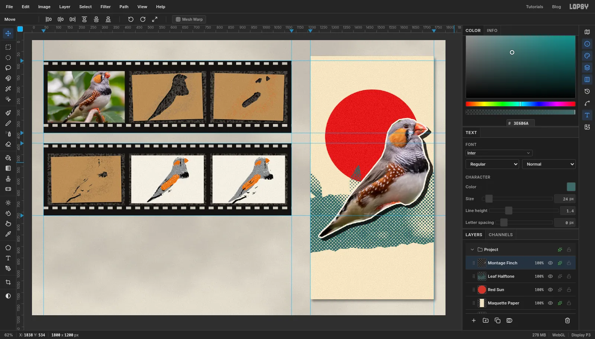

1. Press [[Cmd+D]] and open **Montage Finch**'s effects.
2. Turn on **Stroke** with **Width** `6` and colour `#F6F1E4`, positioned outside. That's the white edge left by the scissors.
3. Turn on **Drop Shadow** with **Offset** `14` / `12`, **Blur** `0` and **Opacity** `80`. A shadow with no blur reads as a cut-out sitting on the paper.

## Set the slogan on paper strips

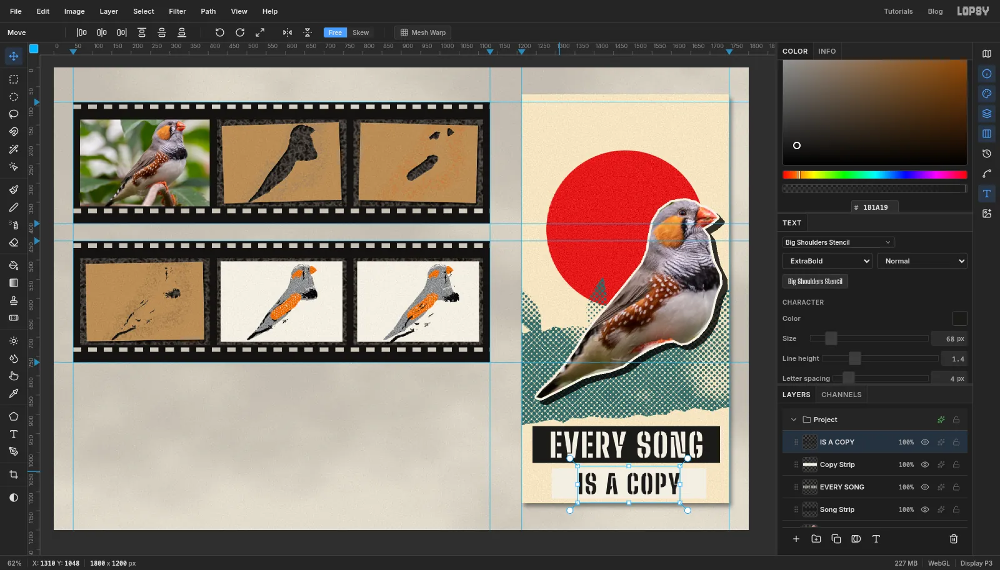

1. Add a layer called `Song Strip`. Marquee a strip about 486 × 96 px across the bottom of the maquette, under the band, and fill it with `#1B1A19`.
2. Pick the **Text** tool. Choose **Big Shoulders Stencil**, weight **ExtraBold**, size `84`, colour `#F3EFE4`. Click on the strip, type `EVERY SONG` and press [[Tab]]. In the **Text** panel set **Letter spacing** to `4`.
3. With the **Move** tool, drag the text so it's centred on the strip, the same space above and below the letters.
4. Click the **EVERY SONG** row and add a layer called `Copy Strip`. Marquee a slightly shorter strip, about 400 × 78 px, just below and a little to the right. Fill it with `#F3EFE4`.
5. Type `IS A COPY` in the same face at size `68` in `#1B1A19`, letter spacing `4`, and centre it on its strip.

## Tilt the strips

1. Click **Song Strip**, then [[Cmd]]-click **EVERY SONG** to select both.
2. With the **Move** tool, drag the rotation handle to turn them about 4° anticlockwise. Press [[Escape]].
3. Select **Copy Strip** and **IS A COPY** the same way and turn them about 3° clockwise.

The text stays live text. You can still click into it and edit it after rotating.

## Print the film edge codes

Real film carries frame numbers and a stock name along its edge.

> **Tip:** Before you click with the Text tool for a new line of type, make sure a *raster* layer is active. With a text layer active, changing the font or size in the options bar restyles that layer instead. Also click well clear of existing text, or you'll start editing it.

1. Click the **Frame 01 Source** row, so the type lands below the maquette in the stack.
2. Pick the **Text** tool: **Space Mono**, **Bold**, size `12`, colour `#D8C9A2`, letter spacing `2`.
3. Just above the top-left corner of each frame, below the holes, type the frame number, a few spaces, and the half-frame number, like `1     1A`. Make one text layer per frame, clicking **Frame 01 Source** again before each one, and name them `Edge 1` to `Edge 6`.
4. Along each strip's bottom rebate, below the holes, type `ZF 400  SAFETY FILM  ·  ROLL 07`. Name these `Edge Roll 1` and `Edge Roll 2`.

## Caption the frames

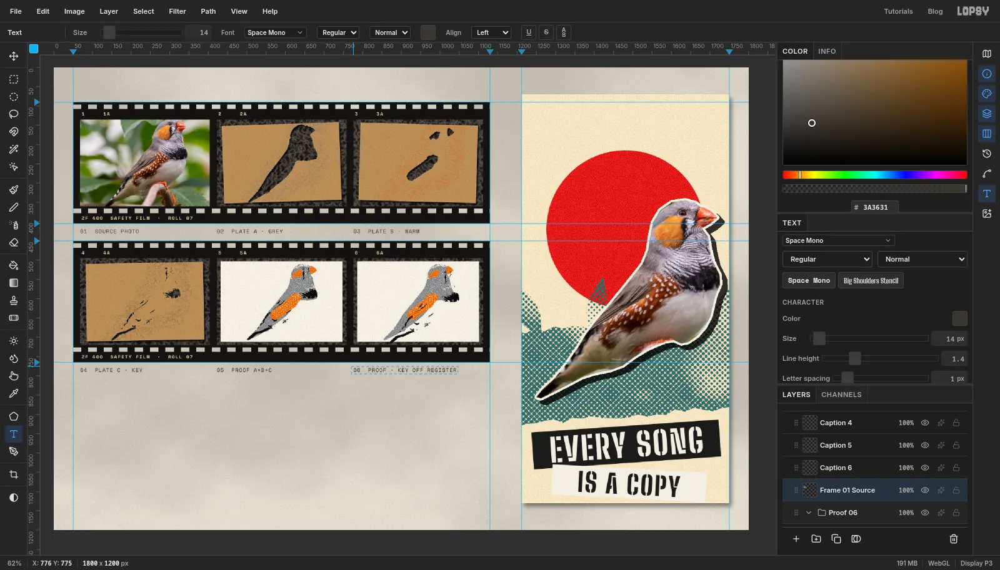

Click **Frame 01 Source** again. Under each strip, in **Space Mono** **Regular** at `14`, `#3A3631`, letter spacing `1`, type one caption per frame, lined up with the frame's left edge. Click **Frame 01 Source** between captions, and name the layers `Caption 1` to `Caption 6`:

- `01  SOURCE PHOTO`, `02  PLATE A · GREY`, `03  PLATE B · WARM`
- `04  PLATE C · KEY`, `05  PROOF A+B+C`, `06  PROOF · KEY OFF REGISTER`

## Mark the keeper and the reject

1. Click **Frame 01 Source** and add a layer called `Grease Pencil`.
2. Pick the **Brush** at **Size** `7` in `#C8302A`. Draw a loose loop round frame 05, overshooting where it closes the way a quick hand would.
3. Draw two strokes corner to corner across frame 06 to cross it out.

## Write the notes

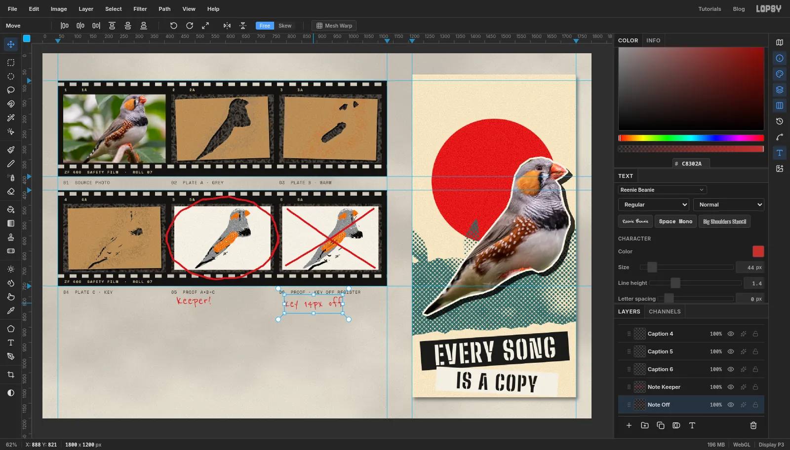

1. With **Grease Pencil** active, pick the **Text** tool and choose **Reenie Beanie** at size `48` in the grease red, letter spacing `0`. Click in the empty paper below frame 05 and type `keeper!`.
2. Click **Grease Pencil** again and type `key 14px off` at size `44` below frame 06.
3. With the **Move** tool, drag each note under its frame's caption, lined up with the caption's left edge.

## Set the title

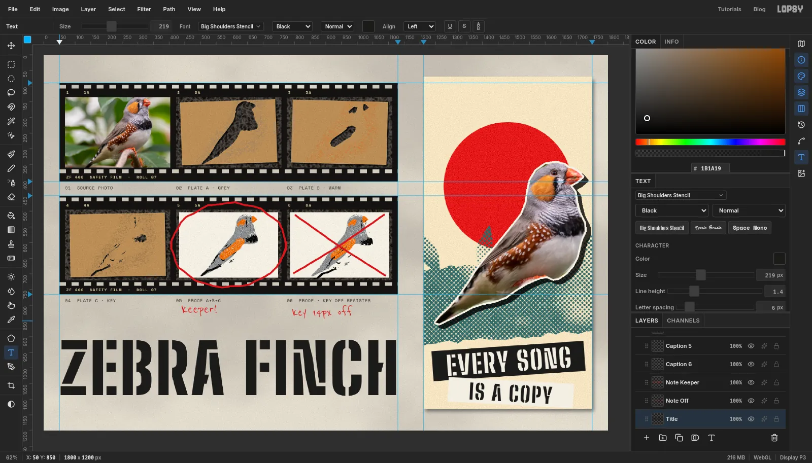

1. Click the **Grease Pencil** layer.
2. Pick the **Text** tool: **Big Shoulders Stencil**, **Black**, size `190`, colour `#1B1A19`. Click under the captions near the left edge and type `ZEBRA FINCH`. Press [[Tab]] and set **Letter spacing** to `6`.
3. Make it as wide as the strips: with the title still selected, raise the size until the right edge of the H lines up with the end of the film strips. Mine landed at `219`.

## Turn FINCH red

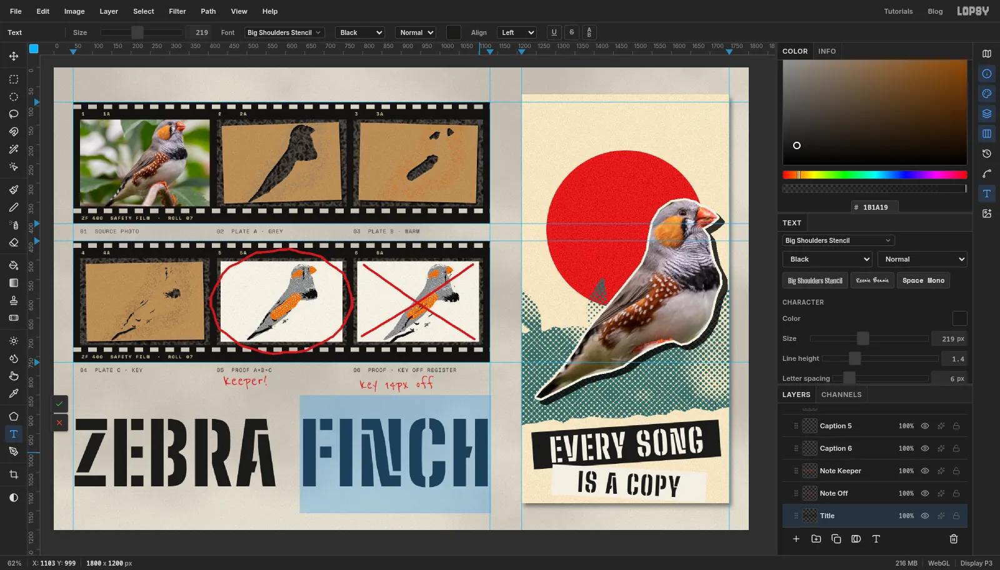

1. With the **Text** tool, click into the title near the end of FINCH and press [[End]].
2. Press [[Shift+Left]] five times to select `FINCH`.
3. Click the **Text color** swatch in the options bar, type `D2352A` in the hex field and press [[Enter]]. Click the swatch again to close it, then press [[Tab]]. Only FINCH changes colour.
4. With the **Move** tool, nudge the title up until its tops sit about 115 px under the bottom film strip, with its left edge on the strips' left edge.

## Add the subtitle, credit and paint chips

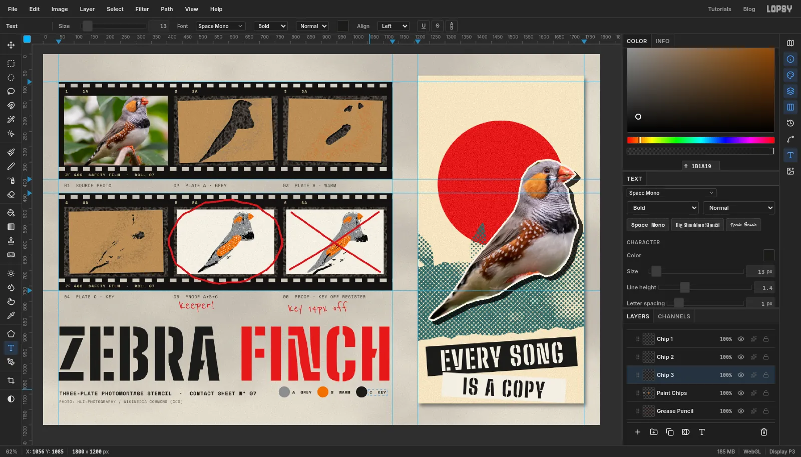

1. Click **Grease Pencil**, then type `THREE-PLATE PHOTOMONTAGE STENCIL  ·  CONTACT SHEET Nº 07` in **Space Mono Bold** at `17` in `#1B1A19`, letter spacing `1`. Click about 30 px below the title, so the Text tool doesn't grab the title instead.
2. Click **Grease Pencil** again and, below the subtitle, type the credit `PHOTO: HLI-PHOTOGRAPHY / WIKIMEDIA COMMONS (CC0)` in **Space Mono Regular** at `12` in `#5A554D`.
3. With **Grease Pencil** active, add a layer called `Paint Chips`. All three circles go on this one layer. Pick the **Shape** tool and set **Shape** to **Ellipse**. Click the **Fill** swatch and type `8C8E8F`. Hold [[Cmd]] and drag out a circle about 36 px across, level with the subtitle and towards the right.
4. Change the fill to `E2772C` and draw the second chip, then `1B1A19` for the third. Space them evenly.
5. Label them `A  GREY`, `B  WARM` and `C  KEY` in **Space Mono Bold** at `13` in `#1B1A19`, just right of each chip. Click **Paint Chips** before each one, and name the text layers `Chip 1` to `Chip 3`.

## Tape the maquette up

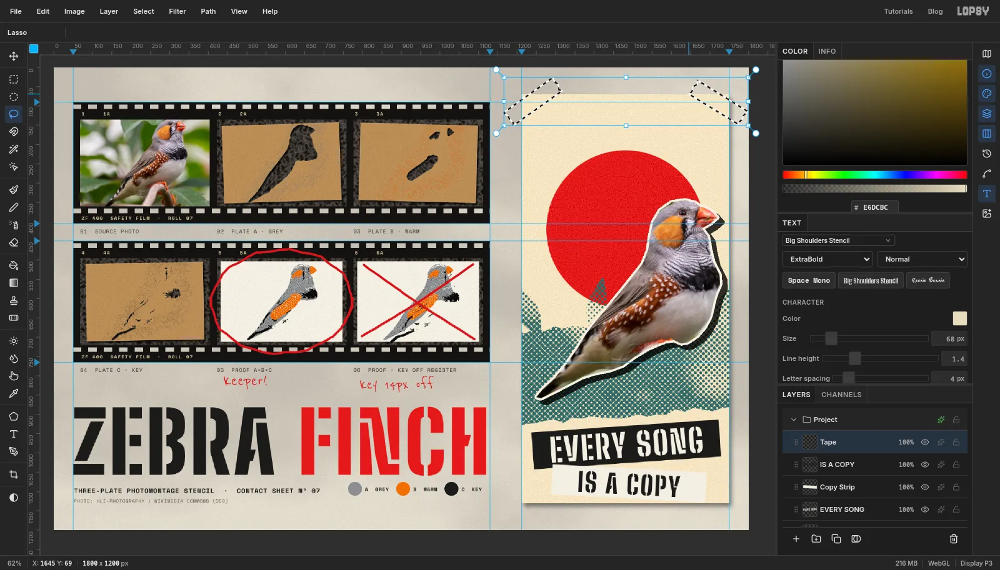

1. Click **IS A COPY** and add a layer called `Tape`.
2. With the **Lasso**, draw a strip of tape about 150 × 42 px across the top-left corner of the maquette, angled down to the right. Zigzag its two short ends so they look torn.
3. Hold [[Shift]] and draw a second strip across the top-right corner, angled the other way.
4. Fill with `#E6DCBC`, deselect, add a light **Texture** (**Amount** `12`) and set the layer's opacity to `78%`.

## Group the maquette and tilt it

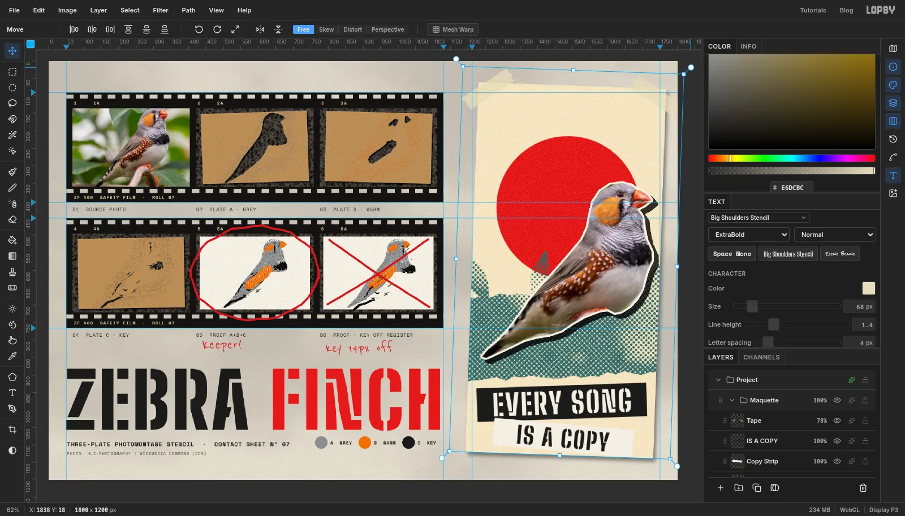

1. Click **Maquette Paper** and [[Shift]]-click **Tape** to select every maquette layer. Choose **Layer → Group Layers** and name the group `Maquette`.
2. With the group selected and nothing marqueed, pick the **Move** tool. Drag a rotation handle to turn the whole sheet about 2° clockwise, as if it was pinned up by hand. Press [[Escape]].
3. Press [[Cmd+Z]] to check the tilt comes off in one step, then [[Cmd+Shift+Z]] to put it back.

## Finish with a darkroom vignette

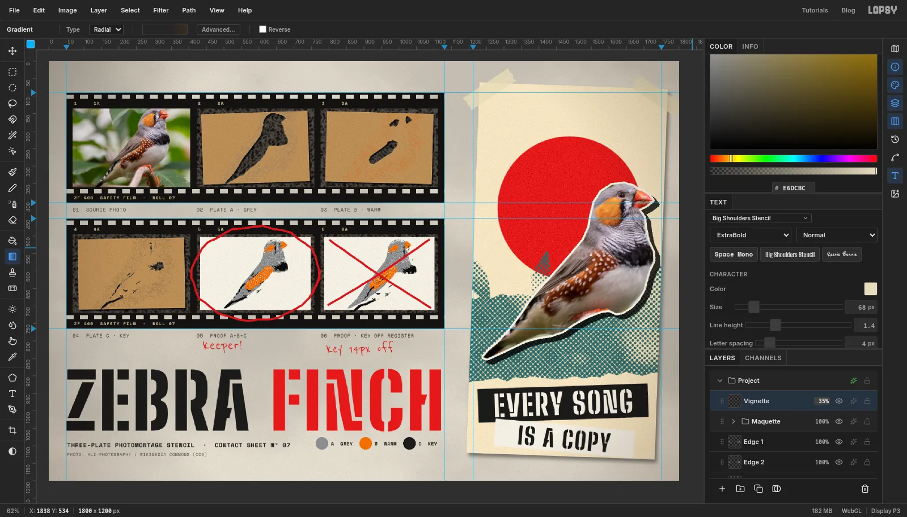

1. Collapse the **Maquette** group with its arrow, so the next layer lands above it rather than inside. Add a layer called `Vignette`.
2. Pick the **Gradient** tool, set **Type** to **Radial** and open **Advanced…**. Make three stops, all `#3A2E22`: fully transparent at the left end and at 60%, and fully opaque at the right end.
3. Drag from the middle of the sheet out past a corner.
4. Set the layer to **Multiply** at `35%` opacity.

Hide the guides with **View → Show Guides**, then **File → Quick Export PNG**. Save the project with **File → Save Project** so you can come back to it.

> **Tip:** Try your own bird or animal. Any photo with clear areas of colour separates well. Pick three colours, threshold the darkest for the key, and let the wand do the rough work before you simplify the shapes by hand.
