**Postmodern** design is what happened when architects and designers got bored of plain glass boxes around 1980. They brought back columns, arches and pediments, but painted them pink and teal, stacked them like toy blocks and stood them on checkerboard floors. Michael Graves put a giant keystone on an office block. The AT&T Building got a broken pediment like a grandfather clock. The Memphis group in Milan added squiggles, confetti and hard black shadows.

A tiered cake is already a little building, so it suits the style. In this tutorial you'll make the front of a 5 × 7 birthday card, 1500 × 2100 px, with a cake drawn as a civic monument in a sunny piazza. A broken pediment holds the candle, and the caption reads *Another year, another storey*.

The tools you'll use:

- **Edit → Define Pattern** and **Fill with Pattern…**, then the Move tool's **Perspective** mode for the floor
- the **Gradient** tool, **Filter → Halftone** and **Filter → Sunburst**
- the **Shape** tool, the marquees, the **Lasso** and the **Magic Wand**
- the **Pen**, for the pediment, the flame, a squiggle and a curve that carries text
- **Copy** and **Paste**, **Duplicate Layer**, **Flip Horizontal**, and the Move tool's scale, rotate and **Skew**
- the **Stroke**, **Outer Glow** and **Drop Shadow** effects, with **Copy effects** and **Paste effects**
- **groups**, **guides**, blend modes, **Add Noise** and a **Saturation & Vibrance** adjustment

The fonts are free Google Fonts from Lopsy's font picker: **Abril Fatface** for the headline and the badge, **Syne** for the banner and **Space Grotesk** for the small type.

The palette:

- Sky `#6F86E0` → `#F3B4C6` → `#FCE6C4`
- Ink `#1B1A2E`, cream `#FBF1DC`, frosting white `#FFF9EC`
- Teal `#1FA79A` / `#16897E`, deep teal `#12635C`
- Pink `#F28CB1` / `#D56E97`, lavender `#B9A6E0`
- Terracotta `#D2573B` / `#B8452D`, flutes `#9E3B26`
- Mustard `#F4B63A` / `#FFD979` / `#D99A22`
- Cobalt `#2B3FA8`, coral `#EC7A5C` / `#F9B39C`
- Sun `#FFD86B` → `#F2703F`, sun dots `#F3C9A0` → `#B8321F`
- Flame `#FFF6C2` → `#FFD23F` → `#F2703F`, glow `#FFE27A`
- Shadow violet `#3B2A6B`, grain grey `#808080`

> **Tip:** Positions are written as `x, y` in document pixels. The status bar at the bottom shows where the cursor is, so you can read a position off it before you press. Key names are Mac keys. On Windows and Linux, use Ctrl for Cmd in keyboard shortcuts. While you drag on the canvas, the Cmd modifier is the Windows or Super key.

## Paint the sky and drop two guides

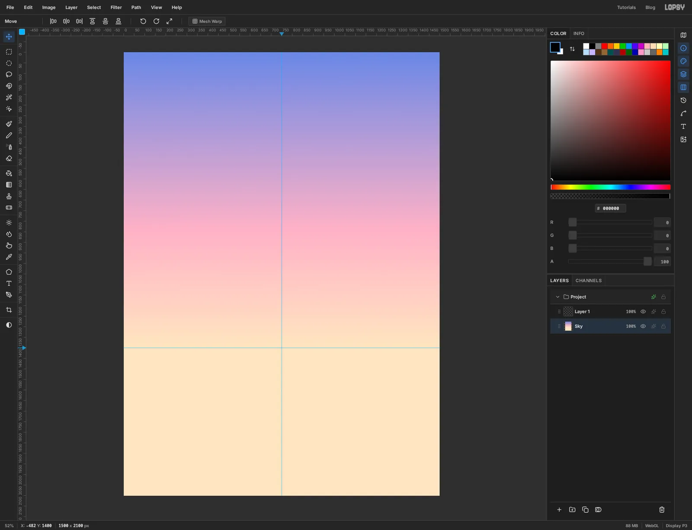

Open [Lopsy](/). In the **New Document** dialog set **Width** to `1500` and **Height** to `2100`, and click **Create**.

1. Double-click the `Background` layer's name and call it `Sky`.
2. Pick the **Gradient** tool in the toolbox, leave **Type** on Linear and click **Advanced…**. Set the left stop to `#6F86E0` and the right stop to `#FCE6C4`, then click the bar at about 60% and give that new stop `#F3B4C6`. Click **Done**.
3. With `Sky` still active, drag straight down from the top edge of the canvas to about two thirds of the way down (y = 1400).
4. Click the top ruler at **750** to drop a guide down the middle. Click the left ruler at **1400** for the horizon.

Everything in the scene is centred on the vertical guide, and the floor starts at the horizontal one.

## Draw a checkerboard tile

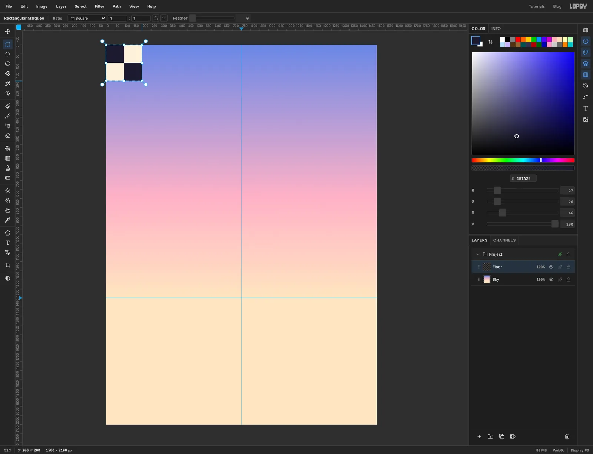

The floor is one small tile repeated, so you only have to draw four squares.

1. Double-click `Layer 1` and rename it `Floor`.
2. Pick the **Rectangular Marquee** ([[M]]). Drag a 200 px square from the top-left corner of the canvas, set the foreground colour to `#FBF1DC` and choose **Edit → Fill**.
3. Press [[Cmd+D]], then drag a 100 px square from the same corner and fill it with `#1B1A2E`. Do the same for the square from `100, 100` to `200, 200`.
4. Press [[Cmd+D]] and drag a marquee around the whole 200 px tile again.
5. Choose **Edit → Define Pattern**. This is **Pattern 1**. Press [[Delete]] to clear the tile, then [[Cmd+D]].

While you're here, make a second pattern for later. With the **Elliptical Marquee**, drag a small circle from `12, 12` to `28, 28` and fill it with `#FFF9EC`. Then drag a rectangular marquee from the corner to `40, 40`, choose **Edit → Define Pattern** again (**Pattern 2**), press [[Delete]] and [[Cmd+D]].

> **Tip:** Patterns aren't saved in `.lopsy` project files. If you reopen the project later and want them again, draw and define them again.

## Fill the floor with the pattern

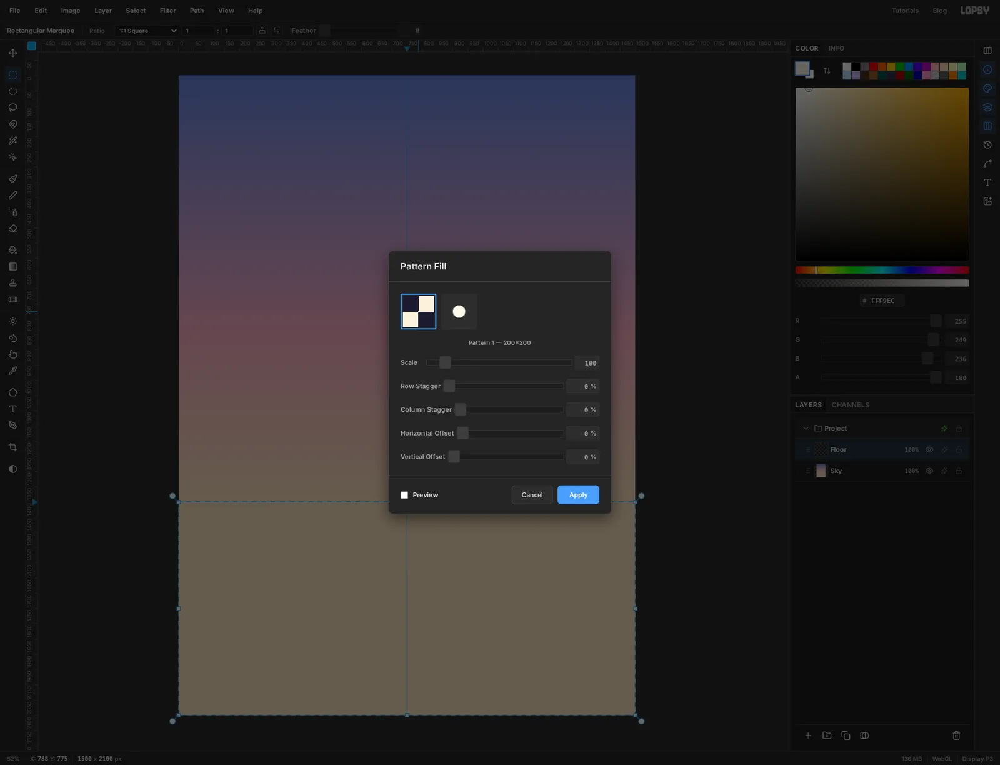

1. With the Rectangular Marquee, drag from the left end of the horizon guide to the bottom-right corner of the canvas. The top edge snaps to the guide.
2. Choose **Edit → Fill with Pattern…** and click the checkerboard thumbnail. Leave **Scale** at `100`.
3. Click **Apply**.

You now have a flat checkerboard, seven squares tall. Keep the selection.

## Tip the floor back with Perspective

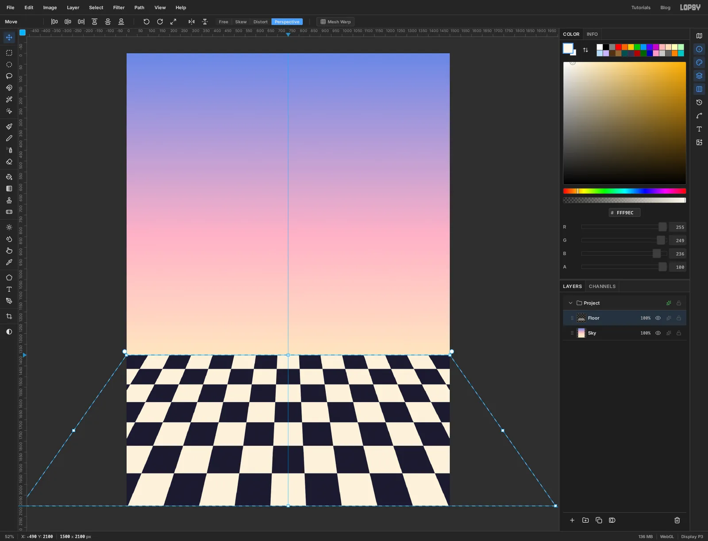

1. Pick the **Move** tool ([[V]]). In the options bar click **Perspective**.
2. Drag the **bottom-left** corner handle straight out to the left, well past the edge of the canvas, until the status bar reads about X = −490. The bottom-right corner moves out the same distance by itself.
3. Press [[Cmd+D]] to apply.

The far squares stay small and the near ones grow, so the floor now runs back to the horizon.

## Add a halftone sun

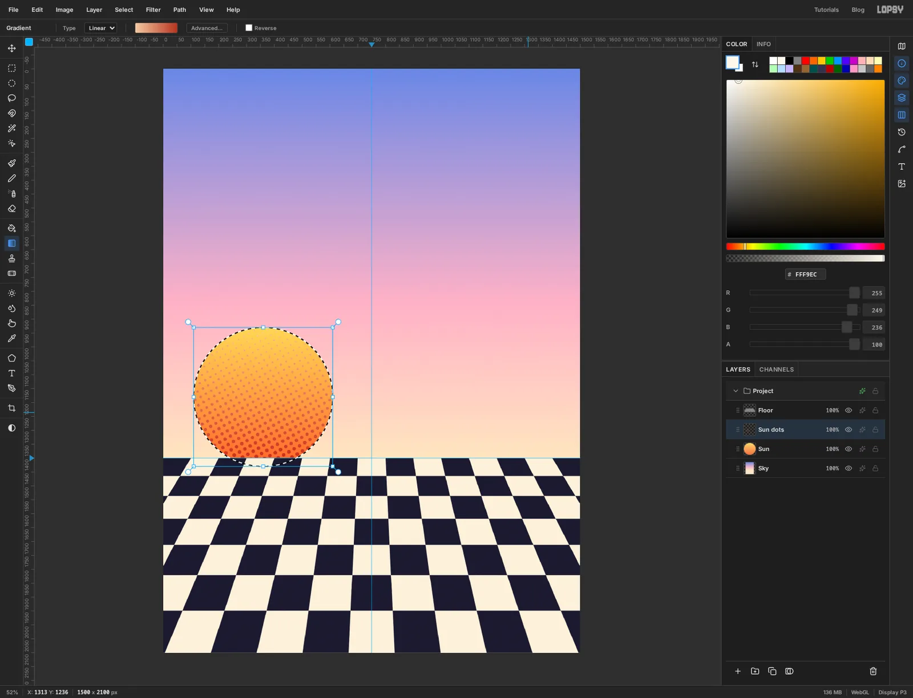

1. Click `Sky` and add a layer with the **+** button. Name it `Sun`.
2. Pick the **Elliptical Marquee** and drag a circle from `110, 930` to `610, 1430`. It dips just below the horizon, where the floor hides it.
3. Pick the **Gradient** tool and click **Advanced…**. Delete the middle stop, set the two that are left to `#FFD86B` and `#F2703F`, and drag from the top of the circle to the bottom.
4. Keep the selection, add another layer and name it `Sun dots`. Change the gradient to `#F3C9A0` → `#B8321F` and drag top to bottom again.
5. Choose **Filter → Halftone…**. Set **Dot Size** to `22`, **Angle** to `30` and **Softness** to `0.4`, and click **Apply**. Press [[Cmd+D]].

Halftone turns the darker end of a gradient into bigger dots and leaves the gaps between them see-through, so the yellow disc shows through from the layer below.

## Build the stairs, a ball and some haze

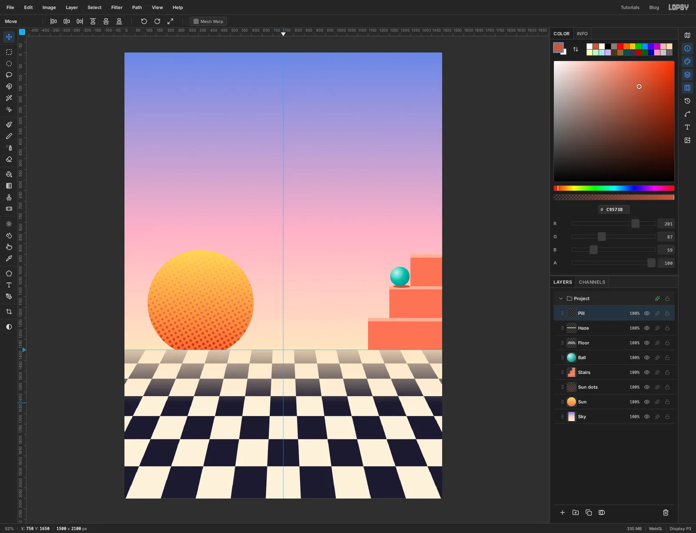

A flight of stairs to nowhere balances the sun on the other side, and a little haze pushes the far end of the floor back.

1. Add a layer named `Stairs`. Marquee and fill three coral `#EC7A5C` blocks, each 150 px tall and running off the right edge: from `1150, 1250`, from `1250, 1100` and from `1350, 950`.
2. Give each step a 16 px strip of `#F9B39C` along its top edge.
3. Still on `Stairs`, drag a flat ellipse about 80 px wide and 14 px tall on the middle step, centred near `1308, 1101`, and fill it with `#C9573B`. It's the contact shadow for a ball.
4. Add a layer named `Ball`. With the Elliptical Marquee drag a circle from `1254, 1008` to `1346, 1100` so it sits on that shadow. Set the Gradient **Type** to Radial and give it three stops: `#C9F5EE`, `#1FA79A` at the midpoint and `#12635C`. Drag from the upper left of the ball to just past its lower right, then press [[Cmd+D]].
5. Click `Floor` and add a layer named `Haze`. Marquee the top 260 px of the floor. Set the gradient back to Linear, delete the middle stop and make both remaining stops `#FCE6C4`. Drag the first stop's **Opacity** to about 85% and the second's to 0. Drag from the horizon down to the bottom of the marquee and press [[Cmd+D]].
6. Add one more empty layer above `Haze` and name it `Pill`. It keeps a place at the top of the stack for the caption, and the groups you make next will land underneath it.

## Stack three tiers with the Shape tool

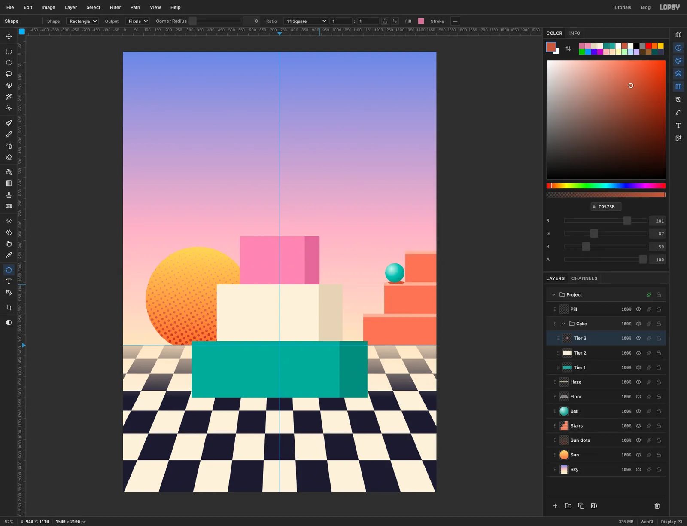

1. Click `Haze` and click **New Group** at the bottom of the Layers panel. Name the group `Cake`.
2. Add a layer named `Tier 1`. Pick the **Shape** tool ([[U]]), set **Shape** to Rectangle, **Corner Radius** to `0` and **Fill** to `#1FA79A`, and leave **Stroke** empty. Shapes grow from the middle, so press on the centre guide at `750, 1515` and drag to `1170, 1650`.
3. On the same layer, change the fill to `#16897E` and drag from `1103, 1515` to `1170, 1650`. That's the shaded side of the tier.
4. Add `Tier 2` in `#FBF1DC` from `750, 1245` to `1050, 1380`, with a `#E2D3B8` band from `993, 1245` to `1050, 1380`.
5. Add `Tier 3` in `#F28CB1` from `750, 995` to `940, 1110`, with a `#D56E97` band from `905, 995` to `940, 1110`.

The light comes from the upper left in this picture, so every dark side faces right.

## Make windows, then flip a copy

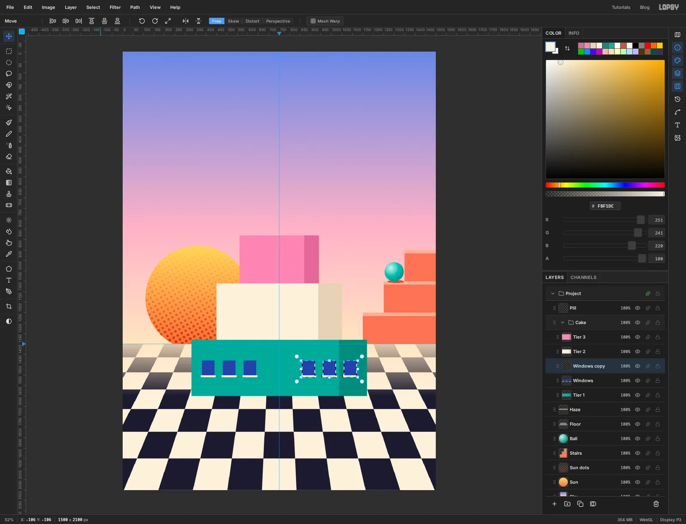

The building is symmetrical, so you only draw the left-hand windows.

1. Click `Tier 1` and add a layer named `Windows`.
2. Marquee and fill three cobalt `#2B3FA8` windows, 60 px wide and 70 px tall, with their top edges at y = 1480 and their left edges at x = 380, 480 and 580. Under each one fill a cream sill, 72 px wide and 10 px tall.
3. Choose **Layer → Duplicate Layer**. Press [[Cmd+A]], pick the **Move** tool and click **Flip Horizontal** in the options bar. With the whole canvas selected, the copy mirrors across the centre guide.
4. Press [[Cmd+D]], then [[Cmd+E]] to merge the copy down into `Windows`.

## Combine two selections into an arched door

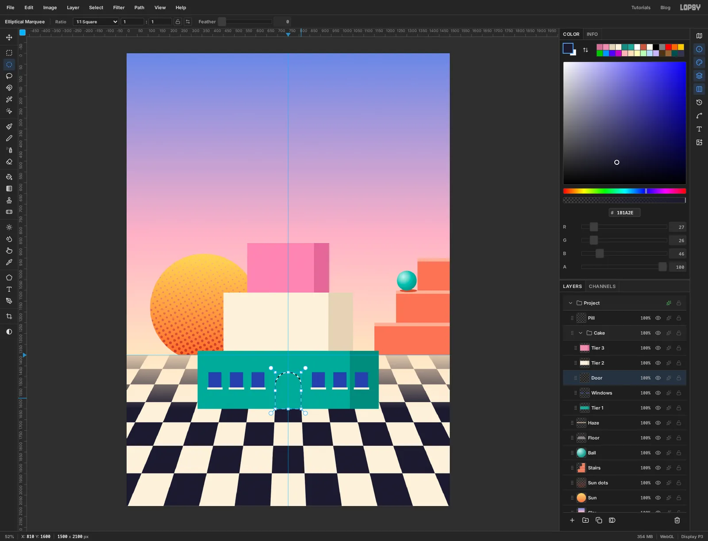

An arch is a rectangle with a circle sitting on its top edge. Two marquees added together make one.

1. Add a layer named `Door`.
2. With the **Rectangular Marquee**, drag from `690, 1540` to `810, 1650`.
3. Switch to the **Elliptical Marquee**, hold [[Shift]] and drag from `690, 1480` to `810, 1600`. Shift adds the circle to the rectangle.
4. Set the foreground colour to `#1B1A2E`, choose **Edit → Fill** and press [[Cmd+D]].
5. Click the effects button on the `Door` row. Tick **Stroke**, set **Width** to `10` and the colour to `#F4B63A`, then close the drawer.

## Wallpaper the top tier with polka dots

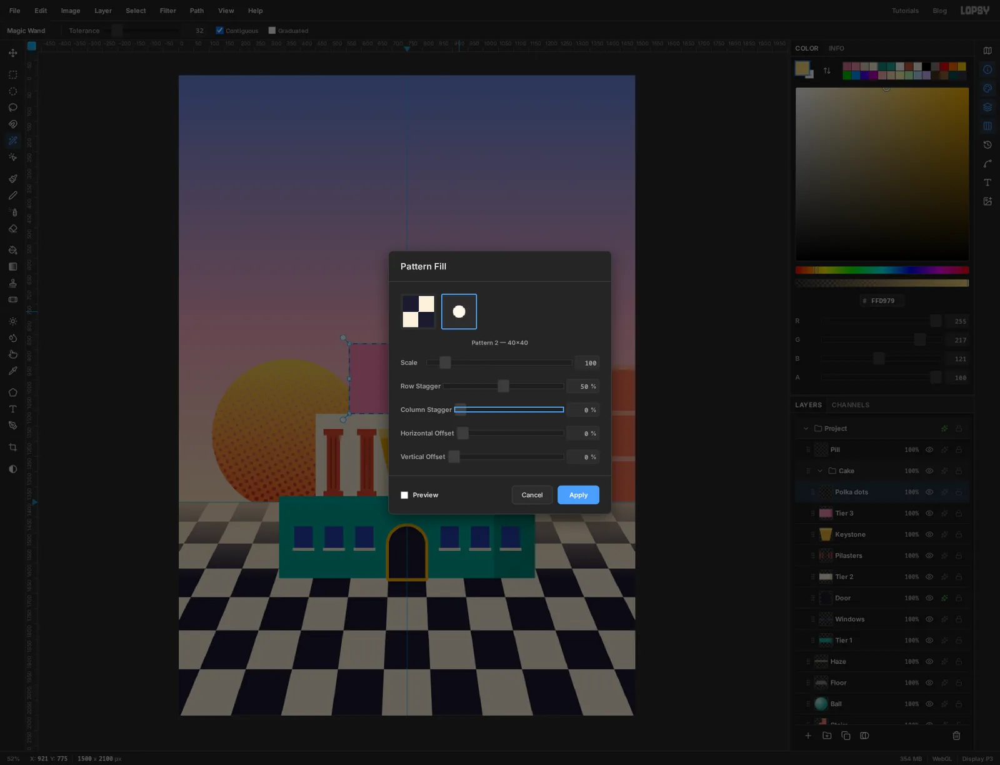

This is where the second pattern from earlier gets used.

1. Click the `Tier 3` layer and pick the **Magic Wand** ([[W]]). Click the pink face, then [[Shift]]-click the darker band so both are selected.
2. Add a layer named `Polka dots`.
3. Choose **Edit → Fill with Pattern…** and click the dot thumbnail (the 40 × 40 one). Set **Row Stagger** to `50` so every other row shifts half a step. Click **Apply** and press [[Cmd+D]].
4. Click the opacity readout on the `Polka dots` row and drag it down to **60%**.

## Add pilasters, a keystone and a round window

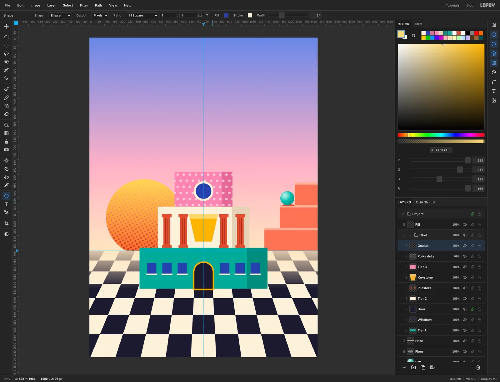

1. Click `Tier 2` and add a layer named `Pilasters`. Each pilaster is three terracotta `#D2573B` rectangles: a shaft 44 px wide from y = 1180 to 1364, a 64 × 20 capital on top and a 64 × 16 base underneath. Put the shafts' left edges at x = 486, 596, 860 and 970. Then fill two thin flutes, 5 px wide, down each shaft in `#9E3B26`.
2. Add a layer named `Keystone`. Pick the **Pen** ([[P]]) and click the four corners of a wedge: `655, 1160`, `845, 1160`, `805, 1340` and `695, 1340`. Click the first anchor again to close it. Open the **Paths** panel from the panel toolbar on the right, click **Path to Selection** and fill the selection with `#F4B63A`. Keep the selection, pick the **Rectangular Marquee**, hold [[Shift]] and [[Alt]] together and drag a box across the top 30 px of the wedge. Shift+Alt keeps only the overlap. Fill that strip with `#FFD979` and press [[Cmd+D]].
3. Click `Polka dots` and add a layer named `Oculus`. With the **Shape** tool set to Ellipse, fill `#2B3FA8`, click the **Stroke** swatch and choose `#FBF1DC` at **Width** `14`. Drag from `750, 1008` to `808, 1066`.

The oversized keystone is a nod to Michael Graves, who put one several storeys tall on the front of the Portland Building.

## Pipe the frosting

Each band of frosting is a pill-shaped rectangle with shorter pills hanging off it.

1. On the **Shape** tool, click the Stroke swatch and choose **Remove stroke**. Switch **Shape** back to Rectangle.
2. Click `Door` and add a layer named `Frosting 1`. Set the fill to `#FFF9EC` and **Corner Radius** to `22`. Press at `750, 1380` and drag to `1188, 1402` for a band 44 px tall that overhangs the tier on both sides.
3. Set **Corner Radius** to `20` and draw nine drips, each 40 px wide. Shapes grow from where you press, so press 30 to 60 px below the band's top edge and drag down about the same distance again. The top of each drip tucks into the band and the bottom hangs 50 to 110 px below it. Vary the lengths and the gaps.
4. Click `Keystone`, add `Frosting 2` and do the same in lavender `#B9A6E0`: a band from `750, 1110` dragged to `1068, 1132`, and six drips.
5. Click `Oculus`, add `Frosting 3` in `#FFF9EC`: a band from `750, 880` dragged to `958, 902`, and four drips.

Let a drip or two cross a pilaster or the top of a window. Overlaps make the frosting look like it was poured on last.

## Stripe a candle with the Lasso

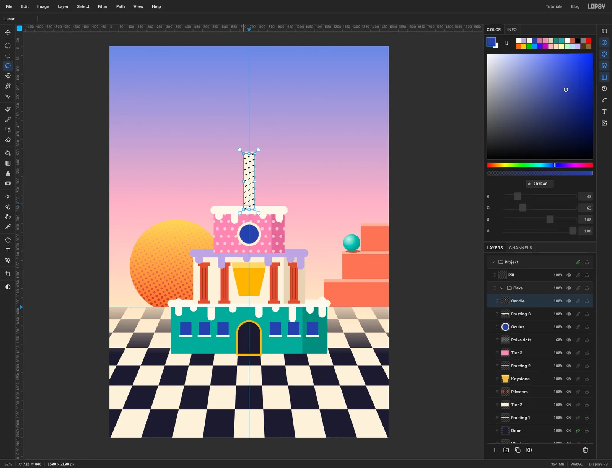

The candle goes in before the pediment, so the pediment can sit in front of it.

1. With `Frosting 3` active, add a layer named `Candle`.
2. Marquee from `720, 566` to `780, 850` and fill it with `#FBF1DC`.
3. Pick the **Lasso** and trace a slanted stripe across the candle: `720, 606` up to `780, 576`, down to `780, 606`, back to `720, 636`.
4. Hold [[Shift]] and trace four more stripes the same shape, each 60 px lower than the last. Shift adds each one to the selection.
5. Fill them with `#2B3FA8` and press [[Cmd+D]].
6. The last stripe runs past the foot of the candle. Marquee everything on this layer below y = 850 and press [[Delete]], then [[Cmd+D]].
7. Add a little `#1B1A2E` wick, 8 px wide, on top of the candle from y = 540 to 566.

> **Tip:** The Lasso is freehand, so move steadily from corner to corner. The stripes are small, and a slightly soft edge reads as a hand-painted candle.

## Draw the pediment with the Pen

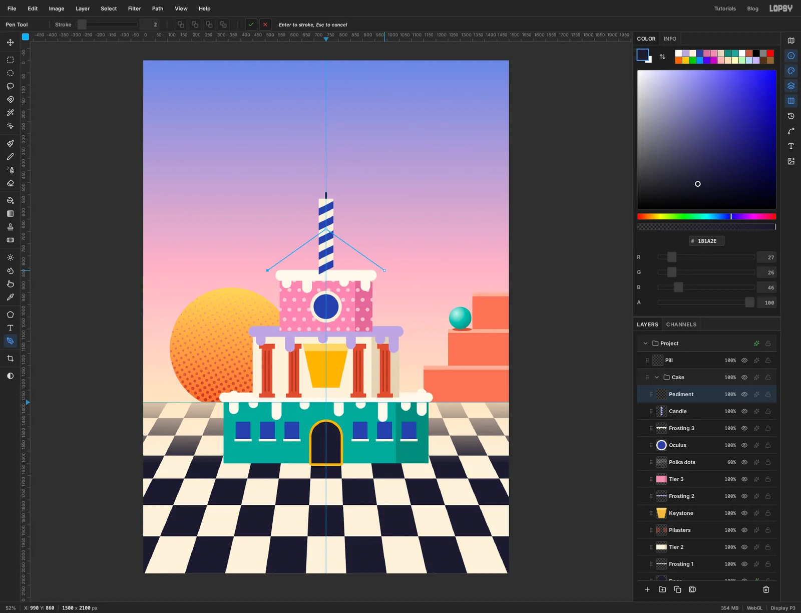

A pediment is the shallow triangle over a temple front. This one overhangs the pink tier by 50 px on each side.

1. Add a layer named `Pediment`.
2. Pick the **Pen**. Click at `510, 860`, at `750, 690` and at `990, 860`.
3. Click the first anchor again to close the triangle.
4. In the **Paths** panel click **Path to Selection**.
5. Fill the selection with `#D2573B`.
6. Keep the selection. With the **Rectangular Marquee**, hold [[Shift]] and [[Alt]] and drag a box over the right half of the triangle, starting on the centre guide. Fill the overlap with `#B8452D` and press [[Cmd+D]].

## Break the pediment

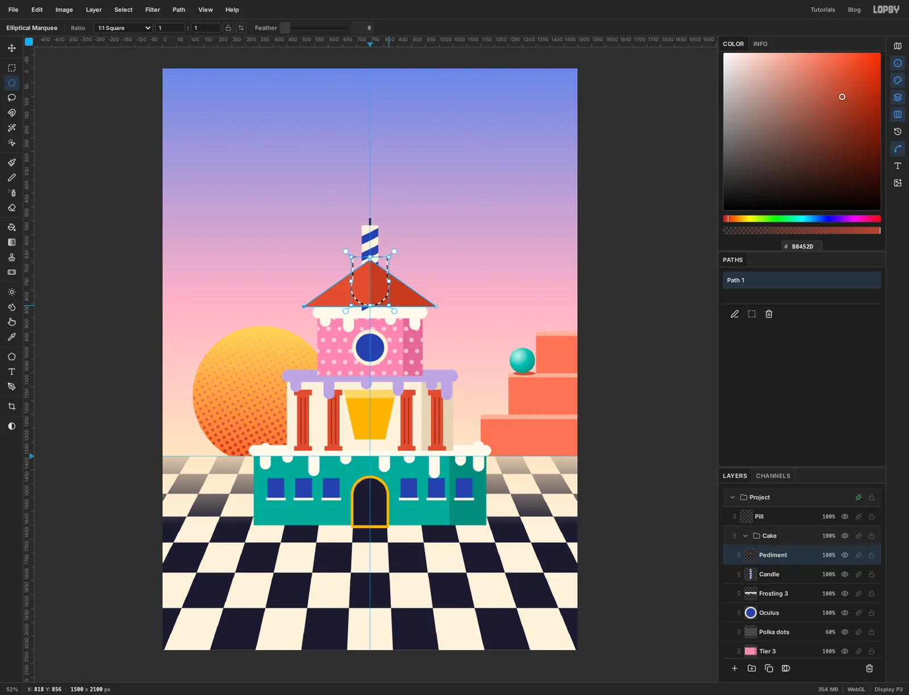

A *broken pediment* has its peak cut away, usually to frame an urn or a finial. Here it frames the candle.

1. With the **Rectangular Marquee**, drag from `688, 680` to `812, 792`.
2. Switch to the **Elliptical Marquee**, hold [[Shift]] and drag from `682, 724` to `818, 856`.
3. Press [[Delete]], then [[Cmd+D]].

The candle is on a layer below the pediment, so it now stands in the gap with the two raking halves in front of it.

## Draw a flame with one curved anchor

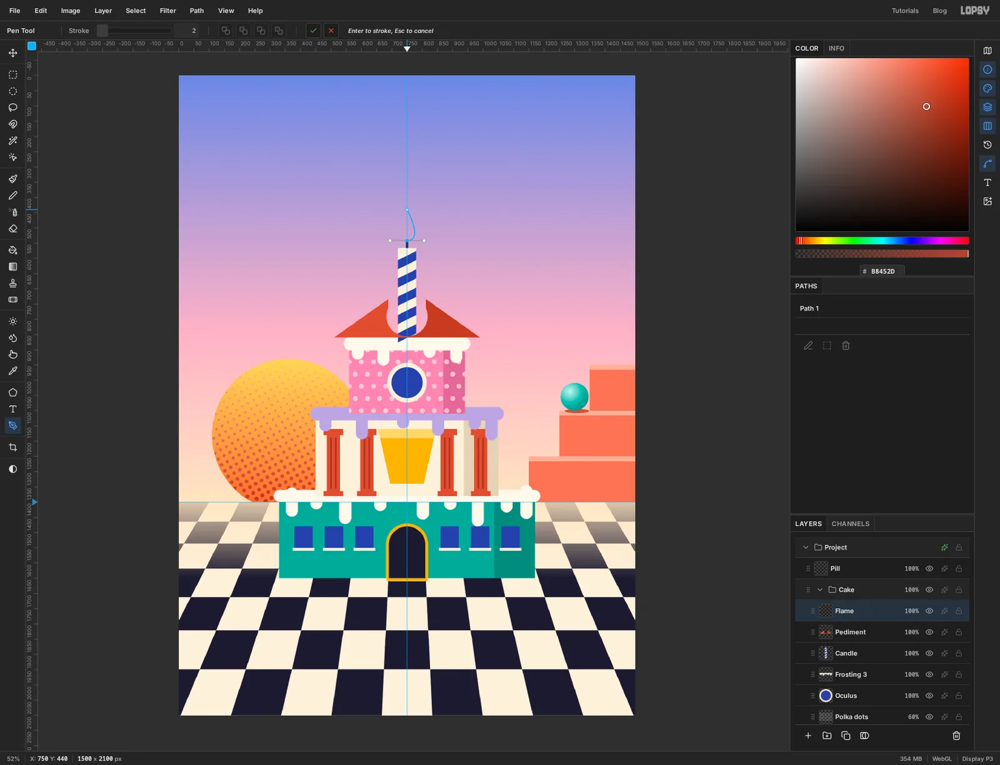

A flame needs only two anchors: a round one at the bottom and a sharp one at the tip.

1. Add a layer named `Flame`.
2. With the **Pen**, press at `750, 542`, just above the wick, and drag to the right to `806, 542` before you let go. That pulls a pair of handles out of the anchor.
3. Click once at `750, 440` for the tip.
4. Click the first anchor to close the path. The handles bend both sides into a teardrop.
5. In the Paths panel click **Path to Selection**.

## Light the flame

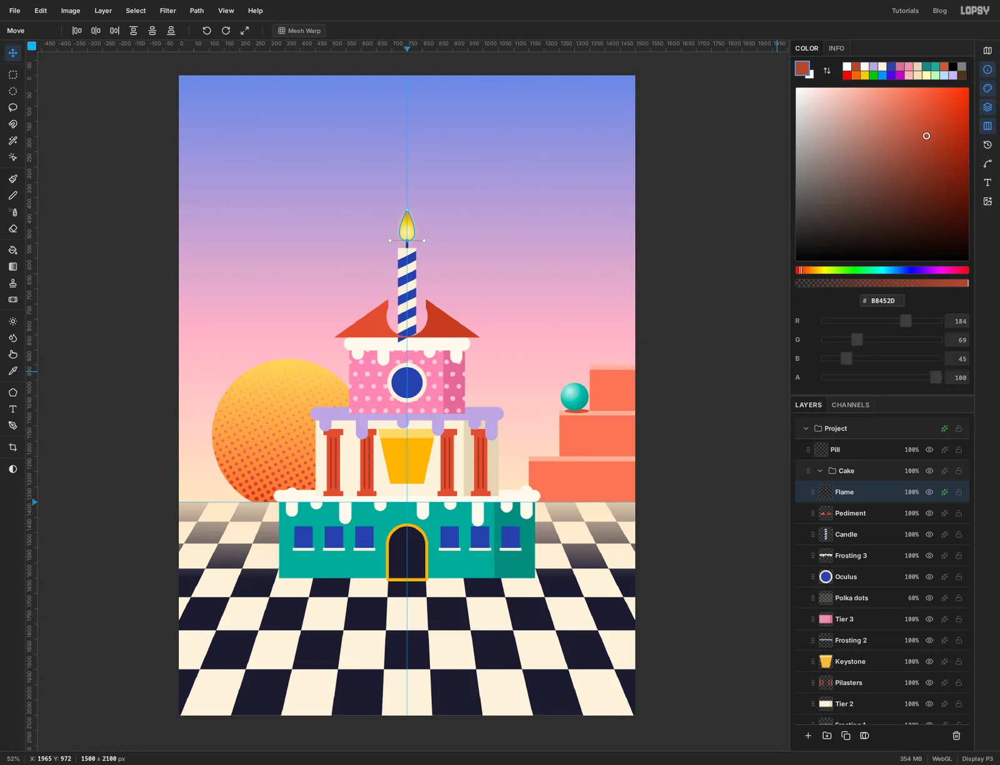

The flame sits level with the banner you'll add later, so keep its glow tight.

1. Pick the **Gradient** tool and set **Type** to Radial. In the editor, set both stops' **Opacity** back to 100%, make them `#FFF6C2` and `#F2703F`, and add `#FFD23F` at about 45%. Drag from the fat part of the flame up to its tip.
2. Press [[Cmd+D]].
3. Open the `Flame` layer's effects, tick **Outer Glow**, set **Size** to `28`, **Opacity** to `70` and the colour to `#FFE27A`.
4. Close the Paths panel.

## Copy the candle and scale it down

The ledges get smaller candles. They're copies of the big one, flame included.

1. Click `Candle`, marquee around the whole candle and its wick, and press [[Cmd+C]].
2. Click `Flame` and press [[Cmd+V]]. Press [[Cmd+D]] and rename the new layer `Small candle`.
3. Click `Flame`, marquee around the flame and press [[Cmd+C]]. Click `Small candle`, press [[Cmd+V]], then [[Cmd+D]] and [[Cmd+E]] to merge the flame copy down. Flame and candle are now one layer, without the glow.
4. Marquee around the copy, from just above the flame's tip to the bottom of the candle.
5. Pick the **Move** tool and click **Free** in the options bar. Hold [[Cmd]] and drag the top-left handle down and to the right until the box is half as tall. Cmd keeps the proportions.

## Stand four small candles on the ledges

One candle goes at each end of the two frosted ledges.

1. With the transform box still showing, drag from inside it to the left end of the lavender frosting, so the candle's centre is at about x = 490 and its base sinks slightly into the frosting. Press [[Cmd+D]].
2. Click `Small candle`, choose **Layer → Duplicate Layer** and drag the copy straight across to the right end of the lavender frosting.
3. Click `Small candle` again, duplicate it and drag this copy down to the left end of the white frosting on the bottom tier, at about x = 385. Do it once more for the right end, at about x = 1115.
4. Click the top `Small candle copy` and press [[Cmd+E]]. Repeat until all four are merged back into `Small candle`.

> **Tip:** Always duplicate the original, not a merged layer, or each new copy brings the earlier candles along with it.

## Skew a cast shadow

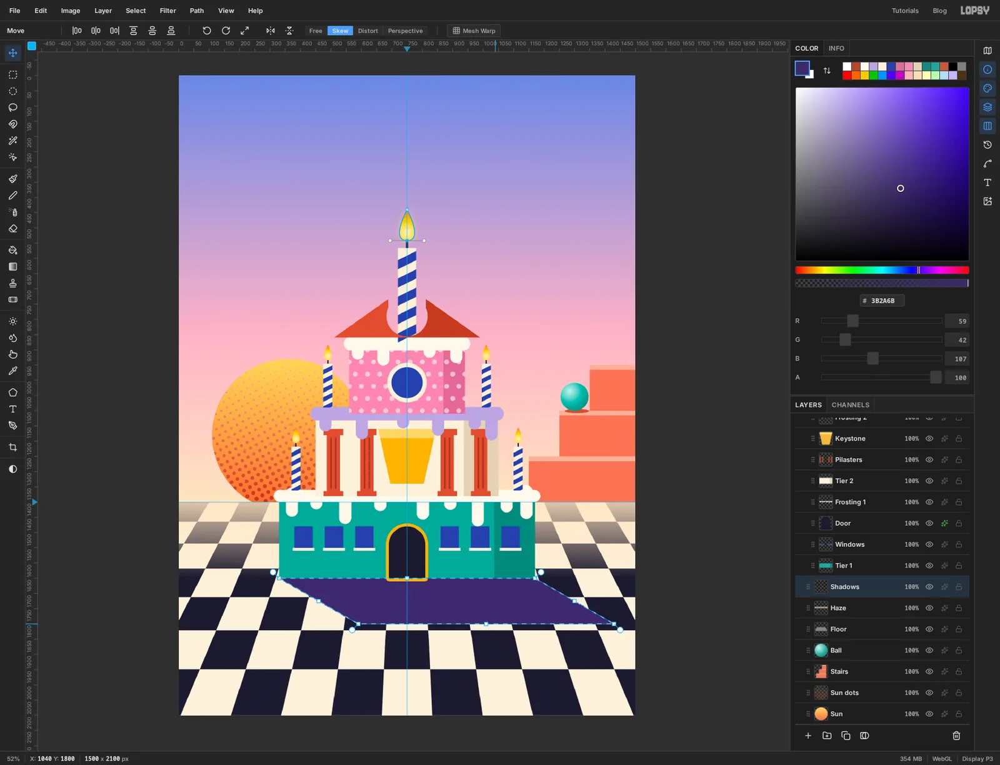

The sun is low on the left, so the cake throws a long shadow forward and to the right.

1. Click `Haze` and add a layer named `Shadows`.
2. Marquee from `330, 1650` to `1170, 1800`, the full width of the cake and 150 px down from its base. Fill it with `#3B2A6B` and keep the selection.
3. Pick the **Move** tool and click **Skew** in the options bar.
4. Drag the **bottom-middle** handle to the right by about 290 px. The top edge stays on the cake and the bottom edge slides.
5. Press [[Cmd+D]].

## Multiply the shadow onto the floor

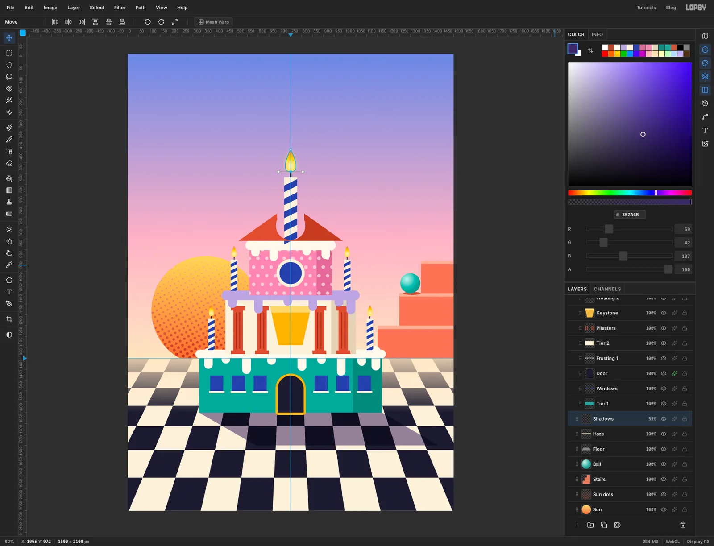

1. Open the `Shadows` layer's effects and set **Blend** to **Multiply**.
2. Close the drawer and drag the layer's opacity down to **55%**.

Multiply only darkens, so the shadow shows as violet on the cream squares and disappears into the ink ones, the way a real shadow would.

## Wrap a gift and move it as a group

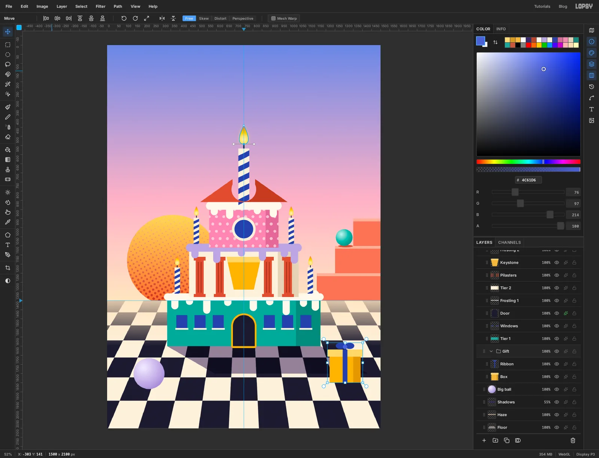

1. Click `Shadows` and add a layer named `Big ball`. Draw a circle from `145, 1715` to `315, 1885` with the Elliptical Marquee and fill it with a radial gradient, `#F1EBFF` → `#B9A6E0` → `#7459BD`, dragged from its upper left to past its lower right. Press [[Cmd+D]].
2. Click **New Group** and name it `Gift`. Add a layer named `Box`. On the **Shape** tool set **Corner Radius** back to `0`. Draw a mustard `#F4B63A` body, 170 px wide and 150 px tall, by pressing at `1305, 1775` and dragging to `1390, 1850`. Add a `#D99A22` band down its right 40 px (press at `1370, 1775`, drag to `1390, 1850`). Set **Corner Radius** to `6` and draw a `#FFD979` lid, slightly wider than the box, from `1305, 1688` to `1402, 1708`.
3. Add a layer named `Ribbon`. Fill a 26 px cobalt strip down the middle of the box, two small cobalt ellipses above the lid for the bow and a lighter `#4C61D6` dot for the knot.
4. Click the `Gift` group row, pick the **Move** tool and drag the box 40 px to the left. Both layers move together.

Press [[Cmd+Z]] and [[Cmd+Shift+Z]]. The whole group steps back and forward as one move. The box starts a little too far right on purpose, to show the group move. If yours is already where you want it, skip the drag.

## Ground the props

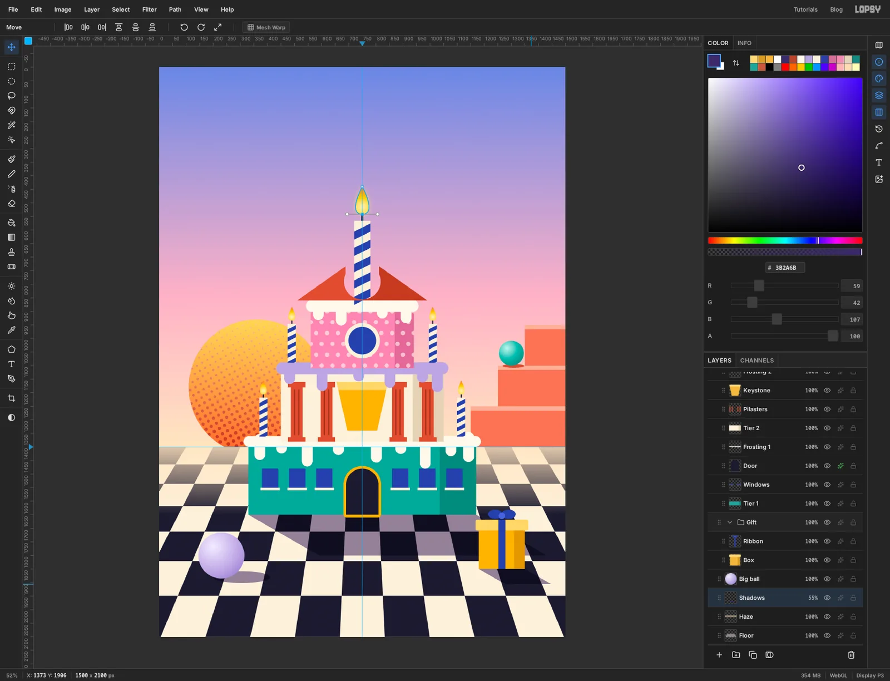

1. Click the `Shadows` layer.
2. With the Elliptical Marquee, drag a flat ellipse under the right side of the ball, about 210 px wide and 44 px tall, and fill it with `#3B2A6B`.
3. Marquee a strip under the gift, as wide as the box and 56 px tall. Fill it, then use the Move tool's **Skew** mode to push its bottom edge about 110 px to the right. Press [[Cmd+D]].

The shadows are on the Multiply layer already, so they match the cake's.

## Draw a squiggle with the Pen

No Memphis pattern is complete without a squiggle. The Pen can stroke a path as well as fill one.

1. Click the `Ball` layer (the teal one on the stairs) and click **New Group**. Name it `Confetti`. It sits behind the floor and the cake, so nothing in it can cover them.
2. Add a layer named `Squiggle` and set the foreground colour to `#2B3FA8`.
3. Pick the **Pen** and set **Stroke** to `18` in the options bar.
4. Press at `90, 690` and drag 34 px to the right. Do the same at `160, 630`, `230, 690`, `300, 630`, `370, 690` and `440, 630`. Every anchor gets level handles, so the line rolls up and down between them.
5. Press [[Enter]]. The Pen strokes the path onto the layer in the foreground colour.

## Rotate a triangle

A level triangle looks parked. A tilted one looks thrown.

1. Add a layer named `Triangle`. On the **Shape** tool choose Polygon, set **Sides** to `3`, **Corner Radius** to `0` and fill `#F4B63A`, and drag from `1075, 675` to `1140, 740`.
2. Marquee around the triangle with a little room to spare.
3. Pick the **Move** tool and click **Free**. Hover just outside a corner handle until the cursor turns into a rotate arrow, then drag clockwise by about **24°**.
4. Press [[Cmd+D]].

## Scatter the confetti and add a starburst

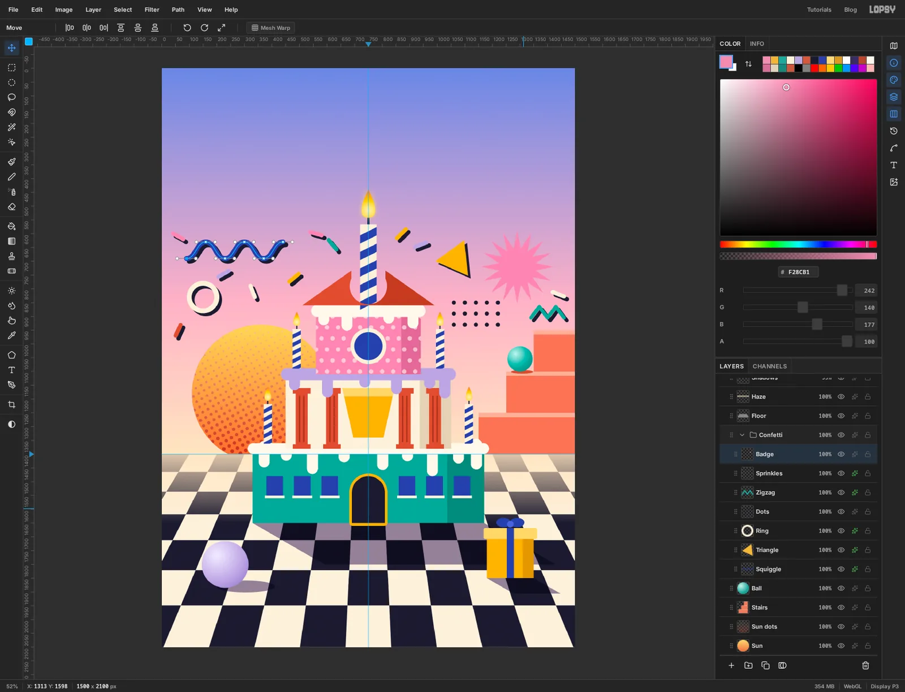

Give each kind of shape its own layer inside `Confetti`.

1. **Ring:** Shape tool, Ellipse, remove the fill, stroke `#FBF1DC` at **Width** `18`. Drag from `150, 830` to `200, 880`.
2. **Dots:** the **Brush** ([[B]]) at **Size** `16`, **Hardness** `100`, in `#1B1A2E`. Click three rows of five dots, 40 px apart, starting at `1060, 850`.
3. **Zigzag:** the Brush at **Size** `14` in `#1FA79A`. Click at `1340, 905`, then [[Shift]]-click at `1370, 865`, `1400, 905`, `1430, 865` and `1460, 905`. Shift joins each click to the last with a straight line.
4. **Sprinkles:** the Brush at **Size** `16`. Make about ten short strokes, 40 to 50 px long, at different angles in pink, mustard, cream, terracotta, lavender and teal. Keep them at least 30 px away from the cake, the candles and the banner area above y = 570.
5. Open the `Triangle` layer's effects, tick **Drop Shadow** and set **Offset X** `10`, **Offset Y** `10`, **Blur** `0`, **Opacity** `100` and the colour `#1B1A2E`. Click **Copy effects**. Open the effects of `Squiggle`, `Ring`, `Zigzag` and `Sprinkles` in turn and click **Paste effects**.
6. **Badge:** add a layer named `Badge` and set the foreground to `#F28CB1`. Choose **Filter → Sunburst…** and set **Rays** `16`, **Length** `7`, **Width** `100`, **Taper** `100`, **Center X** `86` and **Center Y** `34.3`. The centre is a percentage of the canvas, so that puts it at `1290, 720`, in the gap between the triangle and the right edge. Click **Apply**.

A Sunburst with full taper and full width closes up into a spiky star, which makes a good sticker.

## Letter the badge and tilt it

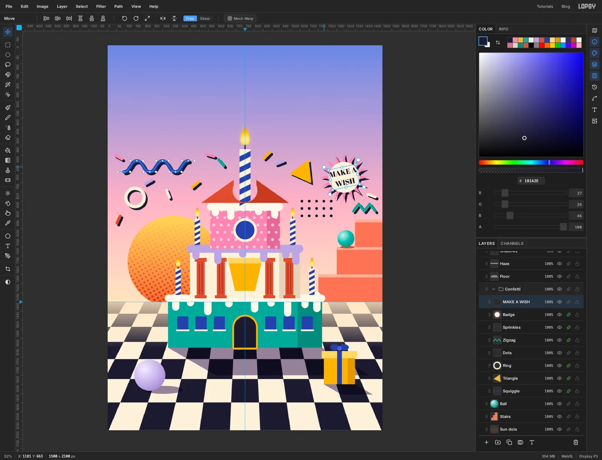

1. On the `Badge` layer, drag a circle with the Elliptical Marquee from `1206, 636` to `1374, 804` and fill it with `#FBF1DC`. Press [[Cmd+D]]. Open the layer's effects and click **Paste effects**.
2. Set the foreground to `#1B1A2E` and pick the **Text** tool ([[T]]). Click an empty patch of sky. Choose **Abril Fatface**, **Size** `40` and **Align** Center. Type `MAKE A`, press [[Enter]], type `WISH` and press [[Tab]] to commit.
3. With the **Move** tool, drag the text onto the middle of the cream disc.
4. Hover just outside a corner of the text box and drag counter-clockwise by about **12°**. Press [[Esc]].

The text stays live after the rotation, so you can still retype it.

## Set the headline

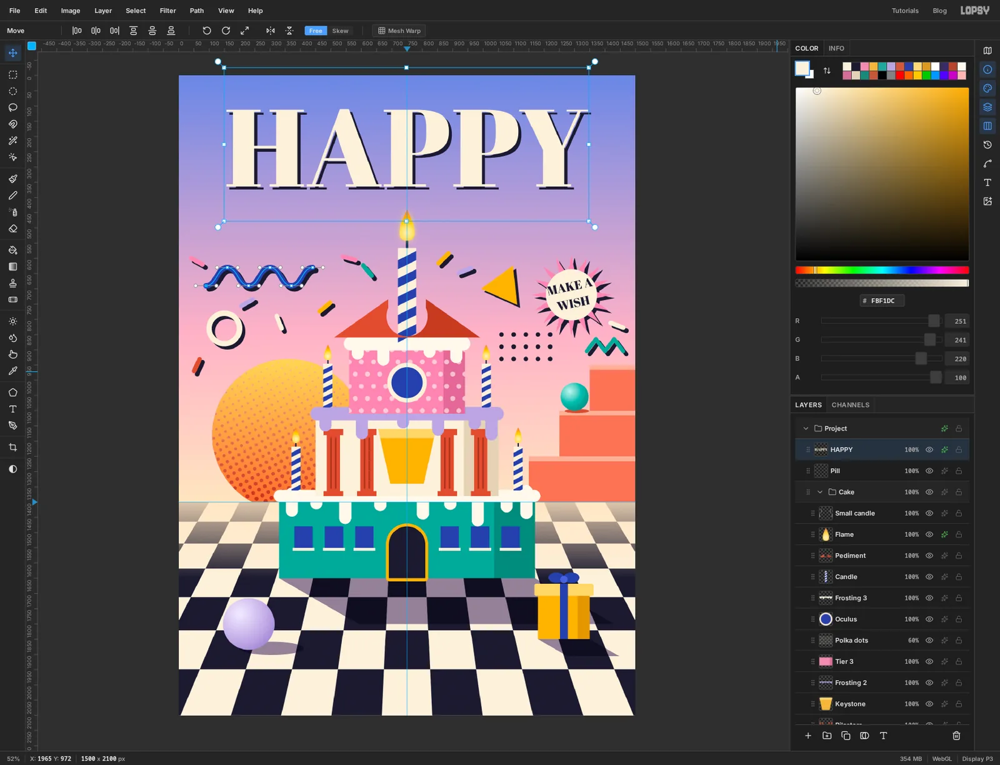

A fat Didone with hairline serifs is the classic postmodern headline face. Abril Fatface is a free one.

1. Click the `Pill` layer so the headline lands above the cake.
2. Set the foreground to `#FBF1DC`. With the **Text** tool, click in the upper left of the sky, choose **Abril Fatface** at **Size** `360`, type `HAPPY` and press [[Tab]].
3. Pick the **Move** tool and click **Align center horizontally** in the options bar.
4. Drag the word up until the tops of the letters are about 110 px from the top edge.
5. Open its effects and click **Paste effects** for the same hard shadow as the confetti.

## Split BIRTH and DAY around the flame

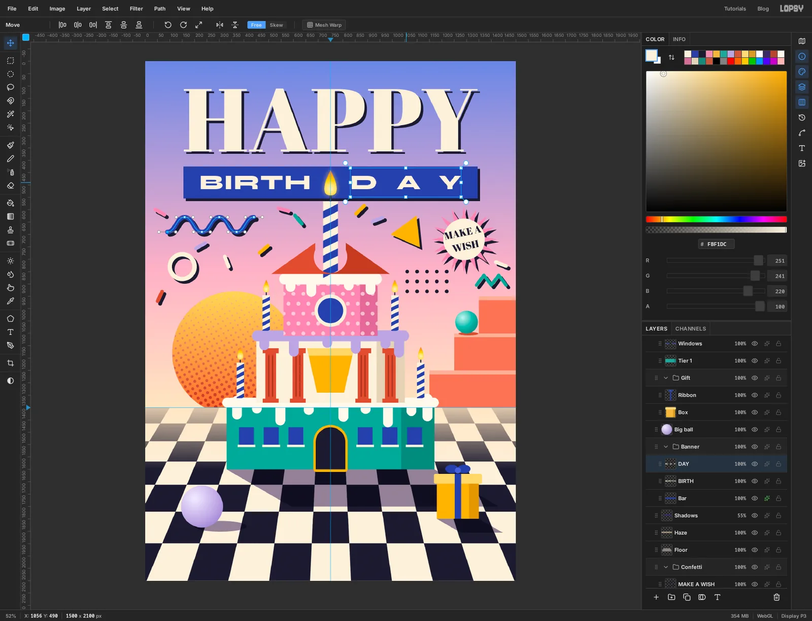

The banner goes behind the cake, so the flame burns in front of it.

1. Click `Shadows`, click **New Group** and name it `Banner`. Add a layer named `Bar`.
2. On the **Shape** tool choose Rectangle, **Corner Radius** `0` and fill `#2B3FA8`. Click the Stroke swatch and choose **Remove stroke**, which is still set from the ring. Draw a bar as wide as the word HAPPY and 130 px tall: press on the centre guide at `750, 490` and drag to `1345, 555`. Paste the shadow effect onto it.
3. Set the foreground to `#FBF1DC`. With the **Text** tool, click on the left half of the bar, choose **Syne**, **ExtraBold**, **Size** `84` (**Align** is still Center from the badge, which is fine), type `BIRTH` and press [[Tab]]. Open the **Text** panel and set **Letter spacing** to `4`.
4. Click the right half of the bar with the Text tool and type `DAY` the same way. Set its **Letter spacing** to `79`.
5. With the **Move** tool, place `BIRTH` so it ends 85 px left of the centre guide (x = 665) and `DAY` so it starts 85 px right of it (x = 835). Centre both on the bar's height.

The wide tracking on DAY makes it exactly as long as BIRTH, about 440 px. The two words balance on either side of the candle and each ends 70 px from its end of the bar.

## Draw a curve for the text to follow

Text can follow any stored path. This one is a quarter circle about 20 px outside the sun's edge.

1. Click the `MAKE A WISH` layer so the next text layer joins the `Confetti` group.
2. Pick the **Pen**. Press at `89, 1204`, beside the sun's left edge, and drag up to `74, 1035`.
3. Press at `384, 909`, just above the top of the sun, and drag right to `552, 924`.
4. Click the **✓** (Commit path) button in the options bar. This keeps the path without stroking it.

## Run MANY HAPPY RETURNS along the curve

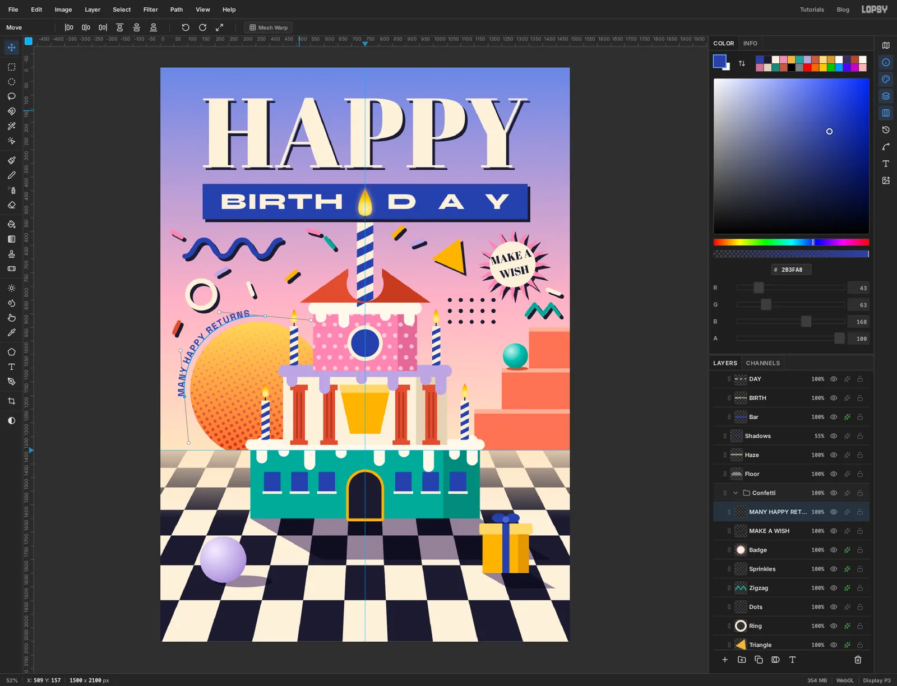

The line starts where the path starts, at the sun's left edge, and reads upward and over the top.

1. Set the foreground to `#2B3FA8`. With the **Text** tool, click an empty spot away from the other type, such as the floor at the far left. Clicking inside another text layer's box would edit that layer instead, and the HAPPY box reaches lower than its letters do. This layer sits behind the floor, so you won't see the words there as you type. They show up once they're on the path.
2. Choose **Space Grotesk**, **Bold**, **Size** `34` and **Align** Left. Type `MANY HAPPY RETURNS` and press [[Tab]].
3. In the Text panel set **Letter spacing** to `3`.
4. In the options bar, open the **Path** list and choose the last path. The words jump onto the curve and follow it around the sun.

## Seat the caption in a pill

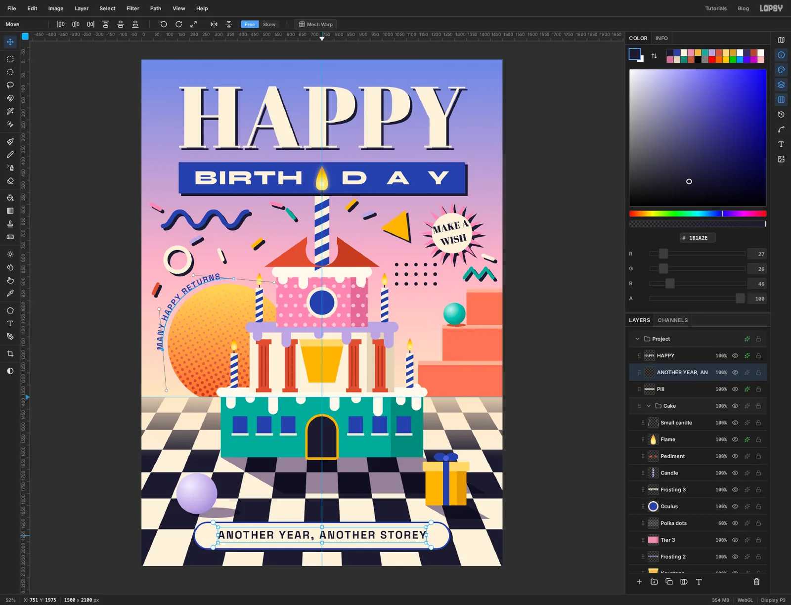

1. Click the `Pill` layer. With the **Shape** tool (Rectangle), set fill `#FBF1DC`, add a stroke of `#2B3FA8` at **Width** `6` and set **Corner Radius** to `55`. Press on the centre guide at `750, 1975` and drag to `1280, 2030`. Paste the shadow effect onto the layer.
2. Set the foreground to `#1B1A2E`. With the **Text** tool, click an empty patch of floor above the pill. Choose **Space Grotesk**, **Bold**, **Size** `46` and **Align** Center, type `ANOTHER YEAR, ANOTHER STOREY` and press [[Tab]]. Set **Letter spacing** to `5`.
3. Pick the **Move** tool and click **Align center horizontally**. Drag the line straight down into the pill.

Check the seating before you move on. The capitals should sit in the middle of the pill's height, with the same gap above and below, and there should be about 100 px of cream at each end so the letters don't crowd the round caps.

## Add grain and a little vibrance

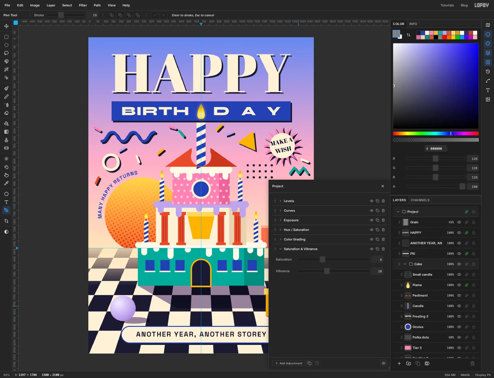

1. Pick the **Pen**, click an empty corner of the canvas and press [[Esc]]. That deselects the last path so its outline stops showing.
2. Click `HAPPY`, the top layer, and add a layer named `Grain`. Press [[Cmd+A]], fill it with `#808080` and press [[Cmd+D]].
3. Choose **Filter → Add Noise…**, set **Amount** to `18`, click **Mono** and click **Apply**.
4. Set the layer's **Blend** to **Overlay** and its opacity to **45%**.
5. Choose **Layer → Adjustment Layer…**. In the drawer click **Add Adjustment → Saturation & Vibrance** and set **Vibrance** to `20`.

Grey at 50% does nothing in Overlay, so only the noise shows, as a fine print grain over the flat colour.

## Export the card

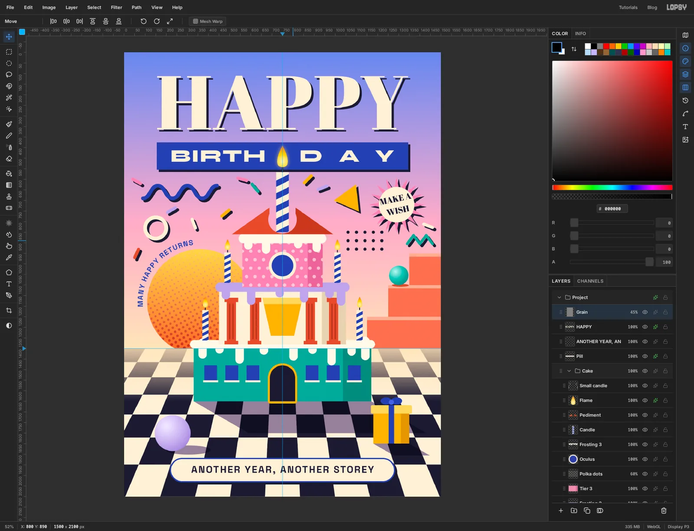

Choose **File → Save Project** to keep the layers, then **File → Quick Export PNG** for the artwork. At 1500 × 2100 px it prints as a 5 × 7 inch card front at 300 dpi.

To make it your own, retype the caption with a name or an age, or swap the tier colours. Because the banner sits behind the cake, the flame stays between BIRTH and DAY whatever you change.
