The San Francisco concert posters of 1966 and 1967 broke every rule of legible design on purpose. Colours from opposite sides of the wheel sat side by side so the edges seemed to vibrate, shapes melted, and lettering bent to fill whatever space was left. It's a great fit for a company that sells distortion. In this tutorial you'll design the landing page for **Fuzz Prophet**, a made-up maker of hand-wired fuzz pedals, as a 1440 × 2200 px desktop comp.

The page has four parts, top to bottom: a dark **nav bar**, a purple **hero** with the pedal on a stack of melting rings, a cream **product section** under a band of wavy stripes, and a dark **footer**. You'll draw the pedal from simple shapes, then reuse it three times for the product cards.

Along the way you'll use:

- **guides**, the **Elliptical Marquee** with **Edit → Fill**, and marquees combined with [[Shift]] and [[Shift+Alt]]
- **Filter → Liquify** to melt circles into wobbly rings and straight stripes into waves
- the **Shape** tool for the pedal, buttons and cards, and its **Path** output for a circle of text
- the **Pen** tool for a cable, a signal wave and an arc, and **text on a path**
- a two-colour headline, the **Text** panel's line height and letter spacing
- **groups**, scaling and rotating a whole group, **Copy Merged**, and rotating a selection
- **Filter → Hue/Saturation** and **Filter → Halftone**, the **Overlay** blend mode and a **Saturation & Vibrance** adjustment
- **Stroke**, **Drop Shadow** and **Outer Glow** effects
- text in **Shrikhand**, **Righteous** and **DM Sans**

The palette:

- Aubergine `#2B0B3F`, ink `#1C062B`
- Ring purples `#3A0F5C` / `#561A8A`
- Violet `#5B1A9E`, magenta `#B026D9`
- Hot pink `#FF3D9A`, tangerine `#FF6B1A`, sun yellow `#FFD91A`
- Turquoise `#19C9C2`, shine `#7FECE4`
- Acid lime `#C6F432`, cream `#FFF1CF`
- Metal `#D9CFB4`, dot orange `#F2A93B`
- Footer greys `#8A7A9A` / `#B79CCB`

> **Tip:** Positions are written as `x, y` in document pixels. The status bar at the bottom of the window shows where the pointer is, so you can hover to find a spot. Key names are Mac keys. On Windows and Linux, use Ctrl for Cmd. **Edit → Fill** fills the selection with the foreground colour, and [[Cmd+D]] deselects. Every outline on this page is ink `#1C062B`. A new layer appears just above the selected layer, or inside the selected group if that group is open.

## Set up the page and start the rings

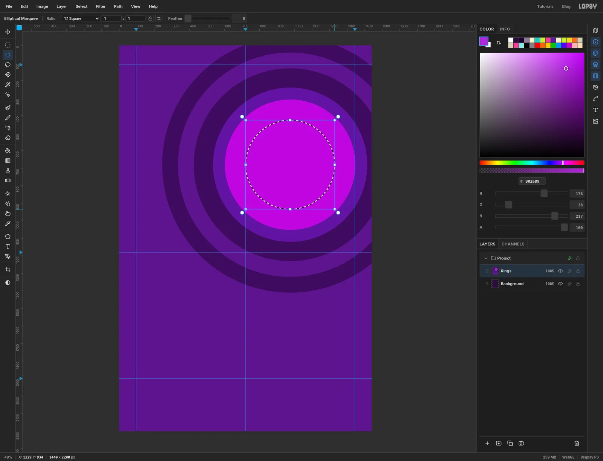

Choose **File → New**, set the size to **1440 × 2200** px and click **Create**. Click the `Background` row, set the foreground colour to aubergine `#2B0B3F` and choose **Edit → Fill**.

Drop the guides. Click the top ruler at **96**, **720** and **1344**: the two outer ones are the page margins and the middle one is the centre line. Then click the left ruler at **110** (bottom of the nav bar), **1180** (bottom of the hero) and **1900** (top of the footer).

Still on `Background`, pick the **Rectangular Marquee** (**M**) and drag from just off the left edge on the **110** guide to just off the right edge on the **1180** guide. Fill it with `#3A0F5C` and press [[Cmd+D]]. That's the hero's base colour.

Now the rings. They are just circles, filled from the biggest to the smallest, all centred on **975, 680**. Double-click `Layer 1`'s name and rename it `Rings`. With nothing selected, choose **Edit → Fill** to flood the whole layer with the same `#3A0F5C`. That's the outermost ring.

Pick the **Elliptical Marquee** and click once on the canvas without dragging. A small dialog asks for two corners, which is easier than dragging a circle this big. Type **From** `-25, -320` **to** `1975, 1680` and press [[Enter]]. That's a circle with a radius of 1000 px. Fill it with `#561A8A`.

Carry on inwards. Press [[Cmd+D]] before each one, because the dialog only opens when nothing is selected:

- `65, -230` to `1885, 1590`, filled `#3A0F5C`
- `155, -140` to `1795, 1500`, filled `#561A8A`
- `245, -50` to `1705, 1410`, filled `#3A0F5C`
- `335, 40` to `1615, 1320`, filled `#561A8A`
- `425, 130` to `1525, 1230`, filled `#3A0F5C`
- `535, 240` to `1415, 1120`, filled violet `#5B1A9E`
- `603, 308` to `1347, 1052`, filled magenta `#B026D9`

The outer circles are far bigger than the hero, and the purple covers the whole page for now. That's fine. You'll trim it soon.

## Finish the bright rings

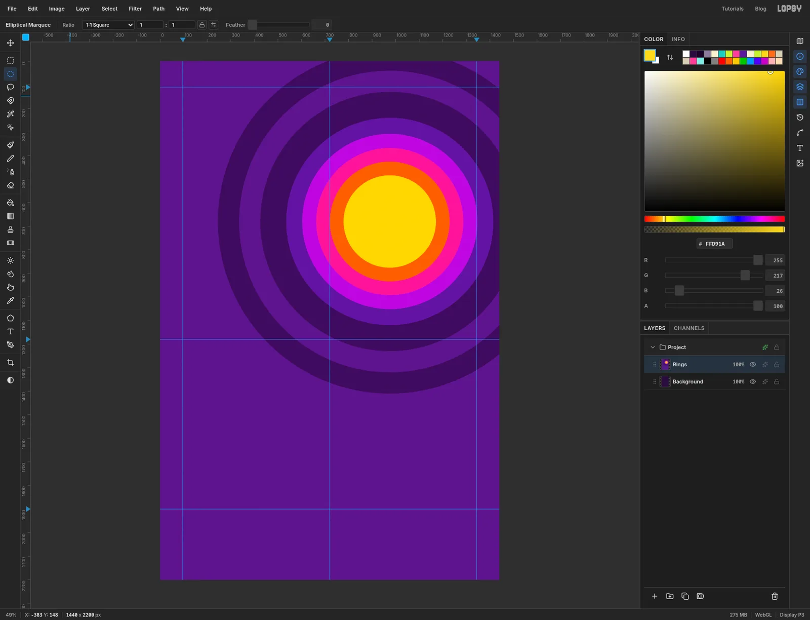

Three more circles finish the stack:

- `663, 368` to `1287, 992`, filled hot pink `#FF3D9A`
- `721, 426` to `1229, 934`, filled tangerine `#FF6B1A`
- `779, 484` to `1171, 876`, filled sun yellow `#FFD91A`

Press [[Cmd+D]].

The two quiet purples keep the left half of the hero calm enough to read text on, while the hot colours pile up where the pedal will sit.

## Melt the rings with Liquify

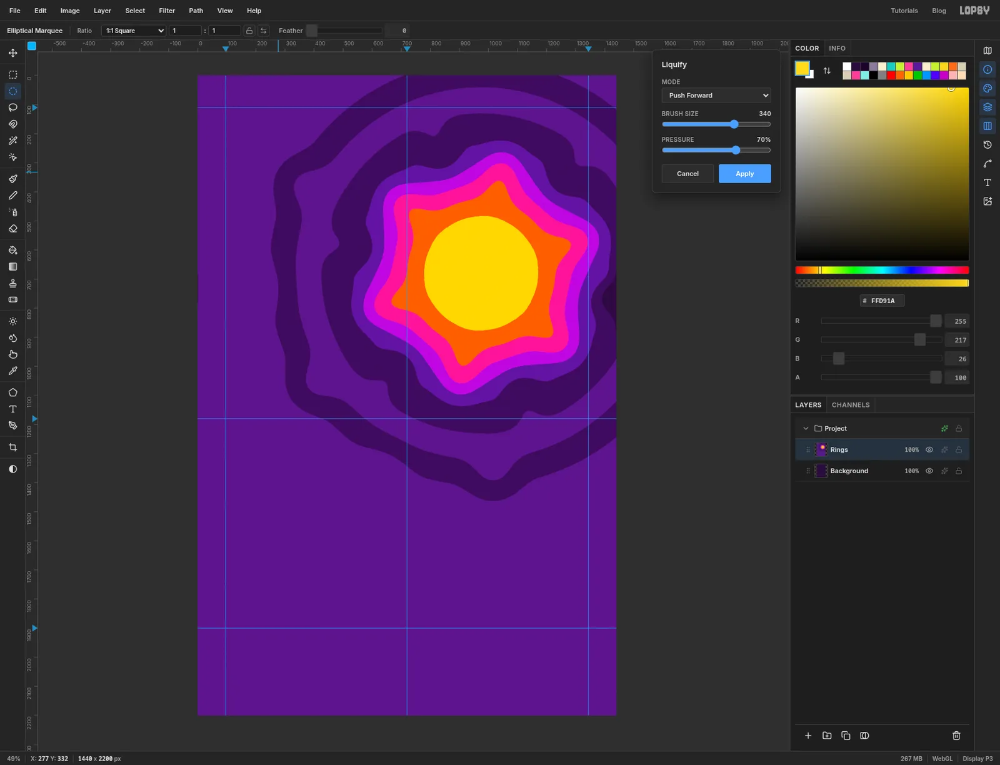

Choose **Filter → Liquify…**. Leave **Mode** on **Push Forward** and set **Brush Size** to `260` and **Pressure** to `70`.

Work your way around the bright rings like the numbers on a clock. At the first spot, start just outside the violet ring and drag about 150 px towards the centre. At the next, start on the orange ring and drag about 150 px outwards. Keep alternating in and out, twelve short drags in all, and the circles turn into a wobbly flower.

Then raise **Brush Size** to `340` and do the same to the big purple rings, a little further out. Stay on the canvas while you drag, because a press on a ruler drops a guide instead. Click **Apply**.

Now trim the overflow. With the **Rectangular Marquee**, drag from the **110** guide to the **1180** guide across the full width again, choose **Select → Inverse**, press [[Delete]] and then [[Cmd+D]].

## Set up the layer stack

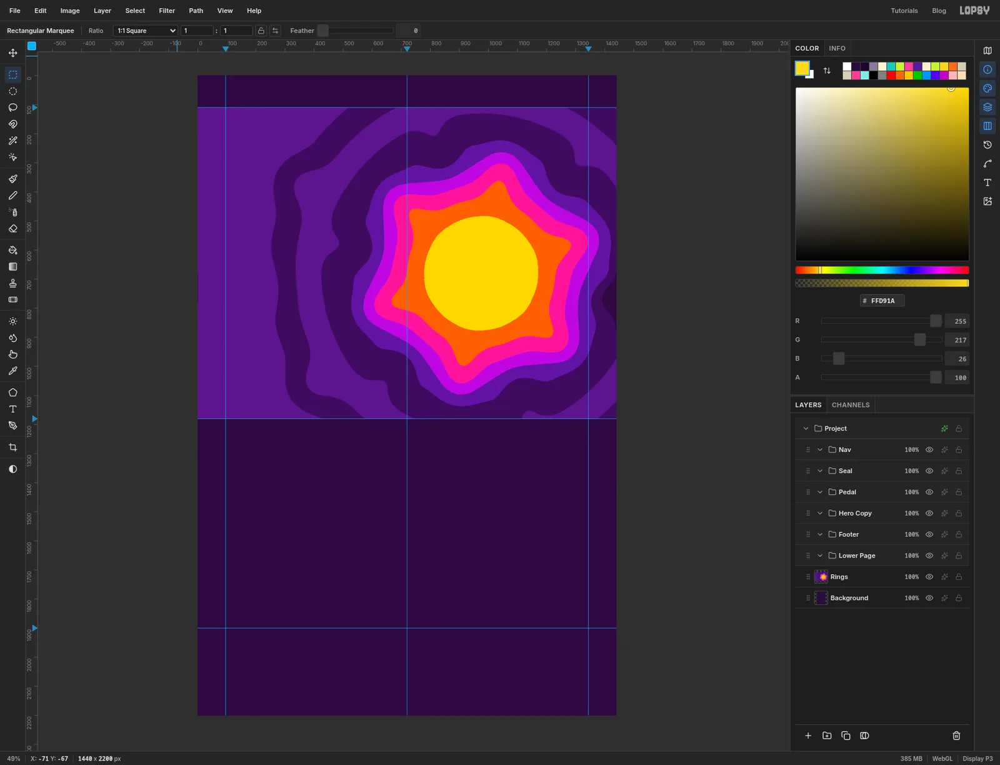

This page ends up with about seventy layers, so make the groups first. A new group always lands directly above the selected layer, so the trick is to create them from the top down.

Click the `Rings` row, click **New Group** at the bottom of the Layers panel and name it `Nav`. Click `Rings` again, make another group and name it `Seal`. Carry on the same way with `Pedal`, `Hero Copy`, `Footer` and `Lower Page`, clicking `Rings` before each one. The stack should read, from the top: `Nav`, `Seal`, `Pedal`, `Hero Copy`, `Footer`, `Lower Page`, `Rings`, `Background`.

## Draw the pedal body

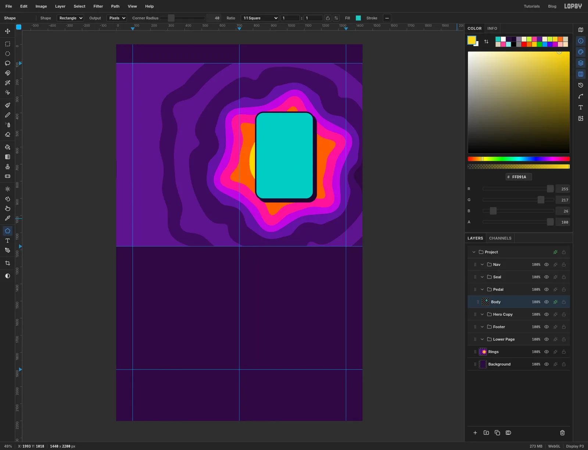

Open the **View** menu and untick **Snap to Guides**, so shapes don't jump to the centre line.

Click the `Pedal` group, click **Add Layer** and name the layer `Body`. Pick the **Shape** tool (**U**) and set **Shape** to **Rectangle**, **Corner Radius** to `40` and the **Fill** to turquoise `#19C9C2`. The Shape tool draws outwards from where you press, so press at **985, 650** and drag to **1150, 900** for a body 330 px wide and 500 px tall.

Click the **✦** button on the `Body` row to open the effects drawer. Tick **Stroke** and set **Width** to `8` and the colour to ink `#1C062B`. Tick **Drop Shadow** and set **Offset X** `16`, **Offset Y** `16`, **Blur** `0` and **Opacity** `100` in ink. A shadow with no blur is a flat-colour poster shadow, and you'll use it all over this page. Close the drawer.

You'll build the pedal upright and tilt it at the end.

## Add the shine and three knobs

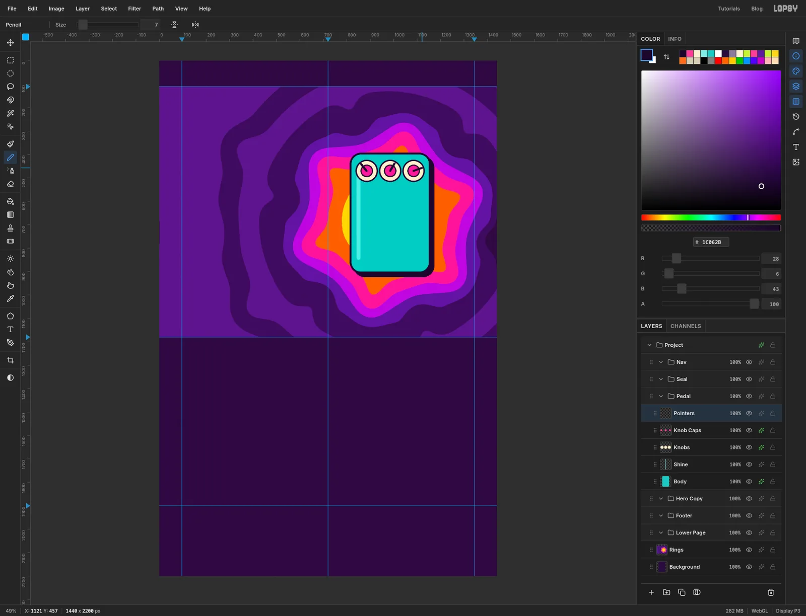

Each part gets its own layer inside `Pedal`. Click **Add Layer** before each one.

- `Shine`: a rectangle with **Corner Radius** `9` in `#7FECE4`, drawn from **850, 650** out to **859, 850**. It's a thin highlight strip down the left side.
- `Knobs`: switch **Shape** to **Ellipse** and the fill to cream `#FFF1CF`. Draw three circles in a row across the top of the body, centred on **885, 470**, **985, 470** and **1085, 470**. Press on the centre and drag out about 42 px for a knob 84 px across, holding [[Cmd]] to keep it a perfect circle. Give the layer a **Stroke** of **Width** `6`.
- `Knob Caps`: three hot pink `#FF3D9A` circles 44 px across on the same centres, with a **Stroke** of `5`.
- `Pointers`: pick the **Pencil** (**N**) at **Size** `7` in ink. Click the centre of a knob, then [[Shift]]-click a point on its rim to draw a straight pointer line. Aim each one a different way, as if someone had been twiddling them.

## Shape the eye from two circles

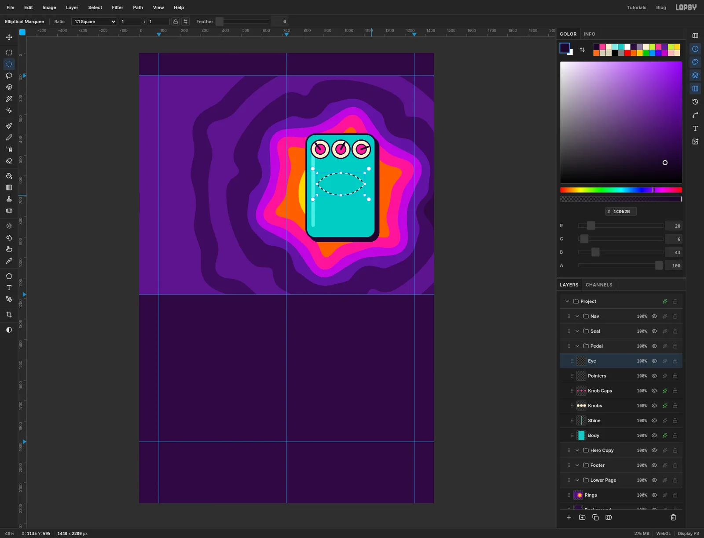

The third eye is an almond, and an almond is where two circles overlap.

Click **Add Layer** and name it `Eye`. Pick the **Elliptical Marquee** and drag a circle from **835, 585** to **1135, 885**. Now hold [[Shift+Alt]] and drag a second circle from **835, 395** to **1135, 695**. Holding both keys keeps only the part the two selections share, which is an almond 232 px wide centred on the pedal.

Fill it with cream `#FFF1CF`, press [[Cmd+D]] and give the layer a **Stroke** of `6`.

## Fill the iris with a banded gradient

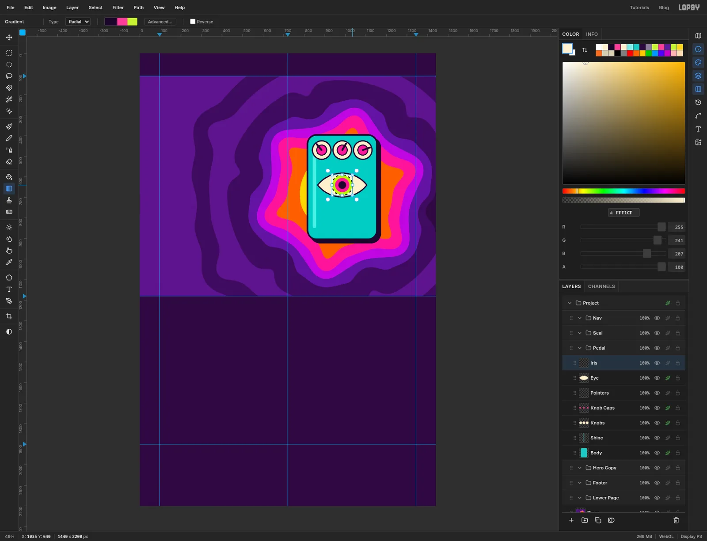

Click **Add Layer** and name it `Iris`. Pick the **Gradient** tool from the toolbox, set **Type** to **Radial** and click **Advanced…**. Click the bar to add stops until you have six, and set them up in pairs so each colour holds flat and then changes abruptly:

- ink `#1C062B` at **0%** and **36%**
- hot pink `#FF3D9A` at **40%** and **68%**
- lime `#C6F432` at **72%** and **100%**

Click **Done**. With the **Elliptical Marquee**, drag a circle from **935, 590** to **1035, 690**. Switch back to the Gradient tool and drag from the centre of the circle to its edge. Press [[Cmd+D]] and add a **Stroke** of `5`.

Add one more layer, `Glint`, and use the **Shape** tool to draw a small cream circle 16 px across at **1000, 624**, on the upper right of the pupil.

## Finish the pedal

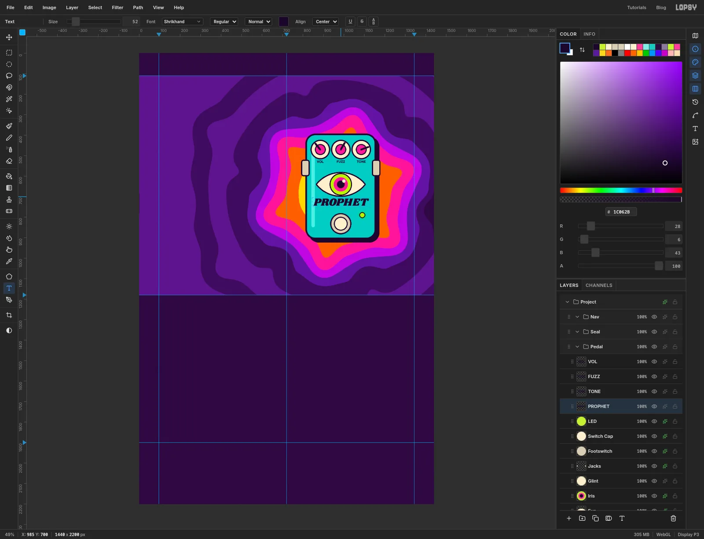

Four more shape layers finish the hardware:

- `Jacks`: two rectangles with **Corner Radius** `6` in metal `#D9CFB4`, each 30 × 70 px, centred on **812, 560** and **1158, 560** so they straddle the body's edges. **Stroke** `6`.
- `Footswitch`: a metal `#D9CFB4` circle 92 px across centred on **985, 832**. **Stroke** `6`.
- `Switch Cap`: a cream circle 58 px across on the same centre. **Stroke** `5`.
- `LED`: a lime `#C6F432` circle 22 px across at **1090, 790**. **Stroke** `4`, plus an **Outer Glow** with **Size** `18` and **Opacity** `90` in the same lime.

Now the lettering. Set the foreground to ink and pick the **Text** tool (**T**). Choose **Righteous**, **Size** `17` and **Align** **Center**. Click at **885, 520**, type `VOL` and press [[Tab]] to commit. Add `FUZZ` at **985, 520** and `TONE` at **1085, 520**. Then switch the font to **Shrikhand** at **Size** `52`, click at **985, 700** and type `PROPHET`.

> **Tip:** Click the `LED` row before you start each new piece of text. If a text layer is still selected when you change the font or size, Lopsy restyles that layer instead.

## Scale the whole group

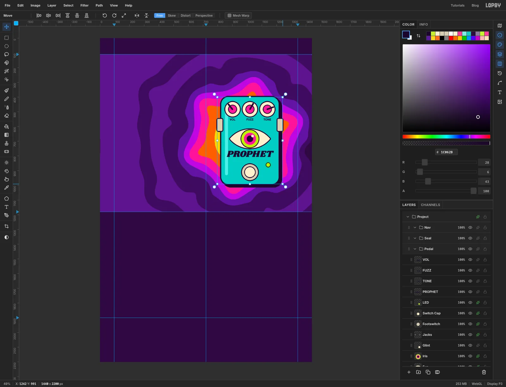

Click the `Pedal` group's row and pick the **Move** tool (**V**). With a group selected, the handles frame everything inside it.

Hold [[Cmd]] to keep the proportions and drag the bottom-right handle about 70 px to the right and 90 px down. That makes the pedal a little under a fifth bigger. Everything scales together, and the text layers stay editable. Press [[Cmd+D]] to commit.

## Copy the pedal as a single layer

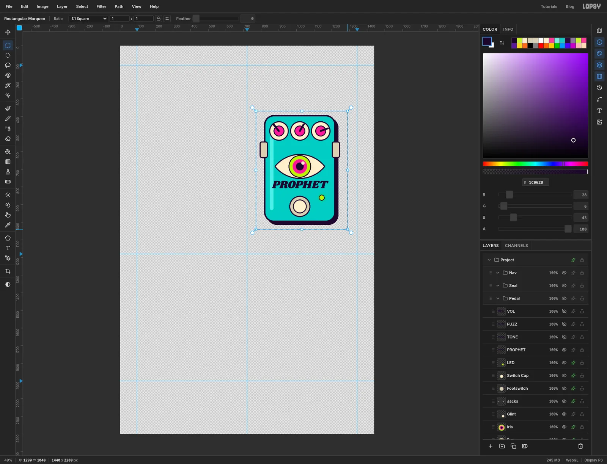

The product cards need three small pedals. Rather than rebuild the pedal, flatten a copy of it.

Hide everything that isn't the pedal: click the eye icons on `Background` and `Rings`. Hide the `VOL`, `FUZZ` and `TONE` layers too, because that lettering turns to mush when it's shrunk. With the **Rectangular Marquee**, drag a box around the pedal, leaving room for its shadow. Choose **Edit → Copy Merged**, which copies what you see rather than one layer, and press [[Cmd+D]].

## Paste, shrink and place the first mini pedal

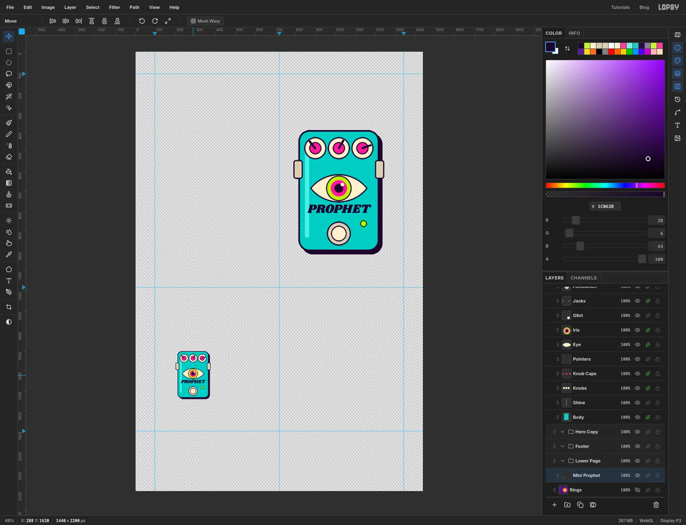

Click the `Lower Page` group and choose **Edit → Paste**. The copy lands exactly on top of the original as a `Pasted Layer`, already selected, with Move handles around it.

Hold [[Cmd]] and drag the bottom-right handle up and to the left until that corner is near **967, 632**. The copy is now a little under 40% of its size. Use the same spot for the other two copies so all three come out the same. Then drag from inside the box to move it down to the first card's spot, centred near **288, 1620**. Press [[Cmd+D]] and rename the layer `Mini Prophet`.

## Rename the pedal for two more copies

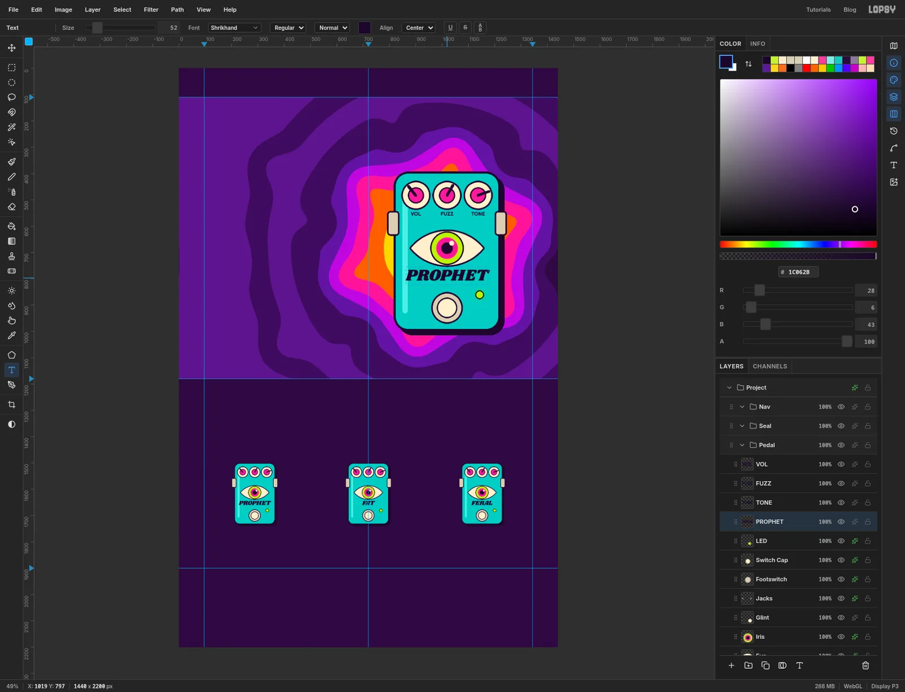

Because the big pedal's name is still live text, each copy can carry a different one.

Click the `PROPHET` layer, pick the **Text** tool and click on the word. Press [[Cmd+A]], type `FAT` and press [[Tab]]. Drag the marquee around the pedal again, choose **Edit → Copy Merged**, press [[Cmd+D]], click `Lower Page` and paste. Shrink and move this copy the same way, to **720, 1620**, and name it `Mini Fat`.

Do it once more with `FERAL`, placing the copy at **1152, 1620** as `Mini Feral`.

Then type `PROPHET` back into the big pedal and click the eye icons to show `Background`, `Rings`, `VOL`, `FUZZ` and `TONE` again.

## Tilt the pedal

Click the `Pedal` group and pick the **Move** tool. Move the pointer just outside a corner of the box, onto the round rotation handle, and drag clockwise. You want a small tilt of about 7°, which is when the box's top-right corner has dropped roughly 55 px. Press [[Cmd+D]].

With the group still selected, drag the pedal about 40 px left and 15 px up so it sits squarely over the yellow sun.

## Draw the cable with the Pen

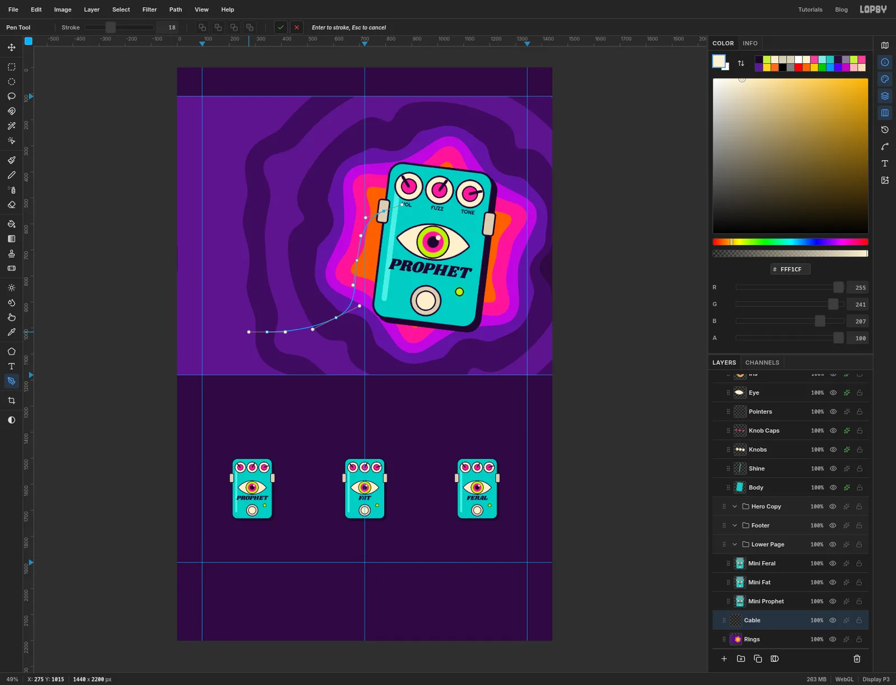

Click the `Rings` row and click **Add Layer**. Name the layer `Cable`. It lands above the rings and below every group, so the pedal will cover the cable's end.

Set the foreground to cream `#FFF1CF`. Pick the **Pen** tool (**P**) and set **Stroke** to `18`. Each anchor is a press and a drag: where you press sets the point, and the direction you drag sets which way the curve leaves it.

1. Press on the pedal's left jack, near **793, 551**, and drag a short way left and slightly down.
2. Press at **690, 740** and drag straight down about 95 px.
3. Press at **610, 960** and drag left and down.
4. Press at **345, 1015** and drag straight left about 70 px.

Press [[Enter]] to stroke the path in the foreground colour. Then open the effects drawer for `Cable` and add a **Stroke** of **Width** `5` in ink, so the cable gets the same outline as everything else.

> **Tip:** The path stays outlined on the canvas while it's selected. Open the **Paths** panel and click its row to deselect it.

## Add the jack plug

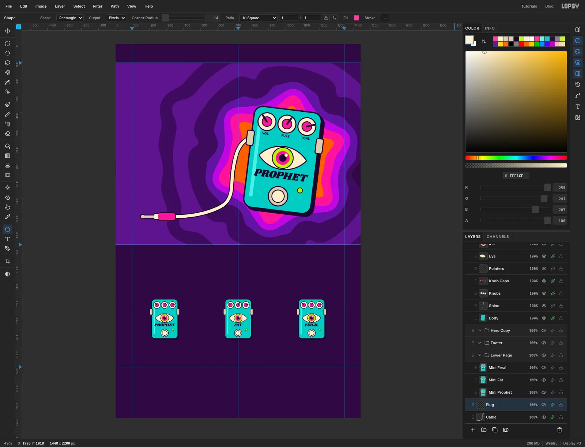

A cable that just stops looks unfinished, so give it a plug. Click **Add Layer** and name it `Plug`. With the **Shape** tool, draw four pieces along the line **y 1015**, from the tip inwards:

- the **tip**: an ellipse in metal `#D9CFB4`, 24 × 20 px, centred on **160, 1015**
- the **shaft**: a rectangle with **Corner Radius** `0` in the same metal, 70 × 14 px, centred on **195, 1015**
- the **collar**: a cream rectangle with **Corner Radius** `4`, 26 × 30 px, centred on **240, 1015**
- the **barrel**: a hot pink rectangle with **Corner Radius** `14`, 100 × 42 px, centred on **300, 1015**, covering the end of the cable

Add a **Stroke** of `5` in ink.

## Draw the buttons and set a two-colour headline

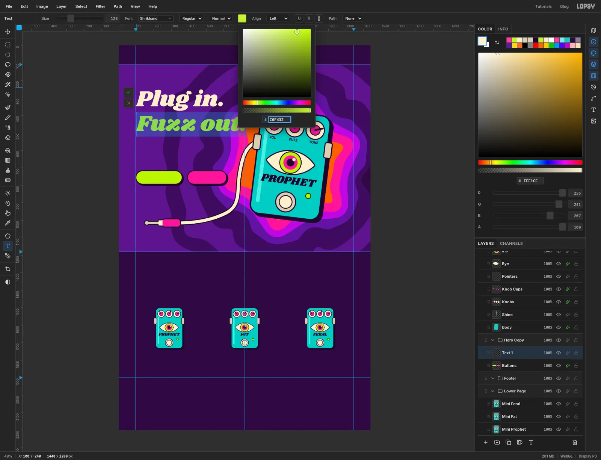

Click the `Hero Copy` group, click **Add Layer** and name the layer `Buttons`. With the **Shape** tool, draw two pills with **Corner Radius** `36`: a lime `#C6F432` one 260 × 72 px centred on **230, 755**, and a hot pink one 220 × 72 px centred on **505, 755**. Give the layer a **Stroke** of `5` and a **Drop Shadow** with **Offset X** `7`, **Offset Y** `7`, **Blur** `0` and **Opacity** `100`, both in ink.

Now the headline. Set the foreground to cream, pick the **Text** tool and choose **Shrikhand** at **Size** `128` with **Align** **Left**. Click at **100, 240**, type `Plug in.`, press [[Enter]] for a new line and type `Fuzz out.`

Before you commit, hold [[Shift]] and press the left arrow nine times to select the second line. Click the **Text color** swatch in the options bar, type `C6F432` and press [[Enter]]. Only the selected letters change. Press [[Escape]] to close the picker and [[Tab]] to commit.

## Give the headline an outline and a shadow

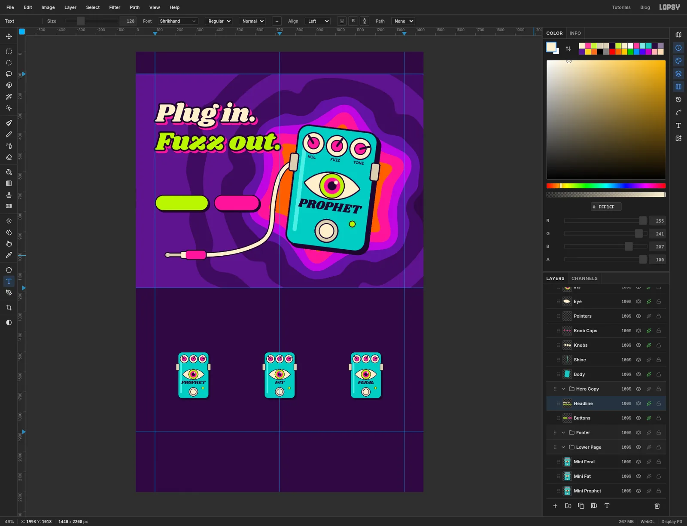

Rename the text layer `Headline`. Open the **Text** panel from the panel buttons on the right edge and set **Line height** to `1.1` to pull the two lines together.

Open the effects drawer and add a **Stroke** of **Width** `8` in ink, then a **Drop Shadow** with **Offset X** `9`, **Offset Y** `9`, **Blur** `0` and **Opacity** `100` in hot pink `#FF3D9A`. Pink against lime is the vibrating colour clash that makes the style.

## Add the hero copy and sparkles

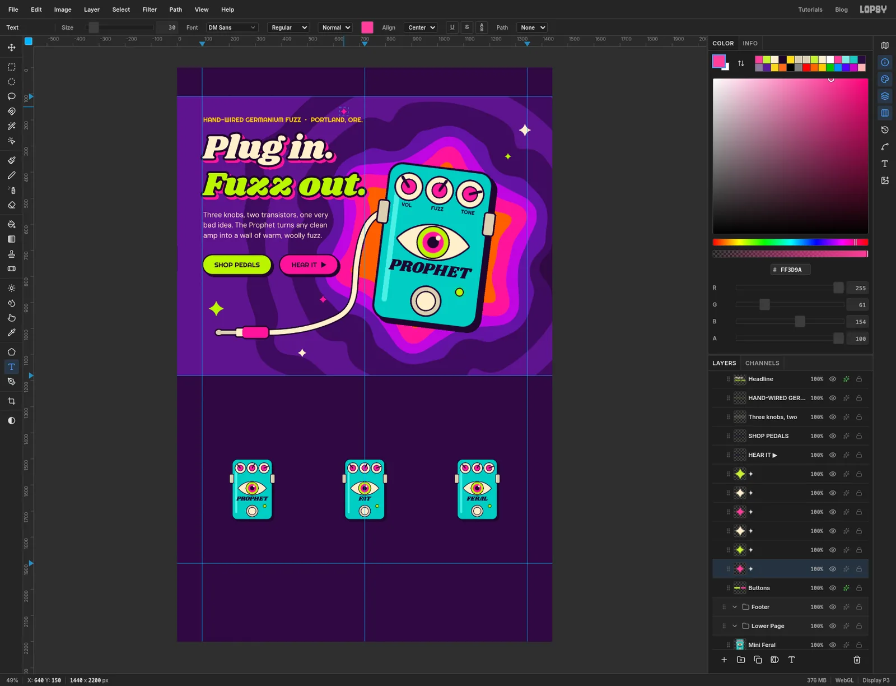

Click the `Buttons` row before each new piece of text, so new layers land in this group and don't restyle the last one.

- The eyebrow: **Righteous**, **Size** `25`, sun yellow `#FFD91A`, at **100, 186**: `HAND-WIRED GERMANIUM FUZZ  •  PORTLAND, ORE.`
- The paragraph: **DM Sans**, **Size** `27`, cream, at **100, 545**, on three lines: `Three knobs, two transistors, one very` / `bad idea. The Prophet turns any clean` / `amp into a wall of warm, woolly fuzz.` Set its **Line height** to `1.45` in the Text panel.
- The button labels: **Righteous**, **Size** `26`, ink, **Align** **Center**. Click at **230, 737** and type `SHOP PEDALS`, then at **507, 737** and type `HEAR IT  ▶`. Your keyboard has no ▶ key, so copy it from this page and paste it. Check that each label sits in the middle of its pill and nudge it with the arrow keys if it doesn't.

The sparkles are text too. Copy the character `✦` from this page. With **DM Sans** and **Align** **Center**, paste it six times as six separate text layers: a big lime one (**Size** `72`) at **150, 880**, cream ones at **480, 1070** (`40`) and **1335, 205** (`58`), pink ones at **560, 868** (`34`) and **640, 150** (`30`), and a small lime one (`30`) at **1270, 322**. They fill the quiet corners without competing with the pedal.

## Start the price seal with a circular path

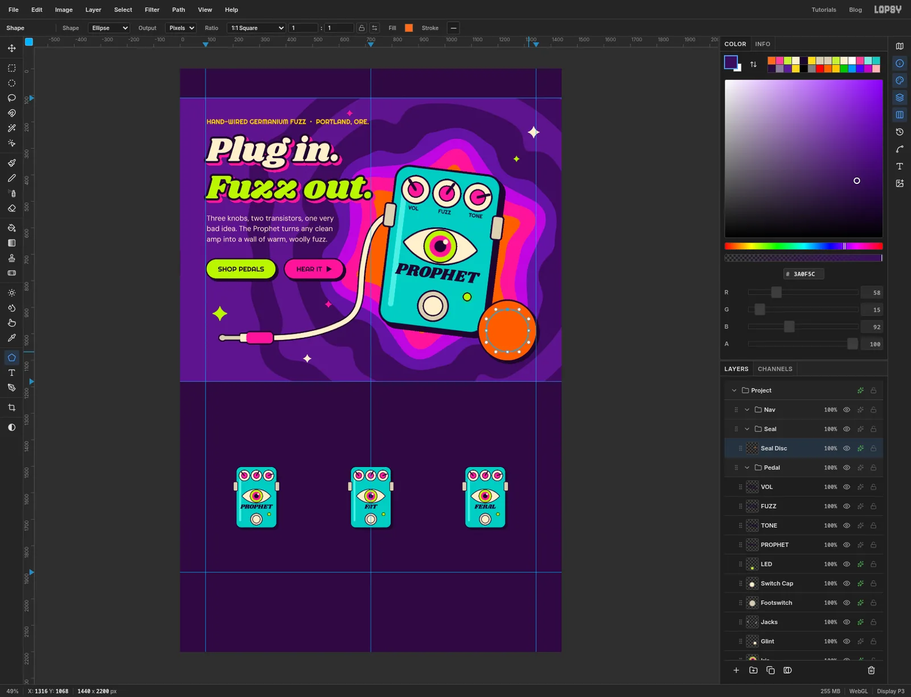

Click the `Seal` group, click **Add Layer** and name the layer `Seal Disc`. With the **Shape** tool set to **Ellipse**, draw a tangerine `#FF6B1A` circle 224 px across centred on **1236, 988**, so it overlaps the pedal's lower right corner. Add a **Stroke** of `6` and a **Drop Shadow** of **8**, **8**, **Blur** `0`, **Opacity** `100`, both in ink.

The lettering needs a circle to run along. In the Shape tool's options bar, change **Output** from **Pixels** to **Path**, then press at the same centre and drag out to **1316, 1068** for a circle with an 80 px radius. This draws a path, not pixels. Set **Output** back to **Pixels** straight away.

## Run text around the seal

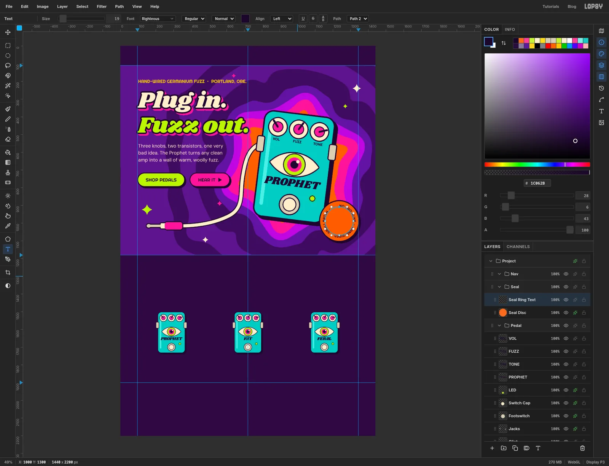

Click `Seal Disc`. Set the foreground to ink and pick the **Text** tool with **Righteous** at **Size** `19` and **Align** **Left**. Click on an empty part of the canvas, well below the hero, type `NO TWO ALIKE  •  HAND-WIRED  •  SMALL BATCH  •` with two spaces either side of each bullet, and press [[Tab]].

With that text layer selected, find the **Path** dropdown at the right of the Text tool's options bar and choose the circle (the newest path in the list). The text jumps onto the circle and follows it round. Rename the layer `Seal Ring Text`.

It won't quite meet itself. Open the **Text** panel and raise **Letter spacing** to `1`, which spreads the letters until the last bullet sits evenly between `BATCH` and `NO`.

> **Tip:** Lopsy remembers the letter spacing for the text you make next. One pixel of tracking suits the labels on the rest of this page, so leave it on.

## Add the price

Click `Seal Disc`, then with **Shrikhand** at **Size** `46`, cream and **Align** **Center**, click at **1236, 948** and type `$149`. Give it a **Stroke** of `5` in ink.

For the small line, switch to **Righteous** at **Size** `16` in ink. A click inside an existing text layer's box edits that layer, so click just below the price, at **1236, 1014**, and type `SHIPS FREE`. Then pick the **Move** tool and tap the up arrow about eight times until the two lines sit together in the middle of the disc.

## Build the nav bar

Click the `Nav` group, click **Add Layer** and name the layer `Nav Bar`. Drag a marquee across the top of the page down to the **110** guide (snapping is still off, so stop on the guide by eye) and fill it with ink `#1C062B`. Press [[Cmd+D]]. Pick the **Pencil** at **Size** `4` in lime, click the left edge on the **110** guide and [[Shift]]-click the right edge for a thin rule.

Add a layer called `Cart Pill` and draw a turquoise `#19C9C2` rectangle with **Corner Radius** `24`, 148 × 48 px, centred on **1270, 55**. Give it a **Stroke** of `4` in cream.

Click `Cart Pill` before each piece of text:

- the logo: **Shrikhand**, **Size** `44`, lime, **Align** **Left**, at **100, 28**: `Fuzz Prophet`
- the links: **Righteous**, **Size** `20`, cream, **Align** **Center**: `PEDALS` at **676, 41**, `SOUNDS` at **806, 41**, `BUILD LOG` at **951, 41** and `ARTISTS` at **1098, 41**
- the cart label: the same type in ink, `CART (0)` at **1270, 41**

## Lay down the cream section

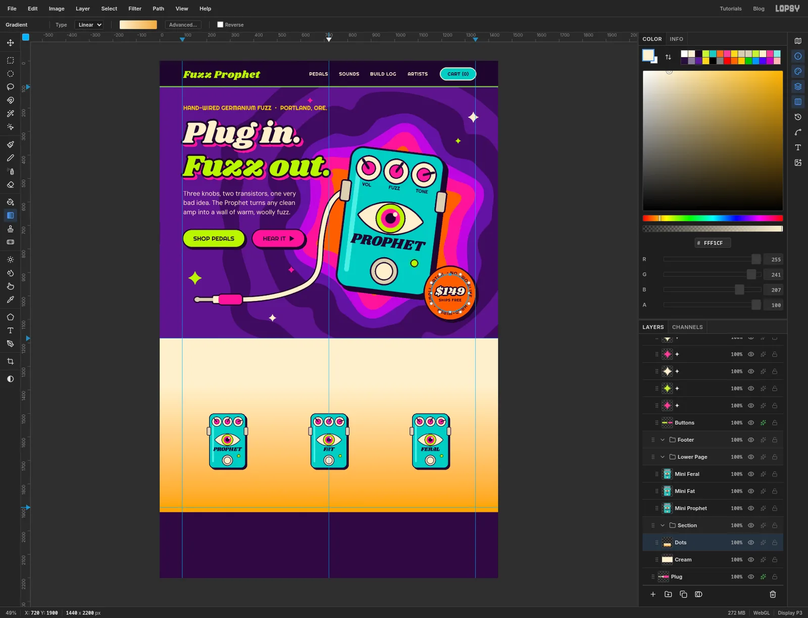

Click the `Plug` row, click **New Group** and name the group `Section`. It lands just below `Lower Page`, so the mini pedals will sit on top of whatever you put in it.

Inside it, add a layer called `Cream`. Drag a marquee across the full width from **y 1212** to **y 1920** and fill it with cream `#FFF1CF`. The top edge will be hidden behind the stripes and the bottom edge behind the footer, so neither has to be exact. Press [[Cmd+D]].

Add a layer called `Dots`. Pick the **Gradient** tool, set **Type** to **Linear** and open **Advanced…**. The iris stops are still there: click each of the four middle stops in turn and click **Delete**, so only two are left. Set them to cream `#FFF1CF` and dot orange `#F2A93B`. Drag a marquee across the full width from **y 1300** to **y 1920**, then drag the gradient straight down from **720, 1380** to **720, 1900**. Press [[Cmd+D]].

## Turn the fade into halftone dots

With `Dots` selected, choose **Filter → Halftone…** and set **Dot Size** `16`, **Angle** `45` and **Softness** `1`. Click **Apply**.

Halftone turns tone into dot size, so the smooth fade becomes a field of dots that start as pinpricks and swell towards the footer. It's the cheapest way there is to make a flat area look printed.

## Select an arch for the first card

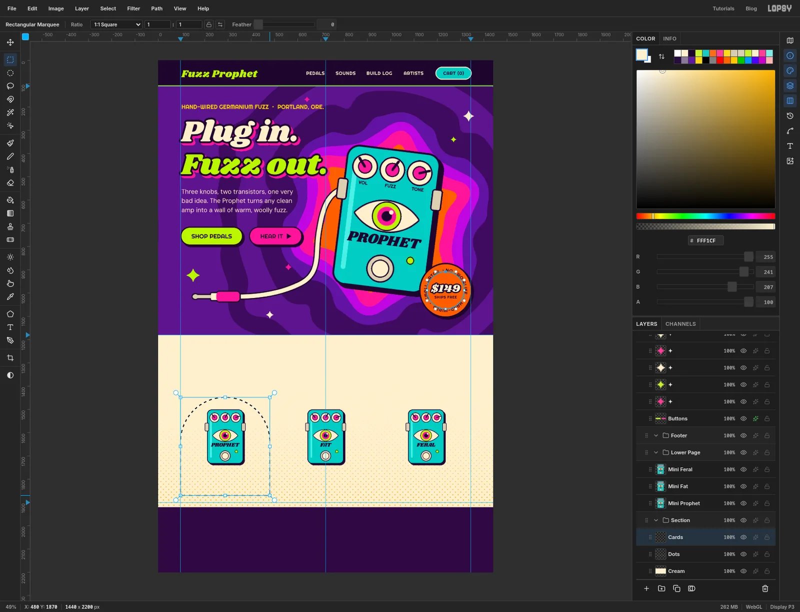

Click the `Dots` row, click **Add Layer** and name the layer `Cards`.

Each card is an arch: a circle with a rectangle hanging off its lower half. With the **Elliptical Marquee**, drag a circle from **96, 1448** to **480, 1832**. Then pick the **Rectangular Marquee**, hold [[Shift]] to add to the selection, and drag from **96, 1640** to **480, 1870**. Fill the arch with violet `#5B1A9E`.

## Fill three cards and their halos

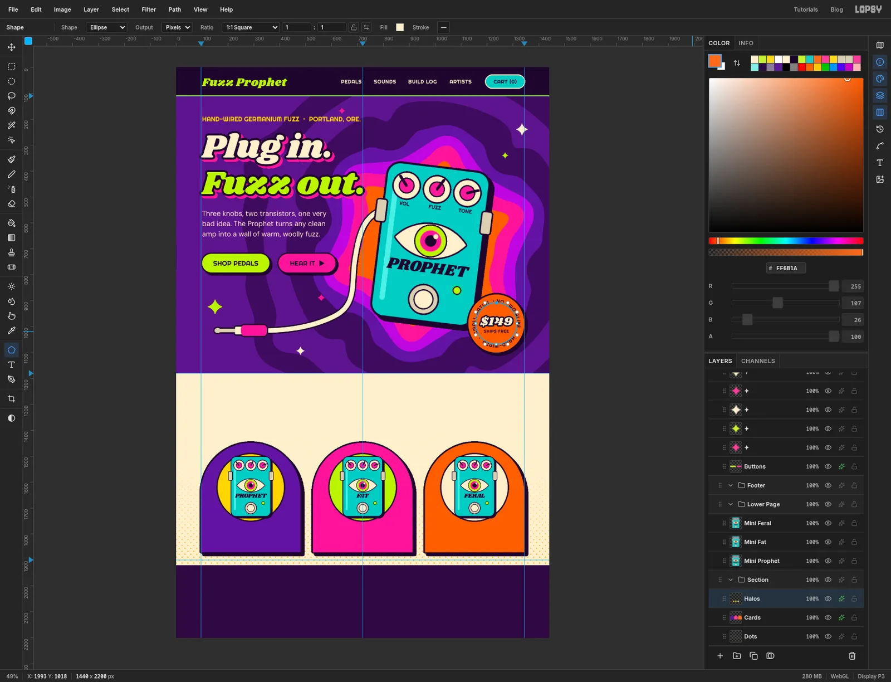

Make two more arches the same way, 432 px further right each time: one from **528** to **912** filled with hot pink `#FF3D9A`, and one from **960** to **1344** filled with tangerine `#FF6B1A`. Press [[Cmd+D]]. Give `Cards` a **Stroke** of `6` and a **Drop Shadow** of **10**, **10**, **Blur** `0`, **Opacity** `100`, both in ink.

Add a layer called `Halos` and use the **Shape** tool to draw a circle 256 px across behind each pedal, centred on **288, 1620**, **720, 1620** and **1152, 1620**. Fill them sun yellow, lime and cream in that order, and add a **Stroke** of `5`.

## Tilt the mini pedals

A single pixel layer is rotated through a selection. Click `Mini Prophet`, drag a marquee around the little pedal, pick the **Move** tool and drag a rotation handle anticlockwise until the pedal leans a little to the left, about 8°. Press [[Cmd+D]].

Do the same for `Mini Fat`, turning it about **5°** clockwise, and `Mini Feral`, about **5°** anticlockwise. Three different angles keep the row from looking stamped out.

## Recolour two of them

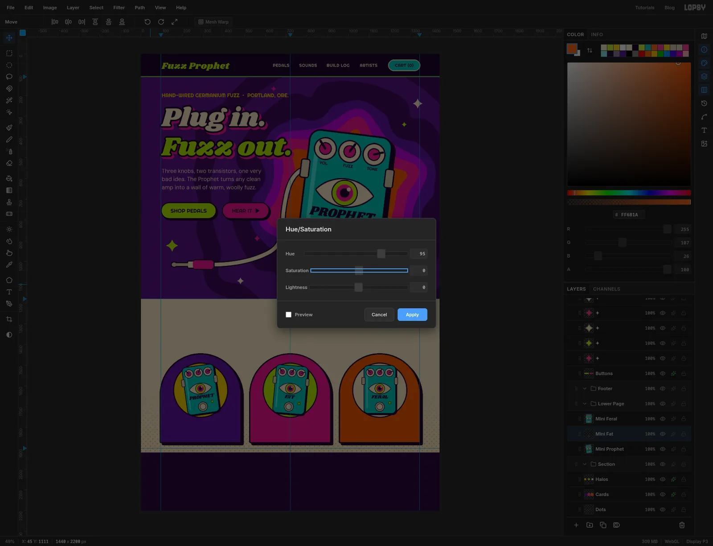

Click `Mini Fat` and choose **Filter → Hue/Saturation…**. Set **Hue** to `95` and click **Apply**. The turquoise body swings round to violet, and the pink knobs and the eye come along for the ride, landing on colours that still clash nicely.

Click `Mini Feral`, open the filter again and set **Hue** to `-125` for a mustard body with blue knobs.

## Stack four stripes for the divider

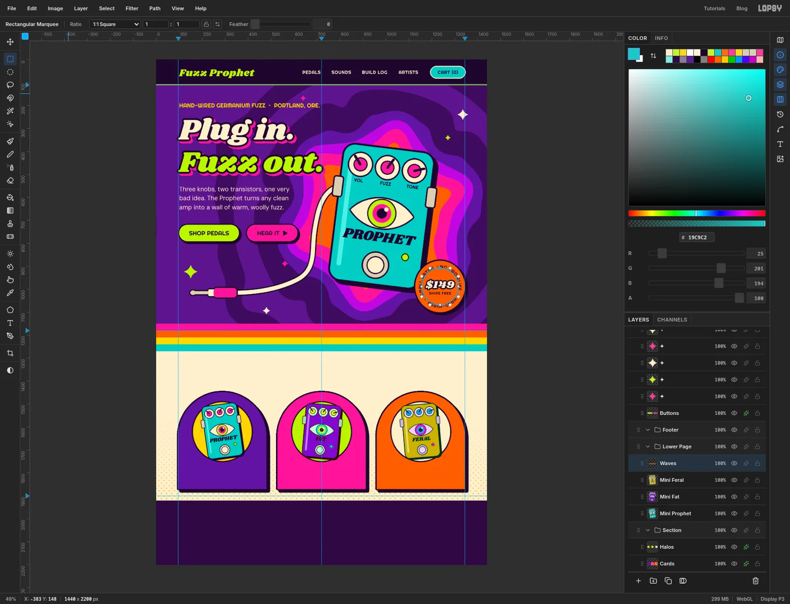

Click the `Lower Page` group, click **Add Layer** and name the layer `Waves`. With the **Rectangular Marquee**, fill four bands across the full width, each 30 px tall, starting at **y 1150**: hot pink, tangerine, sun yellow and turquoise. The last one ends at **y 1270**. Press [[Cmd+D]].

## Push the stripes into waves

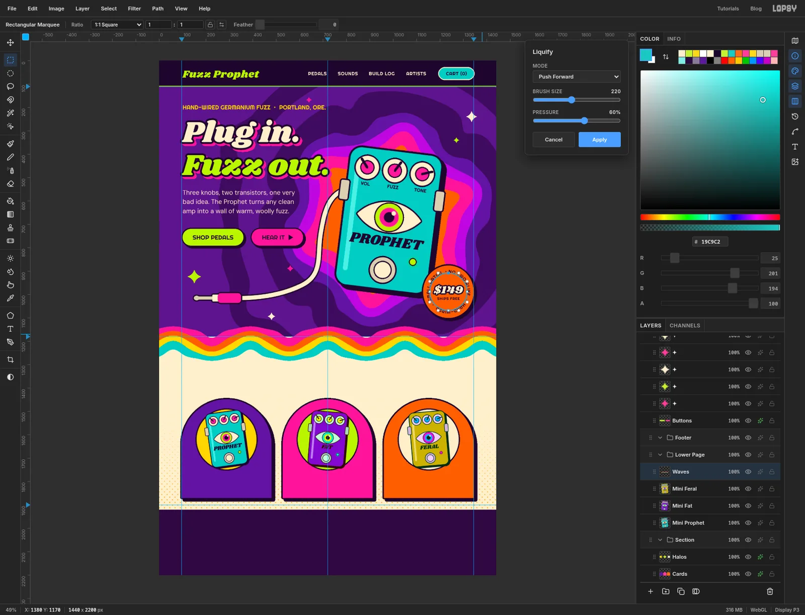

Choose **Filter → Liquify…** again, with **Push Forward**, **Brush Size** `220` and **Pressure** `60`.

Starting near the left edge, drag straight up through the stripes, from about **y 1250** to **y 1170**. Move about 165 px to the right and drag straight down the same distance. Keep going across the page, up then down. Click **Apply**.

Because all four stripes are on one layer, they bend together and stay parallel.

## Draw an arc for the section title

Text on a path isn't only for circles. Pick the **Pen** tool. Press at **250, 1404** and drag up and to the right, about 150 px across and 50 px up. Then press at **1190, 1404** and drag down and to the right by the same amount. You get a shallow arch.

Click the **✓ Commit path** button in the options bar. Don't press [[Enter]] this time, because that would stroke the arc with paint.

Click the `Waves` row. Set the foreground to hot pink and pick the **Text** tool with **Shrikhand** at **Size** `56` and **Align** **Center**. Click an empty spot, type `Three ways to melt your amp` and press [[Tab]]. Choose the arc from the **Path** dropdown. With **Center** alignment the title sits in the middle of the arc. If the last letters go missing, the text is longer than the path, so lower the size a little.

Rename the layer `Section Title`. Give it a **Stroke** of `6` and a **Drop Shadow** of **6**, **6**, **Blur** `0`, **Opacity** `100`, both in ink, so it matches the hero headline. With the **Move** tool, press [[Shift+Up]] twice to lift it 20 px clear of the cards.

## Label the cards

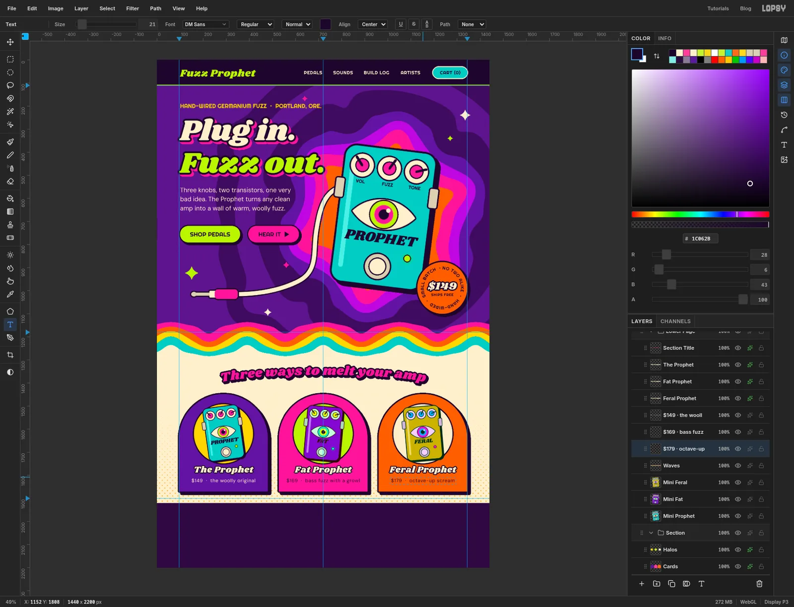

Click `Waves` before each new piece of text.

With **Shrikhand** at **Size** `38`, cream and **Align** **Center**, click at **288, 1750** and type `The Prophet`. Add `Fat Prophet` at **720, 1750** and `Feral Prophet` at **1152, 1750**. Give each one a **Stroke** of `4` in ink.

Then with **DM Sans** at **Size** `21`, add a price line at **y 1808** under each: `$149  ·  the woolly original`, `$169  ·  bass fuzz with a growl` and `$179  ·  octave-up scream`. Use cream on the violet card and ink on the pink and orange ones, where cream wouldn't have enough contrast.

Check each card: the name should clear the bottom of the pedal, and the price line should sit well inside the card's bottom edge.

## Draw a signal wave in the footer

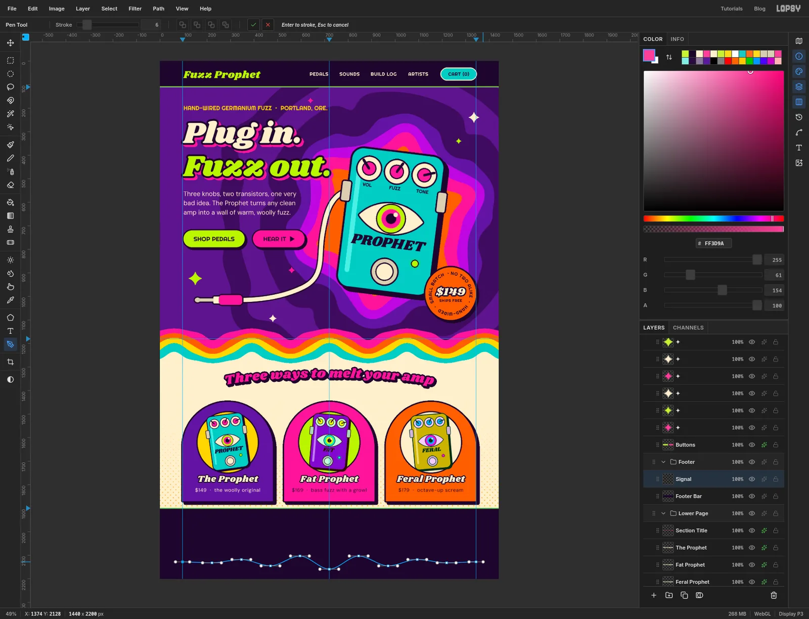

Click the `Footer` group, click **Add Layer** and name it `Footer Bar`. Drag a marquee from the **1900** guide to the bottom of the page, fill it with ink and press [[Cmd+D]]. Draw a lime **Pencil** rule along the **1900** guide, as you did under the nav.

Add a layer called `Signal`. Set the foreground to hot pink and pick the **Pen** tool with **Stroke** `6`. You're drawing a burst of signal along the line **y 2128**, from the left margin to the right one. Start on the line at **96, 2128**, then work across, placing an anchor every 125 px or so. Dip below the line, rise above it, dip again, keeping the ripples tiny at the ends and swelling to about 30 px either side in the middle. End back on the line at **1344, 2128**. On every anchor, drag a short way to the right before letting go, which keeps the wave smooth. Press [[Enter]] to stroke it.

## Fill in the footer

Add a layer called `Email Field`. With the **Shape** tool, draw a cream rectangle with **Corner Radius** `27`, 216 × 54 px, centred on **1118, 2020**, and a hot pink one 104 × 54 px centred on **1292, 2020**.

Click `Email Field` before each piece of text, and set **Align** back to **Left** for everything except the last two:

- the logo: **Shrikhand**, **Size** `54`, lime, at **100, 1928**: `Fuzz Prophet`
- the tagline: **DM Sans**, **Size** `20`, cream, at **100, 2012**: `Hand-wired in small batches in Portland, Oregon.` Set its **Letter spacing** back to `0` so it doesn't run into the links.
- column headings: **Righteous**, **Size** `18`, turquoise: `SHOP` at **640, 1946**, `HELP` at **800, 1946** and `GET THE BUILD LOG` at **1010, 1946**
- the links: **DM Sans**, **Size** `20`, cream, three lines each, at **640, 1978** (`Pedals`, `Kits`, `Merch`) and **800, 1978** (`Shipping`, `Warranty`, `Contact`). Set **Line height** to `1.5`.
- the placeholder: **DM Sans**, **Size** `19`, in a muted `#8A7A9A`, at **1034, 2008**: `you@loud.amp`
- the button: **Righteous**, **Size** `21`, ink, **Align** **Center**, at **1292, 2006**: `JOIN`
- the legal line: **DM Sans**, **Size** `15`, in `#B79CCB`, **Align** **Center**, at **720, 2162**: `© 2026 Fuzz Prophet Pedalworks  ·  Made loud in Portland, Oregon`

## Print the rings with a halftone screen

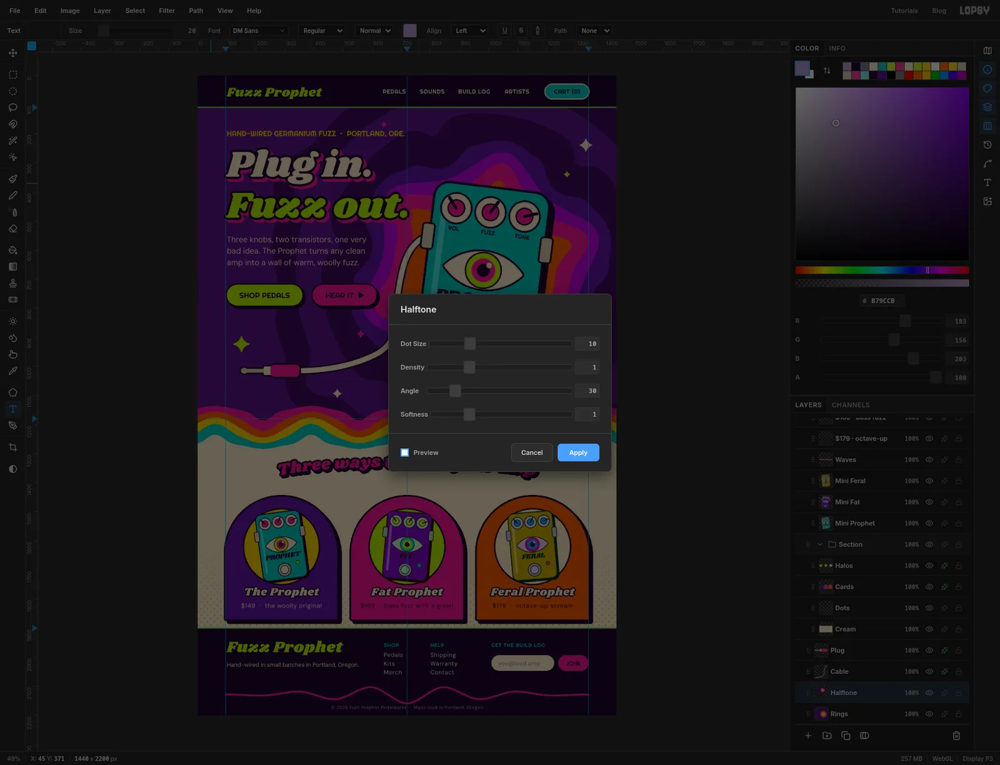

The rings are still perfectly flat, and a poster should look printed. Click the `Rings` row and choose **Layer → Duplicate Layer**. Rename the copy `Halftone`.

Choose **Filter → Halftone…** and set **Dot Size** `10`, **Angle** `30` and **Softness** `1`. Click **Apply**.

Open the effects drawer for `Halftone` and set its blend mode to **Overlay**. Then click the layer's opacity and lower it to **60%**. The dots now tint the rings underneath rather than replacing them, like a screen of ink over flat colour.

## Add a final vibrance boost

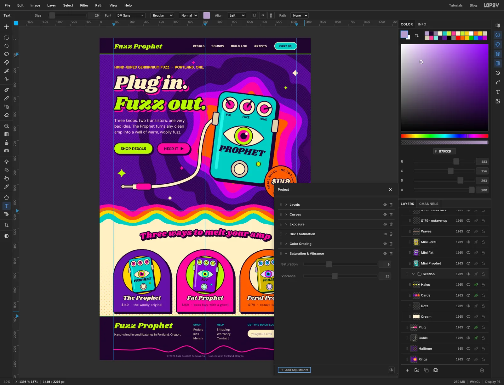

Choose **Layer → Adjustment Layer…** and click **Got it**. The drawer opens on the adjustments for the whole project. Leave the five nodes that are already listed alone. Click **Add Adjustment**, choose **Saturation & Vibrance** and set **Vibrance** to `25`. Vibrance lifts the duller colours more than the ones that are already loud, so the purples catch up with the pinks. Close the drawer.

Open the **View** menu and untick **Show Guides** to see the page clean, then choose **File → Quick Export PNG** to save it.
