A ukulele's four open strings are tuned G, C, E and A. Pluck the G string and it swings back and forth 392 times a second. The C string is the slowest at 262, then E at 330, and A is the fastest at 440. In this tutorial you'll draw what those four notes look like over the same 20 milliseconds, and wrap the chart in a 1960s psychedelic poster: a rainbow checkerboard burst, fat groovy lettering and a ukulele in the middle of it all.

The poster is 1500 × 2100 px. The chart at the bottom is drawn to scale:

- The plot is **1020 px wide and stands for 20 ms**, so one millisecond is 51 px.
- In 20 ms the G string completes 7.84 cycles, C 5.23, E 6.59 and A 8.8. You'll draw exactly that many waves for each.
- Each string on the instrument has the same colour as its wave.

Along the way you'll use:

- the **Elliptical Marquee** with **Edit → Fill**, including circles bigger than the canvas
- **Filter → Sunburst** with the **Difference** blend mode, and a **layer mask** made from a selection
- **Select → Grow**, **Shrink** and **Inverse**, and selections loaded from layer thumbnails
- the **Brush** with **Radial Symmetry**, and the **Pencil** with [[Shift]]-click lines
- copy and paste, **Duplicate Layer**, **Flip Horizontal** and **Merge Down**
- the **Pen** tool for a wavy edge and for the sine waves, plus **Path to Selection**
- **guides** that the marquee snaps to
- text in **Shrikhand** and **Righteous**, a gradient poured into the letters, and the **Stroke**, **Drop Shadow** and **Outer Glow** effects
- a **group**, **Gaussian Blur**, **Texture** and a **Vignette** adjustment

The palette:

- Violet `#2A0B4F`, plum `#5B1A8E`, panel `#1E0840`, sound hole `#12041F`
- Magenta `#FF2E93` (the G string)
- Orange `#FF7A1A` (the C string)
- Yellow `#FFE234` (the E string)
- Teal `#14D3C4` (the A string)
- Cream `#FBF3DC`
- Title `#FBF3DC` → `#FFE234` → `#FF7A1A` → `#FF2E93`

> **Tip:** Positions are written as `x, y` in document pixels. The status bar at the bottom of the window shows where the cursor is, so you can hover to find a spot. A few pixels either way won't show. Key names are Mac keys. On Windows and Linux, use Ctrl for Cmd. Every circle in the burst is centred on the ukulele's sound hole at **750, 948**.

## Fill the page and drag the biggest circles

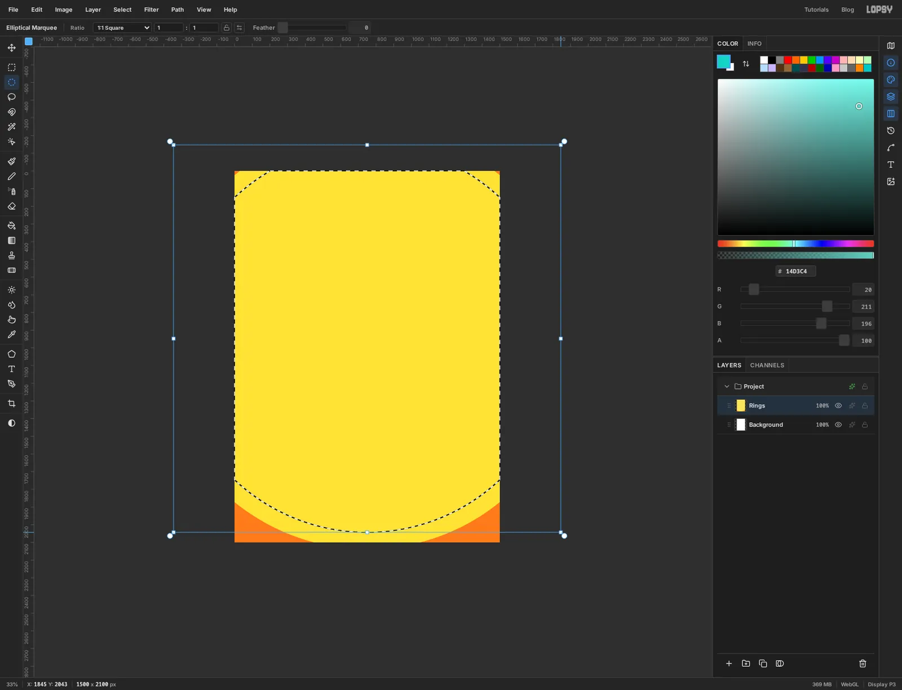

Choose **File → New**, set the size to **1500 × 2100** px and click **Create**. The document starts with a white `Background` and an empty `Layer 1`. Leave the background where it is. Double-click `Layer 1` in the Layers panel and rename it `Rings`. Set the foreground colour to orange `#FF7A1A` in the Color panel's hex field, press [[Cmd+A]], choose **Edit → Fill**, then press [[Cmd+D]] to deselect.

The burst is a stack of filled circles, biggest first. The first three are larger than the page, so you need room around the canvas to drag them. Choose **View → Zoom Out** until the status bar reads 33%. You need about 450 px of grey on every side of the page, so on a small window go one step further.

Pick the **Elliptical Marquee**. A marquee is dragged from one corner of its box to the opposite corner, and both corners can be outside the canvas. For each row below, set the foreground colour, drag the box, choose **Edit → Fill** and press [[Cmd+D]]:

1. Yellow `#FFE234`, from **−440, −242** to **1940, 2138**
2. Teal `#14D3C4`, from **−345, −147** to **1845, 2043**
3. Plum `#5B1A8E`, from **−250, −52** to **1750, 1948**

Always deselect before the next drag. A drag that starts inside an existing selection moves it instead of making a new one.

## Finish the rings

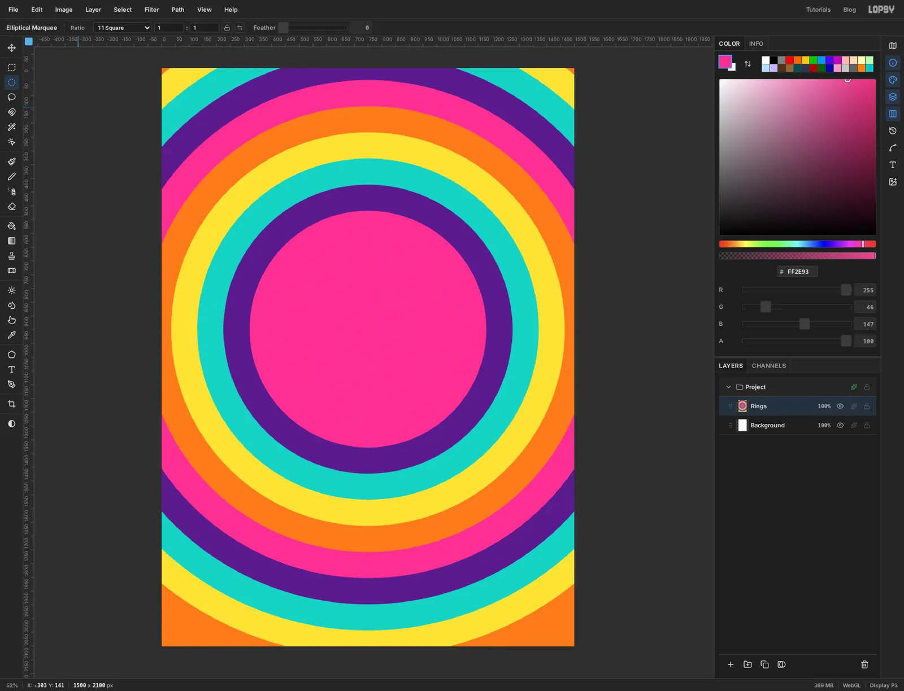

Choose **View → Fit to Screen**. The rest of the circles fit in the window. Each one is 95 px smaller in radius than the last. Fill them the same way:

1. Magenta `#FF2E93`, from **−155, 43** to **1655, 1853**
2. Orange `#FF7A1A`, from **−60, 138** to **1560, 1758**
3. Yellow `#FFE234`, from **35, 233** to **1465, 1663**
4. Teal `#14D3C4`, from **130, 328** to **1370, 1568**
5. Plum `#5B1A8E`, from **225, 423** to **1275, 1473**
6. Magenta `#FF2E93`, from **320, 518** to **1180, 1378**

The last one is the pink disc the ukulele will stand in.

## Paint the sunburst rays

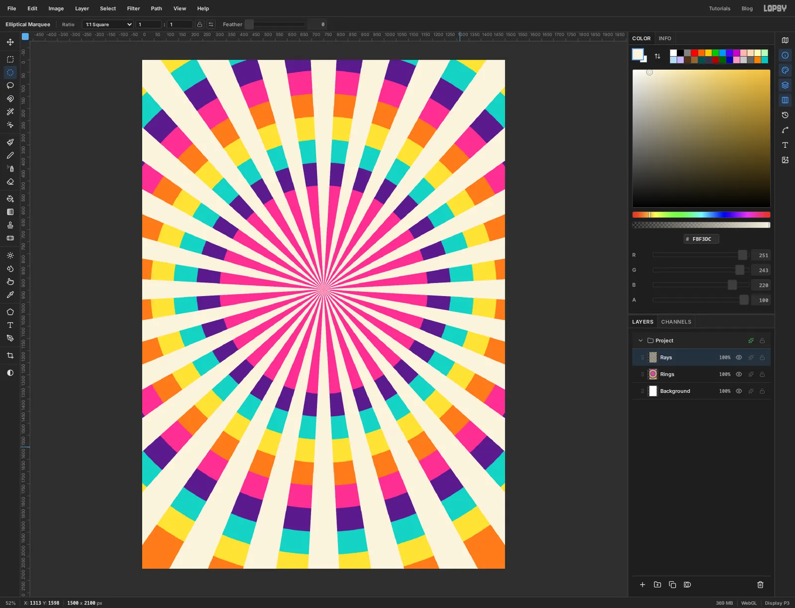

Click **Add Layer** at the bottom of the Layers panel and rename the new layer `Rays`. Set the foreground to cream `#FBF3DC`.

Choose **Filter → Sunburst**. Set **Rays** to **28**, **Width** to **50** and **Center Y** to **45.1**, and leave everything else alone. Center Y is a percentage of the page height, and 45.1% of 2100 is the sound hole, near enough. Click **Apply**.

Sunburst paints in the foreground colour onto a transparent layer, so the rings still show between the rays.

## Switch the rays to Difference

Click the effects button at the right of the `Rays` row to open the effects drawer, and change the **blend mode** at the top from Normal to **Difference**. Close the drawer.

Difference subtracts the cream from whatever is underneath. Under each ray, magenta turns green, yellow turns blue, teal turns red and plum turns lime, and between the rays the rings stay as they were. Ten rings and 28 rays give you a checkerboard.

## Select everything outside the centre disc

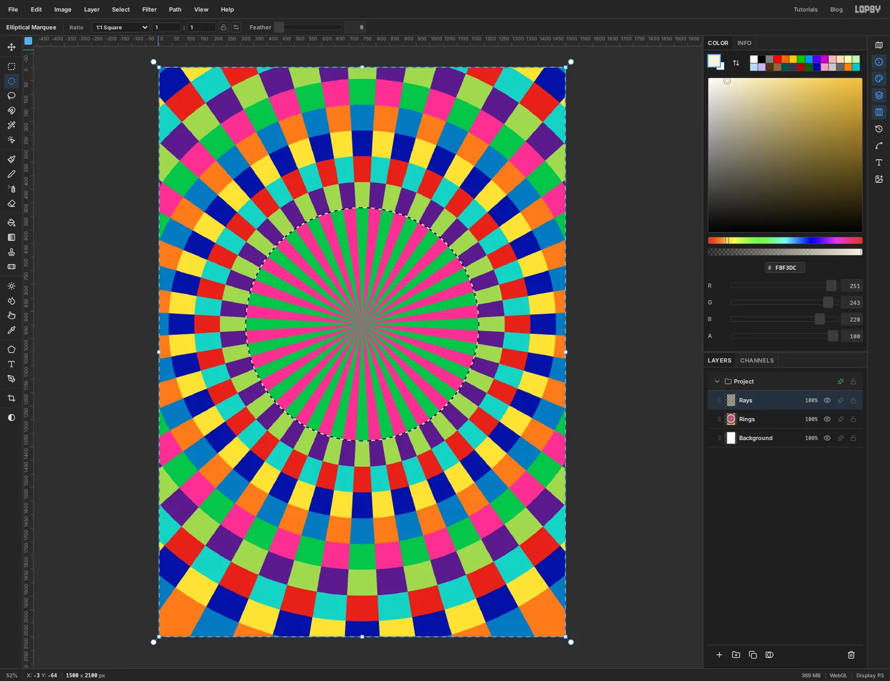

The ukulele needs a calm place to stand, so the rays should stop at the pink disc. With `Rays` still active, select the disc again. This circle should match the disc exactly, so type it instead of dragging: pick the **Elliptical Marquee** and click once on the canvas without dragging. In the **Elliptical Selection** dialog, set From to **320, 518** and To to **1180, 1378**, and click **Select**. Then choose **Select → Inverse**. Now everything except the disc is selected.

## Mask the rays

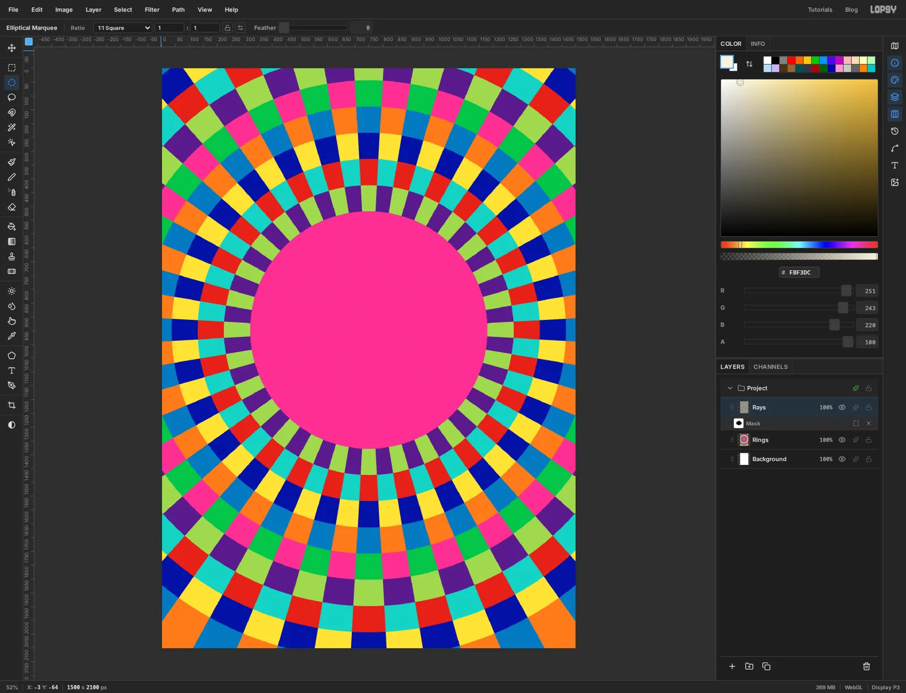

Click **Add Mask** at the bottom of the Layers panel. When there's a selection, the new mask shows only the selected area, so the rays vanish from the disc and the selection is dropped. Nothing is erased. The rays are still there under the mask if you change your mind.

Adding a mask puts you in mask edit mode. Click the `Rays` row to leave it before you go on.

## Start the body with two ellipses

Click **Add Layer** and name it `Body`. With the **Elliptical Marquee**, drag the lower bout from **520, 854** to **980, 1254**. Then hold [[Shift]] and drag the upper bout from **576, 689** to **924, 995**. Shift adds the second ellipse to the first, so you get one figure-of-eight selection.

## Round off the waist

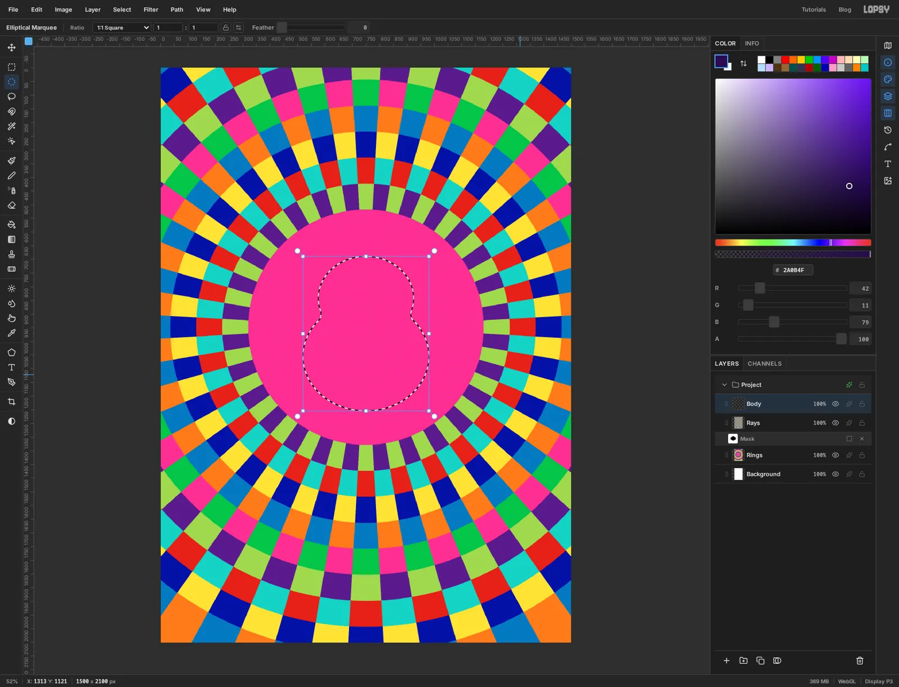

Where the two ellipses meet there are two sharp notches. A real ukulele has a smooth waist. Choose **Select → Grow**, enter **34** and apply. Then choose **Select → Shrink**, enter **34** and apply.

Growing fills the notches in. Shrinking by the same amount puts the outside edge back where it was, but the notches stay rounded.

## Fill and outline the body

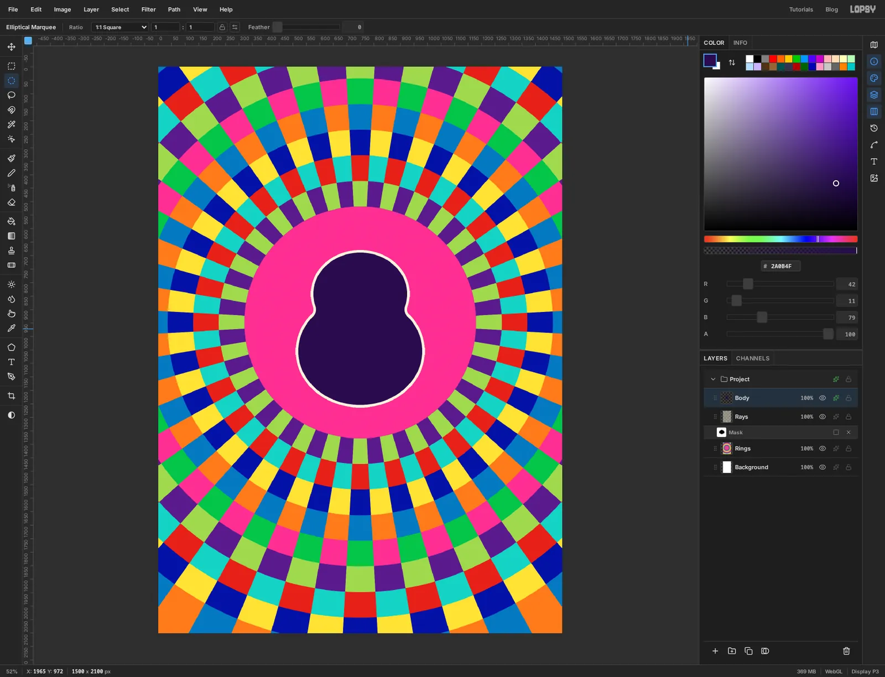

Set the foreground to violet `#2A0B4F`, choose **Edit → Fill** and press [[Cmd+D]].

Open the effects drawer for `Body`, tick **Stroke**, set **Width** to **10** and the stroke colour to cream `#FBF3DC`. Close the drawer.

## Lasso the headstock

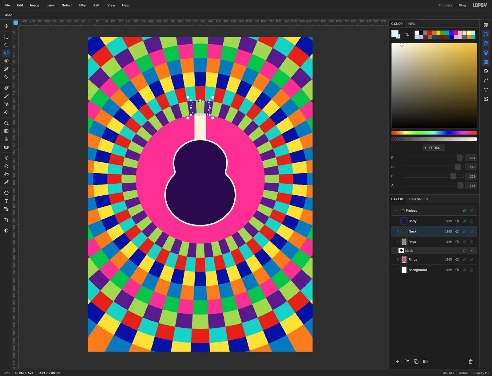

The neck goes under the body, so click the `Rays` row first, then **Add Layer** and name it `Neck`. A new layer always lands just above the active one.

Set the foreground to cream `#FBF3DC`. With the **Rectangular Marquee**, drag from **711, 510** to **789, 731**, choose **Edit → Fill** and press [[Cmd+D]].

Now pick the **Lasso** and trace the headstock in one drag. Start at the bottom left at **702, 520**, go up and out to **687, 441**, in to the left peak at **719, 422**, down into the notch at **750, 437**, up to the right peak at **781, 422**, out to **813, 441** and down to **798, 520**, then back to the start. It doesn't need to be exact. A slightly wobbly crown suits the style.

## Fill the headstock and outline the neck

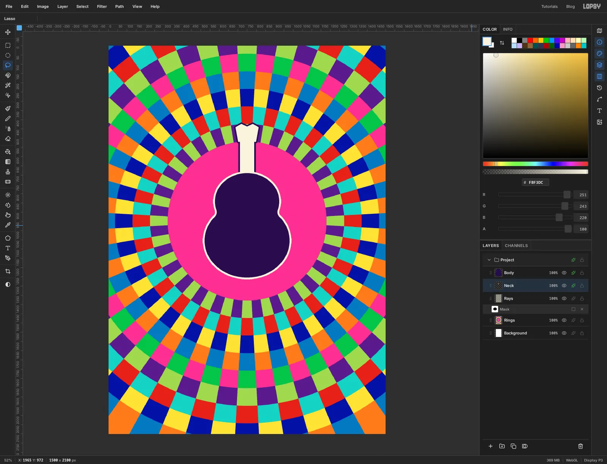

Choose **Edit → Fill** and press [[Cmd+D]]. Open the effects drawer for `Neck`, tick **Stroke**, set **Width** to **8** and the colour to violet `#2A0B4F`.

## Add the fretboard and frets

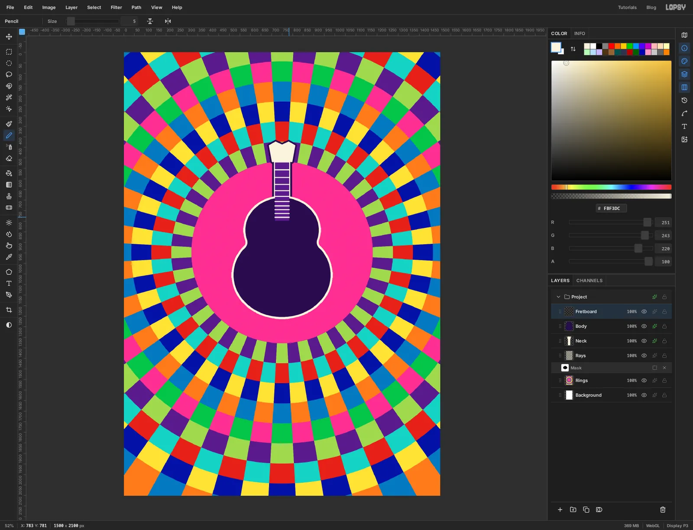

Click the `Body` row, then **Add Layer** and name it `Fretboard`. Set the foreground to plum `#5B1A8E`. With the **Rectangular Marquee**, drag from **716, 522** to **784, 798**, fill and deselect.

Pick the **Pencil**, set **Size** to **5** and the foreground to cream `#FBF3DC`. A fret is a straight line: click once at the left edge of the fretboard, then hold [[Shift]] and click at the right edge. Draw ten of them from **717** to **783** across, at these heights: **556, 592, 625, 655, 682, 706, 727, 745, 763** and **781**. Frets get closer together towards the body, which is why the gaps shrink as you go down.

> **Tip:** Release Shift between frets. A Shift-click always joins to the last point you clicked, so if you keep it held you'll draw a zigzag.

## Add the sound hole, bridge and strings

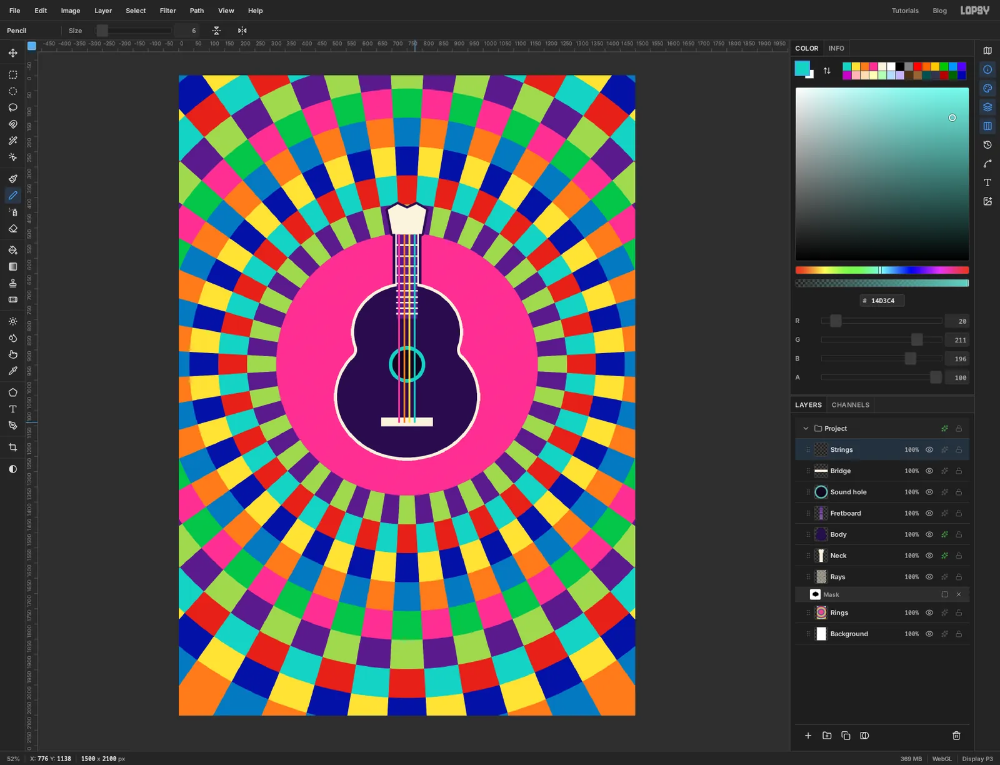

**Add Layer**, name it `Sound hole`. With the **Elliptical Marquee**, drag from **690, 888** to **810, 1008** and fill it teal `#14D3C4`. Deselect, drag from **702, 900** to **798, 996** and fill that with the near-black `#12041F`. Deselect.

**Add Layer**, name it `Bridge`. With the **Rectangular Marquee**, drag from **665, 1122** to **835, 1151** and fill it cream `#FBF3DC`. Deselect.

**Add Layer**, name it `Strings`. Pick the **Pencil** and set **Size** to **6**. Each string is a click at the top of the fretboard and a [[Shift]]-click on the bridge, from **y 524** down to **y 1138**:

1. Magenta `#FF2E93` at **x 724** (G)
2. Orange `#FF7A1A` at **x 741** (C)
3. Yellow `#FFE234` at **x 759** (E)
4. Teal `#14D3C4` at **x 776** (A)

These four colours are the key to the chart, so keep the order.

## Dot the rosette with radial symmetry

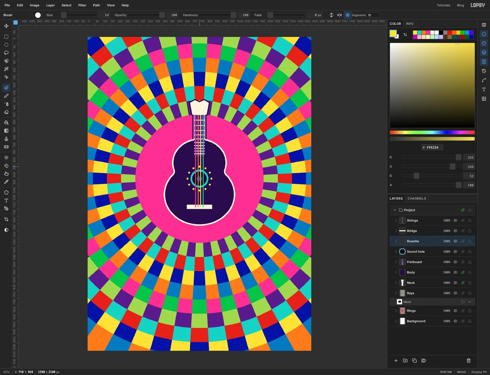

Click the `Sound hole` row, then **Add Layer** and name it `Rosette`. It lands under the bridge and strings.

Pick the **Brush**. In the options bar set **Hardness** to **100** and **Size** to **14**, then click **Radial Symmetry**. A **Segments** field appears beside it. Type **12**.

The symmetry centre starts in the middle of the canvas. Hold [[Cmd]] and click the middle of the sound hole at **750, 948** to move it there. That click doesn't paint.

Set the foreground to yellow `#FFE234` and click once at **750, 868**, straight above the sound hole. One click makes twelve dots.

## Draw the petals

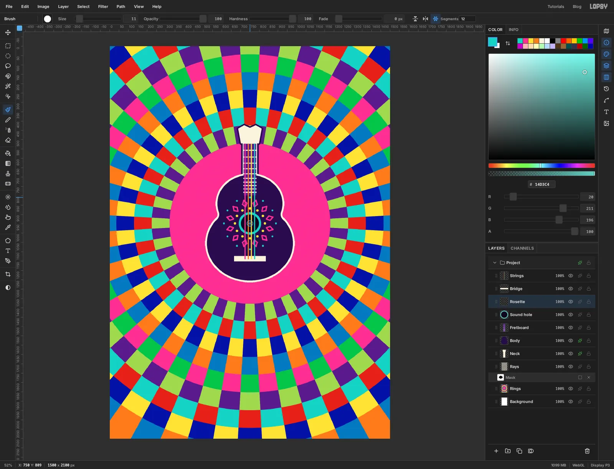

Set the foreground to magenta `#FF2E93` and **Size** to **8**. Just right of the top dot, draw one small diamond in a single stroke: start at **774, 860**, go up and left to **767, 840**, up and right to **783, 824**, down to **790, 846**, and back to the start. The other eleven draw themselves.

Set the foreground to teal `#14D3C4`, **Size** to **11**, and click once at **750, 809**.

Click **Radial Symmetry** again to turn it off, or everything you paint later will come out twelve times.

## Copy a tuning peg

Click the `Rays` row, then **Add Layer** and name it `Pegs`. With the **Elliptical Marquee**, drag a small oval from **656, 446** to **688, 470** and fill it cream `#FBF3DC`. Deselect.

For the second peg, drag a **Rectangular Marquee** around the first one, press [[Cmd+C]] and then [[Cmd+V]]. The copy arrives on its own layer, exactly on top of the original. With the **Move** tool, drag it down and a touch to the right, about 40 px, so it sits beside the lower half of the headstock.

Press [[Cmd+D]], then [[Cmd+E]] to merge the pasted layer down into `Pegs`.

## Mirror the pegs

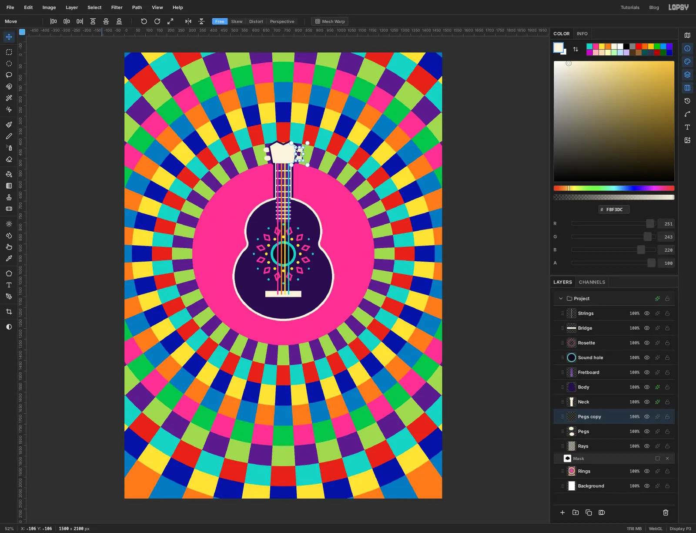

Choose **Layer → Duplicate Layer**. Press [[Cmd+A]], pick the **Move** tool and click **Flip Horizontal** in the options bar. With the whole canvas selected, the flip happens about the centre line of the page, and the ukulele stands on that line, so the copies land on the right side of the headstock.

Press [[Cmd+D]] and [[Cmd+E]] to merge the copy back into `Pegs`. Open the effects drawer, tick **Stroke**, and set **Width** to **6** in violet `#2A0B4F`.

## Select the whole silhouette

1960s posters love an outline around an outline. Click the `Rays` row, then **Add Layer** and name it `Echo`.

Hold [[Cmd]] and click the thumbnail of the `Body` layer. That loads its shape as a selection. Then hold [[Cmd+Shift]] and click the `Neck` thumbnail to add the neck and headstock.

## Fill the echo outlines

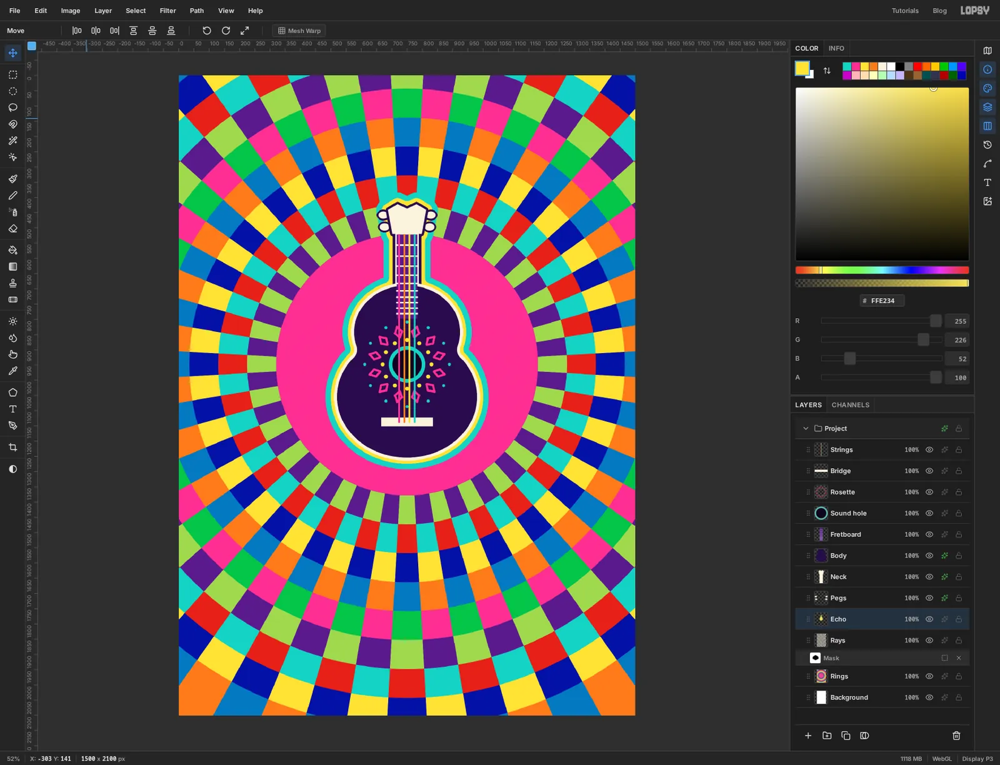

Choose **Select → Grow**, enter **38** and apply. Set the foreground to teal `#14D3C4` and choose **Edit → Fill**.

Without deselecting, choose **Select → Shrink**, enter **18** and apply. Set the foreground to yellow `#FFE234` and fill again. Press [[Cmd+D]].

Because `Echo` is under the instrument, only the bands outside it show.

## Set the title

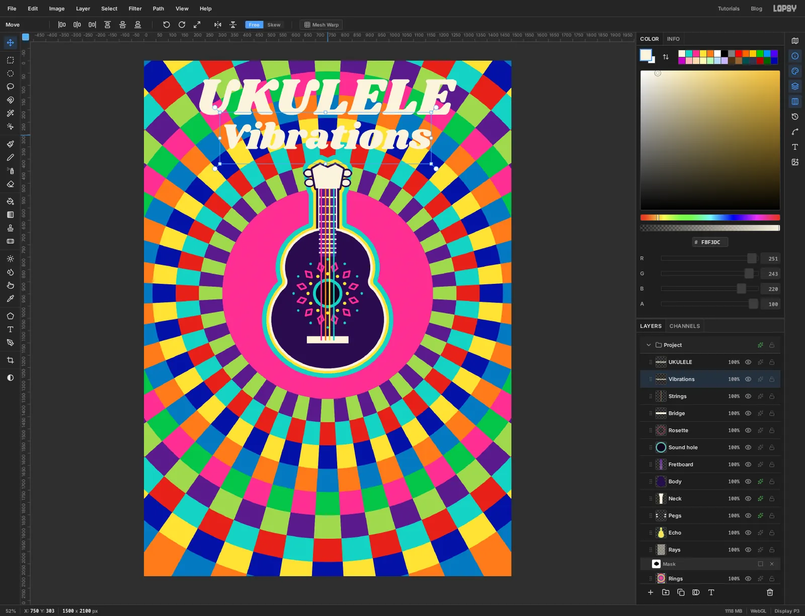

Click the `Strings` row so the title lands above the instrument. Set the foreground to cream `#FBF3DC`. Pick the **Text** tool, set **Size** to **215**, open the font list, search for **Shrikhand** and pick it.

Click an empty part of the canvas, type `UKULELE` and press [[Tab]] to commit. With the **Move** tool, drag the word to the top of the page, centred, with the tops of the letters about 74 px down. The letters run from about x 226 to x 1275.

Click the `Strings` row again before the second word. While a text layer is active, changing the size or font in the options bar restyles that layer, and you'd shrink UKULELE.

Pick the **Text** tool, set **Size** to **150**, click an empty spot, type `Vibrations` and press [[Tab]]. Drag it under the first word, centred, with the tops of its tall letters at about **y 246**. It should tuck up close, about 26 px below the bottom of UKULELE.

## Outline the letters and give them a shadow

Open the effects drawer for `UKULELE`. Tick **Stroke**, set **Width** to **12** and the colour to violet `#2A0B4F`. Tick **Drop Shadow** and set **Offset X** to **9**, **Offset Y** to **11**, **Blur** to **0** and **Opacity** to **100**, in the same violet. With no blur, the shadow is a solid slab, which is what makes the letters look cut out and stacked.

Do exactly the same for `Vibrations`.

## Load the letters as a selection

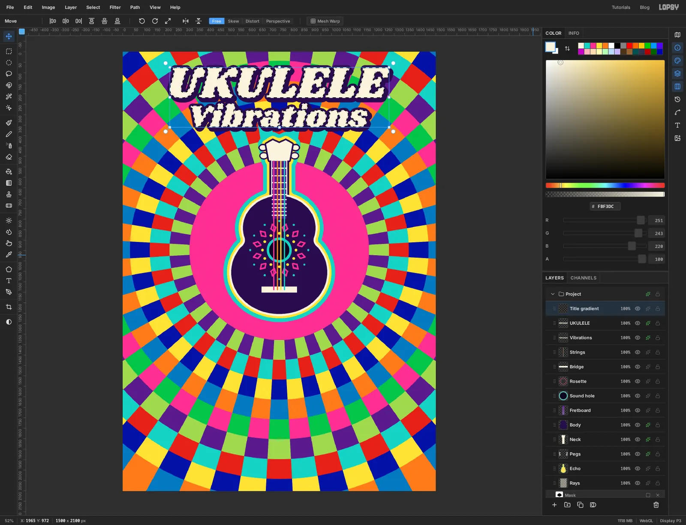

Click the `UKULELE` row, then **Add Layer** and name it `Title gradient`. Hold [[Cmd]] and click the `UKULELE` thumbnail, then hold [[Cmd+Shift]] and click the `Vibrations` thumbnail. Both words are now selected, and the active layer is still the empty one above them.

## Pour a gradient into the title

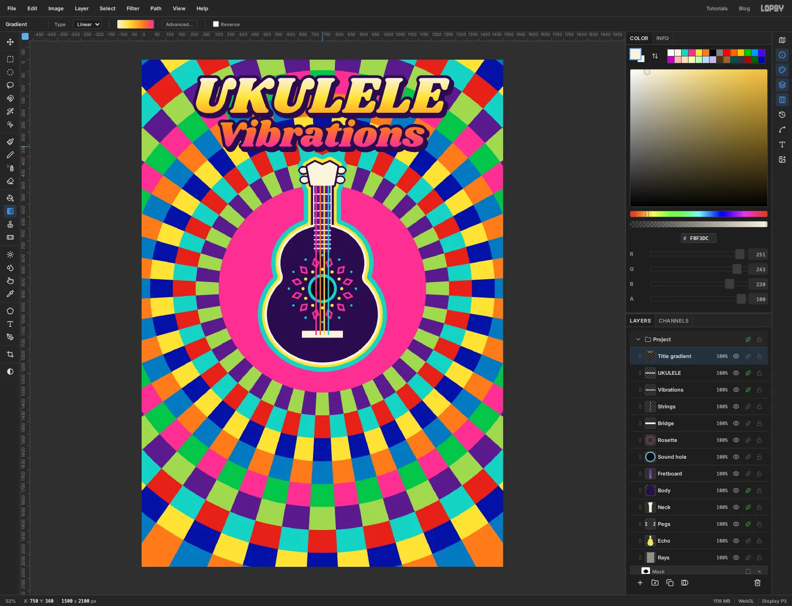

Pick the **Gradient** tool and set its type to **Linear**. Open the gradient editor from the options bar. Click the left stop and type `#FBF3DC` in the hex field, then click the right stop and type `#FF2E93`. Click the gradient bar about 30% of the way along to add a stop and make it yellow `#FFE234`, and click again at about 72% for orange `#FF7A1A`. Click **Done**.

Drag straight down from the top of UKULELE at **750, 74** to the bottom of Vibrations at **750, 360**. The gradient only lands inside the selection, so the two words share one sweep of colour and read as one title. Press [[Cmd+D]].

The outline and shadow still come from the text layers underneath.

## Group the ukulele

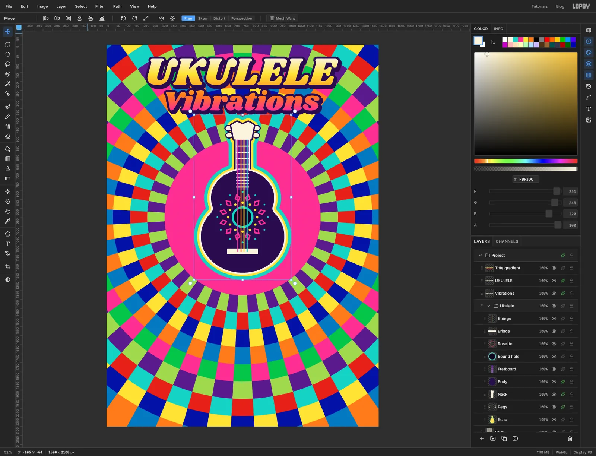

Click the `Strings` row, then hold [[Shift]] and click the `Echo` row. All nine instrument layers are selected. Choose **Layer → Group Layers**, then double-click the new group's name and call it `Ukulele`.

> **Tip:** With the group selected and the **Move** tool active, the handles frame the whole instrument, and a drag or an arrow key moves every part together. Leave it where it is for this poster, because the sound hole has to stay on the centre of the rings.

## Draw a wavy edge with the Pen

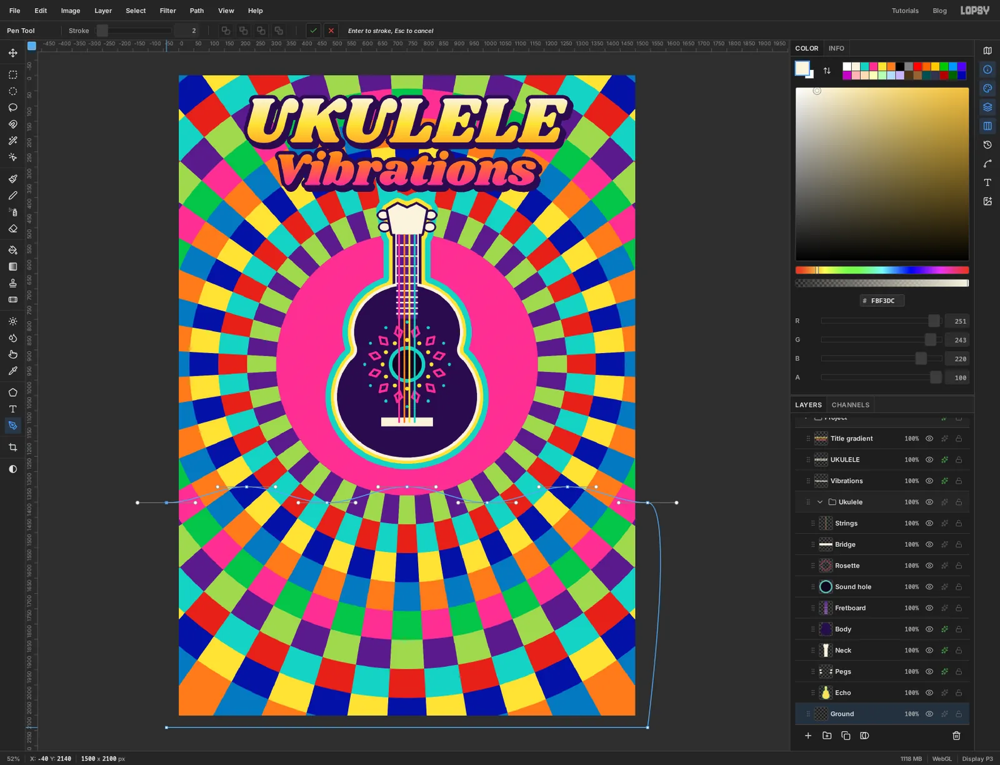

The chart sits on a dark panel with a wavy top. Click the `Rays` row, then **Add Layer** and name it `Ground`.

Pick the **Pen** tool. A plain click makes a corner. Pressing and dragging makes a smooth curve, and the further you drag, the rounder it is. Start in the grey area just left of the canvas. For each of these seven points, press, drag about **95 px** straight to the right, and release:

1. **−40, 1402**
2. **223, 1350**
3. **487, 1402**
4. **750, 1350**
5. **1013, 1402**
6. **1277, 1350**
7. **1540, 1402**

Then click once (no drag) below the bottom right corner at **1540, 2140**, once below the bottom left at **−40, 2140**, and finally click the first point again to close the shape. If a new point appears instead, you missed the first one: zoom in and click right on it. Don't press [[Enter]] here. That would stroke the outline.

## Turn the path into a selection and grow it

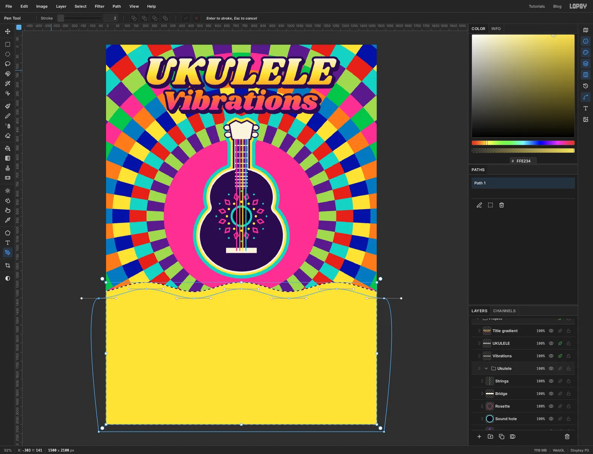

Open the **Paths** panel from the panel buttons on the far right. Your path is listed there. Click its row if it isn't highlighted, then click **Path to Selection**.

Choose **Select → Grow**, enter **36** and apply. Set the foreground to yellow `#FFE234` and choose **Edit → Fill**.

## Stack the bands

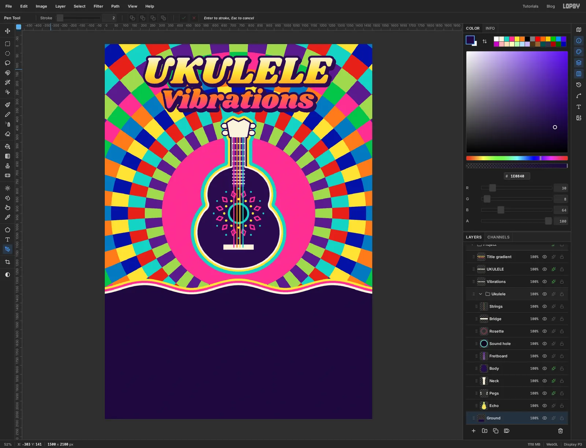

Repeat that three more times. Each time, click **Path to Selection** again to get the original shape back, grow it by less, and fill:

1. Grow **24**, fill magenta `#FF2E93`
2. Grow **12**, fill cream `#FBF3DC`
3. No grow, fill the panel colour `#1E0840`

Press [[Cmd+D]]. In the Paths panel, click the path's row and then **Delete Path** so its blue outline doesn't sit over your work, and close the panel.

## Drop guides and rule the time axis

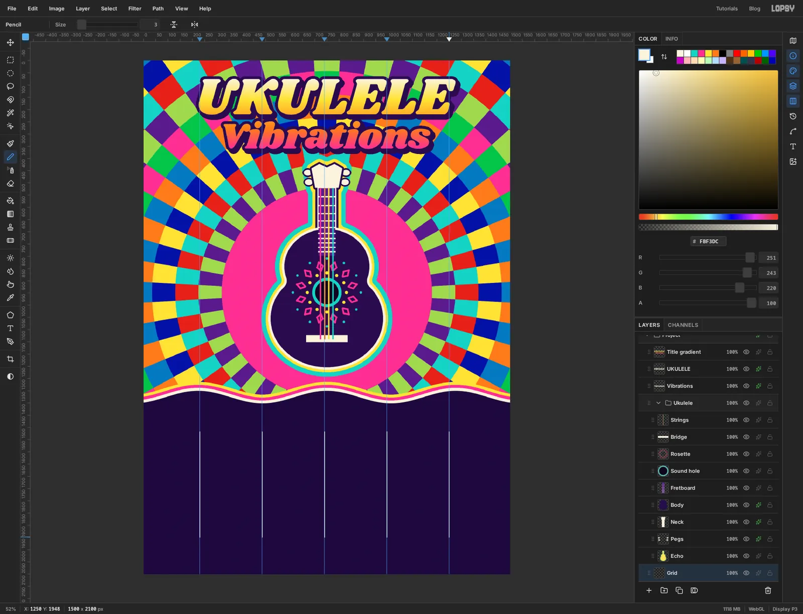

The plot runs from x 230 to x 1250. Click the ruler along the top of the canvas at **230, 485, 740, 995** and **1250**. Each click drops a vertical guide. They mark 0, 5, 10, 15 and 20 ms.

With `Ground` active, **Add Layer** and name it `Grid`. Pick the **Pencil**, set **Size** to **3** and the foreground to cream `#FBF3DC`. On each guide, click at **y 1517** and [[Shift]]-click at **y 1948**.

Click the `100%` on the `Grid` row and drag the slider down to about **35%**, so the lines sit behind the data.

## Draw the G wave with the Pen

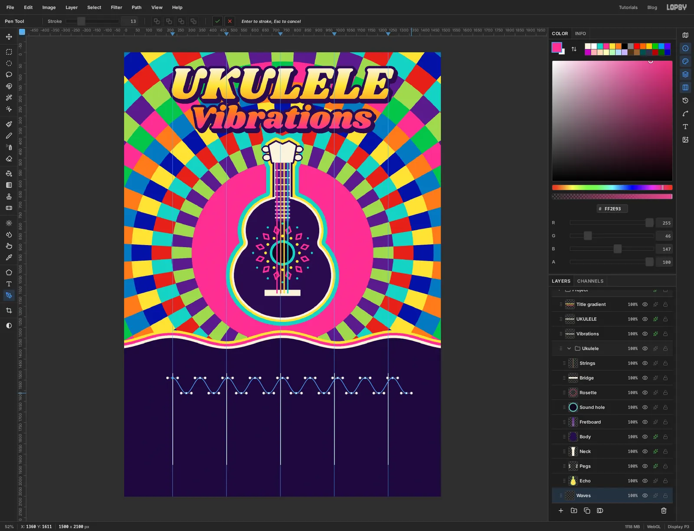

**Add Layer** and name it `Waves`. Pick the **Pen** tool and set **Stroke** in the options bar to **13**. Set the foreground to magenta `#FF2E93`.

A sine wave is easy with the Pen: put a smooth anchor on every crest and every trough, and the curve between them takes care of itself. The G wave is centred on y 1575 and swings 36 px either way, so its crests are at **y 1539** and its troughs at **y 1611**.

At 392 Hz one cycle lasts 2.55 ms, which is 130 px here, so a crest and the next trough are **65 px** apart. Start on the first guide with a crest at **230, 1539**: press, drag **24 px** to the right, release. Then a trough 65 px along at **295, 1611**, a crest at **360, 1539**, then another trough, each with the same short drag to the right. Keep going until you're one anchor past the last guide at 1250. That's 17 anchors, and the last is a crest near **1270, 1539**. You'll trim the extra in a moment.

Press [[Enter]]. The path is stroked in the foreground colour at the width you set.

## Draw the other three waves

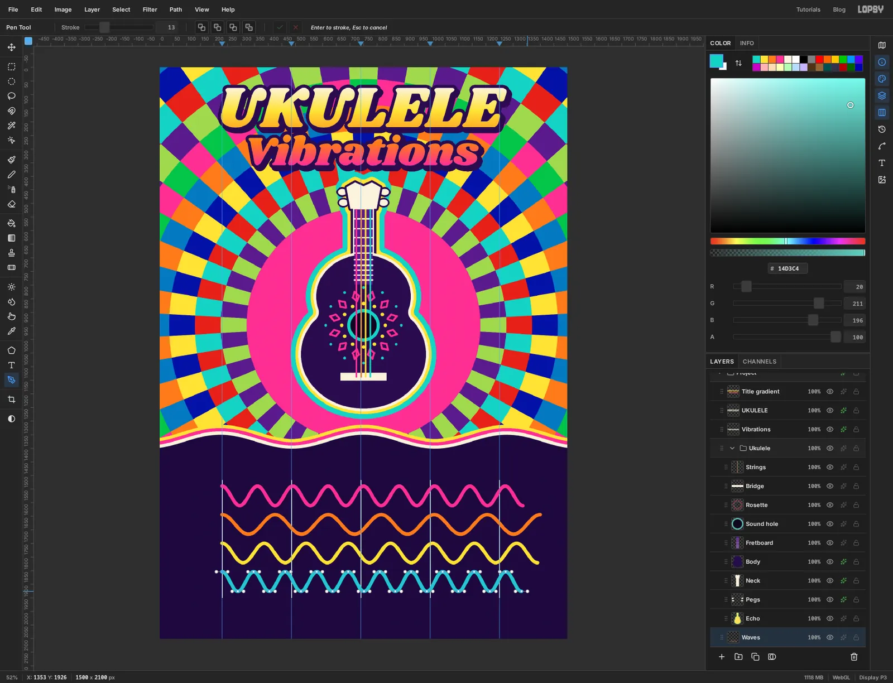

Do the same for the other strings, on the same layer. Every wave starts with a crest on the first guide at x 230. Only the colour, the height and the spacing change:

1. **C**, orange `#FF7A1A`: crests at **y 1644**, troughs at **y 1716**, anchors **97 px** apart, drag **36 px**
2. **E**, yellow `#FFE234`: crests at **y 1749**, troughs at **y 1821**, anchors **77 px** apart, drag **29 px**
3. **A**, teal `#14D3C4`: crests at **y 1854**, troughs at **y 1926**, anchors **58 px** apart, drag **21 px**

C takes 12 anchors, E takes 15 and A takes 19, each ending one anchor past the last guide. Press [[Enter]] after each wave. The drag is always a little over a third of the anchor spacing. Shorter and the wave turns into a zigzag, longer and the crests go flat.

> **Tip:** The spacing is half a wavelength: 1020 px ÷ (frequency × 0.02) ÷ 2. If you'd like to chart a different tuning, that's the only number you need.

## Trim the waves at 20 ms

Pick the **Rectangular Marquee**. Start just to the right of the last guide, at about **1255, 1495**, and drag to the right edge of the canvas at about **1498, 1970**. The left edge of the marquee snaps onto the guide at 1250, so the cut lands exactly on 20 ms.

Press [[Delete]], then [[Cmd+D]]. Open the **Paths** panel. Click each path's row in turn and click **Delete Path**, then close the panel.

## Cap each wave with a dot

The cut leaves a flat end. A dot hides it and marks where each note has got to at 20 ms. Pick the **Brush**, set **Size** to **30** and **Hardness** to **100**, and click once on the end of each wave in its own colour:

1. Magenta at **1250, 1556**
2. Orange at **1250, 1676**
3. Yellow at **1250, 1815**
4. Teal at **1250, 1879**

If your wave ends a few pixels higher or lower, click where it actually ends.

## Make the waves glow

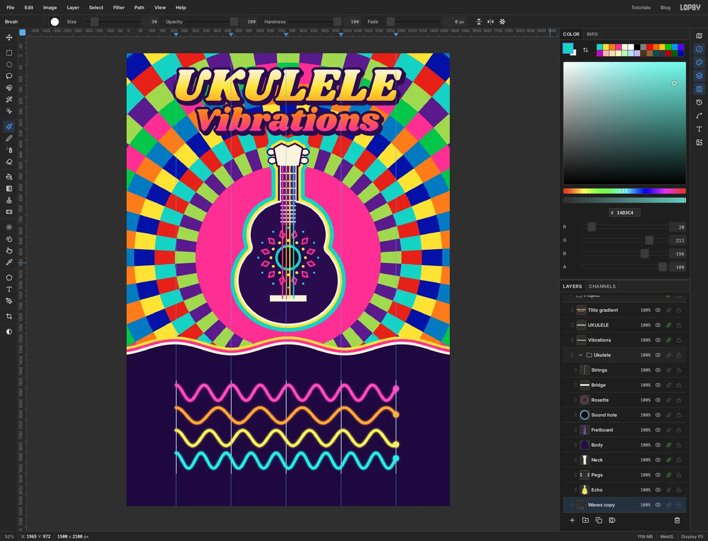

With `Waves` active, choose **Layer → Duplicate Layer**. On the copy, choose **Filter → Gaussian Blur**, set **Radius** to **14** and apply. Open the copy's effects drawer and change its blend mode to **Screen**.

The blurred copy lights up the panel around each line in that line's own colour, which a single Outer Glow effect couldn't do for four colours at once.

Choose **View → Show Guides** to hide the guides. You're done with them.

## Add the chart heading

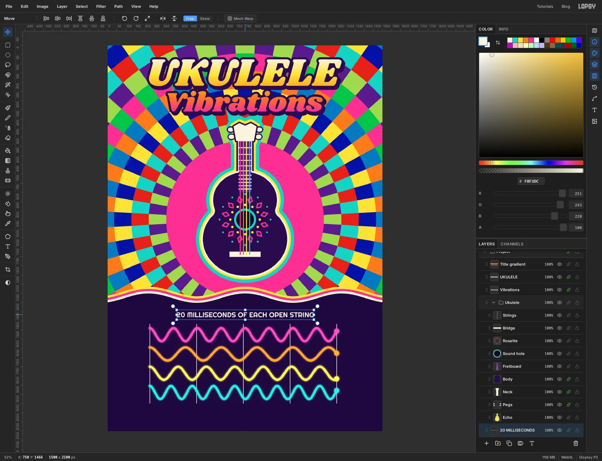

Click the `Waves copy` row. Set the foreground to cream `#FBF3DC`. Pick the **Text** tool, set **Size** to **38** and the font to **Righteous**. Click an empty part of the panel, type `20 MILLISECONDS OF EACH OPEN STRING` and press [[Tab]].

With the **Move** tool, centre it over the plot with the tops of the letters at about **y 1452**. That leaves roughly the same gap above it, to the wavy edge, as below it, to the grid.

## Label each wave

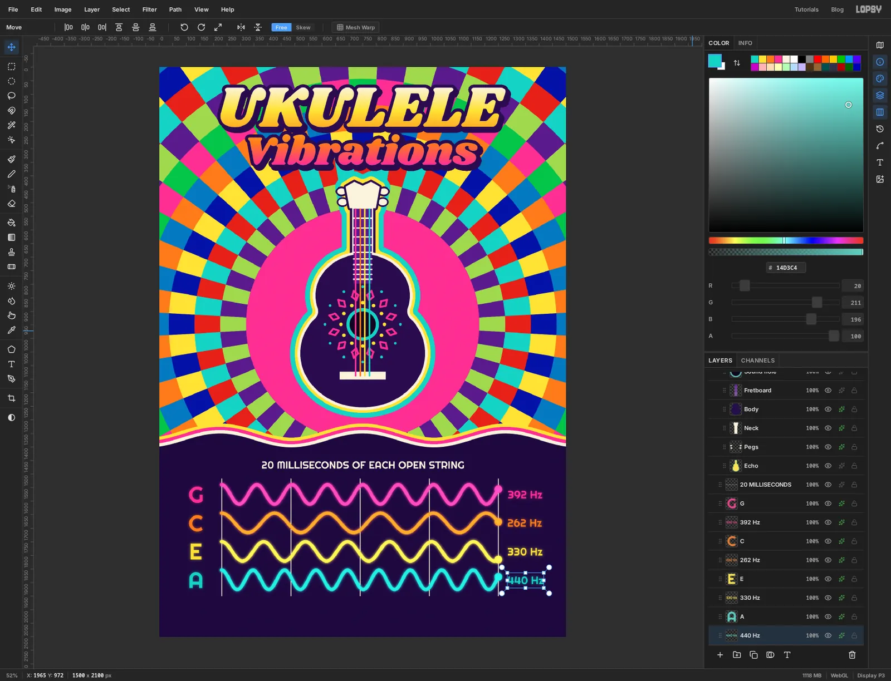

Each wave gets its note name on the left and its frequency on the right, both in the wave's colour. That's eight small text layers, all made the same way:

1. Click the `Waves copy` row, so you don't restyle the label you just made.
2. Set the foreground to the wave's colour.
3. Pick the **Text** tool and click a bare patch of the panel, well away from the other labels. A click inside an existing label's box would edit that label instead.
4. Type the label and press [[Tab]].
5. Drag it into place with the **Move** tool.

The note names are **Righteous** at **Size 84**. Centre each one on **x 135** in the left margin, level with the middle of its wave:

- `G` in magenta, at **y 1575**
- `C` in orange, at **y 1680**
- `E` in yellow, at **y 1785**
- `A` in teal, at **y 1890**

The frequencies are **Righteous** at **Size 40**, in the same colours and at the same four heights: `392 Hz`, `262 Hz`, `330 Hz` and `440 Hz`. Line up their left edges at about **x 1284**, a little clear of the end dots.

To finish, open the effects drawer for the `G` layer, tick **Outer Glow**, set **Size** to **16** and **Opacity** to **55**, and set the glow colour to the same magenta as the letter. Repeat for the other seven labels, each with its own colour.

## Number the time axis

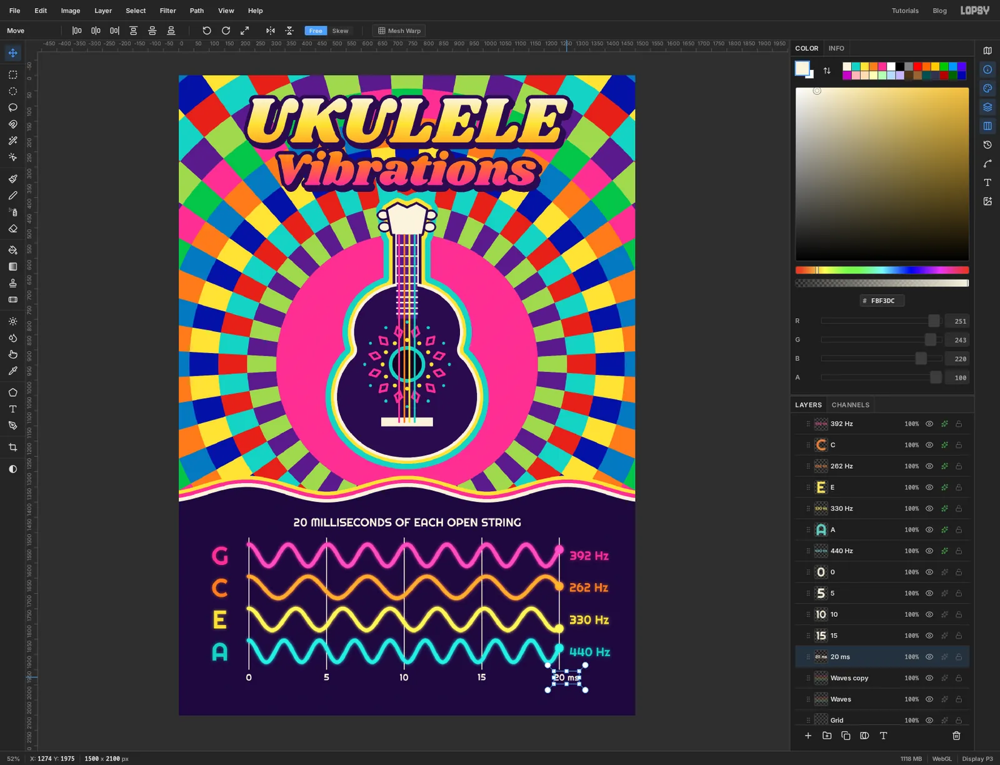

Still in **Righteous**, set **Size** to **30** and the foreground to cream. Make five labels the same way: `0`, `5`, `10`, `15` and `20 ms`.

Drag each one under its grid line with the tops of the digits at about **y 1964**. Centre the first four on their lines. For the last one, centre the `20` on the line and let the `ms` hang out to the right.

## Mark out a border

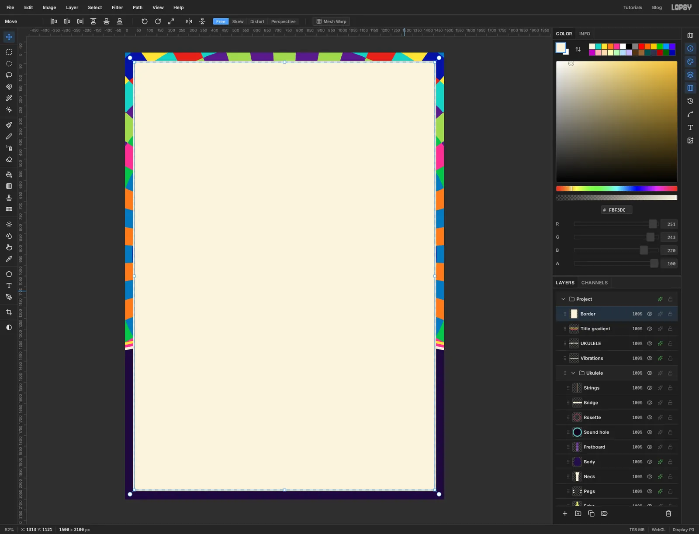

Click the `Title gradient` row at the top of the stack, then **Add Layer** and name it `Border`. Press [[Cmd+A]], choose **Select → Shrink** and enter **38**. Set the foreground to cream `#FBF3DC` and choose **Edit → Fill**. The whole poster disappears under cream for a moment.

Choose **Select → Shrink** again and enter **6**.

## Cut the border down to a keyline

Press [[Delete]], then [[Cmd+D]]. All that's left of the cream is the 6 px ring between the two selections.

## Add paper grain

Flat screen colours look too clean for a 1960s print. **Add Layer** and name it `Grain`. Press [[Cmd+A]], fill it with cream `#FBF3DC` and deselect.

Choose **Filter → Texture**. Pick **Grain** and **Mono**, set **Amount** to **60** and **Size** to **2**, and apply. Open the layer's effects drawer and change the blend mode to **Multiply**, then click the `100%` on the `Grain` row and bring the opacity down to about **40%**.

Multiply only darkens, so the grain shows as fine dark speckle and the cream takes a little glare off the brightest tiles.

## Darken the corners with a vignette

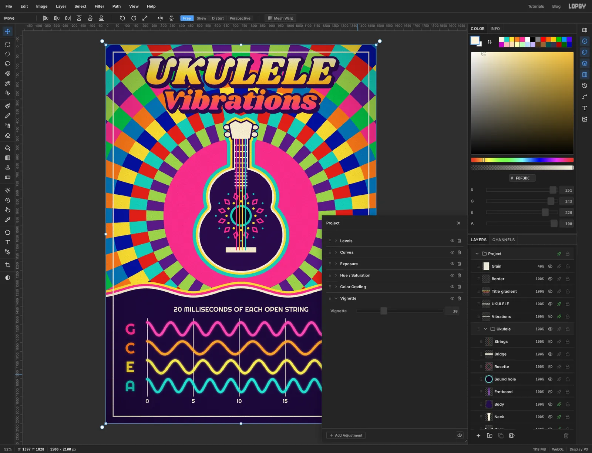

Choose **Layer → Adjustment Layer…**. Adjustments in Lopsy live on a group, and this opens the drawer for the top-level `Project` group, which holds the whole poster. Close the note that explains this if it appears. The drawer already lists a few adjustments that do nothing until you change them. Click **Add Adjustment**, choose **Vignette**, and set the new slider at the bottom of the list to **30**. Close the drawer.

The darker corners push your eye back to the middle. Choose **File → Quick Export PNG** to save the poster, and **File → Save Project** if you'd like to come back and retune it.
