Adventure posters from the late 1950s and 1960s sold a tropical island with a
few flat shapes: a sun far bigger than life, rays shooting across the sky, a
volcano on the horizon, jungle leaves in the corners, and a chunky title with a
hard shadow. This tutorial builds one for a made-up film, **Atoll Odyssey**,
entirely from shapes, gradients and filters. No photos are needed.

The poster is 1200 × 1800 px, the 2:3 shape of a one-sheet. Positions below are
in document pixels: watch **X** and **Y** in the status bar as you move the
pointer. Freehand shapes like the volcano, the canoe and the leaves only need to
be close.

Along the way you'll use:

- the **Gradient** tool and its **Advanced…** stop editor for the sky, sun, sea, leaves and the billing shade
- **Filter → Sunburst** for the rays, a **layer mask** to keep them out of the sun, and **Halftone** and **Add Noise** for print texture
- shift-added **Rectangular Marquee** selections to cut the sun's stripes and the reflection streaks, and **Select → Inverse**
- **Duplicate Layer**, **Flip Vertical** and arrow-key nudges for the reflection, then **Motion Blur** and blend modes
- the **Lasso** and soft **Brush** dabs for the volcano and its smoke, plus **Group Layers** and a group move
- **Show Grid** while drawing the canoe, and the **Pencil** with [[Shift]]-click straight lines
- **Copy**, **Paste**, **Flip Horizontal**, scaling and rotating with the **Move** tool, and **Copy effects** / **Paste effects**
- **Text** in Shrikhand and Oswald, the **Text** panel's letter spacing, and Stroke and Drop Shadow effects
- the **Shape** tool's rounded rectangle, and the root group's **Vignette** and **Saturation & Vibrance** adjustments

The palette:

- Sky `#1E1338` → `#5B2266` → `#C23A62` → `#F2784A` → `#FFD27A`, rays `#FFE6A8`
- Sun `#FFF4C2` → `#FFC24A` → `#FF5A3C`, sun glow `#FFB347`
- Sea `#3E8FA0` → `#1B5E78` → `#0A1F3A`
- Volcano `#3A1A47`, slope light `#FF7A59`, headland `#2A1238`
- Lava `#FF6A2B`, lava glow `#FF4A1F`, smoke `#C98BA8` / `#F2C4B6` / `#D79BB7`
- Canoe ink `#1C0D2A`, birds `#2A1238`
- Monstera `#0C1F1A` → `#1E4A3B` → `#2F6B55`, veins `#4A8A6E`, rim light `#F2A45C`, leaf shadow `#05110D`
- Title cream `#FFF0D2`, outline `#2A0F3A`, hard shadow `#E5365A`
- Billing shade `#070A1C`, credits `#E9CFC0`, date pill `#C8345A`

## Set up the poster and guides

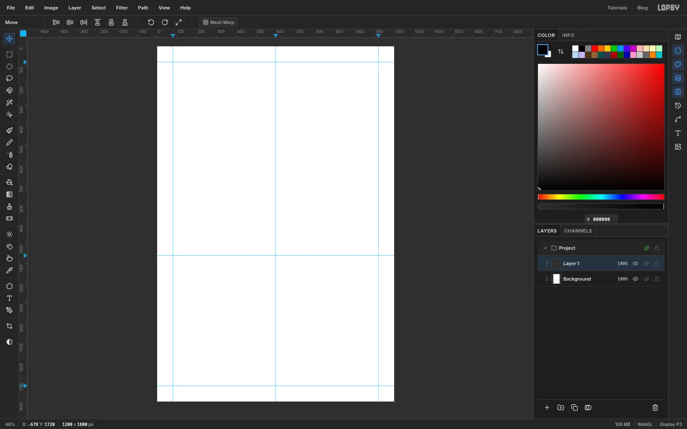

1. Choose **File → New**, set **Width** `1200` and **Height** `1800`, and click **Create**.
2. Click the top ruler at `x 80`, `x 600` and `x 1120` for the side margins and the centre line.
3. Click the left ruler at `y 80` and `y 1720` for the top and bottom margins, and at `y 1060` for the horizon.

## Paint the sunset sky

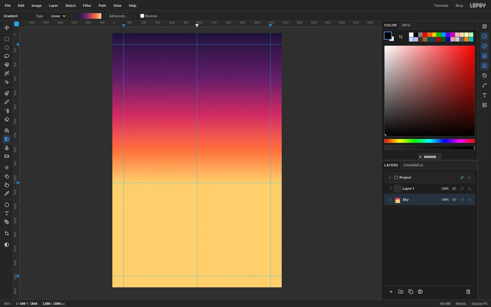

1. Double-click **Background** in the Layers panel and rename it `Sky`.
2. Pick the **Gradient** tool, set **Type** to **Linear** and click **Advanced…**.
3. Set the left stop to `#1E1338` and the right stop to `#FFD27A` with the **Hex color** field. Click the bar at about 30%, 55% and 78% to add three more stops, and make them `#5B2266`, `#C23A62` and `#F2784A`. Click **Done**.
4. Drag straight down the centre guide from the top edge to the horizon guide. Everything below the horizon gets the last colour, which is fine: the sea will cover it.

## Fan out the sunburst rays

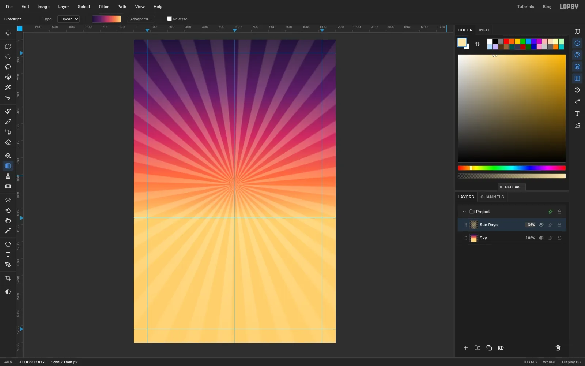

1. Click **Layer 1** and rename it `Sun Rays`. Set the foreground colour to `#FFE6A8`.
2. Choose **Filter → Sunburst…** and set **Rays** `32`, **Length** `110`, **Width** `45`, **Fade** `75`, **Softness** `15`, **Rotation** `4` and **Center Y** `47.8`. That puts the centre of the burst at `y 860`, where the sun will sit. Tick **Preview** to check, then click **Apply**.
3. Click the layer's **Layer effects** button (the sparkle icon), set **Blend** to **Screen**, and close the drawer.
4. Click the layer's opacity (**100%**) and drag the slider to `30`.

## Draw the sun

1. Click **Add Layer** and rename the new layer `Sun`.
2. With the **Elliptical Marquee**, drag from `(300, 560)` to `(900, 1160)` for a 600 px circle centred on the burst.
3. Pick the **Gradient** tool and open **Advanced…**. Set three stops: `#FFF4C2` on the left, `#FFC24A` in the middle (at about 45%) and `#FF5A3C` on the right. Click **Done**.
4. Drag from the top of the circle straight down to its bottom.

## Cut the retro stripes

The classic sunset stripe look comes from slices cut out of the lower half, each one a little thicker than the one above.

1. Press [[Cmd+D]] to deselect, then pick the **Rectangular Marquee** (`M`).
2. Drag a thin band across the sun, wider than the sun on both sides, from `y 880` to `y 886`.
3. Hold [[Shift]] and drag five more bands so they add to the selection: `y 920–930`, `961–975`, `1003–1021`, `1046–1068` and `1090–1116`. The gaps shrink as the bands grow. The last band and a half dip under the horizon. The sea will hide them, but they keep the spacing even.
4. Press [[Delete]], then [[Cmd+D]].

## Add a glow and keep the rays out of the sun

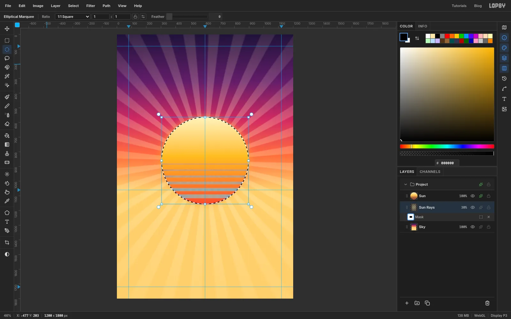

1. Open the **Layer effects** drawer for `Sun`, tick **Outer Glow** and set the colour to `#FFB347`, **Size** `90`, **Spread** `5` and **Opacity** `70`. Close the drawer.
2. Look closely at the gaps between the stripes: the rays show through them. Click `Sun Rays`, then click **Add Mask** at the bottom of the Layers panel. A **Mask** row appears under the layer, and painting now goes on the mask.
3. With the **Elliptical Marquee**, drag from `(304, 564)` to `(896, 1156)`, just inside the sun.
4. Set the foreground colour to `#000000`, choose **Edit → Fill**, and press [[Cmd+D]]. Black hides the rays inside the circle.

## Fill the sea

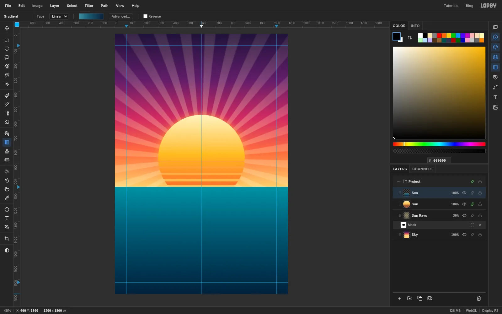

1. Click `Sun`, then **Add Layer**, and rename the new layer `Sea`.
2. With the **Rectangular Marquee**, drag from just left of the canvas on the horizon guide to past the bottom-right corner.
3. Set a **Linear** gradient with the stops `#3E8FA0`, `#1B5E78` (at about 35%) and `#0A1F3A`. Drag from the horizon straight down to the bottom edge, then press [[Cmd+D]].

## Mirror the sun

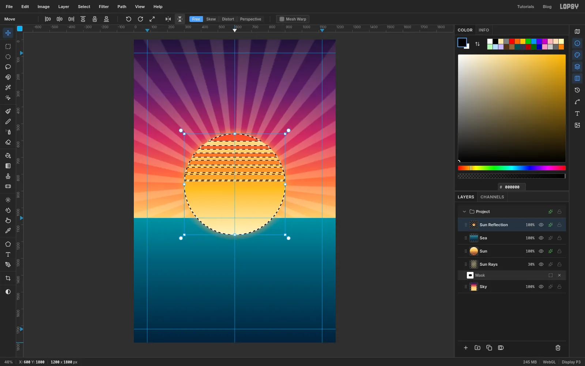

1. Click `Sun` and click **Duplicate Layer**. Rename the copy `Sun Reflection`.
2. Drag `Sun Reflection` by its grip (the dotted handle on the left of the row) up so it sits above `Sea`.
3. [[Cmd]]-click the layer's thumbnail to select its pixels. Press `V` for the **Move** tool and click **Flip Vertical** in the options bar.

## Drop the reflection into the water

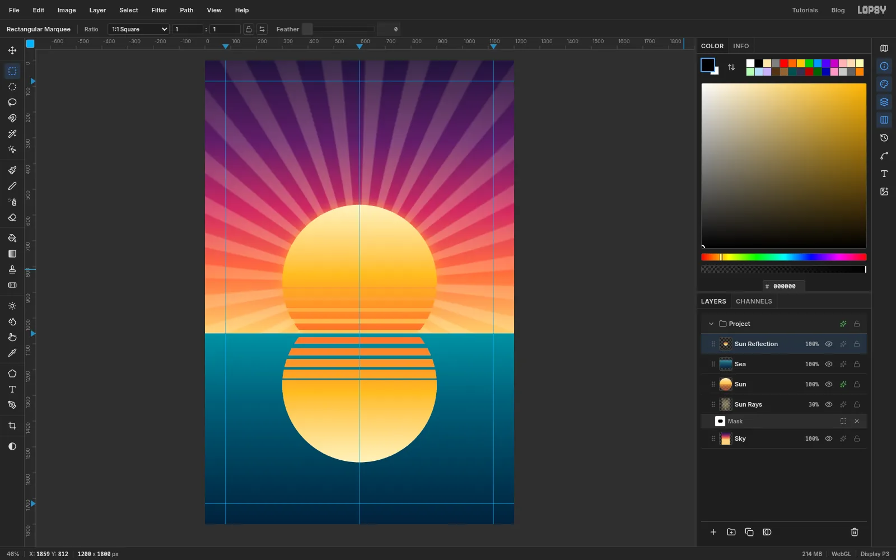

1. Press [[Cmd+D]]. With the **Move** tool still active, hold [[Shift]] and press [[Down]] until the layer has moved down 400 px (40 presses, 10 px each). The reflection's top now mirrors the sun's bottom across the horizon.
2. With the **Rectangular Marquee**, drag from above the top-left corner of the canvas to the horizon guide on the right, and press [[Delete]], then [[Cmd+D]].
3. Open the layer's **Layer effects** drawer and untick **Outer Glow**. A glow under water looks wrong.

## Slice the reflection into streaks

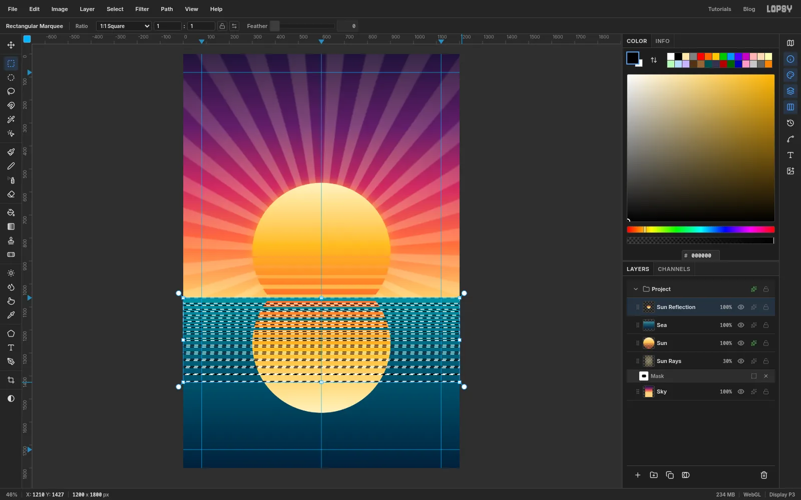

Calm water breaks a reflection into horizontal glints. You'll keep only thin streaks of it.

1. With the **Rectangular Marquee**, drag a band right across the canvas from `y 1066` to `y 1084`.
2. Hold [[Shift]] and keep adding bands down to about `y 1430`. Make each one a little thinner than the last, from about 18 px down to 4 px, and leave a slightly bigger gap each time, from about 9 px to 30 px. Fifteen or so bands is plenty. Keep them above `y 1440` so the streaks stay clear of the credits later.

## Soften the streaks

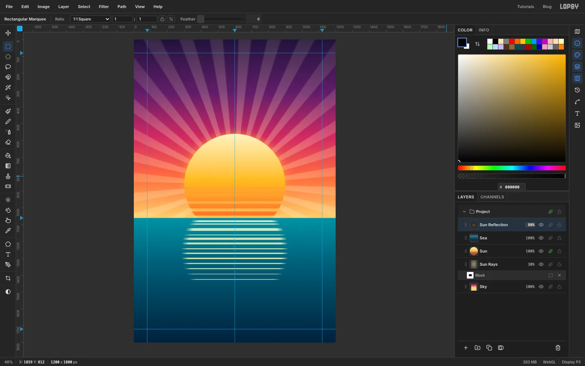

1. Choose **Select → Inverse**, press [[Delete]], then [[Cmd+D]]. Only the streaks are left.
2. Choose **Filter → Motion Blur…** with **Angle** `0` and **Distance** `40` and click **Apply**. Blurring after the cut softens both ends of every streak evenly.
3. In the layer's **Layer effects** drawer, set **Blend** to **Color Dodge**, then set the layer's opacity to `80`.

## Draw the volcano

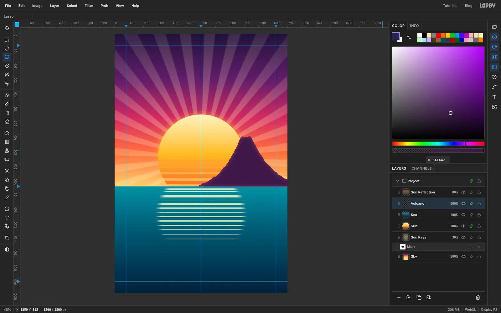

1. Click `Sea`, then **Add Layer**, and rename the new layer `Volcano`.
2. With the **Lasso**, draw the volcano: start on the horizon at `x 560`, a little too far left on purpose (you'll group it and slide it over later), climb gently, then steeply to a flat crater about 50 px wide near `(910, 712)`, come down the right side more slowly, and run off the right edge at about `y 1030`. Close the shape back along the horizon. A slightly wobbly line looks more hand-cut.
3. Set the foreground colour to `#3A1A47` and choose **Edit → Fill**, then [[Cmd+D]].
4. Open **Layer effects**, tick **Inner Glow** and set the colour to `#FF7A59`, **Size** `40` and **Opacity** `45`. The edges now catch the sunset light.

## Puff out the smoke

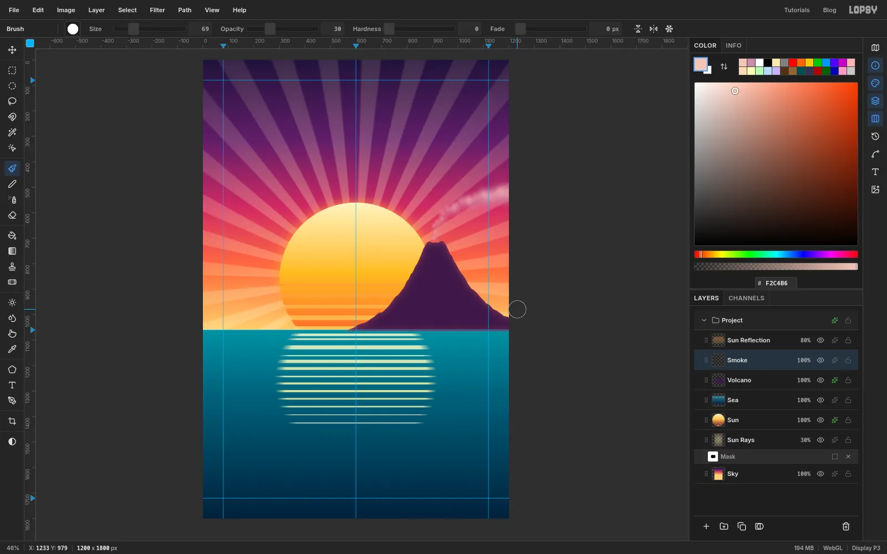

1. Click **Add Layer** and rename it `Smoke`.
2. Pick the **Brush** (`B`), click the brush preview in the options bar, and set **Hardness** `0` and **Opacity** `40`.
3. Set the foreground colour to `#C98BA8`. Click single dabs, one at a time, along a path that rises from the crater, bends to the right, and leaves the right edge at about `y 525`. Start with **Size** `36` and make each dab a little bigger, up to about `126` at the edge. Scatter them a few pixels off the line so the plume billows.
4. Switch to `#F2C4B6` with **Opacity** `30` and dab smaller highlights along the upper-left side of the plume.
5. Choose **Filter → Gaussian Blur…** with **Radius** `3` and click **Apply**.

## Light the lava

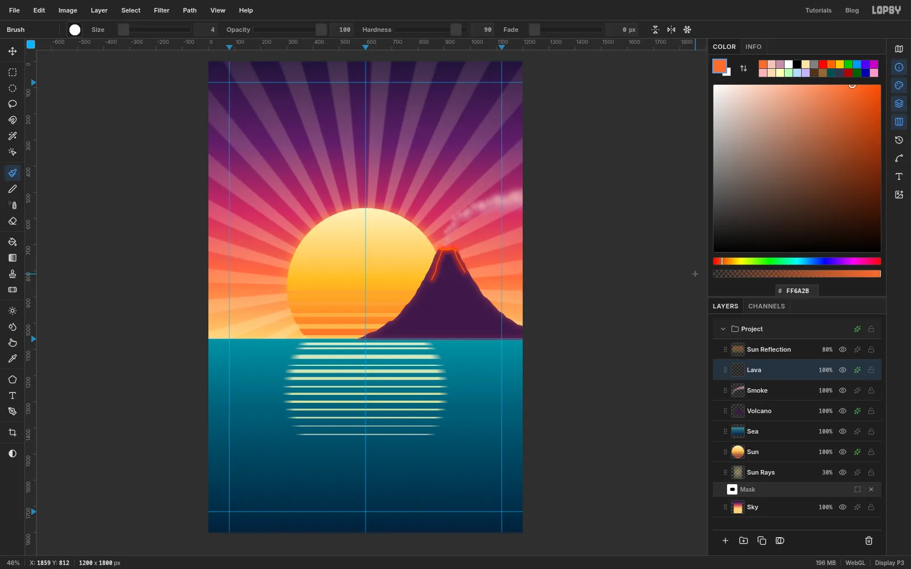

1. Click **Add Layer** and rename it `Lava`.
2. Set the brush **Size** `7`, **Hardness** `90` and **Opacity** `100`, and the foreground colour to `#FF6A2B`.
3. Click once on the left lip of the crater, then [[Shift]]-click across the rim to the right lip. Each [[Shift]]-click draws a straight line from the last point.
4. Set **Size** to `4` and draw two rivulets the same way: one from the left of the crater down the left slope, about 120 px, and a shorter one down the right slope.
5. Open **Layer effects**, tick **Outer Glow** and set the colour to `#FF4A1F`, **Size** `22`, **Spread** `55` and **Opacity** `100`. Thin lines need a high **Spread** for the glow to show.

## Group the island and slide it over

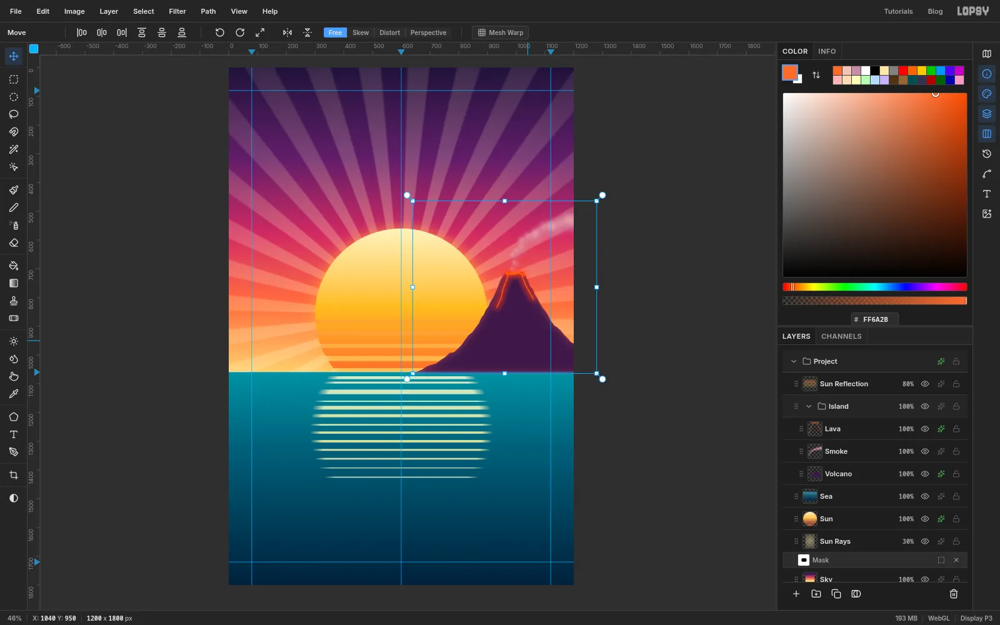

The volcano cuts too far into the sun. Grouping it with its smoke and lava lets you move all three at once.

1. Click `Volcano`, then [[Shift]]-click `Lava` so all three layers are selected.
2. Click **Group Layers** at the bottom of the Layers panel and rename the group `Island`.
3. With the **Move** tool, drag the volcano 80 px to the right. The smoke and lava come with it, and the slope now overlaps far less of the sun.

## Add a headland and thicken the smoke

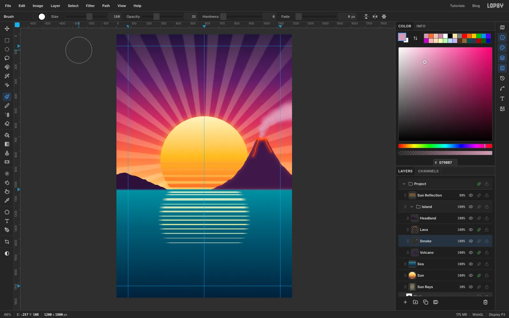

1. With `Island` selected, click **Add Layer**. The new layer goes inside the group. Rename it `Headland`.
2. With the **Lasso**, draw a low hill from off the left edge at about `y 950`, down to the horizon at `x 360`, and close it along the horizon. Fill it with `#2A1238` and deselect.
3. Click `Smoke`. With the **Brush** at **Hardness** `0` and **Opacity** `35`, set the colour to `#D79BB7` and dab a second, bigger trail from the crater to the right edge, growing from **Size** `60` to about `180`.
4. Click **Duplicate Layer**, then choose **Layer → Merge Down**. Merging a copy onto itself doubles the plume's strength.

## Draw the outrigger canoe

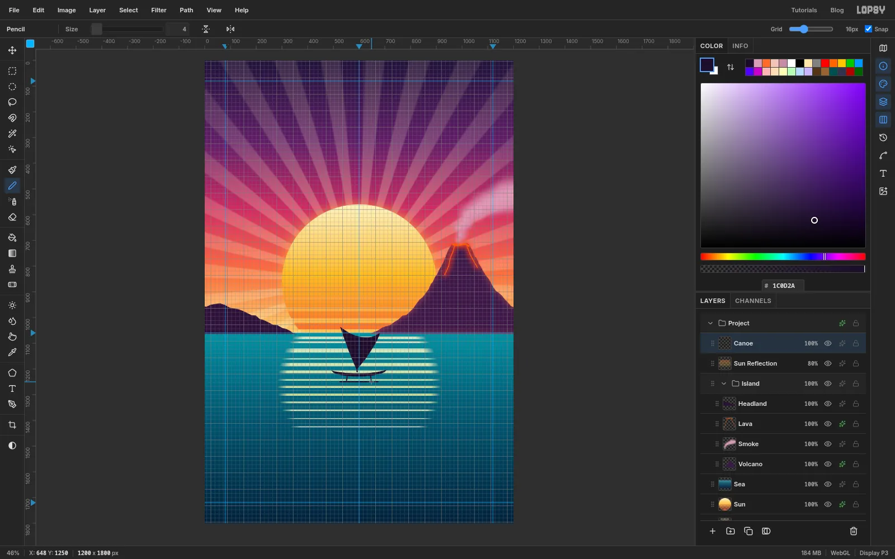

The canoe sits right on the reflection, so its dark silhouette reads against the bright streaks.

1. Choose **View → Show Grid** to help you keep the canoe level and centred.
2. Click `Sun Reflection`, then **Add Layer**, and rename it `Canoe`.
3. With the **Lasso**, draw a thin crescent hull about 220 px long, centred on `x 600`, with its deck at about `y 1205` and its belly at about `y 1232`. Fill it with `#1C0D2A`.
4. Draw the crab-claw sail as another lasso shape in the same colour: a tall, narrow V with its point on the deck just left of `x 600`, and its two tips near the horizon at about `x 525` and `x 685`. Let the sides bow outward a little and the top edge sag in a shallow curve between the tips, like a claw. Fill it.
5. Pick the **Pencil** (`N`) at **Size** `4`. Click and [[Shift]]-click a mast from the deck up into the sail, a float line under the hull from `x 526` to `x 674` at `y 1250`, and two short struts joining the hull to the float.
6. Choose **View → Show Grid** again to hide the grid.

## Fill a monstera leaf and paint its veins

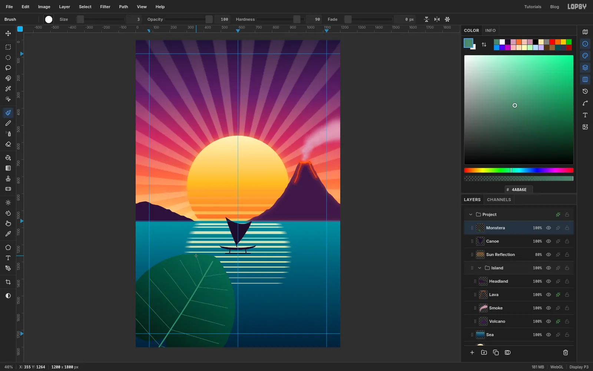

1. Click `Canoe`, then **Add Layer**, and rename it `Monstera`.
2. With the **Lasso**, draw a heart-shaped leaf about 600 px long. Its stem sits at about `(150, 1780)` and its tip at about `(470, 1270)`, so it leans about 30° to the right, and it is about 640 px across at its widest. Round the lobes at the base on both sides of the stem.
3. Set a **Linear** gradient with the stops `#0C1F1A`, `#1E4A3B` (at about 55%) and `#2F6B55`, and drag from the stem to the tip. Press [[Cmd+D]].
4. Pick the **Brush** at **Size** `8`, **Hardness** `90`, **Opacity** `100` and the colour `#4A8A6E`. Click the stem and [[Shift]]-click along the middle of the leaf to the tip for the midrib.
5. At **Size** `3`, paint five or six veins on each side. Each one leaves the midrib and curves out towards the edge, angled slightly towards the tip.

## Cut the leaf's slits

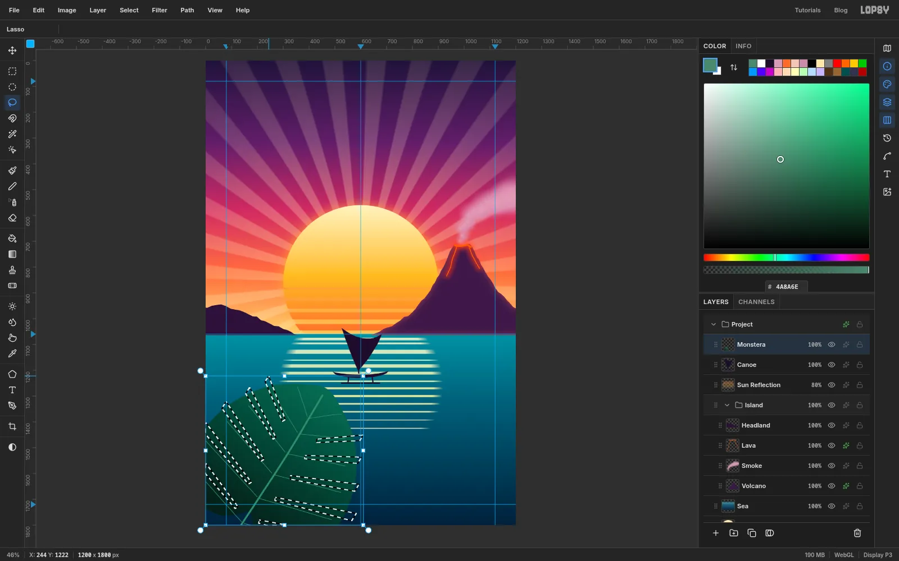

A monstera's slits run along the veins from the edge almost to the midrib.

1. With the **Lasso**, draw a long, thin wedge that starts outside the leaf's edge, between two veins, and narrows as it runs in to about 50 px from the midrib.
2. Hold [[Shift]] and add four more on the same side, then five on the other side. The ones near the tip should be shorter.
3. Press [[Delete]], then [[Cmd+D]].

## Backlight the leaf

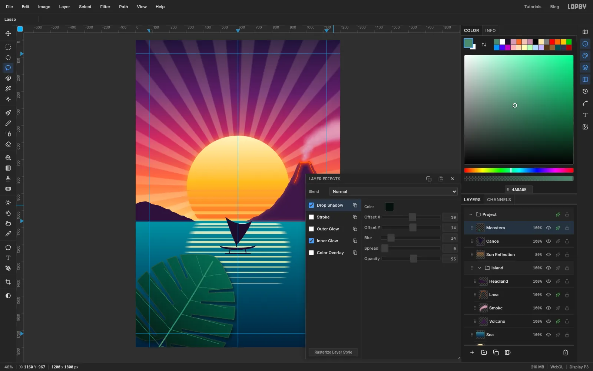

1. Open **Layer effects** for `Monstera`. Tick **Inner Glow** and set the colour to `#F2A45C`, **Size** `8` and **Opacity** `35`. It gives the edges a faint rim of sunset light.
2. Tick **Drop Shadow** and set the colour to `#05110D`, **Offset X** `10`, **Offset Y** `14`, **Blur** `24` and **Opacity** `55`.

## Copy the leaf and flip it

1. With `Monstera` selected, press [[Cmd+A]] and [[Cmd+C]], then [[Cmd+D]].
2. Press [[Cmd+V]]. The copy lands on a new layer in the same place, already selected, with the **Move** tool active. Rename it `Monstera Right`.
3. Click **Flip Horizontal** in the options bar.

## Shrink the copy

Scale and rotate the copy while it's still entirely on the canvas, and move it into the corner afterwards. [[Cmd]]-clicking a thumbnail only selects the part of a layer that's on the canvas, so a transform made after the leaf hangs off the edge would leave the hidden part out.

1. Hold [[Cmd]] and drag the top-left corner handle about 90 px right and 85 px down. [[Cmd]] keeps the proportions.
2. Press [[Enter]] to commit, then [[Cmd+D]].

## Rotate the copy

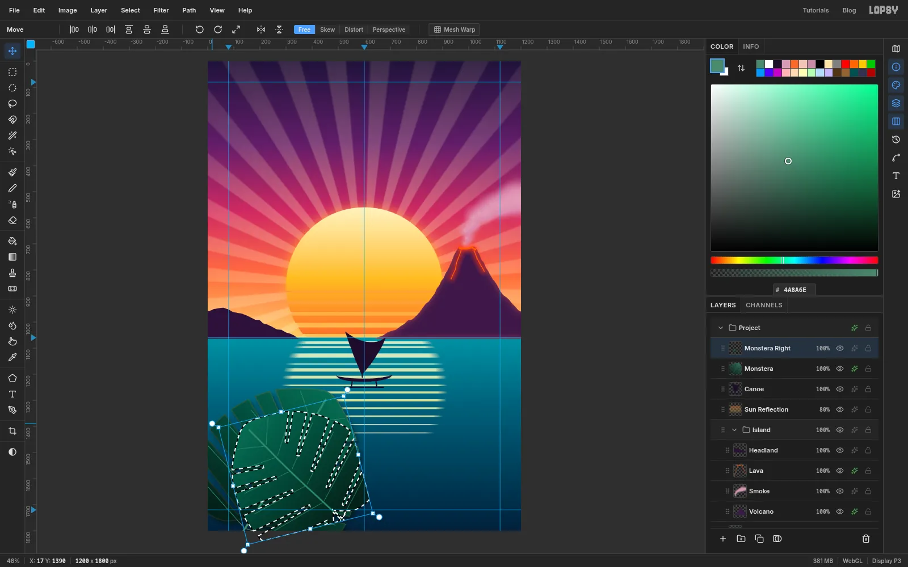

1. [[Cmd]]-click `Monstera Right`'s thumbnail to select it again.
2. With the **Move** tool, drag the round rotation handle just outside the top-left corner about 14° counterclockwise.
3. Press [[Enter]], then [[Cmd+D]].

## Push the leaves into the corners

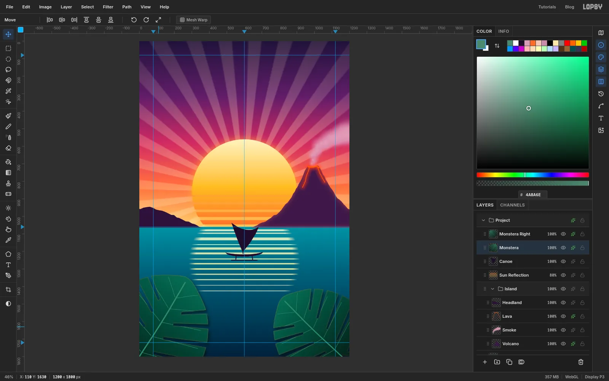

1. Open **Layer effects** for `Monstera` and click **Copy effects** at the top of the drawer. Open the drawer for `Monstera Right` and click **Paste effects**.
2. With `Monstera Right` selected and nothing selected on the canvas, drag the leaf with the **Move** tool into the bottom-right corner so about 90 px hangs off the right edge and 110 px off the bottom.
3. Click `Monstera` and drag it about 190 px left and 80 px down, so it bleeds off the bottom-left corner.

## Add a few birds

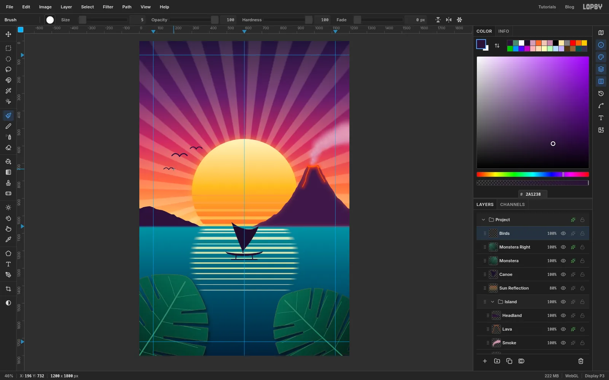

1. Click `Monstera Right`, then **Add Layer**, and rename it `Birds`.
2. Pick the **Brush** at **Hardness** `100` and the colour `#2A1238`.
3. In the open sky left of the sun, draw three shallow "M" strokes, one drag each, with the middle dipping lower than the wing tips. Make each one smaller than the last (**Size** `7`, `6` and `5`, about 90, 70 and 55 px wide), and stagger them so they don't line up.

## Set the tagline

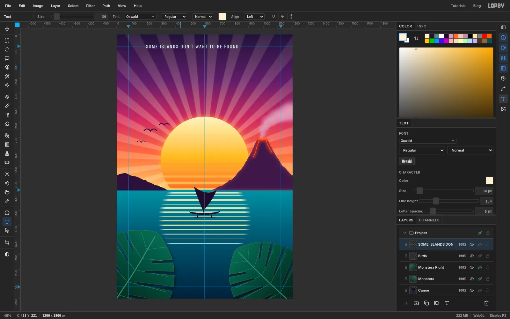

1. Set the foreground colour to `#FFF0D2`. Pick the **Text** tool (`T`), click an empty part of the sky, and set **Size** to `30` and **Font** to **Oswald** in the options bar.
2. Type `SOME ISLANDS DON'T WANT TO BE FOUND` and press [[Tab]] to commit.
3. Open the **Text** panel from the right-hand toolbar and set **Letter spacing** to `5`.
4. With the **Move** tool, nudge the tagline with the arrow keys until it's centred on the `x 600` guide, just under the top margin guide.

Opening the **Text** panel can rearrange the right-hand dock. In the rest of these screenshots the Channels panel ended up above Layers. Click **Layers** in the right-hand toolbar if your Layers panel disappears.

## Type the title

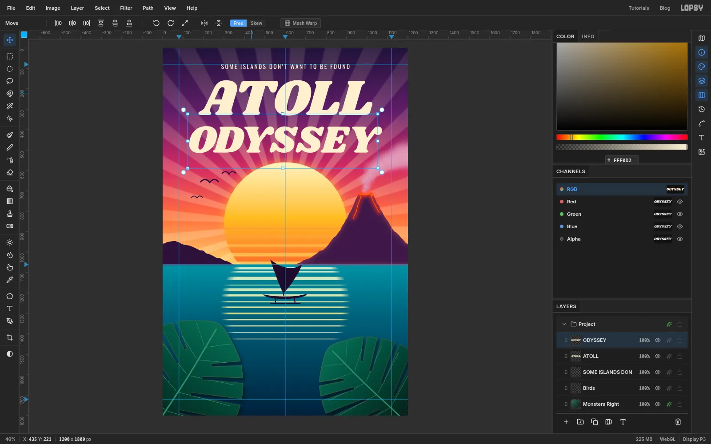

1. With the **Text** tool, click an empty part of the sky. Set **Size** `250` and **Font** **Shrikhand**, type `ATOLL` and press [[Tab]].
2. Click another empty spot below it, set **Size** `190`, type `ODYSSEY` and press [[Tab]].
3. In the **Text** panel, set **Letter spacing** to `-3` for each title layer. Shrikhand's double L opens up at this size, and tightening helps.
4. Centre both on the `x 600` guide with the **Move** tool and arrow keys. Put `ATOLL` a little below the tagline and `ODYSSEY` under it, with a gap of about 50 px between them. The shadows you add next need that air.

## Outline the title and add a hard shadow

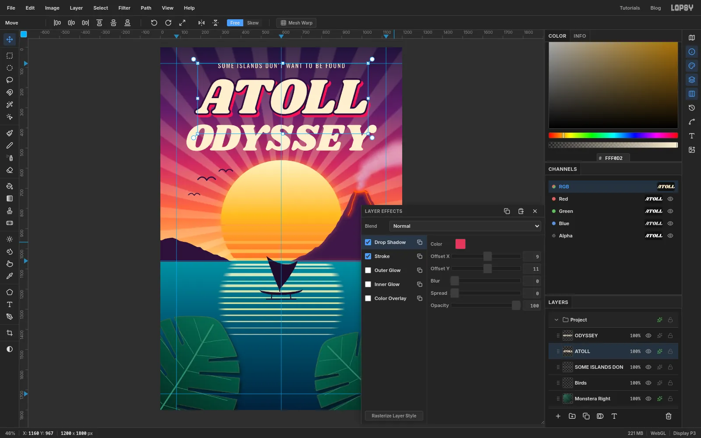

1. Open **Layer effects** for `ATOLL`. Tick **Stroke** and set the colour to `#2A0F3A` and **Width** to `8`.
2. Tick **Drop Shadow** and set the colour to `#E5365A`, **Offset X** `9`, **Offset Y** `11`, **Blur** `0` and **Opacity** `100`. **Blur** `0` gives the solid, printed shadow of old posters.
3. Click **Copy effects**, open the drawer for `ODYSSEY`, and click **Paste effects**.

## Tilt the title

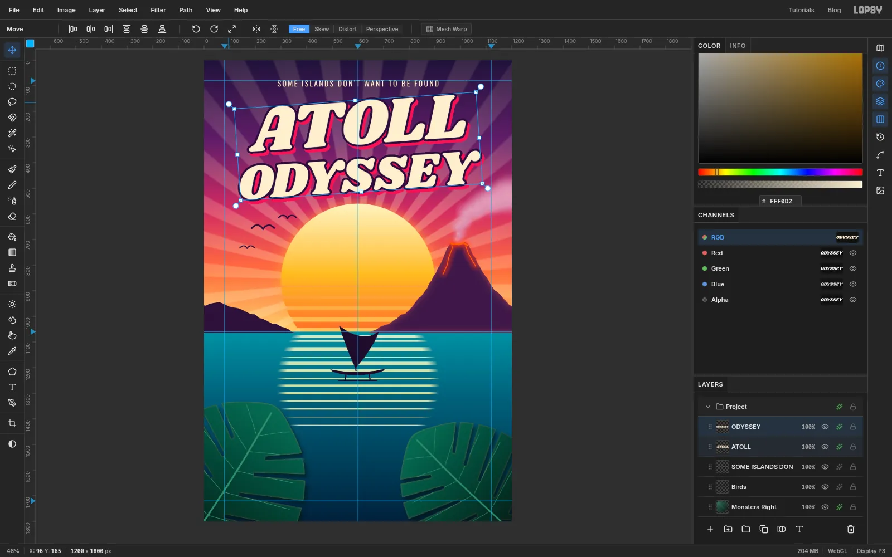

1. Press [[Cmd+D]]. Click `ODYSSEY` in the Layers panel and [[Shift]]-click `ATOLL`. With the **Move** tool, one set of handles frames both words.
2. Drag the rotation handle outside the top-left corner about 4° counterclockwise, so the title climbs to the right. Both layers stay editable text.
3. Press [[Cmd+D]], then click **Group Layers** and rename the group `Title`.
4. Rotating shifts the title a few pixels. With the group selected, nudge it with the arrow keys until it is centred again (8 px left here).

## Darken the bottom for the billing

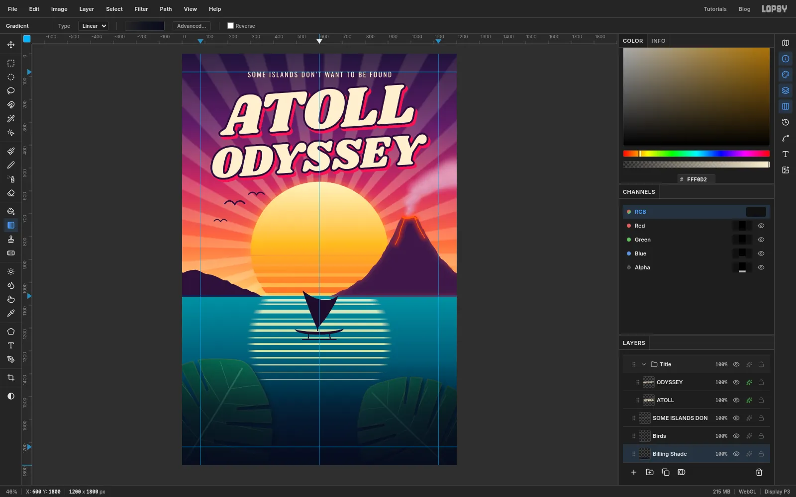

1. Click `Monstera Right`, then **Add Layer**, and rename it `Billing Shade`.
2. Set a **Linear** gradient with all three stops `#070A1C`. Drag the **Opacity** strip under the colour picker to `0` for the left stop, `60` for a middle stop at about 45%, and `95` for the right stop.
3. Drag from `y 1340` straight down to the bottom edge.

## Add the cast and credits

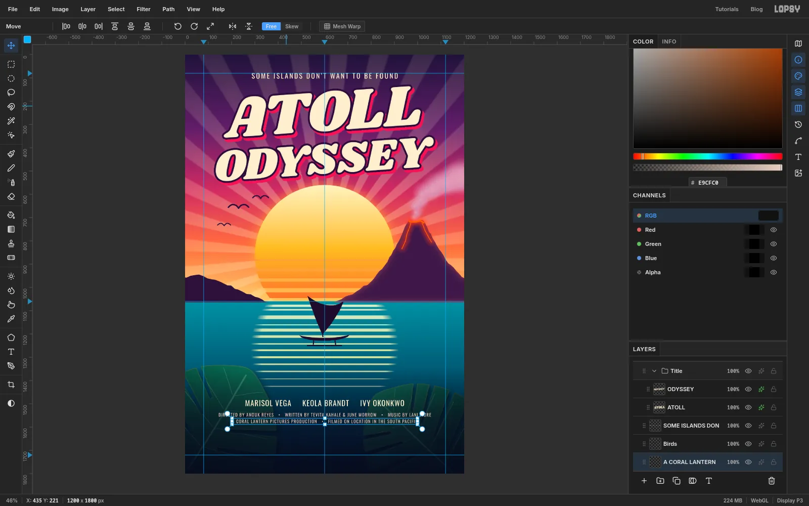

A click inside an existing text layer edits that layer, so start each new line on an empty part of the canvas and move it into place afterwards.

1. Set the foreground colour to `#FFF0D2`. With the **Text** tool, click an empty spot, set **Size** `32`, **Font** **Oswald** and **Letter spacing** `2`, and type `MARISOL VEGA     KEOLA BRANDT     IVY OKONKWO` with five spaces between the names. Commit with [[Tab]] and centre it on `y 1496`.
2. Set the foreground colour to `#E9CFC0`. Type a second line at **Size** `19`: `DIRECTED BY ANOUK REYES   •   WRITTEN BY TEVITA KAHALE & JUNE MORROW   •   MUSIC BY LANI FIORE`. Centre it on `y 1546`.
3. Type a third line at the same size: `A CORAL LANTERN PICTURES PRODUCTION   •   FILMED ON LOCATION IN THE SOUTH PACIFIC`. Centre it on `y 1574`.

## Draw the date pill

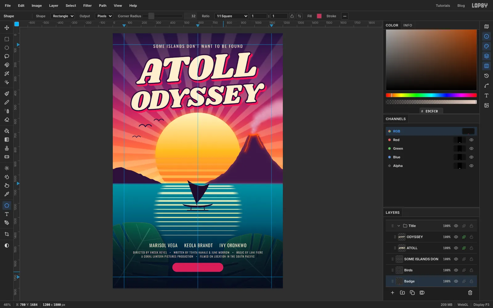

1. Click **Add Layer** and rename it `Badge`.
2. Pick the **Shape** tool (`U`), set **Shape** to **Rectangle** and **Corner Radius** to `32`. Click the fill swatch and enter `C8345A` in **Hex color**.
3. Shapes grow from where you press. Press at `(600, 1652)` and drag 180 px right and 32 px down, for a 360 × 64 px pill.

## Seat the date inside the pill

1. Set the foreground colour to `#FFF0D2`. With the **Text** tool, click an empty spot, set **Size** `28`, and type `IN THEATERS JULY 4`.
2. Nudge it with the arrow keys until it sits in the middle of the pill, with equal space above and below the capitals and at both ends.

## Print halftone dots into the sky

1. Click `Sky`, click **Duplicate Layer**, and rename the copy `Sky Dots`.
2. Choose **Filter → Halftone…** with **Dot Size** `9`, **Density** `1`, **Angle** `45` and **Softness** `0.6`, and click **Apply**.
3. Set its **Blend** to **Soft Light** and its opacity to `70`. The dots now read as print texture on top of the gradient.

## Add film grain

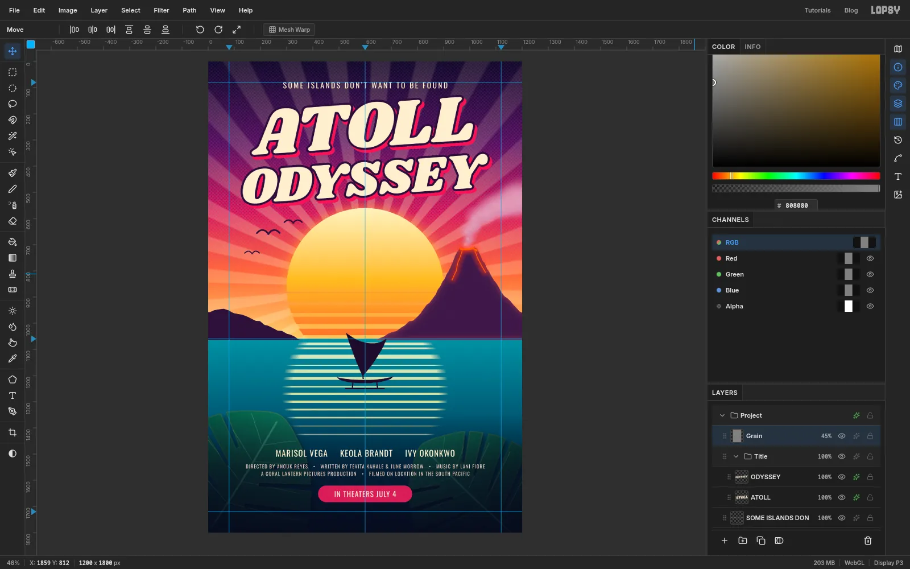

1. Click `IN THEATERS JULY`, then **Add Layer**, and rename it `Grain`.
2. Set the foreground colour to `#808080` and choose **Edit → Fill**.
3. Choose **Filter → Add Noise…** with **Amount** `28` and **Mono**, and click **Apply**.
4. Set **Blend** to **Overlay** and opacity to `45`. Middle grey disappears under Overlay, so only the noise shows.
5. Drag `Grain` by its grip above the `Title` group, so the grain covers the title too.

## Finish with a vignette and vibrance

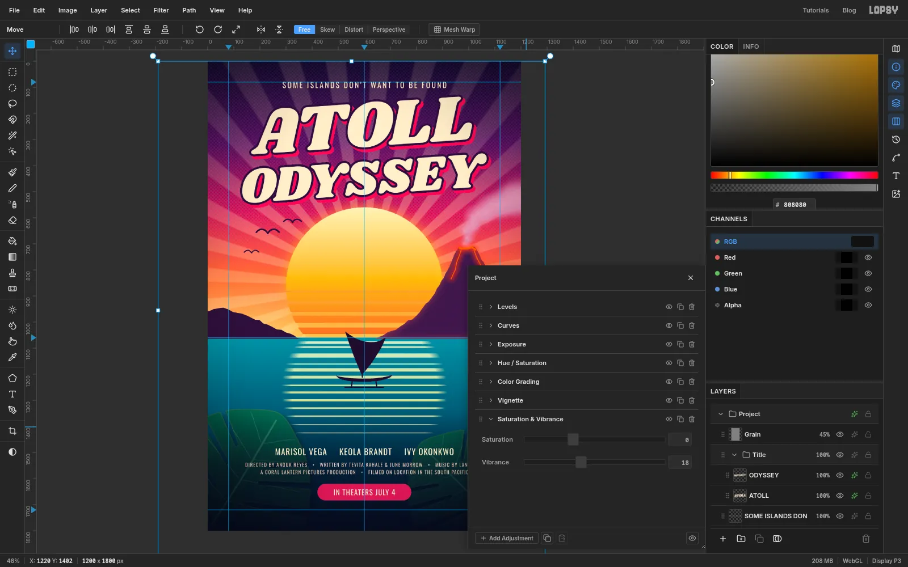

1. Choose **Layer → Adjustment Layer…**. Lopsy opens the adjustments for the root `Project` group. Click **Got it** if the explainer appears. The drawer already lists Levels, Curves, Exposure, Hue / Saturation and Color Grading. They do nothing until you change them, and you'll leave them alone.
2. Click **Add Adjustment → Vignette** and set **Vignette** to `35`.
3. Click **Add Adjustment → Saturation & Vibrance** and set **Vibrance** to `18`.
4. Click the eye icon at the bottom of the drawer to compare with and without the adjustments, then turn it back on and close the drawer.
5. Choose **File → Save Project** to keep the layers, and **File → Quick Export PNG** for the finished image.
