Rococo is the light, playful French style of the mid 1700s, the decor of
Versailles salons and Madame de Pompadour's porcelain. Where Baroque is heavy
and dark, rococo is pale and airy:

- pastel grounds, especially celadon green, rose pink and cream
- gold *rocaille* ornament built from C- and S-shaped scrolls, shells and leaves
- flowers and garden trellises
- a deliberate lack of symmetry, so the left side never quite mirrors the right

In this tutorial you'll make a 1400 × 2000 px dinner menu for
**Bijou Jardin**, an imaginary garden restaurant at Versailles. Along the
way you'll:

- paint a garden trellis with **Shift-click** straight lines and fade it with a **layer mask**
- cut a scalloped cartouche from combined **marquee** selections
- frame Fragonard's *The Swing* in an oval **mask**
- paint gilded scrolls with a **tapered brush**, then turn flat mustard into metal with a banded **gradient**
- set lettering on a ribbon with a **Pen** path and **text on a path**
- build a three-course menu with per-character colour for the prices, grouped and spaced by course
- paint mirrored dividers with **vertical symmetry**
- paint roses, then **copy, paste, flip, scale and rotate** them into garlands
- scatter sprigs with the **Leaf** brush and its **Dynamics**

You'll need one image: Fragonard's
[The Swing](https://commons.wikimedia.org/wiki/File:Fragonard,_The_Swing.jpg)
from Wikimedia Commons. It's in the public domain. Download the 1280 px
wide version.

The palette:

- Celadon ground `#F3F2E4` → `#DCE8D6` → `#A9C6B0`
- Cartouche cream `#FBF6EA`, warm edge glow `#D8B98C`
- Gold ramp `#8A6424` → `#E9CF86` → `#B88A35` → `#F4E1A6` → `#A57A2E` → `#D9B562`
- Ribbon pink `#F6C3CD` → `#E58FA0` → `#CF6F87`, tails `#C8607A`
- Rose petals `#E79AAC`, centres `#C9647F` / `#A84463`
- Leaf green `#7FA37C`, veins `#557C58`
- Title wine `#8C2C49`, ribbon wine `#7E2741`, heading rose `#B4506C`
- Dish green `#2E4D3E`, description green `#46594A`, price gold `#A47D2E`

## Set up the page and guides

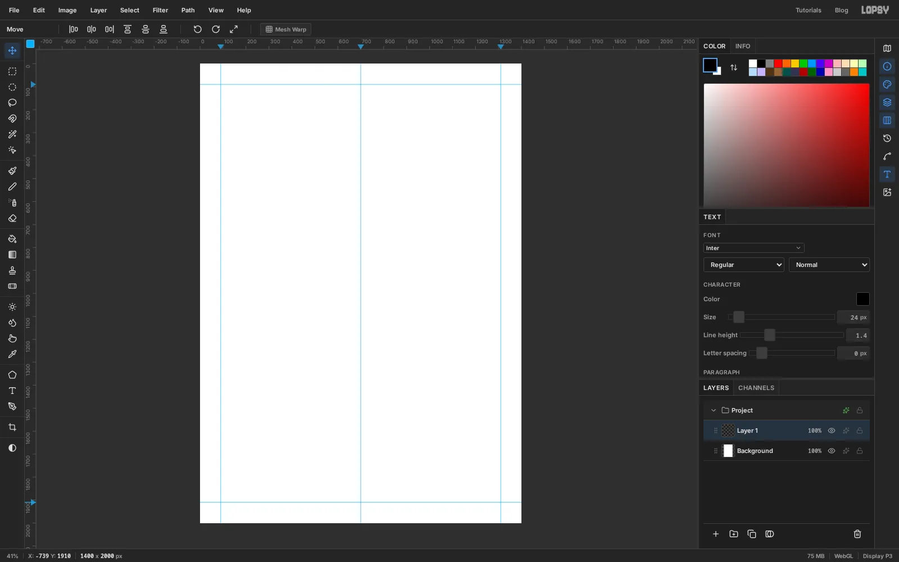

Create a **1400 × 2000** px document with a white background, then choose
**View → Fit to Screen**.

Drop five guides by clicking on the rulers:

- On the top ruler, click at `700` for the centre line, and at `90` and `1310` for the side margins.
- On the left ruler, click at `90` and `1910` for the top and bottom margins.

Everything in the menu is centred on the 700 guide, so it's worth getting
that one exact. The status bar's `X:` readout shows where the pointer is.

## Lay a celadon ground

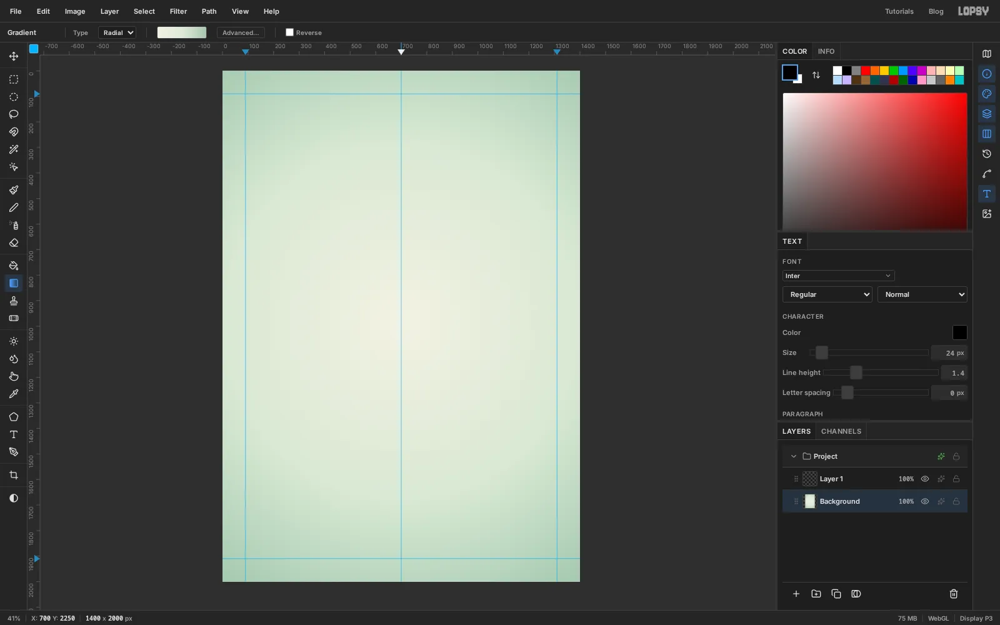

Select `Background`. Choose the **Gradient** tool, set **Type** to
**Radial** and click **Advanced…**. Set three stops:

- `#F3F2E4` at the left end
- `#DCE8D6` in the middle (click the bar a little past halfway to add it)
- `#A9C6B0` at the right end

Click **Done**. Drag from just below the middle of the canvas (about
`y 980`) straight down past the bottom edge. The centre stays pale cream
where the menu will sit, and the corners fall away to celadon.

## Paint a garden trellis

Rename `Layer 1` to `Treillage`. *Treillage* is the French garden trellis
that rococo designers loved.

Pick the **Brush**. Open the brush presets (the tip thumbnail at the left of
the options bar) and choose **Hard Round**. Set Size `5`, Hardness `100`
and the foreground to white.

Draw steep diagonal lines that drop about two px for every one px across.
Click where a line enters the canvas, then **Shift-click** where it leaves.
Shift-click joins the two points with a straight stroke. Space the lines
about 140 px apart. Start them along the top edge, then carry on from points
down the left and right edges until the whole page is covered. Then draw
the same set sloping the other way, so they cross into tall diamonds.

Now set the brush Size to `18` and click on the crossings to give the
trellis its little nail heads. There are well over a hundred. You only need
the ones near the edges, because the next step hides the middle.

## Fade the trellis behind the menu

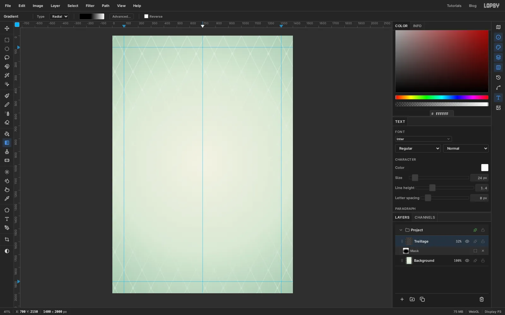

With `Treillage` selected, click **Add Mask** in the Layers panel. Lopsy
switches to editing the mask.

With the **Gradient** tool still on **Radial**, open **Advanced…** and set
the stops to black at `0%`, black at `45%`, and white at `100%`. Drag from
just below the centre of the page to below the bottom edge. Black hides and
white shows, so the trellis disappears behind the menu and stays visible at
the edges.

Click the `Treillage` row to leave mask editing, then set the layer's
opacity to `32%`. The trellis should be a whisper, not a pattern.

## Cut a scalloped cartouche

A *cartouche* is the ornamental panel that rococo inscriptions sit in.
You'll build one from four selections.

Add a layer called `Cartouche` and turn on **View → Show Grid**. It snaps
marquee drags to a 16 px grid, which keeps the edges tidy.

1. With the **Rectangular Marquee**, drag a tall panel from about 200 px in
   from the left edge, just below the halfway line, to about 200 px in from
   the right edge and a little above the bottom margin guide. The panel is
   about 1000 px wide and 830 px tall.
2. Switch to the **Elliptical Marquee**. Hold **Alt** (subtract) and **Cmd**
   (circle) and drag a 128 px circle centred on each corner of the
   rectangle. This bites a round notch out of each corner.
3. Hold **Shift** (add) and drag a wide, flat ellipse across the top edge,
   about 540 px wide and 140 px tall, so the top bulges into an arch. Do the
   same, a little narrower, across the bottom.

Set the foreground to `#FBF6EA` and choose **Edit → Fill**.

## Add an inner gold rule

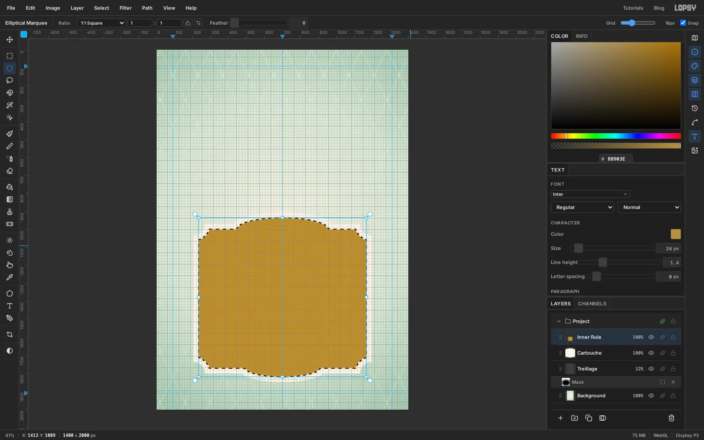

Keep the selection. Add a layer called `Inner Rule`.

1. Choose **Select → Shrink…** and shrink by `26` px.
2. Set the foreground to `#B8903E` and choose **Edit → Fill**.
3. Choose **Select → Shrink…** again and shrink by `3` px.
4. Press [[Delete]], then [[Cmd+D]] to deselect.

Only a 3 px gold line is left, following every notch and arch of the outer
shape. Turn the grid back off with **View → Show Grid**.

## Give the cartouche an edge and a glow

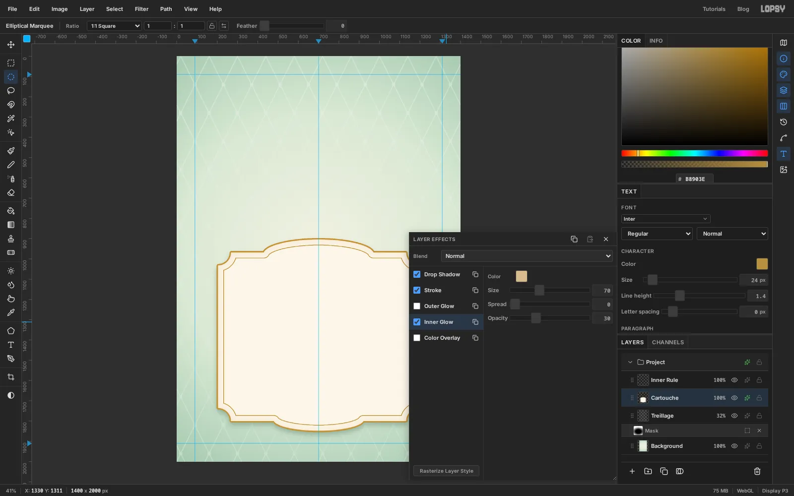

Open the effects for `Cartouche` (the sparkle button on its row) and switch
on three effects:

- **Stroke**: Width `7`, colour `#BE9443`
- **Drop Shadow**: Offset X `0`, Offset Y `14`, Blur `36`, Opacity `38`, colour `#4E6B57`
- **Inner Glow**: Size `70`, Spread `0`, Opacity `30`, colour `#D8B98C`

The green-tinted shadow lifts the panel off the page without looking dirty.
The warm inner glow makes the edges look like old paper.

## Give the paper some tooth

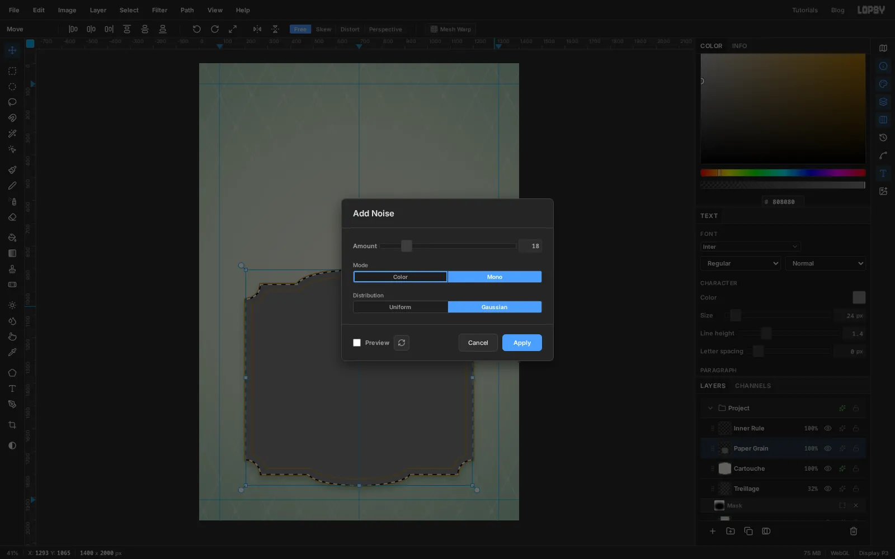

Add a layer called `Paper Grain` above `Cartouche`. **Cmd-click** the
`Cartouche` thumbnail in the Layers panel to load its shape as a selection,
and fill it with mid-grey `#808080`.

Choose **Filter → Add Noise…**, click **Mono** and **Gaussian**, set Amount
to `18` and click **Apply**. Then run **Filter → Gaussian Blur…** at `0.8`
so the grain reads as paper fibre rather than digital noise.

Deselect, set the layer's blend mode to **Overlay** and its opacity to
`35%`. The grey disappears, and only a fine texture is left on the cream.

## Bring in Fragonard's *The Swing*

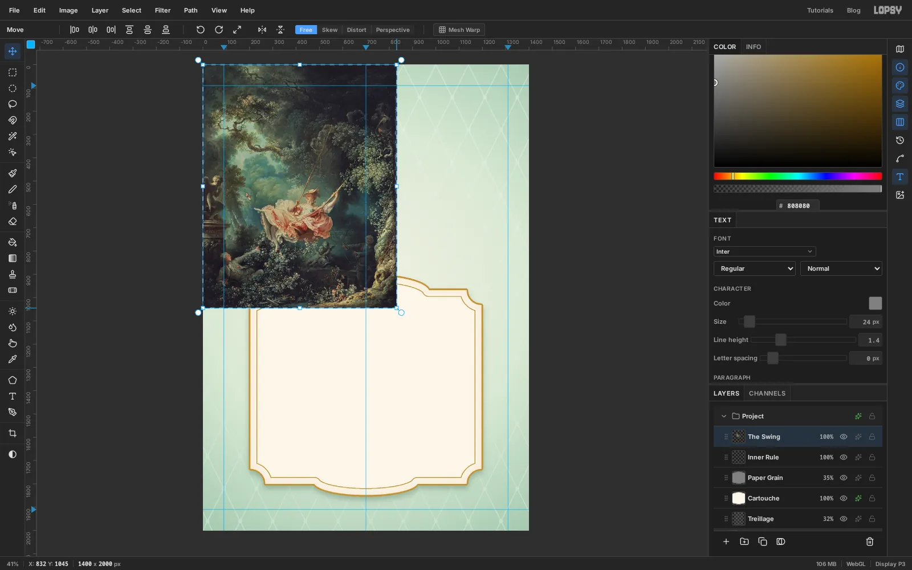

Select `Inner Rule` so the picture lands above it, then drag the downloaded
JPEG onto the canvas. Lopsy shrinks it to fit and selects it with the
**Move** tool active. Rename the layer `The Swing`.

**Cmd-drag** the bottom-right corner handle up and to the left until the
painting is about 830 px wide. Cmd keeps the proportions. Then drag inside
the box to move it up to the top centre, and press [[Cmd+D]] to commit. Tap
[[Shift+↑]] a few times so the swing and the lady sit in the upper middle
of where the oval will be.

## Cut it into an oval

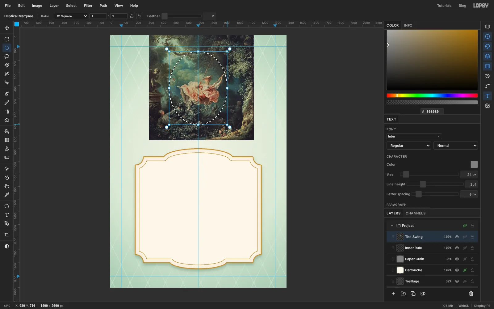

With the **Elliptical Marquee**, drag an oval about 460 × 580 px centred on
the 700 guide, from just under the top margin guide down to roughly a third
of the way down the page. Frame the lady on her swing,
with the little cupid at the bottom right.

Click **Add Mask**. With a selection active, the new mask shows only the
selection, so everything outside the oval is hidden. Nothing is deleted, so
you can still reposition the painting inside the oval later.

## Frame the medallion

Click the `The Swing` row to leave mask editing. Open its effects:

- **Stroke**: Width `16`, colour `#C29A45`
- **Drop Shadow**: Offset Y `10`, Blur `28`, Opacity `40`, colour `#3E5A47`

The stroke follows the mask, so you get a clean gold oval with no extra
layer.

## Paint the C-scrolls

This is the heart of rococo ornament: a C-scroll is a curve that swells
and ends in a curl.

Add a layer called `Rocaille`. Open the brush presets, pick **Hard Round**,
and on the **Shape** tab set **Taper** to `700` and Hardness to `85`. Taper
thins the stroke along its length, so every stroke starts fat and finishes
in a fine point. Set Size `30` and the foreground to `#C29A45`.

Paint each C as two strokes that start at the middle and run outwards into
a curl:

- **Left side:** start beside the oval at about `y 430`. One stroke sweeps up
  and out and curls in at the top left. The other sweeps down and curls in
  under the oval.
- **Right side:** do the same, but make the top half taller and the curl
  bigger.

The two sides shouldn't match. That small imbalance is what makes it read
as rococo rather than neoclassical.

## Thicken the bellies

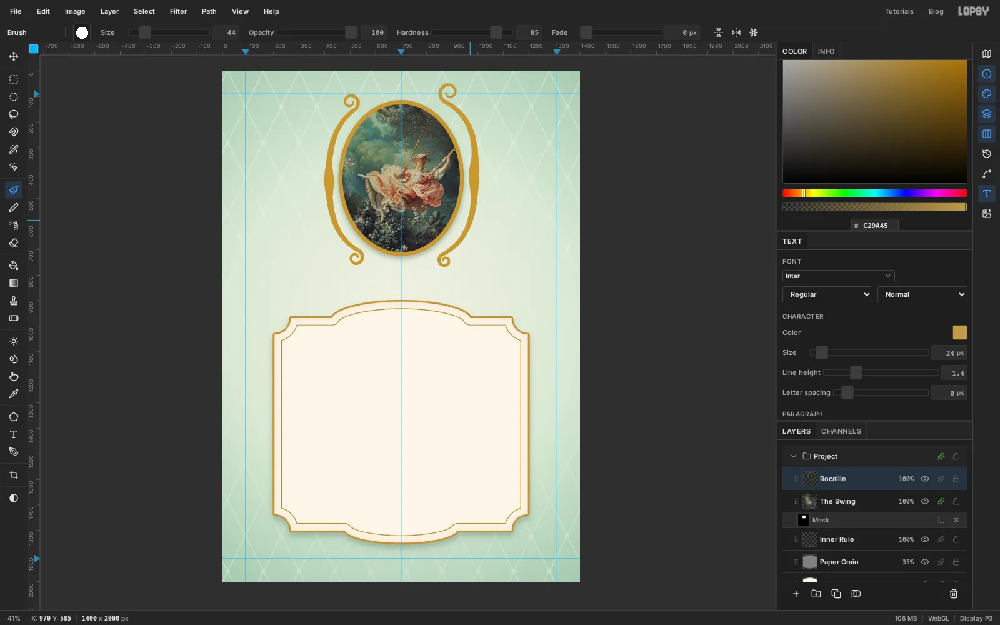

Real carved scrolls are thickest in the middle. In the brush presets set
Taper to `170` and set Size to `44`. Paint over the first third of each
stroke again, starting from the same middle point. The short taper fattens
the belly and blends into the thinner stroke beyond it.

## Add acanthus leaves

Rococo scrolls sprout leaves. Stay on the `Rocaille` layer and use the **Lasso** to draw long, pointed leaf
shapes, about 70–120 px long, growing out from the scrolls. Put three on the
left and four on the right, pointing in different directions. Fill each one
with `#C29A45`.

Then give each leaf a curl and a stem with the Brush:

- Taper `300`, Size `12`: paint a tiny curl off each tip.
- Taper `0`, Size `12`: click on the scroll and **Shift-click** at the base
  of each leaf, so the leaves grow out of the frame instead of floating
  beside it.

## Crown it with a shell

Add a layer called `Shell Crest`. On the 700 guide, just above the oval,
lasso a half-fan about 180 px wide with its point at the bottom, and fill
it with `#C9A24A`.

With the Brush (Hard Round, Taper `0`, Size `30`, still `#C9A24A`), click
nine dabs evenly around the curved edge to scallop it. Then drag a small
**Elliptical Marquee** over the point of the fan, about 50 × 36 px, and fill
it with `#B48A3A` for the hinge.

## Gild the frame

Flat mustard never looks like metal. Metal is defined by sharp bands of
light and dark, so:

1. Select `Rocaille` and **Cmd-click** its thumbnail to select its pixels.
2. With the **Gradient** tool on **Linear**, open **Advanced…** and set six
   stops evenly spaced along the bar: `#8A6424`, `#E9CF86`, `#B88A35`,
   `#F4E1A6`, `#A57A2E`, `#D9B562`.
3. Drag diagonally from the top-left corner of the frame to the
   bottom-right corner.

Deselect, then select `Shell Crest`, Cmd-click its thumbnail and drag the
same gradient corner to corner across just the shell.

## Engrave and polish the gold

The gradient wiped out the drawing inside the shapes, so engrave it back on
top with a hard brush:

- **Shell ribs:** on `Shell Crest`, use Size `5` and `#7A5A22`. Click at the
  hinge, then **Shift-click** to each scallop. Then use Size `2` and
  `#F6E7B5` to add thin highlights between the ribs.
- **Leaf veins:** on `Rocaille`, use Size `3` and `#7A5A22` to draw a vein
  down each leaf.

Open the `Rocaille` effects:

- **Inner Glow**: Size `7`, Spread `0`, Opacity `85`, colour `#FFF0B5`. This catches the light on every edge.
- **Drop Shadow**: Offset X `3`, Offset Y `5`, Blur `6`, Opacity `55`, colour `#5A4318`.

Click **Copy effects** in the drawer's header. Then open the `Shell Crest`
effects and click **Paste effects**.

## Hang a ribbon under the medallion

**Tails.** Add a layer called `Ribbon Tails`. Lasso a forked tail sticking
out from under each end of where the band will go, around `y 720–800`, and
fill both with `#C8607A`. Lasso a small triangle where each tail folds
under the band and fill it with `#8E3550`.

**Band.** Add a layer called `Ribbon Band` and lasso a band about 510 px
wide and 72 px tall that sags gently in the middle, overlapping the bottom
of the oval. Fill it with `#E58FA0`. Keeping the selection, drag a
**Linear** gradient of `#F6C3CD` → `#E58FA0` → `#CF6F87` from the top of the
band to the bottom, so it looks rounded.

Deselect and give `Ribbon Band` a **Drop Shadow**: Offset Y `6`, Blur `10`,
Opacity `35`, colour `#6B2A3E`.

## Draw a path along the ribbon

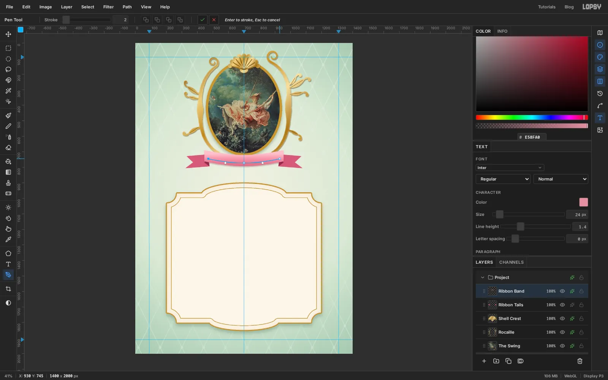

The ribbon sags, so the lettering should sag with it. Pick the **Pen**
tool:

1. Click near the left end of the band, halfway down it.
2. Press at the centre of the band, a little lower, and drag right about
   120 px to pull out smooth handles.
3. Click near the right end of the band at the same height as the first
   point.

Click the **✓** (*Commit path*) button in the options bar. The path is
saved in the Paths panel as `Path 1`.

## Set the ribbon text on the path

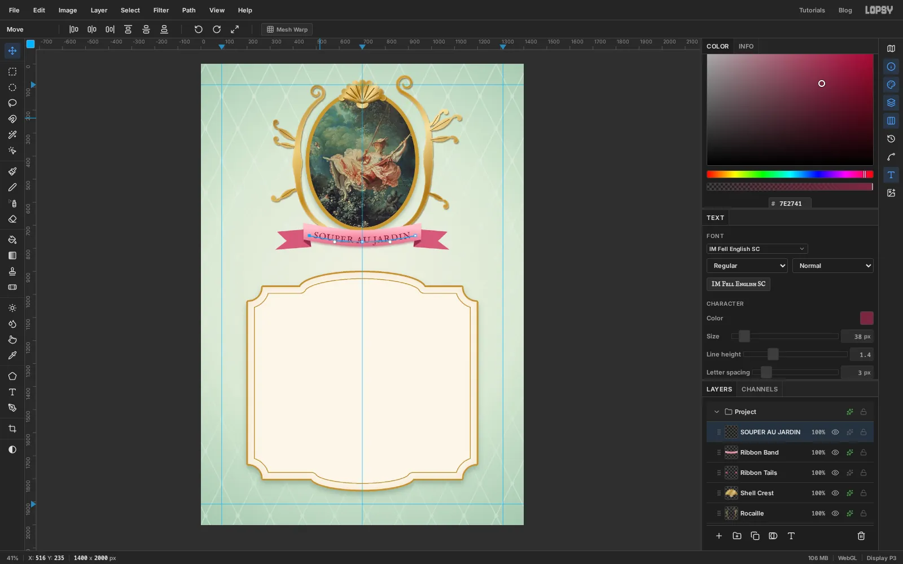

Set the foreground to the ribbon wine `#7E2741`. With the **Text** tool, click in an empty
area below the ribbon. Set Size `38` and the font to
**IM Fell English SC**, an old engraved small-caps face. Set **Align** to
**Center** and type `SOUPER AU JARDIN`, then press [[Tab]] to commit.

In the options bar's **Path** dropdown, choose **Path 1**. The letters jump
onto the curve, centred along it. In the **Text** panel, set Letter spacing
to `3` px so the capitals breathe without crowding the ends of the band.

Switch to the **Move** tool and tap **↓** until the letters sit in the
vertical middle of the band. Check the gap above the tops of the letters
and below the baseline. They should look equal.

## Set the title

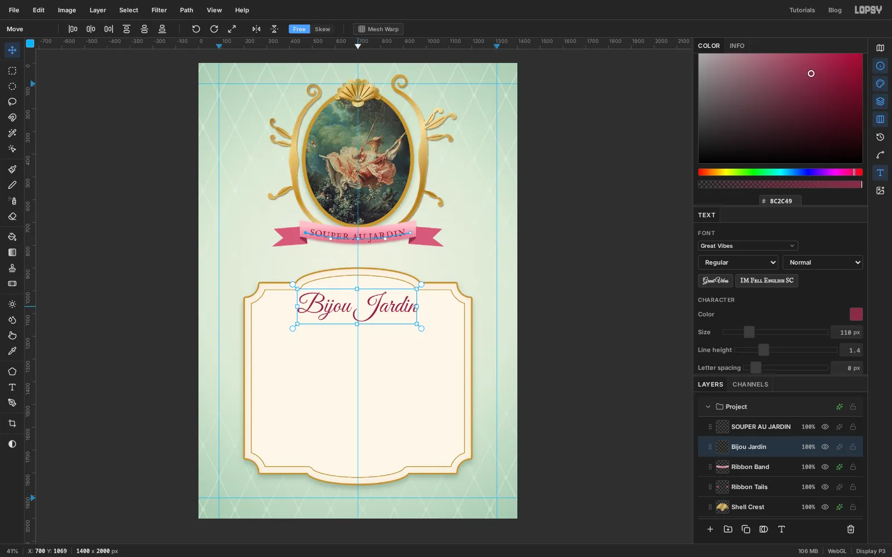

First click an image layer such as `Ribbon Band`, so the Text tool starts a
new layer instead of picking up the ribbon text. Set the foreground to `#8C2C49`, then click with the Text tool in
empty canvas. Set Size `110`, the font to **Great Vibes**, Align to
**Center**, and check Letter spacing is back at `0`. The Text panel
remembers the last value. Type `Bijou Jardin` and press [[Tab]].

Move it with the Move tool so it's centred on the 700 guide, with the tops
of the capitals about 35 px below the inner gold rule. Make sure the long
tail of the J stays clear of the line below it.

## Type the first dish with a gold price

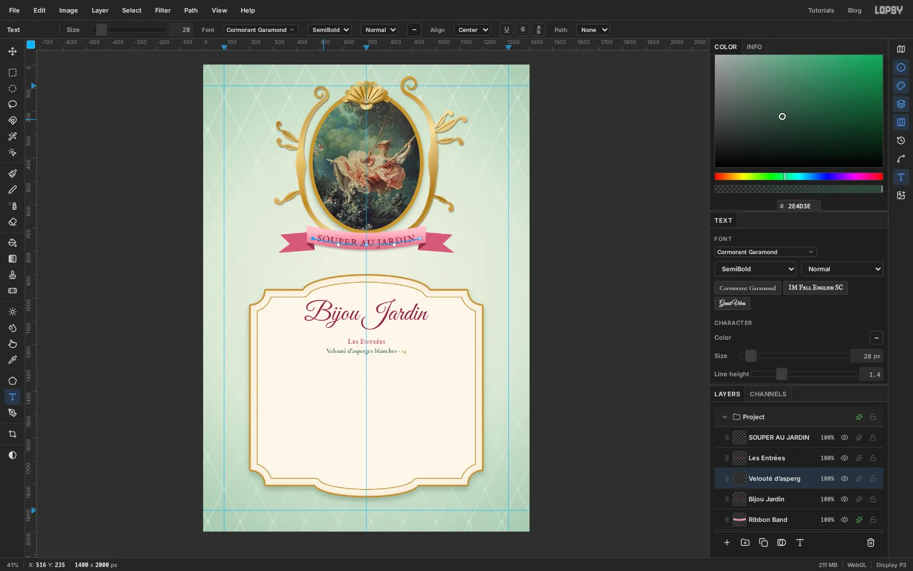

The menu uses three text styles, all centred:

- **Course headings:** IM Fell English SC, `31` px, `#B4506C`
- **Dishes:** Cormorant Garamond **SemiBold**, `28` px, `#2E4D3E`
- **Descriptions:** Cormorant Garamond **Italic**, Regular weight, `23` px, `#46594A`

Create each line by clicking in **empty** canvas (between the ribbon and the
cartouche works well), and only then set the font and size. A click inside
an existing text box edits that layer instead, and changing the font while
a finished layer is selected restyles it. Type the line, press [[Tab]], and
move it into place.

Start with the heading `Les Entrées`, placed about 40 px under the title.
Then type `Velouté d'asperges blanches · 14`. Before pressing Tab, press
[[Shift+←]] twice to select the price and set its colour to `#A47D2E` with
the **Text color** swatch in the options bar. Only the selected characters
change.

## Type the rest of the menu

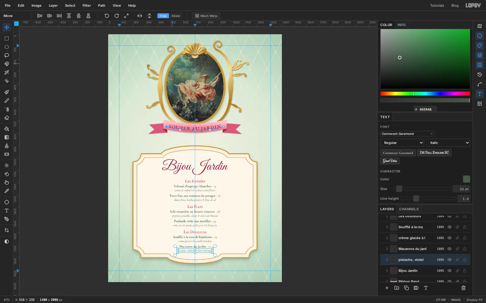

Build the rest the same way:

- **Les Entrées:** Velouté d'asperges blanches · 14 (*crème de cerfeuil & violettes cristallisées*). Tarte fine aux tomates du potager · 16 (*chèvre frais, basilic pourpre & fleur de sel*).
- **Les Plats:** Sole meunière au beurre noisette · 38 (*pommes grenaille, câpres & citron de Menton*). Poularde rôtie aux morilles · 34 (*sauce au vin jaune, petits pois à la française*).
- **Les Douceurs:** Soufflé à la rose & framboise · 15 (*crème glacée à la vanille Bourbon*). Macarons du jardin · 12 (*pistache, violette & fleur d'oranger*).

Use the arrow keys to nudge each line into a steady rhythm:

- a description sits about 8 px under its dish
- each dish sits about 18 px under the description above it
- each heading sits about 18 px above its first dish

Colour each price `#A47D2E` the same way as the first one. The weight
setting sticks between layers just like the letter spacing, so switch to
**SemiBold** for each dish and back to **Regular** for each description.

## Group each course

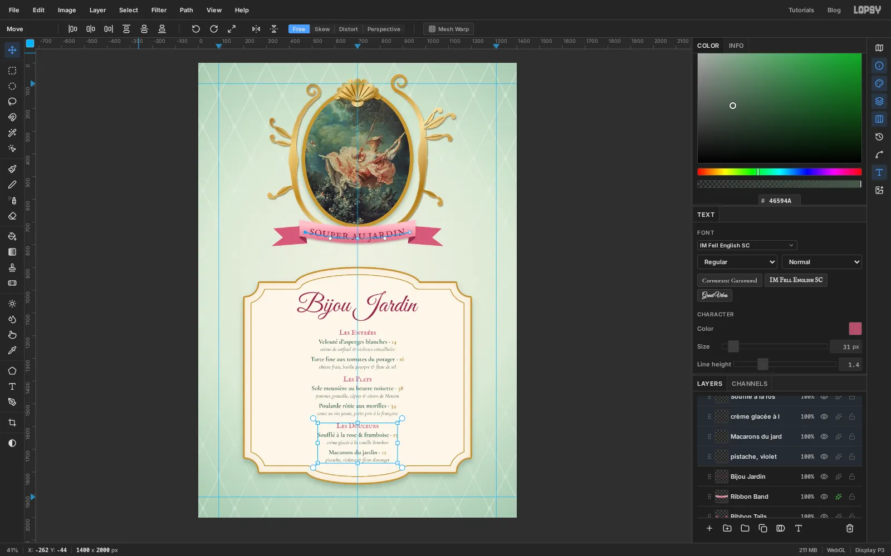

In the Layers panel, click the `Les Douceurs` heading, then **Cmd-click**
its two dishes and two descriptions. Choose **Layer → Group Layers** and
rename the group `Les Douceurs`. Do the same for the other two courses.

Use Cmd-click rather than Shift-click here. Shift-click selects every layer
between the two rows, which can sweep up another course.

## Space the courses as groups

Leave room between courses for a divider. With the **Move** tool, click
the `Les Plats` group row and tap [[Shift+↓]] and [[↓]] to nudge the whole
course down about 15 px. Then select `Les Douceurs` and nudge it about
30 px, so the gap above each heading matches. Each group moves as one
block, so the spacing inside it doesn't change.

## Paint mirrored dividers

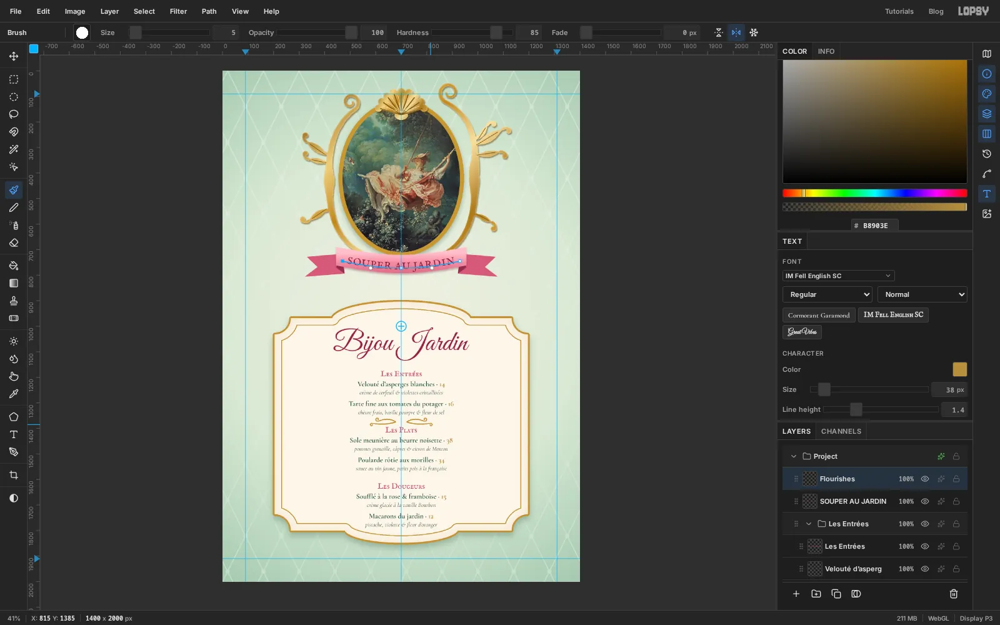

Add a layer called `Flourishes` above the ribbon text. Pick the Brush with
**Hard Round**, Taper `700`, Size `5`, colour `#B8903E`. In the options
bar, turn on **Symmetry Vertical**. A ringed crosshair marks the mirror axis
on the 700 guide.

Halfway between the two courses, paint a short S-curve from just right of
the centre outwards, ending in a little curl. Paint a second, flatter curve
just below it. Each stroke appears mirrored on the left. Click a Size `11`
dot on the centre line. Repeat between Les Plats and Les Douceurs, then
turn symmetry off.

**Symmetry Horizontal** mirrors top-to-bottom, not left-to-right, so make
sure you've picked Vertical.

## Gild the rule and dividers

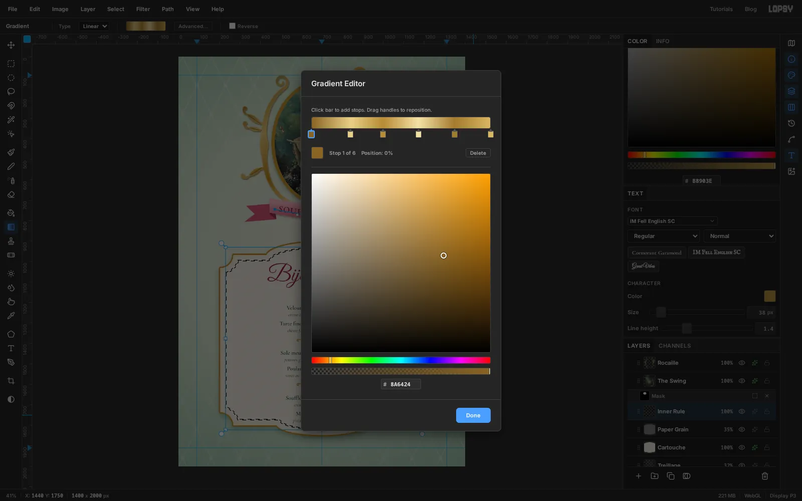

Select `Inner Rule`, then **Cmd-click** its thumbnail to load its pixels as
a selection, and open **Advanced…** on the Gradient tool. The editor keeps the last gradient you used, which here is
the ribbon's pink. Set the six gold stops from the gilding step again
before you drag. Drag corner to corner across the cartouche, then deselect.

Select `Flourishes`, Cmd-click its thumbnail, and drag the same gradient
across the two dividers.

## Bridge the gap with a second shell

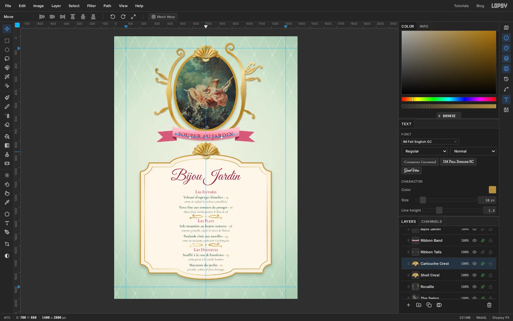

There's an empty band between the ribbon and the cartouche. Select
`Shell Crest` and choose **Layer → Duplicate Layer**. Rename the copy
`Cartouche Crest` and drag it straight down with the Move tool until it
sits on the top arch of the cartouche. It keeps the gilt effects, and it
ties the medallion and the menu into one column.

## Start a rose cluster with leaves

Add a layer called `Rose Cluster` above `Flourishes`. At the top-left
corner of the cartouche, lasso six pointed leaves fanning out from one
point and fill them with `#7FA37C`. With a Size `3` brush in `#557C58`,
click at each leaf's base and **Shift-click** most of the way to its tip
for a vein.

## Paint the roses

Paint three roses, a big one in the middle (about 100 px across) and two
smaller ones beside it. Use a Hard Round brush at Hardness `80`. For each
rose:

1. **Petals:** click six overlapping dabs in a ring with `#E79AAC`, then
   one larger dab in the middle to fill the gaps. The outline comes out
   scalloped. For the big rose use Size `47` for the ring and `65` for the
   middle. Scale those down by about a third for the small roses.
2. **Petal lips:** with a Size `5` brush in `#F6C6D0`, drag a short arc
   along the edge of each outer dab.
3. **Cup:** click a Size `37` dab of `#C9647F` slightly above centre, then a
   Size `18` dab of `#A84463` inside it (smaller on the small roses).
4. **Front petal:** with Size `8` in `#F9D3DA`, drag a curved arc across the
   top of the cup. This is the petal that folds over the opening.

Fill two small `#D9768F` ellipses on the outer leaves for buds.

## Model them with a soft brush

Switch to **Soft Round** at Opacity `40`:

- **Shade:** `#A3405E`, Size `25` (about `16` on the small roses), an arc around the lower half of each rose
- **Deepen:** `#7E2341` at Opacity `55`, Size `20`, one dab in each cup
- **Highlight:** `#FFE6EC` at Opacity `45`, Size `22`, an arc on the upper-left of each rose
- **Leaf light:** `#B9D3A8` at Opacity `45`, Size `10`, a stroke along one side of each leaf

Set Opacity back to `100`. Then choose **Hard Round** with Taper `400`,
Size `6`, colour `#5E8A5F`, and paint two tendrils that curl out of the
cluster.

Give `Rose Cluster` a **Drop Shadow**: Offset X `2`, Offset Y `6`, Blur
`10`, Opacity `35`, colour `#3E5A47`.

## Copy the cluster

Drag a rectangular marquee around the whole cluster, including the
tendrils, and press [[Cmd+C]], then [[Cmd+V]]. The paste lands in place on a
new layer, selected, with the Move tool active. Rename it
`Rose Cluster BR`.

## Flip and enlarge the copy

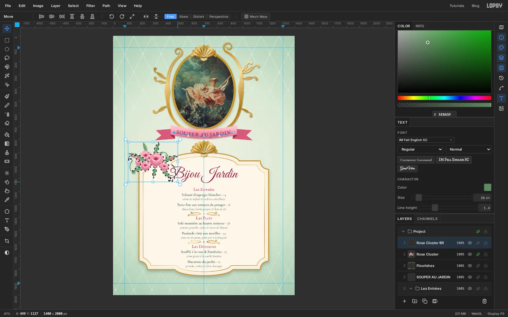

Click **Flip Horizontal** in the Move tool's options bar. Then **Cmd-drag**
the bottom-right corner handle outwards to make the copy about a quarter
bigger. A garland at the bottom should carry more weight than the one at
the top.

Drag inside the box to move it to the bottom-right corner of the cartouche,
and press [[Cmd+D]] to commit.

## Turn it to hang from the corner

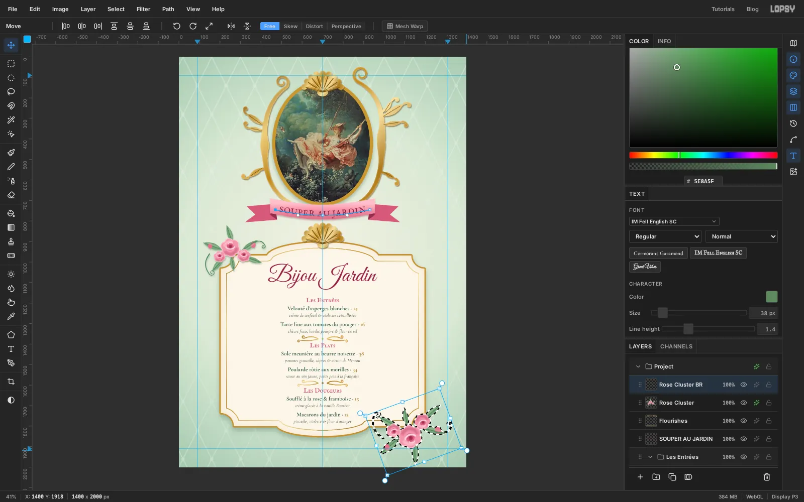

**Cmd-click** the `Rose Cluster BR` thumbnail to select its pixels. Drag
the round rotation handle outside a corner of the box about 160°
clockwise, so the roses hang down and away from the corner instead of
pointing up. Press [[Cmd+D]] to commit.

Drag the cluster up and to the right with the Move tool until it overlaps
the cartouche's corner and no longer covers the address line you'll add at
the bottom.

## Add a third cluster and group the garlands

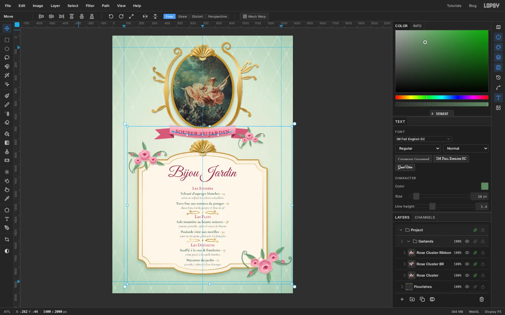

Press [[Cmd+V]] again for another copy and rename it
`Rose Cluster Ribbon`. Cmd-drag a corner inwards to shrink it about 30%,
drag it onto the right tail of the ribbon, and commit.

To give the copies the same shadow, open the `Rose Cluster` effects and
click **Copy effects**. Then click **Paste effects** in each copy's drawer.

Select all three rose layers with Cmd-click, choose **Layer → Group Layers**
and name the group `Garlands`.

## Set up a Leaf brush for sprigs

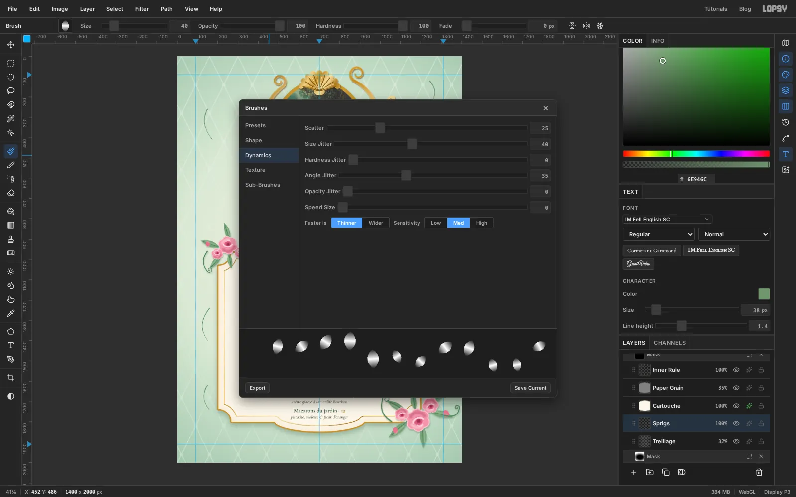

Select `Treillage` and add a layer called `Sprigs`, so they sit behind
everything else. First paint six thin stems with Hard Round, Taper `260`, Size `5`, colour
`#6E946C`: three in the left margin and three in the right, staggered at
different heights so they don't line up. Make each one a gentle curve about
150 px long.

Open the brush presets and choose **Leaf**. On the **Shape** tab, set Size
`40` and Spacing `120`. On the **Dynamics** tab, set **Scatter** `25`,
**Size Jitter** `40` and **Angle Jitter** `35`. The jitter makes the stamped
leaves vary in size and turn, so they look less mechanical.

## Paint the sprigs and set the footer

In `#7FA37C`, paint along each stem again with the Leaf brush. Then switch
back to Hard Round and click a `#E79AAC` blossom at each end, with a
`#F7CAD3` highlight dab on the larger one. Set the layer to `80%`.

For the footer, click in empty canvas near the bottom with the Text tool.
Use IM Fell English SC, `24` px, `#2E4D3E`, centred, and type
`Allée des Tilleuls · Versailles · Réservations 01 39 50 28 14`. Set Letter
spacing to `2` px in the Text panel. Place it so the baseline sits on the
bottom margin guide, centred on 700.

## Warm the whole page

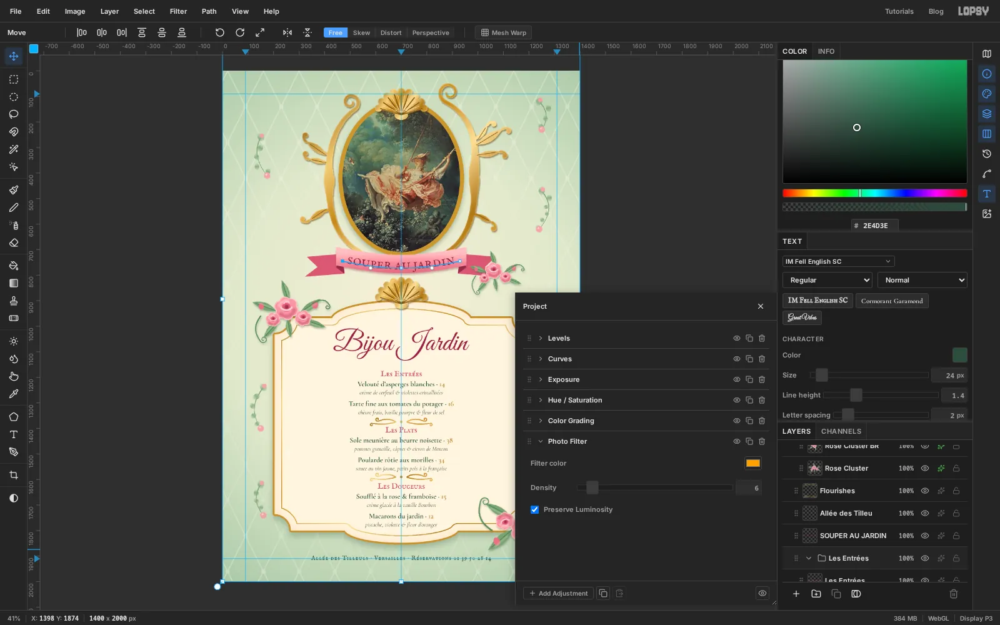

Choose **Layer → Adjustment Layer…**. Lopsy explains that adjustments live
on groups and opens the `Project` group's drawer. Click
**Add Adjustment → Photo Filter** and set **Density** to `6`.

Keep it low. At the default 25 the celadon turns to mustard. At 6 it just
warms the greens and creams together, like an old print.

## Check and export

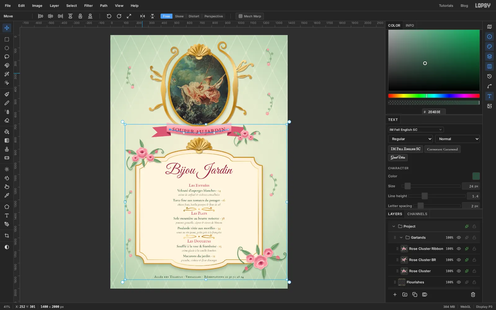

Hide the guides with **View → Show Guides** and look at the whole page:

- Is the title clear of the gold rule?
- Is the ribbon lettering centred in the band?
- Do the roses stay clear of the footer?

Choose **File → Quick Export PNG** for the finished menu, and
**File → Save Project** to keep the layered `.lopsy` file with the live
text, masks and effects.
