Before photography, a mineral was recorded by drawing it. Engraved plates in natural history books showed a specimen on its matrix, a few loose crystals beside it, a cross-section or two, and neat italic captions underneath. In this tutorial you'll paint one of those plates for two minerals that are chemically almost the same thing: **quartz**, where silica is locked into an ordered crystal, and **opal**, where it's stacked as tiny spheres that split light into colour.

The plate is 1600 × 2000 px and holds six figures: a quartz cluster, a polished black opal, a magnified view of the opal's spheres, a prism cross-section, a cut stone and a boulder opal. Nothing is imported. Every figure is built from selections, gradients, brush lines and filters.

Along the way you'll use:

- the **Lasso** with the **Gradient** tool to paint crystal faces one at a time
- **Duplicate Layer** with scale, rotate and flip to grow one crystal into a cluster
- **Filter → Texture**, **Dodge / Burn** and a hatched shadow for the rocks
- **Filter → Voronoi** and **Gaussian Blur** to turn brush dabs into opal fire
- duplicate, nudge and **Merge Down** to pack a lattice of spheres, and a **layer mask** to crop it
- the **Shape** tool's polygons, the **Magic Wand**, the brush's **Radial Symmetry** and the **Paint Bucket**
- copy and paste between layers, **groups**, the **grid**, and rotated text
- **Levels** and **Hue / Saturation** group adjustments
- text in **IM Fell English** and **IM Fell English SC**

The palette:

- Paper `#EBDDBD`, edge tone `#7A4E22`, foxing `#8B5A2B`
- Ink `#3A2A1C`
- Quartz `#F3F7F9` → `#C9D8E3` → `#8FA6BA` → `#4E667E` → `#34475C`
- Matrix rock `#93877A`, ironstone `#9A5A34`
- Opal body `#1E5468` → `#0E3144` → `#061620`
- Opal fire `#19C9A5` / `#35E06A` / `#FFD93C` / `#FF7A1F` / `#E0308A` / `#2C6BFF` / `#7B4DFF`
- Spheres `#F4FCFF` → `#A5D0DC` → `#2F6F86`, lens ground `#0C2A38`

> **Tip:** Positions are written as `x, y` in document pixels. The status bar at the bottom of the window shows where the pointer is. Key names are Mac keys: on Windows and Linux use Ctrl for Cmd. **Edit → Fill** fills the selection with the foreground colour, and [[Cmd+D]] deselects. A new layer appears just above the selected layer.

## Make the paper

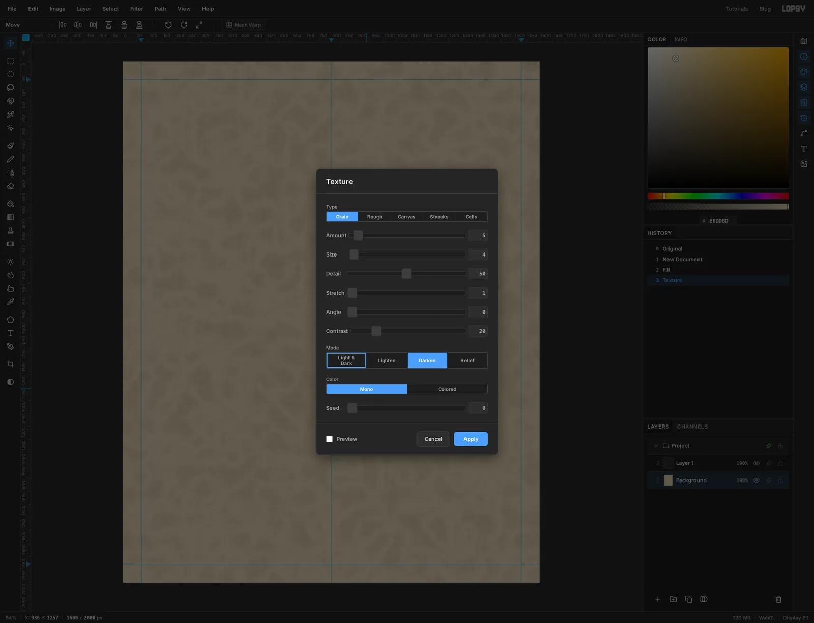

Choose **File → New**, set the size to **1600 × 2000** px and click **Create**. Click the top ruler at **70**, **800** and **1530**, and the left ruler at **70** and **1930**. These guides mark the border and the centre line.

Click the `Background` row, set the foreground colour to paper `#EBDDBD` and choose **Edit → Fill**.

Old paper is blotchy at a large scale and gritty at a small one, so texture it twice. Choose **Filter → Texture…**, click **Rough**, **Light & Dark** and **Mono**, and set **Amount** `5`, **Size** `90`, **Detail** `60` and **Contrast** `10`. Click **Apply**. Open the filter again, click **Grain** and **Darken**, set **Amount** `5`, **Size** `4`, **Detail** `50` and **Contrast** `20`, and apply it.

Keep both amounts low. It's easy to end up with camouflage instead of paper.

## Tone the edges

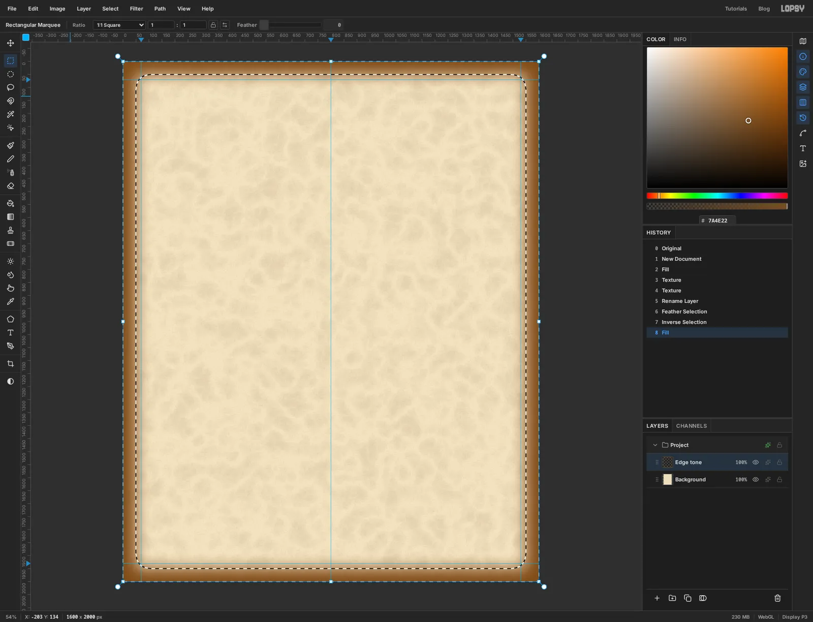

Rename `Layer 1` to `Edge tone`. Pick the **Rectangular Marquee** (**M**) and drag from about **50, 50** to **1550, 1950**, leaving an even margin. Choose **Select → Feather…**, type `60` and click **Apply**. Then choose **Select → Inverse** so only the margin is selected.

Fill it with `#7A4E22` and press [[Cmd+D]]. Open the layer's effects drawer (the sparkle icon on its row), set the blend mode to **Multiply**, close the drawer, then click the layer's opacity and lower it to about **38%**.

Add a new layer called `Foxing`. Pick the **Spray** tool, set **Size** `90`, **Density** `12`, **Opacity** `45` and **Softness** `60`, and with `#8B5A2B` make eight short scribbles scattered around the sheet. Set this layer to **Multiply** as well, at **60%**. These are the rusty freckles old paper gets.

## Rule the border

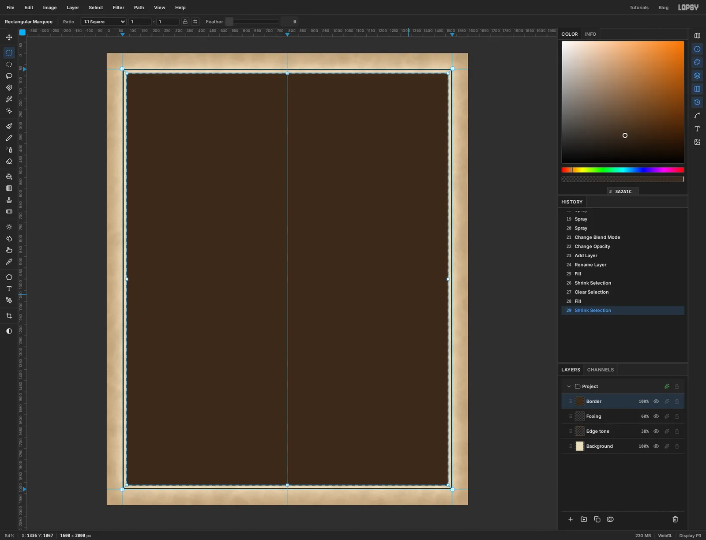

Add a layer called `Border` and set the foreground colour to ink `#3A2A1C`.

Drag a marquee from the top-left guide crossing to the bottom-right one. It snaps onto the guides. Fill it, choose **Select → Shrink…**, type `5` and apply, then press [[Delete]]. What's left is a 5 px frame. Deselect.

For the hairline inside it, drag a second marquee about 16 px inside the first (from **86, 86** to **1514, 1914**), fill it, shrink by `2` and press [[Delete]] again.

## Paint the first crystal face

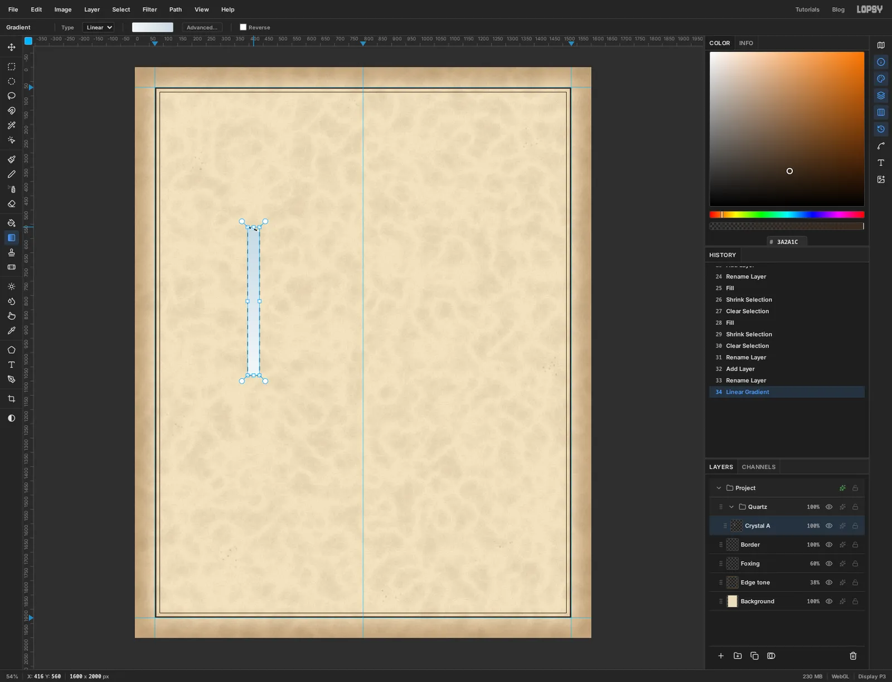

A quartz crystal is a six-sided column with a six-sided point. From the front you see three faces of the column and three of the point, so the whole crystal is six flat shapes, each with its own gradient. Light comes from the upper left: left faces are pale, right faces are dark.

Select the `Border` row, click **New Group** in the Layers panel and name it `Quartz`. Add a layer inside it called `Crystal A`.

Pick the **Lasso** and click-drag a four-cornered shape for the left face of the column: **395, 1080** → **437, 1080** → **437, 575** → **395, 560**. You don't need to click each corner: drag in a straight line from one to the next and let go back at the start.

Pick the **Gradient** tool, set it to **Linear** and open the gradient editor. Set the left stop to `#F3F7F9` and the right stop to `#C9D8E3`, and click **Done**. Drag from the bottom of the selection straight up to the top. The gradient only fills the selection.

> **Tip:** You'll edit gradient stops all through this tutorial. In the gradient editor, click a stop to select it and type its colour into the hex field. Click an empty spot on the bar to add a stop in between, and drag the picker's opacity slider down to make a stop partly or fully transparent.

## Paint the other five faces

Repeat for the rest. Lasso the shape, set the two stops, and drag from the bottom of the shape to its top each time, so the first colour listed ends up at the bottom. Let each face overlap its neighbour by a pixel or two. Later faces paint over earlier ones, and the ink lines will hide the joins.

- Centre face of the column: **437, 1080** → **505, 1080** → **505, 575** → **437, 575**, `#DCE6ED` at the bottom to `#8FA6BA` at the top
- Right face: **505, 1080** → **545, 1080** → **545, 560** → **505, 575**, `#9FB3C4` to `#4E667E`
- Left triangle of the point: **395, 560** → **437, 575** → **473, 410**, `#D5E0E8` to `#FFFFFF`
- Centre triangle: **437, 575** → **505, 575** → **473, 410**, `#7890A6` to `#B4C6D4`
- Right triangle: **505, 575** → **545, 560** → **473, 410**, `#34475C` to `#5F7890`

Press [[Cmd+D]] when the last one is done. The tip sits slightly right of centre, which stops the crystal looking like a pencil.

## Ink the crystal

Add a layer called `A detail` above `Crystal A`. Pick the **Brush** and set its **Hardness** to `100`.

1. **Growth lines.** Set **Size** `2`, **Opacity** `35` and the colour to `#34475C`. Click, then [[Shift]]-click to draw a dozen short horizontal lines across the three column faces at uneven heights. Real quartz has these fine striations across its prism.
2. **A reflection.** Lasso a slanted sliver across the centre face (around **440, 900** to **502, 800**), feather it by `6`, and drag a gradient along it that runs from white at about 55% opacity to fully transparent white. Deselect.
3. **The outline.** Set the brush to **Size** `3` and **Opacity** `100` in ink `#3A2A1C`. Click a corner and [[Shift]]-click the next to trace the outer silhouette. Drop to **Size** `2` and **Opacity** `70` for the inner edges between faces.
4. **A highlight.** In white at **Opacity** `85`, run a line just right of the left ridge, from the base up to the tip.

Choose **Layer → Merge Down** so the crystal is a single layer again. You're about to copy it.

## Duplicate, scale and rotate

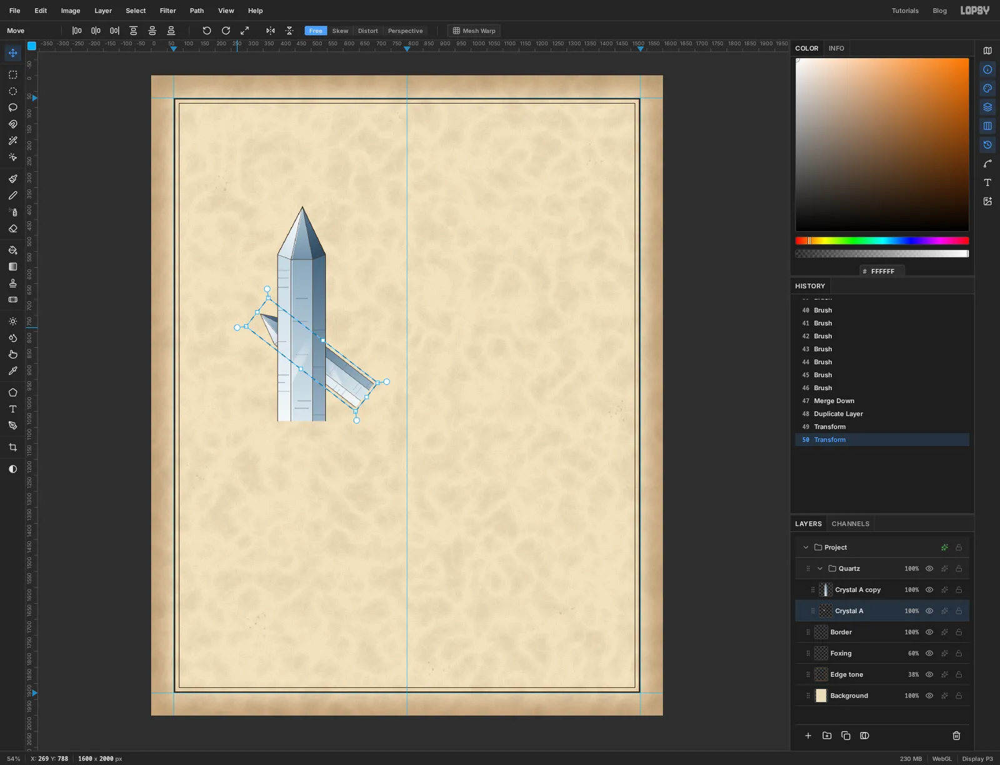

Select `Crystal A` and choose **Layer → Duplicate Layer**. The copy lands on top, so work on the **lower** one. That way each new crystal ends up behind the last.

Click the lower layer, drag a marquee around the whole crystal, and pick the **Move** tool. Hold [[Cmd]] and drag the top-left handle inwards until the crystal is about 60% of its size. Press [[Cmd+D]] to commit.

Marquee the smaller crystal again. Drag the round rotation handle just outside a corner to tilt it about 50° to the left, and commit with [[Cmd+D]]. Then drag the crystal so its base sits beside the big crystal's base.

Tidy the names before going on. Rename the tilted crystal `Crystal 1`, and rename the upright copy back to `Crystal A`. That upright one is your master: every later copy is made from it.

> **Tip:** Don't shrink a crystal below half size in one go. Thin ink lines break up when they're scaled down that far.

## Build the cluster

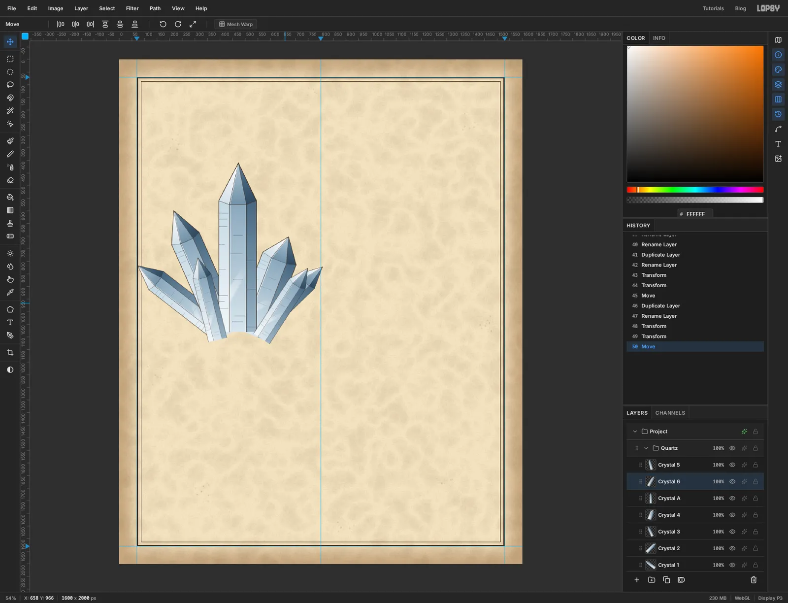

Do the same three more times. Duplicate `Crystal A`, transform the lower of the two layers, then rename it (`Crystal 2`, `Crystal 3`, `Crystal 4`) and rename the untouched copy back to `Crystal A`. Vary every one:

- about 55% size, tilted 45° right
- about 80% size, tilted 25° left
- squashed rather than scaled: drag the top-middle handle down, without [[Cmd]], to keep the width and lose a third of the height, tilted 20° right

Finish with two half-size copies (`Crystal 5` and `Crystal 6`) that stay **on top**. For these, transform the new copy instead of the layer underneath. Tilt them 15° left and 30° right and sit them low at the front. All the bases should meet in roughly one spot. It doesn't matter that they're ragged there, because the rock will cover them.

## Make a double-pointed crystal

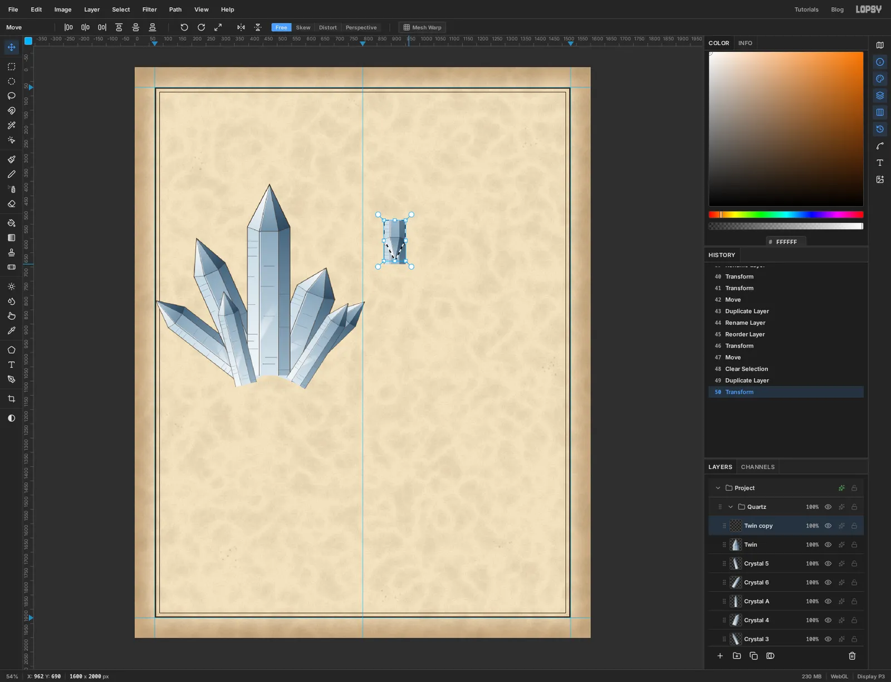

Plates often show a loose crystal beside the main specimen. Duplicate `Crystal A` once more, name the copy `Twin` and drag its row to the top of the group. Scale it to half size and move it to clear paper on the right.

Marquee the lower part of its column and press [[Delete]], leaving the point and a short length of column. Choose **Layer → Duplicate Layer**, marquee the copy, and with the **Move** tool click **Flip Vertical** in the options bar. Deselect, then press [[Shift+↓]] until the flipped half joins the first one end to end. **Merge Down**.

## Place the loose crystal

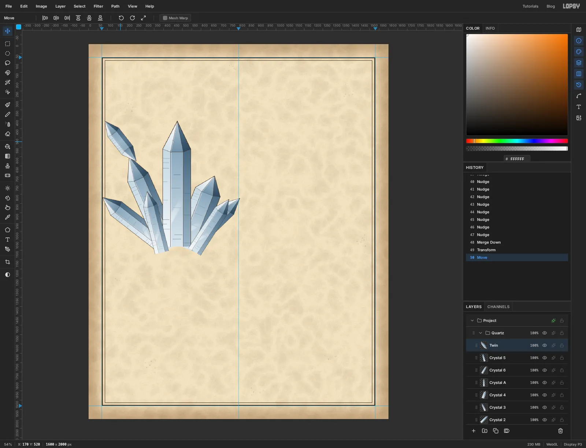

Marquee the joined crystal, rotate it about 40° to the left, commit, and drag it up to the left of the cluster, above the outermost crystal. Leave a clear gap so it reads as a separate specimen.

## Add the rock

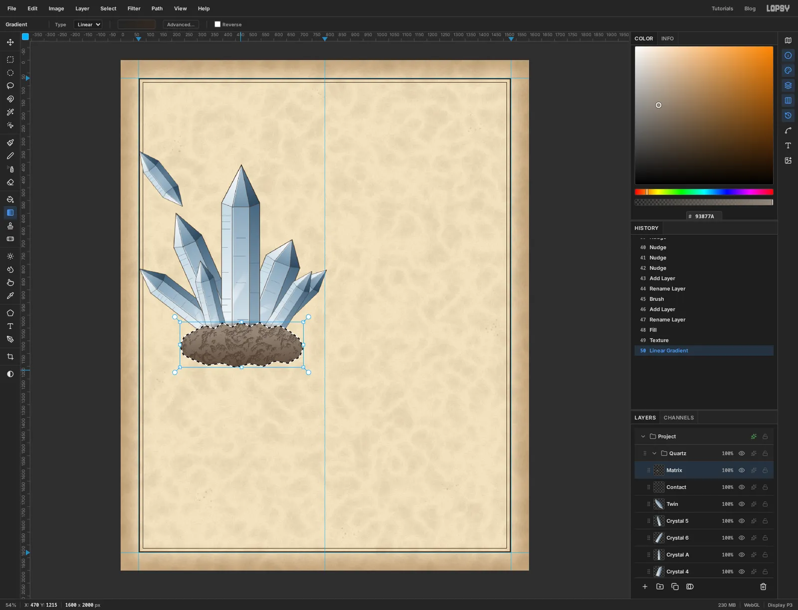

First seat the crystals. Add a layer called `Contact`, pick the **Brush** at **Size** `70`, **Hardness** `0`, **Opacity** `45`, and with a dark brown `#2A2018` make one soft stroke across the bases of the crystals. It reads as shadow where they sink into the rock.

Add a layer called `Matrix`. With the **Lasso**, draw a wide, lumpy rock that covers every crystal base: about 480 px wide and 170 px tall, with a jagged top edge. Fill it with `#93877A`.

Keep the selection and choose **Filter → Texture…**: **Rough**, **Relief**, **Mono**, **Amount** `30`, **Size** `44`, **Detail** `85`, **Contrast** `45`. Then, still inside the selection, drag a linear gradient from transparent `#3A2A1C` at the top to the same colour at about 70% opacity at the bottom to turn the underside away from the light.

## Dodge and burn the rock

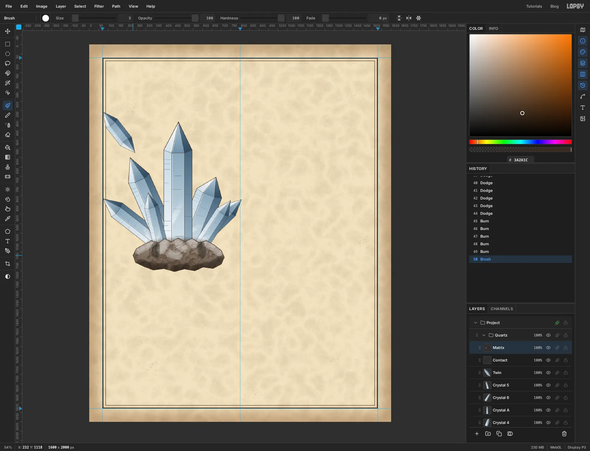

Pick the **Dodge / Burn** tool with **Size** `46` and **Exposure** `40`. It shares its size with the Brush, so the size you set here carries over. In **Dodge** mode make five or six short strokes on the tops of the bumps. Separate strokes matter: one long stroke gives you a stripe. Switch **Mode** to **Burn** and darken the underside and a couple of creases between bumps.

Deselect. Set the **Brush** back to **Size** `3`, **Hardness** `100` and **Opacity** `100`, and trace the rock's outline in ink.

## Move the whole group

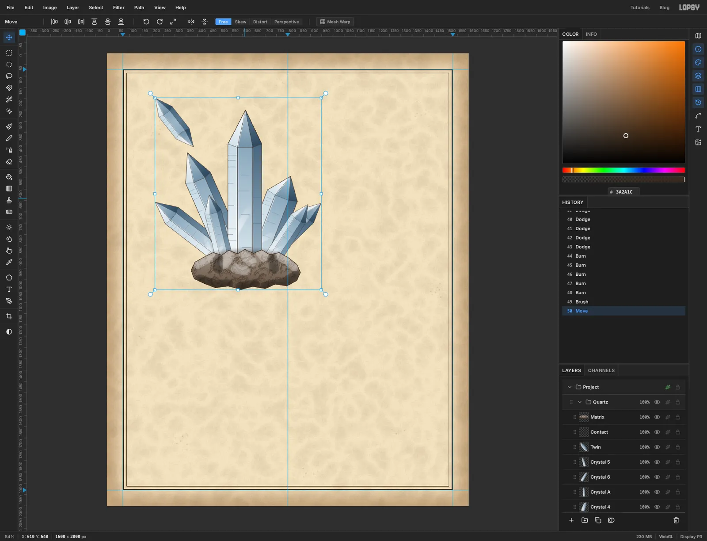

The cluster was built low on the sheet to leave room to work. Now it can go where it belongs. Click the `Quartz` group row and pick the **Move** tool. One box frames every layer in the group. Drag the cluster about 140 px right and 160 px up, until the tallest tip is near **613, 250**. Everything travels together.

## Hatch a shadow

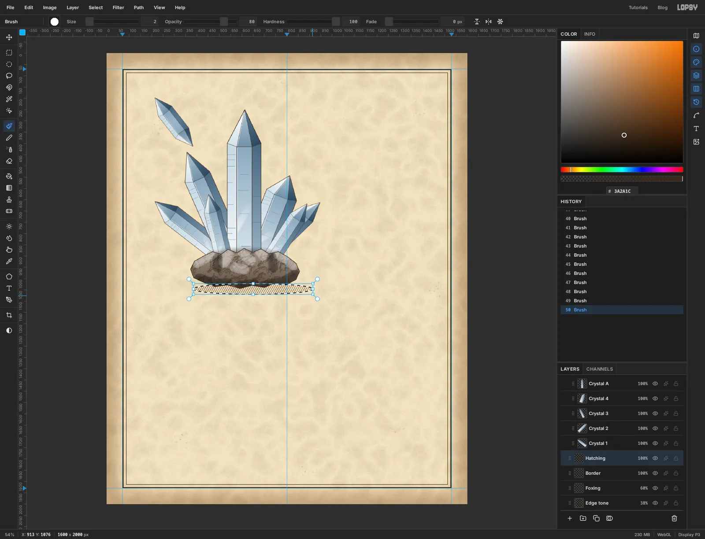

An engraver can't blur, so shadows are hatched. Select the `Border` row and add a layer called `Hatching`. It lands below the `Quartz` group.

With the **Elliptical Marquee**, drag a wide flat ellipse under the rock, a little to the right of centre. Pick the **Brush** at **Size** `2`, **Opacity** `80`, and [[Shift]]-click a row of parallel diagonal lines right across the ellipse, about 9 px apart. The selection trims them to an oval. Deselect.

## Start the opal

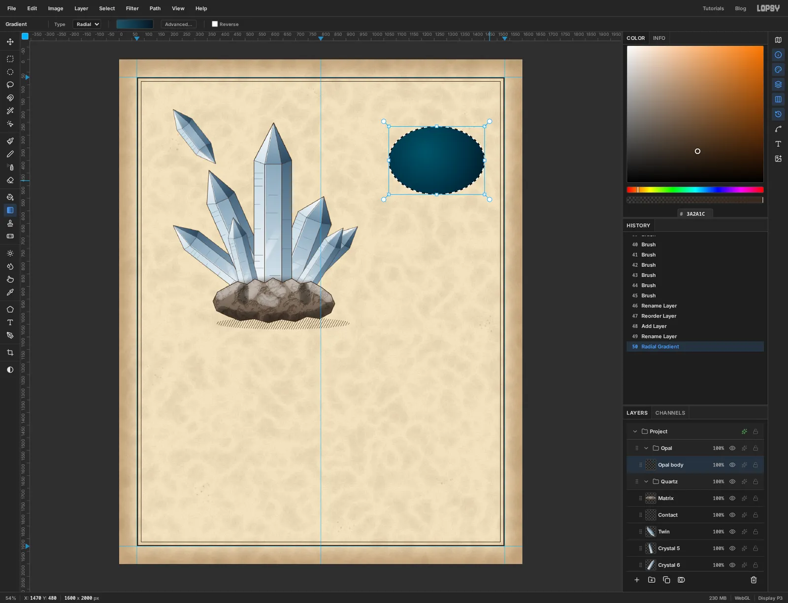

Select the `Quartz` group, click **New Group** and name it `Opal`. The new group appears *inside* `Quartz`, so drag its grip up above the `Quartz` row and a little to the left to pull it out to the top level. Do this for each new group in this tutorial.

Add a layer called `Opal body`. Pick the **Elliptical Marquee** and click once on the canvas without dragging. A small dialog asks for two corners, which is more accurate than dragging. Type **From** `1070, 265` **to** `1450, 535` and press [[Enter]]. Set the gradient to **Radial** with stops `#1E5468`, `#0E3144` at 60% and `#061620`, and drag from the upper left of the oval out past its lower right edge.

## Dab on the colours

Add a layer called `Fire`, keeping the oval selected. Pick the **Brush**: **Size** `44`, **Hardness** `0`, **Opacity** `100`.

Dab in short strokes, changing colour often: teal `#19C9A5`, green `#35E06A`, yellow `#FFD93C`, orange `#FF7A1F`, pink `#E0308A`, blue `#2C6BFF`, violet `#7B4DFF`. Two things make it look like opal rather than confetti. Keep neighbouring dabs in related colours, so the hues drift in bands across the stone. And leave gaps, so the dark body shows through.

## Crystallise the fire

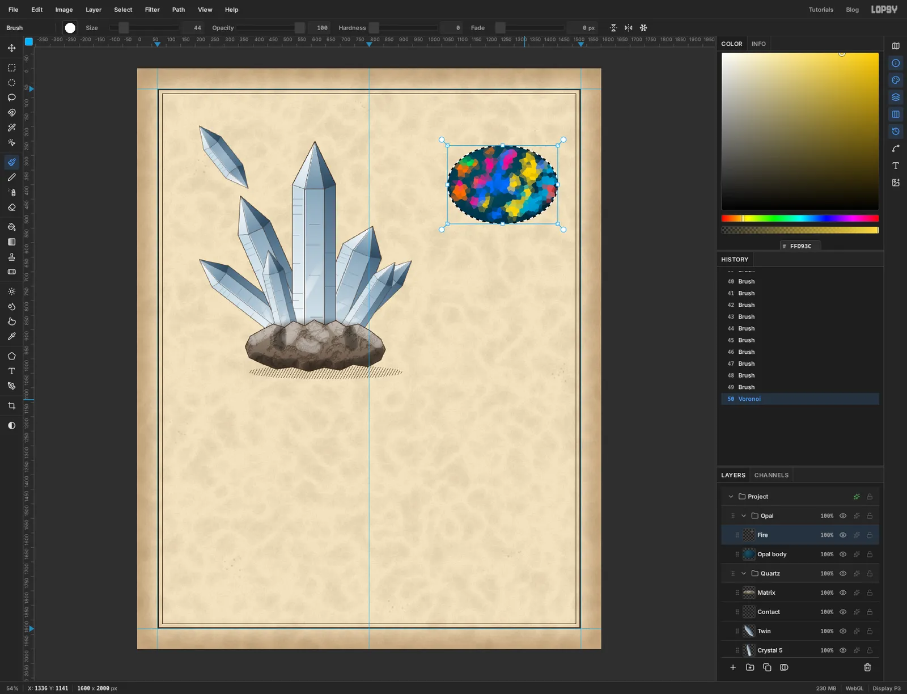

Choose **Filter → Voronoi…** and set **Cells** `150` and **Edge Width** `0`. Click **Apply**. The soft blobs break into angular patches, each one a flat colour, which is how an opal's flashes actually look.

Follow it with **Filter → Gaussian Blur…** at **Radius** `1.5` to soften the hard cell edges and clean up any stray specks. Deselect.

## Polish the stone

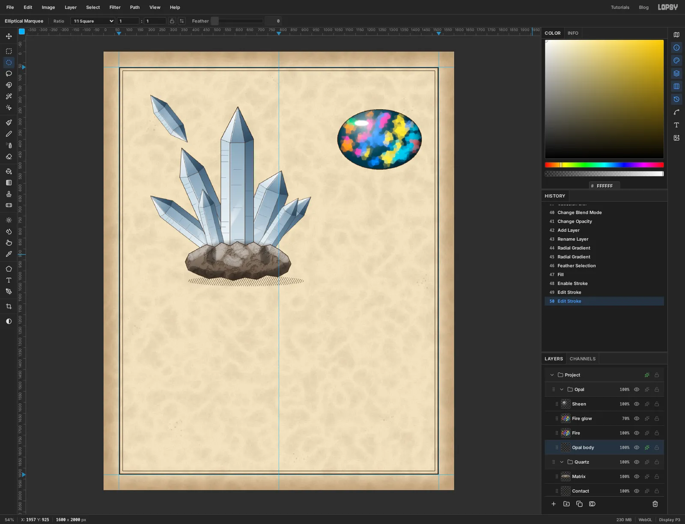

Four small things turn the flat oval into a polished stone.

First, a glow. Duplicate `Fire`, name the copy `Fire glow`, blur it with **Radius** `9`, and set it to **Screen** at **70%**.

Next, a sheen. Add a layer called `Sheen` and select the oval again with the same **From** and **to** values. Drag a radial gradient from white at 70% opacity to transparent, starting at the upper left and reaching about a third of the way across. Then build a second radial gradient with three stops, all `#061620`: fully transparent at the start, still transparent at 70%, and 80% opaque at the end. Drag it from the centre of the stone out to the edge. It only darkens the rim, and that dark rim is what makes the stone look domed. Deselect.

For the bright reflection, drag a small flat ellipse near the upper left, feather it by `4` and fill it white.

Last, open the effects drawer for `Opal body`, tick **Stroke**, and set **Width** `3` in ink.

## Paint one sphere

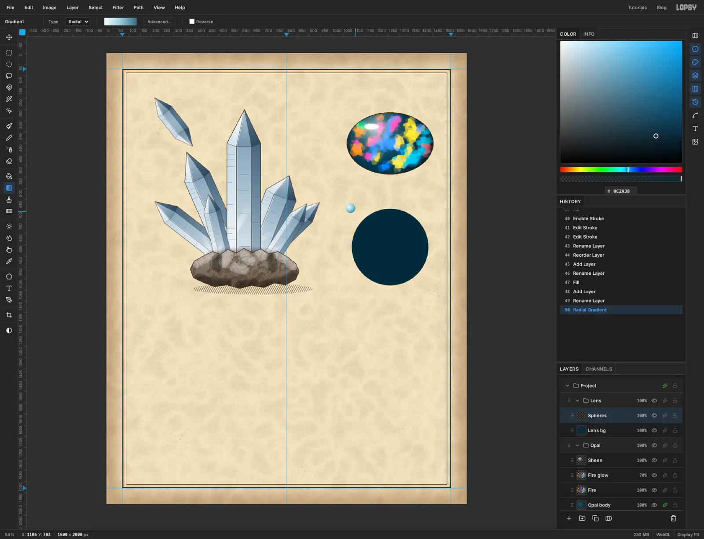

The colour in an opal comes from silica spheres stacked like oranges. Fig. 3 magnifies them.

Make a top-level group called `Lens`. Add a layer `Lens bg`. Click once with the **Elliptical Marquee**, type **From** `1090, 690` **to** `1430, 1030`, and fill the circle with `#0C2A38`.

Add a layer `Spheres`. The first sphere goes just outside the big circle, at the top-left corner of its bounding box, so the grid you build from it covers the whole lens. Deselect, click once with the marquee and type **From** `1063, 667` **to** `1105, 709`. Drag a **Radial** gradient across it from its upper left: `#F4FCFF`, `#A5D0DC` at 45%, `#2F6F86`.

## Pack the lattice by doubling

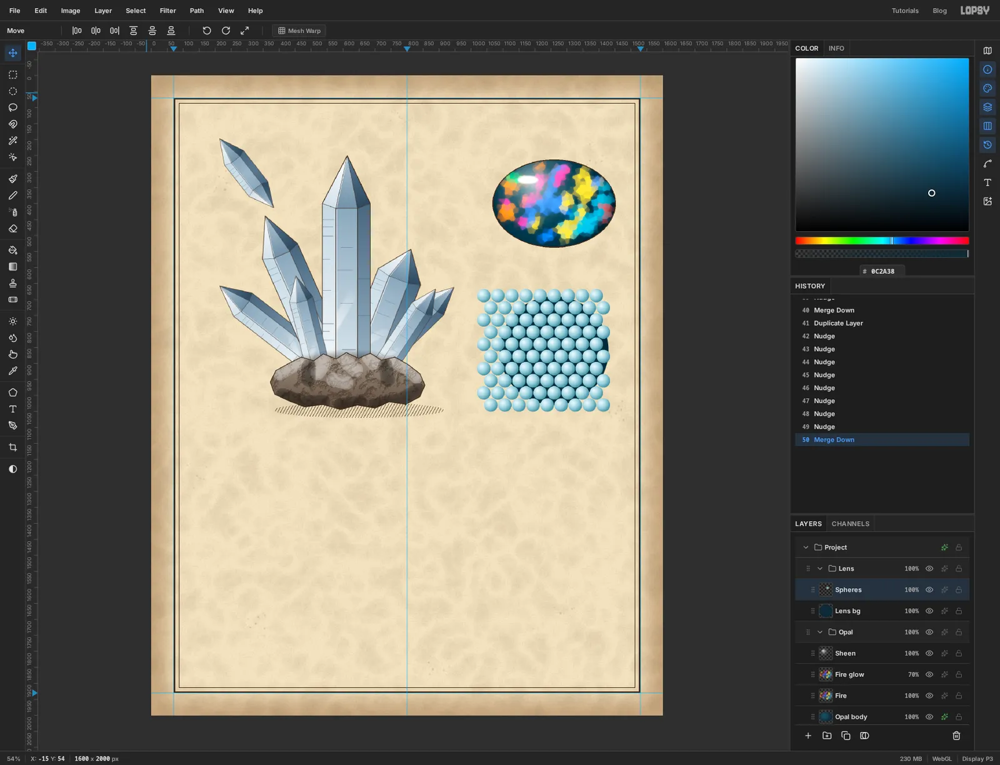

Nobody draws eighty spheres. Double them instead. Each round is the same three moves: **Layer → Duplicate Layer**, nudge the copy with the arrow keys ([[Shift]] moves 10 px), and **Layer → Merge Down**.

1. Nudge right `44`. Two spheres.
2. Nudge right `88`. Four.
3. Nudge right `176` (that's [[Shift+→]] seventeen times, then [[→]] six). A row of eight.
4. Nudge right `22` and down `38`. This is the offset row that makes the packing hexagonal. Two rows.
5. Nudge down `76`. Four rows.
6. Nudge down `152`. Eight rows.
7. Nudge down `76` to add rows at the bottom.
8. Nudge left `44` to add a column on the left.

The grid spills past the circle. That's what you want.

## Crop it with a mask

With `Spheres` active, click once with the **Elliptical Marquee** and type **From** `1096, 696` **to** `1424, 1024`. That's the lens circle, 6 px smaller all round. Click **Add Mask** in the Layers panel. Everything outside the selection is hidden. Click the layer's row to leave mask editing.

Open the effects drawer for `Lens bg` and add a **Stroke**: **Width** `6`, ink.

## Split the light

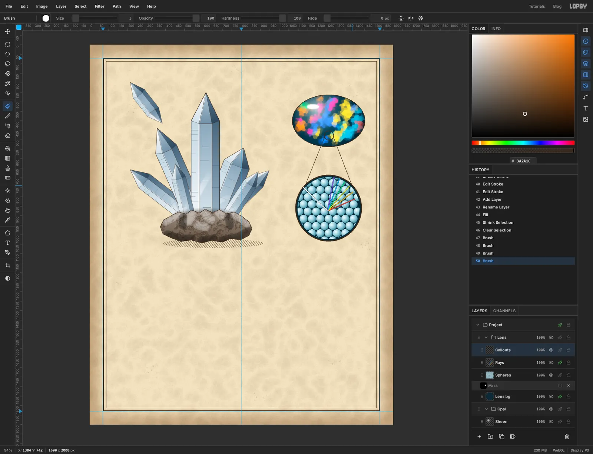

Add a layer `Rays`. With the **Brush** at **Size** `6`, **Hardness** `100` and **Opacity** `100`, [[Shift]]-click a white line from the upper left of the lens to a point just below its centre. Drop to **Size** `5` and draw six rays from that point fanning to the upper right, in red `#FF4D3D`, orange `#FFB02E`, yellow `#F7F052`, green `#4BE08A`, blue `#33B5FF` and violet `#8A5BFF`. Give the layer a 1 px **Stroke** in `#0C2A38` so the rays hold against the pale spheres.

Add a layer `Callouts`. Select a 52 px circle on the lower part of the opal, fill it with ink, shrink the selection by `3` and delete. Then, with a **Size** `3` brush, draw two straight lines from the sides of that ring down to the upper edge of the lens.

## Draw the cross-section

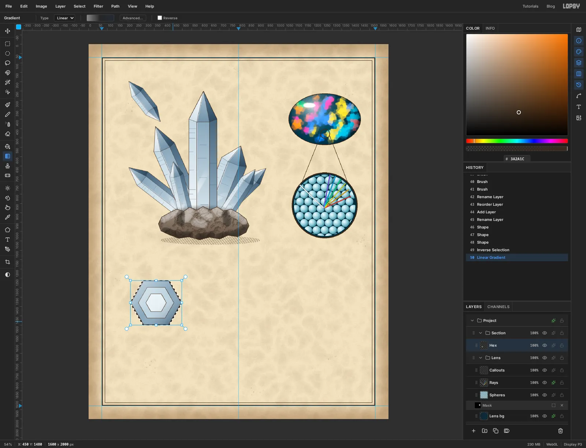

Make a top-level group `Section` and add a layer `Hex`. Pick the **Shape** tool, set **Shape** to **Polygon** and **Sides** to `6`. Click **Stroke** to add one, set it to ink and **Width** `4`. Set the fill to `#8FA6BA`.

The Shape tool draws from the centre outwards. Hold [[Cmd]] and drag from **360, 1380** to **495, 1515** for a regular hexagon. Change **Width** to `2` and draw two smaller ones from the same centre: `#C3D3DF` out to **455, 1475**, and `#EAF1F5` out to **415, 1435**. These are growth zones.

To shade it, pick the **Magic Wand**, click the empty area outside the hexagon and choose **Select → Inverse**. Drag a linear gradient across it from upper left to lower right: white at 45% opacity, transparent in the middle, `#22344A` at 45% at the end. Deselect.

On a new layer `Axes`, draw three dashed lines through the centre at 0°, 60° and 120° with short [[Shift]]-click strokes, and put a small ink dot in the middle.

## Draw facets with radial symmetry

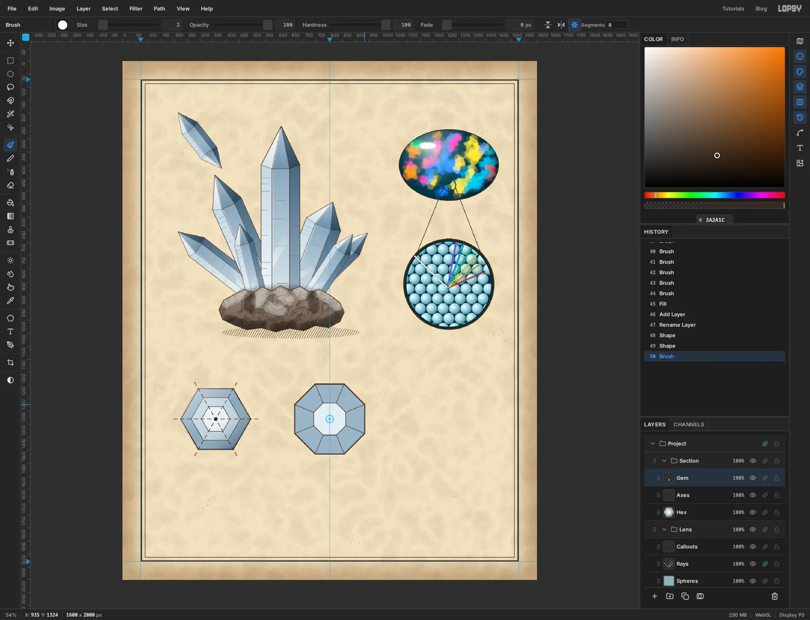

Add a layer `Gem`. With the **Shape** tool, set **Sides** to `8`, **Width** `4`, fill `#9FB3C4`, and [[Cmd]]-drag from **800, 1380** to **935, 1515**. Draw the inner table at **Width** `2`, fill `#E4EDF3`, out to **862, 1442**.

Pick the **Brush** at **Size** `2` in ink and click **Radial Symmetry** in the options bar. It defaults to 8 segments. [[Cmd]]-click the centre of the octagon to move the symmetry centre there.

Now drag one line from a corner of the inner octagon to the matching corner of the outer one. Eight spokes appear. Drag two more from that same inner corner to the midpoints of the two nearest outer sides, and the whole star of facets is done. Click **Radial Symmetry** again to turn it off.

## Fill and shade the cut stone

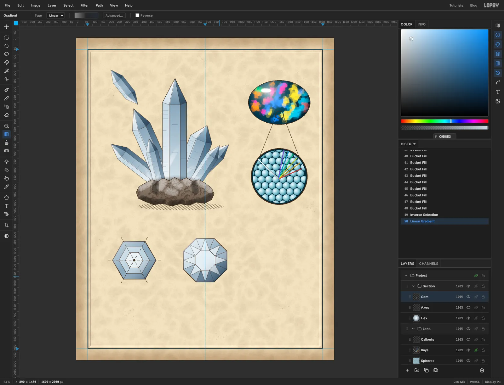

Pick the **Paint Bucket**. With `#DCE6ED`, click each of the eight triangles around the table. With `#5F7890`, click five facets along the lower right rim, and with `#C9D8E3` five along the upper left.

Then shade it exactly like the hexagon: **Magic Wand** outside, **Select → Inverse**, and the same white-to-navy gradient dragged from upper left to lower right.

## Shape the ironstone

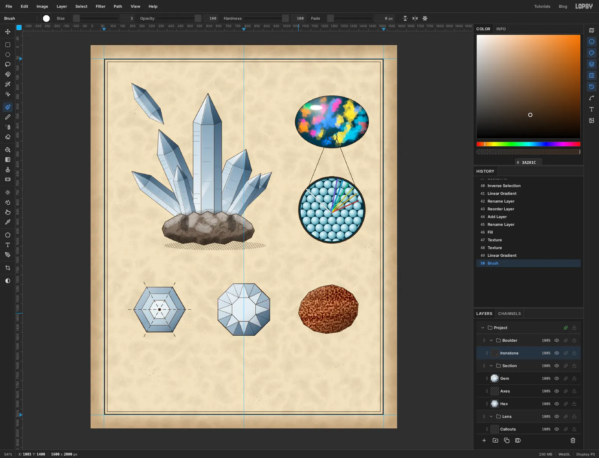

Make a top-level group `Boulder` and a layer `Ironstone`. Lasso a rounded lump about 310 px wide centred on **1240, 1380** and fill it with `#9A5A34`.

This rock should look different from the grey one, so use different textures. Run **Filter → Texture…** with **Grain**, **Light & Dark**, **Mono**, **Amount** `40`, **Size** `9`, **Detail** `90` and **Contrast** `40`. Run it again with **Streaks**, **Darken**, **Amount** `22`, **Size** `60`, **Detail** `60` and **Contrast** `30`. Shade it with a diagonal gradient, from a warm highlight `#FFE2B8` at 40% through transparent to `#2A140A` at 75%. Deselect and ink the outline.

## Paste in a seam of opal

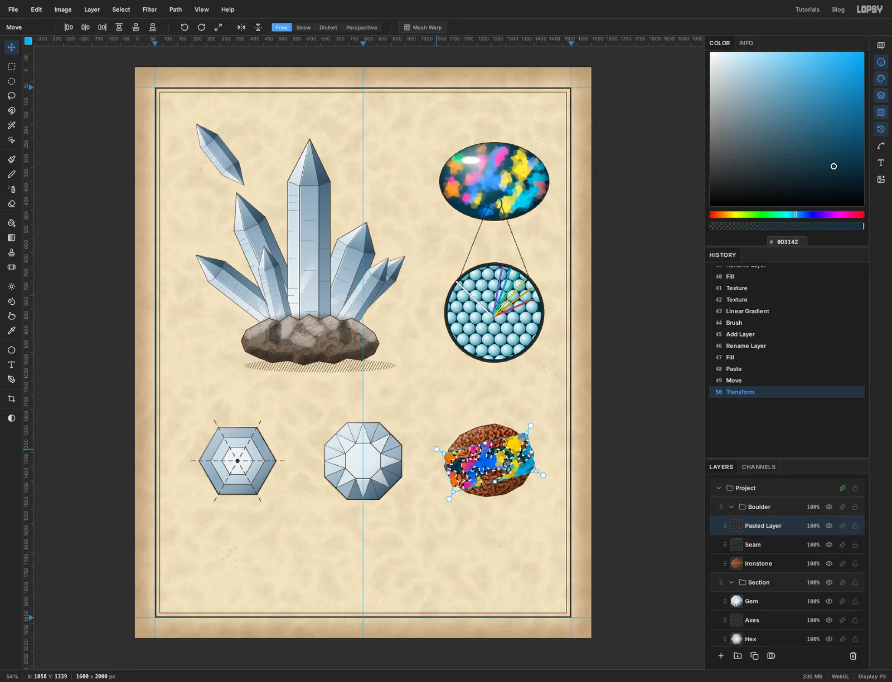

Add a layer `Seam`. Lasso a jagged band running across the rock from lower left to upper right and fill it with the opal body's `#0E3144`. Deselect.

You already painted opal fire once. Click the `Fire` layer, drag a marquee across the middle of the opal and press [[Cmd+C]]. Click `Seam` and press [[Cmd+V]]. The copy arrives in place, selected, with the **Move** tool active. Drag it down onto the rock and turn it about 15° anticlockwise with the rotation handle so the colours run along the seam. Press [[Cmd+D]].

## Trim the seam

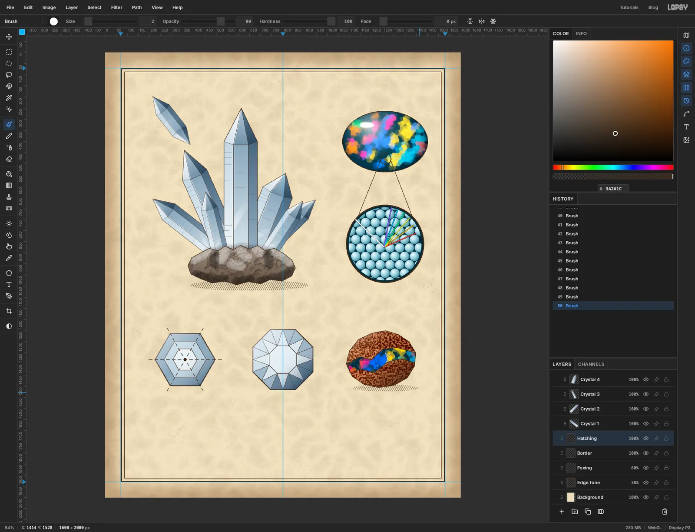

Rename the pasted layer `Seam fire`. To get the seam's shape back, click the `Seam` layer, pick the **Magic Wand** and click the dark fill. Click `Seam fire` again, choose **Select → Inverse** and press [[Delete]]. Only the fire inside the seam is left.

Add a layer `Seam ink`, trace the seam's edge in ink, and add four small white dabs for glints. Then go back to the `Hatching` layer and hatch a small shadow under this rock the same way as before.

## Set the title

Make a top-level group `Lettering`. Pick the **Text** tool, click near the lower left of the sheet around **y = 1640**, choose **IM Fell English SC** at **Size** `120`, and type `OPAL & QUARTZ` in ink. Press [[Tab]] to commit. With the **Move** tool, click **Align center horizontally**.

## Add the captions

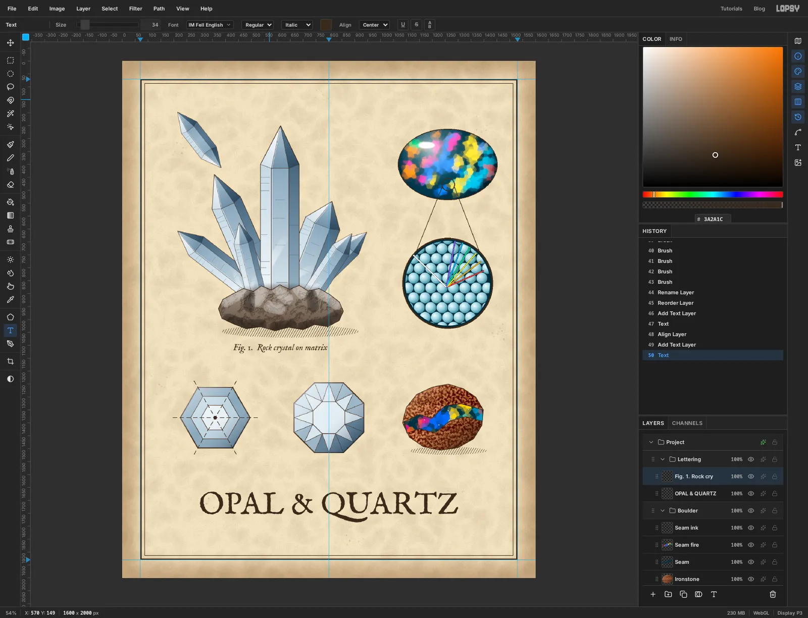

The captions are in **IM Fell English**, **Italic**, **Size** `34`, **Align** **Center**. With centre alignment the text grows both ways from where you click, so click directly under the middle of each figure:

- under the cluster: `Fig. 1. Rock crystal on matrix`
- above the opal: `Fig. 2. Precious opal`
- under the lens, level with the first caption: `Fig. 3. Its silica spheres, magnified`
- under the bottom three: `Fig. 4. Prism in section`, `Fig. 5. Quartz, brilliant cut`, `Fig. 6. Boulder opal`

Add `MINERALOGY` at the top left and `PLATE XVII` (right-aligned) at the top right in the small caps face at **Size** `34`, each about 45 px in from the border. Under the title, add `Two Forms of Silica` in italic at **Size** `46`.

> **Tip:** A click with the Text tool inside an existing text layer's box edits that text instead of starting a new one. If a new label has to sit close to another, click in clear paper nearby and nudge it into place afterwards.

## Snap a scale bar to the grid

Add a layer `Scale bar`. Choose **View → Show Grid**, which also turns snapping on. The grid is 16 px unless you've changed it in the options bar. Drag a thin marquee under the Fig. 1 caption, roughly from **499, 1150** to **733, 1161**. The ends jump to the nearest grid lines, giving a bar exactly 240 px long. Fill it with ink.

Split it into five: marquee the second 48 px segment, shrink the selection by `2` and delete to hollow it out, and do the same to the fourth. Hide the grid again with **View → Show Grid**.

Add a small italic `5 cm` at **Size** `30` just right of the bar. Click below the caption to create it, then nudge it up.

## Label the c-axis

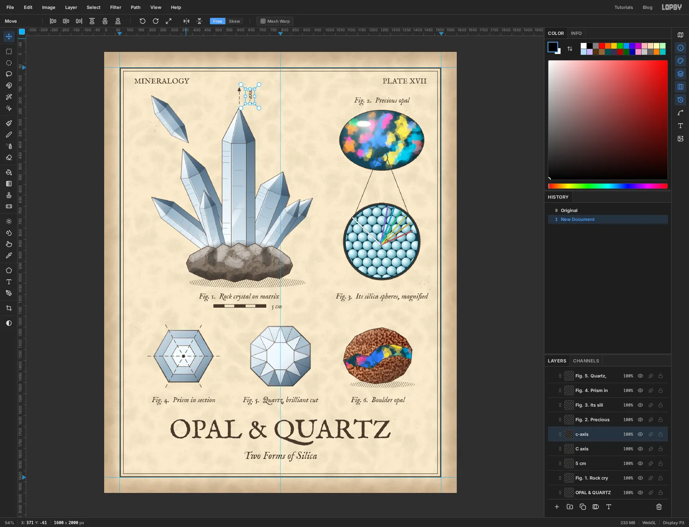

On a new layer `C axis`, take the **Brush** at **Size** `3` in ink and draw three short dashes straight up from the tallest crystal's tip. Lasso a small triangle on top for an arrowhead and fill it.

Type `c-axis` in italic at **Size** `30` in clear paper. With the **Move** tool, hold [[Cmd]] and drag the text's rotation handle: it snaps in 15° steps, so stopping at exactly 90° anticlockwise is easy. Drag the label up beside the arrow. The text stays editable after rotating.

## Fade it like an old print

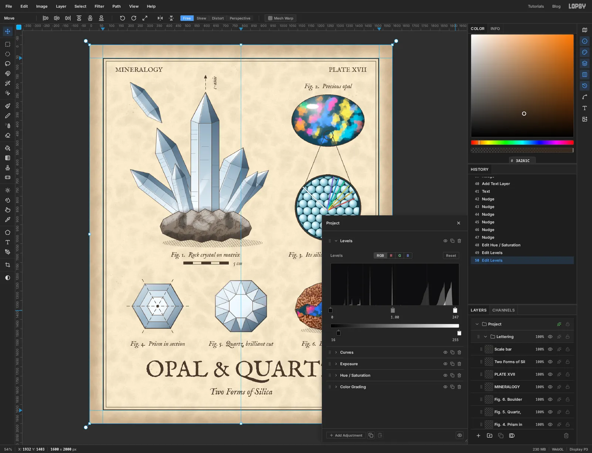

Click the `Project` row at the top of the Layers panel and choose **Layer → Adjustment Layer…**. Lopsy keeps adjustments on groups instead of on separate layers, and a note explains this the first time: click **Got it**. The drawer lists the adjustments for the whole project.

Expand **Hue / Saturation** and set **Saturation** to `-10`. Expand **Levels**, drag the **output black** handle right to `16` and the **input white** handle left to about `247`. Raising the black point turns the ink a faded brown-black, and pulling in the white point brightens the paper.

Close the drawer, untick **View → Show Guides**, and choose **File → Quick Export PNG**.
