Tucson, Arizona gets about 11.6 inches of rain a year, and about half of it falls in the three monsoon months, July to September. The rest of the year is mostly sunshine. In this tutorial you'll draw that year as a honeycomb clock: a sun cell in the middle, six solar panels around it, and twelve garden beds in the outer ring, one per month, each filled with water up to that month's rainfall.

The finished poster is 1600 × 2400 px. It carries two sets of numbers:

- **Rain.** Each month cell is 216 px tall and stands for 2.5 inches when full, so the water line sits at `rain ÷ 2.5 × 216` px above the bottom of the cell.
- **Sunshine.** One gold dot is 50 hours of sunshine in that month, and the month's total is printed at the end of the row.

Read it like a clock. January is at one o'clock, June is at the bottom and December is at the top.

Along the way you'll use:

- **guides** dropped on exact fractions of the canvas, and the **Shape** tool snapping to them
- the **Magic Wand** with a **Rectangular Marquee** in intersect mode, and **Edit → Fill**
- copy and paste, and selections loaded from layer thumbnails
- the **Brush** with **Radial Symmetry**, the **Lasso**, and [[Shift]]-click straight lines
- **Image → Canvas Size** with an anchor
- **Filter → Clouds** and **Voronoi**, radial gradients, and the **Soft Light** and **Overlay** blend modes
- the **Stroke**, **Drop Shadow**, **Outer Glow** and **Inner Glow** effects, with **Copy effects** and **Paste effects**
- text in **Federo** and **Jost**, including text you rotate while it stays editable
- the **Pen** tool and **Path to Selection**
- scaling, rotating and moving a selection, and scaling a whole **group**

The palette:

- Emerald `#2F8F72` → `#1A6654` → `#0C3A33` (the backdrop)
- Sand `#F1E3B4`, water `#4FC4BE`, ink `#0E2F26`
- Brass `#D9A441`, cream `#FBF3D5`
- Sun `#FFF6C2` → `#FFE98A` → `#F29F05`
- Sunshine gold `#FFD34E`
- Panel `#2C4270`, panel lines `#9CC4EC`
- Agave `#17594C` → `#2F8E78` → `#A9E3BC`
- Prickly pear `#9AD48C` → `#4FA567` → `#256B49`, fruit `#E24A80`

> **Tip:** Positions are written as `x, y` in document pixels. The status bar at the bottom of the window shows where the cursor is, so you can hover to find a spot. A few pixels either way won't show. Key names are Mac keys. On Windows and Linux use Ctrl for Cmd, except where a step says otherwise.

## Drop guides on a honeycomb lattice

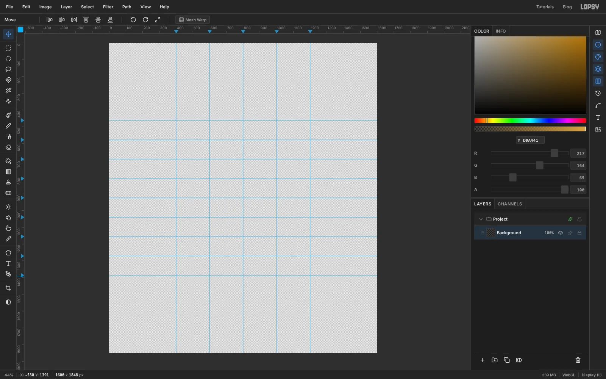

Choose **File → New**, set the size to **1600 × 1848** px, pick a **Transparent** background and click **Create**. The odd height is the trick that makes this poster easy. On a canvas that is 2 ÷ √3 times as tall as it is wide, guides placed on sixteenths of the width and height cross exactly where the cells of a honeycomb have their centres.

Guides come from the rulers. Hold [[Cmd]] and move the pointer over the top ruler: the preview jumps between fractions of the width and a small label names each one. Click at **1/4**, **3/8**, **1/2**, **5/8** and **3/4**. That gives vertical guides at 400, 600, 800, 1000 and 1200.

Do the same on the left ruler for every sixteenth from **1/4** to **3/4**: 1/4, 5/16, 3/8, 7/16, 1/2, 9/16, 5/8, 11/16 and 3/4. Those nine horizontal guides are 115.5 px apart.

If you click the wrong fraction, click the same spot on the ruler again to remove the guide.

## Draw the sun cell

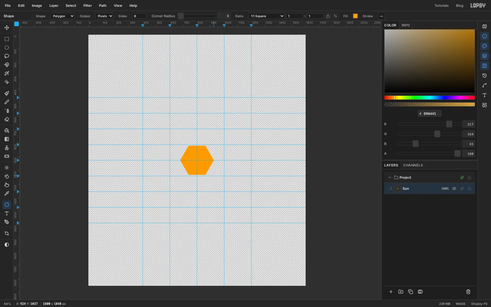

Double-click the `Background` layer's name and rename it `Sun`.

Pick the **Shape** tool. In the options bar set **Shape** to **Polygon**, **Sides** to **6** and **Corner Radius** to **8**. Click the **Fill** swatch and type `#F29F05` into the hex field.

A shape grows outward from the point where you press, and both ends of the drag snap to guides. Press on the centre crossing at **800, 924** and drag down and right to **924, 1037**. The start snaps to the crossing and the bottom of the drag box snaps to the next guide down, so only the sideways distance is up to you: watch the status bar and let go when x reads 924. The hexagon is fitted inside the box by its width, and comes out about 246 px wide and 216 px tall with flat sides at the top and bottom.

You'll make every cell with this same drag, so try it a couple of times and press [[Cmd+Z]] until it feels natural.

## Ring it with six panels

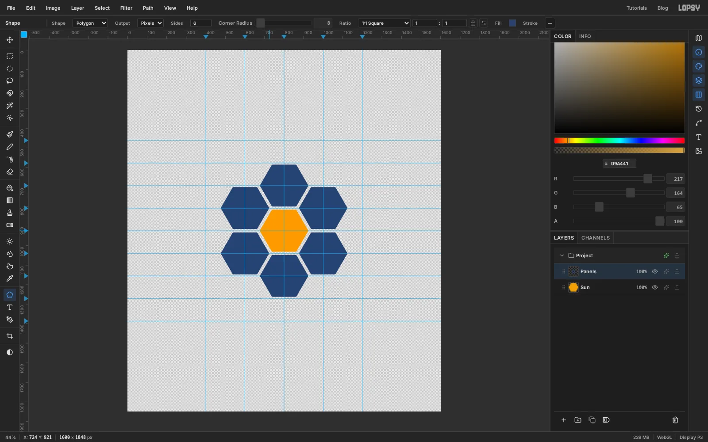

Click **Add Layer** and name it `Panels`. With the Shape tool, change the fill to `#2C4270`.

Draw six more hexagons with the same drag, each starting on the guide crossing next to the sun cell:

1. **800, 693** (above)
2. **1000, 809** (upper right)
3. **1000, 1040** (lower right)
4. **800, 1155** (below)
5. **600, 1040** (lower left)
6. **600, 809** (upper left)

Each drag goes 124 px right and about 113 px down from its start. Keep the 124 the same every time, because it sets the size of the cell. Every hexagon starts on a guide crossing, so the gaps between them come out even without measuring.

## Add the twelve month cells

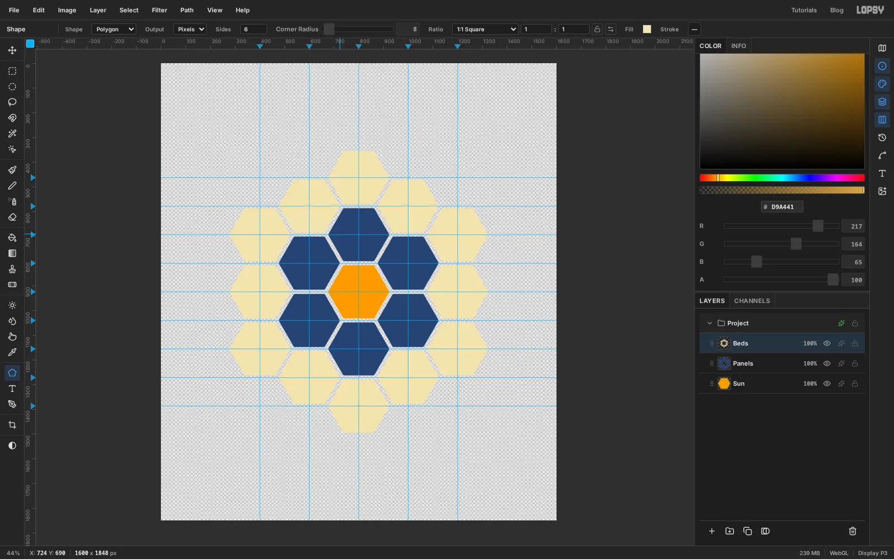

Click **Add Layer**, name it `Beds`, and change the Shape fill to sand `#F1E3B4`. Draw twelve hexagons on the crossings one ring further out. Going clockwise from the top:

1. **800, 462** (December)
2. **1000, 578** (January)
3. **1200, 693** (February)
4. **1200, 924** (March)
5. **1200, 1155** (April)
6. **1000, 1271** (May)
7. **800, 1386** (June)
8. **600, 1271** (July)
9. **400, 1155** (August)
10. **400, 924** (September)
11. **400, 693** (October)
12. **600, 578** (November)

Nineteen cells make a honeycomb two rings deep, and the outer ring has exactly twelve of them, which is why it works as a calendar.

## Select one month cell with the Magic Wand

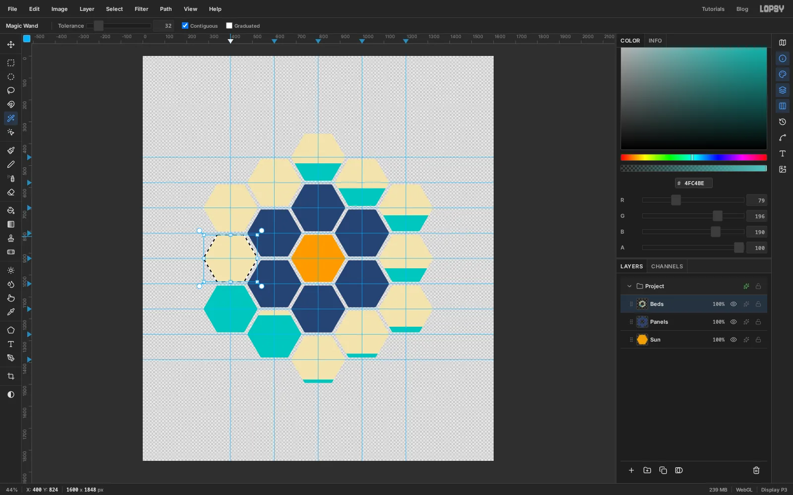

The water goes in one cell at a time. Each one takes three moves: select the cell, cut the selection down to the part below the water line, and fill it.

First choose **View → Snap to Guides** to turn snapping off. The water lines need to land where the numbers put them, not on the nearest guide.

You can fill the cells in any order. The screenshots here show September, the cell centred on **400, 924**, part-way through the job with other cells already done.

Keep the `Beds` layer active and pick the **Magic Wand**. Leave **Tolerance** at 32 and **Contiguous** ticked. Click inside the cell. The wand selects that hexagon and nothing else, because the gaps around it are transparent.

## Cut the selection down to the water line

Pick the **Rectangular Marquee**. Hold [[Shift+Option]] and drag a box that starts to the left of the cell at the height of the water line and ends below and to the right of the cell. For September, drag from about **265, 921** to **535, 1050**.

Holding both keys keeps only the part of the old selection that falls inside the new box. What's left is a hexagon with its top sliced off flat: the shape of the water.

Set the foreground colour to water `#4FC4BE` and choose **Edit → Fill**.

## Fill all twelve cells

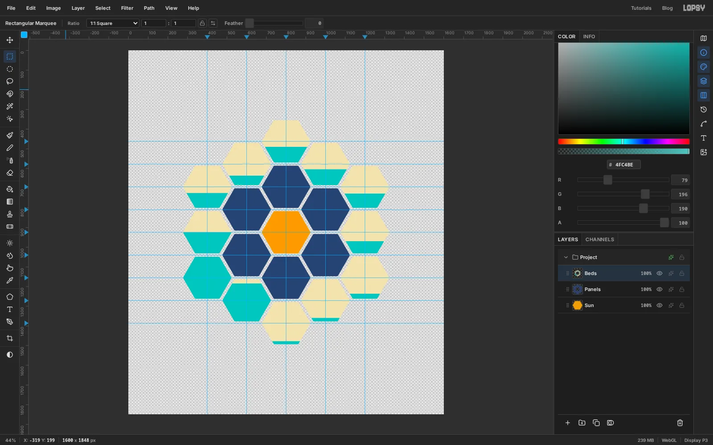

Repeat the three moves for every month: wand, [[Shift+Option]]-drag, **Edit → Fill**. Only the height of the marquee's top edge changes. These are the water lines, with the cell centres for reference:

1. Jan, 0.94 in: cell at 1000, 578, water line at **y 605**
2. Feb, 0.86 in: cell at 1200, 693, water line at **y 727**
3. Mar, 0.73 in: cell at 1200, 924, water line at **y 969**
4. Apr, 0.31 in: cell at 1200, 1155, water line at **y 1236**
5. May, 0.23 in: cell at 1000, 1271, water line at **y 1359**
6. Jun, 0.20 in: cell at 800, 1386, water line at **y 1477**
7. Jul, 2.25 in: cell at 600, 1271, water line at **y 1185**
8. Aug, 2.39 in: cell at 400, 1155, water line at **y 1057**
9. Sep, 1.29 in: cell at 400, 924, water line at **y 921**
10. Oct, 0.89 in: cell at 400, 693, water line at **y 724**
11. Nov, 0.57 in: cell at 600, 578, water line at **y 637**
12. Dec, 0.93 in: cell at 800, 462, water line at **y 490**

Click the wand near the top of each cell so it lands on sand. Press [[Cmd+D]] when the last cell is filled.

> **Tip:** The marquee box can be as wide and as deep as you like. Only its top edge matters, because the wand selection already ends at the cell's sides and bottom.

## Copy the water to its own layer

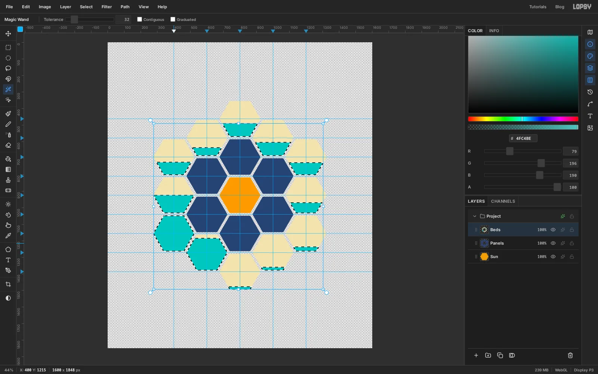

The water is easier to work with on its own layer. With the Magic Wand still active, untick **Contiguous** and click any patch of water. Now every pixel of that colour is selected, in all twelve cells.

Press [[Cmd+C]] and then [[Cmd+V]]. The copy lands in the same place on a new layer called `Pasted Layer`. Rename it `Water`, press [[Cmd+D]], and tick **Contiguous** again so the wand is back to normal for later.

## Stamp sunshine dots with radial symmetry

Click **Add Layer** and name it `Sunshine`. Set the foreground colour to gold `#FFD34E`. Pick the **Brush**, set **Size** to **21** and **Hardness** to **100**.

In the options bar click **Radial Symmetry** and set **Segments** to **6**. A crosshair appears at the centre of the canvas, which is also the centre of the honeycomb. Every dab you paint is now repeated six times around it.

Click once above the December cell at **800, 309**. Six dots appear, one beyond every second month. Click seven more times straight up, 27 px apart: at y **282**, **255**, **228**, **201**, **174**, **147** and **120**.

## Add the second set of rows

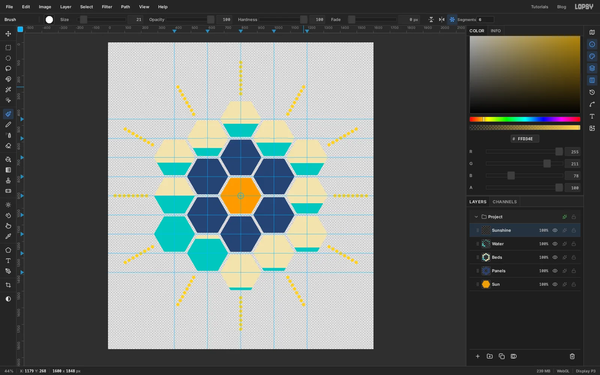

The other six months sit a little closer to the centre, so their rows start closer too. Click at **1084, 432**, just beyond the outer corner of the January cell, then seven more times along the same line, moving about 13 px right and 23 px up each time. The last dot should land near **1178, 268**. The rows on the other five corners follow by themselves.

Now there are twelve rows of eight. Click **Radial Symmetry** again to turn it off before you go on.

## Trim each row to its month

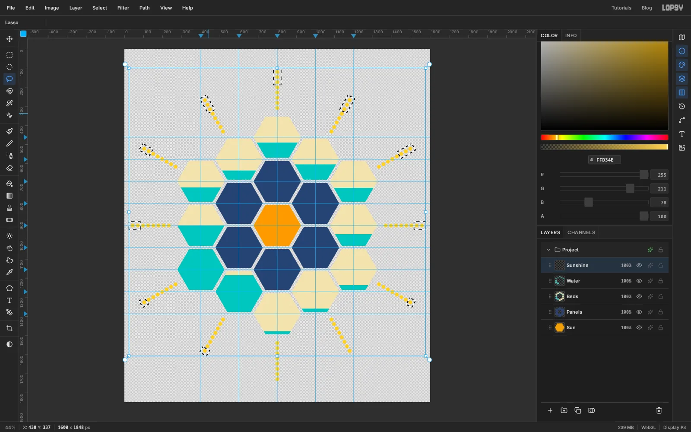

One dot is 50 hours of sunshine. Only May and June need all eight, so the other rows lose their outer dots:

1. Dec, Jan, Feb and Nov keep **5** dots, so they lose three
2. Mar, Sep and Oct keep **6** and lose two
3. Apr, Jul and Aug keep **7** and lose one
4. May and Jun keep all **8**

There are no labels yet, so count round the clock: December is the row at the top, January the next one clockwise, and so on. Going clockwise from the top, the number of dots to remove is 3, 3, 3, 2, 1, 0, 0, 1, 1, 2, 2, 3.

Pick the **Lasso** and draw a loop around the surplus dots at the outer end of the December row. Hold [[Shift]] and loop the surplus dots of the next row, and carry on round. Each loop is added to the selection. When all ten rows are marked, press [[Delete]], then [[Cmd+D]].

## Extend the canvas for the title and key

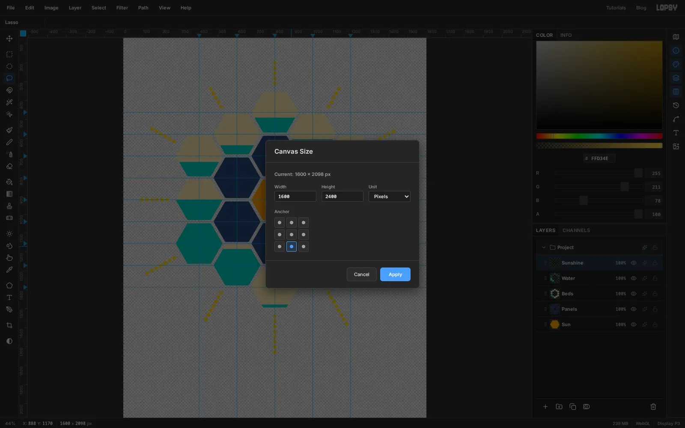

The honeycomb is done, so the canvas can grow to poster size. It needs 250 px more underneath and 302 px more on top.

Choose **Image → Canvas Size**. Set **Height** to **2098**, click the **top centre** square of the anchor grid, and click **Apply**. The anchor is the side that stays put, so the new space is added at the bottom.

Open **Image → Canvas Size** again. Set **Height** to **2400**, click the **bottom centre** anchor, and click **Apply**. Choose **View → Fit to Screen**.

Everything has moved down by 302 px, and the guides moved with it. The centre of the honeycomb is now at **800, 1226**. From here on, positions use the new canvas.

## Paint the emerald backdrop

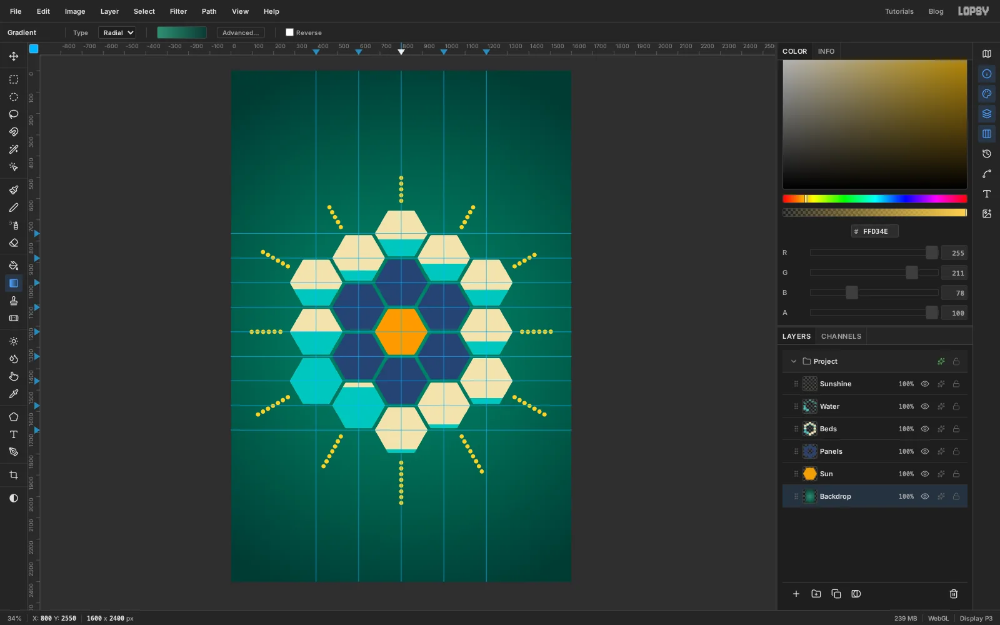

Click **Add Layer**, name it `Backdrop`, and drag its row by the grip on the left to the bottom of the stack, under `Sun`.

Pick the **Gradient** tool and set **Type** to **Radial**. Click **Advanced...** to open the Gradient Editor. Set the left stop to `#2F8F72` and the right stop to `#0C3A33`, then click the middle of the bar to add a third stop and set it to `#1A6654`. Click **Done**.

A radial gradient starts where you press and reaches its last colour where you let go. Press on the centre of the honeycomb at **800, 1226** and drag straight down past the bottom edge of the canvas, to about y **2550**. Dragging beyond the canvas keeps the darkest green for the corners only.

## Render clouds for the glass texture

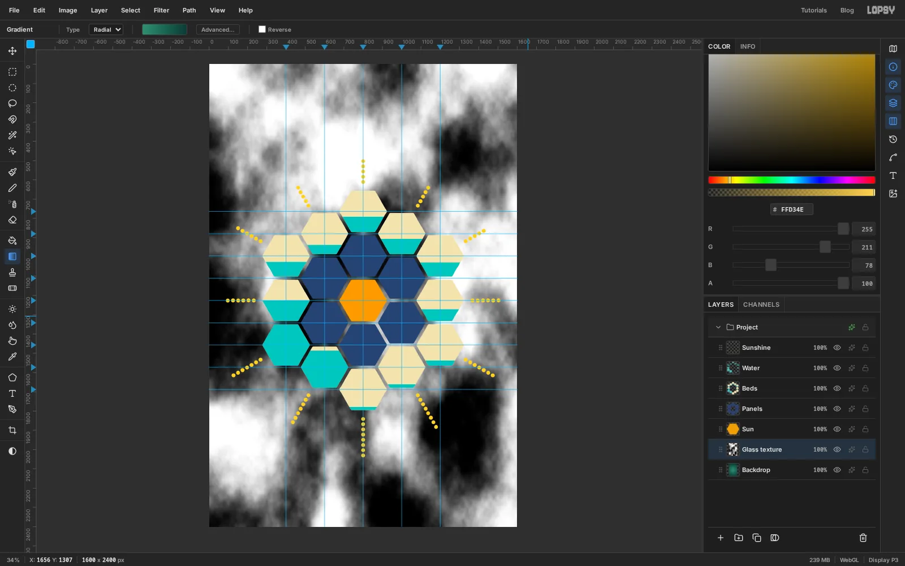

With `Backdrop` active, click **Add Layer** and name the new layer `Glass texture`. It lands just above the backdrop.

Choose **Filter → Clouds** and click **Apply**. The layer fills with random light and dark blotches. They're only raw material for the next step.

## Break the clouds into Voronoi cells

Choose **Filter → Voronoi**. Set **Cells** to **20**, **Edge Width** to **2** and **Seed** to **41**, then click **Apply**.

Voronoi cuts the layer into irregular cells and gives each one the grey that was under its centre. The result looks like leaded glass, or plant cells under a microscope.

## Blend the glass into the backdrop

Click the effects button on the `Glass texture` row to open the drawer and change the blend mode to **Soft Light**. Close the drawer. Then click the `100%` on the row and bring the opacity down to about **22%**.

Soft Light lightens the backdrop under pale cells and darkens it under dark ones. Keep the opacity low. The texture should stay quiet behind the type you'll add later.

## Add a warm halo

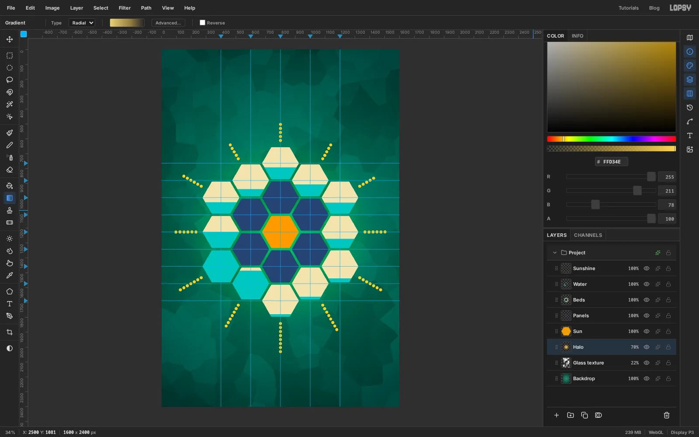

Click **Add Layer** and name it `Halo`. Open the Gradient Editor again and build a gradient that fades out:

- left stop `#FFE27A` at 90% opacity
- a middle stop at about 60% along the bar, `#FFD45A` at 50% opacity
- right stop `#FFD45A` at 0% opacity

The opacity of a stop is the bar under the colour square in its picker. Drag from **800, 1226** down to **800, 1866**.

Set the layer's blend mode to **Overlay** and its opacity to **70%**. A plain yellow glow over green would turn olive. Overlay brightens the green that's already there and keeps it clean.

## Frame the month cells in brass

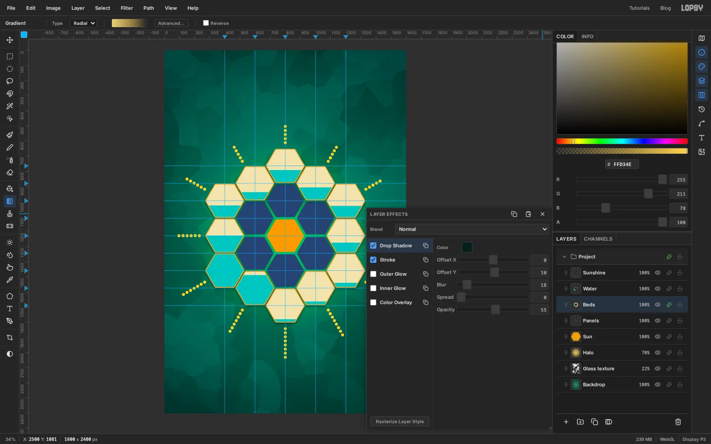

Click the effects button on the `Beds` row.

Tick **Stroke** and click its row to show the settings. Set **Width** to **6** and the colour to brass `#D9A441`.

Tick **Drop Shadow**, click its row, and set **Offset X** to **0**, **Offset Y** to **10**, **Blur** to **18** and **Opacity** to **55**. Set the colour to a very dark green, `#04201B`.

## Paste the frames onto the other cells

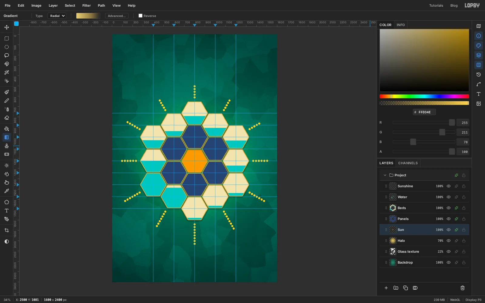

With the drawer still open on `Beds`, click **Copy effects** at the top. Open the drawer for `Panels` and click **Paste effects**, then do the same for `Sun`. Close the drawer.

All three layers now share one frame style. If you change your mind about the width later, change it once and copy it across again.

## Light the sun and rule the first panel lines

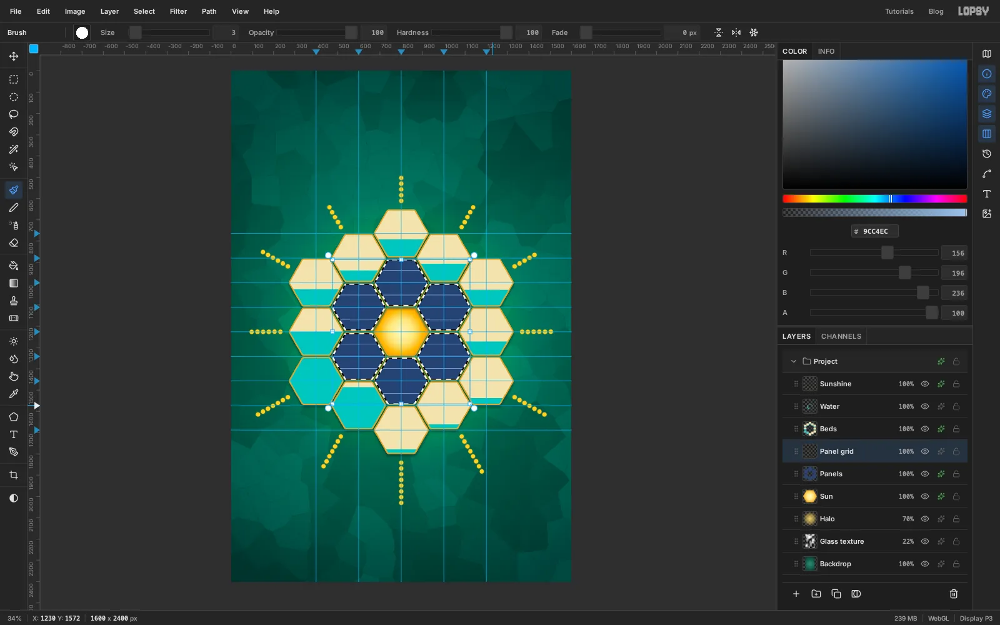

Hold [[Cmd]] and click the thumbnail on the `Sun` row. That loads the hexagon as a selection. Click the row itself to make the layer active, then set up a **Radial** gradient with `#FFF6C2` on the left, `#FFE98A` a little before the middle, and `#F29F05` on the right. Drag from **800, 1226** to **800, 1354** and press [[Cmd+D]].

Open the effects drawer for `Sun`, tick **Outer Glow**, and set **Size** to **40**, **Opacity** to **80** and the colour to `#FFD65C`. Give the `Sunshine` layer an **Outer Glow** too: **Size** 10, **Opacity** 70, colour `#FFB300`.

Now the panels. [[Cmd]]-click the thumbnail on the `Panels` row to select all six. Click the `Panels` row, then **Add Layer** and name the new layer `Panel grid`. The selection stays active on the new layer, so anything you paint stays inside the panels.

Set the foreground colour to `#9CC4EC`. Pick the **Brush**, **Size** **3**, **Hardness** **100**. Click at **370, 1226**, then hold [[Shift]] and click at **1230, 1226**. That draws a straight line through the middle. Add six more above and six below, 58 px apart, the same way.

## Finish the facets with two diagonal sets

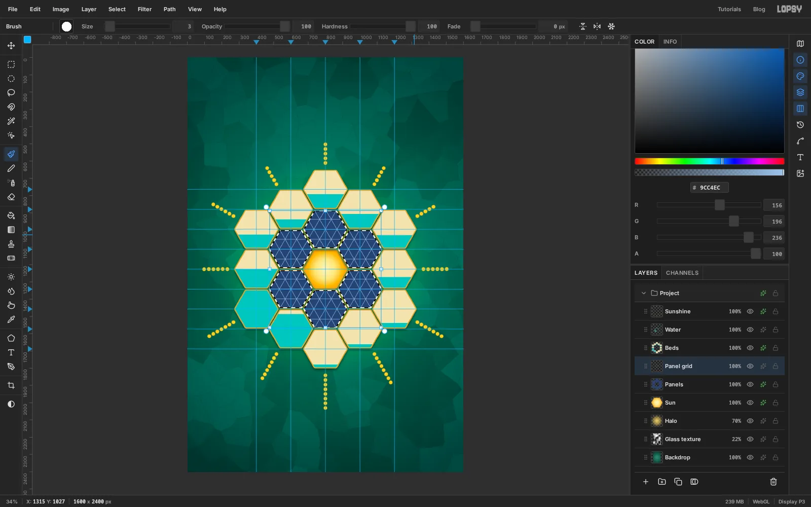

Solar cells on a hexagonal panel are cut along the hexagon's own directions, so the other two sets of lines run at 60°.

Click at **585, 854**, hold [[Shift]] and click at **1015, 1598**. That line runs through the centre of the sun cell. Draw six more to its left and six to its right, moving both ends about 67 px sideways each time, so that each line passes through the points where the horizontal lines meet the earlier diagonals. Then draw the mirror set, starting with **1015, 854** to **585, 1598**.

> **Tip:** Hold [[Cmd+Shift]] for the second click and the line snaps to the nearest 15°, which makes 60° easy to hit. This one needs the Cmd key itself.

Press [[Cmd+D]] and lower the `Panel grid` layer's opacity to **50%**. The lines meet at the centre of every panel, so all six are cut into the same triangles.

## Select one panel for its sheen

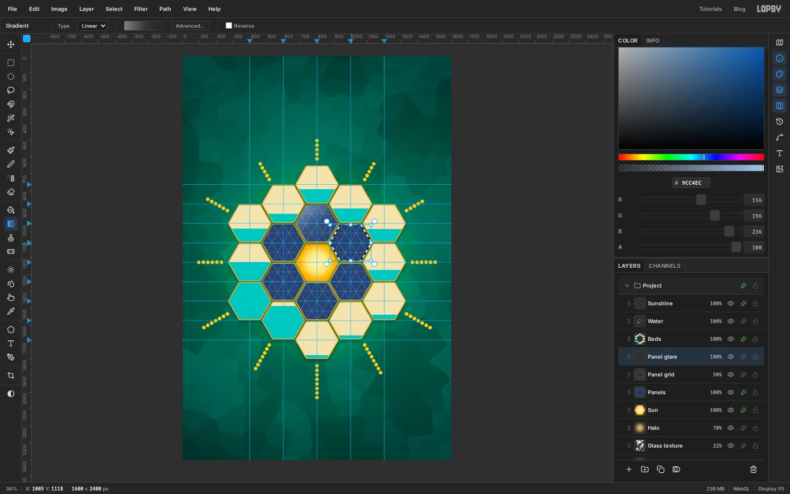

With `Panel grid` active, click **Add Layer** and name the new layer `Panel glare`. Pick the **Gradient** tool, set **Type** to **Linear**, and build a gradient from white at 42% opacity, through `#CFE8FF` at 8% a little past the middle, to white at 0%.

Each panel gets its own sheen so they all catch the light the same way. Click the `Panels` row, pick the **Magic Wand** and click inside the top panel. Then click the `Panel glare` row. The selection stays. The screenshot shows the second panel selected, with the top one already done.

## Sweep a sheen across every panel

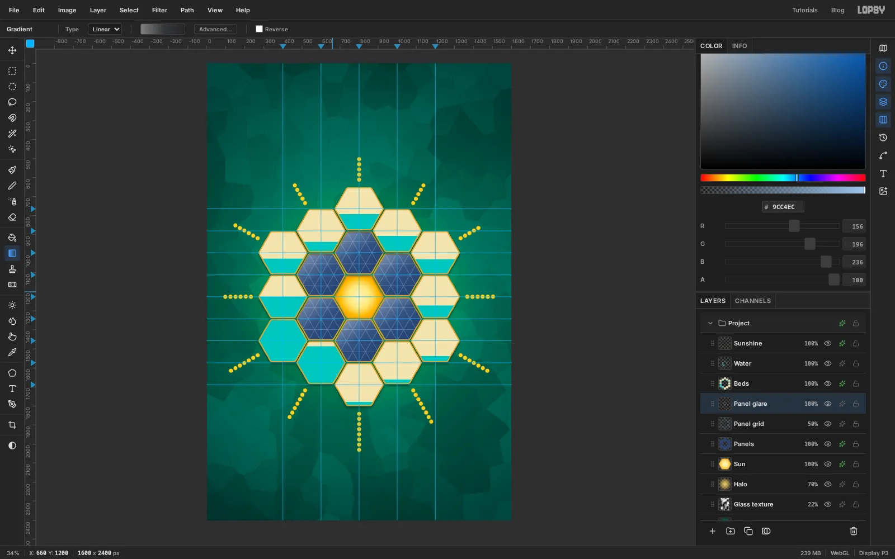

Pick the **Gradient** tool and drag from the upper left of the selected panel to its lower right. For the top panel, the one above the sun, that's from about **720, 890** to **860, 1085**.

Do the same for the other five: click `Panels`, wand the next panel, click `Panel glare`, drag the gradient. Press [[Cmd+D]] at the end.

## Mark the half-way ticks

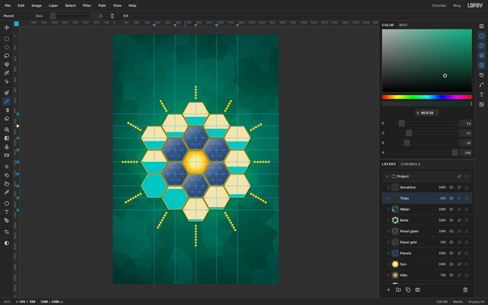

A hexagon is narrower at the top and bottom than in the middle, so it helps to give the eye one fixed mark. Each cell gets a tick at half height, which is 1.25 inches.

Click the `Water` row, then **Add Layer** and name it `Ticks`. Set the foreground colour to ink `#0E2F26`. Pick the **Pencil** and set **Size** to **3**.

On each month cell, click just inside the left corner, hold [[Shift]] and click about 20 px further in. Do the same at the right corner. The corners sit on the horizontal guide through the cell's centre, so the ticks are easy to place. Lower the layer's opacity to **65%**.

September's water line sits just above its ticks. That matches the number: 1.29 inches is a little over half of 2.5.

## Group the honeycomb

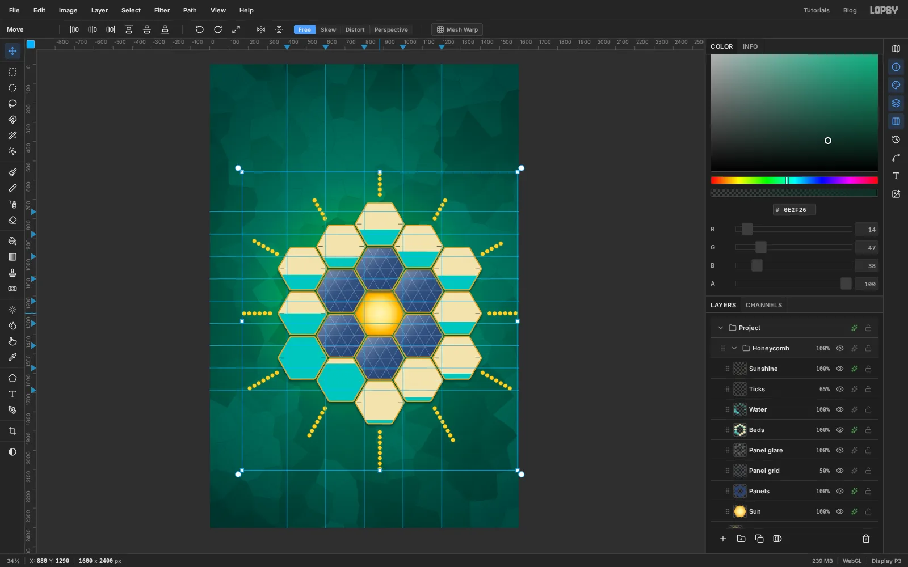

Click the `Sunshine` row, hold [[Shift]] and click the `Sun` row. Every layer between them is selected. Choose **Layer → Group Layers**, then double-click the new group's name and call it `Honeycomb`.

With the group's row selected, the **Move** tool moves all eight layers together. Try it: drag the honeycomb somewhere else, then press [[Cmd+Z]] to put it back. You won't need to move it, but it's worth seeing that the chart is now one object.

Click the small arrow beside the group's name to collapse it. That keeps the Layers panel short.

## Label the first month

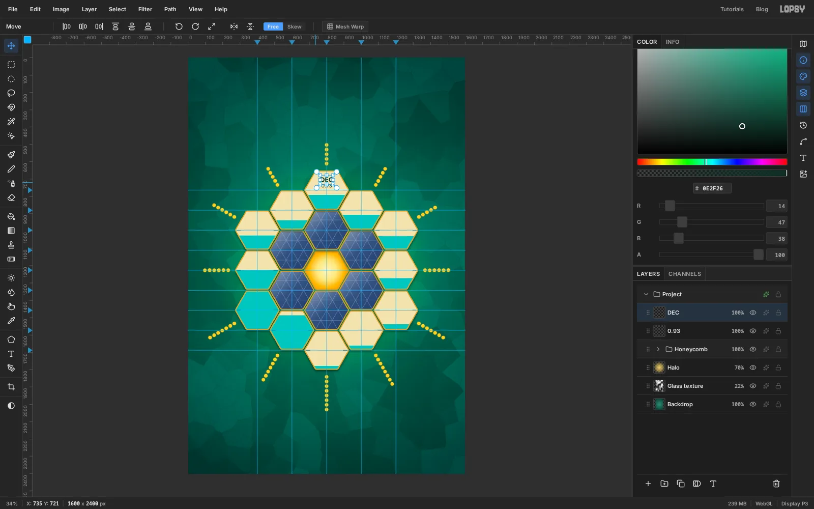

Set the foreground colour to ink `#0E2F26`. Pick the **Text** tool and click in the upper half of the December cell. Type `0.93`. Then, in the options bar, set **Size** to **30**, choose **Jost** from the font menu, set the weight to **Regular** and **Align** to **Center**. Click the ✓ beside the text to commit it.

Switch to the **Move** tool and nudge the number with the arrow keys until it's centred on the cell's vertical guide with the bottom of the digits about 14 px above the guide through the cell's centre.

Click above the number, type `DEC`, and set it in **Jost SemiBold** at **38**. Nudge it so its baseline is about 46 px above the centre guide.

> **Tip:** Type the value before the month. A click with the Text tool inside an existing text box edits that text instead of starting a new one. The month goes above the value, where there's no box yet.

## Label the other eleven

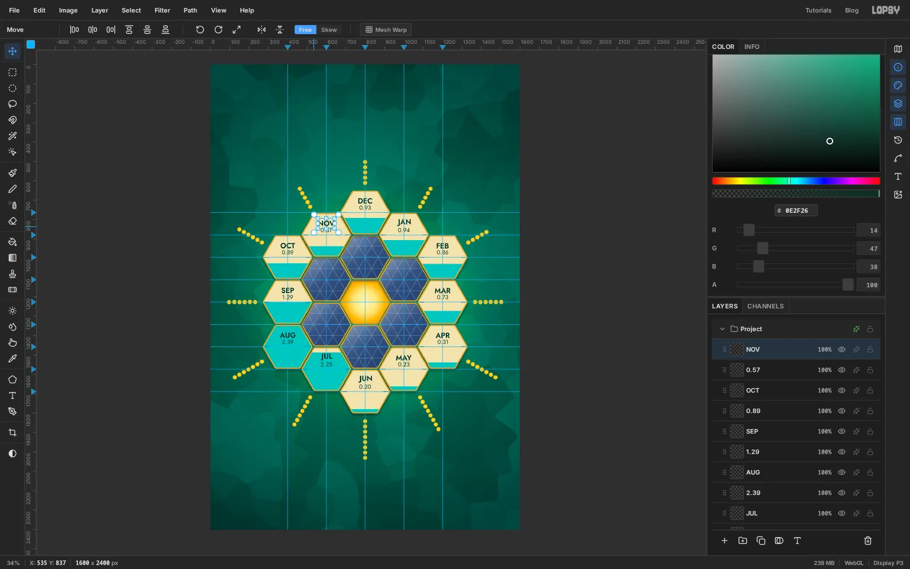

Repeat for the other eleven cells. The options bar remembers the last size, font, weight and alignment, so you only switch between the value style and the month style. Going clockwise from one o'clock:

1. `JAN` 0.94, `FEB` 0.86, `MAR` 0.73
2. `APR` 0.31, `MAY` 0.23, `JUN` 0.20
3. `JUL` 2.25, `AUG` 2.39, `SEP` 1.29
4. `OCT` 0.89, `NOV` 0.57

Each cell is centred on a guide crossing, so measure from there: the value's baseline 14 px above the crossing, the month's 46 px above it. Keeping the same two baselines in every cell makes the labels line up across the ring.

Putting the labels in the upper part of the cell keeps them clear of the water in ten months. July and August are so full that their labels sit on the water, which is fine. Dark ink reads on aqua as well as on sand, and those two cells are meant to stand out.

## Add the centre figure and the sunshine totals

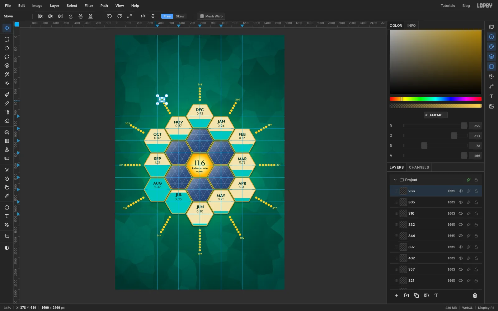

In the sun cell, set three lines of ink text, centred on **800**:

1. `a year` in Jost SemiBold **24**, near the bottom of the cell
2. `inches of rain` in the same style, just above it
3. `11.6` in **Federo** at **72**, above both

Start with the bottom line and work up, for the same reason as before.

Change the foreground colour to gold `#FFD34E`. At the outer end of each row of dots, about 38 px beyond the last dot, type that month's hours of sunshine in Jost **Medium** at **24**: Jan 260, Feb 259, Mar 321, Apr 357, May 402, Jun 397, Jul 344, Aug 332, Sep 316, Oct 305, Nov 266, Dec 248.

There are 39 text layers now. Click the first one, [[Shift]]-click the last, choose **Layer → Group Layers** and name the group `Labels`. Collapse it.

## Set the title

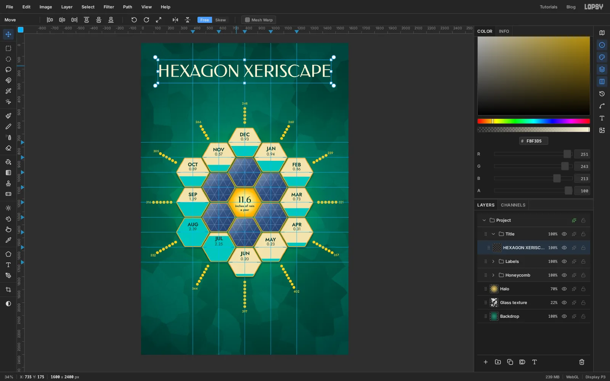

Click the `Halo` row and click **New Group** in the Layers panel toolbar. Name the group `Title` and drag it by its grip to the top of the stack. Starting from a layer outside the other groups keeps the new group out of them.

Set the foreground colour to cream `#FBF3D5`. With the Text tool, click near the top of the canvas and type `HEXAGON XERISCAPE`. Set it in **Federo** at **128**, centred. Move it so it's centred on **800** with its baseline at about y **262**.

## Finish the title block

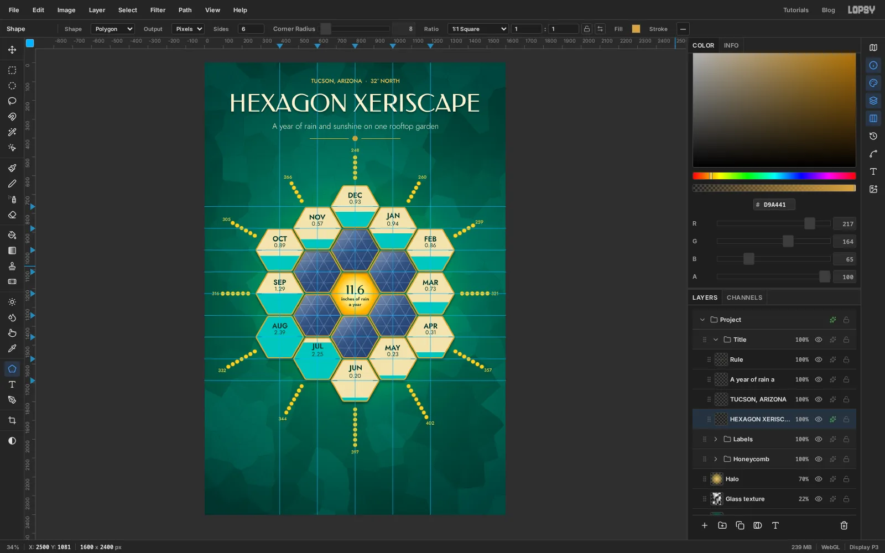

Add two more lines of text:

- above the title, in `#F3C866`: `TUCSON, ARIZONA  ·  32° NORTH` in Jost **Medium** at **30**, baseline at about y **112**
- below it, in cream: `A year of rain and sunshine on one rooftop garden` in Jost **Light** at **42**, baseline at about y **352**

> **Tip:** For a line with characters like `·` and `°`, type the text first and choose the font afterwards. Characters that come from a compose key or a character picker can be dropped if you pick a font from the menu and then type them.

Click **Add Layer** and name it `Rule`. Set the foreground colour to brass `#D9A441`. With the **Pencil** at size **3**, click at **560, 402** and [[Shift]]-click at **765, 402**, then click at **835, 402** and [[Shift]]-click at **1040, 402**. With the **Shape** tool still set to a six-sided Polygon, change the fill to brass, hold [[Cmd]] and drag a small hexagon from **800, 402** to about **816, 418**. Cmd keeps the drag box square.

Last, open the effects drawer for the title text and add a **Drop Shadow**: **Offset X** 0, **Offset Y** 8, **Blur** 14, **Opacity** 60, colour `#04201B`.

## Write a season note

The chart shows that July to September is the wet season. A short note makes sure nobody misses it.

Set the foreground colour to pale aqua `#BFEDE4`. With the Text tool, click in the gap between the July and August rows of dots. Type `MONSOON`, press [[Return]] for a new line and type `JUL – SEP`. The dash is an en dash, [[Option+-]] on a Mac. A plain hyphen is fine if you can't type one. Set it in Jost **SemiBold** at **26**, centred, and commit.

Switch to the **Move** tool. A box with handles appears around the text. The square handles scale it and the round ones just outside the corners rotate it.

## Rotate the note

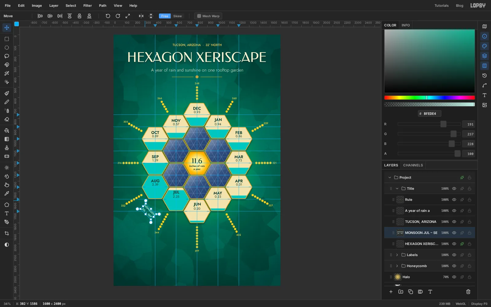

Hold the [[Cmd]] key and drag a round handle clockwise. With Cmd held the angle moves in steps of 15°. Stop at **45°**, which is three steps.

The text is still text. You can double-click it with the Text tool and retype it, and it keeps its angle.

> **Tip:** The 15° snap on the rotation handles reads the Cmd key only. On Windows and Linux, where that key is usually taken by the system, choose **View → Show Grid** instead: with the grid's **Snap** on, the handles snap to 15° without a key.

## Place both notes

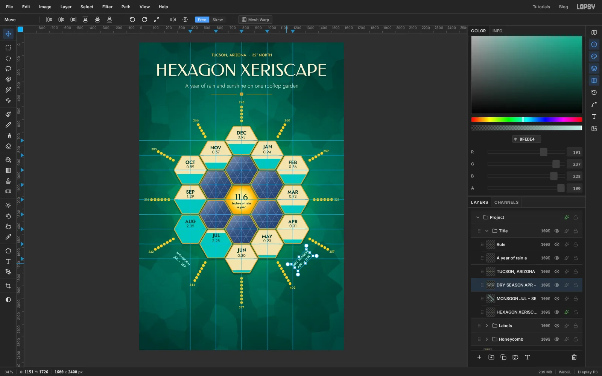

With the Move tool, nudge the note with the arrow keys until its middle sits at about **333, 1693**, half-way between the two rows of dots.

Make the second note the same way on the other side: `DRY SEASON` and `APR – JUN`, rotated **45° anticlockwise**, with its middle at about **1267, 1693**, in the gap between the April and May rows.

## Draw an agave leaf with the Pen

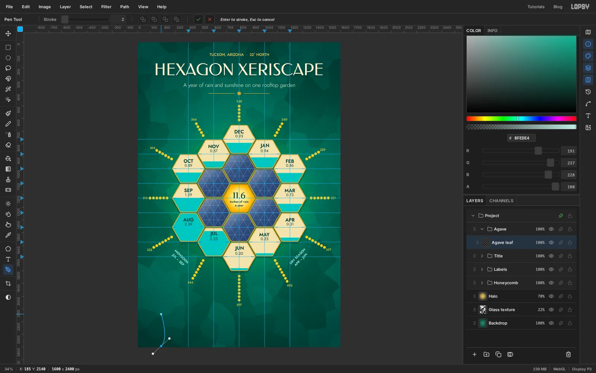

A xeriscape is a garden planted with things that live on the rain that falls. The two bottom corners get two of them, starting with an agave.

Collapse the `Title` group. Click `Halo`, click **New Group**, name it `Agave` and drag it to the top of the stack. Click **Add Layer** and name the layer `Agave leaf`.

Pick the **Pen** tool. Press at **185, 2392**, near the bottom edge, and drag up and to the right to about **250, 2332** before you let go. That pulls a pair of handles out of the anchor. Click once at **185, 2140** for the tip. Then click the first anchor again to close the path.

Two anchors are enough. The handles at the base make the outline swell out on both sides and come back to a point at the tip.

## Fill the leaf with a gradient

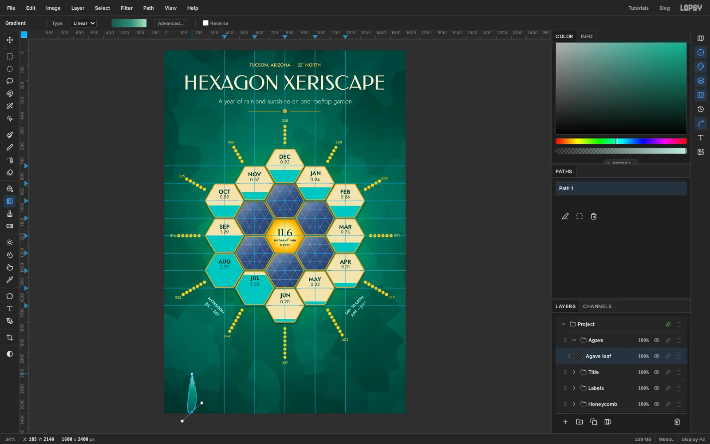

Click **Paths** in the strip of panel buttons on the far right. In the Paths panel, click **Path to Selection**.

Set up a **Linear** gradient: `#17594C` on the left, `#2F8E78` just past the middle, `#A9E3BC` on the right. Drag from the base of the leaf at **185, 2392** up to the tip at **185, 2140**.

Add a midrib while the selection is still on. Set the foreground colour to `#C9F2D6`, pick the **Brush** at **Size** **4**, click at **185, 2362** and [[Shift]]-click at **185, 2170**.

Press [[Cmd+D]]. In the Paths panel click **Delete Path**, then click the **Paths** button again to close the panel. Give the leaf a **Drop Shadow**: **Offset Y** 4, **Blur** 12, **Opacity** 55, colour `#04201B`. The shadow will separate the leaves once they overlap.

## Duplicate the leaf and select the copy

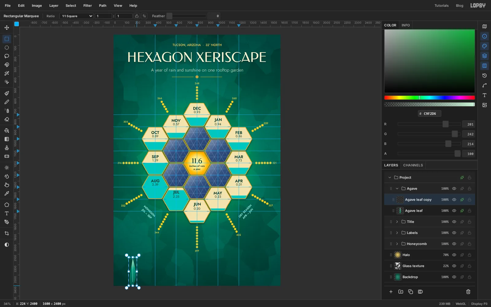

The rest of the plant is this leaf six more times. Each copy is scaled, turned and moved.

Choose **Layer → Duplicate Layer**. The copy sits exactly on top of the original.

Pick the **Rectangular Marquee** and drag a box around the leaf, from about **146, 2128** to **224, 2400**. On a pixel layer, the Move tool's handles work on whatever is selected, so the box you draw is the box you'll transform.

## Scale the copy

Switch to the **Move** tool. Hold [[Cmd]] and drag the bottom-right square handle up and to the left. Cmd keeps the proportions. Stop when the leaf is about three quarters of its size. The box will be roughly 58 px wide.

## Rotate the copy

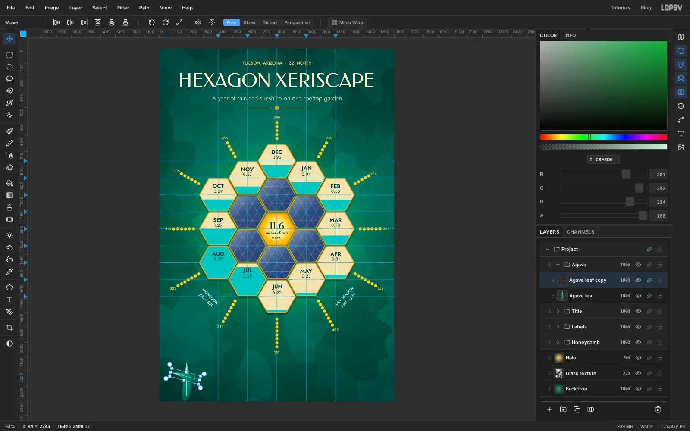

Drag a round rotation handle anticlockwise until the leaf lies almost flat, about **75°**. Hold [[Cmd]] while you drag to land on a 15° step.

Don't drag inside the box at this point, because that moves or resets a transform that isn't committed yet. Press [[Cmd+D]] to commit it and drop the selection first.

## Move it onto the base

Still with the Move tool, drag the leaf so that its base lands on the base of the first leaf, at about **185, 2392**. With nothing selected, the Move tool moves the whole layer.

## Build the rosette

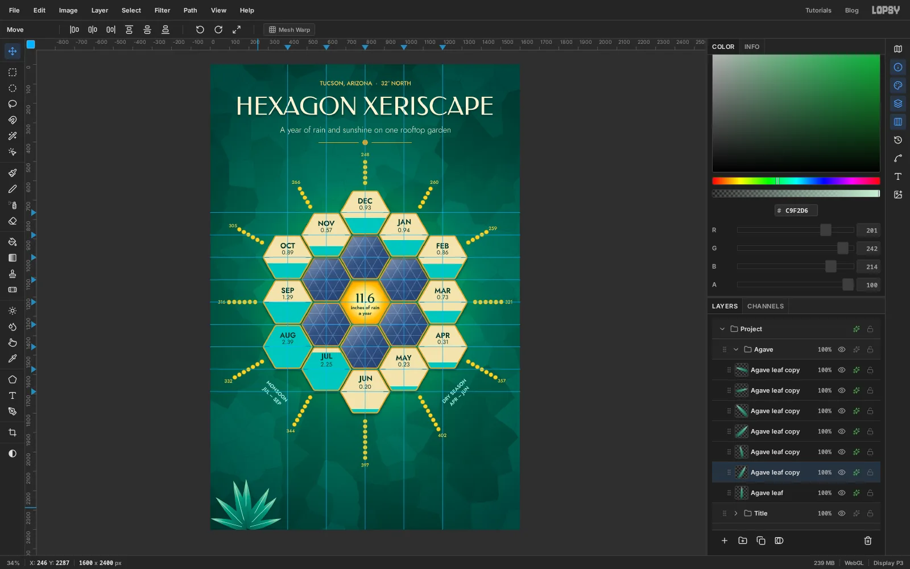

Make five more copies the same way. For each one, click the `Agave leaf` layer first so you always duplicate the upright original:

1. **75°** clockwise at 75%
2. **45°** anticlockwise at 88%
3. **45°** clockwise at 88%
4. **15°** anticlockwise at full size
5. **30°** clockwise at 95%

Work from the outside in, as listed. Each new copy lands just above the original and under the copies you made before it, so the low outer leaves stay in front of the taller inner ones, as they do on a real agave. The uneven last two keep the plant from looking stamped.

## Scale the whole agave

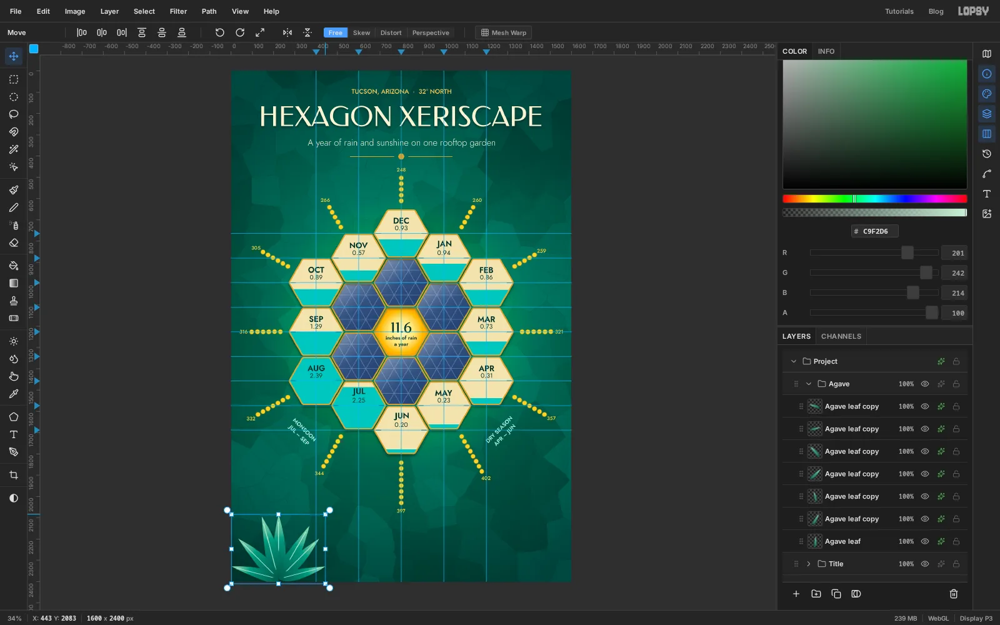

The agave could be bigger. Press [[Cmd+D]] to make sure nothing is selected, then click the `Agave` group's row. With the **Move** tool, the handles now frame all seven leaves at once.

Hold [[Cmd]] and drag the top-right handle up and to the right, from about **367, 2139** to **443, 2083**. The bottom-left corner stays where it is, so the plant grows out of its corner. Press [[Cmd+D]] to commit.

Collapse the `Agave` group.

## Start the prickly pear with an ellipse

Click `Halo`, click **New Group**, name it `Prickly pear` and drag it to the top of the stack.

Set up a **Linear** gradient from `#9AD48C` through `#4FA567` in the middle to `#256B49`.

A prickly pear is a stack of flat oval pads. Each pad goes on its own layer and takes four moves: **Add Layer**, drag an **Elliptical Marquee**, drag the gradient across it, and turn it.

The first and biggest pad stays upright. Name its layer `Pad 1` and drag the marquee from **1373, 2210** to **1537, 2420**. The marquee can run off the bottom of the canvas. Pick the **Gradient** tool, drag from the upper left of the ellipse to its lower right, and press [[Cmd+D]].

For the second pad, add a layer called `Pad 2` and drag an ellipse from **1316, 2109** to **1428, 2261**, overlapping the top left of the first pad.

## Pour the gradient into the pad

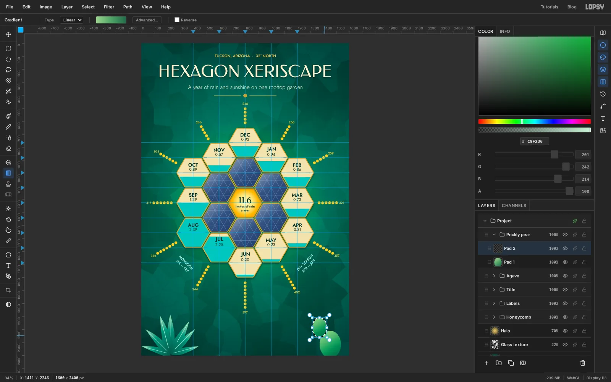

With the marquee active, pick the **Gradient** tool and drag from the upper left of the ellipse to its lower right, as you did for the first pad. The gradient only fills the selection, and because the drag is shorter on a smaller pad, each pad gets the full run from light to dark.

## Turn the pad

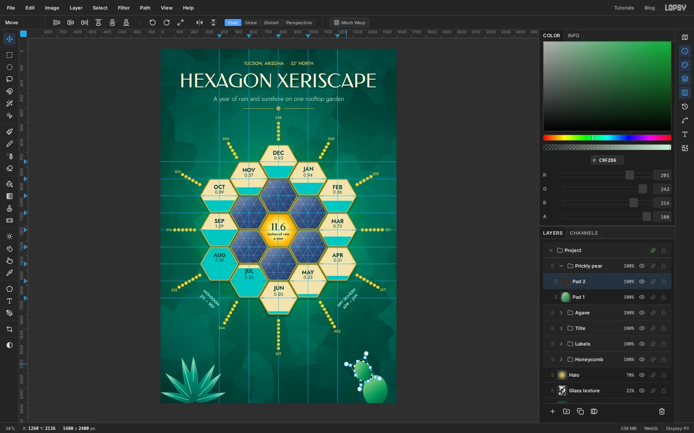

Keep the selection, switch to the **Move** tool, and drag a round handle to tilt the pad about **28°** anticlockwise. Press [[Cmd+D]].

Three more pads finish the plant. Each line gives the ellipse's corners and then the tilt. The angles are rough: lean each pad away from the middle of the plant until it looks right.

1. `Pad 3`: **1463, 2078** to **1587, 2242**, 22° clockwise
2. `Pad 4`: **1334, 2018** to **1410, 2118**, 8° anticlockwise
3. `Pad 5`: **1527, 1996** to **1593, 2084**, 28° clockwise

## Add shadows, spines and fruit

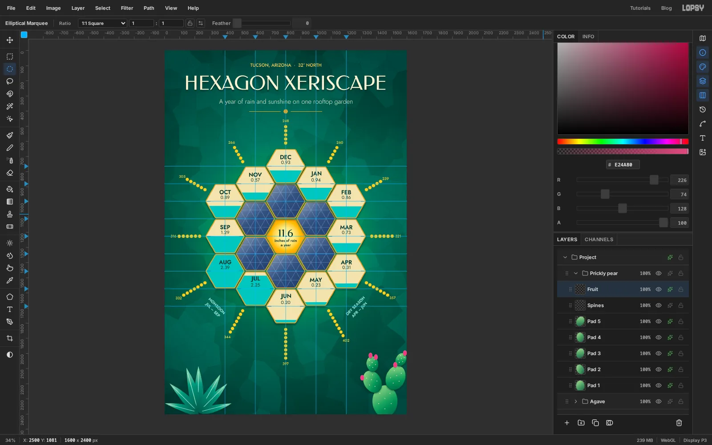

Open the effects drawer for `Pad 1`. Add a **Drop Shadow** (**Offset Y** 5, **Blur** 12, **Opacity** 55, colour `#04201B`) and a **Stroke** (**Width** 2, colour `#1C5A3D`). Click **Copy effects**, then open each of the other four pads' drawers and click **Paste effects**.

Add a layer called `Spines` at the top of the group. With the **Brush** at **Size** **6**, **Hardness** **100** and the colour `#F4F0C9`, click six dots on each pad: two near the top, one in the middle, two lower down and one near the bottom.

Add a layer called `Fruit`. Set the foreground colour to `#E24A80`. With the **Elliptical Marquee**, drag a small upright oval about 26 × 36 px on the top edge of a pad and choose **Edit → Fill**. Make five in all: two on `Pad 4`, and one each on `Pad 5`, `Pad 3` and `Pad 2`. Deselect, then give the layer a **Drop Shadow** (**Offset Y** 3, **Blur** 6, **Opacity** 50) and an **Inner Glow** (**Size** 8, **Opacity** 60, colour `#FF9CC0`).

The pink is the only colour on the poster that isn't green, gold or blue, so use it sparingly.

Collapse the group.

## Draw the key's icons

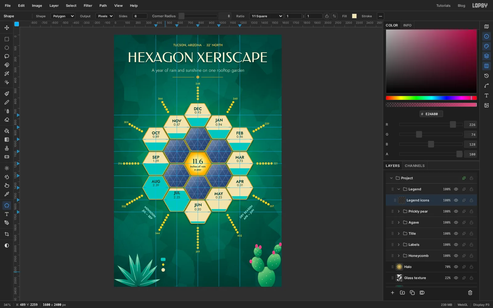

Click `Halo`, click **New Group**, name it `Legend` and drag it to the top. Add a layer called `Legend icons`.

With the **Shape** tool, draw three small shapes in a column at x **470**. Remember that shapes grow from the centre:

1. **Rectangle**, **Corner Radius** 8, fill `#4FC4BE`: from **470, 2140** to **492, 2155**
2. **Ellipse**, fill `#FFD34E`: hold [[Cmd]] and drag from **470, 2190** to **481, 2201**
3. **Polygon**, fill `#F1E3B4`: hold [[Cmd]] and drag from **470, 2240** to **489, 2259**

## Write the key

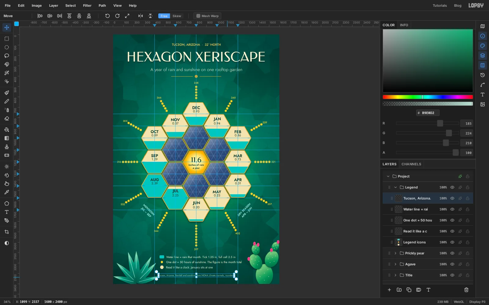

Set the foreground colour to cream `#FBF3D5`. In Jost **Regular** at **28**, aligned **Left**, set three lines that start at x **512**, one beside each icon:

1. `Water line = rain that month. Tick 1.25 in, full cell 2.5 in`
2. `One dot = 50 hours of sunshine. The figure is the month total`
3. `Read it like a clock: January sits at one`

Start with the bottom line and work up. Nudge each so its baseline is about 10 px below the middle of its icon.

Under them, in `#B9E0D2`, add the source in Jost **Regular** at **22**, `Tucson, Arizona. Rainfall and sunshine from NOAA climate normals, rounded.` In the screenshot it's centred on the page and its first letters touch the agave, so nudge it right with [[Shift+→]] until it sits centred between the two plants, at about **860, 2320**.

Three short lines are enough for the key because the chart only has three rules.

## Hide the guides and export

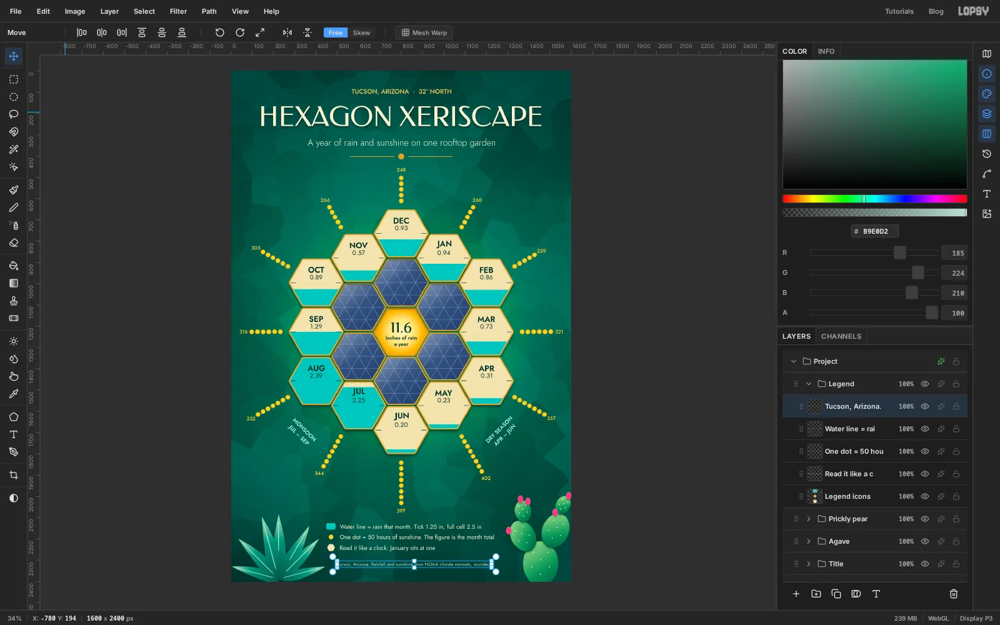

Choose **View → Show Guides** to hide the guides. Choose **File → Quick Export PNG** to save the poster, and **File → Save Project** to keep the layers.

To chart another city, only the water lines, the dot counts and the numbers change. The honeycomb, the guides and everything around them stay as they are.
