Steampunk imagines the future as the Victorians might have built it: brass, copper, rivets, airships and clockwork that keeps the planets in step. An **orrery**, a clockwork model of a planet and its moons, is the perfect centrepiece for a steampunk film. In this tutorial you'll design the one-sheet for an invented movie, **Orrery of Jupiter**, at 1200 × 1800 px, the 2:3 shape of a cinema poster.

The planet is a real photograph: the Hubble Space Telescope's portrait of Jupiter from April 2014, which NASA and ESA have released into the public domain. Download it from Wikimedia Commons (search for "Jupiter and its shrunken Great Red Spot") before you start. Everything else is built in Lopsy with selections, gradients, layer effects, filters and type.

Along the way you'll use:

- ruler **guides**, a radial **Gradient**, **Add Noise** and **Threshold** for a star field
- the **Lasso** and both **Marquees** with [[Shift]] to add and [[Alt]] to subtract, to build a gear as one selection
- a dropped-in photo, the **Move** tool's scale and rotate handles, and a **layer mask**
- selections from layer transparency ([[Cmd]]-click a thumbnail), **Select → Shrink**, and the Lasso with [[Shift+Alt]] to intersect
- **Stroke**, **Drop Shadow**, **Inner Glow** and **Outer Glow** effects, with **Copy effects** and **Paste effects**
- **Multiply**, **Screen** and **Overlay** blending, layer opacity and **groups**
- the **Brush**, **Pencil** and **Spray** tools with [[Shift]]-click straight lines
- the **Sunburst**, **Clouds**, **Hue/Saturation**, **Gaussian Blur** and **Brightness/Contrast** filters
- type in **Cinzel Decorative**, **Cinzel** and **Oswald**, centred with the align buttons
- the root group's **Color Grading** adjustment

The palette:

- Sky `#3A6B62` → `#173B3A` → `#0B1013`
- Copper `#3E1E0F` → `#A85A30` → `#F2B37A` → `#7E3E1F` → `#D98A55`
- Brass `#4A3410` → `#C9A24E` → `#FFF0B8` → `#8C6A26` → `#E2C175`
- Title gold `#FFF4CC` → `#E2BB62` → `#8C6420` → `#F6DB8E` → `#5C4012`
- Oxblood `#A8382C` → `#7A2219` → `#4E130F`, tails `#4A1210`
- Airship red `#C2614A` → `#8E2B22` → `#24080A`
- Parchment type `#F3E6C4` / `#F6E7C1`, credits `#E3D6B4`, ink `#1E1206`
- Halo `#E8B070`, steam `#D9D4C7`, shadow `#020606`

> **Tip:** Positions are written as `x, y` in document pixels. The status bar at the bottom of the window shows where the cursor is, so you can hover to find a spot. Key names are Mac keys: on Windows and Linux, use Ctrl for Cmd. New text layers are named after their words, and this tutorial renames some of them (double-click a name) so later steps can refer to them. Everything lives inside the `Project` group at the top of the Layers panel; that root group is where the colour grade goes at the end.

## Set up the page and paint the sky

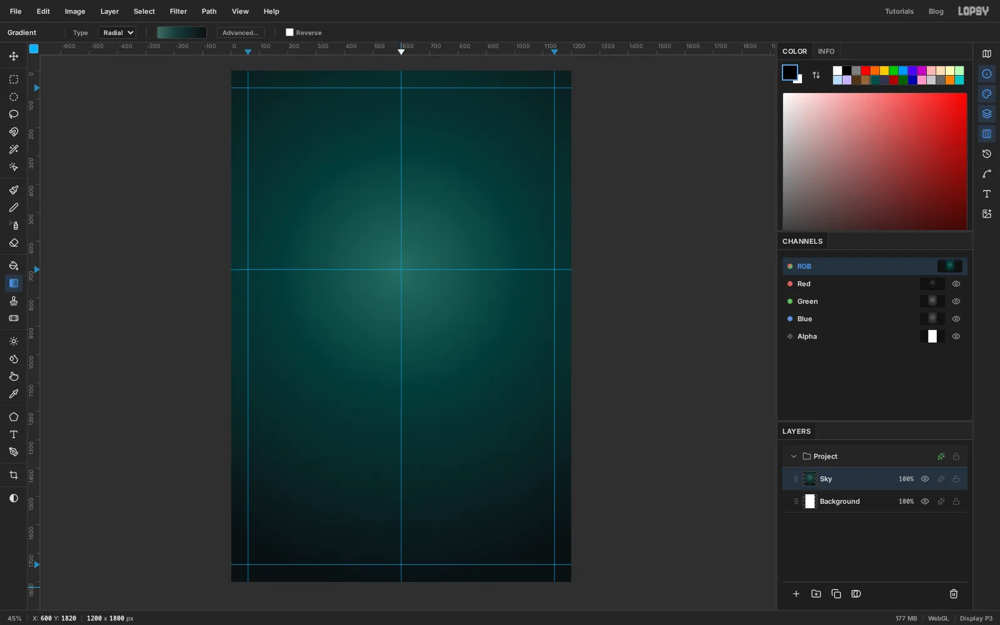

Choose **File → New**, set the size to **1200 × 1800** px with a White background and click **Create**. If the rulers aren't showing, turn on **View → Show Rulers**.

Drop some guides to plan the layout. Click the top ruler at **60** and **1140** for the side margins, then hold [[Cmd]] and click near the middle of the top ruler, which drops a guide at the exact centre, **600**. On the left ruler, click at **60** and **1740** for the top and bottom margins, and at **700**. The planet will sit where the centre guides cross, at **600, 700**.

Rename `Layer 1` to `Sky`. Pick the **Gradient** tool, set **Type** to **Radial** and click **Advanced…**. Make three stops: `#3A6B62` on the left, `#173B3A` a little before the middle and `#0B1013` on the right. Click **Done**, then drag from the centre point, **600, 700**, straight down past the bottom of the page. A radial gradient starts where you press and reaches as far as you drag, so this lights the middle and leaves the corners dark.

## Scatter a star field

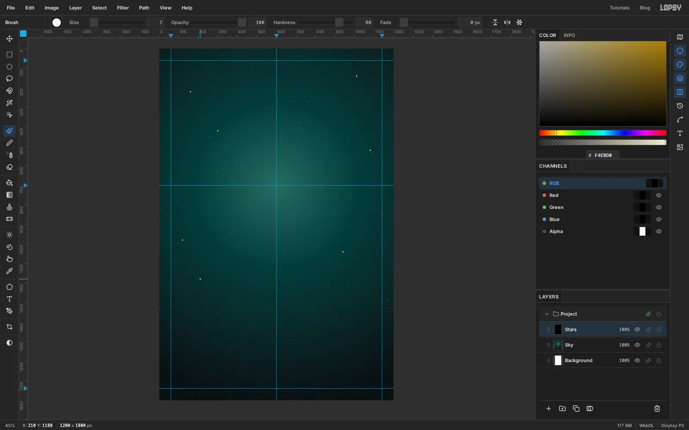

Add a layer called `Stars`. Fill it with mid-grey `#808080`: press [[Cmd+A]], choose **Edit → Fill**, then [[Cmd+D]].

Choose **Filter → Add Noise…**, set **Amount** to `100`, and click **Mono** and **Gaussian**. Gaussian noise puts only a tiny fraction of pixels at the bright end, and those become the stars. Choose **Filter → Threshold…**, set **Level** to `181` and click **Apply**. Everything below that level turns black and only a scatter of white pixels is left.

Open the layer's effects drawer (the sparkle button on its row) and set the blend mode to **Screen**, so the black disappears and only the stars light the sky. Finish with a few hero stars: pick the **Brush** (**B**) at size **7** in `#F4EBD0` and click once in six or seven places, away from the centre.

## Build the gear as one selection

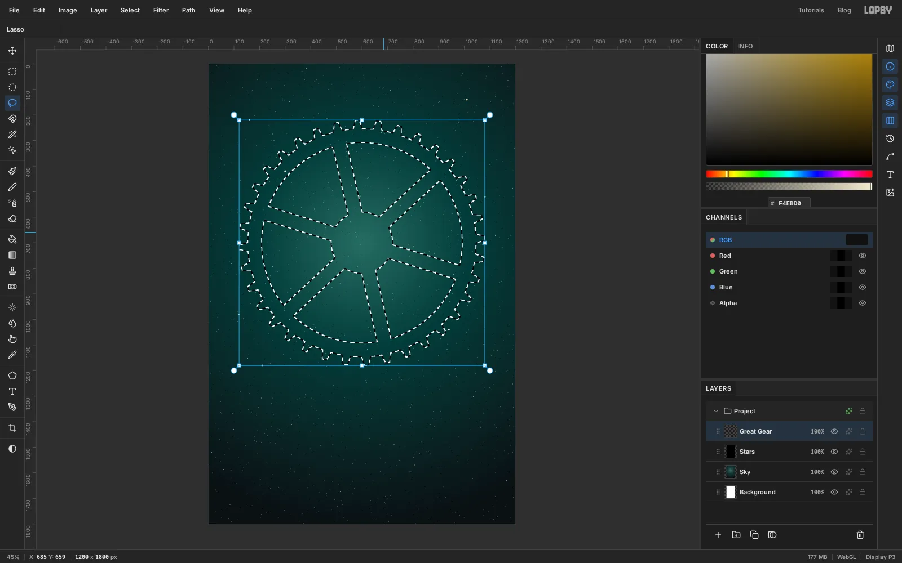

Add a layer called `Great Gear` and hide the guides with [[Cmd+;]] so the selections don't snap to them.

A gear is just a few simple shapes combined into one selection:

1. **The toothed rim.** With the **Lasso** (**L**), trace a circle about 480 px in radius around **600, 700**, stepping out and back in for 36 teeth about 34 px deep: a short climb out, a flat top about 30 px wide, a short step back down, then a gap of about the same width. This is the slowest part of the poster. Zoom in, work a quarter of the circle at a time with [[Shift]] held to add each quarter to the selection, and don't worry if the teeth aren't perfectly even: the rings and moons will cover much of the rim, and a little wobble reads as hand-made brasswork.
2. **Cut out the middle.** Pick the **Elliptical Marquee**, hold [[Alt]] and drag a circle 784 px across, centred on **600, 700**. [[Alt]] subtracts, leaving a band about 55 px wide inside the teeth.
3. **Add the hub.** Hold [[Shift]] and drag a 240 px circle on the same centre.
4. **Add the spokes.** Switch back to the **Lasso**, hold [[Shift]] and draw six long, narrow bars from the hub to the rim, about 56 px wide, spaced evenly like the spokes of a wheel.

Each [[Shift]] or [[Alt]] shape is its own undo step, so [[Cmd+Z]] only takes back the last one if a spoke goes wrong.

## Fill it with copper

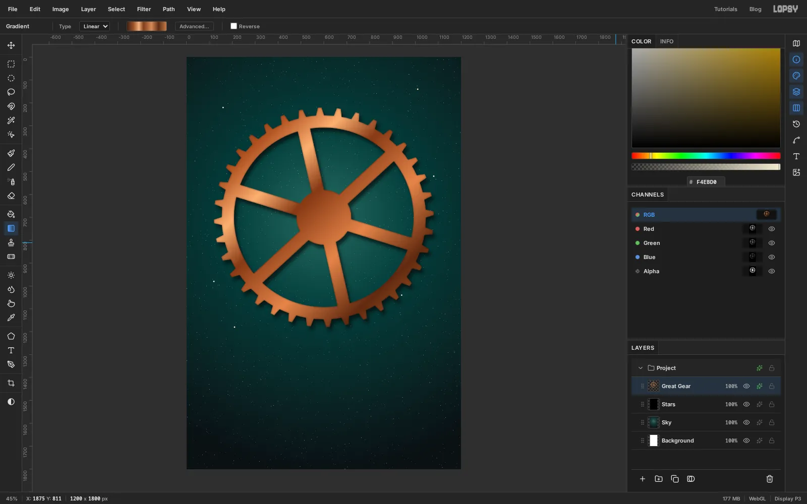

Metal reads as metal because its reflections come in bands, so a two-colour gradient looks like plastic. Pick the **Gradient** tool, set **Type** to **Linear** and open **Advanced…**. Make seven stops: `#3E1E0F`, `#A85A30`, `#F2B37A`, `#7E3E1F`, `#D98A55`, `#5A2C16` and `#C47A45`, spread evenly from left to right. Click **Done** and drag diagonally across the selection from the top-left corner of the gear to the bottom-right. Press [[Cmd+D]].

In the gear's effects drawer, turn on **Inner Glow** with **Size** `10`, **Opacity** `70` and colour `#2A1208` to darken the edges. Then turn on **Drop Shadow** with **Offset X** `10`, **Offset Y** `16`, **Blur** `22`, **Opacity** `65` and colour `#020606`.

## Drop in Jupiter and scale it

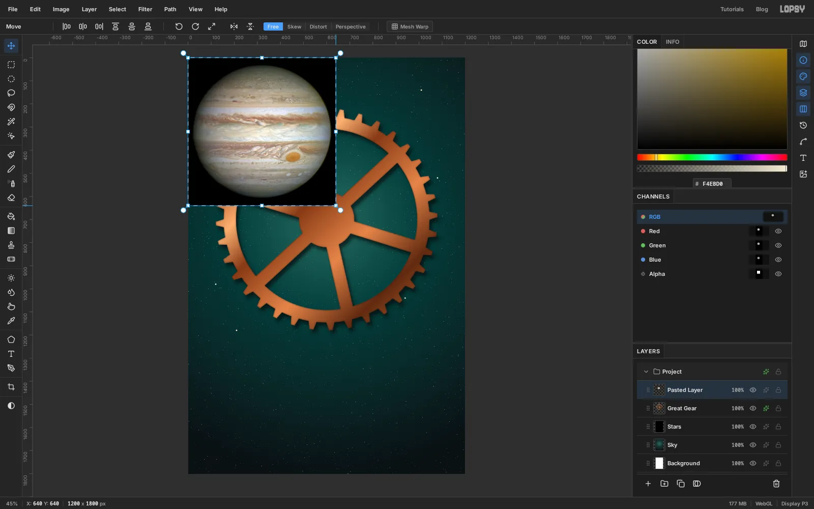

Drag the Jupiter photo from your desktop onto the canvas. Lopsy makes a new layer for it, places it at the top-left corner, selects it and switches to the **Move** tool, so the transform handles are already there.

The planet needs to be about 600 px across. Hold [[Cmd]] (to keep the proportions) and drag the bottom-right corner handle up and to the left until it sits at about **640, 640**, so the photo is about 640 px square. Watch the status bar's `X` and `Y` readout as you drag. Then drag from the middle of the photo to move it so the planet's centre sits on **600, 700**, where the guides cross. Press [[Cmd+D]] to commit, and rename the layer `Jupiter`.

## Mask the planet to a circle

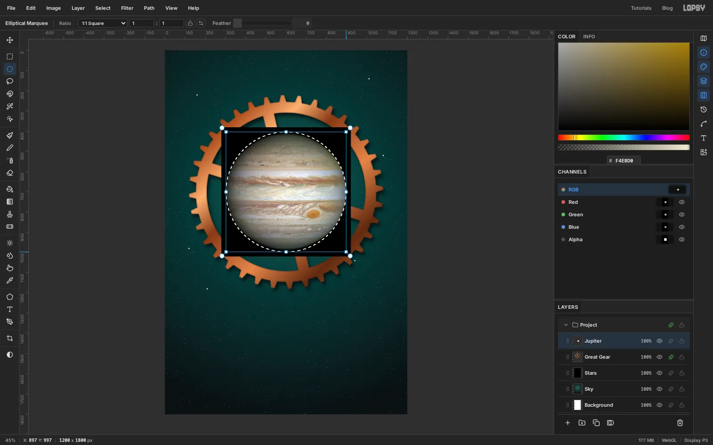

The photo still has its black square background. Pick the **Elliptical Marquee** and drag a circle from **303, 403** to **897, 997**, just inside the planet's edge. Click **Add Mask** at the bottom of the Layers panel. With a selection active, the mask shows only what's inside it, so the black square disappears and the copper gear shows around the planet.

Click the `Jupiter` row to leave mask editing. In its effects drawer, turn on **Inner Glow** with **Size** `10`, **Opacity** `45` and a warm colour, `#F4C98A`. This gives the planet a faint rim of light that stops it looking like a sticker.

## Shade the night side

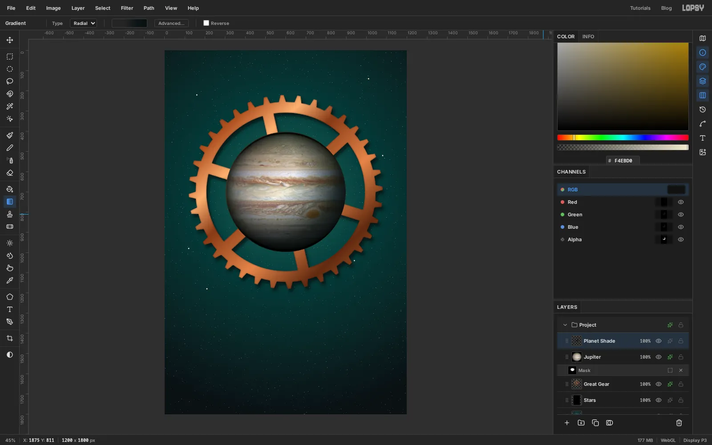

Add a layer called `Planet Shade` and draw the same circle again with the **Elliptical Marquee**. Pick the **Gradient** tool, set it to **Radial** and make four stops, all `#061012`. Give the first two 0% opacity, place them at the left end and about a third of the way along, then set the third to 80% at about three-quarters and the last to 100%. A stop's opacity is set with the bar under its colour picker.

Drag from the upper-left part of the planet, around **470, 560**, out past its lower-right edge. Deselect and set the layer's blend mode to **Multiply**. The planet now looks lit from the upper left, like a sphere.

## Make an orbit ring and tilt it

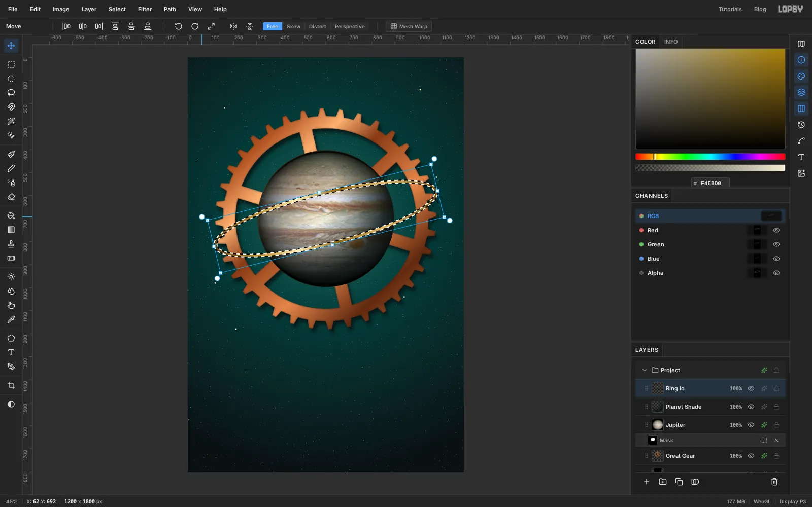

Add a layer called `Ring Io`. With the **Elliptical Marquee**, drag a wide, flat ellipse from **100, 582** to **1100, 818**, 1000 px wide and 236 px tall around the planet. Then hold [[Alt]] and drag a second ellipse about 14 px inside it on every side. That leaves a thin ring.

Make a brass gradient in the **Gradient Editor** with six stops: `#4A3410`, `#C9A24E`, `#FFF0B8`, `#8C6A26`, `#E2C175` and `#5C4012`. Drag it across the ring from its top-left to its bottom-right.

Keep the selection, pick the **Move** tool and drag the round rotation handle outside the top-left corner of the box, turning the ring about **14°** counter-clockwise. Press [[Cmd+D]] to commit.

## Send the back of the ring behind the planet

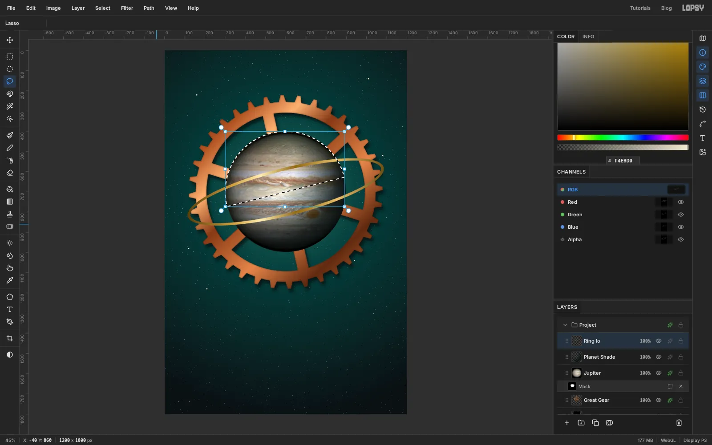

Right now the whole ring sits in front of the planet. The far half of an orbit should pass behind it. Make sure `Ring Io` is still the active layer: you only use the planet as a shape here, and the Delete has to land on the ring.

1. Draw the planet circle again with the **Elliptical Marquee**.
2. Pick the **Lasso**, hold [[Shift+Alt]] and draw a big shape covering everything above a line through the planet's centre at the same tilt as the ring. Start off the left edge a little below the centre, run up to the right edge a little above it, and loop back around the top of the page. [[Shift+Alt]] intersects, so only the top half of the planet circle stays selected.
3. Press [[Delete]] and deselect.

The ring now dives behind the planet at the top and crosses back over it at the bottom.

## Add a second ring and style both

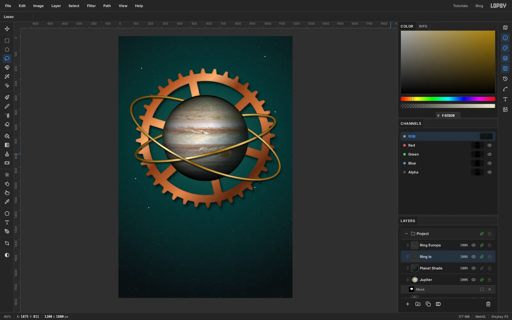

Add a layer called `Ring Europa` and repeat the last two steps with a bigger, rounder ellipse: 1120 × 400 px around the planet (from **40, 500** to **1160, 900**), with a 12 px band. Rotate this one **24°** clockwise, then cut away its back half the same way, this time with a line that runs down from left to right.

Give `Ring Europa` a **Drop Shadow** (**Offset X** `4`, **Offset Y** `10`, **Blur** `10`, **Opacity** `60`, colour `#05090A`) and a **Stroke** of **2** in `#3A2808`. Then click **Copy effects** in its drawer, select `Ring Io`, open its drawer and click **Paste effects** to give it the same style. The shadows fall across the planet, which helps the rings sit in front of it.

## Hang four moons on the rings

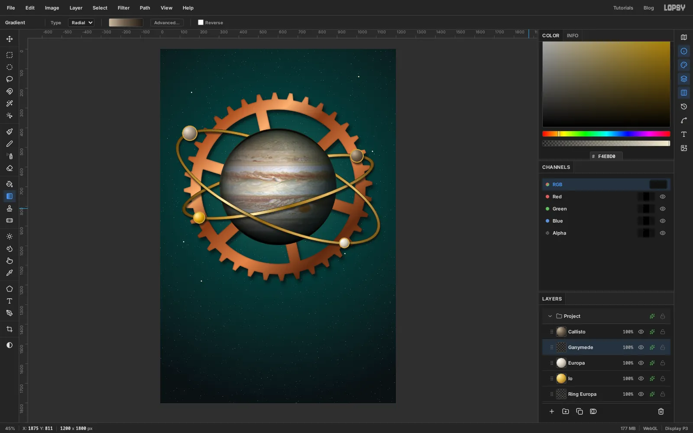

Jupiter's four big moons are Io, Europa, Ganymede and Callisto. Make each one on its own layer named after it:

1. Draw a small circle with the **Elliptical Marquee** where the moon sits on a ring.
2. Fill it with a **Radial** gradient of three stops (light, mid, dark), dragged from the upper left of the circle down past its lower right. That shades it like the planet.

Use these sizes, colours and places:

- `Io`, 52 px across, `#FFF1B0` → `#E0B040` → `#6A4A10`, on the front of `Ring Io` at about **199, 857**
- `Europa`, 44 px, `#FFFFFF` → `#D8CFBE` → `#5E5548`, on the front of `Ring Europa` at about **937, 986**
- `Ganymede`, 68 px, `#EDE4D4` → `#9C8E7E` → `#2E2822`, on the back of `Ring Europa` at about **151, 428**
- `Callisto`, 60 px, `#C9B9A0` → `#6E5E4C` → `#1F1A14`, on the back of `Ring Io` at about **1001, 543**

Select `Ring Europa` before you start so the moons land above both rings.

Give `Callisto` a brass **Stroke** of **5** in `#C9A24E` and a **Drop Shadow** (**Offset X** `6`, **Offset Y** `10`, **Blur** `12`, **Opacity** `70`). Copy its effects and paste them onto the other three moons.

## Group the orrery

The layer list is getting long. Click `Callisto` in the Layers panel, then [[Shift]]-click `Jupiter` to select everything from the moons down to the planet. Choose **Layer → Group Layers** and rename the group `Orrery`. Click the arrow on the group's row to collapse it.

## Give the gear a bevelled edge

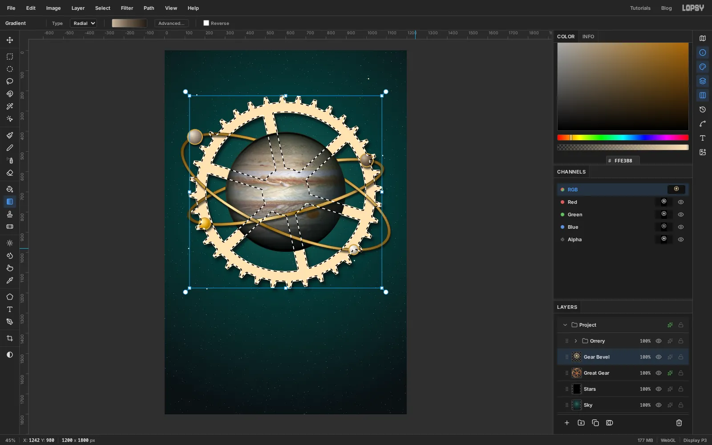

The copper still looks a little flat. Select `Great Gear` and add a layer above it called `Gear Bevel`. [[Cmd]]-click the `Great Gear` thumbnail to load the gear as a selection, set the foreground to `#FFE3B8` and choose **Edit → Fill**.

Now choose **Select → Shrink…**, enter `4` and click **Apply**. Press [[Delete]]. Only a 4 px cream outline of the gear is left. Deselect, soften it with **Filter → Gaussian Blur…** at a **Radius** of `1.5`, and set the layer's blend mode to **Overlay**. Every edge of the gear now catches the light.

## Polish the copper

Add a layer called `Gear Shine` and [[Cmd]]-click the `Great Gear` thumbnail again. Pick the **Gradient** tool, set **Type** back to **Linear**, and make a gradient that alternates black and white at partial opacity:

- black at 60%, at the left end
- white at 70%, about a third of the way along
- black at 30%, a little before the middle
- white at 45%, at about two-thirds
- black at 60%, at the right end

Drag it diagonally across the gear from the top-left to the bottom-right, deselect, and set the layer to **Overlay**. Overlay brightens the copper under the white bands and darkens it under the black ones, which is what a curved, polished surface does.

## Run an axle through the poles

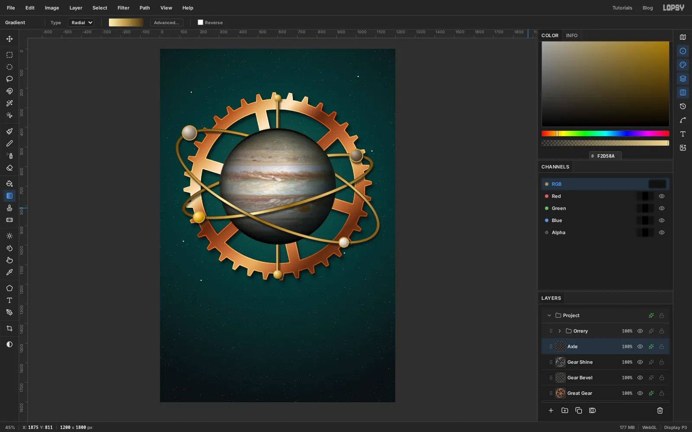

With `Gear Shine` selected, add a layer called `Axle`. The axle should be square to Jupiter's cloud bands, which run straight across the photo, so it runs straight up and down.

Pick the **Brush** at size **16**, hardness **100**, in dark brass `#6B4A1E`. Click at **600, 250**, then [[Shift]]-click at **600, 1150** to paint a straight line. Change to size **7** in `#F2D58A` and do the same from **597, 250** to **597, 1150** for a highlight down the rod.

For the finials, stay on the `Axle` layer. With the **Elliptical Marquee**, draw a circle about 36 px across on the top end of the rod and fill it with a radial brass gradient (`#FFF0B8` → `#C9A24E` → `#4A3410`) dragged from its upper left. Deselect, then do the same with a 44 px circle on the bottom end. Add a **Drop Shadow** to the layer (**Offset X** `6`, **Offset Y** `8`, **Blur** `10`, **Opacity** `60`).

The `Axle` layer sits below the `Orrery` group, so the planet hides the middle of the rod.

## Add two background gears

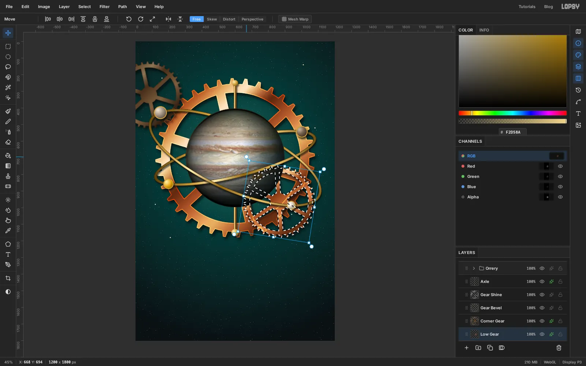

Two smaller gears in the corners make the whole poster feel like a machine.

**The top-left gear.** Select `Great Gear` and choose **Layer → Duplicate Layer**. The copy lands directly above `Great Gear`, under the bevel and shine layers. Rename it `Corner Gear` and [[Cmd]]-click its thumbnail: a single layer only gets transform handles when something is selected. With the **Move** tool, hold [[Cmd]] and drag the bottom-right corner handle up and to the left until the gear is about **400 px** across. Then drag it into the top-left corner so it hangs off the left edge, with its centre near **80, 320**. Press [[Cmd+D]]. Choose **Filter → Hue/Saturation…** with **Hue** `8`, **Saturation** `-35` and **Lightness** `-38` to darken it, and lower the layer to **70%** opacity.

**The bottom-right gear.** Duplicate `Great Gear` again and name it `Low Gear`. Load its selection, scale it down from the top-left corner to about **430 px**, and drag its rotation handle to turn it about **9°**, so its teeth don't line up exactly with the others. Then drag it down into the bottom-right corner so it hangs off the right edge, with its centre near **1195, 1545**. Press [[Cmd+D]], darken it with the same **Hue/Saturation** settings, and lower it to **45%** opacity, further back than the top gear.

> **Tip:** Scale and rotate a copy *before* you push it off the canvas. A selection made by [[Cmd]]-clicking a thumbnail only covers the part of the layer that's on the canvas.

## Fan out a halo of light

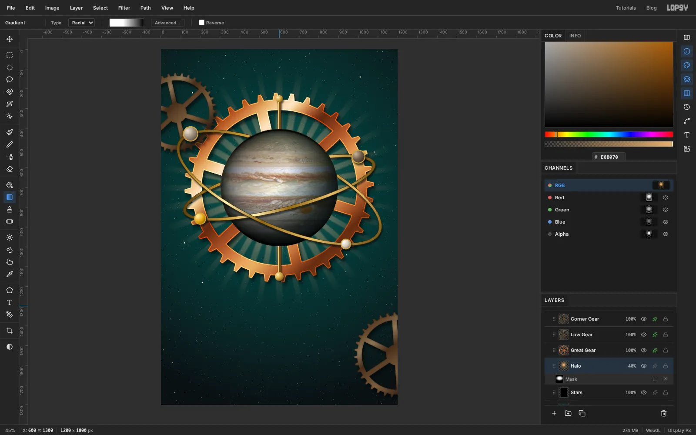

Select `Stars` and add a layer above it called `Halo`. Set the foreground to `#E8B070` and choose **Filter → Sunburst…**:

- **Rays** `36`, **Width** `30`, **Taper** `60`
- **Fade** `70`, **Softness** `40`, **Jitter** `30`
- **Center Y** `39`, which puts the centre of the rays behind the planet

Click **Apply**, then set the layer to **Screen**.

At full strength the rays run right to the edges and fight with the type. Click **Add Mask**, then drag a **Radial** gradient on the mask from the planet's centre outward about 600 px: white for the first 40%, fading to black at the end. Click the `Halo` row to leave the mask and lower the layer to **40%** opacity. The rays now glow behind the orrery and fade out before they reach the edges.

## Roll in some steam

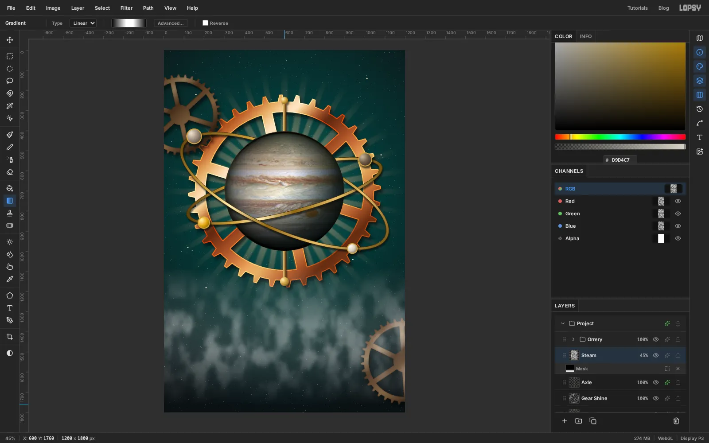

Select `Axle` and add a layer called `Steam`. Set the background colour to black and the foreground to `#D9D4C7`. The **Clouds** filter paints between the two. Choose **Filter → Clouds…** with **Scale** `60`. Soften it with **Gaussian Blur** at `16`, then lower the contrast with **Filter → Brightness/Contrast…** at **Brightness** `10`, **Contrast** `-35`. Without that, the clouds look like smog. Set the layer to **Screen**.

Click **Add Mask** and draw a linear gradient on the mask from **600, 1080** down to **600, 1760**, going black → white → white → black, with the white stops at about 40% and 60%. The steam now sits in a band behind where the title will go. Lower the layer to **45%** opacity.

## Draw the airship envelope

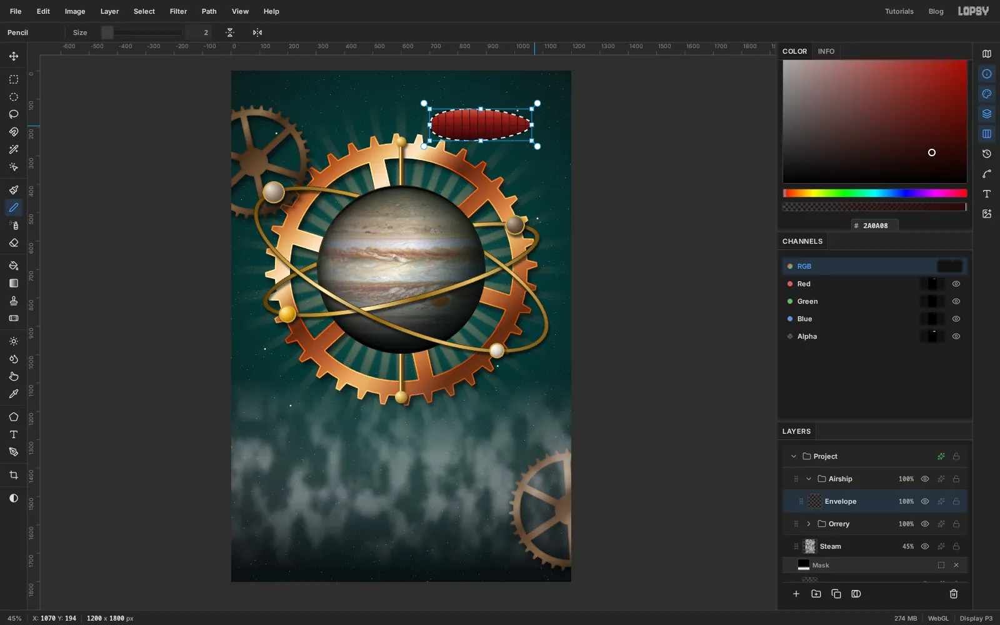

Select the `Orrery` group and click **New Group** at the bottom of the Layers panel. Name the group `Airship`, then add a layer inside it called `Envelope`.

With the **Lasso**, draw a cigar shape about 360 px long and 116 px tall centred on **880, 190**. Make the nose on the left blunt and round, and taper the tail on the right. Fill it with a vertical linear gradient from `#C2614A` at the top through `#8E2B22` and `#4A1210` to `#24080A` at the bottom.

Keep the selection for the ribs. Pick the **Pencil** (**N**) at size **2** in `#2A0A08`. Click above the envelope and [[Shift]]-click below it to draw a straight vertical line every 28 px or so, plus one long line from nose to tail. The selection clips the lines to the envelope. Deselect and add a **Drop Shadow** (**Offset X** `6`, **Offset Y** `14`, **Blur** `16`, **Opacity** `55`).

## Finish the airship and tilt it

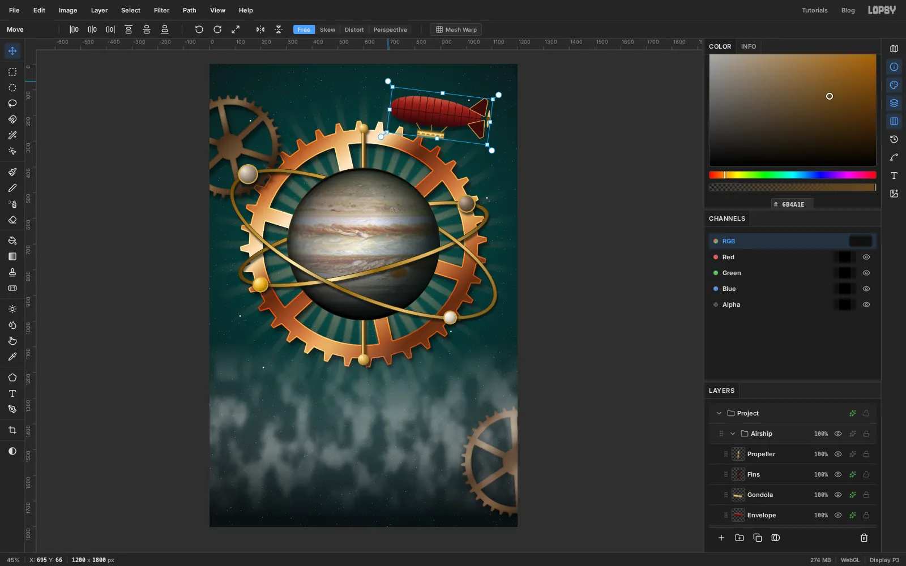

Add three more layers in the `Airship` group, each above the last.

**`Gondola`.**

1. With the **Pencil** at size **2** in `#C9A24E`, draw three short [[Shift]]-click lines hanging about 25 px down from the bottom of the envelope, splayed slightly outward.
2. Marquee a 104 × 26 px box under them, from about **818, 264** to **922, 290**, and fill it with a vertical brass gradient.
3. With the **Elliptical Marquee**, fill five 8 px dots in `#FFE2A0` in a row along the middle of the cabin for windows.
4. Turn on **Outer Glow** (**Size** `8`, **Opacity** `45`, `#FFB347`). It glows around the whole cabin, so the gondola looks lamp-lit.

**`Fins`.** With the **Lasso**, draw a swept-back triangle off the top of the tail, about 50 px tall. Hold [[Shift]] and add a mirror image off the bottom. Fill them with `#3A0F0D` and give the layer a **Stroke** of **3** in `#C9A24E`.

**`Propeller`.** Just behind the tail tip, use the **Elliptical Marquee** to fill a thin upright ellipse, 10 × 68 px, in `#E2C175`, then a 16 px dark hub in `#6B4A1E` on its centre.

Now tilt the whole ship at once. Deselect, click the `Airship` group row and pick the **Move** tool. With a group selected, the transform box frames every layer inside it. Drag the rotation handle to turn the airship about **7°** clockwise so the nose lifts, then press [[Cmd+D]]. Drag the group about 90 px left and 20 px down to tuck it closer to the gear.

## Add a smoke trail

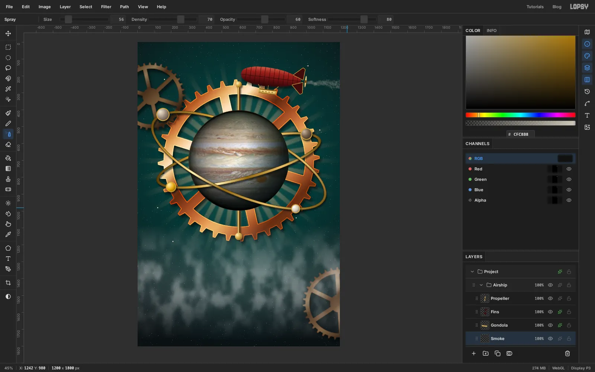

Select `Envelope` and add a layer called `Smoke`. Pick the **Spray** tool (**J**) in `#CFC8B8` with **Density** `70`, **Opacity** `60` and **Softness** `80`. Drag four short, slightly wavy strokes from the propeller to the right edge, raising **Size** each time: `20`, `30`, `42`, then `56`. The trail spreads out as it drifts away. Blur it a little with **Gaussian Blur** at `3` and set the layer to **80%** opacity. Collapse the `Airship` group.

## Set the title

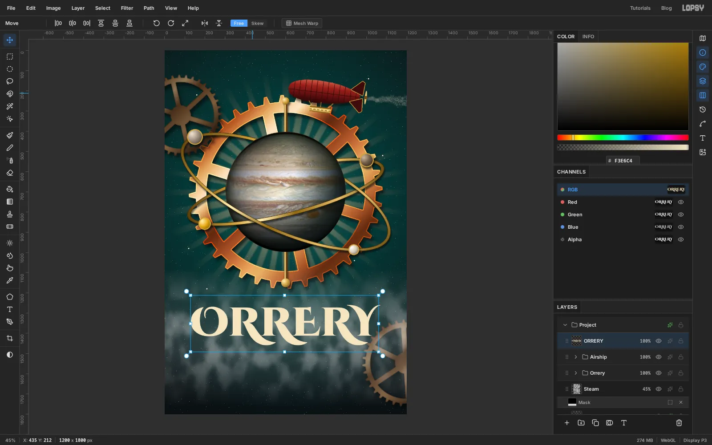

Set the foreground to `#F3E6C4` and pick the **Text** tool (**T**). Click in an empty spot in the lower half of the page, choose **Cinzel Decorative** in the options bar, set **Size** to `200` and the weight to **Black**, then type `ORRERY` and press [[Tab]].

Switch to the **Move** tool and click **Align center horizontally** in the options bar to centre it on the page. Use [[Shift]]+arrow keys to nudge it until the letters sit between about **y 1260** and **y 1458**. That leaves room above for the bottom finial and below for the banner.

## Gild the letters

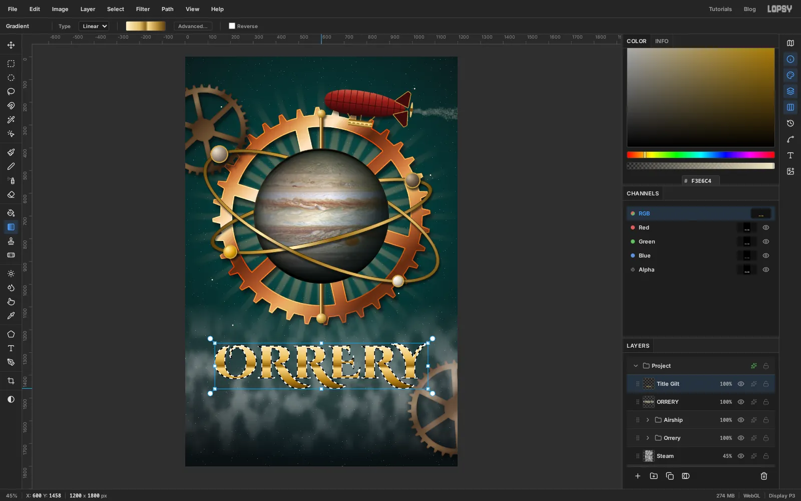

[[Cmd]]-click the `ORRERY` thumbnail to load the letters as a selection, and add a layer called `Title Gilt`. Make a six-stop gold gradient: `#FFF4CC`, `#E2BB62` at about a third of the way, `#8C6420` at the middle, `#F6DB8E` just after it, `#B88A34` and `#5C4012`. The dark stop sitting right next to a bright one is what makes it look like a polished metal edge. Drag it straight down from the top of the letters to the bottom, then deselect.

Select the `ORRERY` text layer underneath and give it a **Stroke** of **5** in `#1E1206` and a **Drop Shadow** with **Offset X** `0`, **Offset Y** `12`, **Blur** `18`, **Opacity** `80`. The outline shows around the gold and lifts the title off the steam.

## Hang the ribbon banner

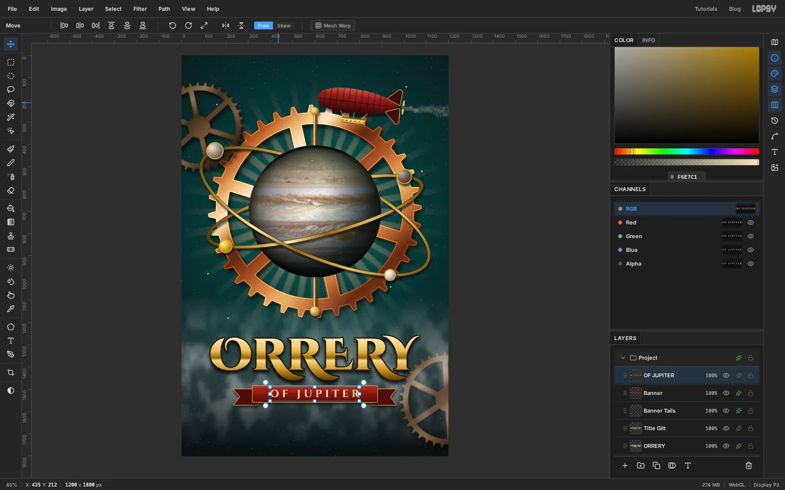

With `Title Gilt` selected, add a layer called `Banner Tails`. With the **Lasso**, draw a tail on the left: a 108 × 70 px box from about **236, 1500** with a V-shaped notch cut into its outer end. Hold [[Shift]] and draw the matching tail on the right, mirrored, from about **856** to **964**. Fill both with `#4A1210`.

Add a layer called `Banner`. Marquee a 560 × 72 px box from **320, 1486**, which covers the inner ends of the tails, and fill it with a vertical gradient from `#A8382C` through `#7A2219` to `#4E130F`. Give it a **Stroke** of **3** in `#C9A24E` and a **Drop Shadow** (**Offset Y** `8`, **Blur** `14`, **Opacity** `70`). Copy the effects and paste them onto `Banner Tails`.

Now the words. Click somewhere empty with the **Text** tool and type `OF JUPITER` in **Cinzel Bold** at **46** px in `#F6E7C1`, then press [[Tab]]. In the **Text** panel, set **Letter spacing** to `14`. Centre it with **Align center horizontally**, then nudge it until the capitals sit in the middle of the banner, with the same gap above and below (about 16 px each). Capitals have no descenders, so the visible letters are what you centre, not the text box.

Select `OF JUPITER`, [[Cmd]]-click `Banner`, `Banner Tails`, `Title Gilt` and `ORRERY`, choose **Layer → Group Layers** and name the group `Title Block`. Collapse the group with its arrow: while an expanded group is active, new layers go inside it, and the credits belong outside.

## Add the tagline and credits

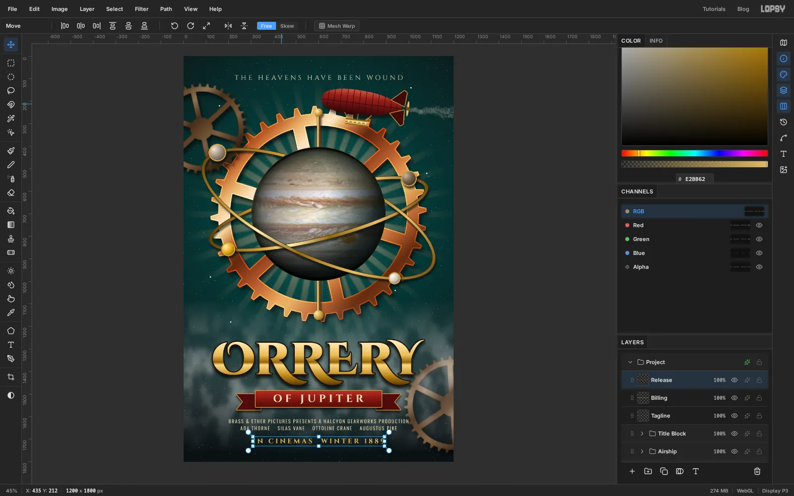

Every film poster has the same supporting cast of type:

- **Tagline.** `THE HEAVENS HAVE BEEN WOUND` in **Cinzel Regular**, **30** px, `#F3E6C4`, with **Letter spacing** `9`. Centre it and move it to about **y 94**, well clear of the frame you'll add next.
- **Billing block.** Pick **Oswald** at **22** px in `#E3D6B4` and set the options bar's **Align** to **Center**. Type `BRASS & ETHER PICTURES PRESENTS A HALCYON GEARWORKS PRODUCTION`, press [[Enter]] for a second line, and type four invented star names separated by wide gaps. Commit with [[Tab]], set **Letter spacing** to `3`, and centre the block on about **y 1636**.
- **Release line.** `IN CINEMAS  WINTER 1889` in **Cinzel Bold**, **30** px, `#E2BB62`, **Letter spacing** `8`, centred on about **y 1708**. That keeps about 50 px clear above the bottom of the frame.

Rename the three layers `Tagline`, `Billing` and `Release`.

## Frame it in brass

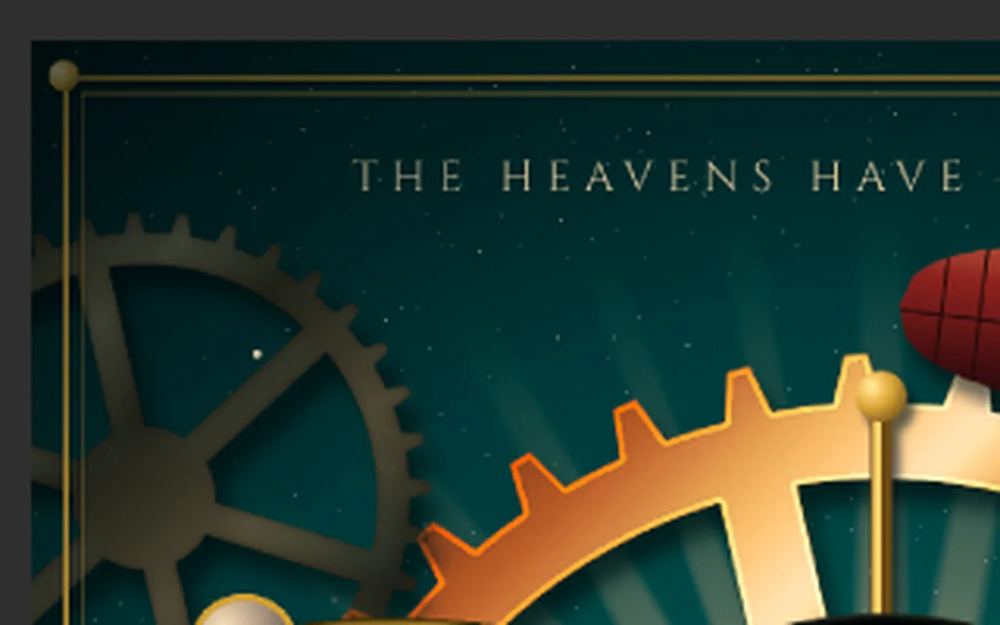

Add a layer called `Frame` at the top of the stack. Set the foreground to `#C9A24E`:

1. Marquee from **24, 24** to **1176, 1776** and choose **Edit → Fill**. The whole page turns gold for a moment. Filling and then deleting the inside gives a rule with perfectly square corners, which is hard to get with a brush.
2. Choose **Select → Shrink…** with `3`, and press [[Delete]]. A 3 px rule is left around the edge.
3. Marquee from **36, 36** to **1164, 1764**, fill it, shrink by `1` and press [[Delete]] for a hairline inner rule.

Put a rivet on each corner of the outer rule: draw a circle 22 px across centred on the corner and fill it with a radial brass gradient. Deselect, and give the layer a small **Drop Shadow** (**Offset Y** `3`, **Blur** `4`, **Opacity** `70`).

## Add grain, a vignette and a colour grade

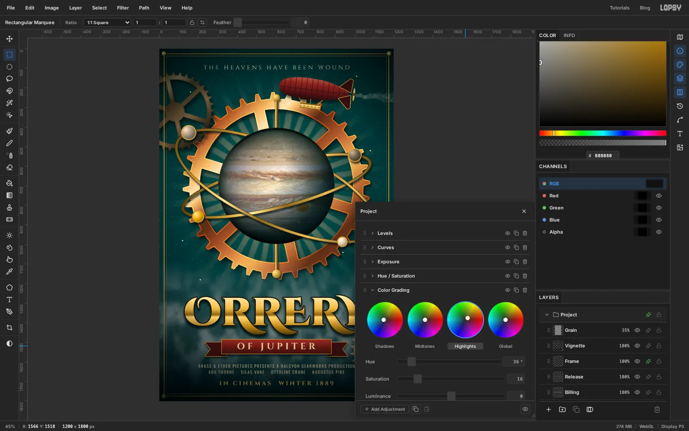

Three finishing touches make it look printed rather than assembled:

1. **Vignette.** Add a layer called `Vignette`. Drag a **Radial** gradient of `#020606` from the middle of the page out past the bottom corner, transparent for the first 55% and rising to 85% opacity at the end. Set it to **Multiply**.
2. **Grain.** Add a layer called `Grain`, fill it with `#808080`, run **Add Noise** at **Amount** `40` with **Mono** and **Gaussian**, set it to **Overlay** and lower it to **35%**. Grey disappears under Overlay, so only the speckle is left.
3. **Colour grade.** Open the `Project` group's drawer with the sparkle button on its row. It already lists **Levels**, **Curves**, **Exposure** and **Hue / Saturation** at neutral settings; leave those alone. Expand **Color Grading**, click **Shadows** and set **Hue** to `188` and **Saturation** to `7`. Then click **Highlights** and set **Hue** `36`, **Saturation** `16`. That cools the shadows towards teal and warms the highlights towards brass. Keep it subtle: much more saturation in the shadows turns the red banner muddy.

Save the project with **File → Save Project**, then export it with **File → Quick Export PNG**.
