Street art lives where people live, and few places show it better than a city basketball court at night. The painted court, the tag on the handball wall and a single sodium streetlight make a scene that is half illustration and half mural.

In this tutorial you'll paint **Basketball Night**: a neighbourhood court after dark, built entirely in Lopsy without any photos. The court surface is painted with big abstract shapes, the way artists such as William LaChance have repainted real courts. The wall behind it carries a graffiti mural, and a streetlight and a night colour grade pull it all together. The finished painting has:

- a **starry night sky** and a **city skyline** whose lit windows come from a pattern you define
- a **chain-link fence** made from a tiny tile you draw with the Pencil
- a **graffiti mural**: a spray-paint tag with outline, 3D shadow and drips, overspray, zigzags, a striped sun, sparkles and a tilted wheatpaste poster, all masked to the wall
- a **painted court** drawn flat, then laid into the scene with a **Perspective** transform
- a **hoop and net**, and a **basketball** with Pen-tool seams and a motion trail
- **night lighting**: a darkening layer with a gradient mask, a light cone and a pool of streetlight, a colour grade, a vignette and film grain

The tools you'll use:

- the **Gradient**, **Spray**, **Brush**, **Pencil**, **Eraser**, **Shape**, **Pen** and **Text** tools
- the **Rectangular** and **Elliptical Marquee** and the **Lasso**, with [[Shift]] to add, **Select → Inverse**, **Shrink** and **Feather**
- **Edit → Define Pattern** and **Fill with Pattern**, **Copy** and **Paste**, **Merge Down** and **Duplicate Layer**
- the **Move** tool's **Free** and **Perspective** modes, and transforming several layers or a whole group at once
- **Stroke**, **Drop Shadow** and **Outer Glow** effects, and the **Multiply**, **Screen** and **Overlay** blend modes
- layer masks, including a mask on a group
- **Add Noise**, **Gaussian Blur** and **Motion Blur**, and the **Color Grading** and **Vignette** adjustments
- **Sedgwick Ave Display** and **Bungee** from the font picker

The palette:

- Sky `#05071A` → `#1A1242` → `#5A1E5C` → `#E0577A`
- Stars `#FFF6E0`, skyline `#140F2E`, windows `#FFC857`
- Fence wire `#C9D1E0`, rail `#8C95AA`, posts `#7D869C`
- Wall `#2B2842`, wall cap `#48436A`, seams `#1A1829`
- Tag lime `#C6FF3D`, outline `#110D22`, hot pink `#FF3E8A`
- Violet `#6A35E0`, cyan `#22D3EE`, sparkle cream `#FFF3D6`
- Poster paper `#F1E6CC`, poster red `#E8432E`, poster ink `#1A1630`
- Asphalt `#1B1C2E`, court teal `#177E86`, coral `#F2545B`, mustard `#F6B93B`, lines `#F4F1E8`
- Backboard `#EEF2F7`, rim orange `#FF5A1F`, bracket `#C2410C`, net `#C4CAD6`, base plate `#0E0F18`
- Pole `#1A1D29` → `#6B7590` → `#151823`
- Ball `#FFC07A` → `#F2701F` → `#8E2F0C`, seams `#2A1206`
- Night shade `#1B1846`, shadows `#05040C`, cracks `#0E0D1F`, texture grey `#808080`
- Lamp post `#10111B`, lamp head `#1B1D2B`
- Lamp light `#FFF1C9`, glow `#FFC46B`, cone `#FFE2A0`, pool `#FFD58A`

> **Tip:** The canvas is 1600 × 1200 px. Positions are written `x, y` in document pixels from the top-left corner, and the status bar at the bottom shows where the pointer is. The landmarks are the **top of the wall** at `y 532`, the **back edge of the court** at `y 780`, and the centre line of the hoop at `x 800`.

> **Tip:** Key names are Mac keys. On Windows and Linux, use Ctrl for Cmd. **Edit → Fill** fills the selection (or the whole layer) with the foreground colour, and [[Cmd+D]] deselects. To load a layer's shape as a selection, [[Cmd]]-click its thumbnail in the Layers panel. Filter dialogs open with their default values every time, so set every value a step lists.

> **Tip:** **Add Layer** and **New Group** put the new item directly above the active layer, inside the same group if that layer is in one, and a new layer goes inside a group when the group itself is active. Start new text in empty canvas: a Text-tool click on an existing text layer edits that layer instead. You can always move text into place afterwards.

## Paint the night sky

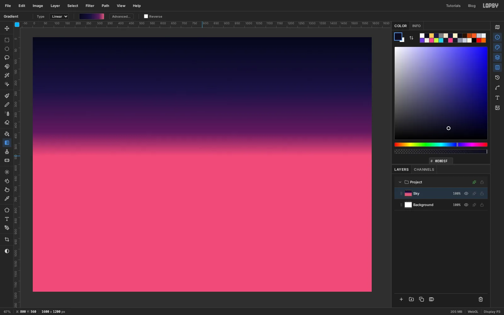

1. Open [Lopsy](/). In the **New Document** dialog, set **Width** to `1600` and **Height** to `1200`, leave the background **White** and click **Create**.
2. Double-click `Layer 1` in the Layers panel and rename it `Sky`.
3. Pick the **Gradient** tool, set the type to **Linear** and click **Advanced…**. Make four stops: `#05071A` at the left end, `#1A1242` a little before halfway, `#5A1E5C` at about 80% and `#E0577A` at the right end. Click **Done**.
4. Drag straight down from the top edge of the canvas to just below the middle, around `y 560`.

Everything below the drag fills with the last colour. That's fine, because the wall and the court will cover it. The hot pink at the bottom is the glow of the city on the horizon.

## Spray a sky full of stars

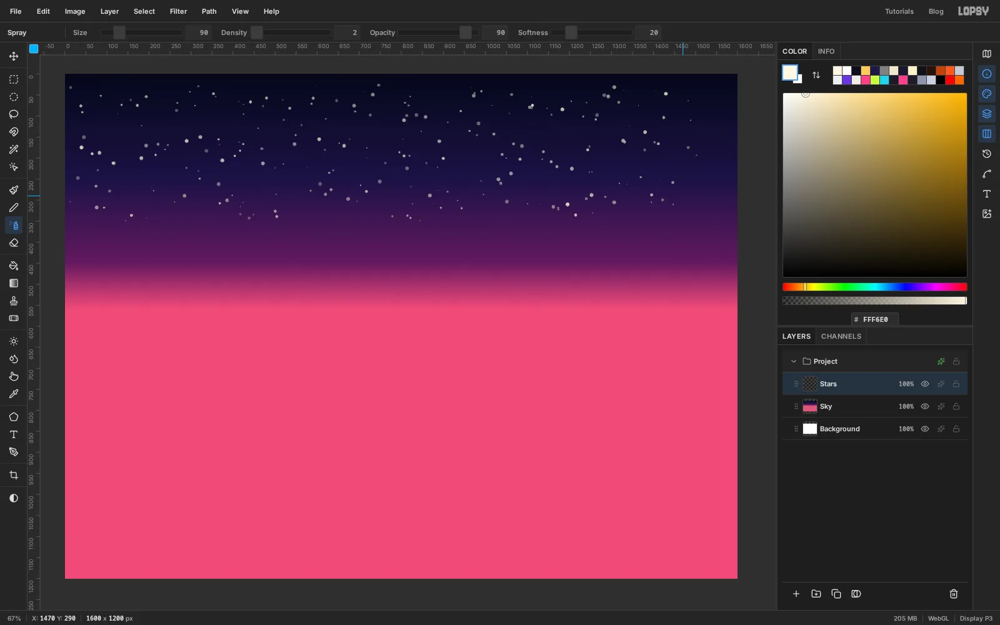

1. Add a layer with the **+** button at the bottom of the Layers panel and name it `Stars`.
2. Pick the **Spray** tool. Set **Size** to `90`, **Density** to `2`, **Softness** to `20` and **Opacity** to `90`.
3. Set the foreground colour to `#FFF6E0`.
4. Drag three long, slightly wavy strokes across the sky from left to right: one near the top, one through the middle of the sky and one just above the horizon glow.

With such a low density, the spray drops only a couple of dots at a time, so you get a loose scatter of stars instead of a cloud. Each dot gets a random size and opacity, so some stars look nearer than others.

## Cut out the skyline

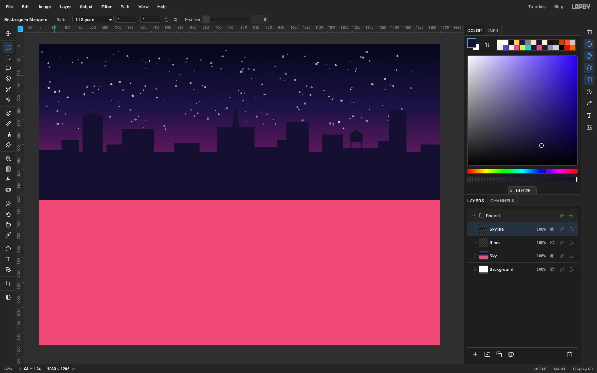

1. Add a layer named `Skyline` and set the foreground colour to `#140F2E`.
2. With the **Lasso**, click out a city outline from the left edge to the right: a row of rectangular rooftops of different heights, all between about `y 330` and `y 470`. Bring the outline down to `y 620` at both edges, close it, and choose **Edit → Fill**.
3. Add a few landmarks the same way, filling each one:
   - a narrow **spire** rising to about `y 250` just left of the middle
   - a **tall tower** with a peaked roof on the left, about 80 px wide, rising to about `y 270`
   - a **slim tower** on the right with a thin antenna on top
   - a **water tower** on one of the right-hand roofs: a small box with a triangular roof and two thin legs
4. Marquee a band across the whole width from `y 430` to `y 620` and fill it too, so there are no gaps at the bottom of the skyline.

Keep the shapes simple and flat. At night the buildings are silhouettes, and the windows will tell the viewer what they are.

## Define a window pattern and fill the skyline with it

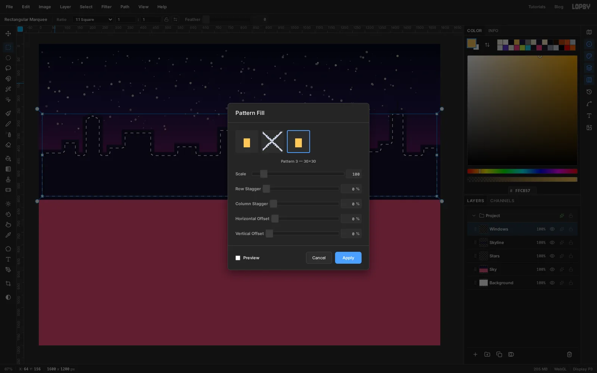

1. Add a temporary layer. With the **Rectangular Marquee**, draw a box about 10 × 14 px and fill it with `#FFC857`. This is one window.
2. Draw a 30 × 30 px marquee with the window near its lower right and choose **Edit → Define Pattern**. Press [[Cmd+D]], then delete the temporary layer with the bin button.
3. Click the `Skyline` layer, then add a new layer above it named `Windows`.
4. [[Cmd]]-click the **Skyline** thumbnail to select the buildings, then choose **Select → Shrink…** and shrink by `14` px. This keeps windows away from the roof edges.
5. Choose **Edit → Fill with Pattern…**. Your window tile is already selected. Click **Apply** and press [[Cmd+D]].

The pattern tiles across the whole selection, so every building is now covered in a neat grid of lit windows. That's a good start, but no city has every light on at once.

## Switch some lights off

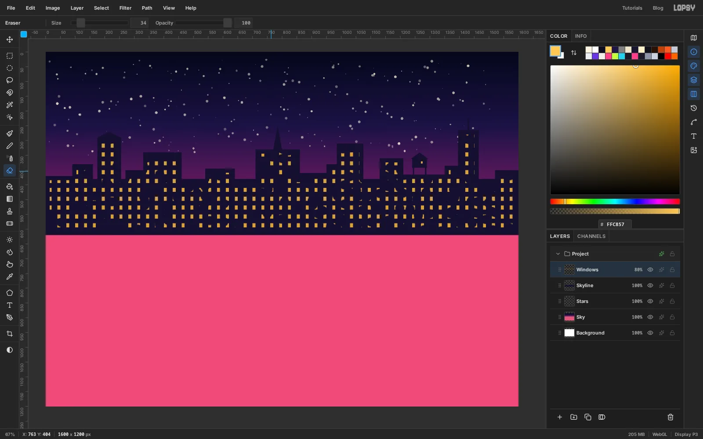

1. Pick the **Eraser**. Set **Size** to `34` and **Opacity** to `100`.
2. Click over the skyline in short bursts, at random, until about half the windows are dark. Leave some floors fully lit and some towers almost dark.
3. Click the `100%` readout on the **Windows** row and drag the slider to `80%`, so the windows glow a little less than the stars.

Single clicks remove one or two windows at a time, which looks more natural than dragging.

## Put up a chain-link fence

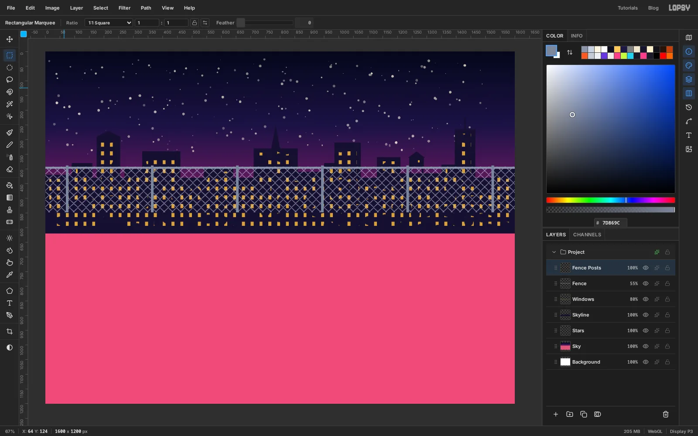

1. Add a temporary layer. With the **Rectangular Marquee**, draw a small square, 28 × 28 px. Leave it selected.
2. Pick the **Pencil**, set **Size** to `2` and the colour to `#C9D1E0`. Draw an X from corner to corner of the square: click at one corner and [[Shift]]-click the opposite corner for a straight line, then do the same for the other diagonal.
3. Choose **Edit → Define Pattern**. Deselect and delete the temporary layer.
4. Add a layer named `Fence`. Marquee a band across the whole canvas from about `y 392` to `y 548`, choose **Edit → Fill with Pattern…**, make sure the new X tile is selected, and click **Apply**. Deselect.
5. Set the **Fence** layer's opacity to `55%`.
6. Add a layer named `Fence Posts`. Pick the **Brush** with **Size** `7`, **Hardness** `100` and colour `#8C95AA`. Click at the left edge at `y 396` and [[Shift]]-click the right edge at the same height for the top rail.
7. With the **Rectangular Marquee**, draw posts 9 px wide from the rail down to `y 548`, the first at `x 70` and then every 290 px. Fill each one with `#7D869C`.

The X tiles join up edge to edge into diamond mesh. At 55% opacity the windows show through it.

## Build the wall

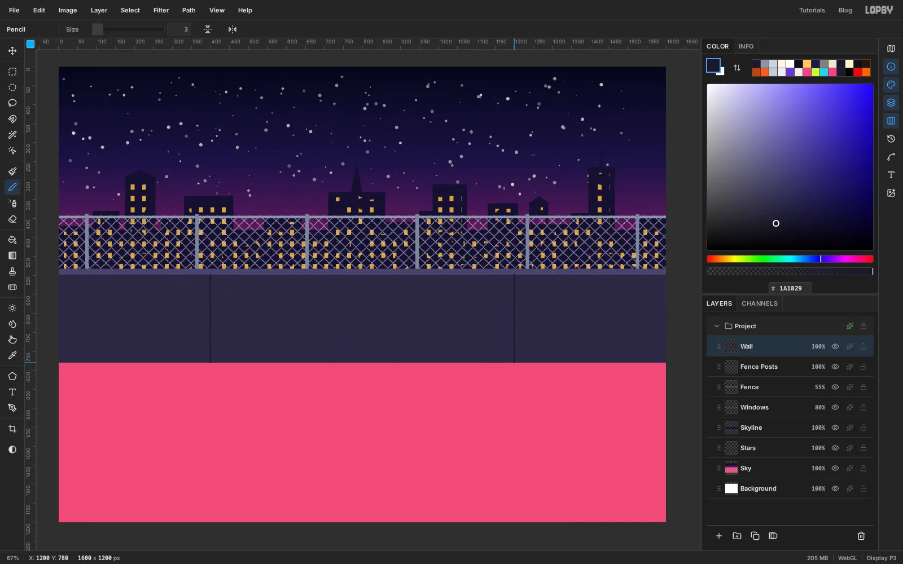

1. Add a layer named `Wall`.
2. Marquee from the left edge at `y 540` to the right edge at `y 780` and fill it with `#2B2842`.
3. Marquee a thin strip along the top, from `y 532` to `y 548`, and fill it with `#48436A` for the wall's cap.
4. Deselect and choose **Filter → Add Noise…**. Set **Amount** to `12`, click **Mono** and **Gaussian**, and click **Apply**.
5. Pick the **Pencil** with **Size** `3` and colour `#1A1829`. Draw two vertical expansion seams at `x 400` and `x 1200`, by clicking at the top of the wall and [[Shift]]-clicking at the bottom.

The noise is subtle on its own. It gives the wall a slightly gritty surface that will catch the colour grade later.

## Start the mural with a striped sun

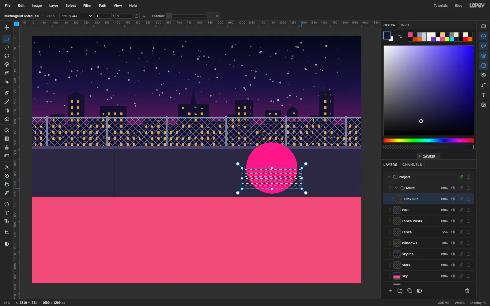

Everything painted on the wall goes into one group, so you can clip the whole mural to the wall later.

1. Click **New Group** in the Layers panel toolbar and name the group `Mural`. Then add a layer inside it named `Pink Sun`.
2. Pick the **Shape** tool. Set **Shape** to **Ellipse** and **Output** to **Pixels**. Click the fill swatch and set it to `#FF3E8A`, and make sure there is no stroke.
3. The Shape tool draws from the centre out. Press at `1165, 640`, about two thirds of the way along the wall, and drag out a circle about 248 px across.
4. Pick the **Rectangular Marquee**. Drag a thin band across the lower half of the circle, then hold [[Shift]] and drag four more bands below it. Make each band a little thicker than the one above, about 7 px for the top one and 14 px for the bottom one.
5. Press [[Delete]] to cut the stripes out, then press [[Cmd+D]].

This is the classic retro sunset disc you see on murals and skate decks. The stripes get thicker towards the bottom, which suggests the sun is sinking.

## Add the blob, overspray and zigzags

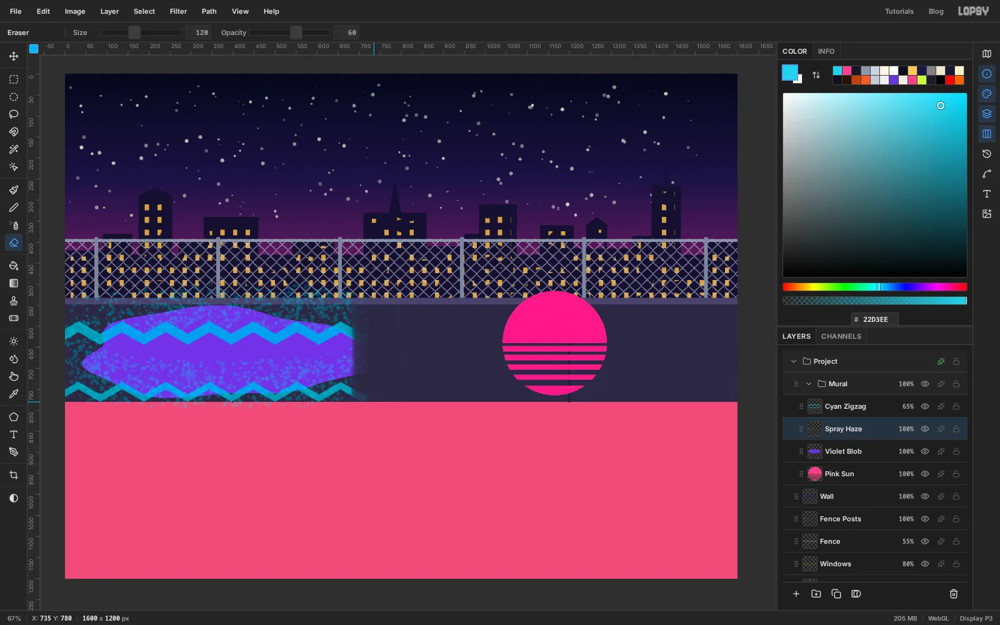

1. Add a layer named `Violet Blob`. With the **Lasso**, draw a wide, lumpy oval across the left half of the wall, about 680 px wide and 210 px tall, and fill it with `#6A35E0`.
2. Add a layer named `Spray Haze`. Pick the **Spray** tool and set **Size** `120`, **Density** `60`, **Opacity** `50` and **Softness** `80`. In `#22D3EE`, drag one loop all the way round the blob's edge.
3. Add a layer named `Cyan Zigzag`. With the **Lasso**, click out a zigzag band about 26 px thick across the top of the blob, from the left edge to about `x 760`. Fill it with `#22D3EE`. Draw a thinner band, about 18 px thick, along the bottom of the blob and fill it too.
4. Pick the **Eraser** with **Size** `120` and **Opacity** `60`. On each of the three layers, drag two vertical strokes over the right-hand ends, around `x 735` and `x 770`. The shapes now fade out instead of stopping in a hard line.
5. Set **Cyan Zigzag** to `65%` opacity.

The overspray is what makes this read as spray paint and not as vector art. Real graffiti always has a halo of dots where the can was moving fast.

## Write the tag

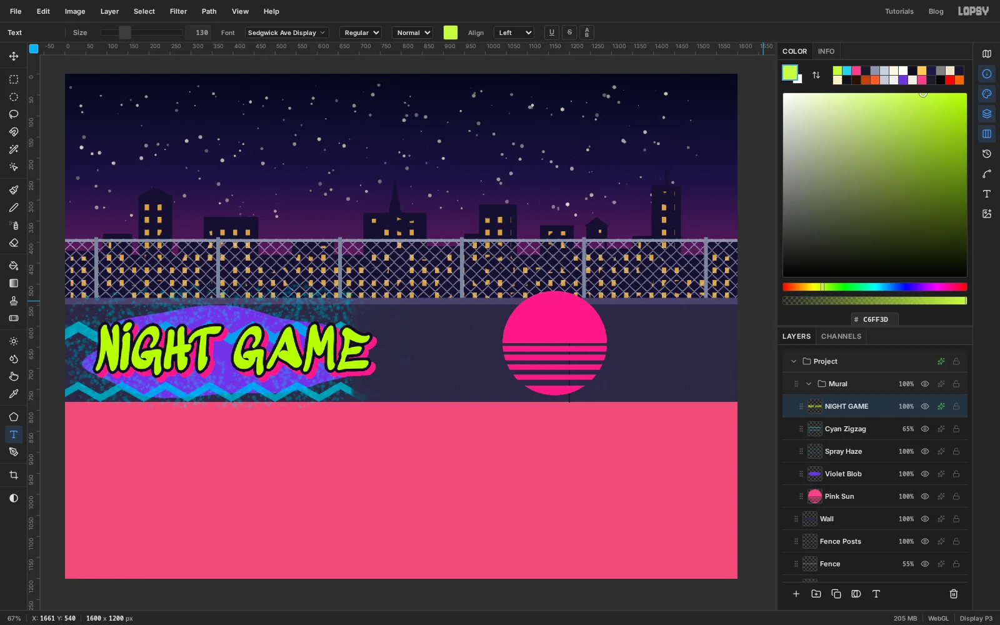

1. Set the foreground colour to `#C6FF3D` and pick the **Text** tool.
2. Click in empty canvas near the top-left of the blob. Before typing, set **Size** to `130` and choose **Sedgwick Ave Display** in the font picker. Type `NIGHT GAME`, then press [[Tab]] to commit.
3. Click the ✦ button on the **NIGHT GAME** row to open its effects:
   - Turn on **Stroke**. Set **Width** to `7` and the colour to `#110D22`.
   - Turn on **Drop Shadow**. Set **Offset X** and **Offset Y** to `10`, **Blur** to `0`, **Spread** to `7`, **Opacity** to `100` and the colour to `#FF3E8A`.

Sedgwick Ave Display is based on real handstyles from the Bronx, and its lowercase "i" is part of that look. A shadow with no blur and a big spread gives the solid, blocky 3D edge that writers paint with a second can.

## Tilt the tag and add drips

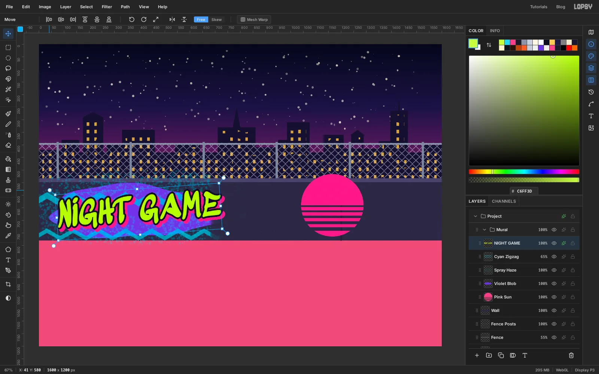

1. Pick the **Move** tool. Handles appear around the text. If the options bar shows **Free / Skew / Distort / Perspective** buttons, make sure **Free** is selected.
2. Grab the round rotation handle outside the top-left corner and drag it a little downwards, until the tag rises about 4° to the right. Press [[Cmd+D]] to commit. The text stays editable.
3. Add a layer named `Drips` above the tag. Pick the **Brush** with **Size** `6`, **Hardness** `100` and **Opacity** `100`, in `#C6FF3D`.
4. Under seven or so of the letters, drag short straight drips downwards from the bottom of the letter. Make them different lengths, from about 30 to 80 px.
5. Set **Size** to `11` and click once at the end of each drip to give it a round blob at the bottom.

A tag that sits perfectly level looks typeset. A slight upward tilt makes it feel like it was painted fast by an arm, not laid out on a grid.

## Copy, scale and rotate a sparkle

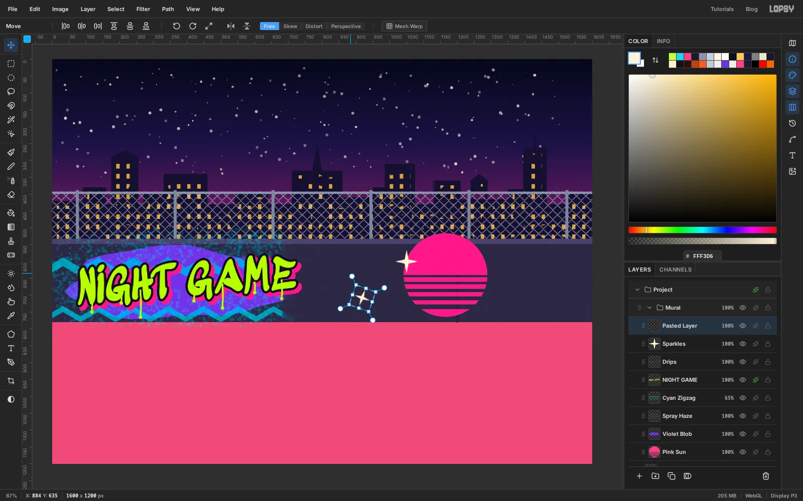

1. Add a layer named `Sparkles`. With the **Lasso**, click out a thin four-pointed star about 68 px tall just left of the pink sun, and fill it with `#FFF3D6`.
2. Marquee around the sparkle, then press [[Cmd+C]] and [[Cmd+V]]. The copy pastes on its own layer right on top of the original.
3. Press [[Cmd+D]], pick the **Move** tool and drag the copy down and to the left, to around `930, 720`, into the empty stretch of wall left of the sun.
4. Marquee around the copy. With the **Move** tool, hold [[Cmd]] and drag the bottom-right corner handle inwards until the sparkle is about three quarters of its size. Press [[Cmd+D]].
5. Marquee it again, grab the rotation handle and turn it about 20°. Press [[Cmd+D]].
6. With the pasted layer active, press [[Cmd+E]] to merge it down into **Sparkles**.

Holding [[Cmd]] keeps the sparkle's proportions while you scale it. The tilt stops the two sparkles from looking like stamped copies.

## Paste up a poster

1. With **Sparkles** active, click **New Group** and name the new group `Poster`. Add a layer inside it named `Paper`.
2. Marquee a rectangle 176 × 198 px on the right of the wall, leaving about 60 px between it and the right edge of the canvas. Fill it with `#F1E6CC`, then run **Filter → Add Noise…** with **Amount** `6`, **Mono** and **Gaussian**.
3. Marquee the bottom 64 px of the paper and fill it with `#E8432E`.
4. With the **Lasso**, draw a small triangle over the top-right corner, with a slightly wobbly diagonal edge, and press [[Delete]] to tear the corner off. Deselect.
5. Set the foreground to `#1A1630`. With the **Text** tool, click in empty canvas, choose **Bungee** at **Size** `48`, and type `OPEN`. Press [[Tab]]. Make a second text layer, `RUN`, the same way.
6. Set the foreground to `#F1E6CC` and make a third text layer, `FRI 9PM`, at **Size** `26`.
7. With the **Move** tool, drag each line into place:
   - `OPEN` centred on the paper, about 26 px below its top edge
   - `RUN` centred under it, with a 16 px gap
   - `FRI 9PM` centred in the red band, top to bottom and side to side

Remember to start each line in empty canvas, as the opening tip says. The arrow keys nudge the active layer 1 px at a time, which makes centring easy.

## Rotate the whole poster as one piece

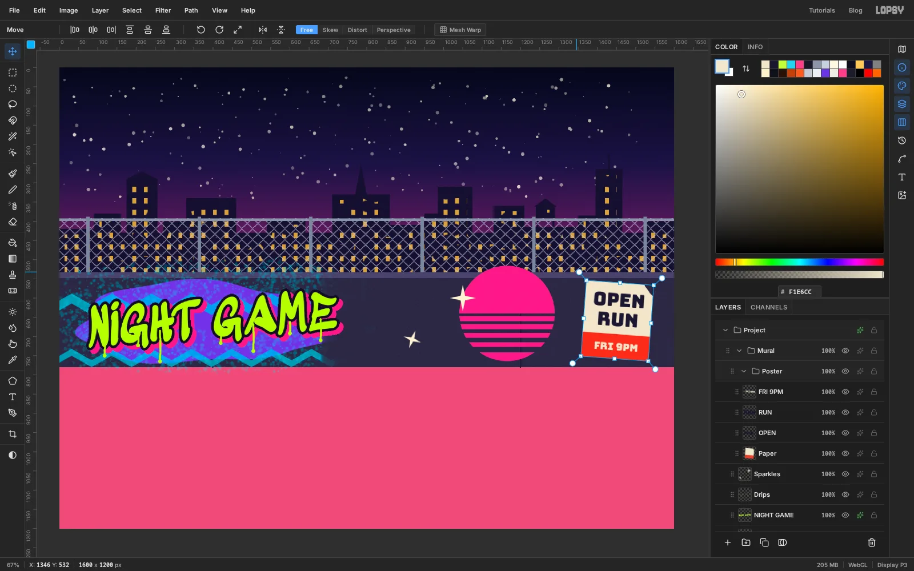

1. Click the **Poster** group row in the Layers panel.
2. Pick the **Move** tool. One set of handles frames the paper and all three text layers.
3. Drag the rotation handle outside the top-left corner a little upwards, turning the poster about 4° clockwise. Press [[Cmd+D]].

Transforming the group turns everything in it together, and the text layers stay live. You can still double-click **RUN** and retype it.

## Mask the mural to the wall

The blob, the zigzags and the spray spill past the wall's edges. A mask on the group trims all of them at once.

1. [[Cmd]]-click the **Wall** layer's thumbnail. The marching ants trace the wall.
2. Click the **Mural** group's row to make it active. The selection stays.
3. Click **Add Mask** in the Layers panel toolbar. The group gets a mask that reveals only the selection, and the selection is dropped.

Anything you paint into the Mural group from now on is clipped to the wall too.

## Lay out the court flat

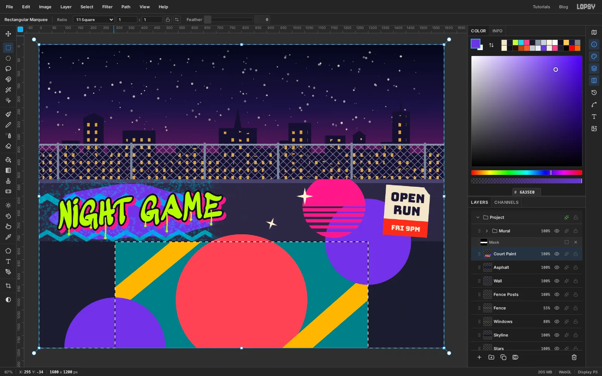

You'll paint the court straight on, as if you were looking down at it, and then tilt it into the scene.

1. Collapse the Mural group with its arrow, then click the **Wall** layer so the next layers go above it.
2. Add a layer named `Asphalt`. Fill a band from `y 778` to the bottom of the canvas with `#1B1C2E`, and give it **Add Noise** at **Amount** `10`, **Mono** and **Gaussian**.
3. Add a layer named `Court Paint`. Marquee a rectangle from `300, 780` to `1300, 1200` and fill it with `#177E86`.
4. Paint the big shapes on top, each with a selection and **Edit → Fill**:
   - a coral `#F2545B` circle, 520 px across, centred low in the rectangle, at `800, 1010`
   - two mustard `#F6B93B` diagonal bands made with the **Lasso**, one across the upper left and one across the lower right
   - two violet `#6A35E0` circles, one on the bottom-left corner and one on the top-right corner
5. Marquee the court rectangle again, choose **Select → Inverse** and press [[Delete]] to trim anything that spills over. Deselect.

The shapes echo a court's markings without matching them: a circle where the key is, bands where the corners are. That play between paint and lines is what makes painted courts fun to look at.

## Draw the court lines

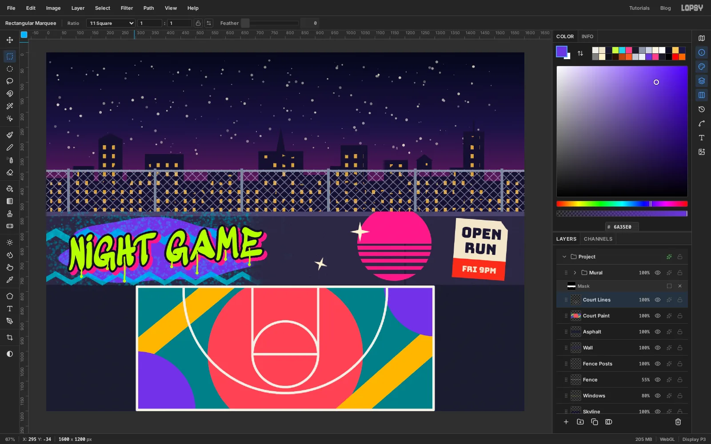

1. Add a layer named `Court Lines`.
2. Pick the **Shape** tool and set **Shape** to **Rectangle**. Remove the fill, set the stroke to `#F4F1E8` and set **Width** to `8`.
3. Draw the court boundary: press at the centre of the court rectangle, `800, 990`, and drag to its bottom-right corner so the line runs just inside the edge.
4. Draw the **key**, a rectangle 220 px wide and 230 px tall that starts at the top edge, centred on `x 800`.
5. Switch **Shape** to **Ellipse**. Draw the **free-throw circle**, 220 px across, centred on the bottom of the key at `800, 1010`.
6. Draw the **three-point arc** as a big circle, 680 px across, centred at `800, 800` on the top edge.
7. Marquee the court rectangle, choose **Select → Inverse** and press [[Delete]] to cut away the half of the big circle that sticks out above the court. Deselect.

## Tilt the court into perspective

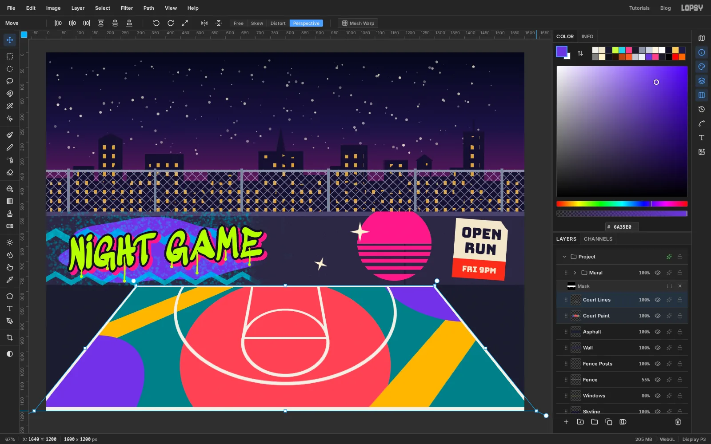

1. Click the **Court Lines** row, then [[Shift]]-click the **Court Paint** row so both layers are selected.
2. Pick the **Move** tool. One set of handles frames both layers. Click **Perspective** in the options bar.
3. Drag the bottom-right corner handle straight out to the right, past the edge of the canvas, by about 340 px. The bottom-left corner moves out to the left by the same amount, and the top edge stays where it is.
4. Press [[Cmd+D]] to commit, then click **Free** in the options bar so the next transforms behave normally.

Perspective mode foreshortens the content as well as the outline. The near half of the court is stretched much more than the far half, so the circles become ellipses that sit flat on the ground.

## Wear the court down

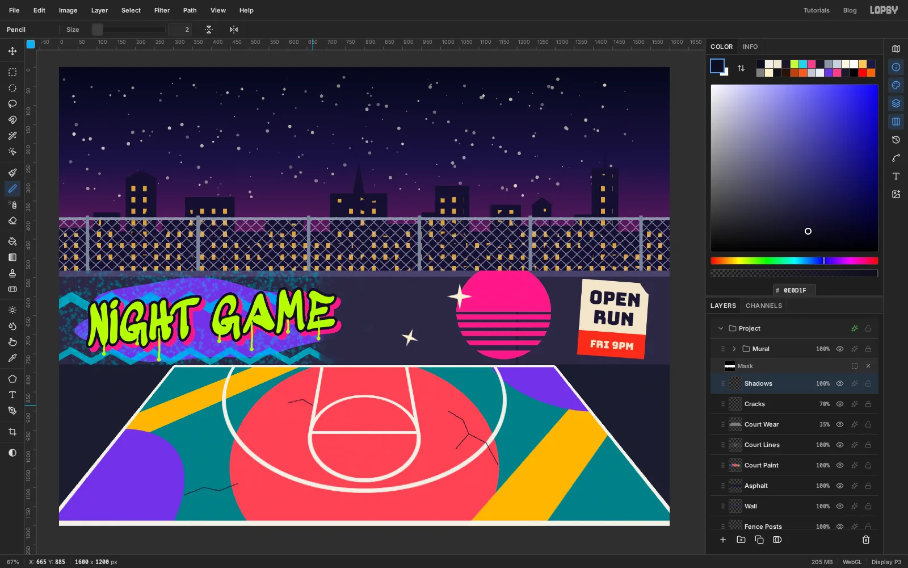

1. Add a layer above **Court Lines** named `Court Wear`.
2. [[Cmd]]-click the **Court Paint** thumbnail, click the **Court Wear** row again, and fill the selection with mid grey, `#808080`.
3. Run **Filter → Add Noise…** with **Amount** `45`, **Mono** and **Gaussian**, then deselect.
4. Open the layer's effects with the ✦ button, set **Blend Mode** to **Overlay**, and set the layer to `35%` opacity.
5. Add a layer named `Cracks`. Pick the **Pencil** with **Size** `2` and colour `#0E0D1F`. Click and [[Shift]]-click short zigzag runs to draw three or four cracks, including one with a branch. Set the layer to `70%` opacity.

On Overlay, mid grey does nothing, so only the noise shows. It adds speckle to the paint the way grit sits in a real outdoor court.

## Draw the hoop

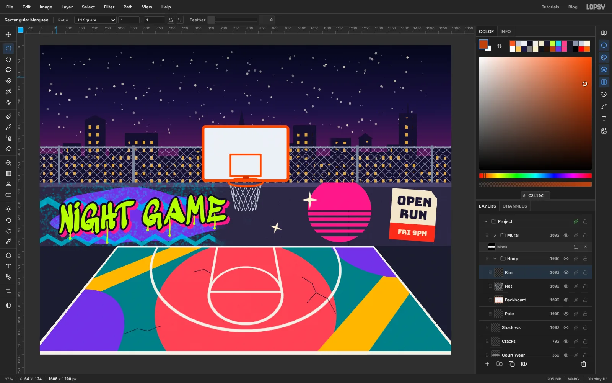

Draw the hoop big first, so the net is easy to draw, and shrink it afterwards.

1. Add a layer named `Shadows` above **Cracks** and leave it empty for now. Then click **New Group** and name the group `Hoop`.
2. Inside the group, add three layers from the bottom up: `Pole` (leave it empty for now), `Backboard` and `Net`.
3. On **Backboard**, pick the **Shape** tool with **Shape** set to **Rectangle**. Set the fill to `#EEF2F7`, the stroke to `#FF5A1F` with **Width** `10`, and **Corner Radius** to `10`. Draw a board 330 × 210 px centred on `800, 420`.
4. Remove the fill, set the stroke **Width** to `7` and **Corner Radius** to `0`, and draw the shooter's square, 118 × 84 px, low in the middle of the board.
5. On **Net**, pick the **Brush** with **Size** `3` and colour `#C4CAD6`. The net hangs from three rows of nine points, each row a half-ellipse that gets narrower lower down: the top row is 128 px wide at the rim, the middle row 104 px wide about 50 px lower, and the bottom row 80 px wide another 50 px lower. From each point, click and [[Shift]]-click a straight strand to the next point along in the row below, then do the same in the other direction. The crossing strands make the diamond mesh, and the net tapers to the bottom.
6. Add a layer at the top of the group named `Rim`. With the **Shape** tool set to **Ellipse**, no fill and a `#FF5A1F` stroke at **Width** `7`, draw a flat ellipse 134 × 30 px across the top of the net. Marquee a small block where the rim meets the board and fill it with `#C2410C` for the bracket.

## Shrink the hoop and plant the pole

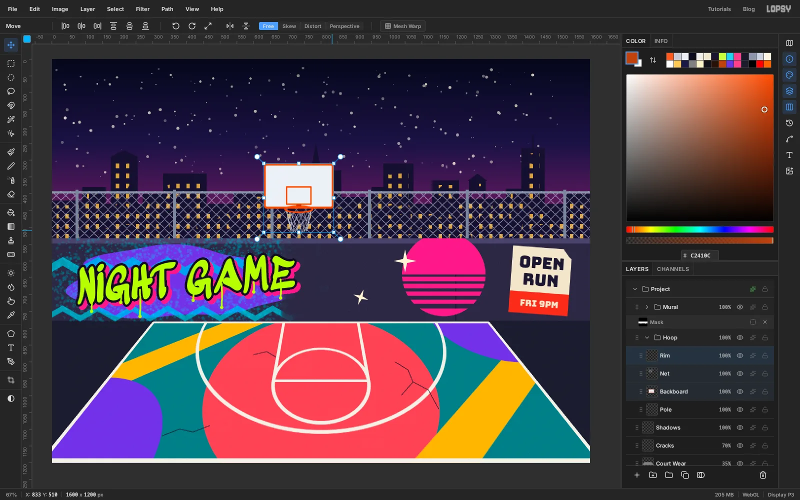

A real backboard is only about an eighth as wide as the court, so this one needs to shrink.

1. Click **Rim**, then [[Shift]]-click **Backboard** to select the three hoop layers.
2. Pick the **Move** tool, hold [[Cmd]] and drag the bottom-right corner handle up and in, until the board is about 60% of its size.
3. Press [[Cmd+D]], select the three layers again and drag them so the board is centred on `x 800`, with its bottom edge just above the top of the wall.
4. Click the **Pole** layer. Marquee a strip 22 px wide from the bottom of the board down to about `y 832`, just in front of the court's back edge, centred on `x 800`.
5. Make a **Linear** gradient with stops `#1A1D29`, `#6B7590` at about 35%, and `#151823`. Drag across the strip from left to right. Deselect.
6. Fill a small flat ellipse in `#0E0F18` at the foot of the pole for its base plate.

Standing the pole in front of the court's back edge, not on it, makes the board hang out over the court the way a real one does.

## Draw the ball with the Pen

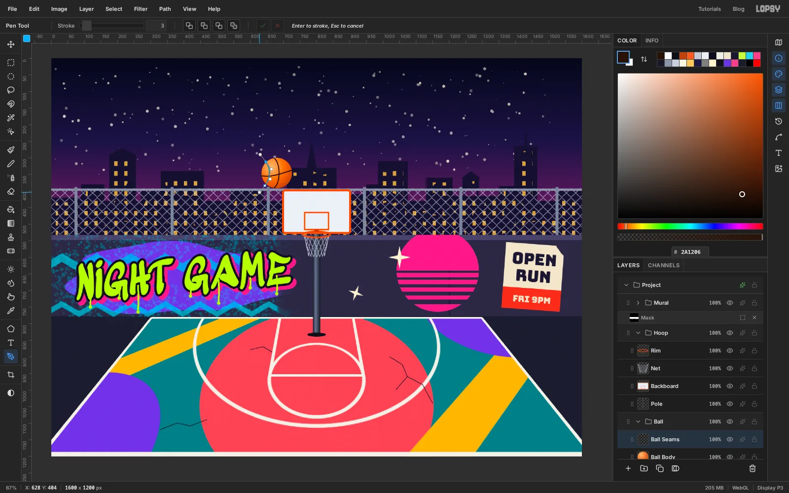

1. Click the **Shadows** layer, click **New Group** and name the group `Ball`. Add a layer inside it named `Ball Body`.
2. With the **Elliptical Marquee**, hold [[Cmd]] and draw a circle 92 px across, up and to the left of the board, centred near `680, 346`.
3. Make a **Radial** gradient with stops `#FFC07A`, `#F2701F` a little before halfway, and `#8E2F0C`. Drag from just up and left of the centre down past the lower-right edge, so the light comes from the top left. Deselect.
4. Add a layer named `Ball Seams`. Set the foreground to `#2A1206`, pick the **Pen** tool and set **Stroke** to `3`.
5. Draw four curved seams. For each one, press at one end and drag a little to pull out handles, press at the other end and drag again, then press [[Enter]] to stroke the path:
   - a seam from top to bottom that bows slightly to the right
   - a seam across the middle that rises gently to the right
   - two C-shaped seams near the left and right sides, curving towards the middle

## Give the ball a motion trail

1. Open the **Paths** panel and click the selected path's row to deselect it, so its blue outline isn't left over the ball.
2. With **Ball Seams** active, press [[Cmd+E]] to merge the seams into **Ball Body**.
3. Choose **Layer → Duplicate Layer** and rename the copy `Ball Trail`.
4. Run **Filter → Motion Blur…** with **Angle** `-35` and **Distance** `80`.
5. With the **Move** tool, drag the trail down and to the left, back along the ball's path, by about 80 px. Set it to `50%` opacity.
6. Drag the **Ball Trail** row below **Ball Body**, so the sharp ball sits on top of its own blur.

The trail tells the viewer which way the ball is moving: up from the lower left, about to drop through the hoop.

## Let the night in

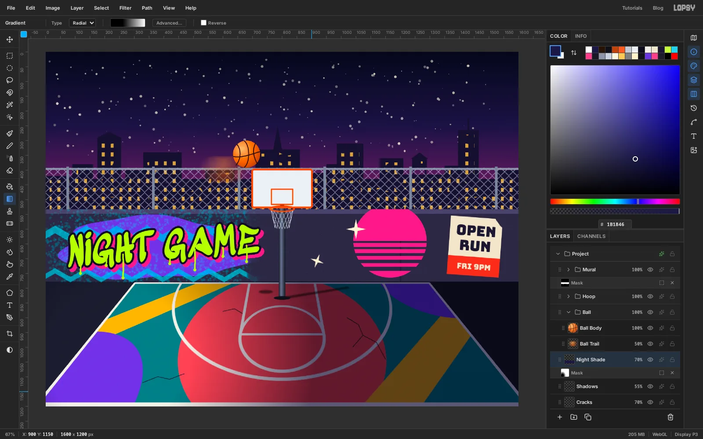

1. Click the **Shadows** layer. Fill a thin wedge in `#05040C` running from the foot of the pole up and to the right, plus a small flat ellipse on the court below the ball. Run **Gaussian Blur** with **Radius** `5`, set the blend mode to **Multiply** and the opacity to `55%`.
2. Add a layer above it named `Night Shade`. Fill a band from `y 778` to the bottom with `#1B1846`, set it to **Multiply** at `70%` opacity.
3. With **Night Shade** active, click **Add Mask**. Lopsy switches to editing the new mask.
4. Make a **Radial** gradient with stops black `#000000` at the left, black again at about 35%, and white `#FFFFFF` at the right. Drag from the lower-left part of the court, around `240, 1030`, out to the lower middle, around `900, 1150`.
5. Click the **Night Shade** row to leave mask editing.

The shadows point away from the lamp you'll add next. Black in the mask hides the darkening, so the patch nearest the lamp keeps its colour and everything else sinks into night.

## Put up the streetlight

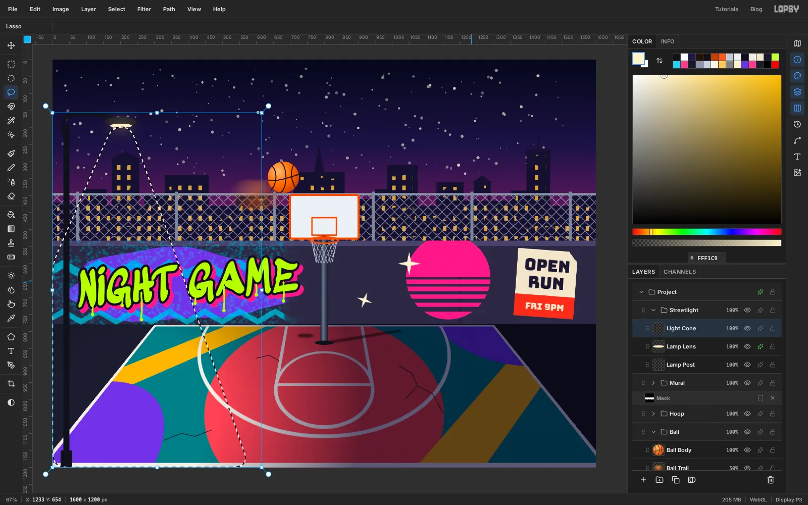

1. Click the **Mural** group row, click **New Group** and name the group `Streetlight`. It lands at the top of the stack, above Mural. Add a layer inside it named `Lamp Post`.
2. Marquee and fill the post in `#10111B`: 18 px wide, close to the left edge, from about `y 190` down to the bottom of the canvas. Add a slightly wider footing at the very bottom.
3. Draw the arm with the **Pen** tool at **Stroke** `12`. Click on the post near its top, press and drag to curve the path up and over, end over the lamp position around `x 200`, and press [[Enter]]. Deselect the path in the Paths panel.
4. Fill a flat ellipse in `#1B1D2B` at the end of the arm for the lamp head.
5. Add a layer named `Lamp Lens` and fill a smaller, flatter ellipse under the head with `#FFF1C9`. In its effects, turn on **Outer Glow** with **Size** `60`, **Opacity** `90` and colour `#FFC46B`.
6. Add a layer named `Light Cone`. With the **Lasso**, draw a tall triangle with its narrow top at the lamp and its wide base at the bottom of the canvas, reaching across to about `x 580`. Choose **Select → Feather…** and feather by `40` px.
7. Make a **Linear** gradient from `#FFE2A0` at full opacity to `#FFC46B` at 0% opacity. In **Advanced…**, select the right-hand stop and drag the **Opacity** strip under its colour square all the way left. Drag from the lamp straight down to the bottom. Deselect, set the layer to **Screen** at `55%`.

## Pool the light on the court

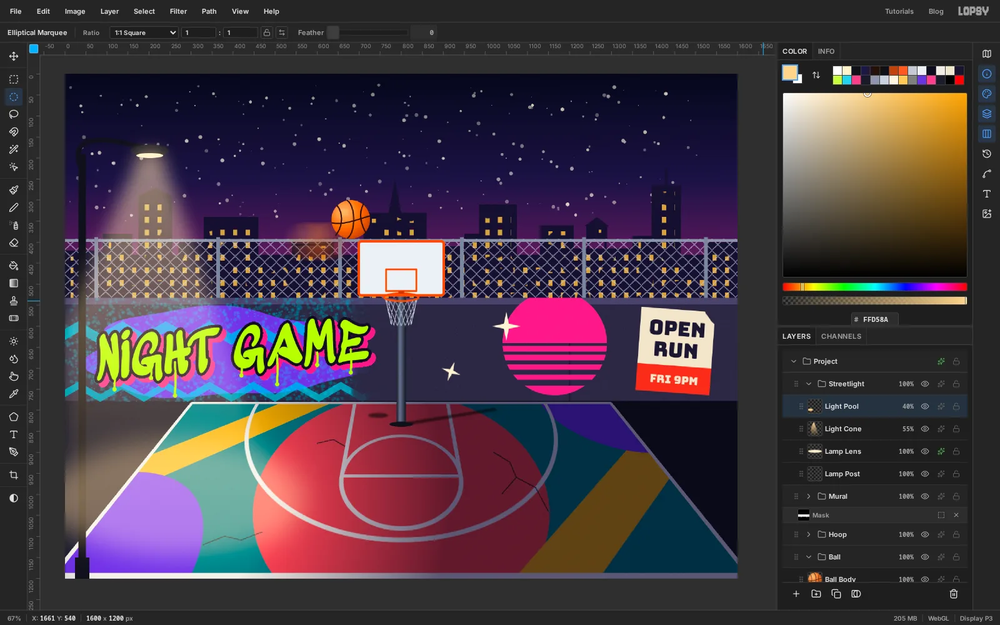

1. Add a layer named `Light Pool`.
2. With the **Elliptical Marquee**, draw a wide ellipse on the court under the lamp, about 600 × 280 px.
3. Choose **Select → Feather…** and feather by `63` px, the largest feather Lopsy allows, then fill with `#FFD58A`. Deselect.
4. Set the layer to **Screen** at `40%` opacity.

The cone fading out into a pool on the ground is what sells the light. The bright patch matches the gap you left in the Night Shade mask.

## Grade the colour

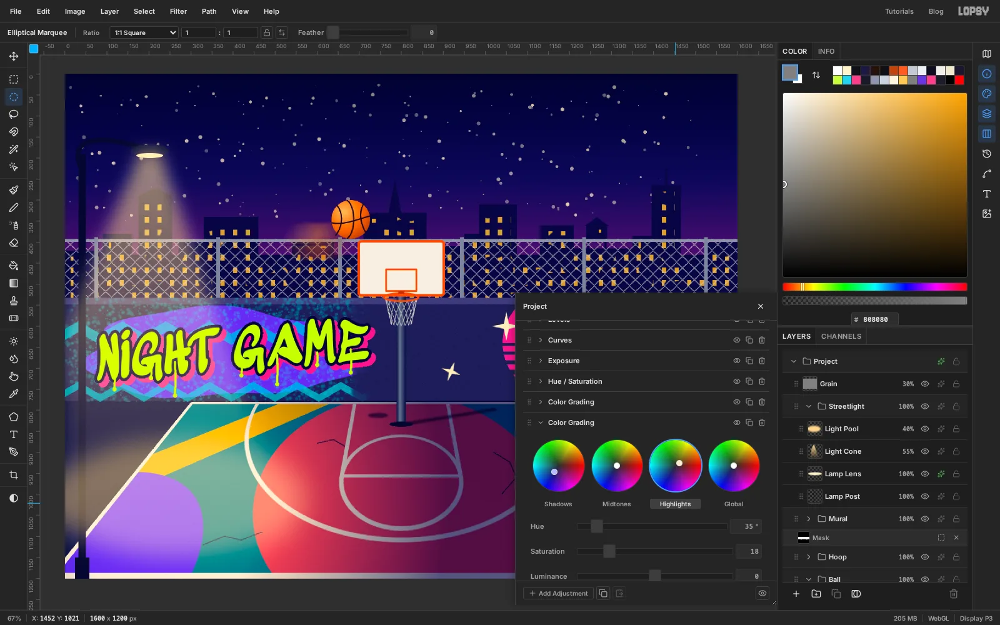

1. Click the **Project** row at the top of the Layers panel and open its drawer with the ✦ button.
2. Click **Add Adjustment** and choose **Color Grading**.
3. Click the **Shadows** wheel. Set **Hue** to `235`, **Saturation** to `30` and **Luminance** to `-8`.
4. Click the **Highlights** wheel. Set **Hue** to `35` and **Saturation** to `18`.

Blue shadows and amber highlights are the classic night-time split. The deep areas go cold, while the streetlight, windows and lime tag stay warm.

## Add a vignette and grain, then export

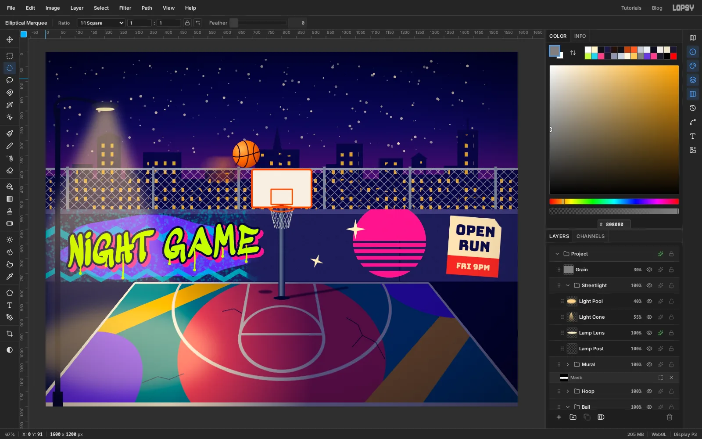

1. In the same drawer, click **Add Adjustment**, choose **Vignette** and set its **Vignette** slider to `45`. Close the drawer.
2. Click the **Light Pool** layer and add a layer named `Grain`. Fill it with `#808080` and run **Add Noise** with **Amount** `22`, **Mono** and **Gaussian**.
3. Set **Grain** to **Overlay** at `30%`. It was created inside the Streetlight group, so drag its row out of the group to the very top of the stack, where it covers the whole painting.
4. Choose **File → Quick Export PNG** to save the image, and **File → Save Project** to keep a `.lopsy` file you can come back to.

The grain sits on top of everything, so the mural, the court and the sky all share the same texture, like a photo of a real wall at night.

> **Tip:** Every piece is still on its own layer. Try a different tag colour with the text layer's colour swatch, switch the court shapes to new colours with **Edit → Fill**, or move the Ball group to a new spot in its arc.
