A jet-lagged body runs on two clocks at once: the one it left and the one it
landed in. This cover for a made-up record, **Jet Lag** by the Jura Line
Quartet, draws exactly that. Seven arcs, one per track, start at twelve
o'clock and run as long as the track does. A second copy of the same arcs is
turned 135°, which is nine hours on a 24-hour dial, and printed over the
first in orange. Where the two inks overlap you get a third colour for free.

It's built the way Swiss Style posters were: a grid, one typeface family, two
inks and nothing decorative. Every shape on the sheet is information.

Along the way you'll use:

- guides, and the grid at three sizes, as a snapping aid and as a ruler
- the Elliptical Marquee and Lasso with [[Alt]] to subtract from a selection
- a square marquee to rotate pixels around a chosen centre
- Color Overlay, the Multiply blend mode and Rasterize Layer Style
- the Shape tool, the Pencil with [[Shift]]-click lines, and Copy / Paste
- point text in two fonts, right and centre alignment, line height and letter spacing
- a rotated text line, groups, Add Noise and the Overlay blend mode

The palette is paper, black and two inks:

- Paper `#ECEAE3`
- Ink black `#131313`
- Departure blue `#3355FF`
- Arrival orange `#FF8A3D`
- Grain grey `#808080` (a texture layer, not an ink)

## Set up the paper and the guides

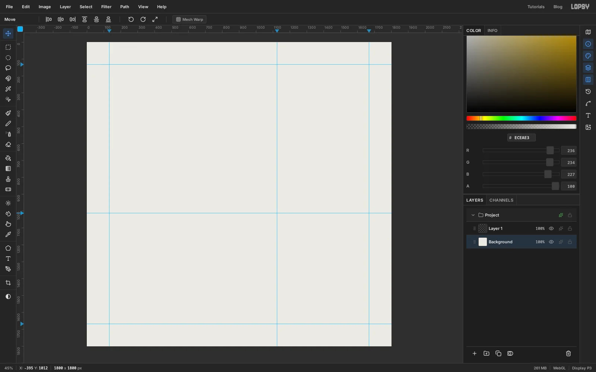

Open [Lopsy](/). In the **New Document** dialog set **Width** and **Height**
to `1800`, choose a **White** background and click **Create**.

1. Select the **Background** layer, set the foreground colour to `#ECEAE3` and choose **Edit → Fill**.
2. Click the top ruler at **132** and at **1668** to drop two vertical guides, then click the left ruler at the same two numbers. These are the margins. A label follows the pointer along the ruler and shows the position before you click; zoom in if you can't land on the exact number, and click a guide's marker on the ruler to remove a wrong one.
3. Click the top ruler at **1124** and the left ruler at **1012**. Where these two cross is the hub of the disc.

The hub sits right of centre on purpose. The left third of the sheet stays
free for the title.

## Select the outer ring

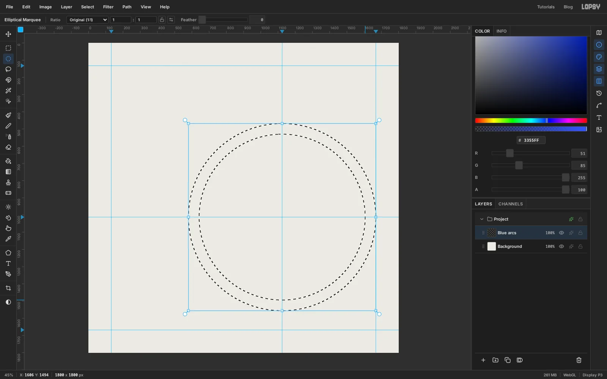

Select **Layer 1** and rename it **Blue arcs**. Each arc starts as a ring, and a ring is
one circle with a smaller circle taken out of it.

1. Choose the **Elliptical Marquee**. Put the pointer up and to the left of the hub, where the status bar reads about **X: 580 Y: 468**. Hold [[Cmd]] to keep the shape a circle and drag down and to the right until the edge snaps onto the right margin guide. That is a circle of radius 544 around the hub.
2. Now hold [[Alt]] and [[Cmd]] together and drag a second circle from about **X: 642 Y: 530** until the status bar reads about **X: 1606 Y: 1494**, the same distance the other side of the hub. [[Alt]] subtracts it, and a ring 62 px wide is left.

> **Tip:** A circle of radius *r* around the hub starts *r* pixels left of and above it. Subtract the radius from 1124 and from 1012 to get the starting corner.

## Cut the ring down to the track's length

The outer ring is track 7, *Arrival*, which runs 5:09. One minute is 40° of
arc on this cover, so the arc covers 5.15 × 40 = 206° clockwise from twelve
o'clock. The
rest of the ring has to go.

Choose the **Lasso** and hold [[Alt]]. Start on the hub, drag straight out
past the ring at about seven o'clock, carry on clockwise around the outside of
the ring up to twelve o'clock, then come straight back down the vertical guide
to the hub and let go. The wedge you traced is subtracted from the ring.

Think of the angles as an ordinary clock face: every hour is 30°, so 206° is a
little before seven. (The clock face is only a way to describe where an arc
stops. The nine-hour turn later on uses a 24-hour dial.)

> **Tip:** The Lasso is freehand, so move in three quick, straight strokes: out, round, back. A fast stroke between two points comes out straight. The stroke round the outside can be as loose as you like, since nothing is there to cut.

## Fill the first arc

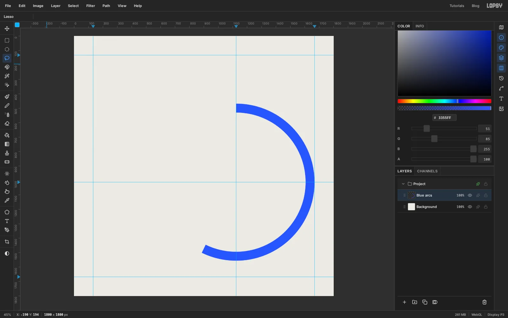

Set the foreground colour to `#3355FF` and choose **Edit → Fill**, then press
[[Cmd+D]] to deselect.

If the end of the arc isn't where you want it, press [[Cmd+Z]] a few times to
step back to the plain ring and trace the wedge again. Each circle and each
wedge is its own undo step.

## Repeat for the other six rings

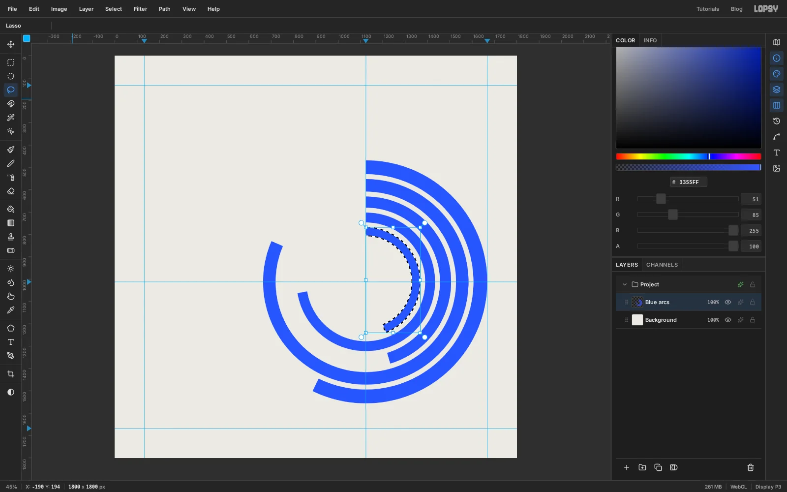

Work inwards, one ring per track. Each ring gets the same four moves: a
circle, a smaller circle with [[Alt]], a lasso wedge with [[Alt]], then
**Edit → Fill**. The two circles of each ring start at the corners given here.

- **Ring 7**, Arrival, 5:09: radius 544 to 482, an arc of 206° that ends just before 7 o'clock
- **Ring 6**, Holding Pattern, 7:20: radius 460 to 404, 293°, ends just before 10 o'clock (circles start at 664, 552 and 720, 608)
- **Ring 5**, Red Eye, 4:05: radius 382 to 332, 163°, ends at half past 5 (circles start at 742, 630 and 792, 680)
- **Ring 4**, Date Line, 6:31: radius 310 to 266, 261°, ends just before 9 o'clock (circles start at 814, 702 and 858, 746)
- **Ring 3**, Meridian, 3:58: radius 244 to 206, 159°, ends just after 5 o'clock (circles start at 880, 768 and 918, 806)
- **Ring 2**, Tailwind, 5:47: radius 184 to 152, 231°, ends just before 8 o'clock (circles start at 940, 828 and 972, 860)
- **Ring 1**, Departure, 4:12: radius 130 to 104, 168°, ends just after half past 5 (circles start at 994, 882 and 1020, 908)

The rings get 6 px narrower each time and the gap between them stays at
22 px. Don't worry about hitting the angles to the degree, or the radii to the pixel. What matters is
that every arc starts on the vertical guide and that a longer track gets a
visibly longer arc.

## Duplicate the arcs and box them in a square

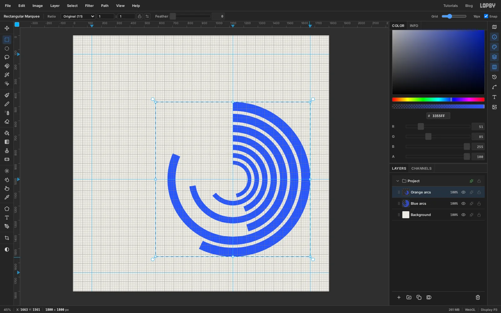

Choose **Layer → Duplicate Layer** and rename the copy **Orange arcs**. This
copy becomes the arrival clock.

The copy has to turn around the hub. A selection rotates around the centre of
its own box, and the arcs don't fill their circle evenly, so give them a box
that does:

1. Choose **View → Show Grid**. With the **Rectangular Marquee** active, drag the **Grid** slider at the right of the options bar to **16px** and leave **Snap** ticked.
2. Hold [[Cmd]] and drag a square from the corner where the very first circle started (about **X: 580 Y: 468**) until its right edge meets the right margin guide. Snapping pulls the corners onto the grid, and the square ends up exactly around the circle, with its centre on the hub.

## Rotate the copy nine hours

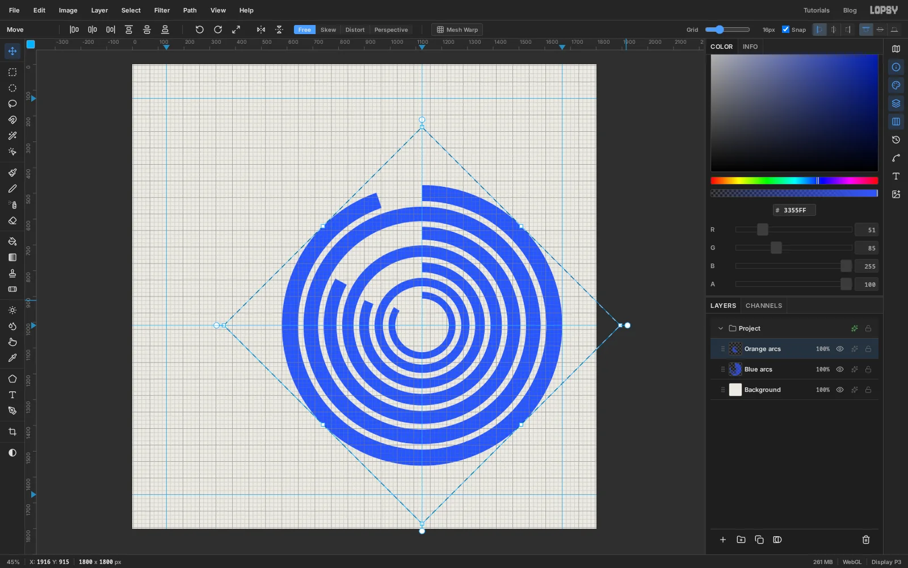

Switch to the **Move** tool. Handles appear around the square. Grab the small
round handle just outside a corner and drag it clockwise.

While the grid is snapping, rotation clicks round in 15° steps, and 15° is
one hour on a 24-hour dial. Count nine steps. At 135° the square stands on
its corner like a diamond. Let go and press [[Cmd+D]] to commit.

## Print the copy in orange

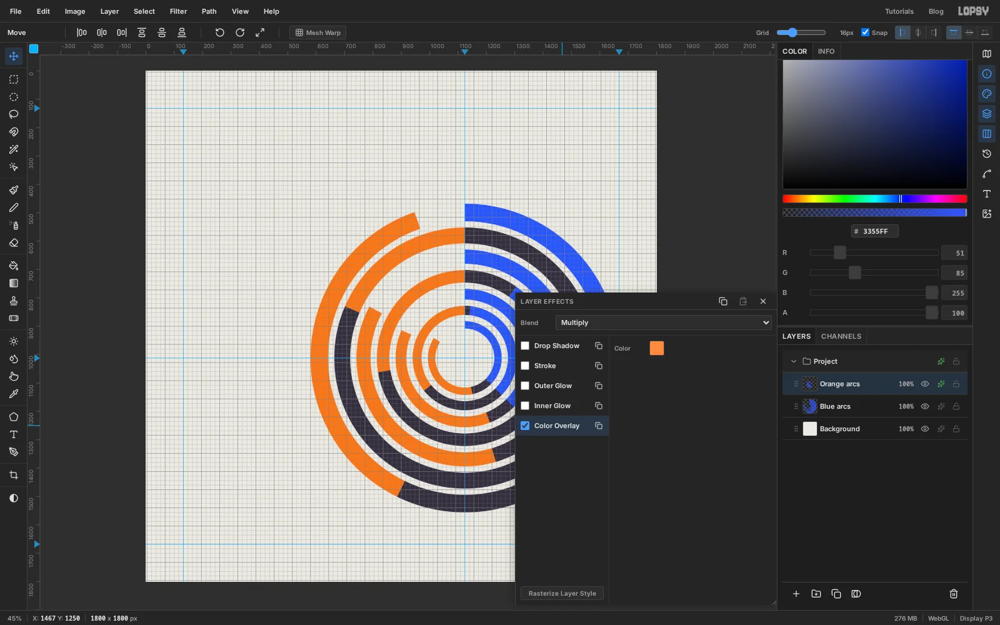

1. Click the effects button (✦) on the **Orange arcs** row. Tick **Color Overlay**, click its colour swatch and enter `#FF8A3D`.
2. At the top of the drawer, set **Blend** to **Multiply**.
3. Click **Rasterize Layer Style** at the bottom of the drawer, then close it.

Multiply behaves like a second ink printed on top of the first. Orange over
paper stays orange, and orange over blue turns into a dark indigo that is
clearly not the black of the type. Two inks, three colours.

Rasterizing bakes the orange into the pixels, so the effect can be forgotten
from here on.

## Add the hub with the Shape tool

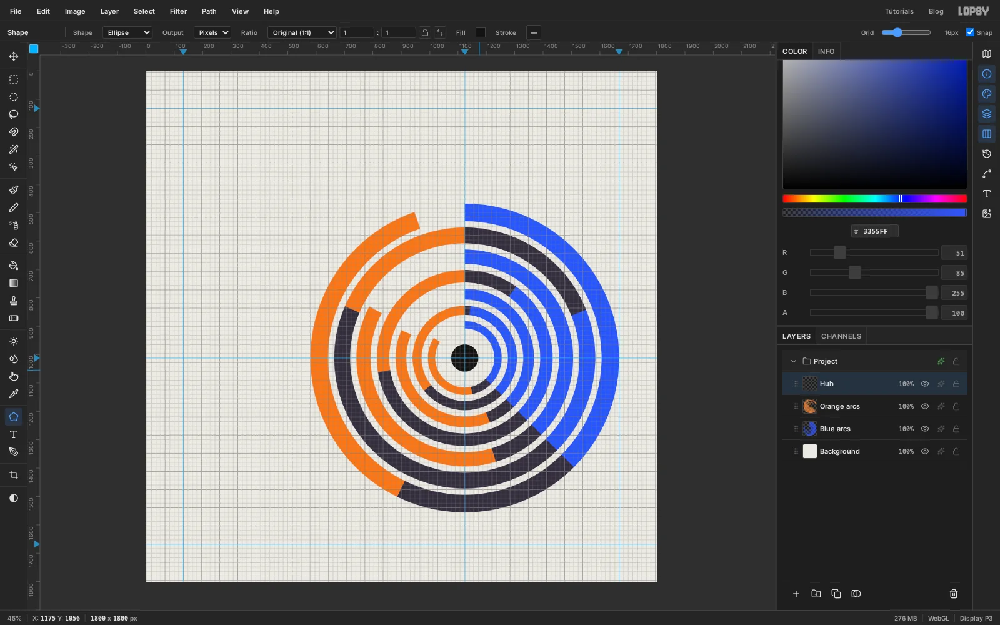

Click **Add Layer** and name the layer **Hub**.

Choose the **Shape** tool, set **Shape** to **Ellipse**, click the **Fill**
swatch and enter `#131313`. The Shape tool draws from the centre outwards, so
press on the hub, where the two guides cross, and drag out three grid squares
across and three down. Snapping makes it a 96 px disc sitting exactly on the
hub.

## Set the title

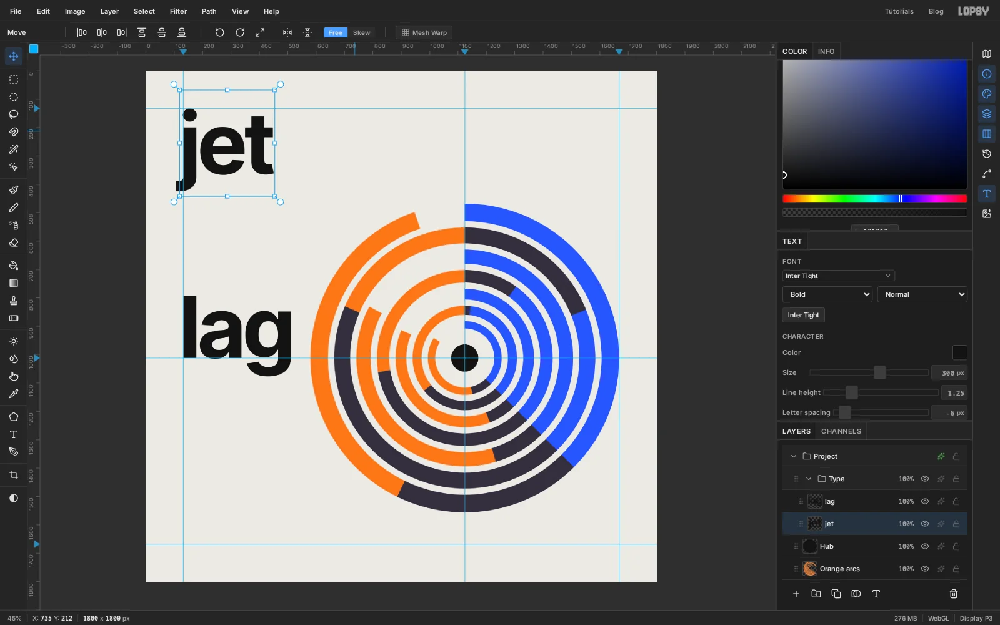

Choose **View → Show Grid** to hide the grid: nudging type is easier without
snapping. Click **New Group**, name it **Type**, and keep it selected so the
text layers land inside it.

1. Set the foreground colour to `#131313`. Choose the **Text** tool and click near the top-left corner. Set **Size** to `300`, pick **Inter Tight** from the font menu and **Bold** from the weight menu. Type `jet` and press [[Tab]].
2. Open the **Text** panel from the buttons on the far right and set **Letter spacing** to `-6`.
3. Click an empty area halfway down the left side, type `lag`, press [[Tab]] and set its **Letter spacing** to `-6` as well.
4. Switch to the **Move** tool and use the arrow keys ([[Shift]] moves 10 px at a time). Move **jet** until the dot of the j touches the top guide and its stem stands on the left guide. The hook of the j hangs out into the margin, and that's fine.
5. Move **lag** until the l stands on the left guide and the word's baseline sits on the horizontal guide through the hub.

The words are split on purpose. "jet" takes off from the top margin, and
"lag" has dropped behind to the axis of the clocks.

## Set the track list in three columns

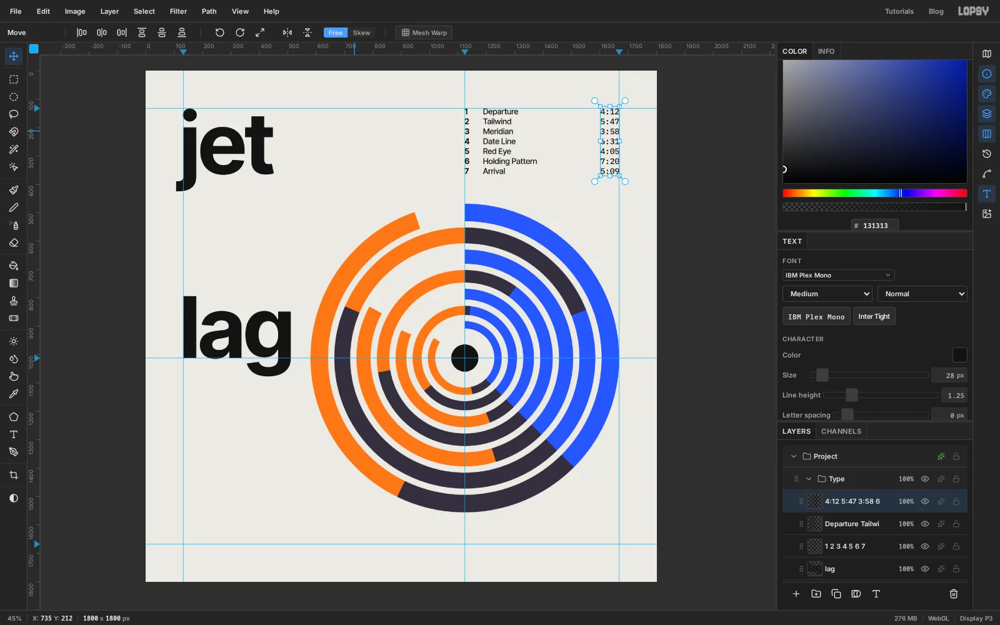

The list is three text layers, so each column keeps its own alignment. Use
**Size** `28` for all three, and after typing each one set **Line height**
to `1.25` in the Text panel. Press [[Enter]] between lines and [[Tab]] when
the column is done.

1. **Numbers:** click on the vertical hub guide near the top. **Inter Tight**, **Bold**. Type `1` to `7`, one per line.
2. **Titles:** click 64 px to the right of the numbers. **Inter Tight**, **Medium**. Type `Departure`, `Tailwind`, `Meridian`, `Date Line`, `Red Eye`, `Holding Pattern`, `Arrival`.
3. **Durations:** set **Align** to **Right** and click on the right margin guide. Pick **IBM Plex Mono**, **Medium**. Type `4:12`, `5:47`, `3:58`, `6:31`, `4:05`, `7:20`, `5:09`.

A monospaced font gives every digit the same width, so the colons line up
down the column.

Click the durations layer, [[Shift]]-click the numbers layer to select all
three, and nudge them together with the **Move** tool until the top of the
first line touches the top guide. At this size and line height the last line
then shares its baseline with "jet".

## Add the artist and the key

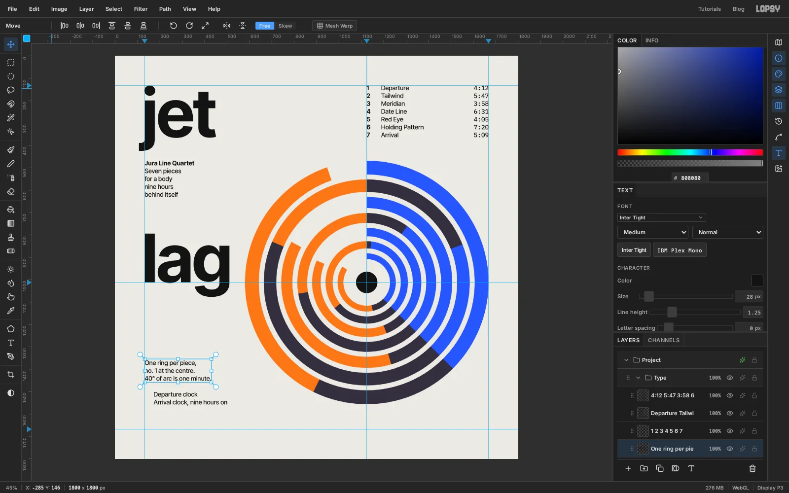

Set **Align** back to **Left**. These are four more **Inter Tight** layers at
**Size** `28`, **Line height** `1.25`.

> **Tip:** Clicking with the Text tool inside an existing text layer edits that layer. Start each new block in an empty patch of paper, then nudge it into place with the Move tool.

1. `Jura Line Quartet` in **Bold**. Move it so the tops of the capitals are level with the top of the disc.
2. `Seven pieces` / `for a body` / `nine hours` / `behind itself` in **Medium**, on four lines, directly underneath.
3. `One ring per piece,` / `no. 1 at the centre.` / `40° of arc is one minute.` in **Medium**, on three lines.
4. `Departure clock` / `Arrival clock, nine hours on`, on two lines, starting 40 px in from the left guide to leave room for a colour square.

Move the last block until its second baseline is level with the bottom of the
disc, and put the three-line block one empty line above it. All four blocks
keep their left edge on the margin guide, apart from the indented key.

## Draw the nine-hour bar

Along the bottom runs a 24-hour scale, 64 px to the hour, from the left
margin to the right. The bar marks the nine hours between a 06:30 departure
and a 15:30 arrival.

1. Select **Hub**, click **New Group** and name it **Scale**. Add a layer inside it named **Lag bar**.
2. Choose **View → Show Grid** again (still 16px). With the **Rectangular Marquee**, start at about **X: 548 Y: 1588**, just under the disc, and drag right to the vertical hub guide and down to **Y: 1636**. Snapping gives a bar 576 px long and 48 px high. Fill it with `#131313`.
3. Drag a marquee two grid squares wide and the same height as the bar against its left end, and fill it with `#3355FF`. Do the same against the right end with `#FF8A3D`.
4. Deselect, hide the grid, and with the **Move** tool press [[↑]] four times. That opens a 4 px gap above where the rule is about to go.

The black part is exactly 576 px, nine hours at 64 px each, and it ends on
the hub guide. The colour caps sit outside the measured span.

## Rule the scale with the Pencil

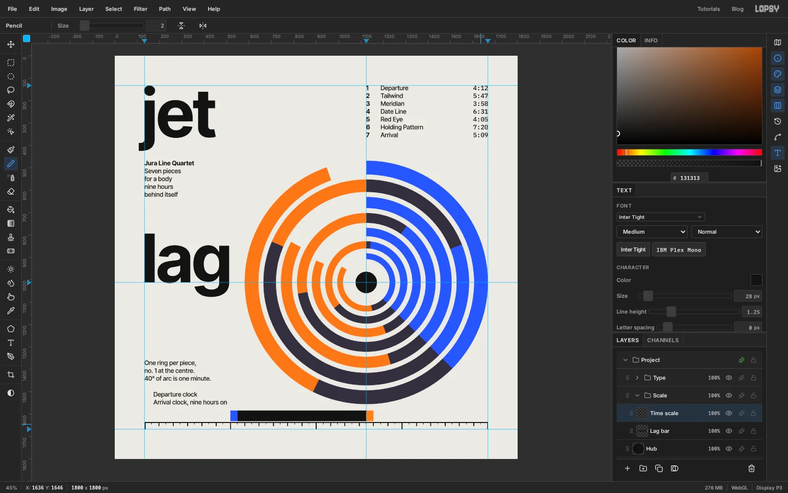

Add a layer named **Time scale** and set the foreground back to `#131313`.
Choose the **Pencil** and set **Size** to `4`.

The Pencil doesn't snap, but the grid still makes a good ruler. Show it, set
the **Grid** slider to **32px** and untick **Snap**: every grid line between
the margins is now an hour or a half-hour mark. Hide the grid again when the
ticks are done.

1. Click at the left margin just under the bar (about **Y: 1638**), then [[Shift]]-click at the right margin. Shift-click draws a straight line from the last point.
2. For the hours, click on the rule and [[Shift]]-click straight below it, every 64 px from the left margin to the right: 25 ticks. Make them about 16 px long, and take the ones at 0, 6, 12, 18 and 24 hours down to the bottom margin guide.
3. Set **Size** to `2` and add a short tick halfway between each pair of hours.

The half-hour ticks are what let the bar start and stop at 06:30 and 15:30
without floating between marks.

## Label the scale and the bar

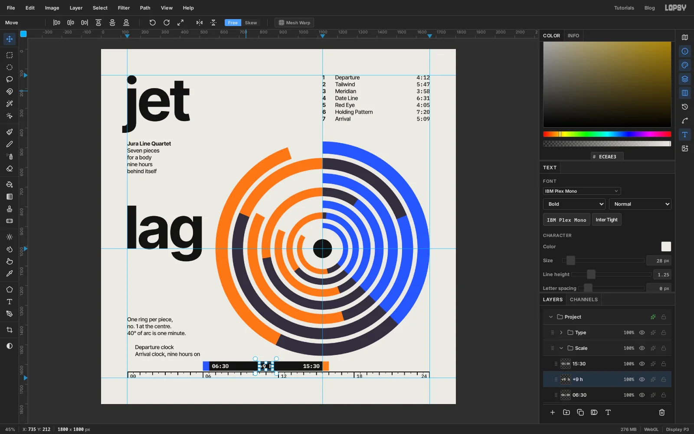

All of these are **IBM Plex Mono**, and like everything else in this part of
the sheet they go in the **Scale** group. Start each one in the empty bottom
margin and nudge it up into place.

1. With the foreground at `#131313`, **Medium**, **Size** `24`: type `00`, `06`, `12` and `18` as four layers and put each one just to the right of its long tick, standing on the bottom margin guide. Put `24` to the *left* of the last tick so it stays inside the margin.
2. Set the foreground to the paper colour `#ECEAE3`, **Bold**, **Size** `28`. Type `06:30` and move it inside the bar, 16 px in from the blue cap.
3. Set **Align** to **Center**, type `+9 h` and put it in the middle of the bar.
4. Set **Align** to **Right**, type `15:30` and put it the same distance in from the orange cap.

Check that the bar text has the same amount of black above and below it, and
nudge it with the arrow keys if it doesn't.

## Add the key squares with Copy and Paste

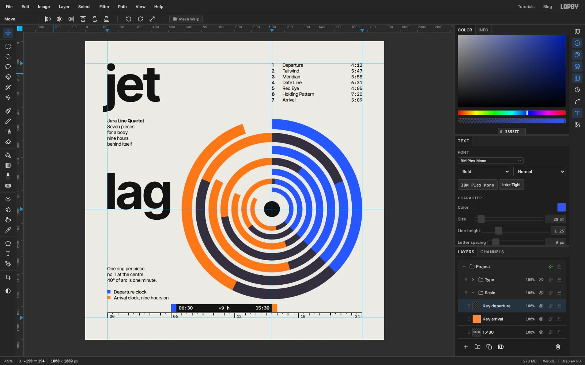

The key needs a square of each ink, the same height as the capital letters.

1. Add a layer named **Key arrival**. Show the grid, and with the **Rectangular Marquee** active set the **Grid** slider to **4px**.
2. Drag a 20 px square on the left margin guide beside "Arrival clock", from the baseline up to the top of the capital A. Fill it with `#FF8A3D`.
3. Press [[Cmd+C]] and [[Cmd+V]]. The copy arrives on a new layer in the same place. Rename it **Key departure**.
4. Hide the grid, press [[Cmd+D]], and with the **Move** tool nudge the copy up one line, 35 px: [[Shift+↑]] three times, then [[↑]] five times.
5. Hold [[Cmd]] and click the layer's thumbnail to select its pixels, then fill with `#3355FF` and deselect.

## Turn a catalogue line up the margin

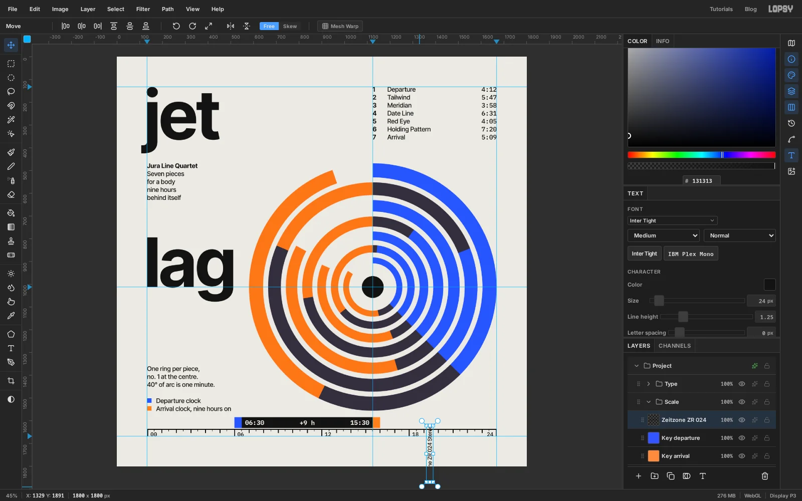

One line of small print runs up the right margin, as it does on a lot of
Swiss sleeves.

1. With the **Text** tool, click in the empty bottom margin. **Inter Tight**, **Medium**, **Size** `24`, foreground `#131313`. Type `Zeitzone ZR 024 Stereo` and press [[Tab]].
2. Switch to the **Move** tool. Hold [[Cmd]] and drag the round handle outside the corner anticlockwise. With [[Cmd]] held the rotation snaps every 15°, so stop when the line stands upright, reading from bottom to top. Press [[Esc]] to finish; the rotation is kept.
3. Move the line so the feet of the letters stand on the right margin guide and the Z is level with the bottom of the disc.

The text is still live after rotating, so you can retype it later.

## Group the clocks

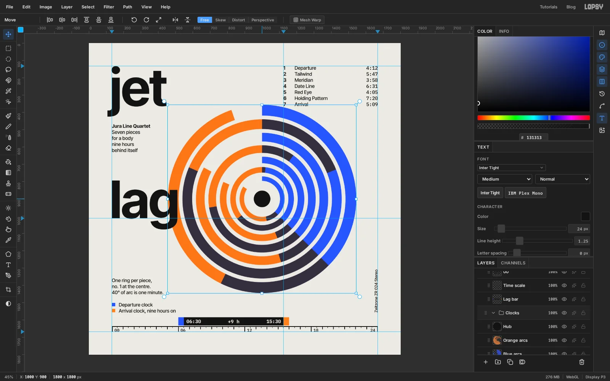

Select **Hub**, [[Shift]]-click **Blue arcs** so all three disc layers are
selected, and choose **Layer → Group Layers**. Name the group **Clocks**.

With the group selected, the **Move** tool treats both clocks and the hub as
one piece. Try it: drag the disc somewhere else, then press [[Cmd+Z]] to put
it back where the grid wants it.

## Add print grain

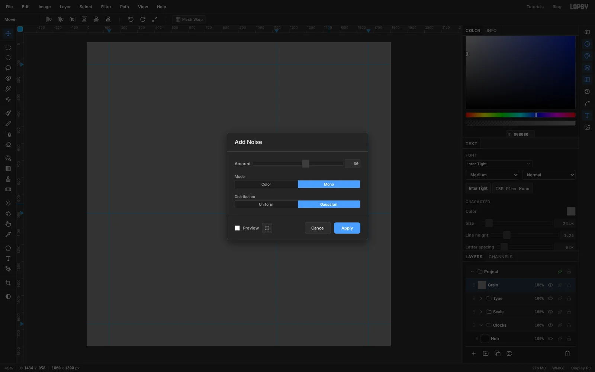

Flat screen colour looks nothing like ink on board, so a little noise goes
over everything.

1. Collapse the **Type** group, select it and click **Add Layer**. The new layer lands above the group. Name it **Grain**.
2. Set the foreground to `#808080` and choose **Edit → Fill**.
3. Choose **Filter → Add Noise…**. Set **Amount** to `60`, click **Mono** and **Gaussian**, then **Apply**.
4. Open the layer's effects and set **Blend** to **Overlay**. Click the layer's opacity and bring it down to **40%**.

Mid-grey does nothing in Overlay, so only the speckle shows: a little lighter
here, a little darker there, in the inks and the paper alike.

## Hide the guides and export

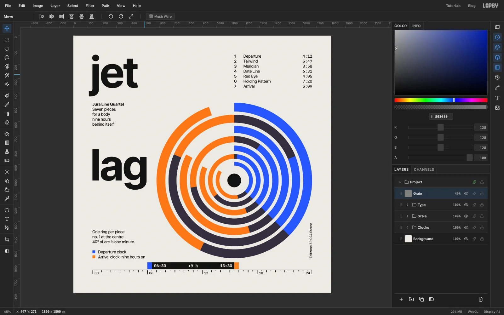

Choose **View → Show Guides** to hide the guides and look at the sheet as a
whole. Check the edges that are meant to meet: the disc and the right margin,
the track numbers and the vertical axis, "lag" and the horizontal axis, the
end of the bar and the hub.

Choose **File → Quick Export PNG** for the cover, and **File → Save Project**
to keep the layers.
