Tiki style is America's 1950s daydream of the South Pacific. You'll know it from carved wooden idols on bar menus, bamboo trim, a sunset that never sets, and flat, bold colour printed on cheap paper. Nobody does that better than a sportfishing charter, so in this tutorial you'll design the landing page for **Yellowfin Expeditions**, a made-up charter boat out of Kona, as a 1440 × 2000 px desktop comp.

The page has five parts, top to bottom: a cream **nav bar**, a sunset **hero** with a leaping tuna, a **charters** section with three price cards, a **catch log** strip and a carved-wood **footer**. The tuna is drawn from a reference photo and bent into a leap with Mesh Warp. Everything else is built from selections, fills, shapes and type.

Along the way you'll use:

- ruler **guides**, the **Rectangular Marquee**, **Edit → Fill** and the **Gradient** tool
- the **Lasso** with [[Shift]] to add, and [[Shift+Alt]] to intersect with a layer you load by [[Cmd]]-clicking its thumbnail
- the **Reference** drawer, **Merge Down**, **Mesh Warp** and the Move tool's rotate and scale handles
- the **Brush**, **Pencil**, **Spray** and **Burn** tools
- **Halftone**, **Add Noise**, **Clouds** and **Motion Blur**, plus a **layer mask** painted with a gradient
- the **Shape** tool with **Show Grid** snapping, **Select → Shrink**, and **Copy effects** / **Paste effects**
- **Stroke**, **Drop Shadow**, **Outer Glow** and **Inner Glow** effects and **Soft Light** / **Multiply** blending
- type in **Kavoon**, **Yesteryear** and **Josefin Sans**, recoloured, rotated and centred inside shapes
- copy and paste, **groups** and **Group Layers**

The palette:

- Sky `#0B2F3E` → `#1D6872` → `#B4596A` → `#EC7448` → `#F9BE4E`
- Sea `#1B7479` → `#0A3A46`, foam `#F3EEDC`
- Sun `#FFD457`, glow `#FFB347`, rays `#FFE3A0`
- Tuna navy `#13305A`, cobalt `#1F4E8A`, belly `#E7E1D2`, fins `#F5C02A`
- Ink `#160C08`, cream `#FBEFD0`, gold `#F7C531`
- Lagoon teal `#0F4E58`, coral `#C8522A`, island `#0B2A30`
- Paper `#F3E2B8`, bamboo `#C98A3E`, wood `#2A160C` / `#4A2814` / `#9A5226`

> **Tip:** Positions are written as `x, y` in document pixels. The status bar at the bottom of the window shows where the cursor is, so you can hover to find a spot. Key names are Mac keys: on Windows and Linux, use Ctrl for Cmd. Lopsy names a new text layer after its words, so this tutorial renames each one (double-click the name) and later steps refer to those names.

## Set up the page and paint the sunset

Choose **File → New**, set the size to **1440 × 2000** px with a White background and click **Create**.

Drop the guides. Click the top ruler at **80** and **1360** for the page margins, then hold [[Cmd]] and click near the middle of the top ruler: with [[Cmd]] held, the guide snaps to the exact centre, **720**. Now click the left ruler at **96** (bottom of the nav), **760** (the horizon), **900** (bottom of the hero), **978** (top of the charters section), **1560** (top of the catch log) and **1760** (top of the footer).

Rename `Layer 1` to `Sky`. Pick the **Rectangular Marquee** (**M**) and drag from where the 96 guide meets the left edge of the page down to where the 760 guide meets the right edge. The marquee edges snap onto the guides.

Pick the **Gradient** tool, set **Type** to **Linear** and click **Advanced…** to open the Gradient Editor. Set five stops: `#0B2F3E` at the left end, `#1D6872` about a third of the way along, `#B4596A` just past the middle, `#EC7448` at about three quarters and `#F9BE4E` at the right end. The mauve stop matters: without it, teal and coral meet in a muddy grey band. Click **Done**, then drag straight down from the top of the selection to the horizon guide. Press [[Cmd+D]].

Click **Add Layer**, name it `Sea`, and marquee the strip between the 760 and 900 guides, edge to edge. Make a two-stop gradient from `#1B7479` to `#0A3A46` and drag it top to bottom. Press [[Cmd+D]].

## Fan out the sun rays

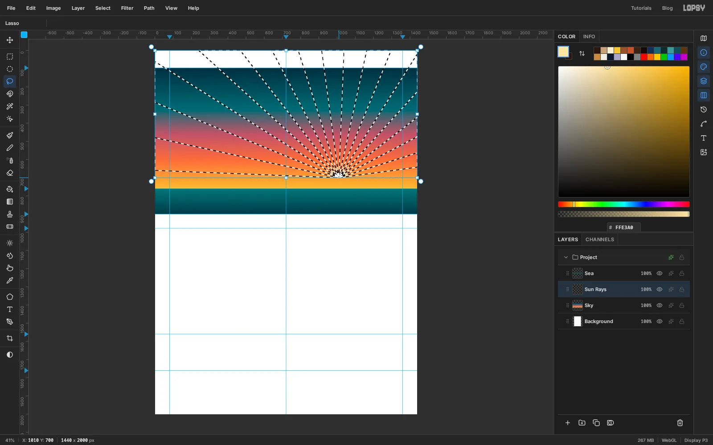

Select the `Sky` layer and add a layer above it called `Sun Rays`. The rays fan out from where the sun will sit, at **1010, 700**.

Pick the **Lasso** (**L**) and draw a long thin wedge: start at **1010, 700**, run off the top-left of the canvas, come back a little to the right, and close the shape back at the sun point. Hold [[Shift]] and draw eight more wedges spread across the upper half, leaving gaps between them. [[Shift]] adds each wedge to the selection.

Set the foreground to `#FFE3A0` and choose **Edit → Fill**, then [[Cmd+D]]. Open the layer's effects drawer (the sparkle button on its row), set the blend mode to **Soft Light**, and drop the layer's opacity to **70%**. The rays now lighten the sky instead of sitting on top of it.

## Raise the sun

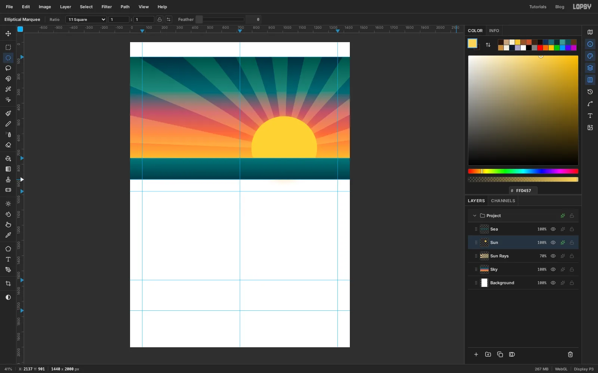

Add a layer called `Sun` above `Sun Rays`. With the **Elliptical Marquee**, drag a circle from **795, 485** to **1225, 915**, which is 430 px across and centred on the ray point. Fill it with `#FFD457` and deselect.

In the `Sun` effects drawer, turn on **Outer Glow** with **Size** `80`, **Opacity** `55` and glow colour `#FFB347`. The sea layer sits above the sun, so the bottom half disappears below the horizon.

## Open a reference and cut out the fins

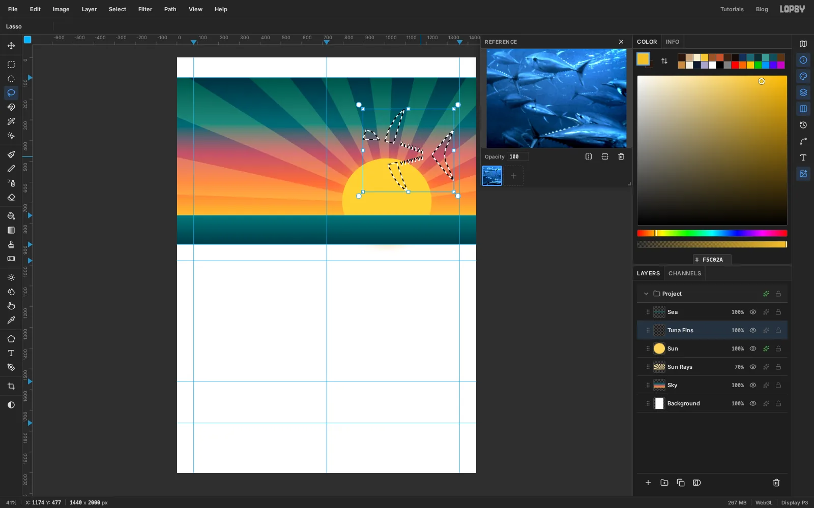

A yellowfin has a few features that make it read as a yellowfin: very long sickle-shaped second dorsal and anal fins, a row of little yellow finlets along the back and belly, a thin stalk before the tail, a crescent tail, and a gold stripe along the side. Click the **Reference** button in the panel toolbar on the right and load a side-on photo of a yellowfin (NOAA's public-domain photos are a good source). Keep the drawer open while you draw.

The fish is built horizontally first, about 530 px long and facing left, centred around **1000, 470**. You'll bend and tilt it later. Add a layer called `Tuna Fins` above `Sun`. With the **Lasso**, draw the small first dorsal fin on top of the body. Then hold [[Shift]] and add the tall sickle-shaped second dorsal, the matching anal fin underneath, a crescent tail at the right end, and seven tiny triangles along the top and bottom of the tail end for the finlets. Leave a gap between the finlets so each one reads on its own.

Fill the selection with `#F5C02A` and deselect.

## Fill the body

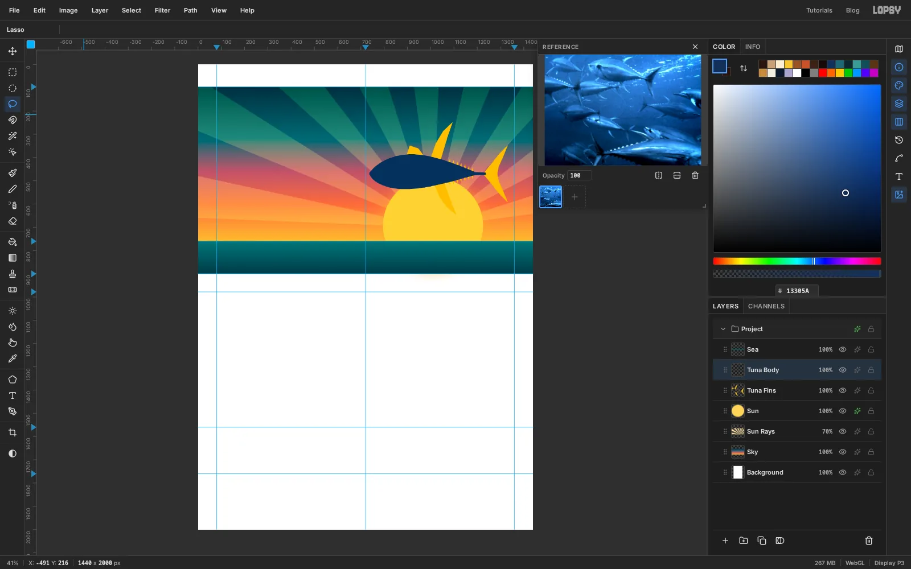

Add a layer called `Tuna Body`. Lasso the body: start at a pointed snout around **737, 470**, sweep up over a rounded back that's highest about a third of the way along, and taper down to a thin stalk only about 10 px tall that reaches the tail. Come back along a slightly fuller belly to the snout. Fill with navy `#13305A`.

## Add the belly with an intersection

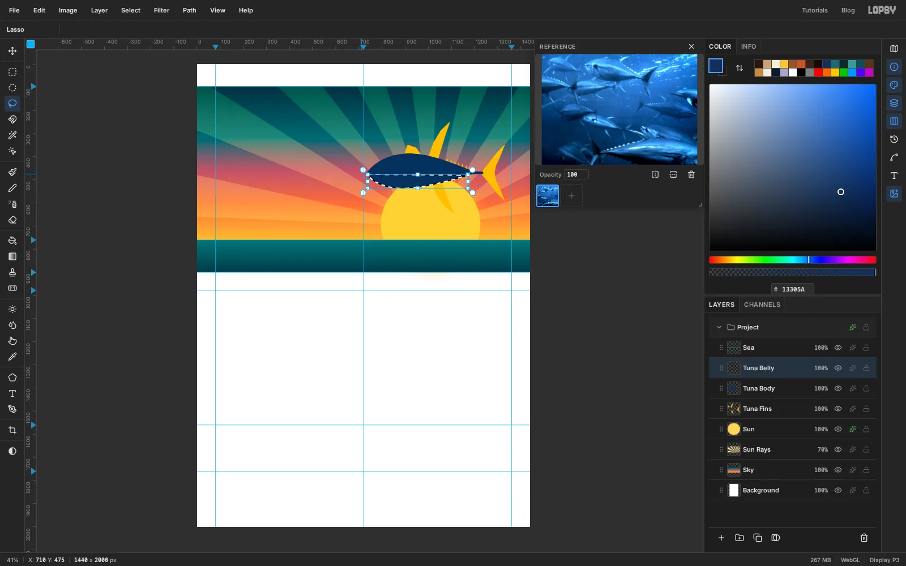

Add a layer called `Tuna Belly`. [[Cmd]]-click the `Tuna Body` thumbnail to load the body as a selection. Pick the **Lasso**, hold [[Shift+Alt]] and draw a big shape that covers everything below a line running from the snout to the tail, just under the middle of the body. [[Shift+Alt]] intersects, so only the lower part of the body stays selected. Fill with `#E7E1D2`.

Do the same on the `Tuna Body` layer for an upper flank band: load the body, intersect with a shape covering the middle third of the body's height, and fill with cobalt `#1F4E8A`. The fish now has a dark back, a lighter blue flank and a pale belly.

## Add the stripe, eye and details

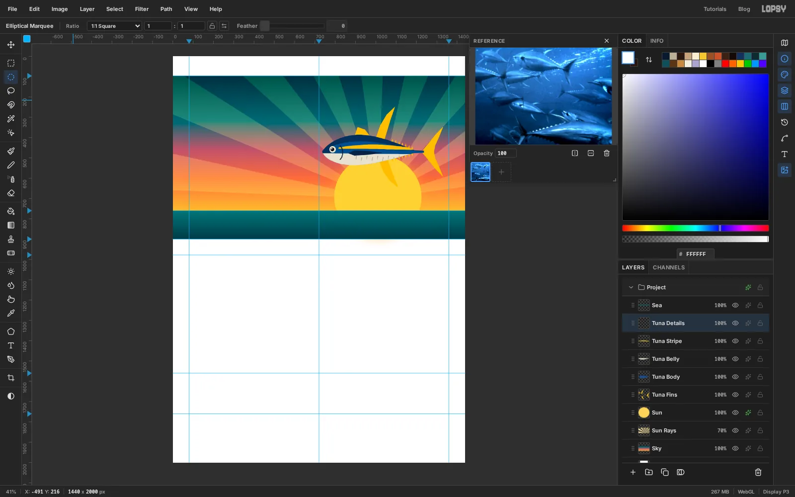

Add a layer called `Tuna Stripe`. Load the body again and intersect it with a long, thin, tapered lasso shape that runs from just behind the eye to the tail stalk, about 20 px tall in the middle and pointed at both ends. Fill with `#F5C02A`.

Add a layer called `Tuna Details` and finish the face:

- Load the belly as a selection, pick the **Pencil** (**N**) at size 3 in `#B9AE93`, and draw nine short slanted marks across the belly: click, then [[Shift]]-click about 15 px lower. The selection keeps the marks on the belly. Deselect.
- Lasso a long, narrow pectoral fin lying along the flank just behind the head and fill it with `#0B2244`.
- With the **Brush** at size 5 in `#0A1A30`, paint a curved gill line just behind the eye.
- Make the eye from three circles: cream `#F2E8CC` about 32 px across, a black pupil about 18 px across set slightly forward, and a 6 px white glint.

> **Tip:** Hide the guides with [[Cmd+;]] while you draw small circles near a guide. Marquee edges snap to any guide within 8 screen pixels, and at "fit to screen" zoom that's about 20 document pixels, enough to pull a small circle out of shape.

## Bend the fish with Mesh Warp

Select `Tuna Details` and press [[Cmd+E]] four times to merge the five tuna layers into one. Rename it `Yellowfin`.

Marquee a box a little bigger than the fish, pick the **Move** tool (**V**) and click **Mesh Warp** in the options bar. Leave the grid at **4 × 4** and tick **Preview**. A leaping fish arches its back, so drag the two inner handles of the left column down about 25 px, the inner handles of the two middle columns up about 25 px, and the inner handles of the right column down about 35 px. Click **Apply** and deselect.

## Tilt it into a leap

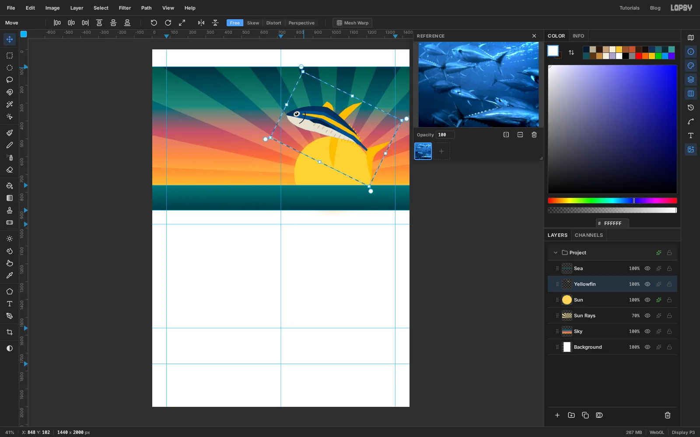

Marquee around the fish again. With the **Move** tool, drag the round rotation handle just outside the top-left corner clockwise, about **26°**, so the head lifts toward the upper left. Press [[Cmd+D]] to commit.

Drag the fish down and to the left (about 60 px left and 50 px down) until the bottom lobe of the tail just dips below the horizon at about **1166, 770**. The `Yellowfin` layer is below `Sea`, so the tip disappears into the water.

Open the layer's effects and turn on **Stroke**: **Width** `4`, colour `#160C08`. The ink outline is what gives it the flat, printed tiki look.

## Draw the splash

Select `Sea` and add a layer called `Splash`. With the **Lasso**, draw a crown of jagged spikes centred on the tail at **1166**: start at the waterline about 90 px to the left, zig-zag up and down across to 90 px on the right, with the tallest spike in the middle about 90 px high. Close it along the waterline. Then pick the **Elliptical Marquee**, hold [[Shift]] and add a flat ellipse about 300 px wide and 36 px tall across the waterline. Fill both with `#F3EEDC` and deselect.

Add six droplets as small ellipses above the crown. Then pick the **Spray** tool (**J**), set **Size** `120` and **Density** `30`, and drag along the waterline through the splash for a fizz of foam. Give the layer a **Stroke** of **3**, ink.

## Add waves and a halftone that fades with depth

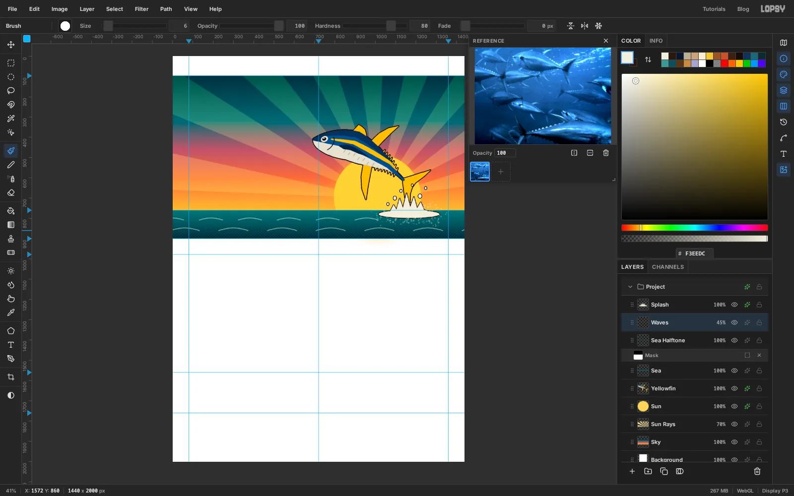

**Halftone on the sea.** Select `Sea` and choose **Layer → Duplicate Layer**. Rename the copy `Sea Halftone`, choose **Filter → Halftone…** with **Dot Size** `10` and **Angle** `45`, and set the layer to **Soft Light**. Click **Add Mask**. With the mask active, make a black-to-white gradient and drag it from the horizon down to **900**. The dots now fade in toward the bottom of the sea.

**Halftone on the sky.** Give the sky the same print texture: select `Sky`, choose **Layer → Duplicate Layer**, rename the copy `Sky Halftone`, apply **Halftone** at **Dot Size** `10`, set it to **Soft Light** and lower its opacity to **45%**. No mask this time: the dots should cover the whole sky.

**Waves.** Add a layer called `Waves` above `Sea Halftone`. Pick the **Brush** at size 6 in `#F3EEDC` and draw two staggered rows of shallow arcs: one row at about **808** with arcs about 115 px wide, and one at about **860** with wider arcs. Skip the arcs right under the splash. Set the layer to **45%** opacity.

## Silhouette a palm against the sun

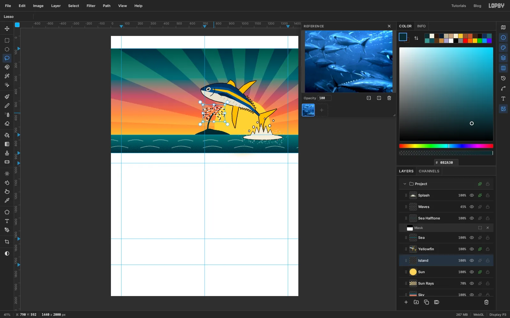

Select `Sun` and add a layer called `Island` above it, so the island sits in front of the sun but behind the fish.

Lasso a low hump of land from **640** to **920** along the horizon, about 50 px tall, and fill it with `#0B2A30`. With the **Brush** at size 11, paint a gently curving trunk from about **742, 728** up to a crown at **790, 592**.

For the fronds, lasso a long tapered leaf out from the crown, then hold [[Shift]] and add six more around it. Make them droop downward at the tips, longer on the sides and short at the top. Fill with the same `#0B2A30`.

## Park the charter boat

Still on `Island`, lasso a small boat hull on the horizon near **1290, 750**. Use [[Shift]] to add a cabin on top and a narrow tuna tower on that, then fill it all with `#0B2A30`. Pick the **Pencil** at size 3 and draw two long outrigger poles angled out from the tower: click at the tower top, then [[Shift]]-click about 55 px out and 20 px up on each side.

## Set the headline

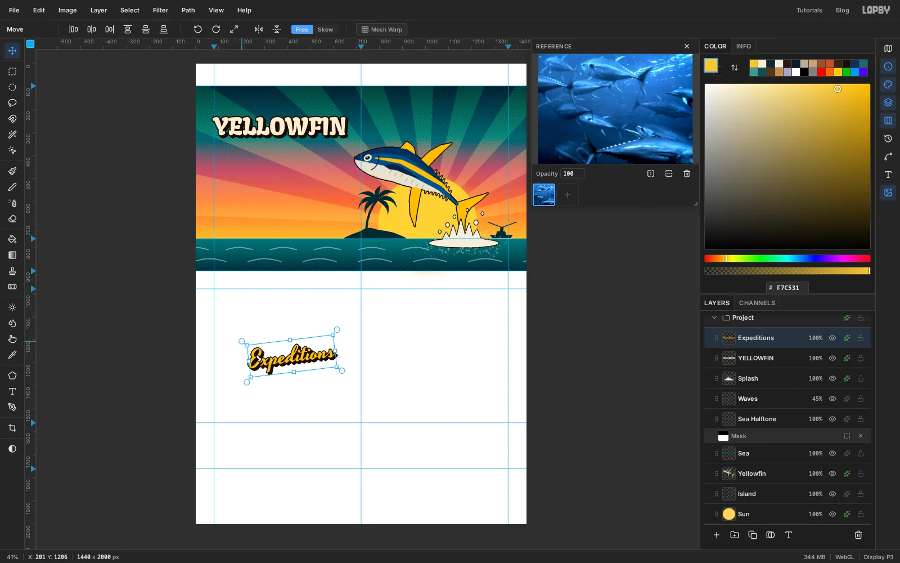

Every outline and hard shadow on this page is ink `#160C08`, and every hard shadow is a **Drop Shadow** offset **8, 8** with **Blur 0** and **Opacity 100**. Set it the same way each time and the page holds together.

Select `Splash` so the type lands above the art. Set the foreground to `#FBEFD0`, pick the **Text** tool (**T**), click at **80, 200**, choose **Kavoon** at **104** px and type `YELLOWFIN`. Press [[Tab]] to commit. Give it a **Stroke** of **5** and a **Drop Shadow** with **Offset X** `8`, **Offset Y** `8`, **Blur** `0` and **Opacity** `100`, all in ink.

Now the script. Click in the empty white space lower down the page, so you don't click into the headline's box, and type `Expeditions` in **Yesteryear** at **100** px in gold `#F7C531`. Give it a **Stroke** of **4** and the same 8, 8 hard shadow. With the **Move** tool, drag the rotation handle outside the text's top-left corner to turn it about **7°** counter-clockwise. Text stays editable after a rotation.

## Lock up the script with the headline

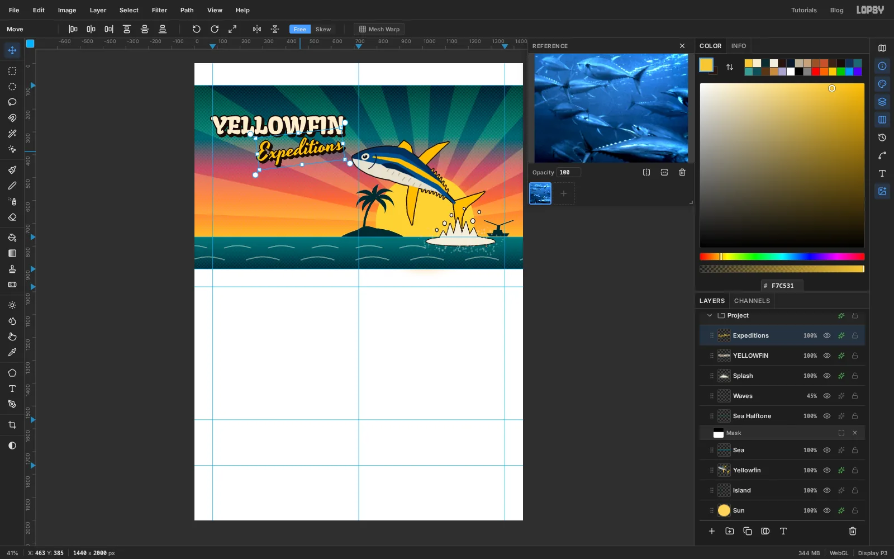

Drag `Expeditions` up under the headline so its right edge lines up with the right edge of the **N** in YELLOWFIN, and its top sits about 14 px below the headline's letters. A clean right edge is what makes the two words read as one lockup instead of two loose pieces.

## Write the copy on a plaque

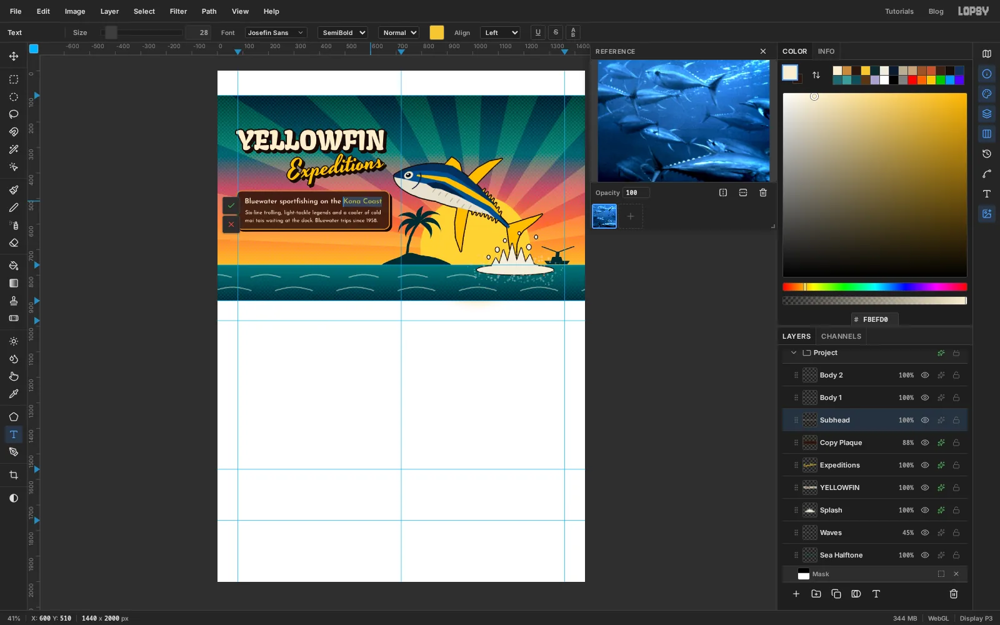

Select `Expeditions` and add a layer called `Copy Plaque`. Pick the **Shape** tool (**U**), set **Shape** to **Rectangle**, **Corner Radius** `22`, fill `#2A160C` and stroke `#C98A3E` at width **4**. The shape grows from the point you press, so press at the centre, **374, 545**, and drag out to **674, 620**. That gives a 600 × 150 plaque whose left edge lines up with the Y. Set the layer to **88%** opacity and give it the 8, 8 hard shadow.

Add three text layers in **Josefin Sans**, cream `#FBEFD0`, each starting 36 px inside the plaque's left edge:

- `Subhead`: `Bluewater sportfishing on the Kona Coast` at **28** px **SemiBold**, centred on **y 510**
- `Body 1`: `Six-line trolling, light-tackle legends and a cooler of cold` at **21** px **Regular**, centred on **y 554**
- `Body 2`: `mai tais waiting at the dock. Bluewater trips since 1958.` at **21** px, centred on **y 585**

That leaves even margins of about 26 px at the top and bottom and 32–36 px at the sides. To pick out the place name, click into the first line with the **Text** tool, press [[End]], then press [[Shift+←]] ten times to select `Kona Coast`, then click **Text color** in the options bar and type `F7C531`. Press [[Tab]] to commit.

## Add matching buttons

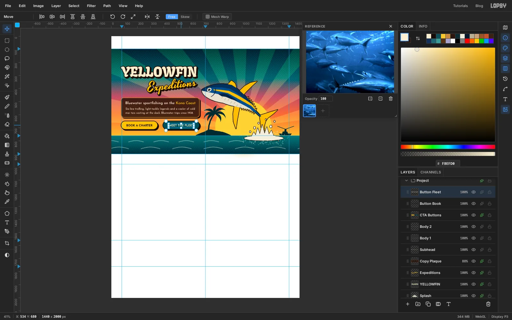

Add a layer called `CTA Buttons`. With the **Shape** tool set to **Rectangle**, **Corner Radius** `32` and an ink stroke of **4**, draw two 280 × 64 pills on the same baseline. For the gold `#F7C531` one, press at **214, 680** and drag to **354, 712**. For the teal `#0F4E58` one, press at **534, 680** and drag to **674, 712**. The outer edges line up with the plaque. Give the layer the 8, 8 hard shadow.

Type `BOOK A CHARTER` in ink and `MEET THE FLEET` in cream, both **Josefin Sans Bold** at **22** px, and rename them `Button Book` and `Button Fleet`. With the **Move** tool, centre each label on its pill by eye, checking the status bar: the pills' middles are at **214, 680** and **534, 680**. The space left and right of each label should match. `Button Fleet` is now the top layer of the page, and each new section's group goes directly above it.

## Paste the logo into the nav

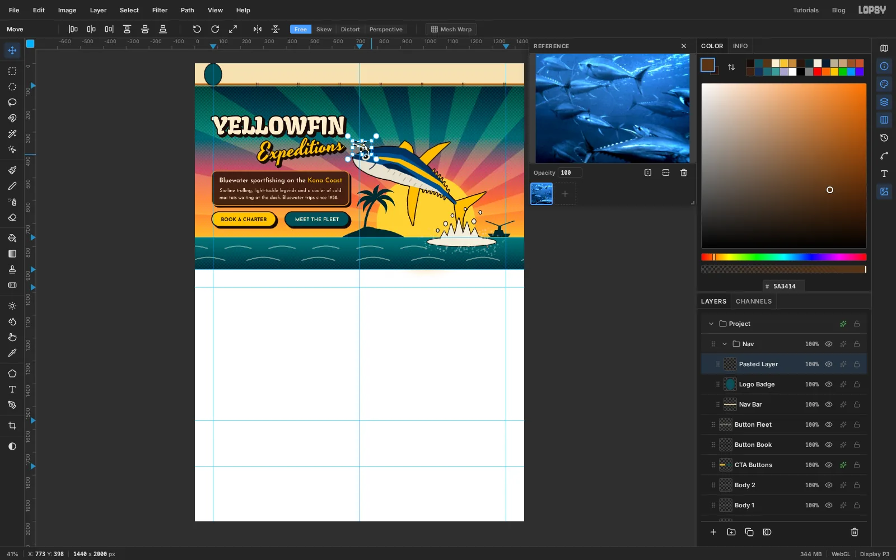

Select `Button Fleet` (the top layer, outside any group) and click **New Group** in the Layers panel. Name the group `Nav` and add a layer inside it called `Nav Bar`. Marquee the top of the page down to the 96 guide and fill it with `#F3E2B8`. For the bamboo rail, fill a 14 px strip at **86** with `#C98A3E` and a 4 px band at **91** with `#7A4A1E`. Then use the **Pencil** at size 3 in `#5A3414` to draw pairs of short vertical node marks across the rail every 180 px.

Add a layer called `Logo Badge` and draw a 76 px teal `#0F4E58` circle with a 3 px ink stroke centred on **80, 48**, using the **Shape** tool set to **Ellipse**.

Now reuse the tuna. Select `Yellowfin`, marquee around the fish and press [[Cmd+C]]. Select `Logo Badge` and press [[Cmd+V]]: the copy pastes in place, already selected, with the **Move** tool active. Hold [[Cmd]] and drag the bottom-right corner handle up and in until the box is about **84 px** wide. [[Cmd]] keeps the proportions.

## Finish the nav

Drag the small tuna onto the badge, centred on **80, 46**, and press [[Cmd+D]]. Rename it `Logo Fish` and give it a 3 px **Stroke** in cream `#FBEFD0`, so where the fish breaks out of the circle the overlap looks deliberate.

Type `Yellowfin` in **Yesteryear** at **46** px in ink, rename it `Wordmark`, and place it about 12 px to the right of the badge, centred on **y 46**. Add a layer called `Nav Pill` and draw a teal pill with an ink stroke of 3 by pressing at **1286, 46** and dragging to **1360, 72**, so it ends on the right margin. Then type the links as one line, `CHARTERS      FLEET      CATCH LOG      CREW`, and `BOOK NOW`, both in **Josefin Sans Bold** at **19** px, and rename them `Nav Links` and `Nav CTA`. Spacing the links with six spaces is a comp shortcut: in a real build they'd be separate elements, but one layer is easier to centre and move. Use ink for the links and cream for the button. Centre `BOOK NOW` on the pill, and end the links about 40 px left of it, all on **y 46**.

## Weave the tapa band

Select `Button Fleet` again and make another **New Group** called `Charters Section`. Inside it, add a layer called `Paper`, marquee everything between the 978 and 1560 guides and fill it with `#F3E2B8`. Keep the selection and choose **Filter → Add Noise…** with **Amount** `6`, **Mono** and **Gaussian**, for a little paper tooth.

Add a layer called `Tapa Band`, marquee the strip between the 900 and 978 guides and fill it with `#2A160C`.

The pattern repeats every 48 px. Each tooth is three straight Lasso strokes. Draw one 48 px-wide triangle hanging down from the top of the band and one pointing up from the bottom, then hold [[Shift]] and keep adding pairs along the band. Use the status bar to land each point on a multiple of 48. Fill with `#F1DDB0`.

The diamonds work the same way: 22 px wide, one centred on each tooth (x 24, 72, 120 and so on, at y 939). Lasso the first, [[Shift]]-add the rest, and fill with coral `#C8522A`. It's 30 diamonds, but each one is four quick strokes.

> **Tip:** If you'd rather not draw every tooth, draw four, select the first 192 px of the band, copy and paste, and drag the copy exactly 192 px right before you **Merge Down**. Then repeat with 384 and 768.

## Snap three cards to the grid

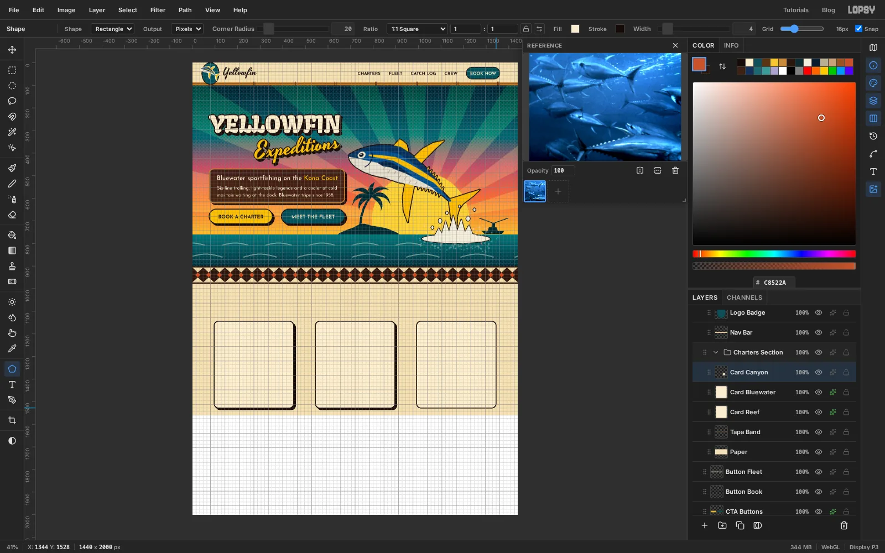

Choose **View → Show Grid**. The grid is 16 px and snapping turns on with it. Hide the guides with [[Cmd+;]] first: a guide beats the grid when snapping, and the 1360 margin guide would pull the third card's corner out of line.

Add three layers named `Card Reef`, `Card Bluewater` and `Card Canyon`, and on each draw a **Rectangle** with **Corner Radius** `20`, fill `#FBEFD0` and an ink stroke of **4**. Press at the centre and drag to a corner: the centres are at **272**, **720** and **1168** on **y 1336**, and each card is **352 × 384**. Because the centre and corner both snap, the three cards come out identical and evenly spaced. Hide the grid again with [[Cmd+']].

Give `Card Reef` the 8, 8 hard shadow. In its effects drawer click **Copy effects**, then open each of the other two cards' drawers and click **Paste effects**.

## Colour the card headers

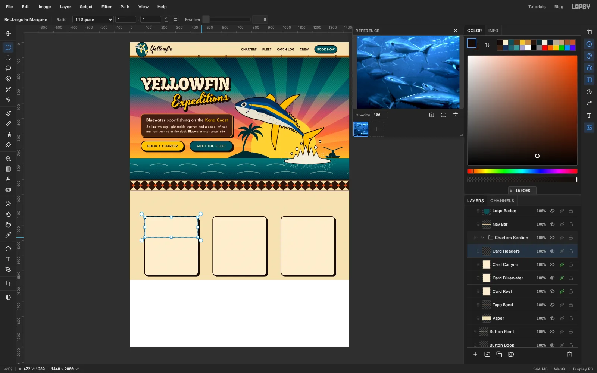

Add a layer called `Card Headers` above the cards. For each card:

1. [[Cmd]]-click the card's thumbnail to load it as a selection.
2. Choose **Select → Shrink…** and shrink by **4** px, so the header sits inside the ink outline instead of covering it.
3. With the **Rectangular Marquee**, hold [[Shift+Alt]] and drag a box over the top of the card down to **y 1280**.
4. Fill with the card's colour: teal `#1D6872`, navy `#13305A` or coral `#C8522A`.

Then pick the **Pencil** at size 4 in ink and draw a divider along **y 1280** across each card: click at the left edge, then [[Shift]]-click at the right.

## Draw the card icons

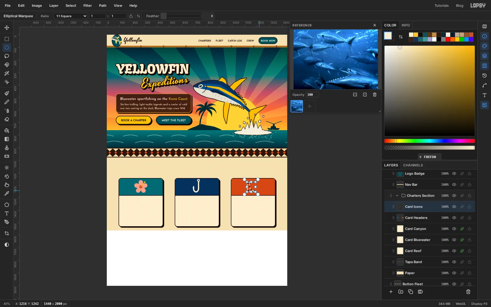

Add a layer called `Card Icons`. Each header gets one flat icon, centred on **y 1212**:

- **Reef:** a hibiscus made from five rounded petals (draw one with the **Lasso** and [[Shift]]-add four more around a centre), filled `#F6A48C`, with a coral centre and a gold brush-stroke stamen.
- **Bluewater:** a fish hook about 100 px tall. With the **Brush** at size 11 in cream, drag a straight shank down from **732, 1168** to **732, 1226**, then curve it round to the left in a J about 40 px wide, ending pointing up at **692, 1216**. Lasso a small triangle on that tip for the barb, and add a ring at the top of the shank. Make the ring by filling a small circle and then [[Alt]]-dragging a smaller circle inside it to cut the hole.
- **Canyon:** a crescent moon. Select an 80 px circle with the **Elliptical Marquee**, then hold [[Alt]] and drag a same-size circle offset up and to the right to cut it away. Fill with cream, then add three gold five-point stars with the **Lasso**.

Give the layer a 3 px ink **Stroke**.

## Set the section heading and card text

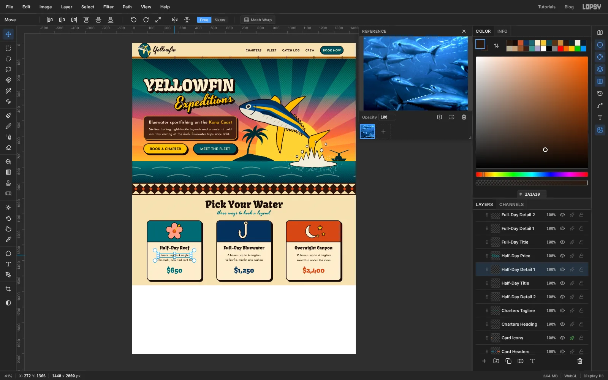

Centre the heading `Pick Your Water` in **Kavoon** at **64** px, ink, on **720, 1036**, and the line `three ways to hook a legend` in **Yesteryear** at **38** px, teal `#1D6872`, on **720, 1096**.

For each card, centre four lines on the card's middle (**272**, **720** or **1168**):

- the name in **Kavoon 28**, ink, on **y 1320**: `Half-Day Reef`, `Full-Day Bluewater`, `Overnight Canyon`
- the length and party size in **Josefin Sans SemiBold 19**, `#2A1A10`, on **y 1366**: `4 hours · up to 4 anglers`, `8 hours · up to 6 anglers`, `18 hours · up to 4 anglers`
- the target fish in **Josefin Sans Medium 19** on **y 1396**: `mahi-mahi, ono and reef fish`, `yellowfin, marlin and wahoo`, `swordfish under the stars`
- the price in **Kavoon 44** in the card's header colour on **y 1462**: `$650`, `$1,250`, `$2,400`

> **Tip:** Start each new text in an empty part of the canvas and move it into place afterwards. A Text-tool click inside an existing text layer's box edits that layer, so clicking where the last title sits types into the title.

## Build the catch log strip

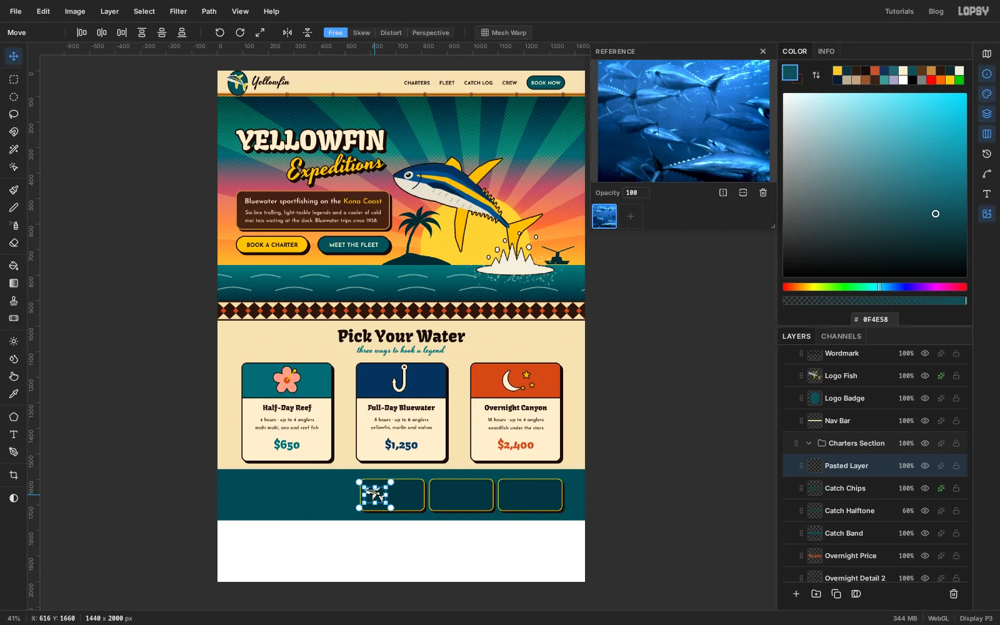

Select `Overnight Price` and add a layer called `Catch Band`. It lands inside the `Charters Section` group, which is fine for now: you'll give the catch log its own group at the end. Marquee between the 1560 and 1760 guides and fill with teal `#0F4E58`. Duplicate it, rename the copy `Catch Halftone`, run **Halftone** at **Dot Size** `8`, set it to **Soft Light** and lower its opacity to **60%**.

Add a layer called `Catch Chips` and draw three **250 × 124** rounded rectangles (**Corner Radius** `18`, fill `#0A3440`, gold stroke **3**), centred on **685**, **955** and **1225** on **y 1660**. Their left edges land at **560**, **830** and **1100**. Give the layer the 8, 8 hard shadow.

Now reuse the logo fish as an icon. Select `Logo Fish`, marquee around it and press [[Cmd+C]]. Select `Catch Chips`, press [[Cmd+V]] and drag the pasted fish into the left end of the first chip. Paste twice more for the other chips. Copy the effects from `Logo Fish` and paste them onto the three copies so they get the cream outline too.

## Fill in the catch log

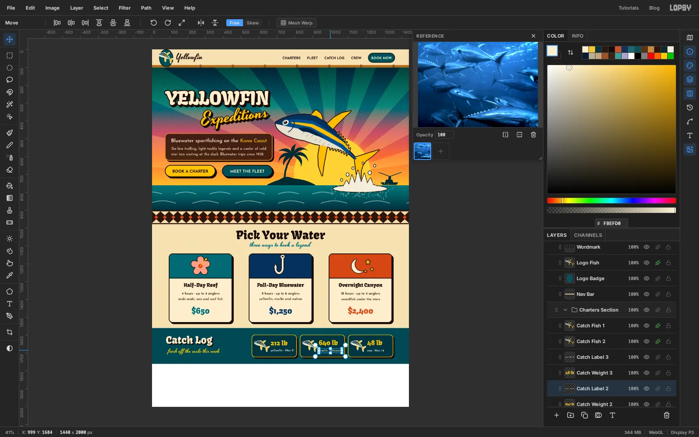

Name each text layer as you go (`Catch Heading`, `Catch Weight 1` and so on). On the left, type `Catch Log` in **Kavoon 56**, cream, with a 6, 6 hard shadow, starting at **x 80** on **y 1630**, and `fresh off the scale this week` in **Yesteryear 32**, gold, on **y 1690**.

In each chip, put the weight in **Kavoon 36**, gold, on **y 1642**, and a short label in **Josefin Sans SemiBold 17**, cream, on **y 1684**. Start both about 106 px in from the chip's left edge, just clear of the fish. Keep the labels short (`yellowfin · Nov 9`, `marlin · released`, `ono · Nov 14`) so they finish well inside the chip.

## Grow a wood grain for the footer

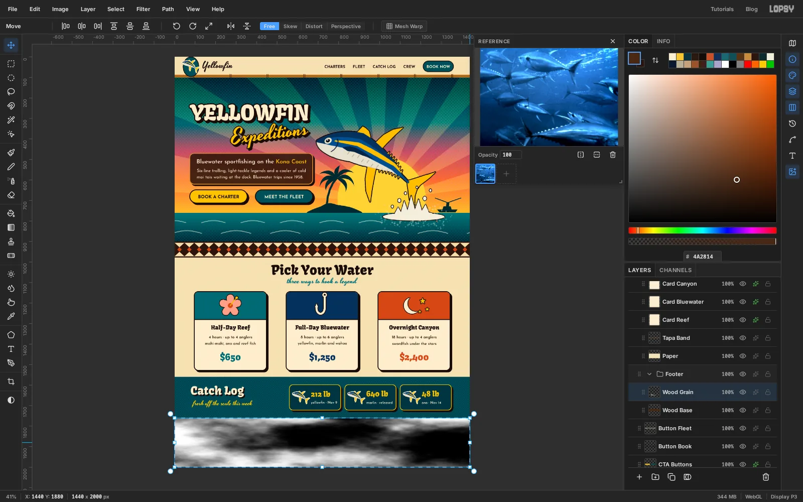

Select `Button Fleet` and make a **New Group** called `Footer`. Add a layer called `Wood Base` and fill everything below the 1760 guide with `#4A2814`.

Add a layer called `Wood Grain`, marquee the same area, and choose **Filter → Clouds…** with **Scale** `16`. Clouds are blotchy, but wood is long and streaky. Marquee just the left 300 px of the footer, pick the **Move** tool and drag the right-edge handle all the way across to **1440**. That stretches the clouds nearly five times wider. Deselect.

Marquee the footer again, run **Add Noise** at **40** (Mono), then **Filter → Motion Blur…** at **Angle** `0`, **Distance** `30`. The noise smears into fine horizontal grain. Set the layer to **Soft Light**, then duplicate it, rename the copy `Wood Streaks`, set it to **Multiply** at **20%** to darken the streaks.

## Reuse the bamboo rail and carve a tiki

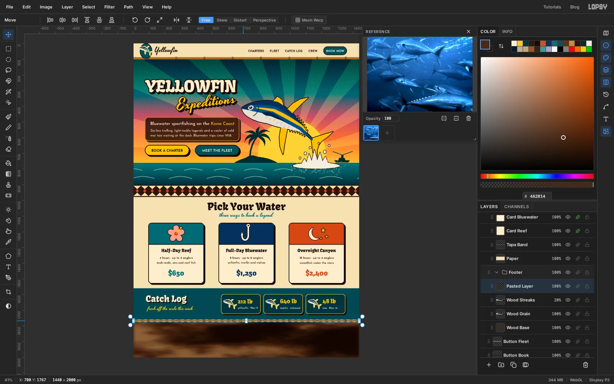

Select `Nav Bar`, marquee the bamboo strip from **0, 86** to **1440, 100** and copy it. Select `Wood Streaks`, paste, and drag the copy straight down until it sits along the top of the footer at **1760**. Press [[Cmd+D]] and rename it `Footer Bamboo`.

Add a layer called `Tiki Mask` and carve a mask in the bottom-right corner, fully inside the footer:

- a **150 × 184** rounded rectangle (**Corner Radius** `30`) in `#9A5226`, centred on **1281, 1884**, so it spans **1206–1356** across and **1792–1976** down
- a brow band: marquee an 18 px strip across the face at **1828** and fill it with darker `#6A3417`
- a wide nose: lasso a trapezoid about 26 px wide at the top and 44 px at the bottom, from **1866** to **1902**, in the same dark brown
- eyes: with the **Elliptical Marquee**, fill two 46 × 32 px almonds in `#1E0C04` centred on **1244, 1868** and **1318, 1868**, then a 16 px gold `#F7C531` pupil in each, so the eyes glow
- cheeks: two flat 26 × 18 px coral `#E2704A` ellipses just below and outside the eyes
- mouth: marquee a 106 × 36 px box from **1228, 1918** and fill it `#1E0C04`, then lasso a row of cream `#F1DDB0` triangle teeth hanging from the top and, with [[Shift]], a row pointing up from the bottom

Pick the **Dodge** tool (**O**), switch **Mode** to **Burn**, set **Exposure** to **20** and size **24**, and run it down both sides of the face to round it off. Finish with an ink **Inner Glow** (**Size** `10`, **Opacity** `45`) for carved depth, a 3 px ink **Stroke** and the 8, 8 hard shadow.

## Write the footer and tidy the layers

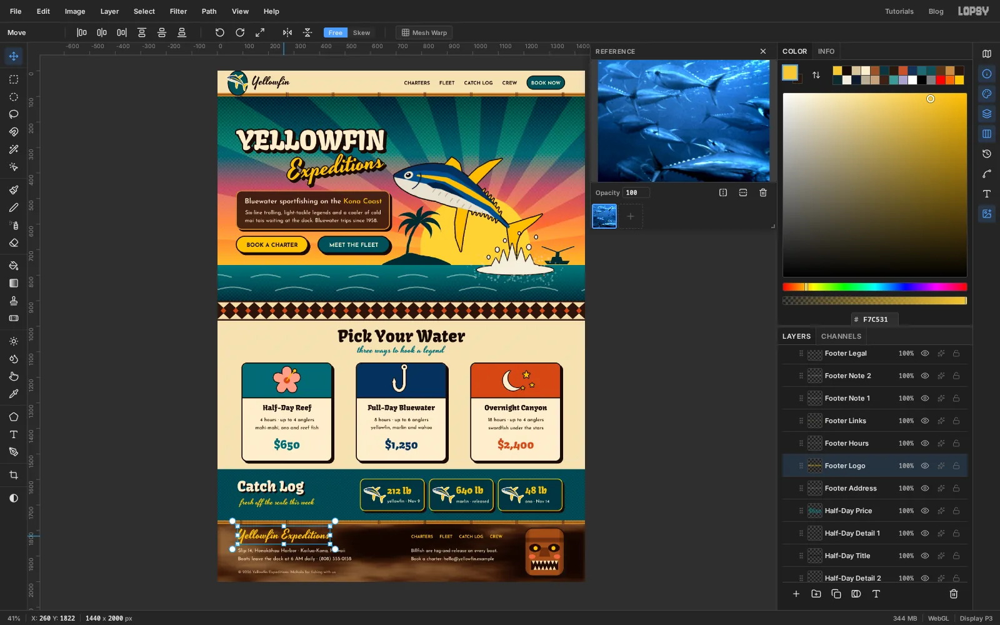

Set the footer type, starting each line at **x 80** on the left or **x 760** in the middle column:

- `Yellowfin Expeditions` in **Yesteryear 50**, gold, on **y 1822**
- the address and sailing time in **Josefin Sans 19**, cream, on **y 1878** and **1910**: `Slip 14, Honokōhau Harbor · Kailua-Kona, Hawaii` and `Boats leave the dock at 6 AM daily · (808) 555-0158`
- `CHARTERS     FLEET     CATCH LOG     CREW` in **Josefin Sans Bold 16**, gold, on **y 1822**
- two lines in **Josefin Sans 18**, cream, on **y 1878** and **1910**: `Billfish are tag-and-release on every boat.` and `Book a charter: hello@yellowfin.example`
- `© 2026 Yellowfin Expeditions. Mahalo for fishing with us.` in **Josefin Sans 15**, `#D9C29A`, on **y 1962**: small, but still readable on the dark wood

Finally, tidy up. Click the first footer text layer, [[Shift]]-click the last, and choose **Layer → Group Layers**. Name the group `Footer Text` and drag it by its handle onto the `Footer` group's row. Do the same with the catch log layers into a `Catch Log` group. To check the groups, select `Footer Text` and drag it with the **Move** tool: all seven lines move together. Undo to put them back.

Choose **File → Save Project** to keep a layered `.lopsy`, then **File → Quick Export PNG** for the final comp.

> **Tip:** Want a different charter? Swap the tuna for a marlin or mahi-mahi (the fin layout is the main thing to change), recolour the three card headers, and the sunset, tapa band, plaque, cards and footer all carry over as they are.
