**Yōkai** are the spirits and monsters of Japanese folklore, and some of
the best loved are ordinary objects that have come to life. A paper lantern
left too long tears open into a grinning mouth. An old umbrella grows one
eye and hops about on a single leg. Edo-period storytellers swapped these
tales at night during **hyaku monogatari**, "a hundred ghost stories", and
woodblock artists such as Hokusai printed them.

This tutorial turns three of them into a **tattoo flash sheet**: a page of
ready-to-use designs that a client picks from on the studio wall. The
designs are a **chōchin-obake** (lantern ghost), a **kasa-obake** (umbrella
ghost) and a **Hannya** mask from Noh theatre: a woman turned into a horned demon by
jealousy.

The look is borrowed from ukiyo-e prints. Every shape is a flat colour with
a heavy black keyline. Shading comes from **bokashi**, where the printer
wipes a soft fade of ink across the block. Tattoo flash needs edges a
stencil can follow, so here the fade is stepped into flat bands: a
gradient run through **Posterize**.

The sheet is 1500 × 2000 px. You'll use:

- the **Texture**, **Fibers**, **Clouds**, **Posterize** and **Add Noise** filters
- guides and the **Rectangular Marquee** with **Select → Shrink**
- gradients from the **Gradient Editor**, and a gradient on a **layer mask**
- [[Cmd]]-click on a layer thumbnail and **Select → Inverse** to keep paint inside a shape
- the **Lasso**, **Shape** tool, **Brush**, **Eraser** and **Magic Wand**
- the **Stroke**, **Inner Glow** and **Color Overlay** effects, with **Copy effects** and **Paste effects**
- copy and paste, **Flip Horizontal**, **Duplicate Layer**, and the Move tool's scale and rotate handles
- groups, including rotating and scaling a whole group at once
- type in **Zen Antique** and **Yuji Syuku**, centred with the Move tool's **Align** buttons
- a **Hue / Saturation** adjustment on the whole document

The palette is a woodblock printer's handful of inks:

- Washi paper `#EBDDBF`, foxing `#9C7A48`
- Sumi ink `#1C1A1F`, bone white `#F4ECD8`
- Vermilion `#C8372D` / `#8E1F1C`, seal red `#C8381E`
- Gold `#E8B850`, ochre `#D9962B`
- Prussian blue `#4E78A8` → `#1F3F6E` → `#16243F`
- Ghost-fire `#FFFFFF` → `#BFE3E6` → `#3E8C84`
- Sakura `#F1B7B0`, tongue pink `#E0605A`

Two habits make the steps easier to follow:

- New layers appear just above the selected layer, and inside a group
  when the group itself is selected. The steps tell you what to click
  first.
- Each design lives in its own group, so you can move or resize it as one
  piece at the end.

## Make the washi paper

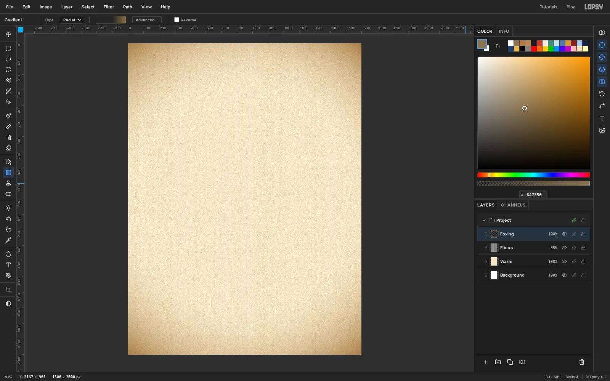

Choose **File → New**, set **1500** by **2000** pixels with a white
background and click **Create**. Lopsy puts the layers in a **Project**
group. Leave them there. Double-click **Layer 1**, rename it **Washi**,
press [[Cmd+A]], set the foreground to `#EBDDBF` and choose **Edit → Fill**.
Press [[Cmd+D]].

Give it some tooth: **Filter → Texture…**, pick **Rough**, and set Amount
`22`, Size `2.5` and Detail `70`.

Add a layer called **Fibers**, fill it with a mid brown (`#8A7350`) and run
**Filter → Fibers…** with Variance `24` and Strength `40`. Open its
effects drawer (the sparkle button on the row), set **Blend** to **Soft
Light**, then set the layer's opacity to **35%**.

Add one more layer called **Foxing** for the aged edges. Pick the
**Gradient** tool, choose **Radial**, and open the Gradient Editor. Make
the stops transparent at the centre, still transparent at 55%, and
`#9C7A48` at about 85% opacity at the end. Drag from the middle of the
page straight down past the bottom edge. Set the layer's blend to
**Multiply**.

## Rule a double border

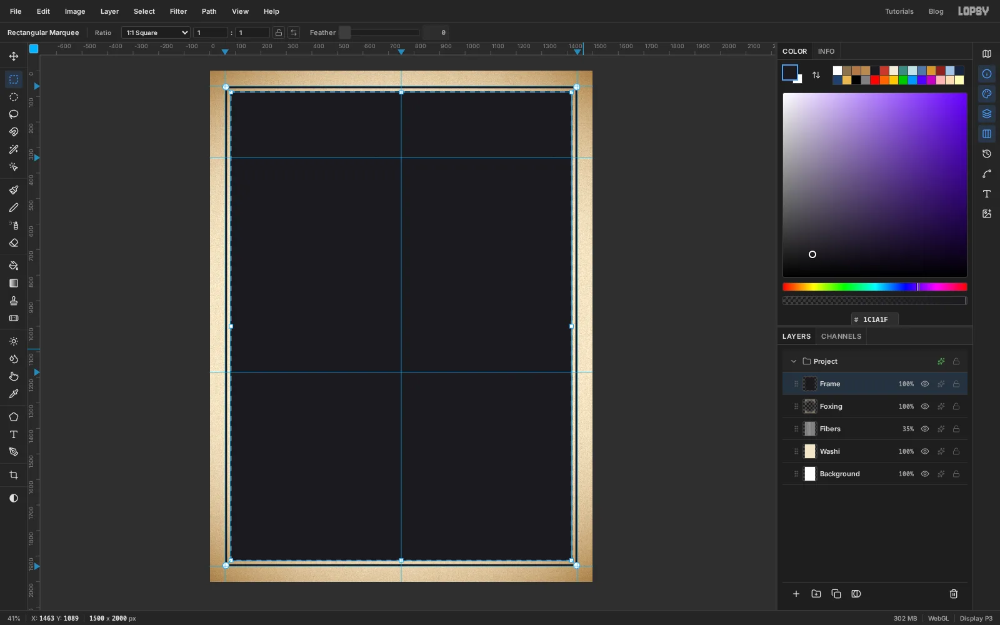

Hold [[Cmd]] and click the top ruler near the middle. The guide snaps to
the exact centre (750). Let go of [[Cmd]] for the rest: as you hover a
ruler, a readout shows the position under the pointer, so you can click
right on the number. Click the top ruler at **60** and **1440**, and the
left ruler at **60**, **340**, **1180** and **1940**. The outer
pair are your margins. The 340 and 1180 guides split the page into a top
row for two designs and a bottom row for the third.

Add a layer called **Frame** and set the foreground to sumi `#1C1A1F`. With
the **Rectangular Marquee**, drag from the top-left margin corner to the
bottom-right one. The edges snap to the guides. Then:

1. **Edit → Fill**.
2. **Select → Shrink…** by `8` and press [[Delete]]. That leaves an 8 px
   outer rule.
3. **Select → Shrink…** by `12` and fill again.
4. **Select → Shrink…** by `3`, press [[Delete]] and then [[Cmd+D]].

You now have a heavy outer line and a hairline just inside it.

## Shape the lantern and add a bokashi band

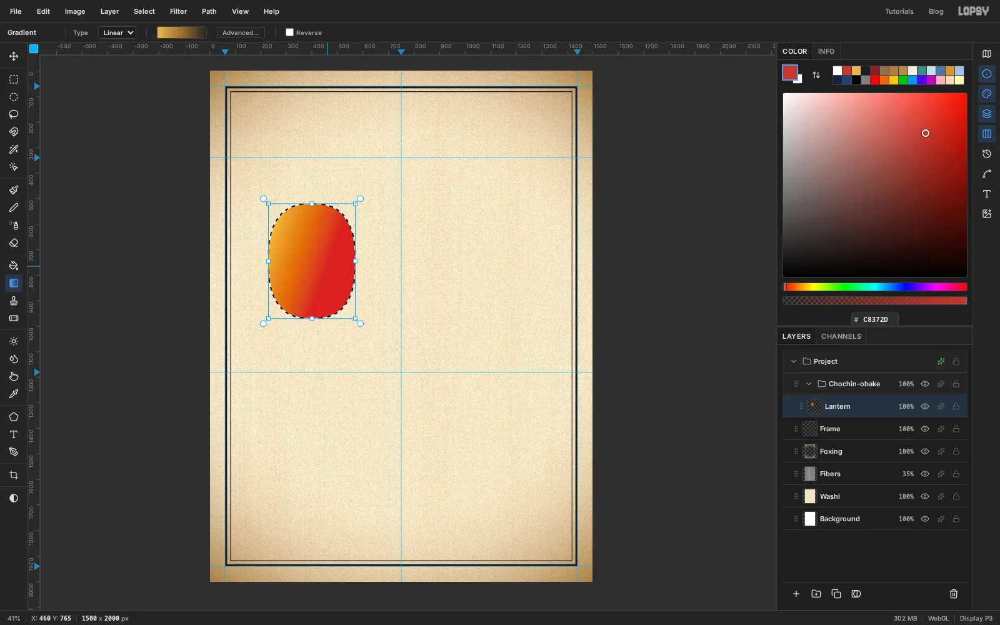

Click the **Project** row and press the **New Group** button. Call the
group **Chochin-obake**, then add a layer inside it called **Lantern**.

A paper lantern is a barrel: wide in the middle with flattened ends. Use
the **Lasso** to draw a rounded, slightly squared oval about 340 px wide and
450 px tall in the upper-left cell (centred around x 400, y 745). Fill it
with vermilion `#C8372D`.

[[Cmd]]-click the **Lantern** thumbnail to select its shape. Pick the
**Gradient** tool, set it to **Linear**, and in the Gradient Editor make
three stops: gold `#E8B850` at full opacity, ochre `#D9962B` at 60% in the
middle, and ochre at 0% at the end. Drag from the lantern's left edge to
just right of its centre, angled slightly downward. Press [[Cmd+D]].

## Flatten it into woodblock steps

A smooth gradient looks like airbrush, not print. Choose **Filter →
Posterize…** and set **Levels** to `6`. The blend snaps into three flat
bands, like a printer laying gold, orange and red blocks next to each
other.

Try a few values. Four levels turn the red muddy, and eight levels bring
back too much of the smooth blend.

## Paint the ribs and keep them inside

Add a layer called **Ribs**. Pick the **Brush**, set Size `7`, Hardness
`100`, and colour `#8E1F1C`. Paint nine horizontal ribs across the
lantern, spaced evenly from top to bottom. Let each one dip a little in
the middle so it wraps around the barrel. Run them past the edges: you'll
trim them next.

[[Cmd]]-click the **Lantern** thumbnail, click the **Ribs** layer, and
choose **Select → Inverse** ([[Cmd+Shift+I]]). Press [[Delete]] to clear
everything outside the lantern, then [[Cmd+D]]. Set the Ribs layer's blend
mode to **Multiply** so they darken each colour band.

## Add the caps with the Shape tool

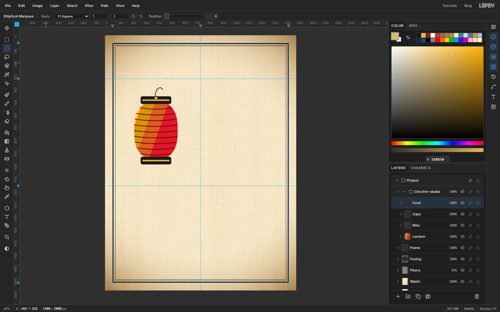

Add a layer called **Caps**. Pick the **Shape** tool and choose
**Rectangle** in the options bar. Click the fill swatch and type `1C1A1F`.
The shape doesn't use the foreground colour once you've set its fill, so
always check the swatch. Set **Corner Radius** to `14`.

Shapes grow from where you press. Press at the top centre of the lantern
and drag out until the cap is about 240 px wide and 60 px tall, overhanging
the body. Do the same at the bottom. Change the fill to gold `#E8B850`,
set the radius to `2`, and draw a thin band across the middle of each cap.

Add a layer called **Cord** and brush a 6 px black loop rising from the top
cap. Add a small gold ellipse where it meets the cap.

## Give it a face

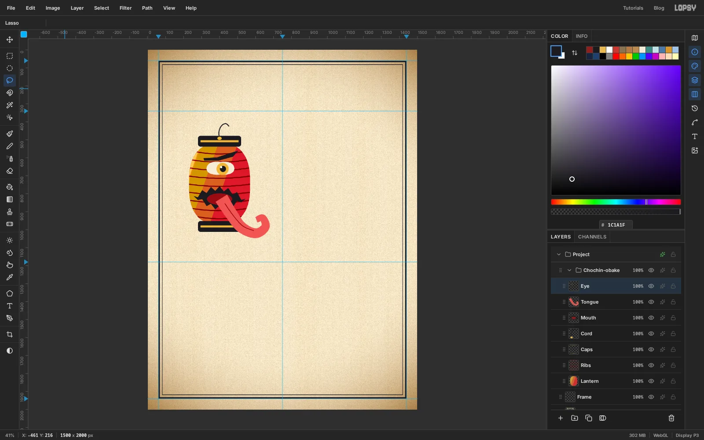

Each feature goes on its own layer:

1. **Mouth**: lasso a wide mouth across the lower third with jagged teeth
   along the top and bottom edges, and fill it black. Add a dark-red oval
   for the throat.
2. **Tongue**: lasso a long tongue that leaves the mouth, droops down past
   the bottom cap and curls back up at the tip. Fill it `#E0605A` and
   brush a 5 px dark-red groove down the middle.
3. **Eye**: lasso a large almond and fill it bone `#F4ECD8`. Then use the
   **Elliptical Marquee** and **Edit → Fill** for a gold iris, a black
   pupil and a small white catch light. Finish with a lassoed black wedge
   of a brow that slopes down toward the middle of the face.

## Ink the keylines with Stroke

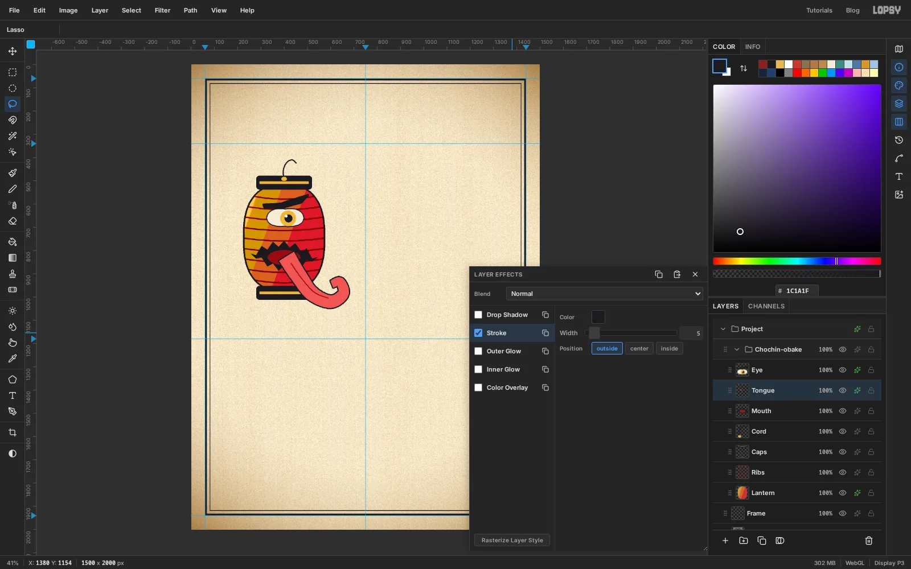

Tattoo flash lives on its outline. Open the **Lantern** layer's effects
drawer, tick **Stroke**, set **Width** to `7` and the colour to sumi
`#1C1A1F`. Do the same for **Tongue** at `5` and **Eye** at `4`.

Because the stroke is an effect, it follows the shape if you edit it
later. Set it once and you can keep reshaping the shape.

## Start the umbrella ghost

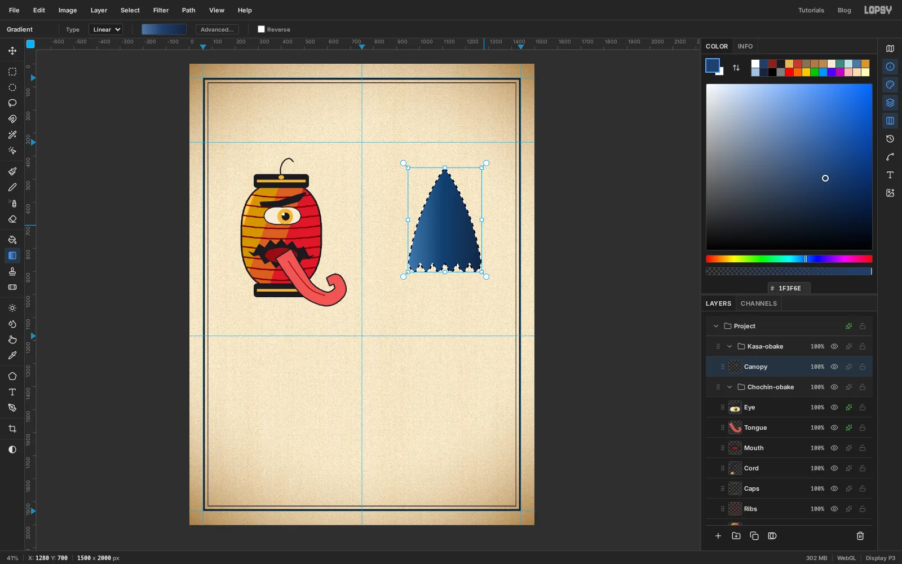

Click **Project** and add a new group called **Kasa-obake**, with a layer
called **Canopy** inside it.

In the upper-right cell, lasso a closed umbrella: a point at the top
(around y 450), sides that bulge gently outward, and a hem of six shallow
scallops along the bottom (around y 900). Fill it Prussian blue.

[[Cmd]]-click the thumbnail and drag a **Linear** gradient from the left
side of the canopy to the right. Use three stops: `#4E78A8`, `#1F3F6E`,
`#16243F`. The light coming from the left makes it look round.

## Fold the paper and tie it closed

Add a layer called **Folds**. Brush 5 px indigo lines from just under the
tip down to each point between the scallops. Then brush one pale-blue
`#9FC3E6` highlight down the left side. Trim the layer to the canopy as you
did the ribs: [[Cmd]]-click **Canopy**, select the Folds layer,
[[Cmd+Shift+I]], [[Delete]].

Add a **Finial** layer and use the Shape tool to draw a small black
rounded bar sticking up from the tip. Add a **Tie** layer, brush a 12 px
red band across the canopy near the top and trim it the same way. Then
paint two loose 6 px ribbon ends trailing off to the right.

Give **Canopy** a 7 px black **Stroke**.

## Reuse the eye: paste, flip and scale

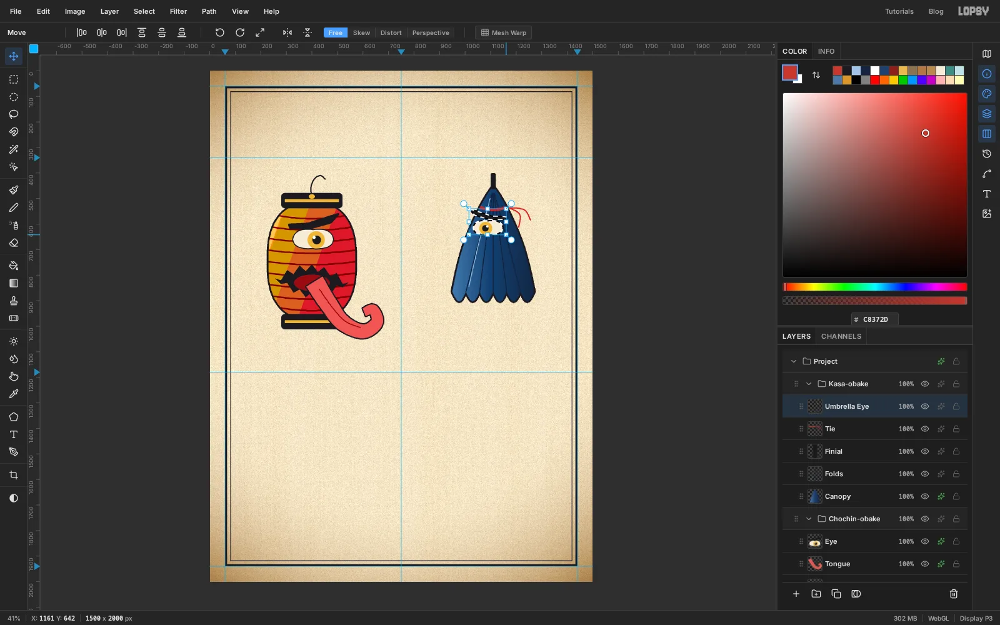

There's no need to draw a second eye. Click the lantern's **Eye** layer,
[[Cmd]]-click its thumbnail and press [[Cmd+C]]. Click the **Tie** layer and
press [[Cmd+V]]. The copy lands in place as a new layer with the Move tool
active. Rename it **Umbrella Eye**.

Drag the copy across onto the umbrella, a little below the tie. Click
**Flip Horizontal** in the options bar so the brow slopes the other way.
Then hold [[Cmd]] and drag the bottom-right handle inward to shrink it to
about three-quarters of its size. Drag it until it's centred on the
canopy, and press [[Cmd+D]].

Pasting pixels doesn't copy effects. Open the **Eye** layer's effects
drawer and click **Copy effects**, then open **Umbrella Eye** and click
**Paste effects**.

## Give the umbrella a tongue and a leg

Add **Umbrella Mouth** and fill a small red crescent under the eye. Add
**Umbrella Tongue**: a long tongue that swings out past the left edge of the
canopy and curls up. Copy the lantern **Tongue**'s effects and paste them
onto it.

For the leg, click the **Canopy** layer first, then add **Leg**. It lands
just above the canopy and below the folds, tie and face, so the top of the
leg tucks under the hem. Lasso a slightly wavy leg from under the
hem down to about y 1080. Fill it bone white and give it a 6 px black
**Stroke**.

Click **Umbrella Tongue** and add a **Geta** layer on top. A geta is a
wooden sandal raised on two teeth. With the Shape tool, draw an ochre
rounded bar for the sole, then two small black blocks underneath. Brush a
red strap arching over the top.

## Tilt the whole umbrella as a group

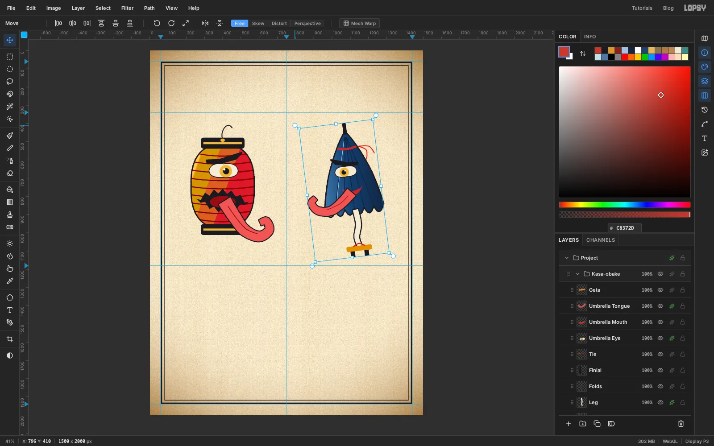

A hopping umbrella shouldn't stand bolt upright. Press [[Cmd+D]] to make
sure nothing is selected, then click the **Kasa-obake** group row. With the
**Move** tool, one transform box surrounds everything in the group.

Grab the round rotation handle just outside a corner and turn the box
about **7°** anticlockwise. Press [[Cmd+D]] to commit.

Collapse both groups to keep the Layers panel tidy.

## Set the Hannya on a mottled disc

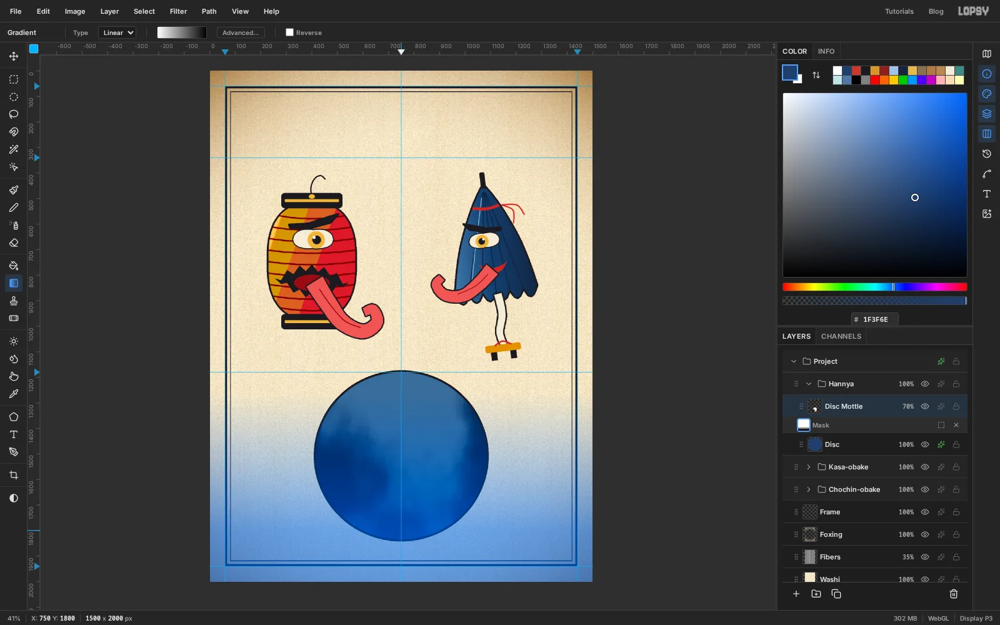

Click **Project** and add a group called **Hannya**. Add a layer called
**Disc**, and with the **Elliptical Marquee** fill a circle about 670 px
across in the lower half, centred on the middle guide. Use Prussian blue
`#1F3F6E`. Give it an 8 px black **Stroke**.

Add a layer called **Disc Mottle**. [[Cmd]]-click the **Disc** thumbnail and
run **Filter → Clouds…** with Scale `5`. Clouds paints in your
foreground and background colours, which is why it goes on its own layer.
Here the foreground is still the disc blue and the background is white.
Press [[Cmd+D]], set the layer to **Soft Light** at **70%**.

Click **Add Mask**. Pick the **Gradient** tool, set **Linear** with white
at the start and black at the end, and drag from the top of the disc to
the bottom. The clouds now fade out toward the lower
edge, like ink thinning on the block.

## Draw one horn, then mirror it

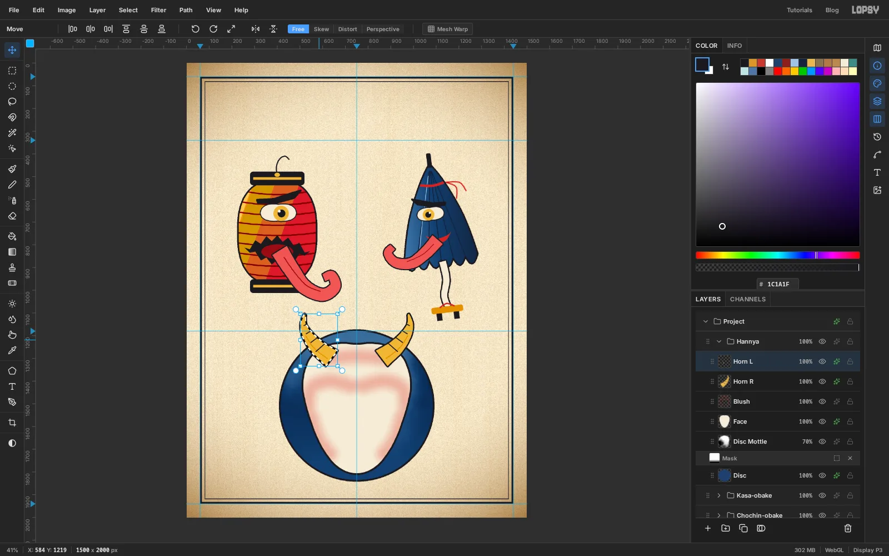

Add a **Face** layer. Lasso the mask shape, rounded at the top and tapering
to a chin near the bottom of the disc. Keep it symmetric by working on the
right half and matching the left. Fill it bone and give it an 8 px black
**Stroke**.

Add a **Blush** layer. [[Cmd]]-click the Face thumbnail, and with a soft
120 px brush at 30% opacity in vermilion, sweep across the forehead, under
the eyes and down the cheeks. Press [[Cmd+D]] and set the layer to
**Multiply**.

Add **Horn R** and lasso a curved horn rising from the right temple. Fill it
gold, brush a 5 px ochre line along its inner curve, and add black ridge
marks with [[Shift]]-click straight lines. Give it a 6 px **Stroke**.

Now choose **Layer → Duplicate Layer** and rename the copy **Horn L**.
[[Cmd]]-click its thumbnail, pick the **Move** tool and click **Flip
Horizontal** in the options bar. Drag the copy across to the left temple,
keeping it level: pink alignment lines show when it lines up with the
right horn. Fine-tune with the arrow keys ([[Shift]]+arrow moves 10 px),
then press [[Cmd+D]].

## Glare with gold eyes and heavy brows

Hannya's eyes are gold, which in Noh theatre marks a demon. Add an **Eyes**
layer and fill two angled almond shapes in gold, with a black pupil in
each. Give the layer a 6 px **Stroke**.

Add **Brows**: two thick black wedges that start near the nose and sweep up
and out toward the horns.

On a **Nose** layer, brush the nose with a 7 px black brush. Draw one side,
then repeat it mirrored so the flared nostrils match. Add a short fold from
each nostril toward the mouth and a crease under each eye.

## Shade the throat with the Magic Wand

Add **Lips** and lasso a wide crescent grin that reaches toward the edges
of the face. Fill it vermilion and give it a 6 px **Stroke**. On a **Maw**
layer above it, fill a slightly smaller black crescent inside.

Pick the **Magic Wand** and click inside the black maw. It selects just
that shape. Drag a **Radial** gradient from dark red `#8E1F1C` to black,
starting low in the throat. Press [[Cmd+D]].

On a **Teeth** layer, fill a band of bone-coloured upper teeth, two long
upper fangs and two lower fangs. Split the band into teeth with 3 px
[[Shift]]-click lines, and give the layer a 3 px **Stroke**.

## Frame the face with hair

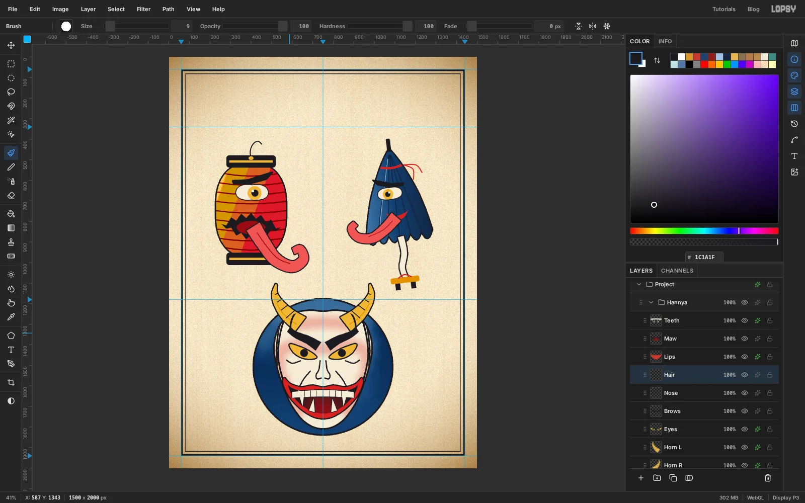

Click **Nose** and add a **Hair** layer. With a 9 px black brush, paint
three strands down each side, starting at the top of the forehead and
following the edge of the face down to the cheeks. Like the nose, draw one
side and mirror it.

To keep the strands on the face, [[Cmd]]-click the **Face** thumbnail,
click the **Hair** layer, choose **Select → Inverse** and press [[Delete]].
Press [[Cmd+D]].

## Scale the Hannya to match the others

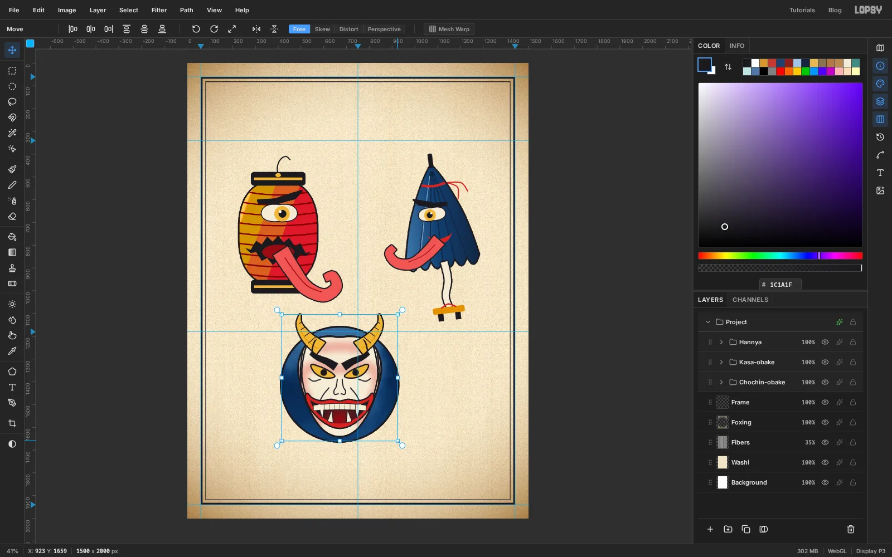

The mask is now much bigger than the lantern and the umbrella. A flash
sheet should offer equal choices, so shrink it. Collapse the group, click
the **Hannya** row and pick the **Move** tool. Hold [[Cmd]] and drag the
bottom-right handle up and in until the disc is about three-quarters of
its size, roughly 510 px across. Press [[Cmd+D]].

Click the group row again and drag it so it's centred on the middle guide,
about 60 px lower. That leaves room for the footer below it. Every layer
in the group scales together. Layer masks stay where they were, but the
soft cloud fade on the disc hides the shift. Stroke widths don't shrink,
so the mask's keylines end up slightly heavier, which suits flash.

## Light a ghost-fire

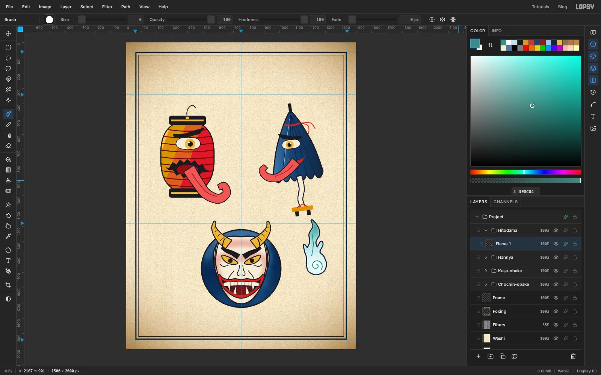

**Hitodama** are floating soul-flames, often drawn drifting around ghosts.
Click **Project**, add a group called **Hitodama**, and a layer called
**Flame 1**.

Lasso a flame to the right of the Hannya. Give it a round bottom, two small
side flickers, and a long tail that bends to one side and curls at the tip.
Fill it with any pale blue, [[Cmd]]-click the thumbnail and drag a
**Radial** gradient from white through `#BFE3E6` to teal `#3E8C84`, from the
bottom of the flame up to its tip.

With a 6 px teal brush, draw a spiral inside the round head and a line up
the tail. Add a 7 px indigo **Stroke** and a white **Inner Glow** at size
`18` and opacity `70`.

## Copy the flame and turn the copies

[[Cmd]]-click **Flame 1**'s thumbnail, press [[Cmd+C]] then [[Cmd+V]], and
rename the copy **Flame 2**. Drag it to the left of the lantern. With
[[Cmd]] held, drag a corner handle to shrink it to about 60%, then grab the
rotation handle and tilt it about **14°**. Press [[Cmd+D]].

Make **Flame 3** the same way: smaller (about half size), tilted the other
way, and tucked between the lantern and the Hannya.

Use **Copy effects** on Flame 1 and **Paste effects** on each copy so all
three share the same outline and glow.

## Set the title

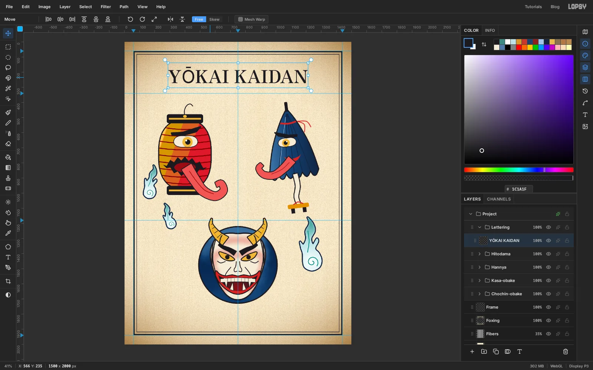

Click **Project** and add a group called **Lettering**. Set the foreground
to sumi, pick the **Text** tool and click in an empty spot near the top.
Before typing, set **Size** to `118` and choose the font **Zen Antique**.
Set the font and size *after* you click to start the text. If you change
them while a finished text layer is selected, you restyle that layer
instead. Type `YŌKAI KAIDAN` and press [[Tab]] to commit.

To get the macron on the Ō, type it from your system's character viewer or
paste it in.

Switch to the **Move** tool and click **Align center horizontally**. The
title lands exactly on the centre line.

## Add the kanji and the caption

Set the foreground to vermilion, click above the title, and type
`妖 怪 怪 談` in **Yuji Syuku** at `64`. That's *yōkai kaidan* in kanji. The
spaces open up the brush characters. Centre it with the Align button.

Back in sumi, make one more text layer in **Zen Antique** at `30`:
`TATTOO FLASH  ·  SHEET Nº 13  ·  HYAKU MONOGATARI`. Make it in empty
canvas, then drag it to just below the title and centre it. Check that
the caption clears the title's descenders. If it doesn't, nudge the title
up with the arrow keys.

## Number the designs

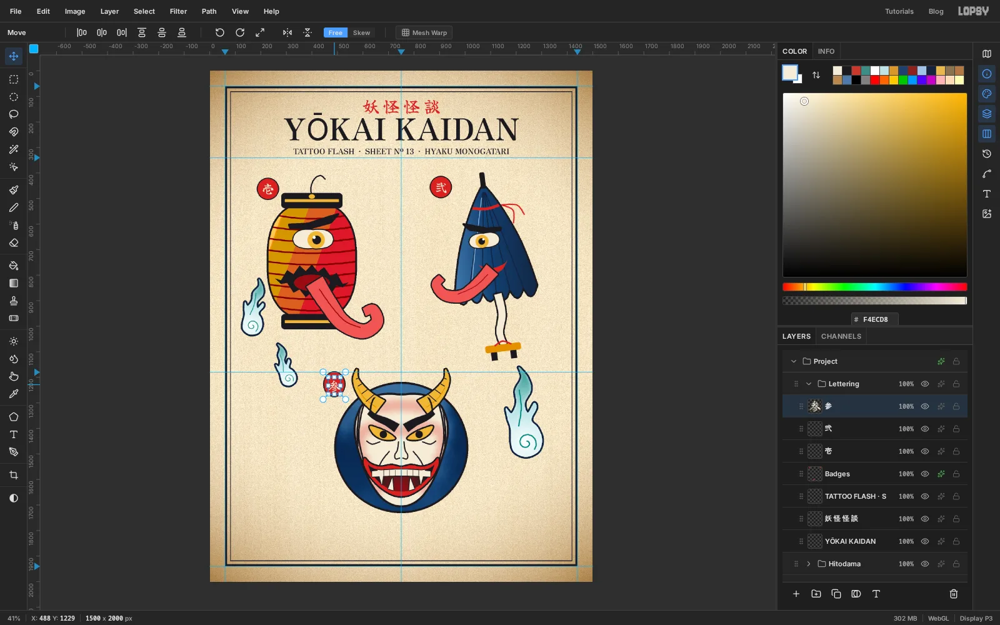

Flash sheets number every design so clients can ask for it by number. Add
a **Badges** layer and, with the **Elliptical Marquee** (hold [[Cmd]] while
dragging for a perfect circle) and **Edit → Fill**, make three vermilion
circles about 80 px across:
one above-left of the lantern, one above-left of the umbrella, and one
beside the Hannya's left horn. Give the layer a 4 px black **Stroke**.

Set the foreground to bone and make three text layers in **Yuji Syuku** at
`48`: `壱`, `弐` and `参`, the formal kanji for one, two and three. Make each
one in empty canvas and drag it onto its badge. Use the arrow keys to
nudge each one until it sits in the optical centre of its circle. Kanji
tend to sit a few pixels low, so check them up close.

## Write vertically in a cartouche

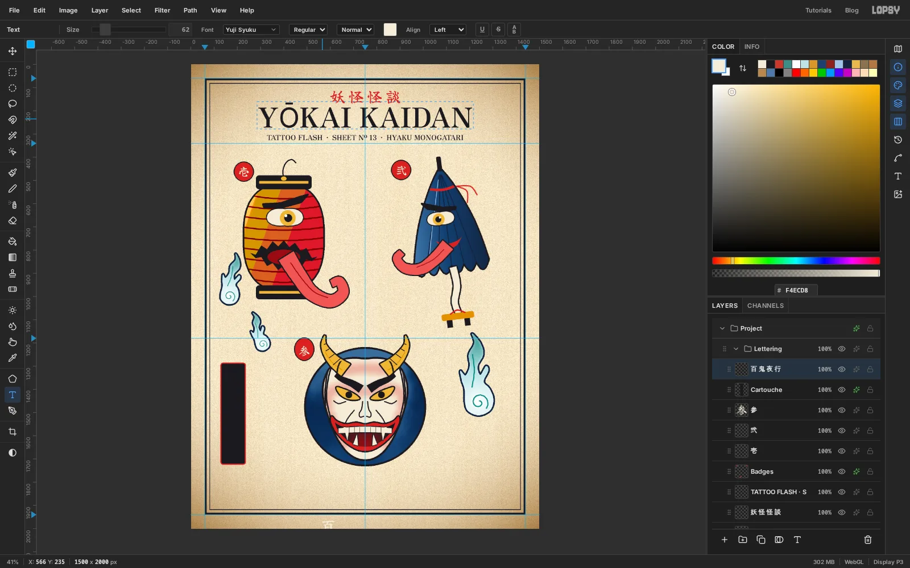

Add a **Cartouche** layer. With the Shape tool, draw a black rounded
rectangle about 100 × 215 px on the left side of the bottom row, below the
small flame. Give it a 5 px vermilion **Stroke**.

For vertical type, click an empty spot on the paper near the bottom edge
with the Text tool, choose
**Yuji Syuku** at `62`, and type one character per line, pressing [[Enter]]
between them: `百`, `鬼`, `夜`, `行`. That's *hyakki yagyō*, the night
parade of a hundred demons. Press [[Tab]], then drag the text into the
cartouche. Use the arrow keys to even out the margins on all four sides.

## Stamp the seal

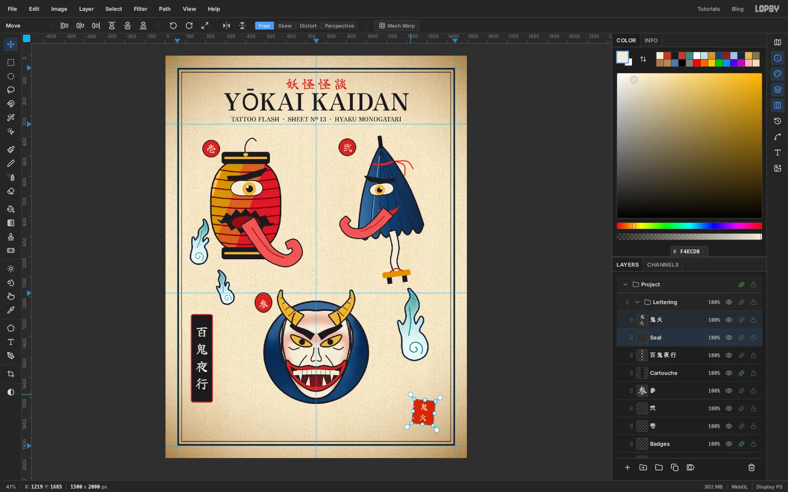

Japanese prints are finished with red seals, called **hanko**. Add a **Seal** layer
and draw a rounded square in `#C8381E` with the Shape tool, about
110 × 120 px, in the bottom-right corner. Chip its edges with a few clicks
of an 8 px **Eraser**.

Make a bone-coloured text layer in **Yuji Syuku** at `38` with `鬼`, a line
break and `火` (*onibi*, demon fire), and drag it onto the seal.

Real seals are never stamped perfectly straight. Click **Seal**, then
[[Cmd]]-click the **鬼 火** row so both are selected. With the Move tool,
rotate the box about **6°** clockwise and press [[Cmd+D]]. The text stays
editable, with the rotation kept on it.

## Add the footer legend

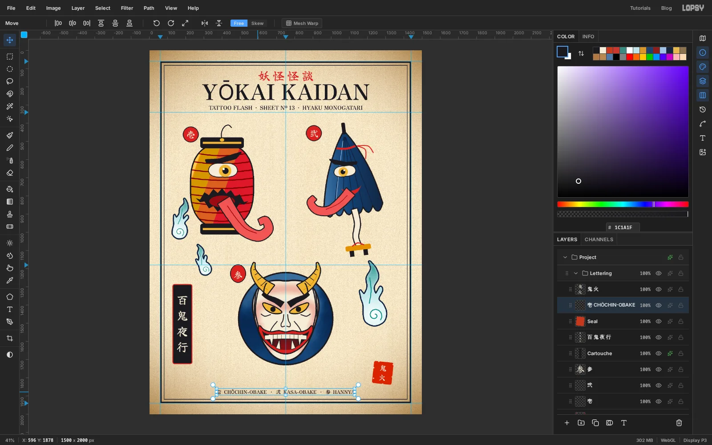

In sumi **Zen Antique** at `26`, type
`壱  CHŌCHIN-OBAKE   ·   弐  KASA-OBAKE   ·   参  HANNYA`. Drag it to sit
about 40 px above the inner border line and click **Align center
horizontally**. Make sure there's clear paper between the line and the
border, and between the line and the disc above.

## Scatter a few sakura

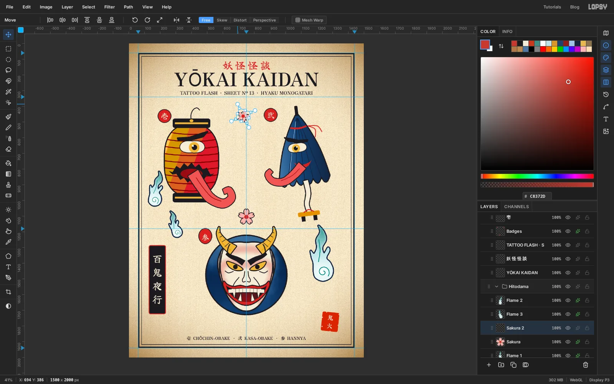

Click **Flame 1** and add a **Sakura** layer. Lasso a five-petal blossom
about 100 px across between the lantern and the Hannya, with a small notch
at the tip of each petal. Fill it `#F1B7B0`. Add a red centre and five short
red stamen lines with [[Shift]]-click lines. Give it a 4 px **Stroke**.

Copy and paste it twice. Put one smaller copy at the top, between the two
upper designs, and one beside the right-hand flame. Scale and rotate each
one a little differently, and paste the original's effects onto both.
Three is enough. With more than that they turn into confetti.

## Knock back the saturation

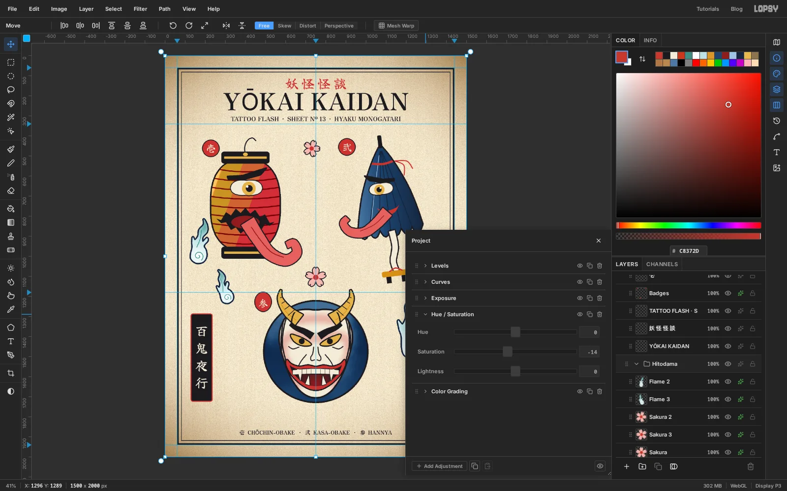

Real woodblock inks are a little chalky. Choose **Layer → Adjustment
Layer…**. This opens the adjustments for the whole **Project** group. If an
explanation appears, click **Got it**. Expand **Hue / Saturation** and set
**Saturation** to `-14`.

It's non-destructive, so you can come back and change it at any time.

## Add the print grain

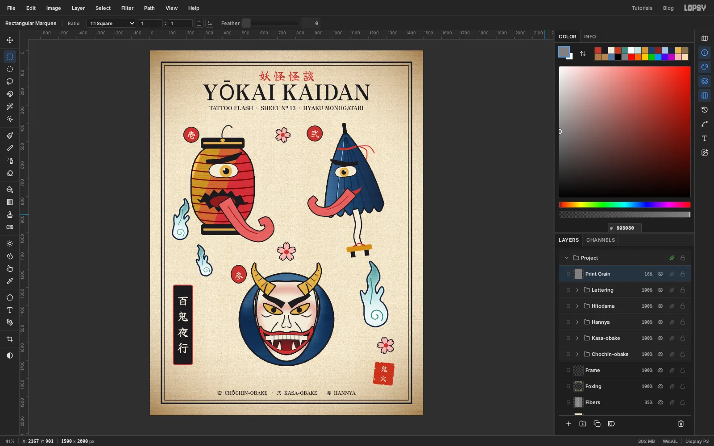

Click the **Project** row and add a final layer called **Print Grain**.
Fill it with mid grey `#808080` and run **Filter → Texture…** with
**Streaks**: Amount `45`, Size `2`, Detail `80`, Stretch `14`, Angle `0`
and Contrast `20`. Then add a little **Add Noise** (`12`, **Mono**).

Set the layer to **Overlay** at about **16%** opacity. Grey disappears in
Overlay, so only the grain shows, like the wood of the block pressed into
the paper. Keep it subtle. At 30% it looks like scanlines.

Press [[Cmd+;]] to hide the guides, then **File → Save Project** and
**File → Quick Export PNG**.
