**Voxel art** is pixel art in three dimensions: everything is built from identical little cubes. From the usual isometric angle every cube shows the same three faces, a diamond on top, a face on the left and a face on the right, so a cube is really one small picture repeated hundreds of times.

That makes it a good fit for a **colour brush**. In this tutorial you'll draw ten cubes with the Pen, one for each material, turn each into a brush with **Edit → Define Color Brush…**, and then build the whole illustration by clicking: one click, one cube. The result is a one-page menu, 1200 × 1800 px, for an imaginary cantina called **Cactus Nacho**.

The menu has:

- a blocky sun, made by pixelating a circle and using it as a selection
- a floating sand island with a saguaro, a bowl of nachos and a stone bowl of salsa, all stamped from cube brushes
- pixel lettering with a hard extruded shadow
- a two-column menu in a monospaced face, with dot leaders that line the prices up by themselves
- a tilted happy-hour badge, a row of pattern-filled squares, print grain and a vignette

The tools you'll use:

- the **Gradient** tool, **Filter → Pixelate…**, **Filter → Threshold…** and the **Magic Wand**
- the **Pen** with the **Paths** panel's **Path to Selection**, and **Edit → Fill**
- **Edit → Define Color Brush…** and the **Brush**
- **Edit → Define Pattern** and **Edit → Fill with Pattern…**
- the **Text** tool and the **Text** panel
- the **Drop Shadow**, **Stroke** and **Outer Glow** effects
- **groups**, the **Move** tool's rotate handle, **Add Noise** and a group's **adjustments**

The fonts are free Google Fonts from Lopsy's font picker: **Silkscreen** for the name and the headings, and **Space Mono** for the menu.

Every cube material has three shades, listed top / left face / right face:

- Dusk sky `#2A1B3D` → `#3A2352`, ink `#1A1028`, cream `#FFF3D6`
- Sun `#FFC83D` → `#FF9A3D` → `#F26B4E`
- Sand `#F2D39B` / `#D9B274` / `#B98D52`
- Cactus `#6CCB6F` / `#3F9E57` / `#2B7545`
- Cactus shade `#55B85C` / `#32864A` / `#215F38`
- Flower `#FF7EB6` / `#E0528F` / `#B23A6E`
- Chip `#FFD24A` / `#F3A927` / `#C98114`
- Salsa `#F0503F` / `#C8332D` / `#96211F`
- Lime `#B8E04A` / `#8CBF2E` / `#5F8F1E`
- Sour cream `#FFF6E0` / `#E9D8B5` / `#CDB68C`
- Bowl teal `#3FD0C2` / `#25A59B` / `#177A74`
- Stone `#8D7FA8` / `#6A5C88` / `#4B4066`

> **Tip:** Positions are written as `x, y` in document pixels, and the status bar shows the cursor's position. Key names are Mac keys. On Windows and Linux, use Ctrl for Cmd.

## Paint the dusk sky

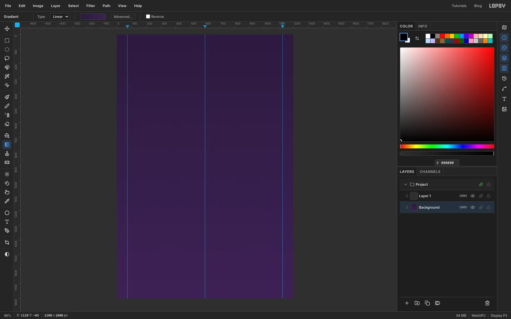

Open [Lopsy](/). In the **New Document** dialog set **Width** to `1200` and **Height** to `1800`, and click **Create**.

1. Click the **Background** layer and pick the **Gradient** tool. Click **Advanced…**, set the left stop to `#2A1B3D` and the right stop to `#3A2352`, and click **Done**.
2. Drag from the top edge of the canvas straight down to the bottom edge.
3. Click the top ruler at **72**, **600** and **1128** to drop three vertical guides: the two margins and the centre line.

## Make a blocky disc to use as a mask

The sun should be made of blocks, like everything else. **Pixelate** on its own won't do that to a shape on an empty layer: it keeps the shape's outline. So you'll make the blocky outline first, as a black-and-white picture.

1. Click `Layer 1` and rename it `Sun Mask` (double-click its name).
2. Set the foreground colour to `#000000` and choose **Edit → Fill**.
3. Pick the **Elliptical Marquee** and click the canvas once without dragging. In the dialog type **From** `336`, `264` and **To** `864`, `792`, and press [[Enter]].
4. Set the foreground colour to `#FFFFFF`, choose **Edit → Fill**, and press [[Cmd+D]] to deselect.
5. Choose **Filter → Pixelate…**, set **Block Size** to `24` and click **Apply**. The edge turns into grey squares.
6. Choose **Filter → Threshold…** and click **Apply**. Each grey square becomes fully white or fully black.

## Select the disc with the Magic Wand

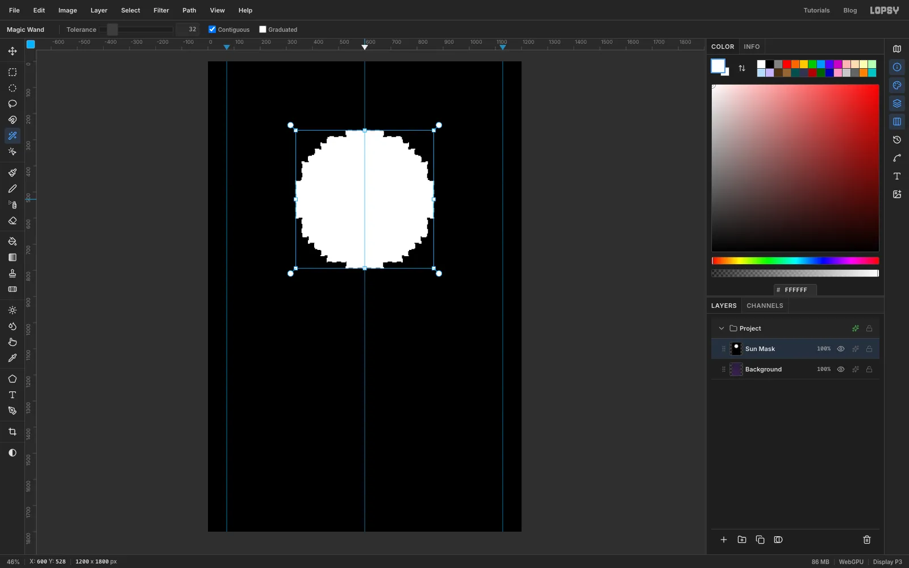

1. Pick the **Magic Wand** ([[W]]) and click in the middle of the white disc.
2. Delete the `Sun Mask` layer with the bin button at the bottom of the Layers panel. The selection stays.

You're left with a selection shaped like a circle built from 24 px squares.

## Fill the sun and pixelate it

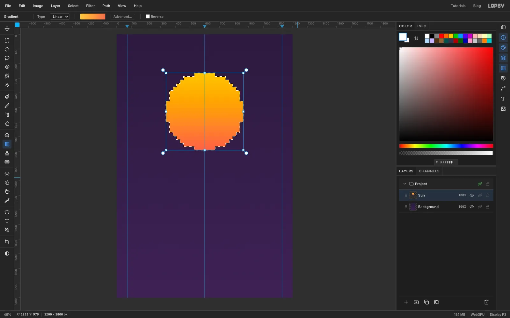

1. Click **Background** and add a layer with the **+** button. Name it `Sun`.
2. Pick the **Gradient** tool and open **Advanced…**. Set the left stop to `#FFC83D` and the right stop to `#F26B4E`, click the middle of the bar to add a third stop, and set it to `#FF9A3D`. Click **Done**.
3. Drag from the top of the disc at `600, 264` straight down to `600, 792`.
4. Choose **Filter → Pixelate…** at **Block Size** `24` again. The smooth gradient breaks into rows of flat colour.
5. Press [[Cmd+D]].

## Add a glow and some stars

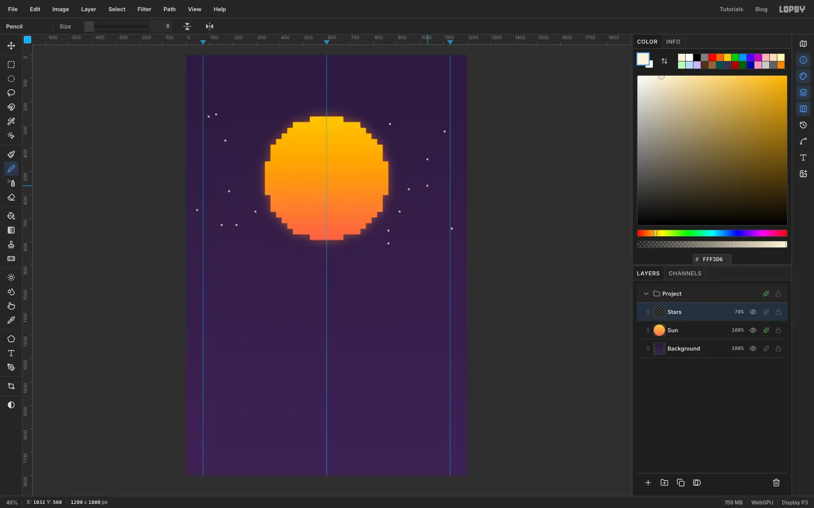

1. With `Sun` active, click the **✦** button on its row to open the effects drawer. Tick **Outer Glow** and click its name. Set **Size** to `60`, **Spread** to `0`, **Opacity** to `45` and the colour to `#FF9A3D`. Close the drawer.
2. Add a layer named `Stars`. Pick the **Pencil** ([[N]]), set **Size** to `8` and the colour to `#FFF3D6`.
3. Click about twenty times to scatter square stars down both sides of the sun. Keep them lower on the page than y = 250, so the top stays clear for the title, and off the glow.
4. Click the opacity readout on the `Stars` row and set it to **70%**.

## Draw one cube with the Pen

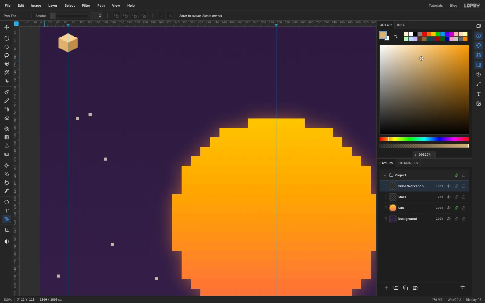

Every cube is **48 px wide and 48 px tall**. Its top is a 48 × 24 diamond and its sides are 24 px tall. You'll draw the first one centred on `72, 72`.

Add a layer named `Cube Workshop` and zoom in on the top-left corner with Cmd and the scroll wheel.

1. Pick the **Pen** ([[P]]). Click the six corners of the cube's outline in turn: `48, 60`, `72, 48`, `96, 60`, `96, 84`, `72, 96`, `48, 84`. Click the first point again to close the path.
2. Open the **Paths** panel, click **Path to Selection**, then **Delete Path**.
3. Set the colour to the sand **right-face** shade, `#B98D52`, and choose **Edit → Fill**. Press [[Cmd+D]].
4. Draw the top diamond the same way through `48, 60`, `72, 48`, `96, 60`, `72, 72`, and fill it with `#F2D39B`.
5. Draw the left face through `48, 60`, `72, 72`, `72, 96`, `48, 84`, and fill it with `#D9B274`.

Filling the whole outline with the darkest shade first means there's never a gap between the faces.

## Draw a cube for every material

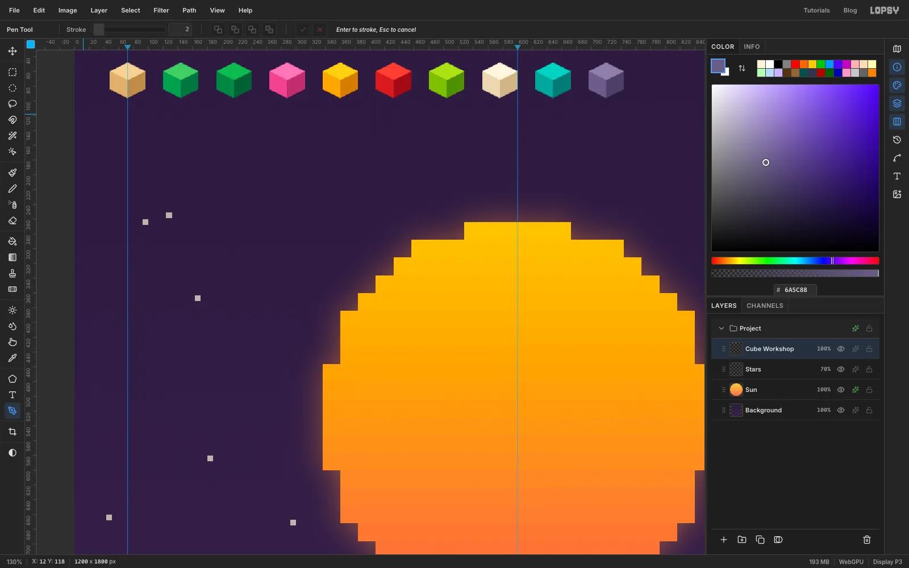

Draw nine more cubes on the same layer, each **72 px to the right** of the last, so their centres sit at x = 144, 216, 288, 360, 432, 504, 576, 648 and 720. The points are the same as before with 72 added to each x.

In order, the cubes are **cactus**, **cactus shade**, **flower**, **chip**, **salsa**, **lime**, **sour cream**, **bowl teal** and **stone**. Use the three shades from the list at the top: the last shade for the outline, the first for the diamond and the middle one for the left face.

## Turn the cubes into colour brushes

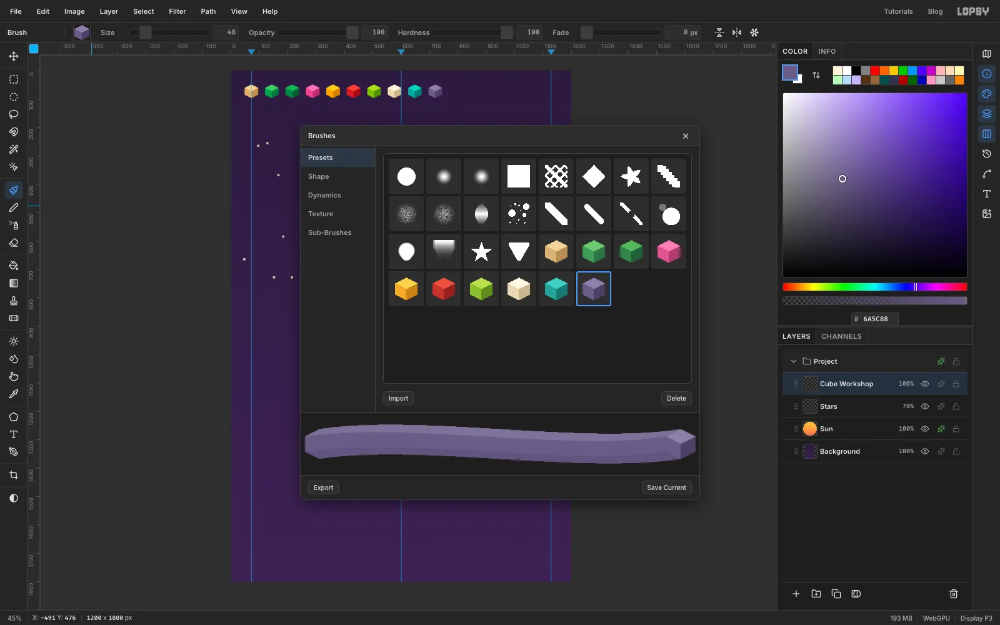

1. Pick the **Rectangular Marquee** ([[M]]) and click the canvas once without dragging. In the dialog type **From** `48`, `48` and **To** `96`, `96`, and press [[Enter]]. That's a square drawn exactly around the first cube.
2. Choose **Edit → Define Color Brush…**, type `Sand Cube` and click OK.
3. Do the same for the other nine, moving the square 72 px right each time (**From** `120`, `48` **To** `168`, `96`, and so on). Name them, in order, `Cactus Cube`, `Shade Cube`, `Flower Cube`, `Chip Cube`, `Salsa Cube`, `Lime Cube`, `Cream Cube`, `Teal Cube` and `Stone Cube`.
4. Press [[Cmd+D]], then click the eye on `Cube Workshop` to hide it. Keep the layer: brushes aren't saved in `.lopsy` project files, so you can define them again from it later.

Pick the **Brush** ([[B]]) and click the brush thumbnail at the left of the options bar. The ten cubes are at the end of the preset grid. A colour brush paints its own colours, ignores the foreground colour, and comes in at **Size** `48`, the cube's real size. Leave Size alone and one click stamps one crisp cube.

## Stamp the island's stone underside

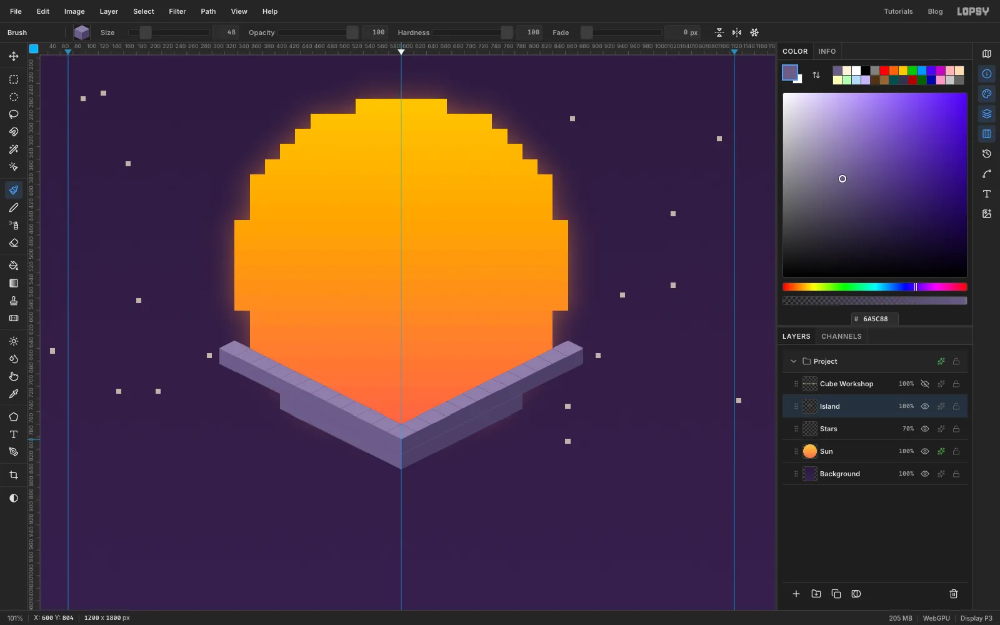

Click `Stars`, add a layer named `Island`, and zoom to 100%.

Cubes sit on a lattice. Call a cube's place **(a, b, h)**: `a` steps toward the lower right, `b` steps toward the lower left, and `h` cubes up. The centre of that cube is at

- **x = 600 + 24 × (a − b)**
- **y = 492 + 12 × (a + b) − 24 × h**

So one step along `a` moves the click **24 right and 12 down**, one step along `b` moves it **24 left and 12 down**, and one cube up moves it **24 up**. The back corner of the island, (0, 0, 0), is at `600, 492`.

There's one rule for the order: **stamp a cube after the cubes behind it and below it.** Work from the back toward you and from the bottom up, and each new cube covers the right parts of the old ones.

1. Open the brush presets and click **Stone Cube**.
2. Stamp the lower tier at `h` = −2. It's two rows that meet in a point at the front: `b` = 12 with `a` from 5 to 11, then `a` = 12 with `b` from 5 to 11, and last the front point, (12, 12, −2). The first click is (5, 12, −2) at `432, 744` and the front point is at `600, 828`.
3. Stamp the upper tier the same way at `h` = −1: `b` = 12 with `a` from 1 to 11, then `a` = 12 with `b` from 1 to 11, then the point at (12, 12, −1). It starts at (1, 12, −1), which is `336, 672`.

Only the two front rows of each tier ever show, so that's all you need to stamp. Watch the status bar as you move the cursor, and click when it reads the position you want. If a cube lands a pixel off, press [[Cmd+Z]] and click again.

## Cover it with sand

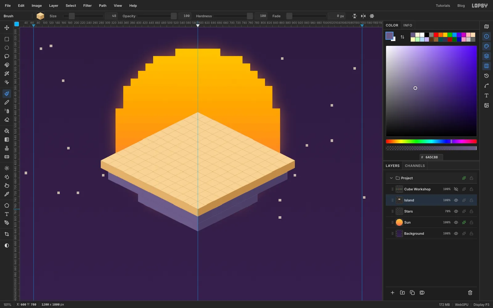

1. Switch to **Sand Cube**.
2. Stamp a 13 × 13 slab at `h` = 0: every `a` and `b` from 0 to 12. Start at the back corner, `600, 492`, and work forward one diagonal row at a time. The left corner is (0, 12, 0) at `312, 636`, the right corner is (12, 0, 0) at `888, 636`, and the front corner is (12, 12, 0) at `600, 780`.

The faint lines between the cubes come for free. Each stamp has a soft anti-aliased edge, and where two edges meet a little of what's underneath shows through.

## Grow the saguaro

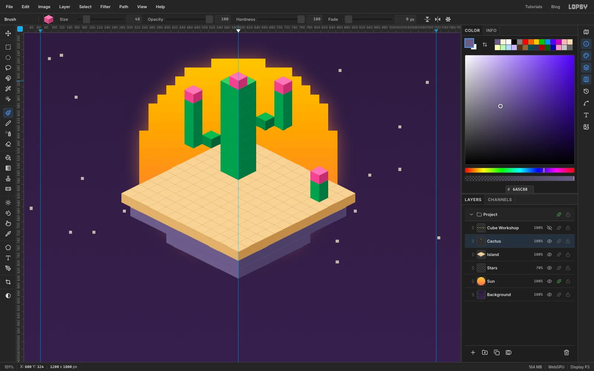

Add a layer named `Cactus`.

1. **Trunk:** with **Cactus Cube**, stamp four columns ten cubes tall, `h` from 1 to 10, at (3, 3), (4, 3), (3, 4) and (4, 4), in that order. The bottom cube of the front column, (4, 4, 1), is at `600, 564`.
2. **Left arm:** stamp one **Shade Cube** at (2, 5, 4), which is `528, 480`. Switch back to **Cactus Cube** and stamp a column at (1, 6) for `h` from 4 to 8, starting at `480, 480`.
3. **Right arm:** one shade cube at (5, 2, 6), `672, 432`, then a cactus column at (6, 1) for `h` from 6 to 9, starting at `720, 432`.
4. **Flowers:** with **Flower Cube**, stamp one on the trunk at (4, 4, 11), one on the left arm at (1, 6, 9) and one on the right arm at (6, 1, 10).
5. **Barrel cactus:** at the back right, stamp two cactus cubes at (11, 2) for `h` = 1 and 2, and a flower on top at (11, 2, 3).

The arms step out *across* the page, one cube right-and-back or left-and-forward at a time, so they stay level with the trunk and there's clear space under each one. The darker shade cube works as the shadow where an arm meets the trunk.

## Fill the bowls

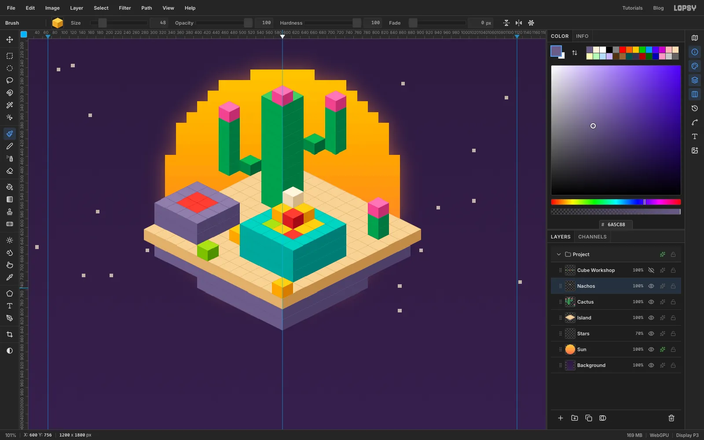

Add a layer named `Nachos`. A bowl has cubes in front of its filling, so build each one a level at a time: the two back sides of the rim, then the filling, then the two front sides.

1. **A loose chip:** with **Chip Cube**, stamp one at (5, 9, 1). It goes first because the bowl's corner will overlap it.
2. **Nacho bowl, base:** with **Teal Cube**, stamp a 5 × 5 square at `h` = 1 for `a` from 7 to 11 and `b` from 6 to 10, back corner first.
3. **Level 2:** stamp the back of the rim in teal: `a` = 7 with `b` from 6 to 10, then `b` = 6 with `a` from 8 to 11. Fill the 3 × 3 middle (`a` 8 to 10, `b` 7 to 9) with **Chip Cube**. Finish the rim in teal: `a` = 11 with `b` from 7 to 9, `b` = 10 with `a` from 8 to 10, and last the front corner (11, 10).
4. **Level 3:** the same again at `h` = 3, with two toppings in place of chips: **Lime Cube** at (8, 9, 3) and **Salsa Cube** at (10, 9, 3).
5. **The heap:** above the rim, stamp a 2 × 2 layer at `h` = 4 for `a` 8 to 9 and `b` 7 to 8. Use chips, except **Salsa Cube** at (9, 8, 4). Top it with one **Cream Cube** at (8, 7, 5).
6. **Salsa bowl:** with **Stone Cube**, stamp a 4 × 4 base at `h` = 1 for `a` from 0 to 3 and `b` from 8 to 11. At `h` = 2, stamp the back of the rim (`a` = 0 with `b` from 8 to 11, then `b` = 8 with `a` from 1 to 3), fill the 2 × 2 middle with **Salsa Cube**, and finish the rim (`a` = 3 with `b` from 9 to 10, `b` = 11 with `a` from 1 to 2, then the corner (3, 11)).
7. **Last pieces:** a **Lime Cube** at (5, 12, 1) and a **Chip Cube** on the front corner at (12, 12, 1).

Zoom back out with **View → Fit to Screen**.

## Float the island with a shadow

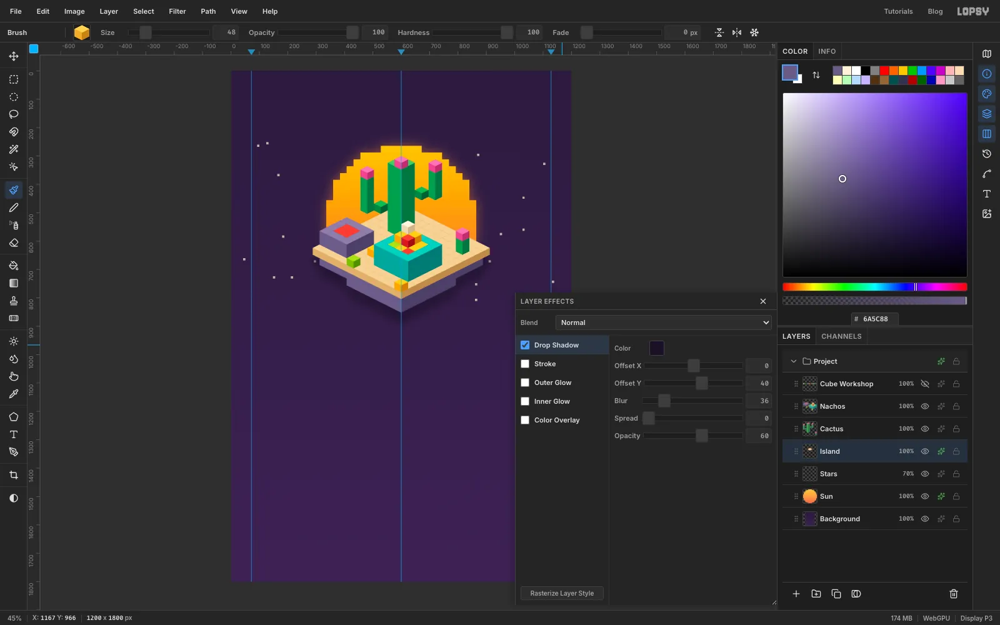

1. Click the `Island` layer and open its effects drawer with the **✦** button.
2. Tick **Drop Shadow** and click its name. Set **Offset X** to `0`, **Offset Y** to `40`, **Blur** to `36`, **Spread** to `0`, **Opacity** to `60` and the colour to `#1A1028`.
3. Close the drawer.

A shadow that falls straight down and stays soft makes the island read as hovering over the page.

## Group the scene

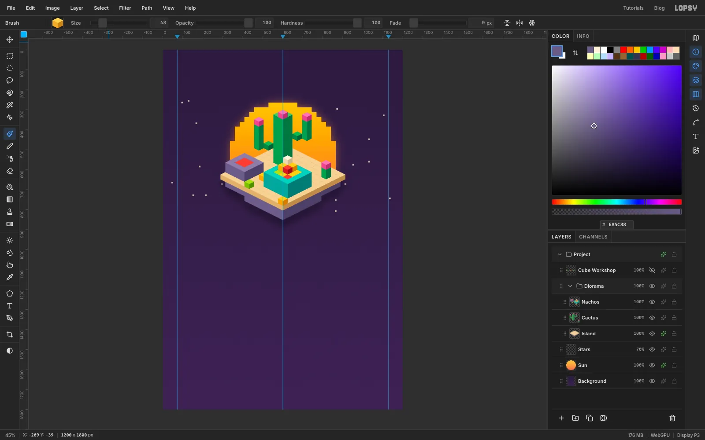

1. Click `Island`, then Shift-click `Nachos` so all three scene layers are selected.
2. Choose **Layer → Group Layers** and name the group `Diorama`.

With the group's row selected, the **Move** tool ([[V]]) and the arrow keys move the whole scene as one, which is handy if you want it higher or lower on the page later.

## Add the menu panel and a pattern tile

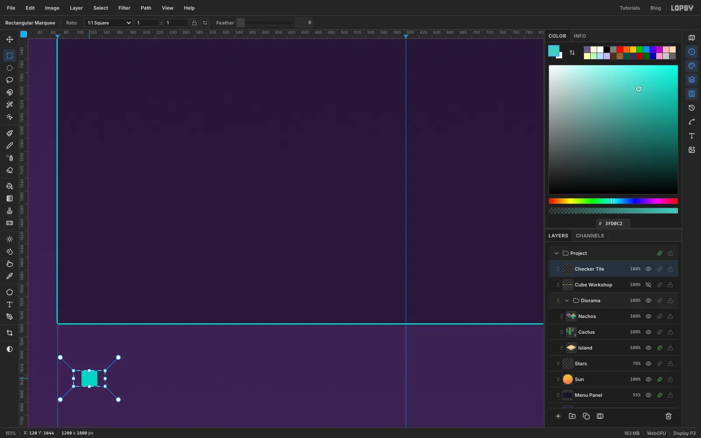

The menu sits on a dark panel, and the rows of squares above and below it are a tiny pattern.

1. Click **Background** and add a layer named `Menu Panel`. With the **Rectangular Marquee**, click once and type **From** `72`, `984` **To** `1128`, `1560`. Fill it with `#1A1028` and deselect.
2. Open its effects drawer, tick **Stroke**, and set **Width** to `2` and the colour to `#3FD0C2`. Close the drawer and set the layer's opacity to **55%**.
3. Click `Cube Workshop` and add a layer named `Checker Tile`. Zoom in on the lower left of the canvas. Select **From** `108`, `1632` **To** `132`, `1656` and fill it with `#3FD0C2`.
4. Now select **From** `96`, `1632` **To** `144`, `1656`: the square with 12 px of empty space to its left and right. Choose **Edit → Define Pattern**.
5. Deselect, choose **View → Fit to Screen**, and delete the `Checker Tile` layer.

## Fill two rows with the pattern

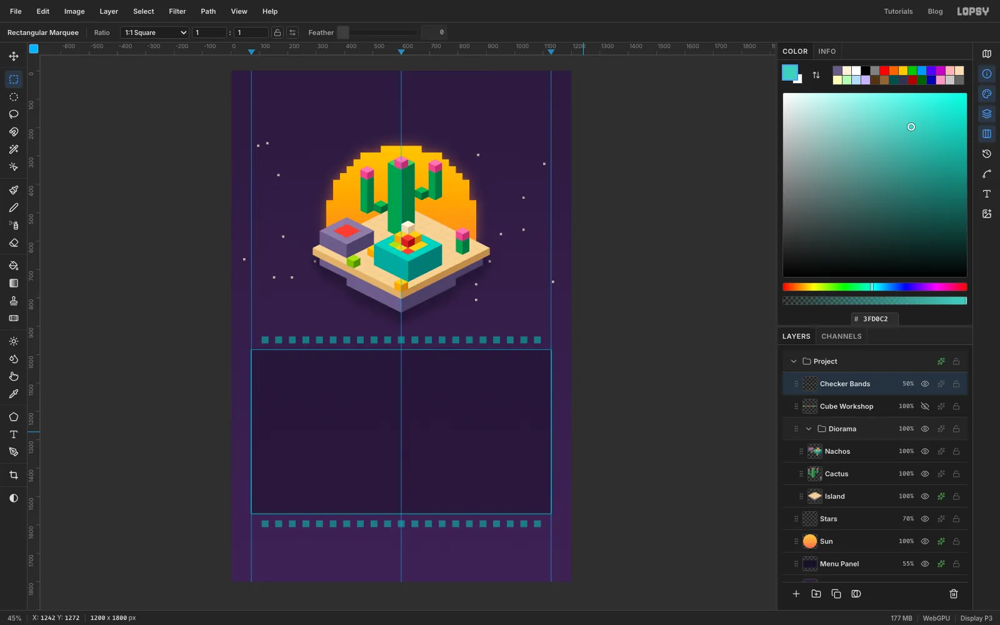

1. Click `Cube Workshop` and add a layer named `Checker Bands`.
2. Select **From** `96`, `936` **To** `1104`, `960`. Choose **Edit → Fill with Pattern…**, click your pattern and click **Apply**.
3. Select **From** `96`, `1584` **To** `1104`, `1608` and fill it the same way. Deselect.
4. Set the layer's opacity to **50%**.

Patterns tile from the canvas's top-left corner, and the tile is 48 px wide with its square in the middle, so one square lands exactly on the centre guide. Stopping the selection 24 px inside each margin ends both rows on a whole square.

## Set the footer and the first menu block

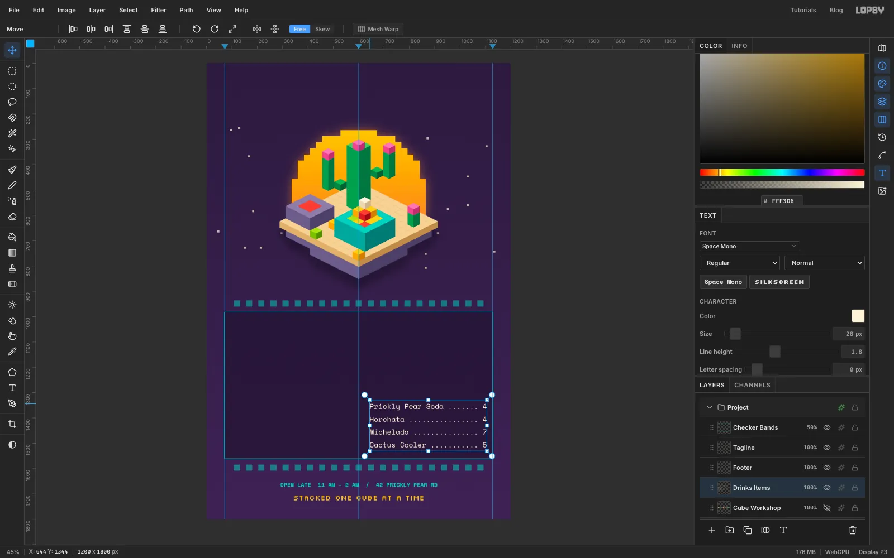

The menu is set in **Space Mono**, a monospaced face: every character is the same width. If you type every row to the same number of characters, padding with full stops, the prices line up in a column without any tabs.

Two habits make the type go smoothly:

- **Click the hidden `Cube Workshop` layer before each new piece of text.** New layers land just above the active one, and the Text options restyle a text layer if one is active.
- **Work up the page in bands, and do the right column first in each band.** A click with the Text tool inside an existing text layer's box edits that layer, and the boxes reach to the right of and below their text.

Positions below are the left edge and the top of the letters. A layer marked *centred* should have its middle on the guide at x = 600. Click roughly in place, type, press [[Tab]] to finish, then nudge the layer with the **Move** tool and the arrow keys. Double-click each new layer's name to rename it.

1. Click `Cube Workshop` and pick the **Text** tool ([[T]]). Type `STACKED ONE CUBE AT A TIME` in **Silkscreen** at **Size** `30`, colour `#FFC83D`. Centre it with the top of the letters at y = **1706**. Name it `Tagline`.
2. Click `Cube Workshop`. Type `OPEN LATE  11 AM - 2 AM  /  42 PRICKLY PEAR RD` in **Space Mono**, weight **Bold**, Size `22`, `#3FD0C2`. Centre it with its top at **1654**. Name it `Footer`.
3. Click `Cube Workshop`. Set Space Mono to **Regular**, Size `28`, colour `#FFF3D6`. Click at about `644, 1344` and type the four drinks below, one to a line, each row **27 characters** long. Press [[Tab]].
4. In the **Text** panel set **Line height** to `1.8` and **Letter spacing** to `0`. Nudge the layer until the left edge of the letters is at x = **644** and the top of the first line is at y = **1344**. Name it `Drinks Items`.

The drinks rows:

- `Prickly Pear Soda ....... 4`
- `Horchata ................ 4`
- `Michelada ............... 7`
- `Cactus Cooler ........... 5`

## Set the rest of the type

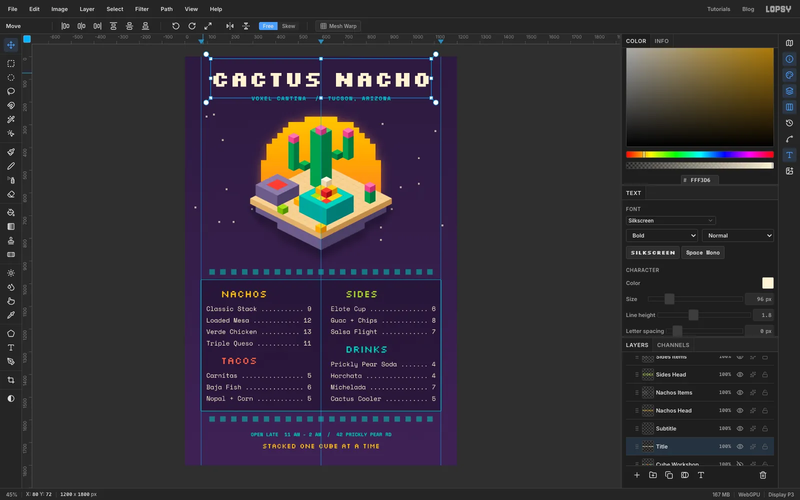

Set the rest the same way, in this order: each list first, then the heading above it. Headings are **Silkscreen** 44, Regular. Lists are **Space Mono** 28, Regular, `#FFF3D6`, line height 1.8, one item to a line, every row 27 characters long.

1. `DRINKS` heading, `#3FD0C2`, left at 712, top at 1276. Name it `Drinks Head`.
2. Tacos list, left at 96, top at 1394: `Carnitas ................ 5`, `Baja Fish ............... 6` and `Nopal + Corn ............ 5`. Name it `Tacos Items`.
3. `TACOS` heading, `#F26B4E`, left at 164, top at 1326. Name it `Tacos Head`.
4. Sides list, left at 644, top at 1100: `Elote Cup ............... 6`, `Guac + Chips ............ 8` and `Salsa Flight ............ 7`. Name it `Sides Items`.
5. `SIDES` heading, `#B8E04A`, left at 712, top at 1032. Name it `Sides Head`.
6. Nachos list, left at 96, top at 1100: `Classic Stack ........... 9`, `Loaded Mesa ............ 12`, `Verde Chicken .......... 13` and `Triple Queso ........... 11`. Name it `Nachos Items`.
7. `NACHOS` heading, `#FFC83D`, left at 164, top at 1032. Name it `Nachos Head`.
8. Subtitle: `VOXEL CANTINA  /  TUCSON, ARIZONA` in Space Mono **Bold** 24, `#3FD0C2`, **Letter spacing** `4`, centred, top at 172. Name it `Subtitle`.
9. Title: `CACTUS NACHO` in **Silkscreen Bold** 96, `#FFF3D6`, centred, top at 72. Name it `Title`.

Each heading starts 68 px to the right of its list, which leaves room for a cube.

## Extrude the title

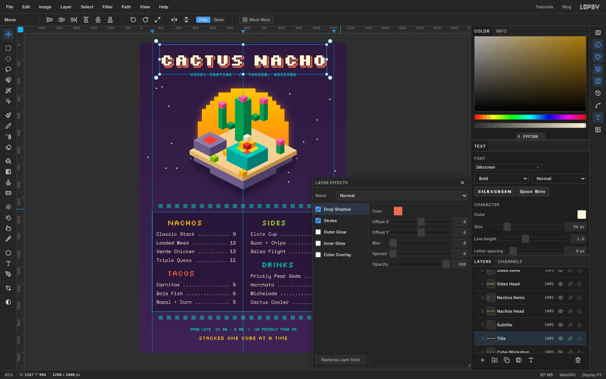

1. Click the `Title` layer and open its effects drawer.
2. Tick **Stroke** and set **Width** to `4` and the colour to `#1A1028`.
3. Tick **Drop Shadow** and set **Offset X** and **Offset Y** to `8`, **Blur** to `0`, **Spread** to `0`, **Opacity** to `100` and the colour to `#F26B4E`.
4. Close the drawer.

With no blur and full opacity, the shadow is a second, solid copy of the letters, which reads as a block of thickness behind each one.

## Stamp a cube beside each heading

1. Click the `Title` layer and add a layer named `Menu Icons`.
2. Pick the **Brush** and stamp one cube to the left of each heading, level with the middle of its letters: **Chip Cube** at `120, 1046` for NACHOS, **Salsa Cube** at `120, 1340` for TACOS, **Lime Cube** at `668, 1046` for SIDES and **Teal Cube** at `668, 1290` for DRINKS.

Each cube matches its heading's colour and its left edge lines up with the list below it.

## Build the badge

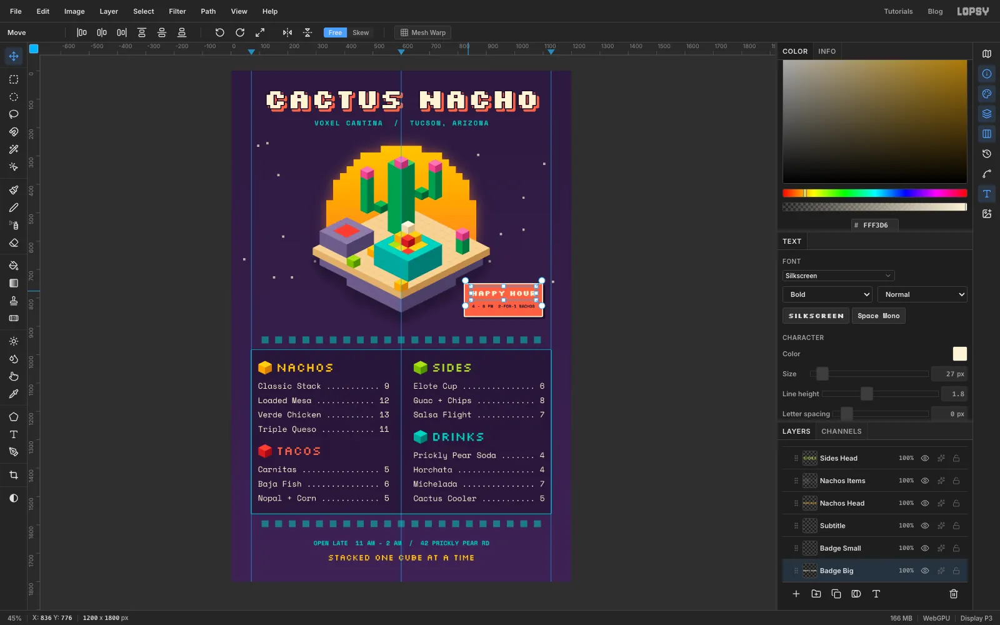

1. Click `Menu Icons` and add a layer named `Badge Plate`. Select **From** `824`, `752` **To** `1096`, `864`, fill it with `#F26B4E` and deselect.
2. Open its effects drawer. Tick **Stroke**: **Width** `4`, colour `#FFF3D6`. Tick **Drop Shadow**: **Offset X** and **Y** `7`, **Blur** `0`, **Opacity** `100`, colour `#1A1028`.
3. Click `Badge Plate`, pick the **Text** tool and type `4 - 6 PM  2-FOR-1 NACHOS` in Space Mono **Bold** 15, `#1A1028`. Nudge it so it's centred on x = 960 with the top of the letters at y = 824. Name it `Badge Small`.
4. Click `Badge Plate` again and type `HAPPY HOUR` in **Silkscreen Bold** 27, `#FFF3D6`, centred on x = 960 with its top at y = 776. Name it `Badge Big`.

Both lines should sit at least 24 px inside the plate on every side.

## Tilt the badge

1. Click `Badge Plate`, then Shift-click `Badge Small`, the top layer of the three, so the plate and both lines are selected. Choose **Layer → Group Layers** and name the group `Badge`.
2. With the **Move** tool, hover just outside the top-right corner handle until the cursor changes, and drag counter-clockwise by about **9°**.
3. Press [[Enter]] to apply.

The plate, its outline, its shadow and both lines of live text turn together.

## Add print grain

1. Click `Cube Workshop` and add a layer named `Grain`. It lands above the artwork and below the type, so the grain textures the picture and the small text stays clean.
2. Set the colour to `#808080` and choose **Edit → Fill**.
3. Choose **Filter → Add Noise…**, set **Amount** to `35` and click **Apply**.
4. Open the layer's effects drawer, set **Blend** to **Overlay**, close it, and set the layer's opacity to **70%**.

## Finish with a vignette

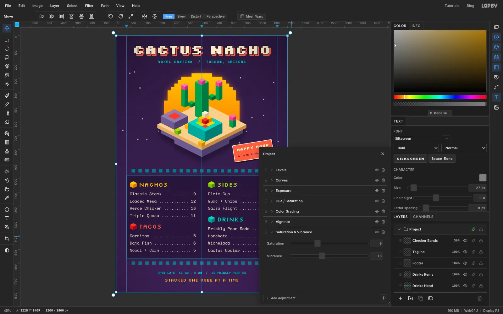

1. Click the **Project** group at the top of the Layers panel and open its drawer with the **✦** button. It already lists a few adjustments at their neutral settings; leave those alone.
2. Click **Add Adjustment** and choose **Vignette**. Set its **Vignette** value to `28`.
3. Click **Add Adjustment** again and choose **Saturation & Vibrance**. Set **Vibrance** to `18`.
4. Close the drawer.

Adjustments on the Project group apply to the whole picture without changing any layer. Untick **View → Show Guides** to hide the guides, save the project with **File → Save Project**, and export the menu with **File → Quick Export PNG**.
