Your genome is about **3.1 billion letters** long, written in the four DNA
bases A, C, G and T. That sounds like a lot until you meet an onion. An
onion carries about five times as much DNA as you do. In 2024 a small fork
fern from New Caledonia, *Tmesipteris oblanceolata*, set the record at
around **160 billion** base pairs. Genome size has very little to do with
how complicated an organism is, and biologists call this the *C-value
paradox*. It's a good story for a chart.

This tutorial turns that story into a poster in the style of a Japanese
**woodblock print**. Ukiyo-e printers carved one block per colour and
printed them one after another on damp paper. A few of their habits make
the look:

- **Bokashi**: a gradient wiped onto the block by hand, often a band of
  indigo across the top of the sky.
- **Flat colour plates** with the **wood grain** showing through, printed
  under a black **key block** that holds the outlines. The plates never
  line up perfectly.
- A **cartouche** holding the title, a red **hanko seal**, and **kento**,
  the L-shaped registration marks carved into the block's margin.

The chart is a horizontal bar chart on a **log scale**. Each gridline is
ten times the one before, so a bacterium and a fern can share one page.
The poster is 1400 × 2000 px.

The tools you'll use:

- **guides**, the **Rectangular Marquee** with [[Shift]] to add, the
  **Lasso**, and **Select → Shrink**, **Grow** and **Inverse**
- the **Gradient Editor** with transparent stops
- **Filter → Texture** (Grain and Rough) and **Filter → Fibers**
- **Duplicate Layer**, dragging layers in the Layers panel, **Add Mask**,
  **Merge Down** and **Group Layers**
- the **Shape** tool for the cartouche, legend, mist bands, seal and border
- the **Text** tool in **Zen Antique** and **Shippori Mincho B1**, with
  **Vertical** text and the Text panel's **Line height**
- the **Pen** tool, **Pencil** and **Brush** with [[Shift]]-click straight
  lines
- the **Move** tool's rotate handle, arrow-key nudges, copy and paste
- the **Color Overlay** effect, the **Soft Light** blend mode and a
  **Photo Filter** adjustment

The palette:

- Washi paper `#EFE4CC`, sumi ink `#211C18`
- Sky `#14263D` → `#1F3B5C` (indigo, also the animals)
- Vermilion `#C2412D` (you, the cartouche and the seal)
- Ochre `#D6A243` (microbes), sage `#7E9468` (plants)
- Rung blue `#8FB1C4`, rung rose `#E2B49B`
- Value labels `#7A5A3C`, wood grain `#8C7A5E`

Two habits will save you trouble:

- New layers appear just above whichever layer is selected, so the steps
  tell you which layer to click first.
- Marquee and Shape drags snap to guides. When a step says to turn
  **View → Snap to Guides** off, do it, or small shapes jump onto the
  nearest guide.

## Lay down the washi and the guides

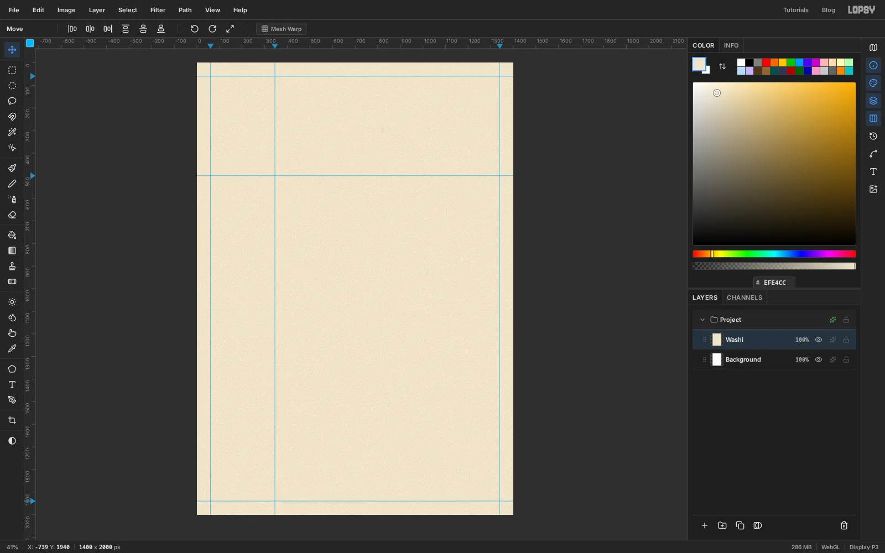

Choose **File → New** and make a document **1400** wide and **2000** high
with a white background. Rename **Layer 1** to **Washi**, set the
foreground colour to `#EFE4CC`, press [[Cmd+A]] and choose **Edit → Fill**.
Press [[Cmd+D]].

Real washi has a soft tooth. Choose **Filter → Texture…**, leave the type
on **Grain** and set **Amount** `14`, **Size** `2` and **Detail** `70`.

Now click the rulers to drop guides. On the top ruler click at about
**60** and **1340** for the side margins, and at **345**, where the bars
will start. On the left ruler click at about **60**, **500** (the top of
the chart) and **1940**.

## Wipe an indigo bokashi across the sky

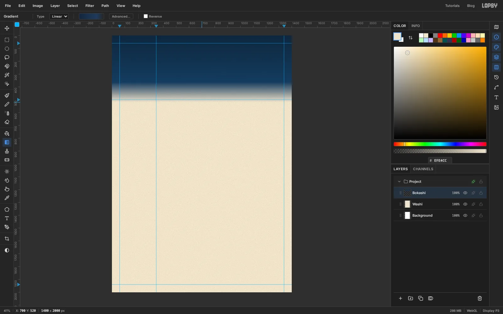

Add a layer called **Bokashi** and pick the **Gradient** tool. Click
**Advanced…** to open the Gradient Editor and set up four stops:

- `#14263D` at the left end
- `#1F3B5C` at **70%**
- `#1F3B5C` at **84%**, with its opacity at about **55%**
- `#1F3B5C` at the right end, with its opacity at **0**

Drag straight down from the top edge to just above the 500 guide. Most of
the sky stays solid indigo, then it fades fast into the paper, the way a
printer's hand-wiped bokashi does.

## Trace the back strand of the helix

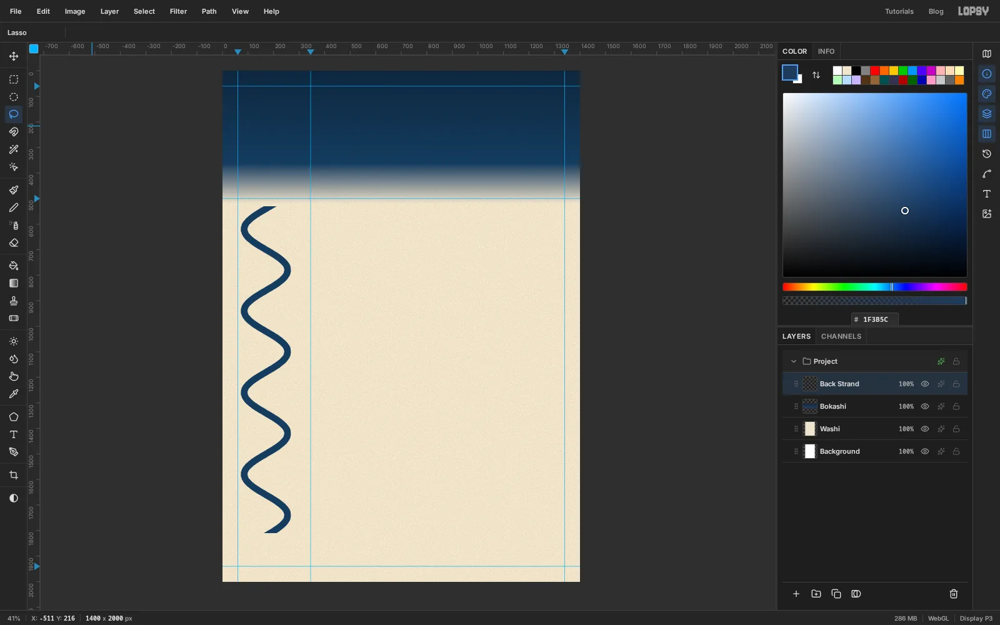

Add a layer called **Back Strand**. The helix runs down the left margin
from about y 540 to y 1800, centred on x 170. Each strand swings
85 px either side of the centre and crosses the middle every 160 px.

Set the foreground colour to indigo `#1F3B5C` and pick the **Pen**
tool. Start at the top of the helix, then click-drag an anchor at each
crest, alternating left (x 85) and right (x 255) every 160 px down the
page. Drag each handle straight down so the curve passes smoothly
through the crest. Set the Pen's **Stroke** to `26` and press [[Enter]]
to stroke the path onto the layer.

> **Tip:** You can also trace both edges of the ribbon with the
> **Lasso** and choose **Edit → Fill**. That takes a steady hand, but it
> lets you thicken the strand where it swings out.

## Add the base-pair rungs

Add a layer called **Rungs**. Each rung is a 12 px tall bar spanning
the gap between the two strands at that height, and each is split in the
middle into two colours: one half for each base of the pair. Put two
rungs in the widest part of every twist, 40 px apart, and leave out the
crossings, where the strands are too close together. That's about 16
rungs, or 32 halves, so this is a patient step.

Work one colour at a time. With the **Rectangular Marquee**, drag the
first half-rung, then hold [[Shift]] and drag every other half-rung that
takes the same colour. Fill the selection, press [[Cmd+D]], and move on
to the next colour. Alternate the pairs ochre `#D6A243` with sage
`#7E9468` and sky blue `#8FB1C4` with rose `#E2B49B`, swapping sides
from rung to rung.

## Draw the front strand

Add a layer called **Front Strand** above **Rungs**. Trace the second
ribbon the same way, swinging the opposite way, so that it's on the left
wherever the first one is on the right. Fill it with vermilion `#C2412D`.

The two strands now cross every 160 px, but the red one is always on top.
A real double helix goes over and under, which is the next step.

## Weave the strands over and under

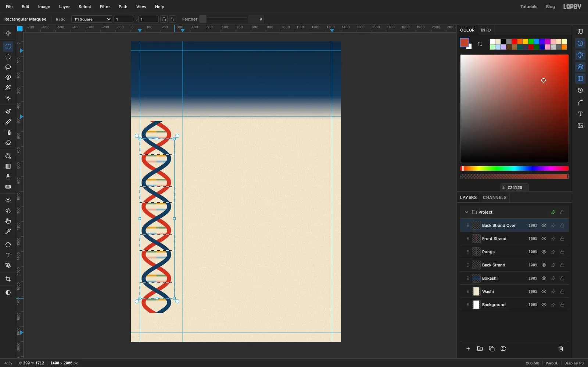

Click **Back Strand** and use **Duplicate Layer**. Rename the copy
**Back Strand Over**, then drag it by its grip in the Layers panel to sit
above **Front Strand**.

With the **Rectangular Marquee**, draw a box about 100 px tall and as
wide as the helix around the crossing at about y 700. Hold [[Shift]] and
add the same box around the crossings at about y 1020, 1340 and 1660. Click **Add Mask**:
the copy now shows only at those four crossings. The navy strand crosses
over at every other twist.

Select the four helix layers (click the top one, [[Shift]]-click the
bottom one) and click **Group Layers**. Name the group **Double Helix**.

## Mark out the bars

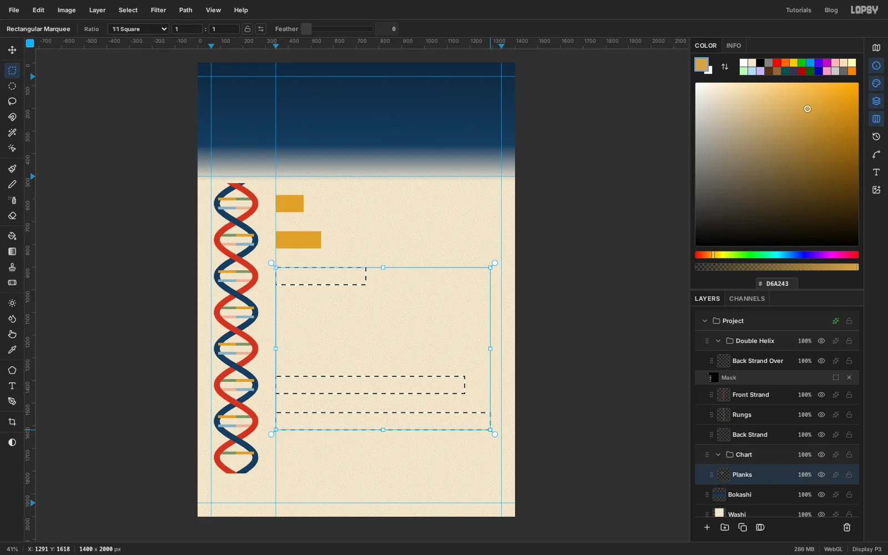

Click **Bokashi**, click **New Group** and name it **Chart**. Inside it,
add a layer called **Planks**.

Each bar starts at the 345 guide, is 76 px tall, and has its middle at
y 620, 780, 940 and so on, 160 px apart. On this log scale each factor of
ten is **185 px**, starting from 1 million at x 345, so the bars end at
about:

1. E. coli, 4.6 million: **468** (ochre)
2. Baker's yeast, 12 million: **545** (ochre)
3. Fruit fly, 140 million: **742** (indigo)
4. Human, 3.1 billion: **991** (vermilion)
5. Onion, 16 billion: **1123** (sage)
6. Axolotl, 32 billion: **1178** (indigo)
7. Marbled lungfish, 130 billion: **1291** (indigo)
8. Fork fern, 160 billion: **1308** (sage)

As with the rungs, fill one colour at a time: drag the first bar of a
colour, [[Shift]]-drag the others, fill, deselect.

## Carve wood grain into the bars

With **Planks** selected, choose **Filter → Texture…** and pick **Rough**.
Set **Amount** `20`, **Size** `6`, **Detail** `30`, **Stretch** `14`,
**Angle** `0` and **Contrast** `0`.

Stretch pulls the rough ridges out sideways into wavy lines that read as
the grain of a cherry block. Keep the amount low. At 40 or more it starts
to look like brushed metal.

## Cut the key block

The black outlines come from a separate block. Click **Duplicate Layer**
and name the copy **Key Block**. Then:

1. [[Cmd]]-click the **Key Block** thumbnail to select its pixels.
2. Choose **Select → Shrink…** and enter `4`.
3. Press [[Delete]]. Only a 4 px rim of each bar is left.
4. Press [[Cmd+D]].

## Ink it and knock the colour off register

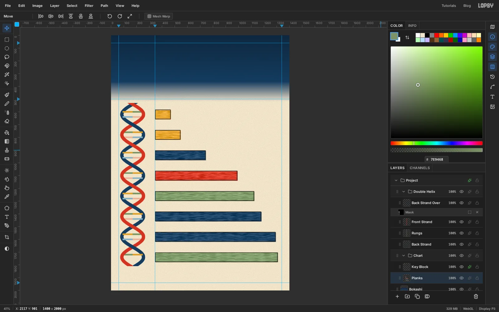

Open the effects drawer for **Key Block**, switch on **Color Overlay** and
set it to sumi `#211C18`. The rims are now black outlines.

Now make the print a little imperfect. Click **Planks**, pick the
**Move** tool and press [[→]] three times and [[↓]] twice. The colour
plate slips just off its outlines, the way a hand-printed sheet does.
Keep the offset this small. Any bigger and it reads as a mistake.

## Rule the gridlines and label each row

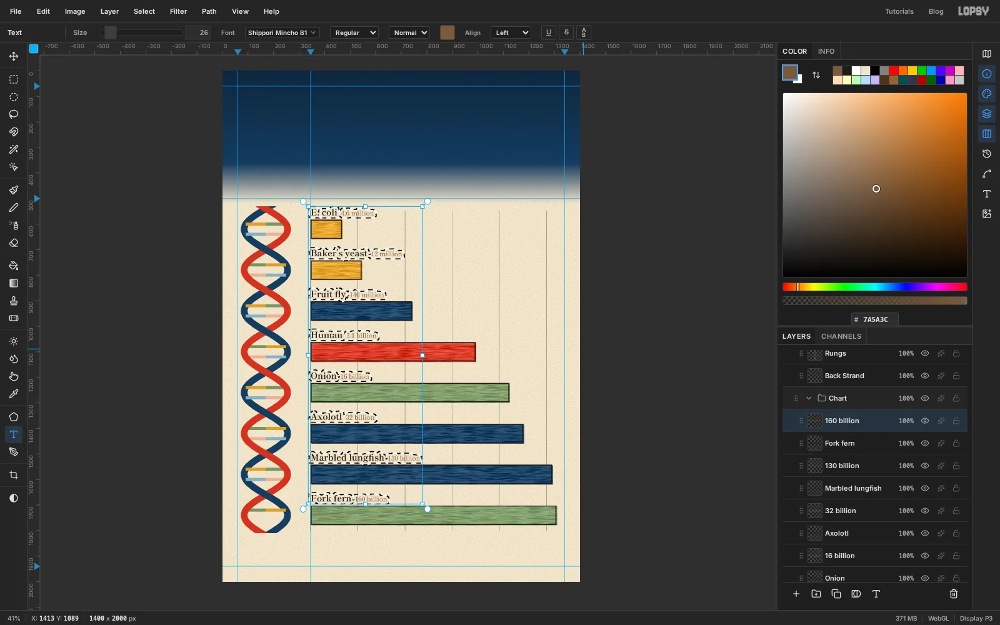

Click **Key Block** and add a layer called **Axis**. Pick the **Pencil**
at size `2` in sumi. At x 345, 530, 715, 900, 1085 and 1270, click at the
top of the chart and [[Shift]]-click at about y 1800 to rule a straight
line. Drag **Axis** below **Planks** in the Layers panel and set its
opacity to **35%**.

Now label the rows. With the **Text** tool, click on the 345 guide just
above each bar and type the organism's name in **Shippori Mincho B1**,
**Bold**, size `34`, in sumi. Leave about 14 px between the baseline and
the top of the bar. Then click just after each name and type its value
in the same font, **Regular**, size `26`, in `#7A5A3C`. Line up the
baselines by eye.

The gridlines run straight through the values. To clear them:

1. [[Cmd]]-click the first value's thumbnail (*4.6 million*), then
   [[Cmd+Shift]]-click the other seven values to add them. Only the
   values reach the gridlines, so you can leave the names out.
2. Choose **Select → Grow…** and enter `10`.
3. Click **Axis**, press [[Delete]] and press [[Cmd+D]].

## Set the title on the indigo

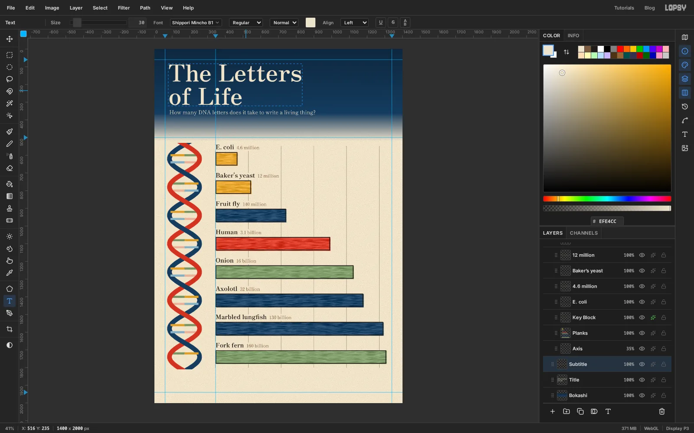

Click **Bokashi** so the title layers sit outside the chart group. With
the **Text** tool, click near the top-left margin and type
`The Letters`, press [[Enter]] and type `of Life`. Use **Zen Antique** at
`132` in paper `#EFE4CC`. Press [[Tab]] to commit.

The default line height leaves a big gap between the lines. Open the
**Text** panel and set **Line height** to `1`.

Under the title, still on the solid indigo, add the subtitle *How many DNA
letters does it take to write a living thing?* in **Shippori Mincho B1**
at `30`, also in paper.

## Build the cartouche

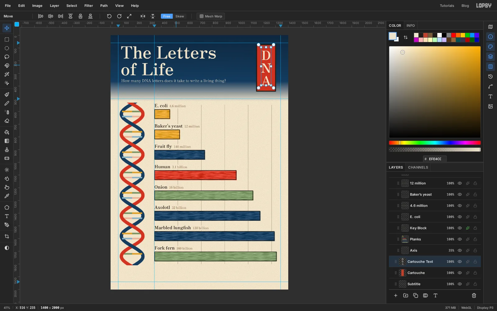

Add a layer called **Cartouche**. Pick the **Shape** tool, choose
**Rectangle**, set **Fill** to vermilion `#C2412D`, add a **Stroke** of
sumi `#211C18` and set **Width** to `8`. Shapes draw out from their
centre, so press where the middle of the box should be, just inside the
right margin and about a third of the way down the sky. Drag out until
the box is about 150 px wide and runs from the top margin down to about
y 440.

With the **Text** tool, click inside the box and set **Zen Antique** at
`100` in paper. Before you type, click the **Vertical** toggle (the
stacked A/B button), then type `DNA` and press [[Tab]]. Rename the layer **Cartouche Text**.
Switch to the
**Move** tool and nudge the text with the arrow keys until there's an
equal margin on all four sides.

> **Tip:** Vertical stays switched on for the next text you make. Turn it
> off again before your next label.

## Add a colour key

The bar colours mean something, so the reader needs a key. Turn
**View → Snap to Guides** off first, because these squares sit right by
the 500 guide.

Click **Cartouche Text** and add a layer called **Legend Keys**. With the
**Text** tool, type each label as its own text layer in
**Shippori Mincho B1** at `22`, in sumi, along one line at about y 460:
**Microbes**, **Animals**, **You** and **Plants**, leaving room for a
square before each one. Remember to switch **Vertical** off first.

Click **Legend Keys** again. With the **Shape** tool, hold [[Cmd]] and
draw a 26 px square just left of each label: fill it with that group's
colour, give it a 3 px sumi stroke, and centre it on the text. Turn
**View → Snap to Guides** back on when you're done.

## Label the axis

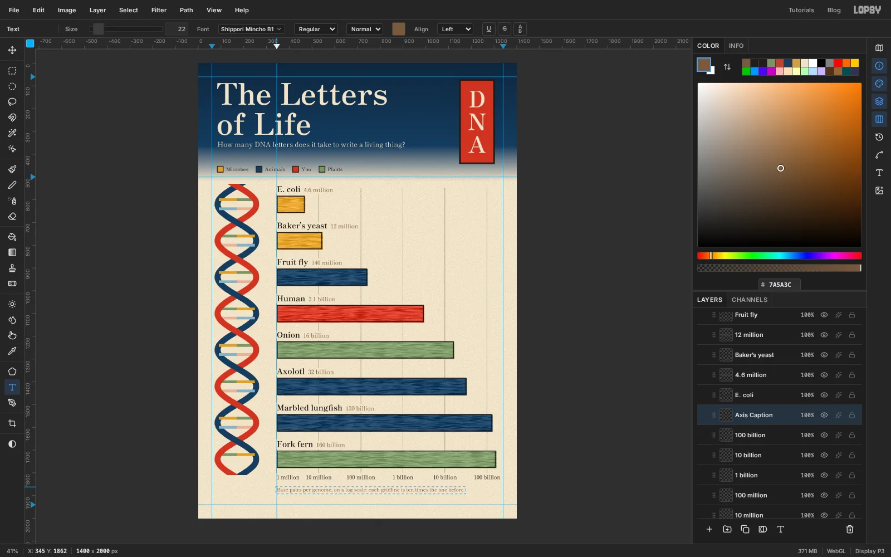

Click **Key Block**. With the **Text** tool, set **Align** to **Center**
before you click, so each label is centred where you click. Click just
under each gridline at about y 1806 and type `1 million`, `10 million`,
`100 million`, `1 billion`, `10 billion` and `100 billion` in
**Shippori Mincho B1** at `24`.

Below them, left-aligned at the 345 guide, add the caption *Base pairs per
genome, on a log scale: each gridline is ten times the one before.* at
`22` in `#7A5A3C`. A log scale needs saying out loud. Without the
caption, readers will compare bar lengths as if they were proportional.

## Point out the onion

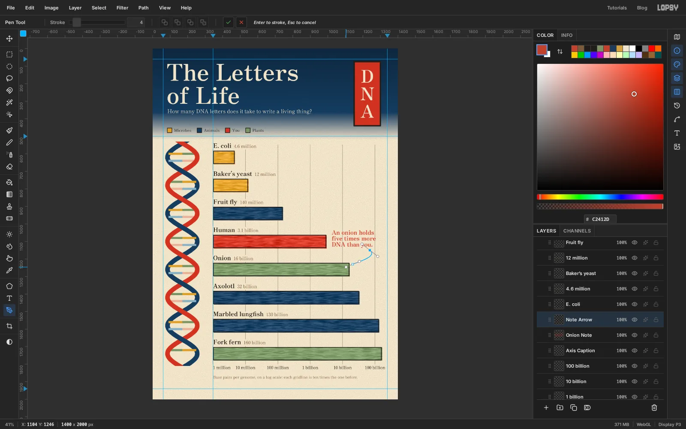

This is the chart's story, so give it a callout. Click **Key Block**, then
in the empty space right of the **Human** bar type in **Zen Antique** at
`34`, vermilion:

`An onion holds` / `five times more` / `DNA than you.`

with [[Enter]] between the lines. Rename the layer **Onion Note**.

Add a layer called **Note Arrow**. Pick the **Pen** tool, set **Stroke**
to `4` and keep vermilion as the foreground colour. Press below the note
and drag down and to the right to pull out a handle. Then press just
past the end of the onion bar and drag down and to the left. Press
[[Enter]] to stroke the curve.

Finish the arrowhead with the **Brush** at size `4`: click a little up
and right of the tip, [[Shift]]-click the tip, then do the same from a
little below and right of it.

## Flag the record holder

On the fork fern row, click just after *160 billion* and type
`← the largest genome ever measured` in **Zen Antique** at `26`,
vermilion. Rename the layer **Fern Note**.

Both notes cross gridlines, so clear them the same way as before:
[[Cmd]]-click the note thumbnails (with [[Shift]] to add), **Grow** by
`10`, click **Axis**, press [[Delete]] and press [[Cmd+D]].

## Lay in kasumi mist bands

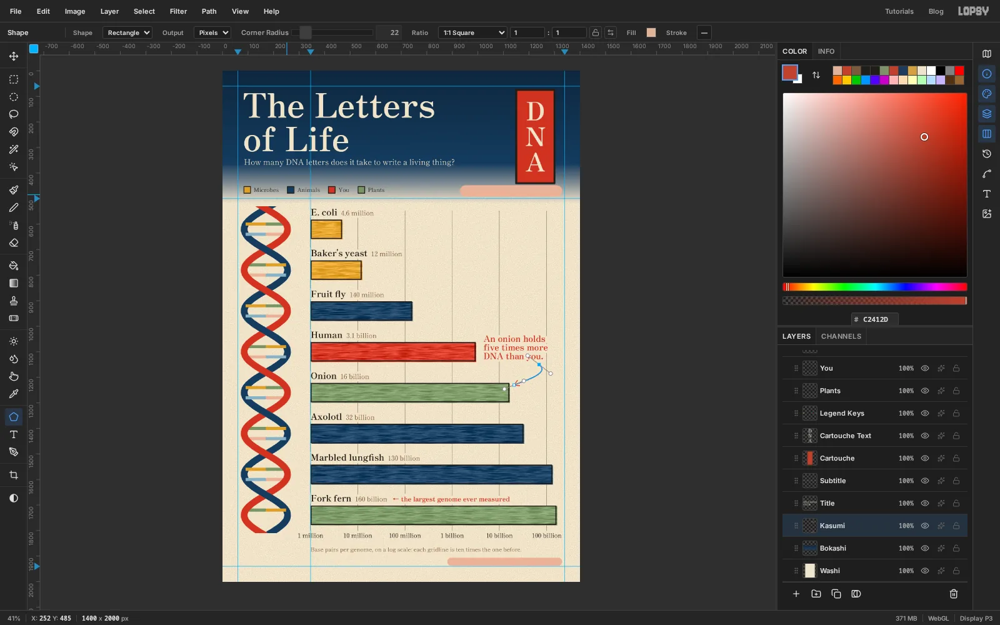

Ukiyo-e artists used horizontal mist bands called **kasumi** to divide a
picture into layers. Click **Bokashi** and add a layer called **Kasumi**.

Pick the **Shape** tool, set **Fill** to rose `#E2B49B`, remove the
stroke, and set **Corner Radius** to `22`. Draw one band about 400 px
wide and 44 px tall that starts under the cartouche and ends just inside
the right margin. Draw a thinner one along the bottom of the poster,
under the caption.

## Copy the band to make a stepped mist

Kasumi usually come in overlapping steps. Draw a marquee around the top
band, press [[Cmd+C]] and then [[Cmd+V]]. The copy is pasted onto a new
layer in the same place. With the **Move** tool, drag it about 80 px
left and 40 px down so the two bands overlap like a stair.

Press [[Cmd+D]], then [[Cmd+E]] to merge the pasted layer down into
**Kasumi**.

## Set the seal

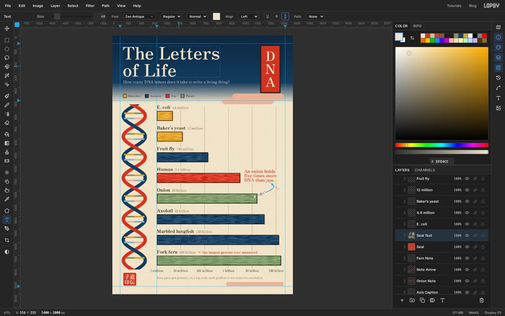

Click **Fern Note** and add a layer called **Seal**. With the **Shape**
tool, draw a vermilion square about 100 px across with a **Corner
Radius** of `8`, in the bottom-left corner under the helix. Line its left
edge up with the title.

With the **Text** tool, click inside it, set **Zen Antique** at `40` in
paper, and turn **Vertical** on. Type `子印`, press [[Enter]] and type
`遺伝`. Vertical columns run from left to right in Lopsy, so typing the
second column first makes the seal read the traditional way, right to
left: *遺伝子印*, "gene seal".

## Turn the seal a little crooked

With the seal text selected, press [[Cmd+E]] to merge it down into
**Seal**. That turns the text into pixels, which the rotation and the
wear need. Draw a marquee around the seal, switch to the **Move** tool, and
drag the round rotate handle outside a corner to turn it about
**4° anticlockwise**. Press [[Cmd+D]] to commit. A stamp pressed by hand
is never quite square.

## Wear the seal

Click **Add Mask**. Draw a marquee around the seal, then choose
**Filter → Texture…**. Pick **Rough** and **Darken**, and set **Amount**
`85`, **Size** `3`, **Detail** `80` and **Contrast** `75`.

The filter runs on the mask, so the dark specks punch small holes through
the seal, as if the ink missed the high spots of the paper. Darken
matters here. A new mask is all white, and Lighten can't make white any
lighter.

## Print the border and the kento marks

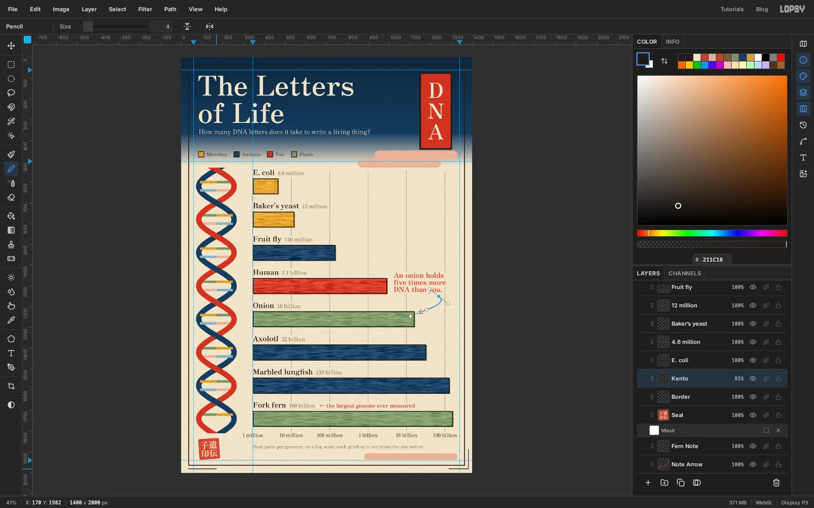

Click **Seal** and add a layer called **Border**. With the **Shape** tool, remove the fill,
set a 4 px sumi stroke and corner radius `0`, and draw a rectangle about
36 px in from every edge.

Add a layer called **Kento**. With the **Pencil** at `4` in sumi, draw
the two registration marks in the margin:

- an **L** outside the bottom-right corner: click under the border's
  bottom edge, [[Shift]]-click to the right of the corner, then
  [[Shift]]-click straight up
- a short straight bar under the bottom-left corner

Set the layer to **85%** opacity. On a real block these marks hold the
paper in place, so they always print a little lighter.

## Trim the sky to the border

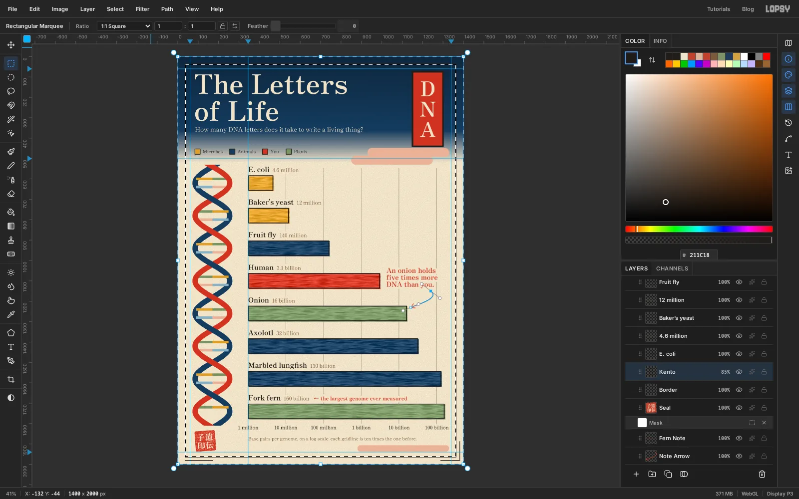

The indigo still runs to the edge of the paper. Draw a marquee just
inside the border, choose **Select → Inverse**, click **Bokashi** and
press [[Delete]]. The sky now stops at the border and leaves a clean
paper margin, like a real print. Press [[Cmd+D]].

## Mottle the flat colours

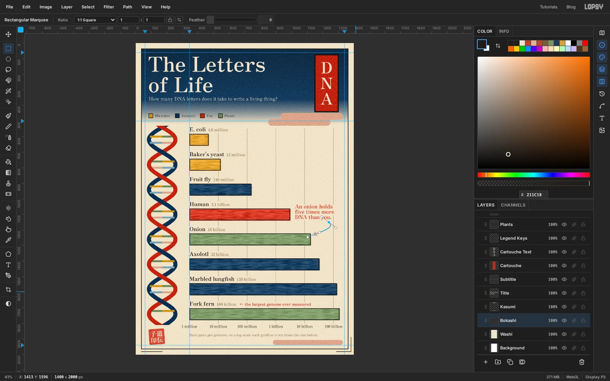

Flat colour from a block isn't perfectly flat. The ink sits on the tops
of the paper fibres and leaves a speckle that printers call
*goma-zuri*, or sesame printing.

Select **Cartouche** and run **Filter → Texture…** with **Grain**,
**Darken**, **Amount** `28`, **Size** `2.5`, **Detail** `60` and
**Contrast** `30`. Repeat it on **Kasumi**, **Legend Keys** and the four
helix layers. On **Bokashi**, use a gentler setting: **Light & Dark**,
**Amount** `14`, **Size** `3`, **Detail** `60`, **Contrast** `10`.

## Fade the ends of the helix

The helix stops with a hard cut at each end. Click the **Double Helix**
group and click **Add Mask**. Group masks can't take the brush or the
gradient, but **Edit → Fill** works.

Pick the **Rectangular Marquee** and set **Feather** to `28`. Drag a box
over the top end of the helix, ending at about y 556. Hold [[Shift]] and
add a box over the bottom end, starting at about y 1782. Set the
foreground colour to black, choose **Edit → Fill**, press [[Cmd+D]] and
set Feather back to `0`. Both ends now dissolve into the paper.

## Tidy the layers into groups

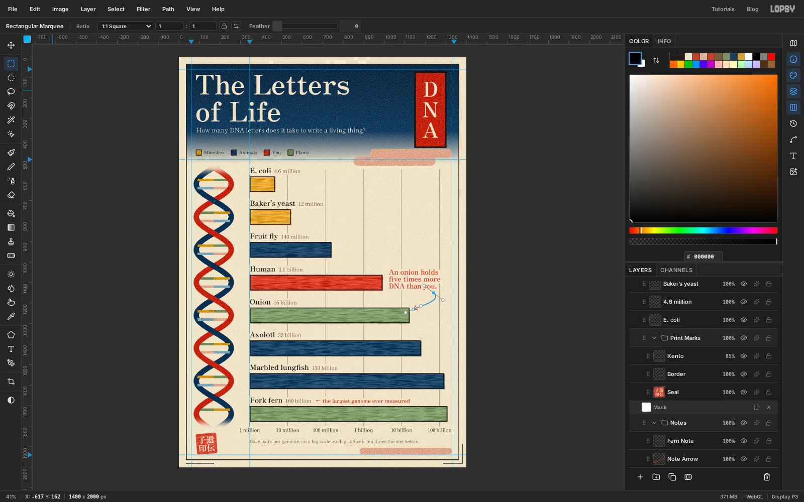

[[Cmd]]-click to select **Onion Note**, **Note Arrow** and **Fern Note**
and click **Group Layers**, then name the group **Notes**. Do the same
for the title, subtitle, cartouche and legend layers (**Header**), and
for the seal, border and kento (**Print Marks**). The arrow's pen path stays on screen while it's
selected. Click it in the **Paths** panel to deselect it when it gets in
the way. Clicking a group with
the **Move** tool moves everything in it together. That's handy if the
callout needs to shift a few pixels.

## Lay wood grain over the whole print

On a real print the grain of the block shows wherever there's ink. Collapse
the **Double Helix** group, select it, and click **Add Layer**: the new
layer goes above the group, at the top of the stack. (**Double Helix**
is the highest group because **Chart** and the header layers were all
added above **Bokashi**, lower down.) Name it **Wood Grain**.

Set the foreground colour to `#8C7A5E` and choose **Filter → Fibers…**
with **Variance** `20` and **Strength** `48`. It fills the layer with
long vertical fibres. Set the layer's blend mode to **Soft Light** and its
opacity to **40%**. The grain shows in the indigo and the bars and almost
disappears on the paper.

## Warm the paper and export

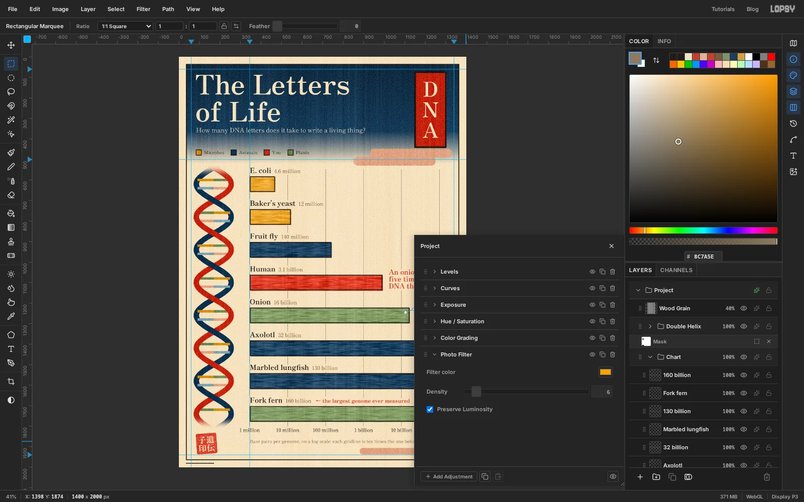

Every Lopsy document wraps its layers in a **Project** group, the top row
of the Layers panel. Open its effects drawer, click
**Add Adjustment** and choose **Photo Filter**. Keep the warm orange
filter but drop **Density** to `6`. That's just enough to age the paper
without turning it yellow.

Choose **File → Save Project** to keep an editable copy, then
**File → Quick Export PNG**.

You've made a chart that tells one clear story, *bigger isn't more
complex*, using the same means a woodblock printer had: flat plates, a
key block, a wiped gradient and the grain of the wood.
