A flying saucer came down in a field decades ago, and nobody came to collect it. This painting tells that story the way a punk zine would: flat spot colours, coarse halftone dots, a hero cut out with scissors and glued down, and a typed caption stuck on with tape.

It's a digital painting, so everything is drawn by hand in Lopsy. There are no photos to import. The picture is 1600 × 2000 px.

The tools you'll use:

- the **Lasso** and the **Elliptical** and **Rectangular Marquee**, with [[Shift]] to add and [[Shift+Alt]] to intersect
- [[Cmd]]-click on a layer thumbnail to load its shape, and **Select → Grow / Shrink / Inverse**
- the **Gradient** tool with **Filter → Halftone**, **Sunburst**, **Fibers**, **Threshold**, **Texture** and **Add Noise**
- the **Brush** with **Spacing** and **Taper**, the **Pencil** with [[Shift]]-click lines, **Spray** and the **Eraser**
- a layer **group** that you rotate and move as one piece, with a **Hue / Saturation** adjustment on it
- layer effects: **Stroke**, **Color Overlay** and **Drop Shadow**, with **Copy effects** and **Paste effects**
- a **layer mask**, ruler **guides**, and live **text** that you rotate together with its label

The palette is paper, toner and three spot colours:

- Paper `#EAE3D0`, cut-out white `#F6F1E4`
- Toner black `#17130F`
- Hot pink `#F0447C`, ray pink `#C91E5C`
- Sun yellow `#F2E14B`
- Rust `#D2601F`, light rust `#E88A3C`, oxide `#8A3312`, dead light `#5A2410`
- Glass `#C3CCC6`, tape `#B9C6C2`

> **Note:** Shortcuts are written for a Mac. On Windows and Linux use [[Ctrl]] wherever it says [[Cmd]].

## Tear out the sky

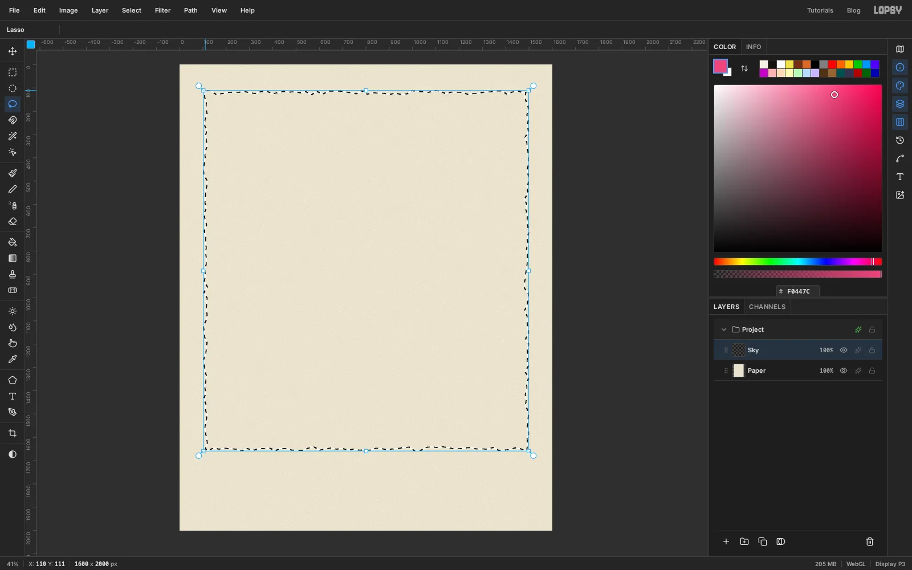

Choose **File → New** and make the document **1600** wide and **2000** high, in pixels, with a white background.

Click the *Background* layer, set the foreground colour to paper `#EAE3D0`, press [[Cmd+A]] and choose **Edit → Fill**. Deselect with [[Cmd+D]]. Double-click the layer's name and call it *Paper*. Give it some tooth with **Filter → Texture…** (**Grain**, **Amount 10**, **Size 1.5**, **Detail 70**) and then **Filter → Add Noise…** (**Amount 9**, **Mono**, **Gaussian**).

Rename *Layer 1* to *Sky*. Pick the **Lasso** and draw a tall rectangle that leaves a margin of about 110 px at the top and sides and stops about 350 px above the bottom of the page. Wobble your hand as you go so the edge looks torn.

## Burst the rays

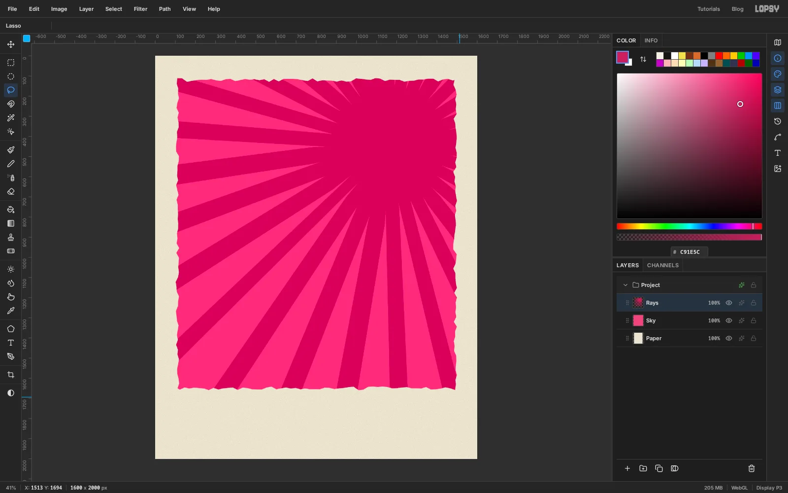

Set the foreground to hot pink `#F0447C`, choose **Edit → Fill**, and deselect.

Click **Add Layer** and name it *Rays*. Hold [[Cmd]] and click the *Sky* thumbnail to load the torn panel as a selection, so the rays stay inside it.

Set the foreground to ray pink `#C91E5C` and choose **Filter → Sunburst…**. Set **Rays 30**, **Length 140**, **Width 38**, **Taper 35**, **Jitter 40**, **Seed 12**, **Rotation 4**, and put the centre in the upper right with **Center X 73** and **Center Y 22**. Apply and deselect.

Two pinks that close together read as one printed colour with a pattern in it. That keeps the sky busy without stealing attention from the saucer.

## Shade the sun with a gradient

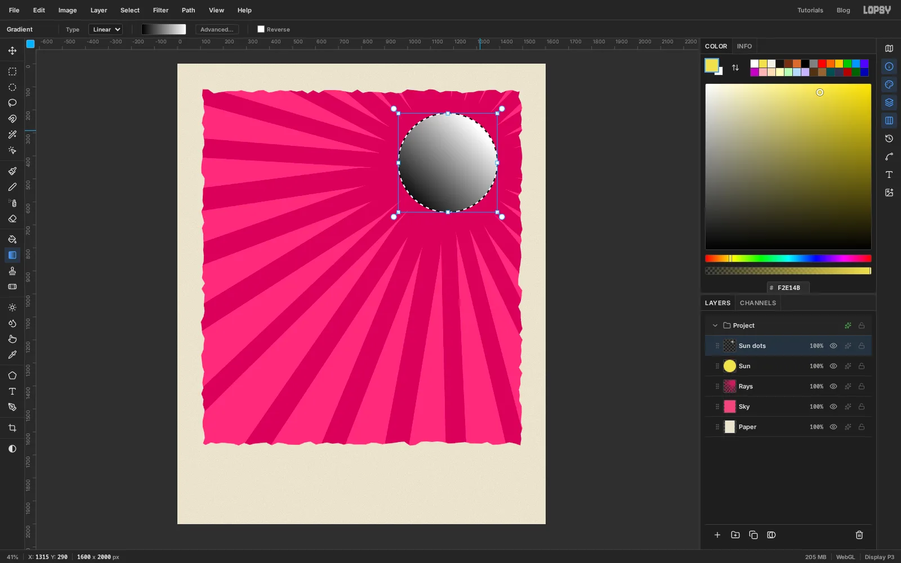

Add a layer called *Sun*. Pick the **Elliptical Marquee**, hold [[Cmd]] to keep it round, and drag a circle about 430 px across over the point the rays come from. Fill it with sun yellow `#F2E14B` and deselect.

Add a layer called *Sun dots* and [[Cmd]]-click the *Sun* thumbnail. Pick the **Gradient** tool, set it to **Linear** and open **Advanced…**. Make the left stop black, the right stop white, and click the bar at about 60% to add a mid-grey stop (`#9A9A9A`). Drag from the lower left of the disc to its upper right.

It looks wrong for a moment. The next step turns it into dots.

## Turn the gradient into halftone dots

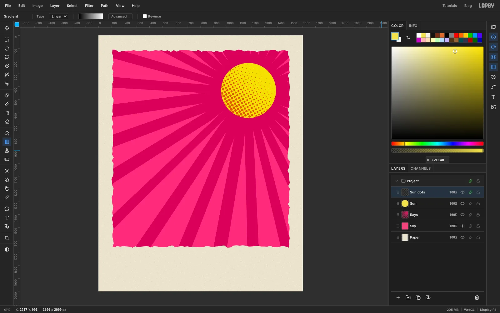

With the selection still active, choose **Filter → Halftone…** and set **Dot Size 24**, **Angle 30** and **Softness 0.3**. Dark parts of the gradient become big dots, and white prints nothing at all.

Because the selection is still active, the dots stop at the edge of the disc. Deselect.

The dots are grey. To print them in rust, open the layer's effects with the sparkle button on its row, tick **Color Overlay**, and set its colour to `#D2601F`.

## Print the outline off-register

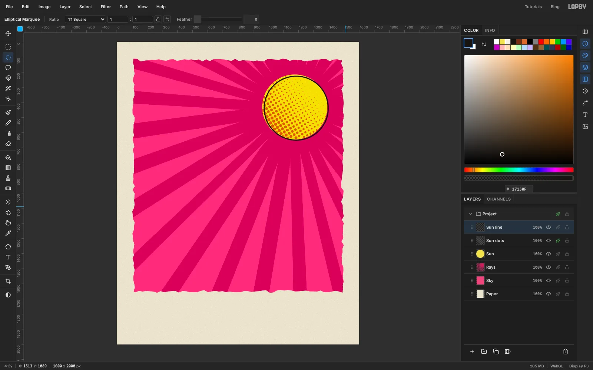

Cheap printing never lines its colours up perfectly, so the sun's outline goes on its own layer, a little out of place.

Add a layer called *Sun line*. Drag another circle about the same size as the sun, but start about 10 px to the right and 8 px lower. It doesn't have to match exactly. A ring that's slightly the wrong size is part of the misprint. Fill it with toner black `#17130F`. Then choose **Select → Shrink…**, enter **7**, and press [[Delete]]. That leaves a 7 px ring. Deselect.

## Block in the saucer

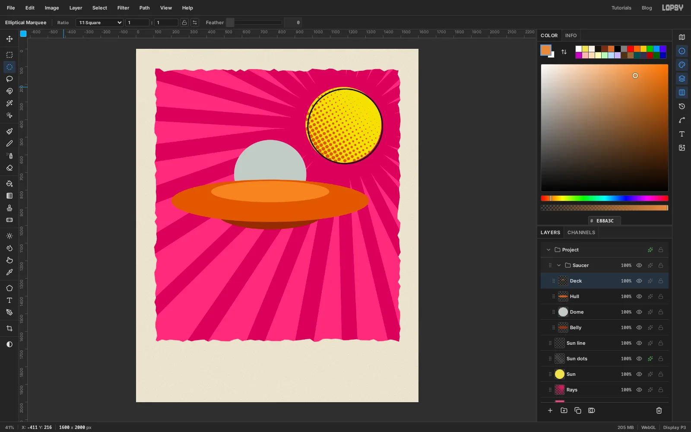

Build the saucer level. You'll tip it over later, all in one go.

Click **New Group** in the Layers panel and name the group *Saucer*. With the group selected, each new layer lands inside it. Add four layers and fill one ellipse on each with the **Elliptical Marquee**, in this order from the bottom up:

1. *Belly*: about 600 × 180 px, in oxide `#8A3312`, sitting low.
2. *Dome*: about 410 × 390 px, in glass `#C3CCC6`, sitting high.
3. *Hull*: about 1120 × 240 px, in rust `#D2601F`. It should cover the bottom half of the dome and the top half of the belly.
4. *Deck*: about 670 × 120 px, in light rust `#E88A3C`, on the upper half of the hull.

Centre them all on the same vertical line. Leave room around the saucer, because it's nearly as wide as the panel.

## Outline every part in ink

Open the effects on *Hull*, tick **Stroke**, and set **Width 6** in toner black `#17130F`.

Now copy that to the rest. Click **Copy effects** at the top of the drawer. Then, for *Deck*, *Belly* and *Dome* in turn, click the layer, open its effects and click **Paste effects**. One line weight across the whole saucer is what makes it look drawn with a single pen.

## Pit the hull with the Spray tool

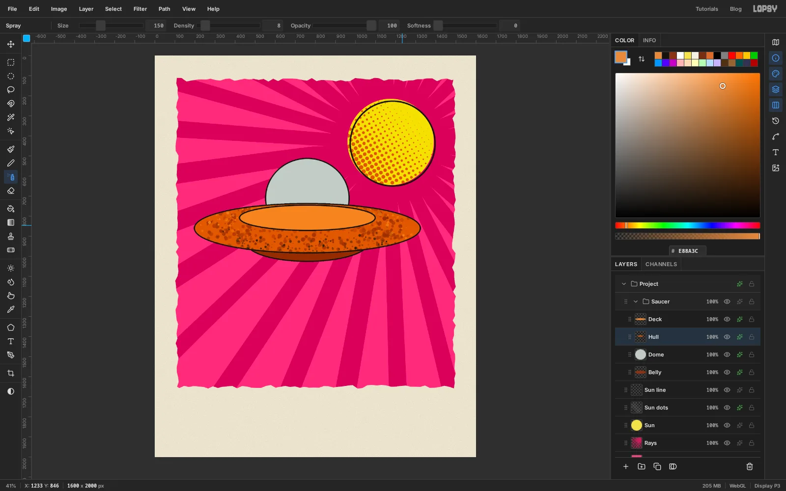

[[Cmd]]-click the *Hull* thumbnail and click the *Hull* layer, so paint stays on the hull.

Pick the **Spray** tool and set **Size 190**, **Density 14**, **Opacity 100** and **Softness 0**. Softness 0 gives hard-edged dots. Then make three passes:

1. Oxide `#8A3312`: one sweep along the lower half and a short one at each end.
2. Toner black, **Size 120**, **Density 6**: a lighter sweep along the lower half.
3. Light rust `#E88A3C`, **Size 150**, **Density 8**: a sweep along the top edge for flaking highlights.

Deselect when you're done.

## Add a halftone shadow

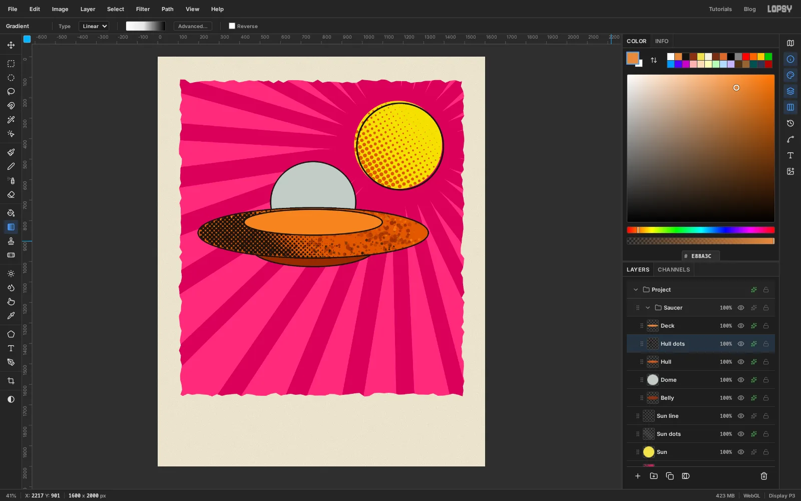

The sun is at the upper right, so the shadow belongs at the lower left.

Add a layer called *Hull dots* above *Hull* and [[Cmd]]-click the *Hull* thumbnail. With the **Gradient** tool, make a gradient that is white on the left, `#E6E6E6` at about 45%, and black on the right. Drag from the hull's upper right down to its lower left.

Run **Filter → Halftone…** at **Dot Size 15**, **Angle 45**, **Softness 0.3**. Deselect, and give the layer a **Color Overlay** in toner black so the dots print as solid ink.

## Break the dome

Shade the dome the same way. Add *Dome dots* above *Dome*, load the *Dome* selection, and drag a white → `#F0F0F0` → `#3A3A3A` gradient from the dome's upper right to its lower left. Use **Halftone…** at **Dot Size 13** with the same **Angle** and **Softness** as the hull, deselect, and add a black **Color Overlay**.

Click the *Dome* layer. With the **Lasso**, draw a jagged hole on the right side of the glass and fill it with toner black. A dark inside reads as a break. A hole you can see the sky through reads as a sticker.

For the cracks, pick the **Pencil** at **Size 4**. Click where a crack starts, then hold [[Shift]] and click where it turns. Each [[Shift]]-click draws a straight line from the last point. Run two or three cracks out from the hole and give each a short branch.

## Draw seams and rivets

Add a layer called *Seams* above *Hull dots* and load the *Hull* selection again.

With the **Pencil** still at **Size 4**, draw panel seams. Click on the edge of the deck, then [[Shift]]-click on the rim straight out from it. Draw five or six across the front of the hull and a few round the back, like the spokes of a wheel. The ones that fall in the shadow will mostly disappear into the dots.

The rivets are one brush stroke. Pick the **Brush** in toner black, set **Size 9** and **Hardness 100**, then click the brush thumbnail at the left of the options bar to open the Brushes window. On the **Shape** tab, set **Spacing** to **200**. Close the window and drag once along the lower rim. With the spacing that wide, the stroke comes out as a row of dots. Deselect.

## Add a row of dead lights

Bright yellow lights would say the saucer still has power. These ones went out a long time ago.

Click *Deck* and add a layer called *Lights* above it. Set the foreground to the dead light colour `#5A2410`, the Brush **Size** to **34**, and **Spacing** to **190** in the Brushes window. Drag one curve along the front of the hull, following its lower edge.

## Finish the damage

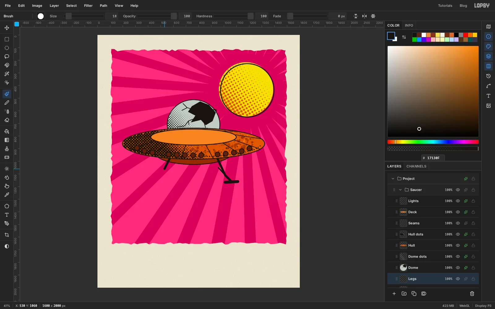

A few fixes make it look properly wrecked:

- **Widen the hole.** Mine came out looking like a star. Click *Dome*, lasso a bigger, lumpier shape over it with a couple of deep notches, and fill it with black.
- **Knock out two lights.** Click *Lights*, pick the **Eraser** at **Size 48**, and click once on two of the discs.
- **Outline the lights.** Open the effects on *Hull*, click **Copy effects**, then open the effects on *Lights* and click **Paste effects**.
- **Add the landing gear.** Add a layer called *Legs* just above *Belly*. Set the Brush **Spacing** back to **1** and the colour to toner black. At **Size 18**, click under the right side of the belly, [[Shift]]-click about 130 px lower and further out, then [[Shift]]-click again a little lower still, so the strut bends at a knee. At **Size 10**, draw a brace from the knee back up to the belly. At **Size 24**, draw a short flat foot across the bottom of the strut. On the left side, draw only a short stub. That leg is going into the ground.

## Select the whole group

Press [[Cmd+D]] to make sure nothing is selected. Click the *Saucer* group's row in the Layers panel and pick the **Move** tool.

One box with handles now frames everything in the group. Whatever you do to that box happens to all nine layers at once.

## Tip it over

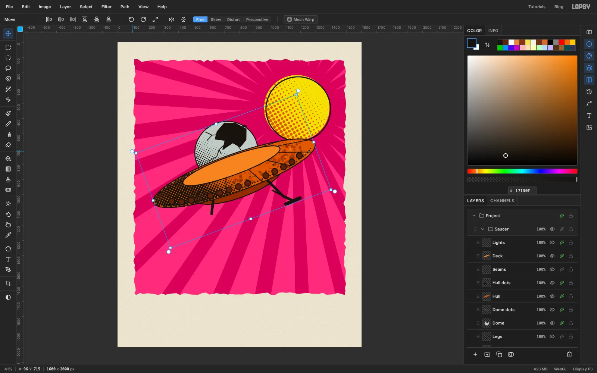

The round handles just outside the corners rotate. Drag the top-left one down and to the left until the saucer leans about 20° with its left rim low.

Press [[Cmd+D]] to commit the rotation.

## Drop it into place

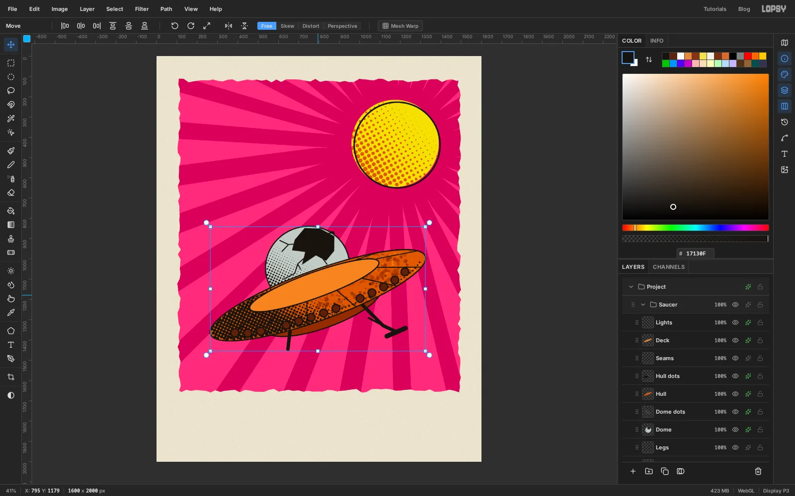

With the group still selected, drag from the middle of the hull to move the whole saucer. Bring it down about 320 px and a touch to the right. The low rim should end up around 280 px above the bottom of the panel, with clear sky between the dome and the sun.

If you overshoot, [[Cmd+Z]] puts the whole group back in one step.

## Grow a selection for the paper border

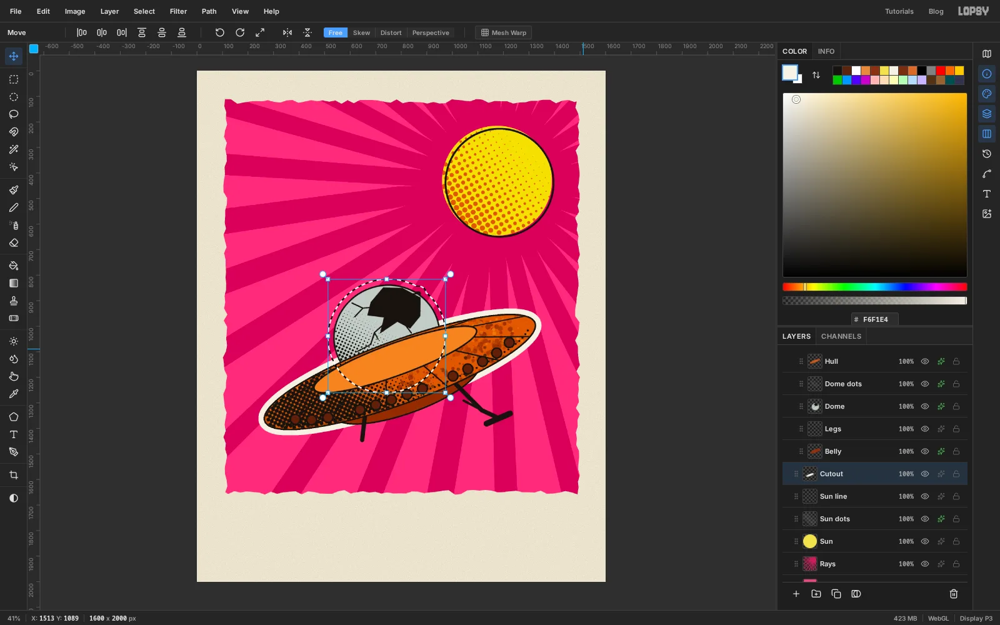

Zine heroes are cut out with scissors, with a rim of white paper left around them. You can get an even rim from the saucer's own shapes.

Click *Sun line* (the layer just below the group) and add a layer called *Cutout*. Set the foreground to cut-out white `#F6F1E4`. Then, for each of *Hull*, *Dome*, *Belly* and *Legs*:

1. [[Cmd]]-click the layer's thumbnail.
2. Click the *Cutout* layer.
3. Choose **Select → Grow…**, enter **26**, and apply.
4. Choose **Edit → Fill** and deselect.

## Give the cut-out a hard shadow

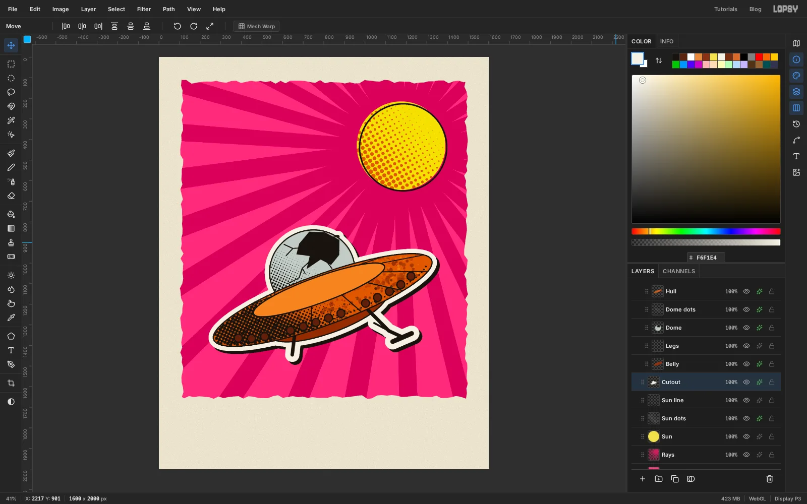

Open the effects on *Cutout* and tick **Drop Shadow**. Set **Offset X 14**, **Offset Y 14**, **Blur 0** and **Opacity 100**, in toner black.

With no blur, the shadow is a solid black copy of the shape. That's how a shadow looks after a trip through a photocopier.

## Draw the stars by hand

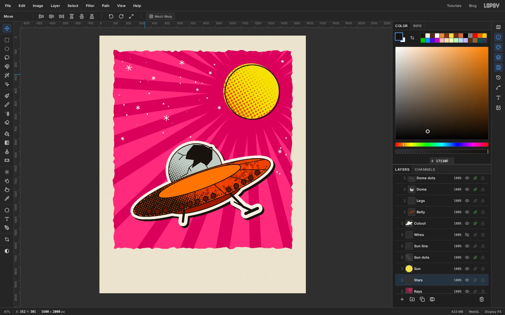

Click *Rays* and add a layer called *Stars*. Pick the **Pencil** at **Size 4** in cut-out white.

For each star, click, then [[Shift]]-click about 30 px away to draw a short line. Cross it with two more lines to make an asterisk. Draw ten or so in different sizes, mostly in the empty upper left. Then scatter single clicks between them for specks, changing the **Size** between 4 and 10 as you go.

## Put up the telephone poles

Click *Sun line* and add a layer called *Wires*. It sits below *Cutout*, so the wires will pass behind the saucer.

Pick the **Brush** with **Hardness 100** in toner black:

- At **Size 20**, click near the bottom right of the panel and [[Shift]]-click about 750 px higher, leaning slightly, for the tall pole. Add two crossarms at **Size 12** and **10**.
- At **Size 15**, draw a shorter pole on the far left with one crossarm.
- At **Size 4**, drag three wires from the right crossarms to the left pole. Let each one sag in the middle.

The second pole gives the wires somewhere to end. Without it they'd run off the edge of the panel and take the eye with them.

## Cut the ground from the panel

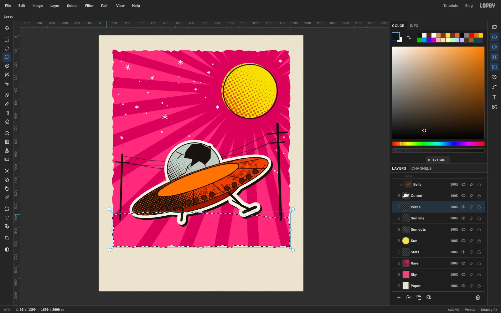

Make the selection first. [[Cmd]]-click the *Sky* thumbnail to load the panel. Now pick the **Lasso**, hold [[Shift+Alt]], and draw a rolling line across the panel about 250 px above its bottom edge. Carry on down past the bottom of the panel and back round to the start. [[Shift+Alt]] keeps only the part where the two selections overlap, so the ground gets the panel's torn edge for free.

The selection stays put while you make a layer for it. Click the *Saucer* group and add a layer called *Ground*. It lands inside the group, so drag its grip up and to the left until the layer sits above the *Saucer* folder. Then fill the selection with toner black and deselect.

## Bury the rim

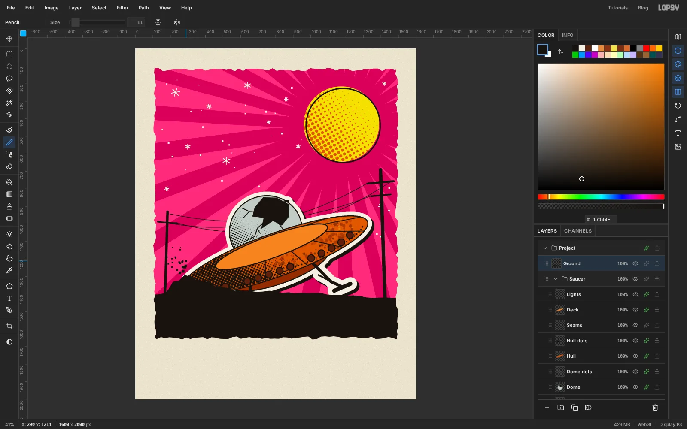

Still on *Ground*, lasso a lumpy mound over the saucer's low rim, tall enough to hide the tip, and fill it with black. Now the saucer is in the ground and not just resting on it.

Pick the **Pencil** in black and dot some clods flying up and to the left of the mound. Use bigger sizes (up to 14) near the dirt and smaller ones further out.

## Scratch in the skid

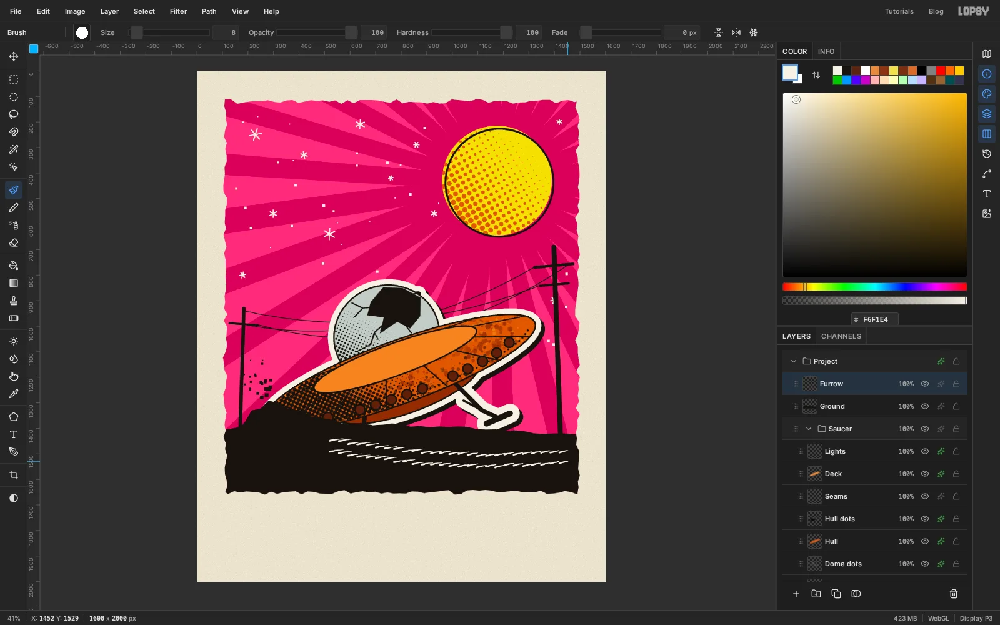

Add a layer called *Furrow*. Pick the **Brush** in cut-out white at **Size 8**. In the Brushes window, set **Taper** to **70**. Taper makes each stroke shrink to a point after that many pixels.

Starting under the saucer, flick short strokes from left to right, each about 50 px long. Lay down two rows that wander a little and get shorter towards the right edge. They read as the trench the saucer ploughed on its way in.

## Grow the grass

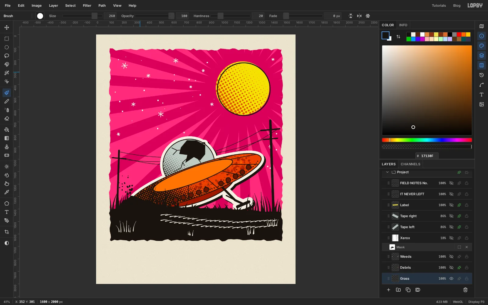

Add a layer called *Grass*. Switch the Brush to toner black at **Size 15**.

Each blade is one flick from the base up to the tip, bending slightly to one side. Set **Taper** a little longer than the blade you're about to draw, so the stroke thins all the way up:

1. **Taper 150**: tall blades at the left and right of the panel.
2. **Taper 90**: medium blades to fill between them.
3. **Taper 45**: short blades in front of the saucer, so its leg still shows.

Start each stroke just below the horizon, in the black. Leave gaps and vary the lean. Then switch to cut-out white at **Size 7** and add three or four small tufts low in the ground.

> **Tip:** The Brushes window covers part of the canvas while it's open. Close it before you paint.

## Scatter some wreckage

Add a layer called *Debris*. With the **Lasso**, draw four small angular shards on the horizon, three to the right of the saucer and one by the mound. Fill each with rust `#D2601F`.

Copy the effects from *Hull* once more and paste them onto *Debris* so the shards get the same ink outline.

## Plant dandelions

Something has had time to grow here. Add a layer called *Weeds*.

For the stalks, use the **Brush** in cut-out white at **Size 5** with **Taper** back at **0**. Draw four thin stalks rising from the grass on the right and two on the left. Keep them off the hull.

For each seed head, pick the **Pencil** at **Size 3**. Click the top of a stalk, then [[Shift]]-click about 35 px away. Click the top of the stalk again and [[Shift]]-click in a new direction. Ten to sixteen spokes make a full head. Finish with a **Size 7** dot on the end of every other spoke.

## Make the copier streaks

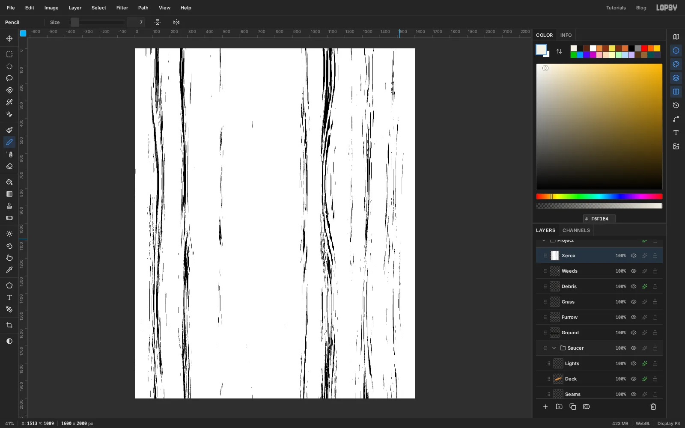

Add a layer called *Xerox* at the top of the stack. Choose **Filter → Fibers…** with **Variance 40** and **Strength 30**. Then choose **Filter → Threshold…** with **Level 74**, which leaves ragged black streaks on white.

Don't worry that it hides everything. The next step fixes that.

## Fade the streaks and mask the saucer

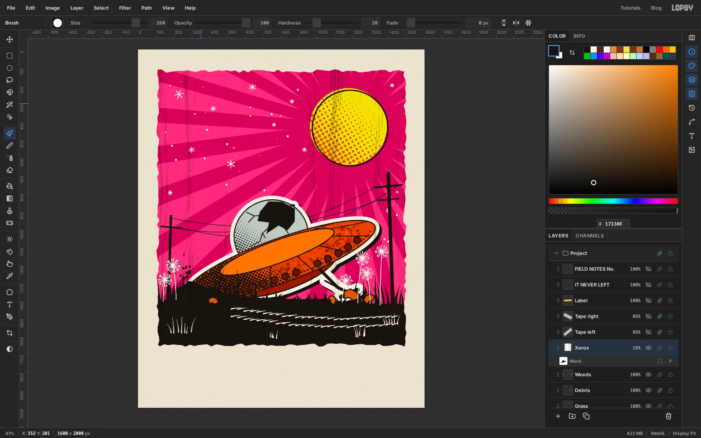

[[Cmd]]-click the *Sky* thumbnail, click *Xerox*, choose **Select → Inverse**, press [[Delete]] and deselect. The streaks now stop at the torn edge.

Open the layer's effects and set the blend mode to **Multiply**, then click the opacity figure on its row and bring it down to **18%**.

Click **Add Mask**. Pick the **Brush** at **Size 260** and **Hardness 20**, and paint over the saucer. On a mask the brush always hides, whatever the foreground colour, so the streaks clear away from the hero. While you paint, the hidden area shows as a blue tint. Click the *Xerox* row when you're done to leave the mask, and the tint goes away.

## Cut and turn a strip of tape

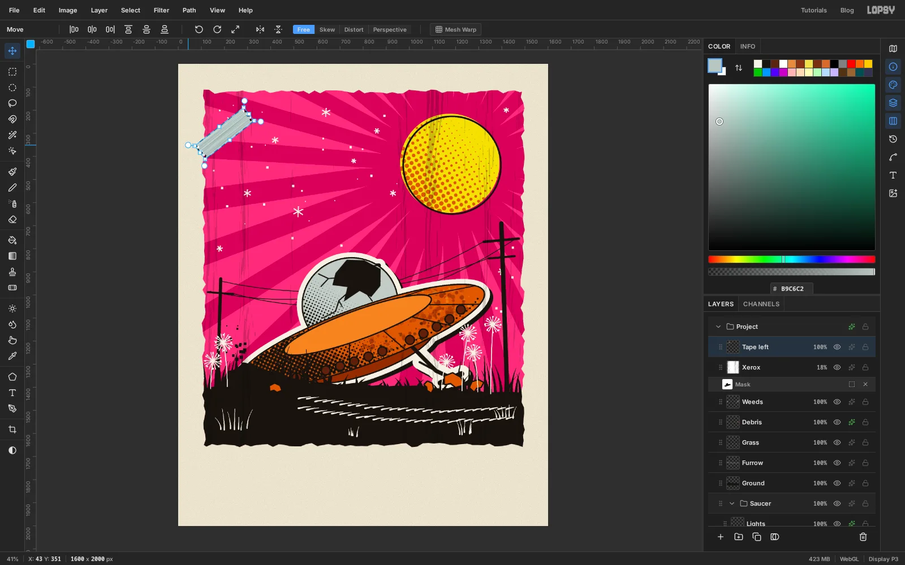

Add a layer called *Tape left*. With the **Lasso**, draw a strip about 270 × 74 px in an empty patch of sky, and zig-zag the two short ends as if they were torn off a roll. Fill it with tape `#B9C6C2` and run **Filter → Texture…** with **Streaks**, **Amount 18**, **Size 3**, **Detail 50** and **Stretch 8**.

Keep the selection, pick the **Move** tool, and drag a corner rotation handle to turn the strip about 38° anticlockwise. Press [[Cmd+D]].

## Tape down both corners

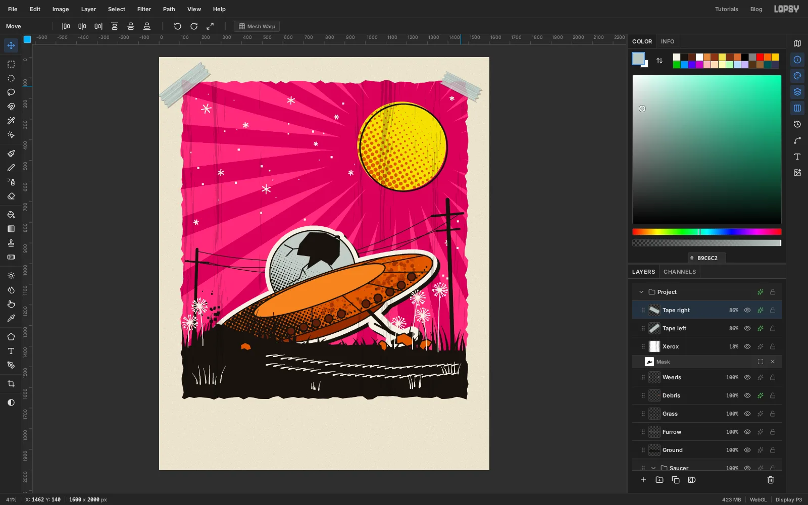

Set the layer's opacity to **86%** and add a **Drop Shadow** with **Offset X 3**, **Offset Y 5**, **Blur 0** and **Opacity 30**. Drag the strip over the panel's top left corner.

Make a second strip the same way on a layer called *Tape right*. Make it shorter (about 200 × 66 px) and turn it about 27° clockwise before you drag it over the top right corner. Two different pieces look torn by hand. Two matching ones look copied.

## Lay out the label on guides

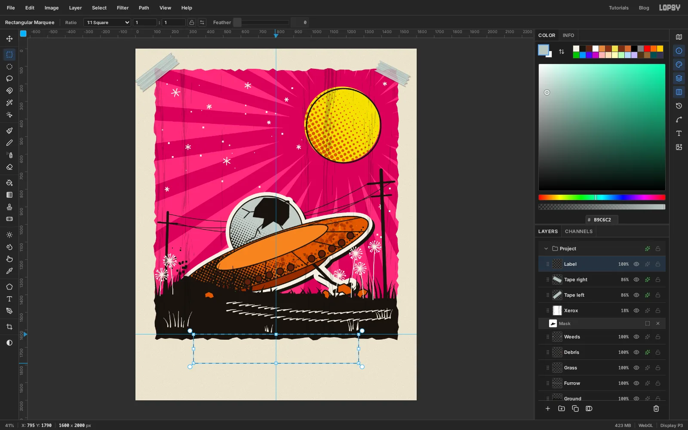

Hold [[Cmd]] and click the top ruler near 800. The guide jumps to exactly half the page width. [[Cmd]]-click the left ruler near 1620 and it lands on 1625, just above the panel's bottom edge.

Add a layer called *Label*. Pick the **Rectangular Marquee** and drag from the left, starting about 330 px in from the edge of the page and just under the horizontal guide, across to the centre guide and down about 165 px. The top and right edges snap to the guides. Hold [[Shift]] and drag a matching box in from the right. Because both halves meet on the centre guide, the strip is centred on the page.

Fill it with sun yellow `#F2E14B`, deselect, and add **Filter → Add Noise…** (**Amount 8**, **Mono**). Give it the same hard shadow as the cut-out, a little smaller: **Drop Shadow**, offsets **10** and **10**, **Blur 0**, **Opacity 100**.

## Type the caption

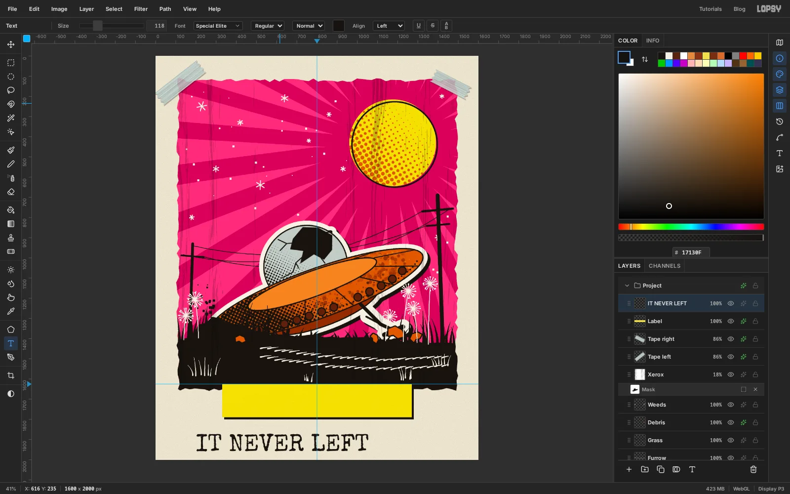

Set the foreground to toner black. Pick the **Text** tool and click on the empty paper below the label. Typing on bare paper makes the words easy to see while you set them up. You'll move them onto the label next.

Set **Size** to **118**, choose **Special Elite** from the font menu, type **IT NEVER LEFT**, and press [[Tab]] to commit.

## Seat the text on the label

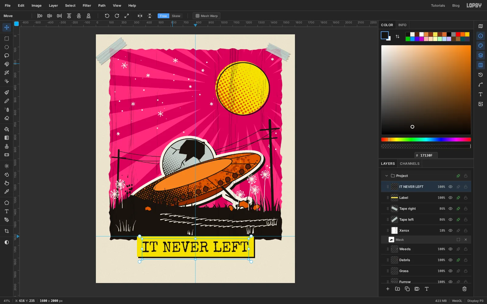

Pick the **Move** tool and click **Align center horizontally** in the options bar.

Now nudge the text up with the arrow keys. [[Shift+↑]] moves 10 px and [[↑]] moves 1 px. Stop when the gap above the capitals matches the gap below them. Check the sides too. There should be about as much yellow left and right of the words as there is above and below. If the words crowd the ends, make the type smaller.

## Tilt the label and its text together

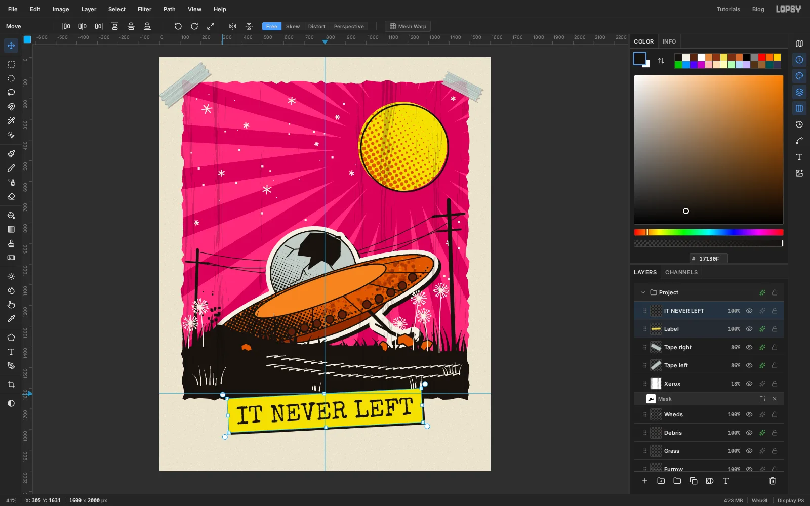

Click the text layer, then [[Shift]]-click *Label* so both are selected. The **Move** tool draws one box around the pair.

Drag a rotation handle about 3° anticlockwise and press [[Cmd+D]]. The text is still live text, so you can fix a typo later and it keeps its tilt.

## Add the footer and warm up the rust

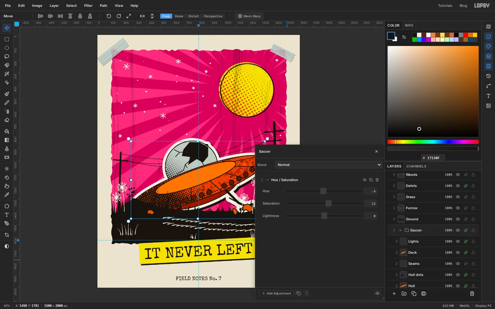

With the **Text** tool, click near the bottom of the page, set **Size** to **40**, still in Special Elite and toner black, and type **FIELD NOTES No. 7**. Commit it and use **Align center horizontally** again.

Last, click the *Saucer* group and open its drawer with the sparkle button. A group has adjustments where a layer has effects. Click **Add Adjustment**, choose **Hue / Saturation**, and set **Hue −4** and **Saturation 12**. Every layer in the group gets a little redder and richer, and you can change it or take it off at any time.

Choose **File → Save Project** to keep the layers, and **File → Quick Export PNG** for the finished picture.
