Games from the Super Nintendo and Mega Drive era got lush skies out of
tiny palettes with a few tricks. They used flat bands of colour, a
checkerboard **dither** where two bands meet, crisp stair-stepped edges, and a
bright line wherever light catches a shape. In this tutorial you'll use those
tricks to make **Volcano Ascent**, a 1200 × 1680 px cover for an imaginary
hiking zine. It looks like the title screen of a game that never existed. A
hiker stands on a ledge looking up at a glowing volcano, and a role-playing
game dialog box lists what's in the issue.

Everything is built on an **8 px grid**, so each "art pixel" is an 8 × 8
square and the cover is 150 × 210 art pixels. You won't place the dither
by hand. A four-square pattern, the **Posterize** filter and a
**Gradient Map** turn any smooth grey gradient into a 16-bit one. No photos
are needed.

Along the way you'll use:

- the **grid** with snapping, and the **Rectangular Marquee**'s exact-corners dialog
- **Define Pattern** and **Fill with Pattern** to make an ordered dither
- **Pixelate**, **Posterize**, **Threshold**, **Gaussian Blur**, **Select → Grow** and **Drop Shadow**
- **Gradient Map** adjustments on groups
- a white-on-black "stencil" with the **Magic Wand** to turn any shape into stair-stepped pixels
- the **Elliptical Marquee** and **Lasso**, with [[Shift]] to add and [[Alt]] to subtract
- [[Cmd]]-clicking thumbnails and nudging the selection with the arrow keys to light the edges of a shape
- the **Pencil** at 8 px for stars, trees, a trail and a hand-placed hiker sprite
- the **Brush**, the **Gradient** tool (linear and radial) and **Edit → Fill**
- copy and paste, scaling and rotating with the **Move** tool, **Align center horizontally** and **Image → Flip Horizontal**
- **New Group**, **Add Layer**, **Merge Down** and **Rasterize Layer**
- **Text** in Press Start 2P, a free pixel font

The palette:

- Sky `#0E0A2A` → `#24154F` → `#46206A` → `#7A2A78` → `#B83A6E` → `#E85A4E` → `#FF9A48`
- Volcano `#26143A` → `#3A1E4E` → `#5C2250` → `#94304A`, rim `#7A4592`, moonlight `#9A6AB8`
- Lava `#FF5A1E`, lava light `#FFD23C`, glow `#B83A48` / `#86284C`, tapers `#6E2246`, embers `#FF7A2A`
- Crater `#FFB43C` / `#FFF0A0`, crater lip `#651D52`
- Smoke `#4A3A66` → `#6E5A8E` → `#B4587E`
- Mountains `#341C55`, mountain rim `#6A3F8E`
- Foothills and pines `#140A24`, foothill rim `#3A2258`, trail `#C88A5E`
- Basalt `#24133C`, tops `#3E2357`, joints `#100820` / `#2E1A48`, ledge rim `#7A3450`
- Hiker outline `#1A0F1F`, beanie `#D8474A` / `#962838`, skin `#F2B48A`, pack `#E0A030` / `#A86A1C`
- Jacket `#2FA39A` / `#1E6E73`, trousers `#5A6AB8` / `#3E4A8A`, boots `#5A2E1A`, stick `#9A6A3A`, lava rim `#E8703A`
- Title bands `#FFF6A0` / `#FFD23C` / `#FF9A2E` / `#E8432E`, outline `#12081C`, extrusion `#4A1238`
- Dialog box `#3A4CC8` → `#121A66`, borders `#F4F4F4` / `#0A0F3A`, menu cursors `#FFD23C`
- Moon `#FFE9B0`, stars `#FFF4D6` / `#9C8AD8` / `#B9A6E8`, hearts `#FF4A5A`

## Set up the document and an 8 px grid

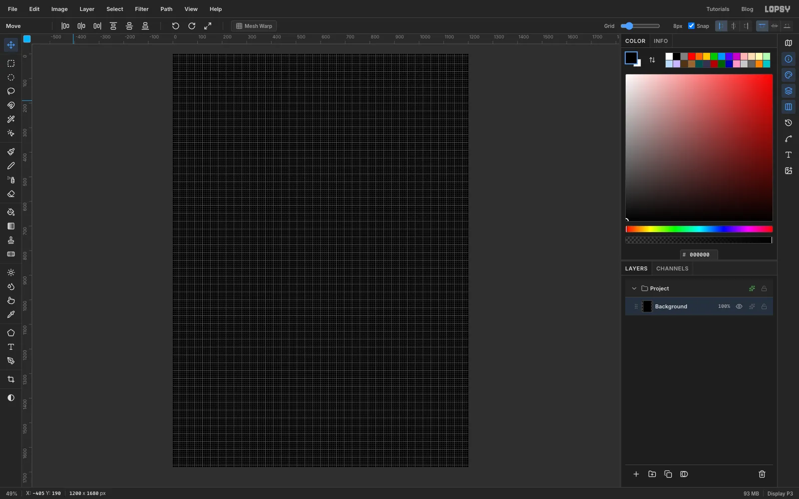

Create a new document **1200 × 1680 px**. Choose **View → Show Grid**, then
drag the **Grid** slider at the right of the options bar to **8px** and make
sure **Snap** is ticked. With snapping on, marquees land on grid lines, and
the arrow keys nudge a selection by exactly one grid square. You'll rely on
both.

Delete the empty **Layer 1**. Select the **Background** layer, choose
**Select → All**, set the foreground colour to black (`#000000`) and choose
**Edit → Fill**. Deselect with [[Cmd+D]].

> **Tip:** Throughout this tutorial, "one pixel" means one 8 × 8 grid square.
> Measurements in **px** are real screen pixels.

## Make a Bayer dither tile and define it as a pattern

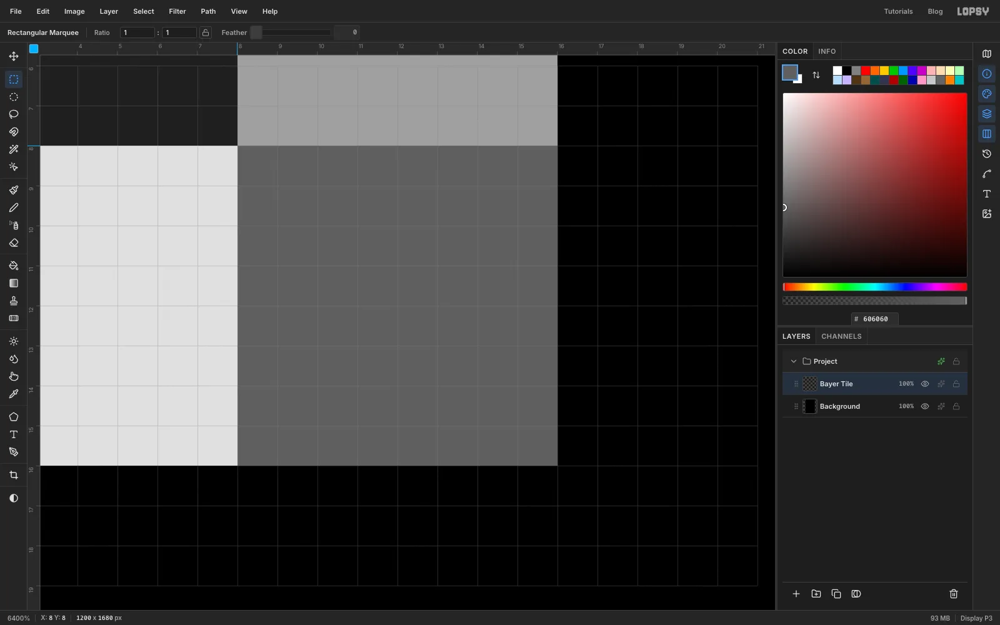

Ordered dithering uses a small grid of thresholds called a **Bayer matrix**.
The 2 × 2 version has four values, and you'll paint it as four grey squares.

Click **Add Layer** and name it **Bayer Tile**. Pick the **Rectangular
Marquee**. A single click with nothing selected opens a dialog where you
type exact corners. Make these four squares, and for each one press
[[Cmd+D]] to deselect first, click once, type the corners and fill with
**Edit → Fill**:

1. From **0, 0** to **8, 8**, filled with `#202020`.
2. From **8, 0** to **16, 8**, filled with `#9F9F9F`.
3. From **0, 8** to **8, 16**, filled with `#DFDFDF`.
4. From **8, 8** to **16, 16**, filled with `#606060`.

Deselect, then select the whole tile from **0, 0** to **16, 16** and choose
**Edit → Define Pattern**. Deselect again and delete the **Bayer Tile**
layer. The pattern stays available for the rest of the session.

## Paint the sky as a grey gradient

Every coloured area on this cover starts out in grey, because grey values are
what Posterize and the Gradient Map work on.

Select the **Background** layer and click **New Group** in the Layers
panel footer. Name it **Sky**. With the group open, click **Add Layer** and
name the layer **Sky Value**.

Pick the **Gradient** tool and set **Type** to **Linear**. Click
**Advanced…**, click each end stop and type its colour into the hex field:
black on the left and white on the right. Drag from the top edge of the
canvas straight down to about **500 px above the bottom edge**. Everything
below that will be hidden by the ground later.

## Pixelate it and fill a layer with the dither pattern

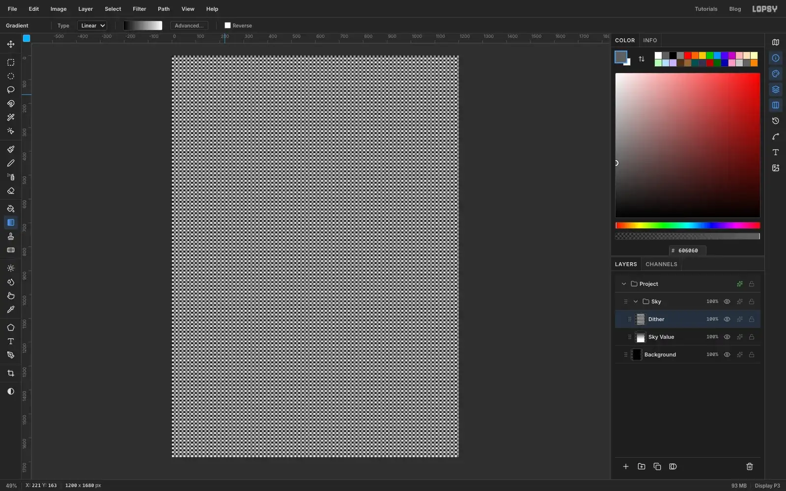

Choose **Filter → Pixelate…** and set **Block Size** to **8**. The gradient
becomes 8 px tall steps that line up with the grid.

Click **Add Layer** and name it **Dither**. Choose **Edit → Fill with
Pattern…**, pick the 16 × 16 pattern you defined and click **Apply**. The
four greys repeat across the whole canvas, every square sitting exactly on
a grid square.

## Merge the pattern at 8% and posterize to seven greys

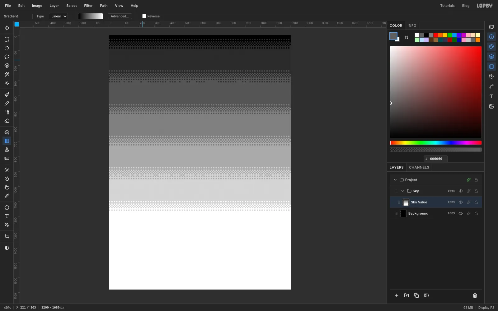

Click the **Dither** layer's opacity and set it to **8%**, then choose
**Layer → Merge Down**. Each grid square of the sky is now nudged up by a
slightly different amount, following the pattern.

Choose **Filter → Posterize…** and set **Levels** to **7**. Posterize
rounds every pixel to the nearest of seven greys. Most of the sky lands on
a flat band. Near the line between two bands, the 8% nudge tips some
squares up and leaves others down, always in the same order. You get
transitions that step from one pixel in four, to a checkerboard, to three in
four: the classic 16-bit sky.

## Colour the sky with a Gradient Map

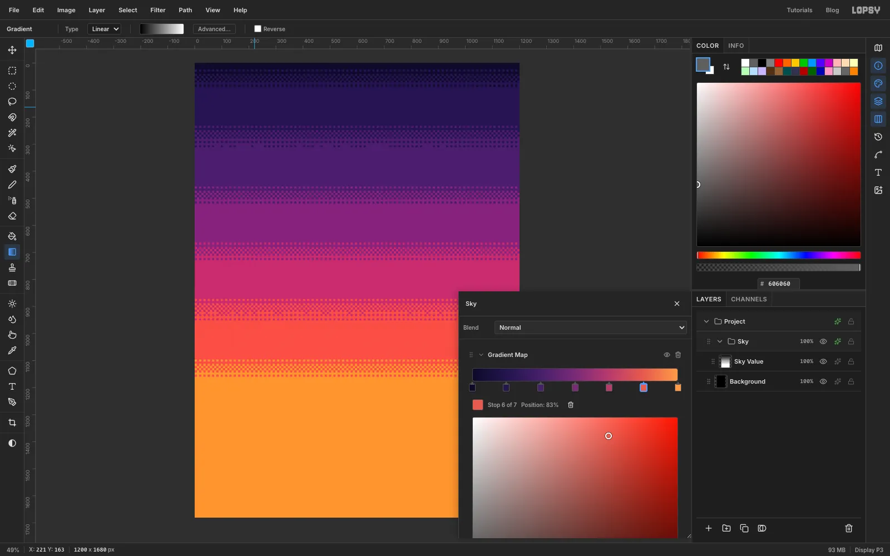

Click the **Sky** group's effects button (the sparkle icon on its row) to
open **Group Adjustments**. Click **Add Adjustment → Gradient Map** and
expand it.

Give the map seven stops, one for each grey level. Click the row under the
gradient bar to add stops at roughly **0, 17, 33, 50, 67, 83 and 100%**.
Select each one and type its colour into the hex field:
`#0E0A2A`, `#24154F`, `#46206A`, `#7A2A78`, `#B83A6E`, `#E85A4E` and
`#FF9A48`.

Each grey band becomes one flat colour, and the dither now mixes
neighbouring colours instead of greys. Because it's an adjustment, you can
retune the palette at any time.

## Scatter pixel stars with the Pencil

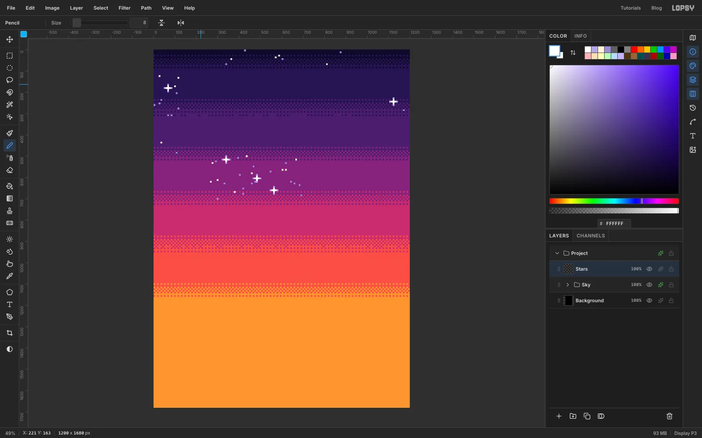

Collapse the **Sky** group, select it and click **Add Layer**. Name the new
layer **Stars**. Pick the **Pencil**, set its **Size** to **8** and click in
grid squares to place single-pixel stars. Use `#9C8AD8` for dim stars and
`#FFF4D6` for bright ones, about three dim stars for every bright one. Keep
them out of the middle of the top third, where the title will go, and away
from the two top corners.

For a twinkle, click a square and [[Shift]]-click two squares to its right
to draw a line, then extend it two squares to the left the same way, in
`#B9A6E8`. Do the same vertically. Finish with a small white plus in the
centre: three pixels across, one above and one below. Five twinkles is
plenty.

## Cut a crescent moon from two circles

Curves drawn with marquees have soft, anti-aliased edges, and that breaks
the pixel art look. To get stair-stepped edges, draw each shape in white on
a black **stencil**, then let Pixelate and Threshold snap it to the grid.

Click **Add Layer** and name it **Moon**. Click **Add Layer** again and name
this one **Stencil**. Choose **Select → All** and fill it black.

Pick the **Elliptical Marquee** and drag a circle from about **64, 520** to
**192, 648**. Hold [[Alt]] and drag a second circle from about **104, 504**
to **216, 624**. That subtracts it and leaves a crescent. Fill the selection
with white.

## Turn the crescent into pixels with the stencil

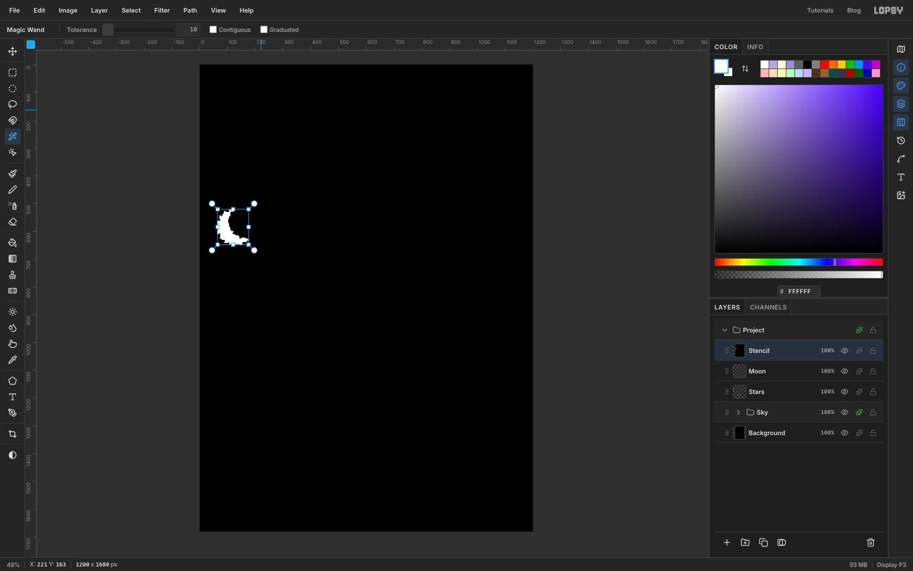

Deselect, then:

1. Choose **Filter → Pixelate…** with **Block Size 8**.
2. Choose **Filter → Threshold…** with **Level 128**. Squares that were more
   than half covered turn white, and the rest turn black.
3. Pick the **Magic Wand**, set **Tolerance** to **10**, untick
   **Contiguous**, and click the white crescent.

You now have a selection whose edges follow the grid. Click the **Stencil**
row and delete it with the trash button. The selection stays.

> **Tip:** This routine is how every curved or slanted shape on this cover
> gets its stepped edges: add a black Stencil layer, paint the shape in
> white, then Pixelate, Threshold, Magic Wand and delete the stencil. From
> here on it's called **stencil the shape**.

## Fill the moon

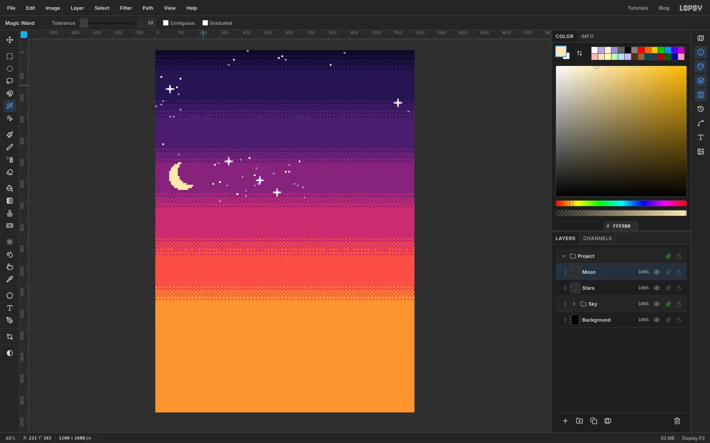

Select the **Moon** layer, fill the selection with `#FFE9B0` and deselect.

## Add a mountain range with a lit edge

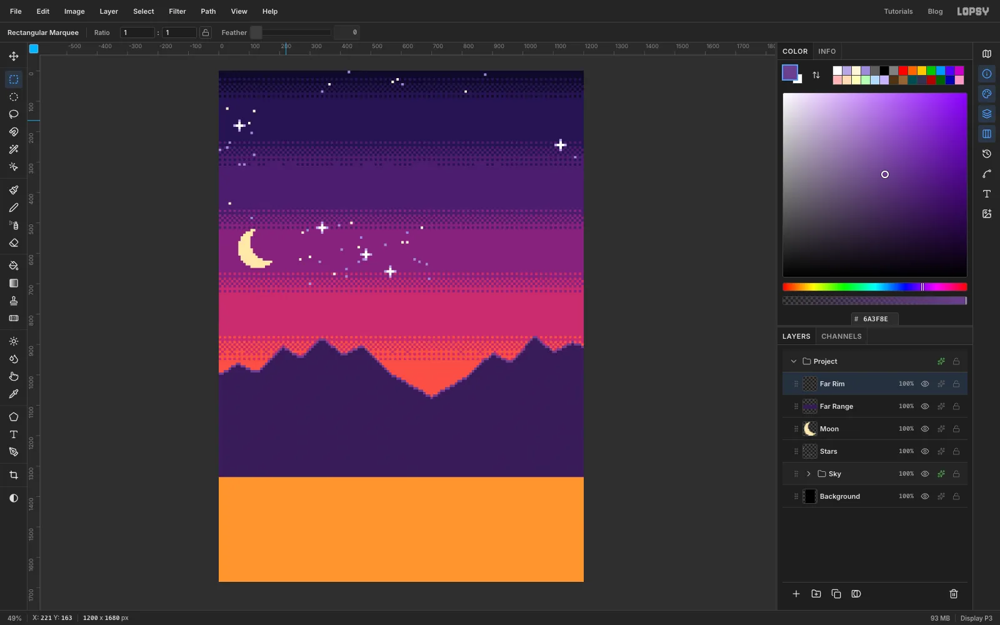

Add a layer named **Far Range** and stencil a jagged ridge with the
**Lasso**. Start off the left edge a little more than halfway down the
canvas, and zigzag across with about eight peaks of different heights. The
tallest reach a bit above the 900 px mark on the ruler. Leave a low dip just
right of the middle, where the volcano will stand. Come back along a line
well below the ridge, at about y 1340. Fill it with `#341C55`.

Now light its top edge. This trick comes back many times:

1. Add a layer named **Far Rim**.
2. [[Cmd]]-click the **Far Range** thumbnail to load its shape as a
   selection, select **Far Rim** and fill with `#6A3F8E`.
3. [[Cmd]]-click the **Far Range** thumbnail again. With the **Rectangular
   Marquee** tool active, press [[Down]] once. With Snap on, the selection
   moves exactly one grid square.
4. Select **Far Rim** and press [[Delete]].

Everything the moved selection covers is erased. That leaves a one-pixel
line along each column's top edge, the **edge light**. Press a different
arrow to light a different side.

## Draw the volcano and fill it with a radial gradient

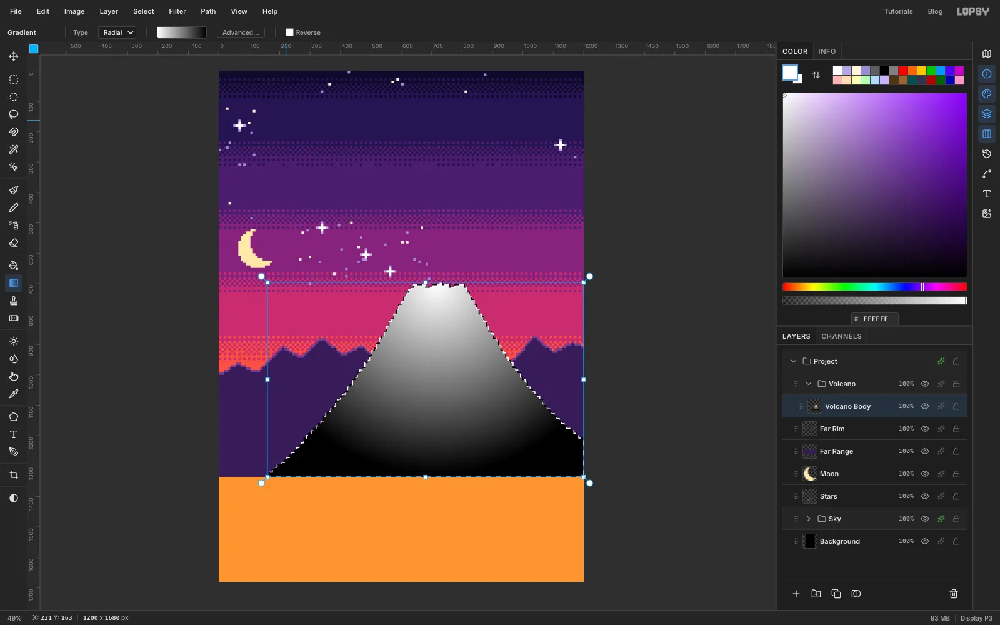

Select **Far Rim** and click **New Group**. Name the group **Volcano** and
add a layer inside it named **Volcano Body**.

Stencil the cone with the **Lasso**. It's a wide, slightly concave cone with
its summit just right of the centre, about 40% of the way down the canvas.
Make the summit a ragged flat top about 150 px wide. Run the left flank down
to the bottom-left corner area, and the longer right flank off the right edge
about three quarters of the way down. Close it along the bottom, below the
mountains.

Keep the selection. Select **Volcano Body**. Set the **Gradient** tool to
**Radial** with **white** on the left stop and **black** on the right, and
drag from the centre of the summit about **620 px** straight down.

## Dither the volcano and map it to four colours

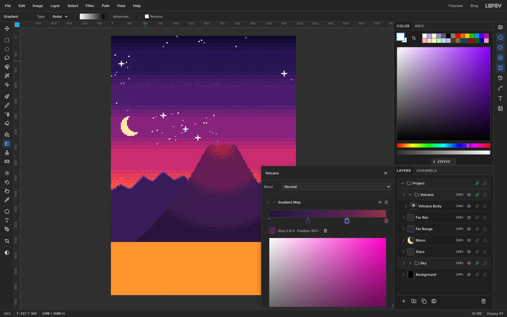

Repeat the sky recipe inside the selection:

1. **Filter → Pixelate…**, Block Size **8**.
2. Add a layer named **Dither**, choose **Edit → Fill with Pattern…** and
   set the layer's opacity to **10%**. The pattern only fills inside the
   selection.
3. Deselect and choose **Layer → Merge Down**.
4. **Filter → Posterize…** with **Levels 4**.

Open the **Volcano** group's Group Adjustments, add a **Gradient Map** with
four stops at **0, 33, 67 and 100%**, and set them to `#26143A`,
`#3A1E4E`, `#5C2250` and `#94304A`. The cone is darkest at its base and
glows plum near the crater.

## Light the volcano's edges

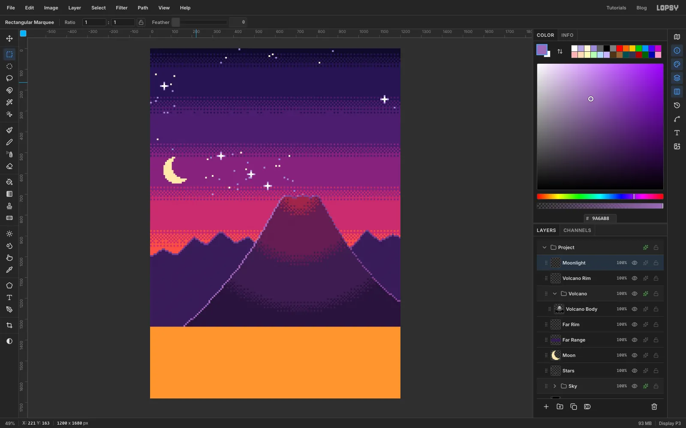

Collapse the **Volcano** group. With the group selected, add a layer named
**Volcano Rim** and edge-light **Volcano Body**: [[Cmd]]-click its
thumbnail and fill, then [[Cmd]]-click again, press [[Down]] and delete. Use
`#7A4592`.

The moon is on the left, so add one more layer, **Moonlight**, and
edge-light **Volcano Body** again. This time press [[Right]] and fill with
`#9A6AB8`. Moving the selection right leaves only the left-facing edges lit.

## Paint the lava streams on a stencil

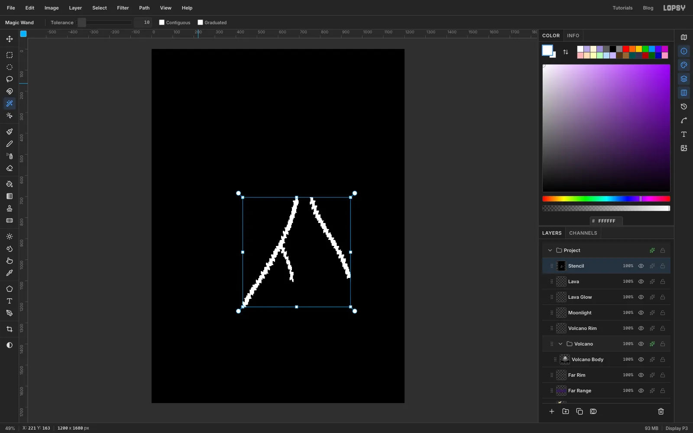

Add a layer named **Lava Glow**, then another named **Lava** above it.

Stencil the streams, but paint the white with the **Brush** at **Size 22**
and **Hardness 100**:

- Drag one stream from the left side of the crater down and to the left,
  wobbling slightly, and stop about two thirds of the way to the volcano's
  foot.
- Drag a second from the right side of the crater down and to the right,
  stopping a little higher than the first.
- Set the size to **16** and drag a short branch off the first stream,
  about halfway down.

Pixelate, Threshold and Magic Wand as usual, delete the stencil, then fill
the **Lava** layer with `#FF5A1E`.

## Make a stepped glow stencil

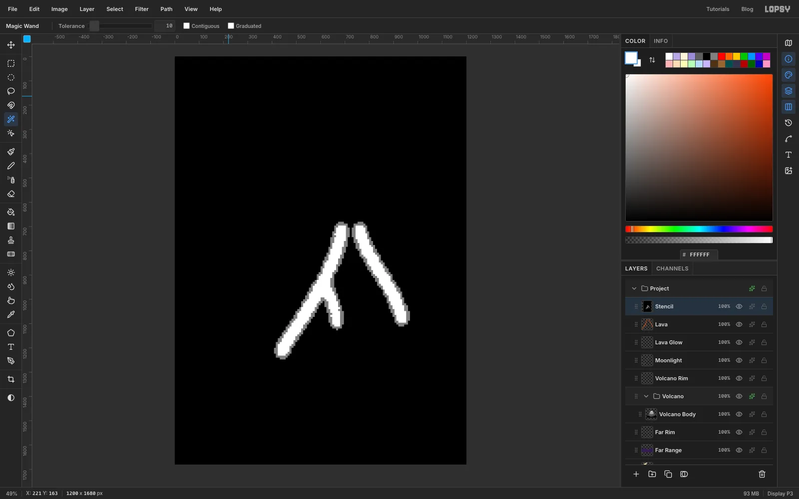

A soft Outer Glow would look out of place on pixel art, so build a stepped
one instead:

1. With **Lava** selected, add a layer named **Stencil** and fill it black.
2. [[Cmd]]-click the **Lava** thumbnail and choose **Select → Grow…** with
   **16** px.
3. Select **Stencil**, fill with white and deselect.
4. **Filter → Gaussian Blur…** with **Radius 20**, then **Pixelate** at
   **8**.
5. Add the dither pattern at **12%** and Merge Down, as before.
6. **Posterize** with **Levels 3**.

You end up with three values: black, a mid-grey halo and a white core around
each stream.

## Fill the glow and light the streams

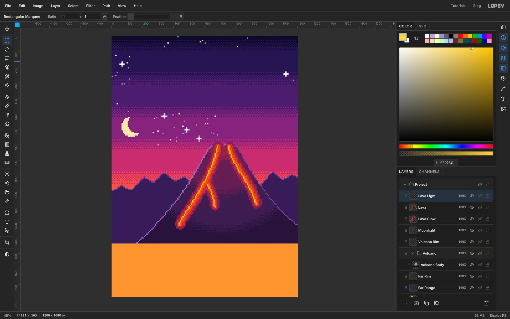

With the **Magic Wand** (Contiguous still off), click a mid-grey square of
the halo, select **Lava Glow** and fill with `#86284C`. Deselect, go back
to **Stencil**, click the white core, select **Lava Glow** and fill with
`#B83A48`. Then delete the stencil. The Lava layer sits above the glow, so
only the parts outside the streams show.

Add a layer named **Lava Light** and edge-light the **Lava** shape with
[[Right]], filling with `#FFD23C`. Every stream gets a bright left edge.

## Set the crater into the summit

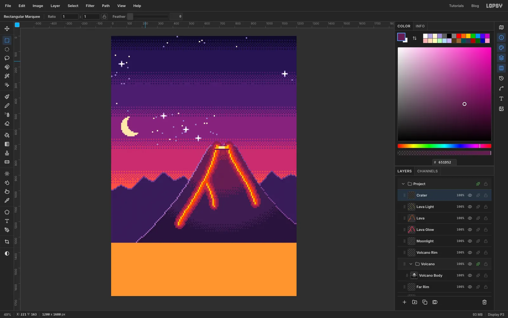

Add a layer named **Crater**:

1. Stencil an ellipse about **88 × 20 px**, set just inside the summit, and
   fill it with `#FFB43C`.
2. Stencil a smaller ellipse, about **52 × 10 px**, in the same place and
   fill it with `#FFF0A0`.
3. With the **Rectangular Marquee**, select a strip **96 × 8 px** under the
   pool, from about **667, 728** to **763, 736**. Fill it with `#651D52`.

That dark front lip makes the glow sit inside the peak instead of on top of
it.

## Taper the streams and add embers

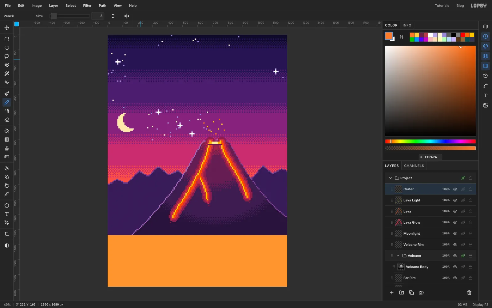

Select the **Lava** layer and pick the **Pencil** (Size 8). Where each
stream ends, carry on in the same direction with two `#B83A48` pixels, then
one `#6E2246` pixel. The streams now fade out instead of stopping with a
flat cut.

Select **Crater** and click a handful of embers into the sky just above the
crater: about five in `#FFD23C` and five in `#FF7A2A`.

## Rough out the smoke with overlapping ovals

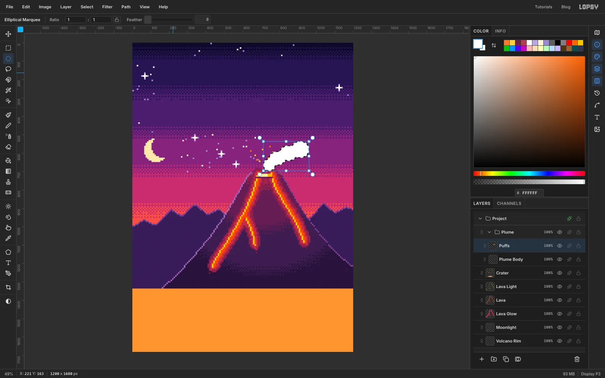

With **Crater** selected, click **New Group**. Name the group **Plume** and
add a layer named **Plume Body** inside it. Then add another layer above it
named **Puffs**.

With the **Elliptical Marquee**, drag an oval just above the crater. Hold
[[Shift]] and drag three more, each a little bigger, higher and further
right, so they climb up and to the right. Fill with white.

## Copy, scale and rotate the puffs

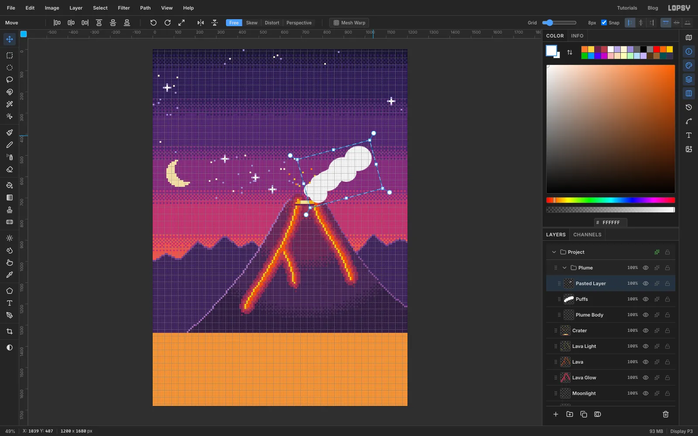

Draw a **Rectangular Marquee** around the four ovals, then press
[[Cmd+C]] and [[Cmd+V]]. The copy pastes in place on a new layer, but with
no selection, so the Move tool has no handles to grab. Draw the same marquee
again over the copy, then switch to the **Move** tool:

1. Hold [[Cmd]] and drag the top-right corner handle outwards until the
   copy is about a third bigger.
2. Drag the round rotation handle just outside a corner to tilt the copy
   about **14°** anticlockwise.
3. Drag the copy up and to the right so it carries on from the first
   cluster and runs off the right edge.

Keep the smoke clear of the row where the subtitle will go, a band about
450 to 500 px down. Press [[Cmd+D]], then **Layer → Merge Down** into
**Puffs**.

## Stencil the smoke

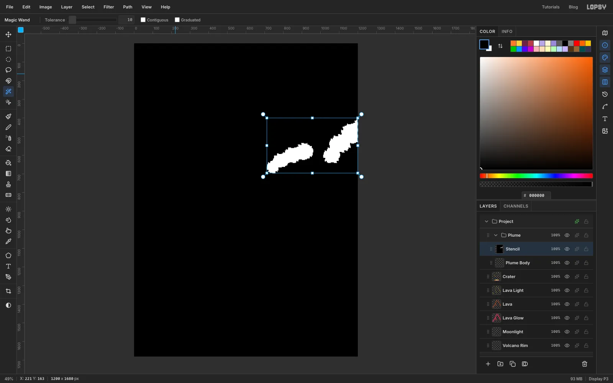

The puffs are already on their own layer, so make the stencil underneath
them. Select **Plume Body** and add a layer named **Stencil**. It lands
between **Plume Body** and **Puffs**. Fill it black, select **Puffs** and
choose **Merge Down**. The white puffs drop onto the black.

Pixelate at 8, Threshold at 128 and Magic Wand the white as usual, then
delete the stencil.

## Shade the smoke with three dithered tones

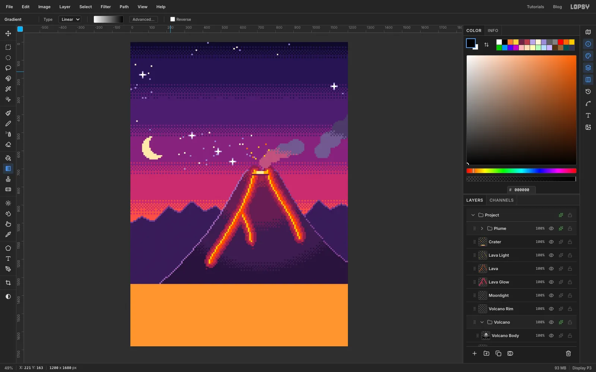

Keep the selection and select **Plume Body**. Drag a **Linear** gradient
from white near the crater to black at the top right. Then:

1. Pixelate at **8**.
2. Add the dither pattern at **12%** and Merge Down.
3. Deselect and **Posterize** to **3** levels.

In the **Plume** group's Group Adjustments, add a Gradient Map with stops
at **0, 50 and 100%**: `#4A3A66`, `#6E5A8E` and `#B4587E`. The underside
now glows pink in the lava light. Collapse the group.

## Roll out the foothills

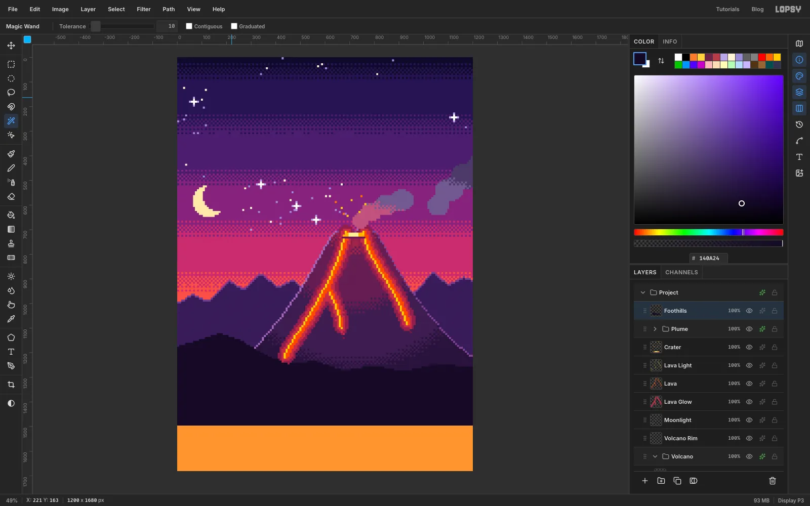

Select the **Plume** group and add a layer named **Foothills**. Stencil a
band of rolling hills with the **Lasso**:

1. Start off the left edge a little below the mountains.
2. Rise to a rounded hilltop about 170 px in, where the hiker's backdrop
   will be.
3. Roll down and to the right in gentle bumps, crossing the foot of the
   volcano.
4. Close the shape low down, well below where the ledge will start.

Fill it with `#140A24`, the darkest colour on the cover. Against it, the
volcano's base and the hiker both stand out.

## Draw a pine tree pixel by pixel

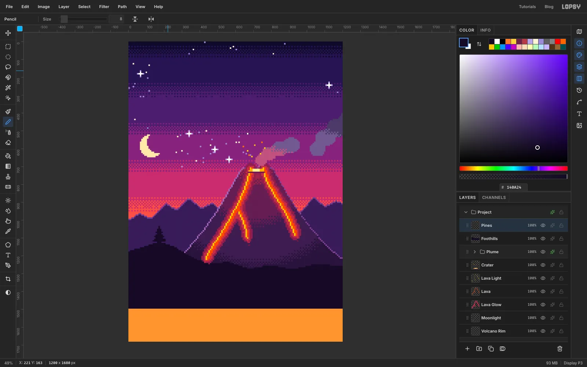

Add a layer named **Pines**. With the **Pencil** (Size 8) in `#140A24`,
draw a pine 9 pixels wide and 12 tall on the left hilltop. Draw each row
with a click and a [[Shift]]-click. Counting columns 1–9 from the left, the
rows from the top are:

1. A one-pixel tip in column 5, two rows tall.
2. Two rows 3 wide (columns 4–6).
3. A row 5 wide (3–7).
4. A row 3 wide (4–6), which makes a notch.
5. Rows 5 wide (3–7), then 7 wide (2–8), then 5 wide (3–7).
6. A row 8 wide that hangs to the right (2–9).
7. The full 9-wide base.
8. A one-pixel trunk in column 4, slightly off-centre.

The longer bough and the off-centre trunk make the tree lopsided on
purpose, so mirrored copies look different.

## Copy the pine along the ridge

Draw a marquee around the pine, press [[Cmd+C]] and [[Cmd+V]], and drag the
copy with the **Move** tool to another spot, standing on the hill line.
Press [[Cmd+D]] and **Merge Down**. Make three copies: one just left of the
first, and two on the right-hand hills. Before merging the last one, choose
**Image → Flip Horizontal** to mirror it.

Add a layer named **Foothill Rim** and edge-light the **Foothills** with
[[Down]] in `#3A2258`.

## Dot a switchback trail up the slope

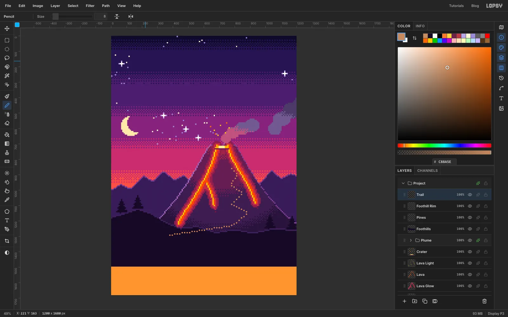

Add a layer named **Trail**. With the **Pencil** in `#C88A5E`, click every
other grid square to make a dashed path:

1. Start at the right end of the flat hilltop on the left. That's where
   the ledge will stop, about 1290 px down.
2. Run gently up and right across the foothills to below the volcano's
   centre.
3. Zigzag up the flank in four switchbacks between the two long lava
   streams, ending about halfway up the cone.

## Lay down the ledge and its lit tops

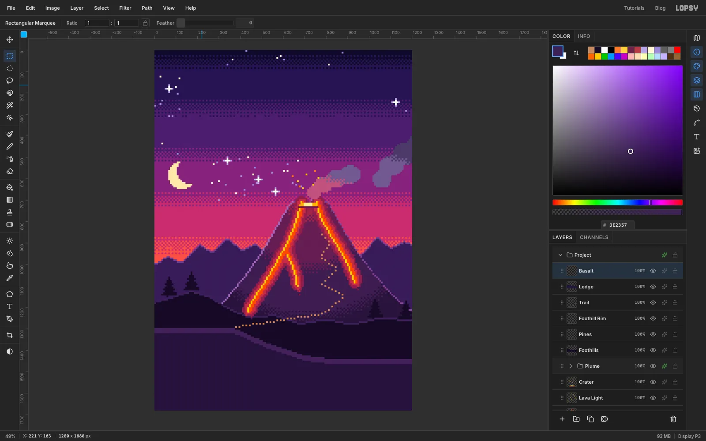

Add a layer named **Ledge** and stencil the ground with the **Lasso**:

1. Draw a flat top **1296 px** down, from the left edge to about a third of
   the way across.
2. Slope it down to the right until it is about 1440 px down at
   two thirds of the way across.
3. Run it level to the right edge, then close it along the bottom of the
   canvas.

Fill it with `#24133C`. Then add a layer named **Basalt** and edge-light
the **Ledge** with [[Down]] pressed **three** times, in `#3E2357`. That
gives every column of rock a three-pixel lit top face.

## Cut the basalt into columns

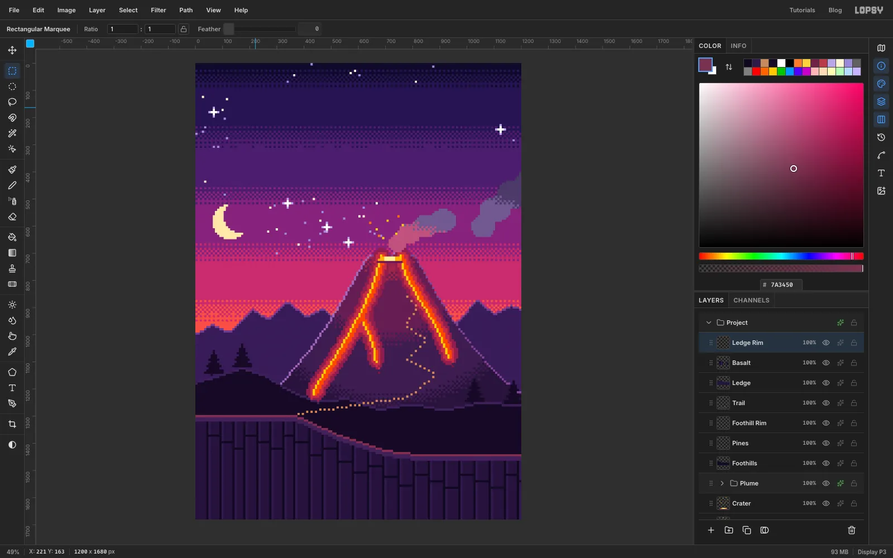

Basalt cracks into tall columns, so draw the joints straight down with the
**Pencil** on the **Basalt** layer:

1. In `#100820`, click just below the lit top face and [[Shift]]-click at
   the bottom of the canvas. Repeat every 40–56 px across the ledge, varying
   the spacing a little.
2. In `#2E1A48`, draw a second line one pixel to the right of each joint.
   This is the moonlit side of each column.
3. Add short horizontal `#100820` joints between neighbouring columns,
   each at a different height.

Finish with a layer named **Ledge Rim**, edge-lit from the **Ledge** with
[[Down]] in `#7A3450`.

## Place the hiker sprite

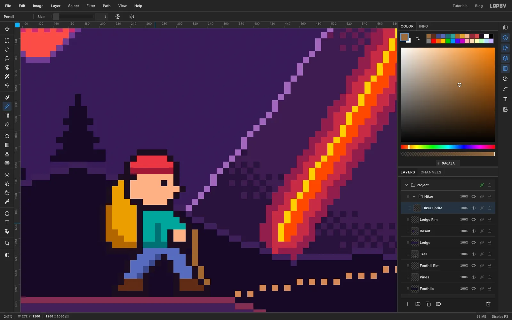

Select **Ledge Rim**, click **New Group** and name it **Hiker**. Add a layer
inside it named **Hiker Sprite**. The sprite is **18 pixels wide and 24
tall**. It stands on the flat part of the ledge, with its left edge 200 px
in and the bottom of its boots on the ledge's top line. Zoom in and use the
screenshot above as your chart. At this zoom, each art pixel is clear
enough to count.

Work in three passes, drawing long runs with a click and a
[[Shift]]-click:

1. **Outline** in `#1A0F1F`: the head, beanie, pack, body, legs and boots.
2. **Flat fills**: beanie `#D8474A`, face and hand `#F2B48A`, pack
   `#E0A030`, jacket `#2FA39A`, trousers `#5A6AB8`, boots `#5A2E1A` and the
   stick `#9A6A3A`.
3. **Shading**: a `#962838` band at the bottom of the beanie, `#A86A1C` down
   the back of the pack, a `#1E6E73` fold in the jacket and `#3E4A8A` on
   the inside of the trousers.

## Rim-light the hiker

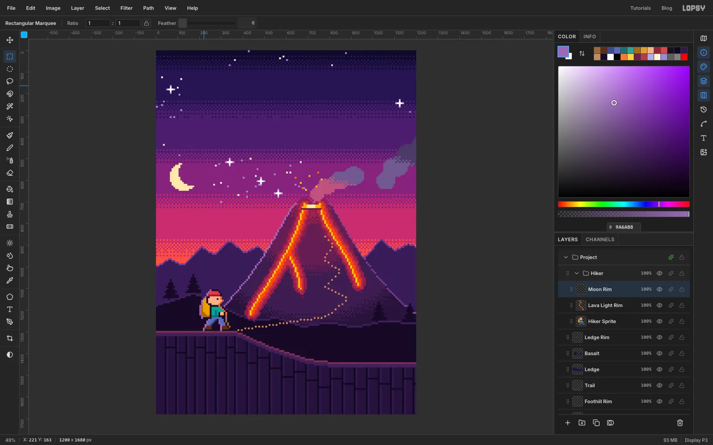

Add a layer named **Lava Light Rim** and edge-light the **Hiker Sprite**
with [[Left]] in `#E8703A`. That lights every edge that faces right,
towards the lava. You only want it on the face, arm and front of the pack.
Select the top 40 px of the sprite (the beanie) and press [[Delete]]. Do the
same for the bottom 80 px (the legs and stick).

Then add a layer named **Moon Rim** and edge-light the sprite with
[[Right]] in `#9A6AB8`. The back of the pack now catches the moonlight and
separates from the dark hills.

## Set the title in Press Start 2P

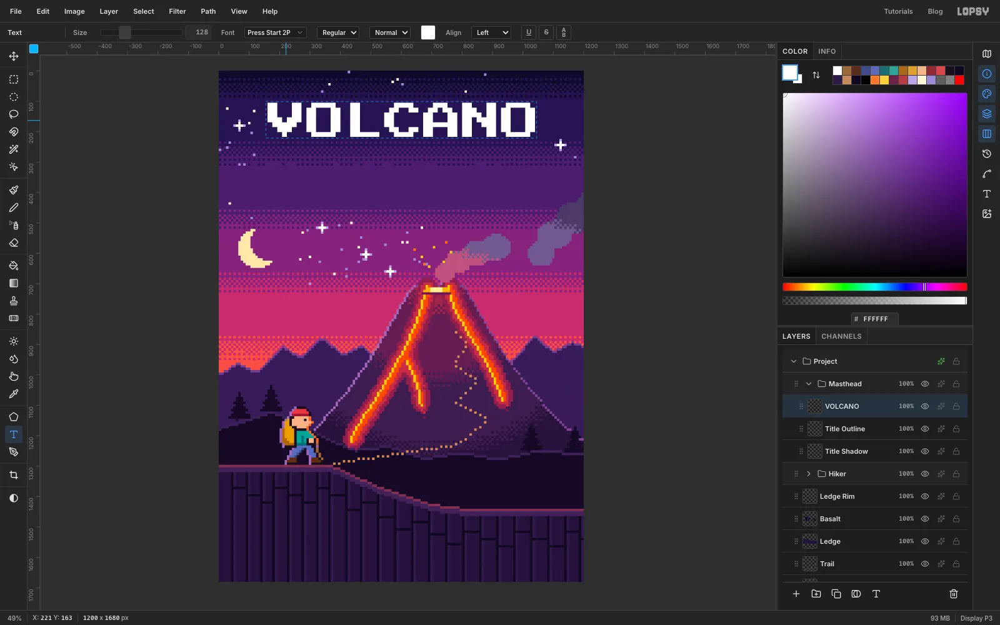

Collapse the **Hiker** group, select it and click **New Group**. Name the
group **Masthead**. Add a layer named **Title Shadow**, then one named
**Title Outline**. The text will go above them.

Pick the **Text** tool. In the options bar choose **Press Start 2P**, set
**Size** to **128** and the colour to white, click near the top of the
canvas and type **VOLCANO**. Press [[Tab]] to commit. At 128 px, each pixel
of the font is exactly 16 px, two grid squares.

Switch to the **Move** tool and click **Align center horizontally** in the
options bar. Untick **Snap** for a moment and use the arrow keys
([[Shift]]+arrow moves 10 px) to bring the top of the letters to **120 px**
down. The ruler and the Info panel show where you are. Add **ASCENT** the
same way, centred, with the top of its letters at **280 px**. Then tick
**Snap** again.

## Band the letters in four colours

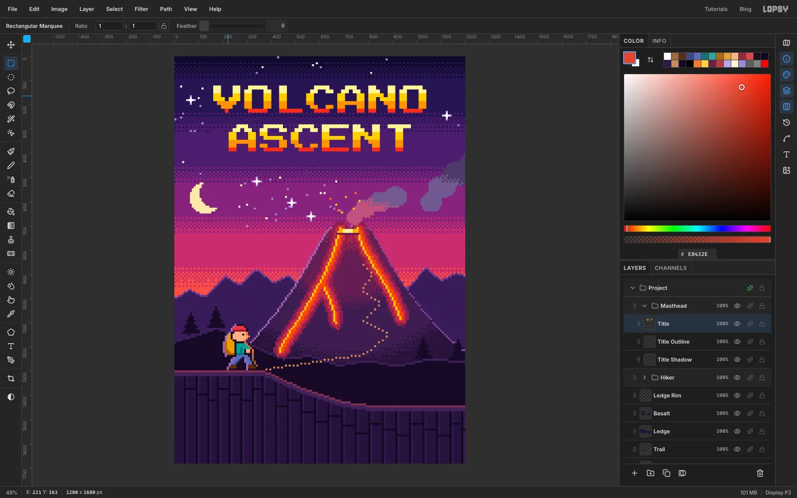

Old game logos were often filled with hard horizontal stripes of colour
instead of a smooth gradient. Select each text layer and click **Rasterize
Layer**. Select **ASCENT** and choose **Merge Down**, then rename the merged
layer **Title**.

Each line is 7 font pixels (112 px) tall. Colour it in bands that are 2, 2,
2 and 1 font pixels tall:

1. [[Cmd]]-click the **Title** thumbnail.
2. With the **Rectangular Marquee**, hold [[Shift]]+[[Alt]] and drag across
   the full width from **120** to **152 px** down. That intersects the
   selection with the letters' top two rows.
3. Fill with `#FFF6A0`.

Repeat for **152–184** in `#FFD23C`, **184–216** in `#FF9A2E` and
**216–232** in `#E8432E`. Then do ASCENT the same way, starting at 280.

## Walk an outline around the letters

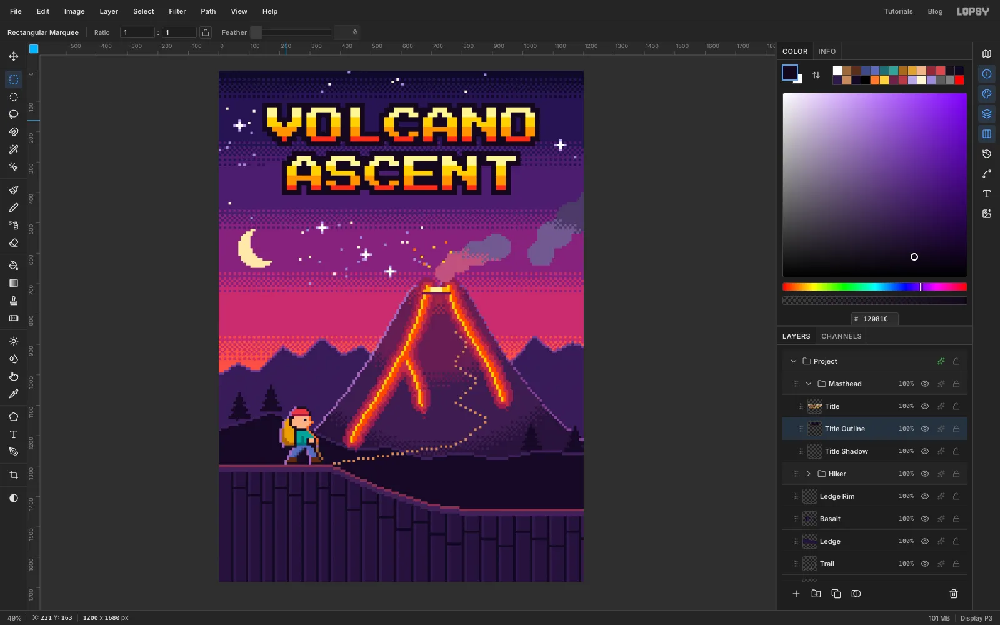

[[Cmd]]-click the **Title** thumbnail, select the **Title Outline** layer
and set the foreground colour to `#12081C`. With the **Rectangular
Marquee** tool active, move the selection around a square, filling at each
stop. Each arrow press moves it 8 px:

1. Press [[Left]] twice and fill.
2. Press [[Up]] twice and fill.
3. Press [[Right]] twice and fill, then [[Right]] twice more and fill.
4. Press [[Down]] twice and fill, then [[Down]] twice more and fill.
5. Press [[Left]] twice and fill, then [[Left]] twice more and fill.

The eight fills, each 16 px off in a different direction, add up to a
one-font-pixel outline with square corners.

## Extrude the title in 3D

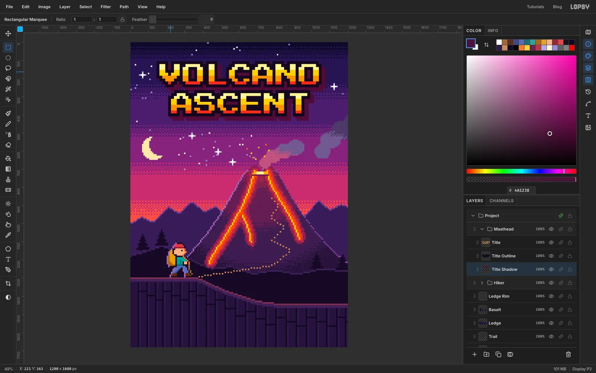

[[Cmd]]-click the **Title Outline** thumbnail, select **Title Shadow** and
set the colour to `#4A1238`. Press [[Right]] and [[Down]] once each, then
fill. Do that two more times. The three stacked fills step down and to the
right behind the outline and give the title depth.

## Add the subtitle with a hard shadow

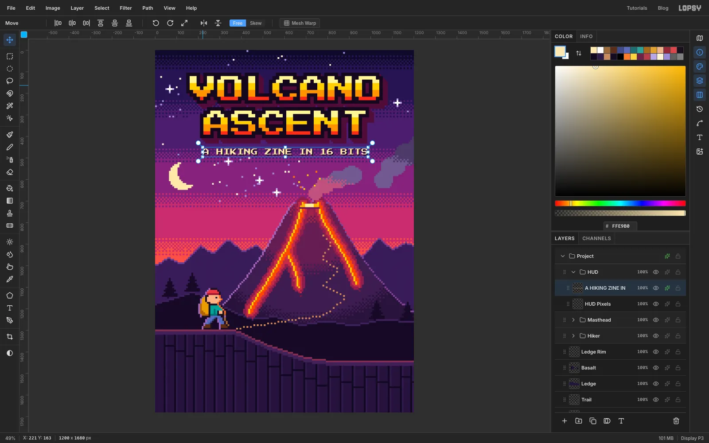

Collapse **Masthead**, select it and click **New Group**. Name it **HUD**,
after a game's heads-up display, the strip that shows the score and lives.
Add a layer inside it named **HUD Pixels**.

With the **Text** tool, Press Start 2P at **Size 32** in `#FFE9B0`, type
**A HIKING ZINE IN 16 BITS**. Centre it with **Align center horizontally**
and nudge the top of the letters to **456 px** down. Open its layer effects
and turn on **Drop Shadow** with **Offset X 4**, **Offset Y 4**, **Blur
0**, **Opacity 100** and colour `#12081C`. A hard shadow is how 16-bit
games kept small type readable over a busy background.

## Add the top bar

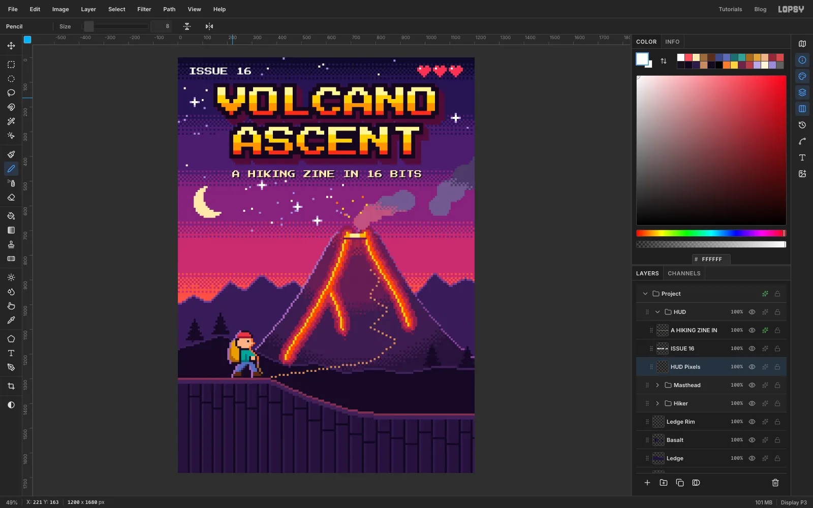

Select **HUD Pixels**, then type **ISSUE 16** in white at Size 32 and move
it so its top-left corner sits **48 px** from the left and **40 px** from
the top.

On **HUD Pixels**, draw three pixel hearts with the **Pencil** in
`#FF4A5A`. Each heart is 7 pixels wide and 6 tall. From the top, its rows
are:

1. Two pixels, a gap, then two more.
2. Seven pixels, with the second one white for a highlight.
3. Seven pixels.
4. Five pixels.
5. Three pixels.
6. One pixel.

Leave one pixel between hearts, and end the last one 48 px from the right
edge, so it matches the margin on ISSUE 16.

## Build the dialog box

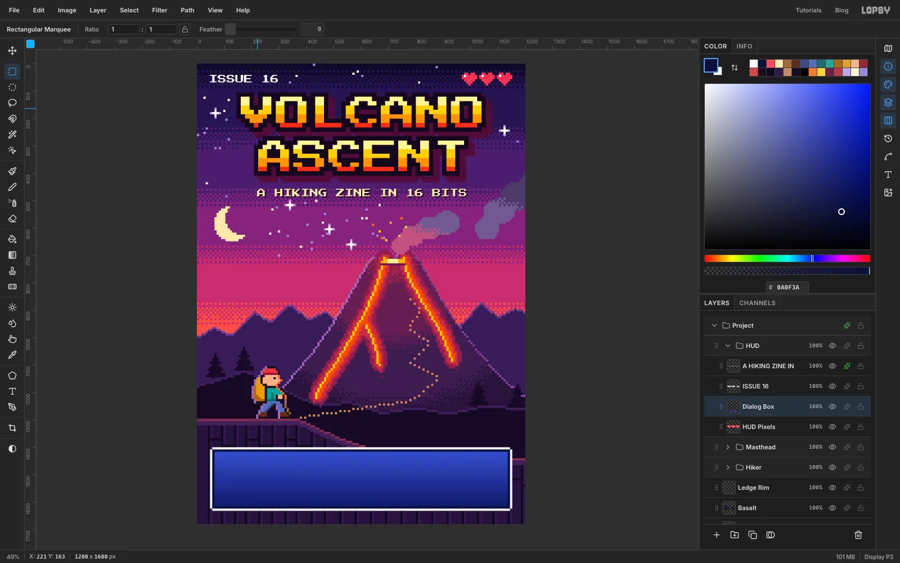

Add a layer named **Dialog Box**. Use the Rectangular Marquee's
exact-corners dialog for each rectangle. Remember to press [[Cmd+D]] before
each click.

1. **48, 1400** to **1152, 1632**, filled with `#F4F4F4`, the white border.
2. **56, 1408** to **1144, 1624**, filled with `#0A0F3A`, the navy inner
   border.
3. **64, 1416** to **1136, 1616**. Set the **Gradient** tool to Linear and,
   in **Advanced…**, type `#3A4CC8` and `#121A66` into the two stops. Drag
   from the top of this selection to the bottom, then choose **Filter →
   Pixelate…** at 8 to step it into bands.

To notch the corners, select each 8 × 8 corner square of the white border
and press [[Delete]].

## Write the dialog text and menu cursors

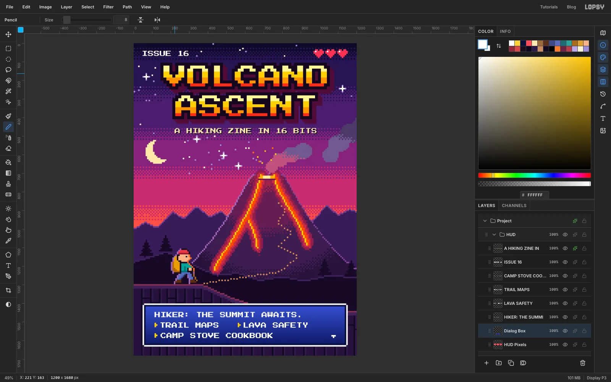

Type the lines in white Press Start 2P at **Size 32**. Click the **Dialog
Box** row before each new line, so the text layer lands in the HUD group
above the box. Make the **bottom line first**. A click inside an existing
line's text box edits that line instead of starting a new one, so working
upwards keeps every click in empty space. The positions are for the top-left
of each line's letters:

- **CAMP STOVE COOKBOOK** at 144, 1558
- **TRAIL MAPS** at 144, 1502
- **LAVA SAFETY** at 592, 1502
- **HIKER: THE SUMMIT AWAITS.** at 112, 1446

That puts the lines 56 px apart, with about 30 px of padding above and
below.

On **Dialog Box**, draw a menu cursor in front of each menu item with the
**Pencil** in `#FFD23C`. Each cursor is a small triangle: one pixel, then
two, then one, stacked. Put the cursors 112 px and 560 px in from the left,
so the first column lines up with the H of HIKER, and centre them on their
lines. At the bottom right, add a white "more" arrow: three pixels in a
row with one under the middle.

## Save and export

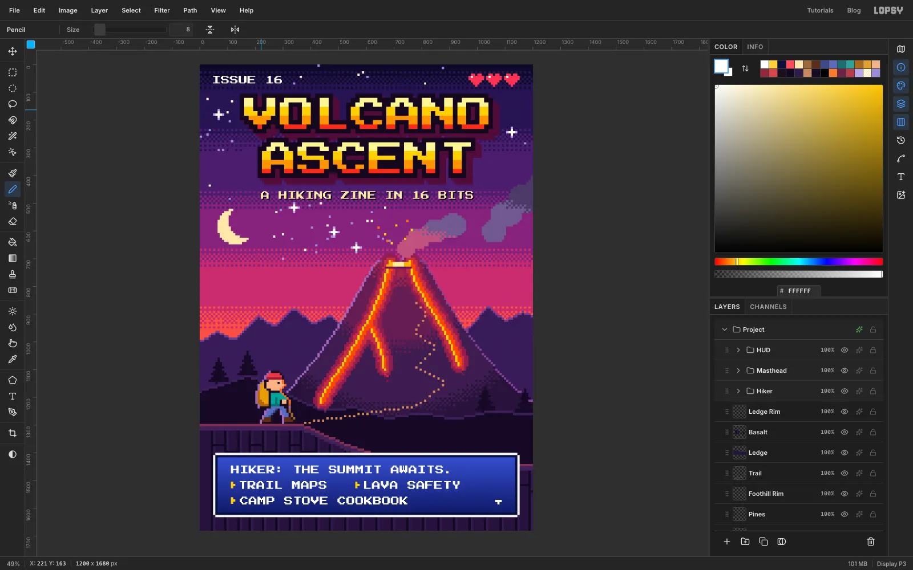

Collapse the **HUD** group. Save the project with **File → Save Project**
and export the cover with **File → Quick Export PNG**.

To change the mood later, open any group's Gradient Map and retype its
stops. The dithering stays put, because it lives in the grey values
underneath.
