Role-playing games from the 16-bit era kept a **quest log**: a parchment
window listing what you'd done and what was left. In this tutorial you'll
borrow that screen for a holiday card. The scene is a snowy village at night,
and the quest log underneath lists the season's chores, with one still to do.

The card is **1568 × 1120 px** and everything sits on an **8 px grid**, so
each "art pixel" is an 8 × 8 square and the picture is 196 × 140 art pixels.
You don't need any photos. Most of it is drawn with the Pencil one square at
a time, and Lopsy's patterns, selections and symmetry do the repetitive
parts for you.

Along the way you'll use:

- the **grid** with **Snap**, and the **Rectangular Marquee** for flat blocks of colour
- **Define Pattern** and **Fill with Pattern**, with **Row Stagger** for bricks and logs
- a checkerboard layer loaded as a selection, so the Pencil paints a **dither** by itself
- the **Pencil** at 8 px, with **Symmetry** for the tree
- the **Paint Bucket** and **Magic Wand**
- the **Brush**, a rotation with the **Move** tool, **Pixelate**, **Posterize** and the **Screen** blend mode for an aurora
- copy and paste, **Flip Horizontal**, **Hue/Saturation**, groups and moving a group as one
- **Text** in two free pixel fonts, Silkscreen and Tiny5, with **Stroke** and **Drop Shadow** effects
- a **Saturation & Vibrance** adjustment on the whole project

The palette:

- Sky `#0B1030` → `#121A45` → `#1B2A63` → `#274082` → `#36589F` → `#4F78BA` → `#6C97CF`
- Stars `#8FA6D6` / `#FFF6D8`, moon shade `#C9D2EE`, craters `#E0DDC8`, halo `#4F78BA`
- Aurora `#2FD49A` / `#6F62E8` / `#B6FFD9`
- Mountains `#2A3F7A`, shaded face `#21326A`, snow caps `#E6EEFF` / `#A9BEE8`, forest `#173A52`
- Logs `#9A6238` / `#7A4A2A` / `#4A2A18`, knot `#5E3820`, bricks `#B5483C` / `#6E2A2A`
- Roof `#A43A3A` / `#6E2430`, icicles `#CDEBFF` / `#8FC4F2`, door `#8A5A34` / `#6B4226`, frames `#3A2012`
- Windows `#FFE27A` / `#FFAE42`, eave lights `#FF5A5A` / `#6FC6FF`, smoke `#8FA6D6` / `#C7D6F4`
- Tree `#1B6149` / `#0E3B3A` / `#2F9058` / `#74D47C`, trunk `#54301C` / `#7A4A2A`
- Star and gold `#FFCC33` / `#FFF2A8`, baubles `#E0413F` / `#4FA3E8`, fairy lights `#FFE27A` / `#FF8FB0`
- Snow `#F4F8FF` / `#D3E0F8` / `#B4C8EE`, lamplight on snow `#FFD27A`, lamp post `#1E2238` / `#343A5C`
- Snowman nose `#FF8A2A`, arms `#54301C`
- Hero hat `#2F9058` / `#74D47C`, skin `#F2B48A`, hair `#7A4A2A`, cheek `#E88A7A`, scarf `#E0413F` / `#A32838`, coat `#3A62C8` / `#274082`, trousers `#4A3A78`, boots `#1E2238`
- Parchment `#F2DFA8`, bevel `#FFF6D6` / `#D2B272`, divider `#C9A866`, ink `#3A2012`, heading `#8B1A1A`, ticks `#2F9058`
- Hearts `#E0413F` / `#FFA3A0` / `#A32838`
- Title `#FFCC33` / `#FF9D3C`, title shadow `#A32838`, outline `#0B1030`, snow drips `#DCE8FF`

## Set up the document and an 8 px grid

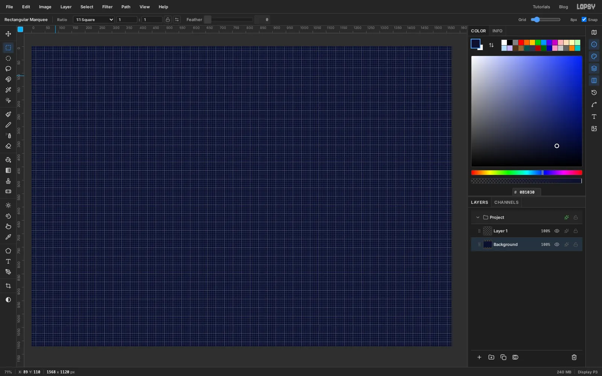

Create a new document **1568 × 1120 px**. Choose **View → Show Grid**, then
drag the **Grid** slider at the right of the options bar down to **8px** and
make sure **Snap** is ticked. From now on marquees land on grid lines.

Click the **Background** layer, set the foreground colour to `#0B1030` and
choose **Edit → Fill**. That's the darkest sky colour, and it will show
through at the top.

> **Tip:** In this tutorial "one square" means one 8 × 8 grid square.
> Measurements in **px** are real pixels. The status bar at the bottom shows
> the pointer's X and Y, and a pair like **96, 528** is X then Y.

## Lay the sky down in flat bands

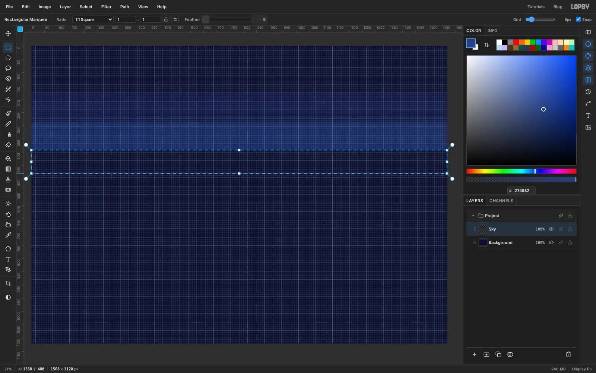

Click **Layer 1** and rename it `Sky`. Pick the **Rectangular Marquee**
(**M**) and drag a strip across the full width of the canvas, from **176 px**
down to **288 px** on the left ruler. Set the foreground to `#121A45` and
choose **Edit → Fill**.

Repeat for five more strips, each a little lighter than the last. You don't
need to deselect between them, but start each new drag below the old strip:
if you press inside the selection you'll move it instead.

1. **288 → 392 px**, `#1B2A63`
2. **392 → 480 px**, `#274082`
3. **480 → 560 px**, `#36589F`
4. **560 → 640 px**, `#4F78BA`
5. **640 → 832 px**, `#6C97CF`

Press [[Cmd+D]] to deselect. The bottom of the canvas stays dark for now,
because snow will cover it.

## Make a checkerboard helper layer

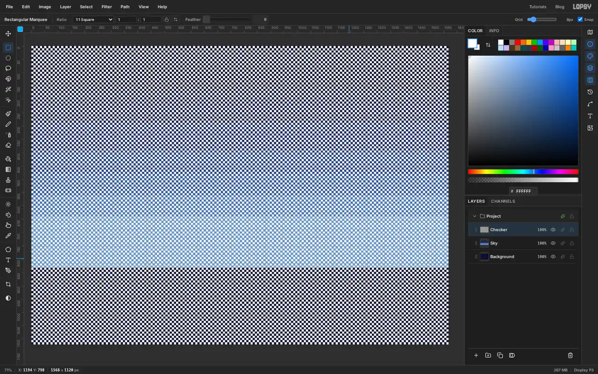

16-bit skies blend two colours by alternating them in a checkerboard, called
a **dither**. Placing hundreds of squares by hand is slow, so make a
checkerboard once and reuse it as a selection.

Click **Add Layer** and name it `Checker`. Pick the **Pencil** (**N**), set
**Size** to **8** and the foreground to white. Zoom in on the top-left corner
of the canvas and click the very first square, then the square diagonally
below and to the right of it.

Switch to the Rectangular Marquee and drag from the corner over those
**2 × 2 squares** (16 × 16 px). Choose **Edit → Define Pattern**, then press
[[Delete]] and [[Cmd+D]]. Now choose **Edit → Fill with Pattern…**, pick
**Pattern 1** and click **Apply**. The layer fills with a checkerboard that
lines up with the grid.

Do it once more for a sparser version. Add a layer called `Sparse`, click
only the first square, define the same 2 × 2 area as a pattern, delete it,
and fill the layer with **Pattern 2**. That one has one square in four.

Click the eye on both layers to hide them. You'll never see them in the
card, only borrow their shapes as selections.

## Dither the edges between the bands

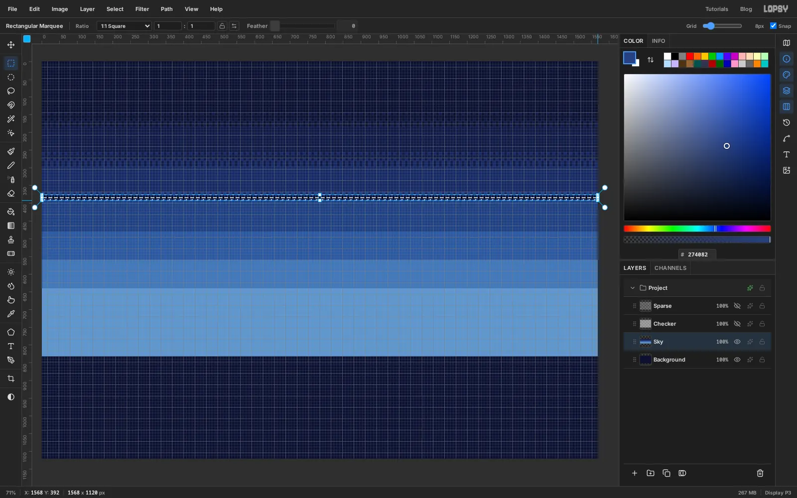

Each edge between two bands gets three passes, two squares tall each. The
first pass sprinkles the lower colour into the band above:

1. Hold [[Cmd]] and click the **Sparse** thumbnail. The whole sparse pattern
   loads as a selection.
2. With the Rectangular Marquee, hold [[Shift+Alt]] and drag a strip across
   the canvas that covers the **third and fourth squares above the edge**.
   Shift+Alt keeps only the overlap, so you're left with one square in four
   inside that strip.
3. Click the `Sky` layer, set the foreground to the **lower** band's colour
   and choose **Edit → Fill**.

Then do the same with the **Checker** thumbnail on the **two squares right
above the edge**, still filling with the lower colour. Finally load
**Sparse** again, intersect it with the **two squares right below the
edge**, and fill with the **upper** band's colour.

Repeat for all six edges and deselect. Each edge now fades through a quarter,
a half and three quarters.

## Add stars and a full moon with a dotted halo

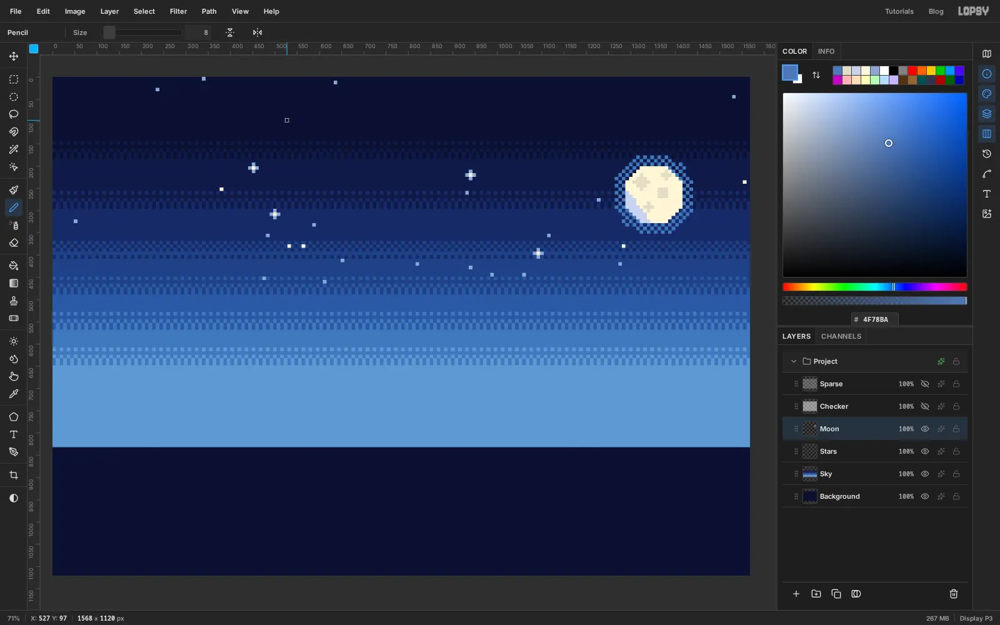

Click `Sky`, then **Add Layer** and name it `Stars`. With the Pencil still at
8 px, click single squares across the top two thirds of the sky. Use
`#8FA6D6` for most of them and `#FFF6D8` for about one in three. Leave the
top strip fairly clear for the title. For a twinkle, click the four squares
above, below, left and right of a bright star in the dimmer colour.

Add a layer called `Moon`. The moon is a circle **16 squares** across in the
upper right, with its centre about 27 squares in from the right edge and 33
down from the top. Draw it a row at a time in `#FFF6D8`: drag the Pencil
along each row, starting with a row 8 squares wide, then 10, 12, 14 and 14,
then six rows of 16, and back down the same way. Shade the lower-left edge with a crescent of `#C9D2EE` two or three
squares thick, and dab four small craters in `#E0DDC8`, each a blob of
three to nine squares.

For the halo, [[Cmd]]-click the `Checker` thumbnail so the checkerboard is
selected, click the `Moon` layer again, and draw a ring **three squares
thick** around the moon in `#4F78BA`. The Pencil only lands on every other
square, so the ring comes out dithered. Deselect.

## Brush an aurora and turn it

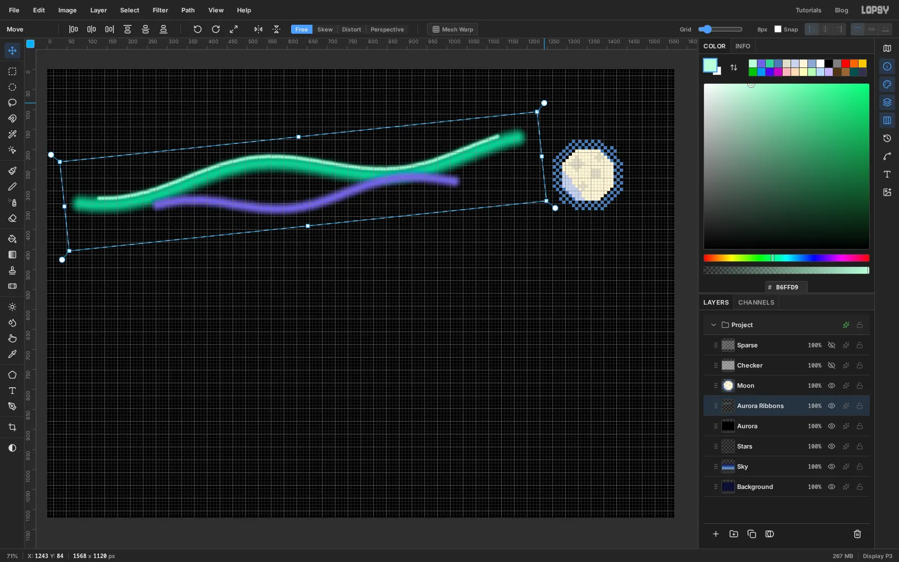

The aurora starts as ordinary soft brush strokes. A filter turns them into
pixels in the next step.

Click `Stars`, add a layer called `Aurora` and fill it with **black**. The
sky disappears until the end of the next step. Add another layer above it
called `Aurora Ribbons`. Pick the **Brush** (**B**),
set **Size** to **64** and **Hardness** to **0**, and paint three strokes:

1. A long wavy ribbon in `#2FD49A` from the left edge to about three
   quarters of the way across, roughly 250 px from the top.
2. A shorter ribbon in `#6F62E8` at **Size 44**, just under the middle of
   the first.
3. A thin bright core in `#B6FFD9` at **Size 18**, along the top of the
   first ribbon.

Drag a marquee around all three. Pick the **Move** tool (**V**) and untick
**Snap** for a moment, because snapping locks rotation to 15° steps. Drag
the round handle outside the top-right corner upward until the ribbons tilt
about **6°**, so the right end rises. Tick **Snap** again and deselect.

## Pixelate, posterize and screen the aurora

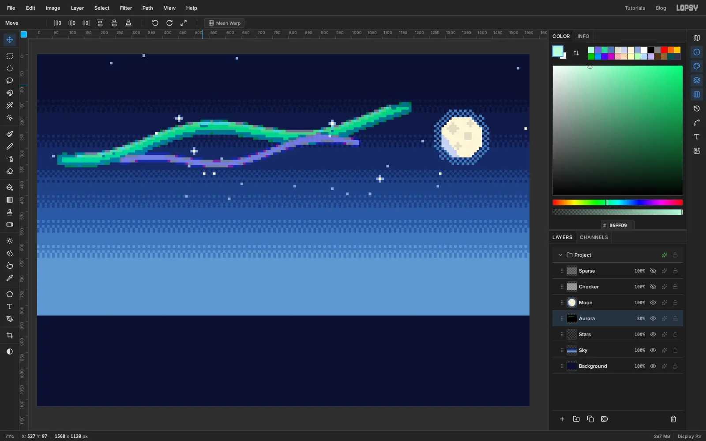

Choose **Layer → Merge Down** to drop the ribbons onto the black layer.
Choose **Filter → Pixelate…**, set **Block Size** to **8** and apply. Every
grid square becomes one flat colour. Then choose **Filter → Posterize…**
with **Levels** at **3**, which cuts the soft fade down to a few hard steps.

Click the layer's effects button (the sparkle icon on its row) and set
**Blend** to **Screen**. Black has no effect in Screen, so only the ribbons
show. Set the layer's opacity to **80%**.

Painting on black first matters. Pixelate keeps a layer's transparent
outline, so soft strokes on an empty layer would keep their smooth edge.

## Draw the mountain ridge and fill it with the Paint Bucket

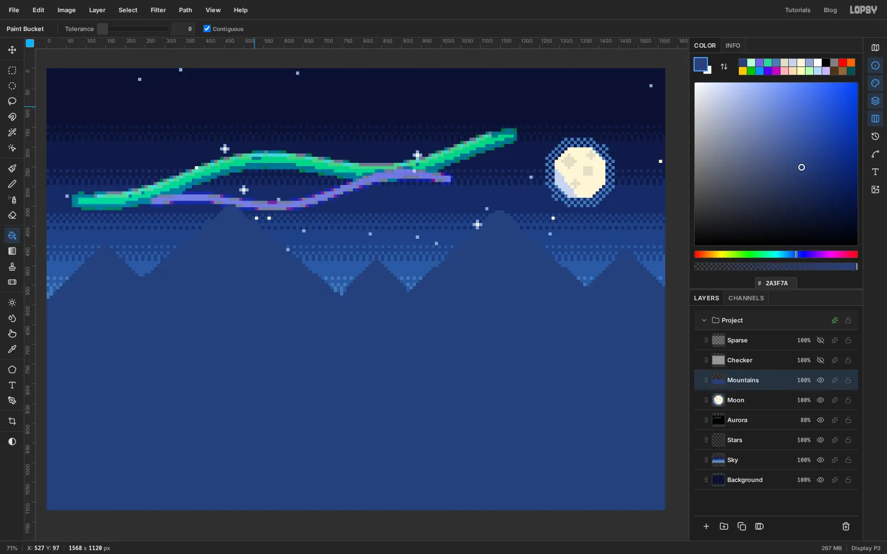

Click `Moon`, add a layer and name it `Mountains`. With the Pencil at 8 px
and `#2A3F7A`, draw the ridge: a single stair-stepped line of squares that
runs from the left edge to the right edge over five peaks. Put the two
tallest about **345 px** and **360 px** from the top, a third of the way in
from each side, and three lower ones between and beside them. Go up and down
one square at a time. Each square must touch the next along a full side, not
only at a corner, or the fill will leak.

Pick the **Paint Bucket** (**G**), set **Tolerance** to **0** and click
anywhere below the line. Everything under the ridge fills.

> **Tip:** If the sky fills too, press [[Cmd+Z]], find the gap in the ridge
> and add a square there.

## Paint snow caps inside a Magic Wand selection

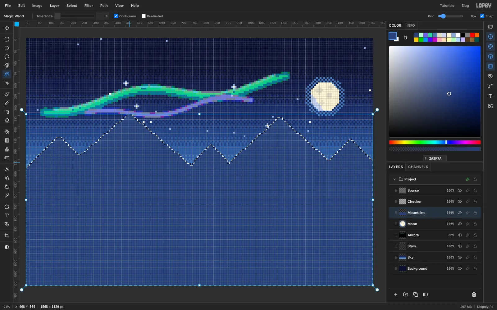

Pick the **Magic Wand** (**W**), set **Tolerance** to **0** and click the
mountains. With that selection active the Pencil can't paint outside them,
so you can be loose at the edges.

The moon is on the right, so that side is lit. On each peak, colour the top
eight to ten rows `#E6EEFF` on the right of the summit and `#A9BEE8` on the
left. Give the bottom of each cap a ragged edge by dropping every few
columns one or two squares lower. Then run a wedge of `#21326A` down the
left face of each mountain, starting one square wide under the cap and
widening as it goes down. Deselect.

## Fill a strip with a pine tree pattern

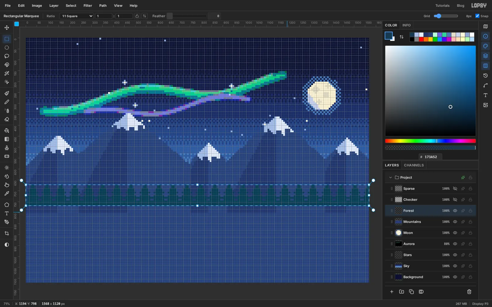

The distant forest is one tree, repeated.

Add a layer called `Forest`. In the top-left corner, draw a small pine in
`#173A52` that is **8 squares wide and 12 tall**. From the top, make the
rows 2, 2, 4, 4, 6, 4, 6, 8, 6, 8, 8 and 8 squares wide, each centred. The
two rows that step back in read as gaps between branches. Marquee the 8 × 12 block
(64 × 96 px), choose **Edit → Define Pattern**, and press [[Delete]].

Now drag a marquee across the full width of the canvas from **672 px** to
**768 px**. Choose **Edit → Fill with Pattern…**, pick **Pattern 3** and
apply. Deselect.

## Build the cabin wall from a staggered log pattern

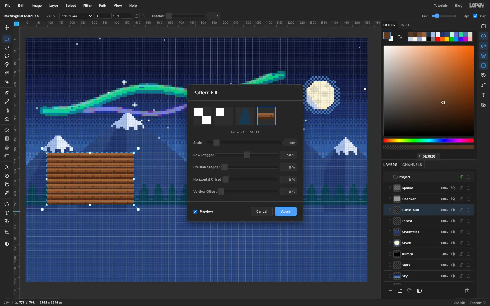

Add a layer called `Cabin Wall`. In the top-left corner draw a tile **8
squares wide and 3 tall**: a top row of `#9A6238`, a middle row of `#7A4A2A`
with one square of `#5E3820` for a knot, and a bottom row of `#4A2A18`.
Define it as a pattern and delete it, as before.

Drag a marquee for the wall, **50 squares wide and 30 tall**, with its
top-left corner at **96, 528** and its bottom-right at **496, 768**. That
puts it 12 squares in from the left edge, with its foot level with the
bottom of the forest. Choose **Edit → Fill with Pattern…**, pick **Pattern 4** and
set **Row Stagger** to **50%**. Each row of tiles slides half a tile
sideways, so the knots don't line up. Tick **Preview** to check, then apply
and deselect.

The chimney works the same way. Add a layer called `Chimney`. Make a tile
**4 squares wide and 2 tall**, with three squares of `#B5483C` and one of
`#6E2A2A` on top and a full row of `#6E2A2A` beneath. Define it, delete it,
and fill a marquee **8 squares wide and 9 tall** with **Pattern 5** at
**Row Stagger 50%**. Start it at **392, 336**, which is above the right-hand
third of the wall, so the roof will overlap its bottom. Finish it with a three-row cap of snow in `#F4F8FF`,
one square wider than the bricks on each side.

## Draw the roof, door, windows and smoke

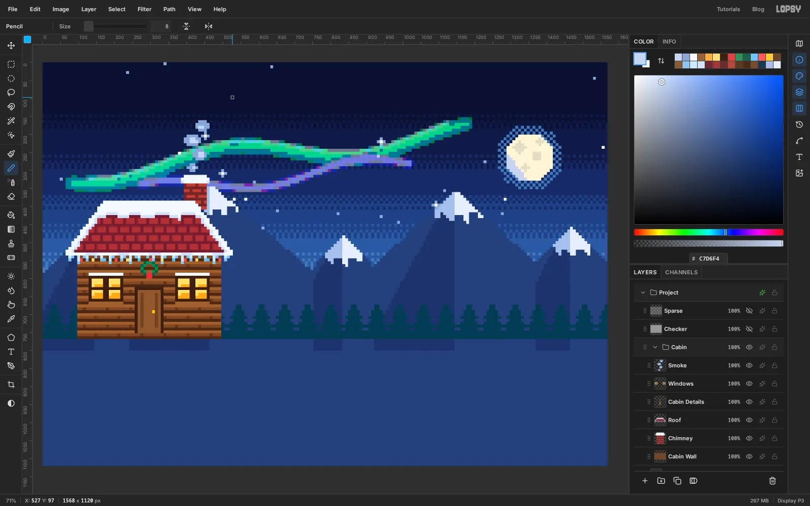

The rest of the cabin is drawn with the Pencil, each part on its own layer
so you can fix one without touching the others.

- **Roof:** add `Roof`. Draw a trapezoid 58 squares wide at the eave and 18
  tall, sitting on top of the wall and overhanging it by four squares at
  each end. Step each side in three squares every four rows as you go up. Fill it with `#A43A3A`
  and draw shingle lines in `#6E2430` on every third row, with short
  verticals between them. Cover the top five rows and both sloping edges in
  `#F4F8FF`, with a line of `#D3E0F8` under the snow. Along the eave add a
  row of snow and hang icicles one to three squares long in `#CDEBFF`, with
  a `#8FC4F2` tip.
- **Details:** add `Cabin Details`. Centre a door on the wall, 10 squares
  wide, starting 12 squares below the eave and running to the bottom of the
  wall. Draw it in `#8A5A34` with a `#3A2012` frame, two plank lines in
  `#6B4226` and a `#FFCC33` knob. Above it draw a small wreath, a ring 6
  squares across in `#1B6149` and `#2F9058` with a `#E0413F` bow. Under the eave, click a light every fourth square,
  cycling `#FF5A5A`, `#FFE27A` and `#6FC6FF`.
- **Windows:** add `Windows`. Draw two windows, one each side of the door,
  four squares in from the ends of the wall and seven squares below the
  eave. Each is 12 squares wide and 11 tall: a
  `#3A2012` frame with a cross, four panes of `#FFE27A` with `#FFAE42` in
  their lower corners, a `#9A6238` sill and a line of snow on top.
- **Smoke:** add `Smoke`. Draw four puffs rising from the chimney in
  `#8FA6D6` with `#C7D6F4` centres, each smaller than the one below.

Click `Smoke`, [[Shift]]-click `Cabin Wall` and choose **Layer → Group
Layers**. Name the group `Cabin`.

## Draw one pine, then copy it

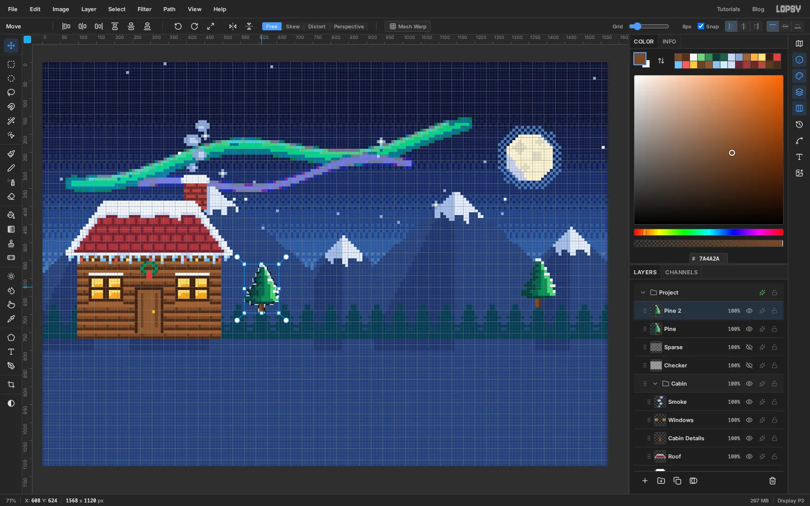

Click the **Project** row at the top of the Layers panel, then **Add
Layer**. Starting from the Project row puts the new layer at the top of the
stack, not inside the Cabin group. Name it `Pine`.

Draw a pine **12 squares wide and 17 tall** on the right, about 24 squares
in from the right edge, with its foot level with the cabin's. Use `#1B6149` for the
body, `#0E3B3A` down the left side, `#2F9058` and `#74D47C` toward the
right, a few squares of snow on the right-hand tips, and a two-square trunk
in `#54301C` and `#7A4A2A`.

Drag a marquee around it, press [[Cmd+C]] and [[Cmd+V]]. The copy arrives on
its own layer in the same place. With the **Move** tool, drag it left to sit
between the cabin and the middle of the canvas. With Snap on it moves a
whole square at a time, so it stays on the grid. Deselect, press [[Cmd+V]]
again and drag that copy to the far right edge. Rename the copies `Pine 2`
and `Pine 3`.

## Draw half the tree with Symmetry

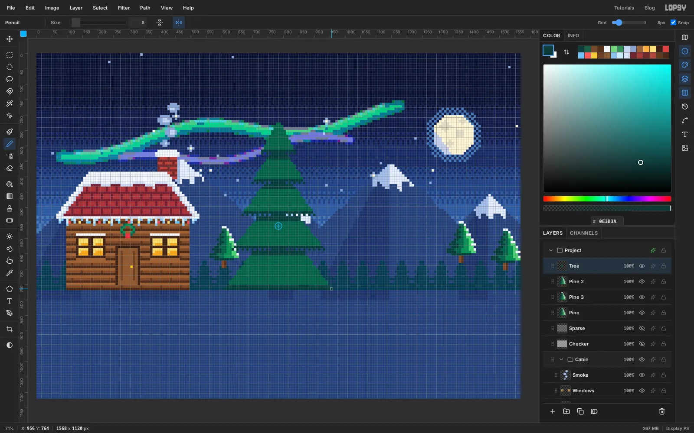

Click the **Project** row, add a layer and name it `Tree`. Pick the Pencil
and click **Symmetry Vertical** in the options bar. A marker appears at the
centre of the canvas, and everything you draw on one side is mirrored on the
other.

Draw the right half of a tree in `#1B6149`, working down from about
**225 px**. It has five tiers. Each one starts narrow and widens by about
one square every two rows. Each new tier starts **two rows above** where the
last one ended, so the tiers overlap and the whole tree is 68 rows tall:

1. 13 rows, from 1 square wide to 7
2. 14 rows, from 3 to 11
3. 15 rows, from 5 to 15
4. 16 rows, from 7 to 19
5. 18 rows, from 9 to 22

Those widths are for your half only. Finish each tier with two rows of
`#0E3B3A`, and on the very last row of a tier leave out every other square
to make a ragged hem. Add two more dark rows just under each hem, where the
tier above casts a shadow.

> **Tip:** Symmetry mirrors mistakes too. [[Cmd+Z]] removes both halves of
> a stroke at once.

## Light the tree and hang the decorations

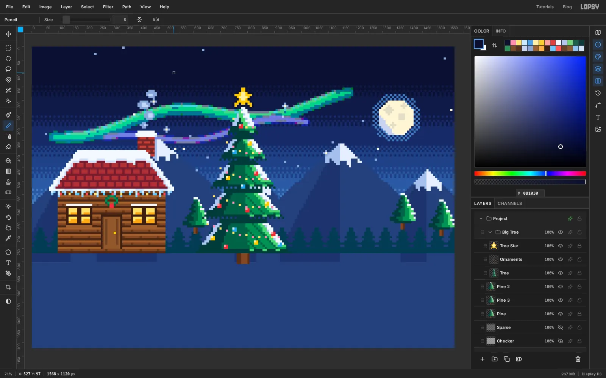

Add a layer called `Tree Star` while Symmetry is still on. Draw half of a
five-point star above the tip in `#FFCC33`, about 4 squares wide and 9 tall,
with a `#FFF2A8` core. Then click **Symmetry Vertical** again to turn it
off, and trace a one-square outline around the star in `#0B1030` so it
stands out against the aurora.

Click `Tree` again. Add a short trunk six squares wide below the bottom
tier in `#54301C` and `#7A4A2A`. The snow will bury most of it. Lighting is
not symmetrical, so paint it by hand:

- the two outermost squares on the **right** edge of each tier in
  `#F4F8FF`, for snow
- the next two or three squares in `#74D47C`
- a band of `#2F9058` across the right-hand third
- `#0E3B3A` over the outer left third
- a single column of `#B4C8EE` down the far left edge

Add a layer called `Ornaments` above `Tree`. Draw about fifteen baubles, each
2 × 2 squares with a paler square in one corner, in red `#E0413F`, gold
`#FFCC33` and blue `#4FA3E8`. Then add fairy lights: on each tier, click a
single square every third column along a gently sagging line, alternating
`#FFE27A` and `#FF8FB0`.

Group `Tree Star`, `Ornaments` and `Tree` as `Big Tree`.

## Lay the snow and dither its shadows

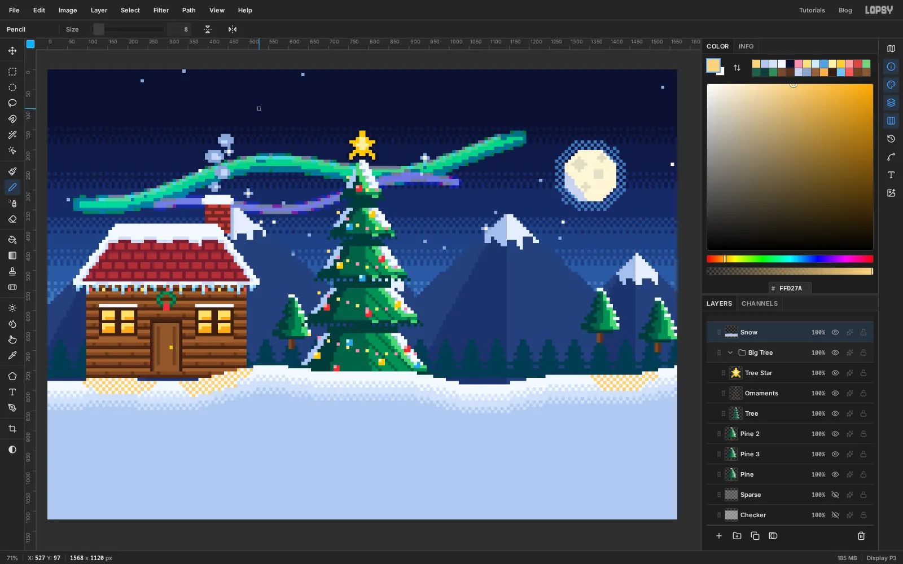

Click the **Project** row, add a layer and name it `Snow`. It sits above the
cabin, pines and tree on purpose, so the drifts cover their feet. With the
Pencil
in `#F4F8FF`, draw the top edge of the snow from the left edge to the right
edge, about **760 px** down, rising and falling by two or three squares.
Keep the line unbroken, as you did for the ridge. Pick the Paint Bucket and
click below the line.

Now shade it. About five squares below the top edge, drag the Pencil along
rows of `#D3E0F8`, following the curve of the surface. From nine squares
down, switch to `#B4C8EE`.

To soften the steps, [[Cmd]]-click the `Checker` thumbnail, click `Snow`
again, and paint the two rows above each colour change in the darker
colour. Only every other square takes the paint.

Keep the selection for one more job. In `#FFD27A`, paint a patch about five
rows deep on the snow under each cabin window, and one more on the right
where the lamp post will stand. The dither reads as warm light spilling onto
the snow. Deselect.

## Wrap one present and recolour two copies

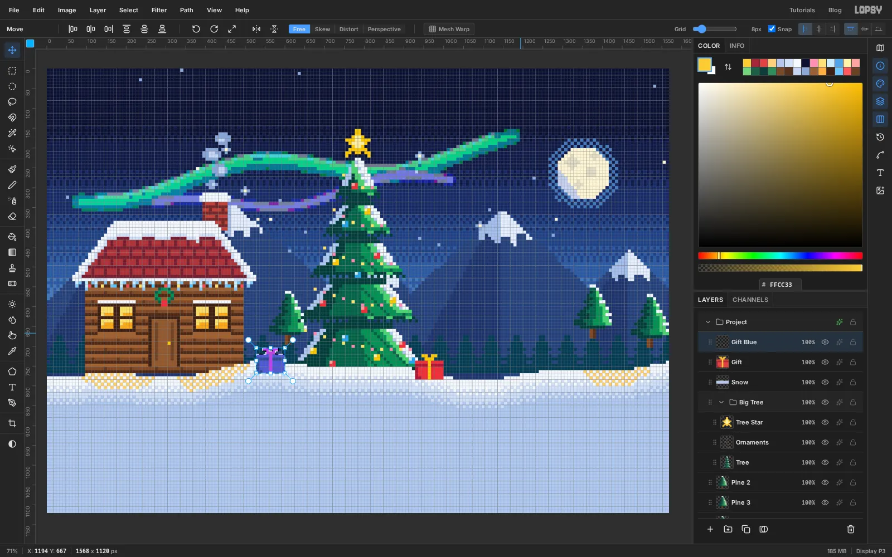

Click the **Project** row, add a layer and name it `Gift`. To the right of
the tree's base, draw a box **9 squares wide and 6 tall** in `#E0413F`, with
a second row and a right-hand column of `#A32838`. Run a `#FFCC33` ribbon
down the middle and add a small bow on top.

Marquee the present, copy and paste it, and drag the copy to the left of the
tree with the Move tool. While it is still selected, choose **Filter →
Hue/Saturation…**, set **Hue** to **−125** and **Saturation** to **−20**,
and apply. The red box turns blue and its ribbon turns magenta.

Paste again, drag that copy over to the right, near where the lamp post
goes, and apply **Hue 125**, **Saturation −35** for a green one. Rename the
two new layers `Gift Blue` and `Gift Green`.

## Draw the snowman and the hero, and flip the hero

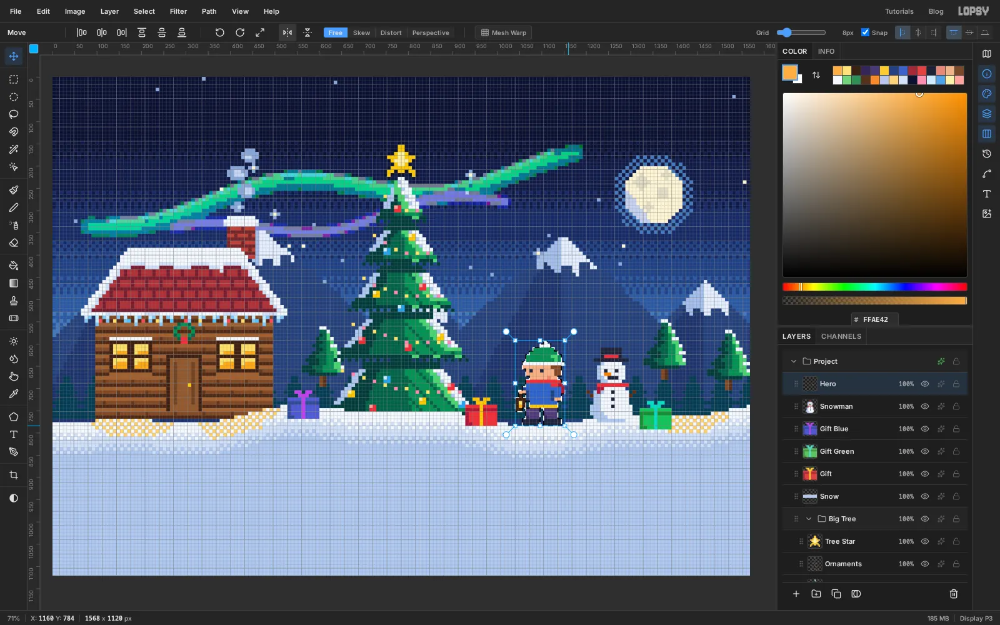

Click the **Project** row and add a layer called `Snowman`. Draw him about
40 squares in from the right edge, 14 squares wide and 21 tall, standing on
the snow. Work from the top:

1. A top hat, 4 rows: a 6-square crown in `#1E2238` with a `#E0413F` band,
   on a 10-square brim.
2. A head, 6 rows of `#F4F8FF` up to 8 squares wide, with two `#1E2238`
   eyes, a two-square `#FF8A2A` nose and a three-square mouth.
3. A scarf, one row of `#E0413F` with a `#A32838` tail on one side.
4. A body, 9 rows widening to 12 squares, with three `#1E2238` buttons.
5. Two stick arms in `#54301C`, each two squares long.

Shade his left side in `#B4C8EE`, since the moon is on the right.

Add a layer called `Hero`. Draw a child **16 squares wide and 24 tall**
between the tree and the snowman. Work from the top:

1. A bobble, 2 rows of `#F4F8FF`, on a hat 4 rows tall in `#2F9058` with
   a few squares of `#74D47C`, and one row of `#F4F8FF` for the fur brim.
2. A face, 4 rows of `#F2B48A`, with `#7A4A2A` hair at the back, two
   `#1E2238` eyes and a `#E88A7A` cheek.
3. A scarf, one row of `#E0413F`, with a `#A32838` tail hanging behind.
4. A coat, 6 rows of `#3A62C8` with `#274082` arms, and one row of
   `#FFCC33` for the belt.
5. One arm held out in front with a `#F2B48A` hand, carrying a lantern 3
   squares wide: a `#3A2012` frame around a `#FFE27A` and `#FFAE42` flame.
6. Trousers, 3 rows of `#4A3A78`, and boots, 2 rows of `#1E2238`.

It's easier to draw a character facing the way you find natural. If yours
faces away from the tree, as mine did, drag a marquee around the sprite,
pick the **Move** tool and click **Flip Horizontal** in the options bar.
Deselect.

## Add the lamp post, group the sprites and move them together

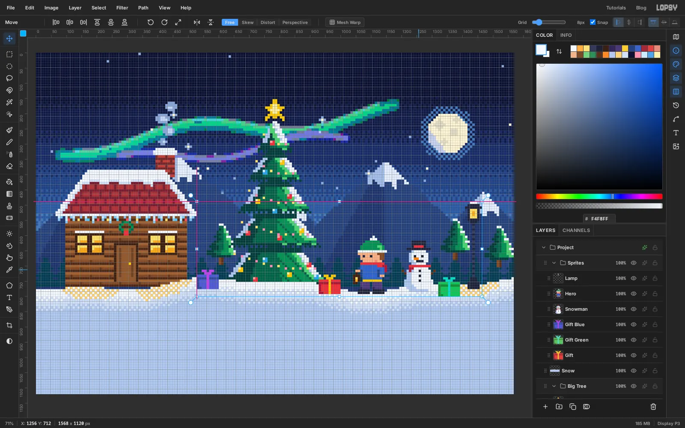

Add a layer called `Lamp`. Near the right edge, draw a post one square wide
and about 22 tall, alternating `#1E2238` and `#343A5C`, on a stepped base.
Top it with a lantern head 7 squares wide: a dark frame, a `#FFE27A` pane
with an `#FFAE42` centre, and a cap of snow.

Click `Lamp`, [[Shift]]-click `Gift` and choose **Layer → Group Layers**.
Name the group `Sprites`.

With the group selected and the Move tool active, drag anywhere on the
snowman and pull **down by one square**. All six layers move together, and
everything settles into the snow. Press [[Cmd+Z]] and [[Shift+Cmd+Z]] to
compare before and after.

## Scatter the snowfall

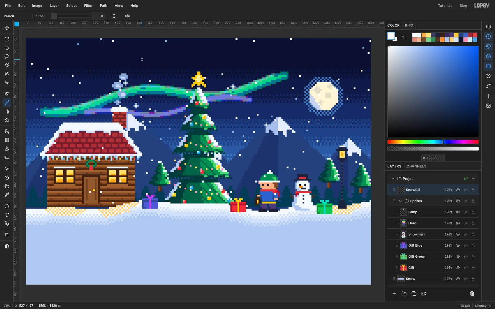

Click the **Project** row and add a layer called `Snowfall`. With the Pencil
in white, click about eighty single squares all over the scene. Keep them at
least three or four squares apart, and stay out of the strip at the top
where the title goes and the bottom quarter of the canvas, where the quest log
will sit.

A few flakes in front of the cabin and the tree help. They put the snow
between you and the scene.

## Build the parchment panel

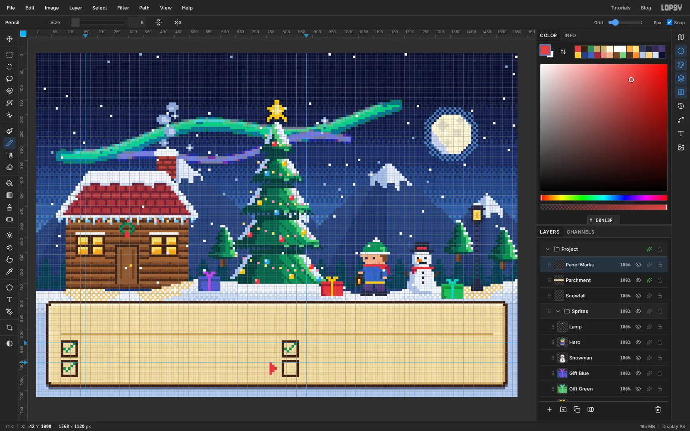

Click the **Project** row and add a layer called `Parchment`. Drag a marquee
from **32, 808** to **1536, 1088**, leaving four squares of margin at the
sides and bottom, and fill it with `#F2DFA8`. Deselect.

With the Pencil in `#3A2012`, draw the border along all four edges of the
block. Click one corner, then [[Shift]]-click the next for a straight line.
Just inside it, draw the top and left edges in `#FFF6D6` and the bottom and
right edges in `#D2B272`. That bevel makes the panel look raised.

For the notched corners, marquee the single square at each corner of the
border and press [[Delete]]. Then click one dark square diagonally inside
each notch to close the outline.

Open the layer's effects, tick **Drop Shadow** and set **Offset X** to
**0**, **Offset Y** to **8**, **Blur** to **0** and **Opacity** to **55**,
with the colour `#0B1030`. With no blur, the shadow stays a crisp one-square
step.

Add a layer called `Panel Marks`:

- a divider in `#C9A866` across the panel, **13 squares** below its top edge
- four checkboxes, each **7 × 7 squares** of `#3A2012` outline: two under the
  left end of the divider and two just right of centre
- a tick in `#2F9058` inside three of them: two squares going down, then
  three going up to the right. Leave the lower-right box empty
- a `#E0413F` cursor, a small triangle pointing right, one square to the
  left of the empty box

Click the top ruler **three squares to the right** of each column of boxes,
and the left ruler level with each row, to drop guides where the text will
start.

## Set the heading in a pixel font

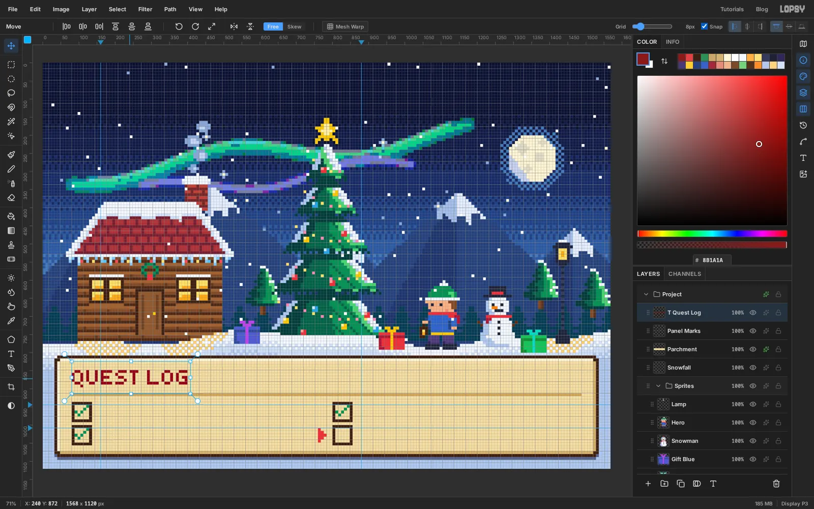

Click the **Project** row first. If a text layer is selected when you change
the Text options, they restyle that layer.

Pick the **Text** tool (**T**). Choose the font **Tiny5**, set **Size** to
**64** and the colour to `#8B1A1A`. At 64 px each of the font's pixels is
exactly one grid square. Click an **empty patch of sky**, type `QUEST LOG`
and press [[Tab]] to commit. Don't click inside the panel. Once there's text
there, a click near it would edit that text.

Pick the Move tool and untick **Snap**. Snap would line up the edge of the
text layer's box, which is a few pixels outside the letters, and it's the
letters that need to land on the grid. Drag the words into the top-left of
the panel. Then use the arrow keys to nudge them a pixel at a time until the
tops of the letters are **five squares** below the panel's top edge and the
Q starts **ten squares** in from the left edge of the canvas. The letters
should sit exactly on the grid squares. Tick **Snap** again and rename the
layer `T Quest Log`.

## Add the quests, the reward and three hearts

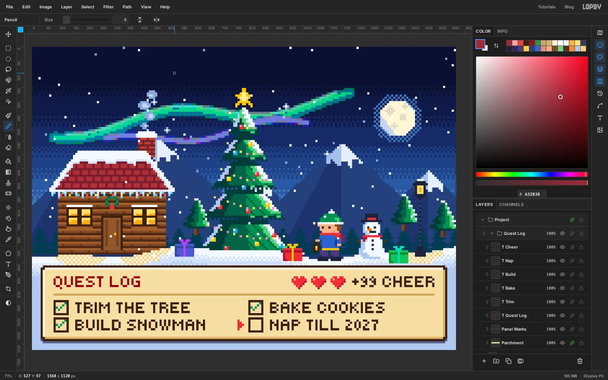

Add the four quests the same way, in Tiny5 at 64 px and `#3A2012`. For each
one, click the Project row, click the sky, type, commit and move it into
place against the guides:

- `TRIM THE TREE` and `BUILD SNOWMAN` beside the two left-hand boxes
- `BAKE COOKIES` and `NAP TILL 2027` beside the two right-hand boxes

Leave **three squares** between each box and its text, and line the letters
up with the middle five rows of the box so there's one square of box above
and below them.

Type `+99 CHEER` as a sixth text layer and seat it on the heading's row,
with its last letter **ten squares** from the right edge of the canvas, to
match the heading's inset on the left.

Click `Panel Marks` and draw three hearts to the left of the reward, each
**7 squares wide and 6 tall** in `#E0413F`, with a `#FFA3A0` highlight and a
`#A32838` edge. Leave two squares between hearts and three between the last
heart and the plus sign.

Choose **Edit → Clear Guides**, then group everything from `Parchment` up to
the last text layer as `Quest Log`.

## Type the title and tighten its tracking

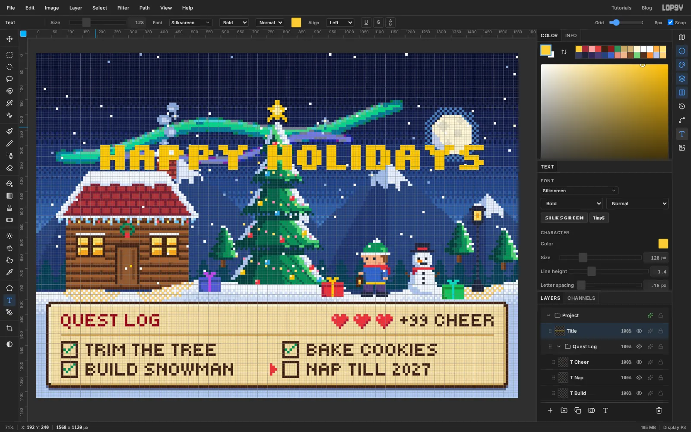

Click the **Project** row and pick the Text tool. Choose **Silkscreen**, set
the weight to **Bold**, **Size** to **128** and the colour to `#FFCC33`.
Click the sky and type `HAPPY HOLIDAYS`, then press [[Tab]]. Rename the
layer `Title`.

At 128 px each font pixel is two squares, so the title is still on the grid,
but it runs almost edge to edge. Open the **Text** panel and set **Letter
spacing** to **−16**. That closes each gap by one font pixel and leaves a
comfortable margin on both sides.

With the Move tool and Snap off, drag and nudge the title until it is
centred, with the tops of the letters **six squares** from the top edge.

Open the layer's effects. Tick **Stroke** and set **Width** to **8** and the
colour to `#0B1030`. Tick **Drop Shadow** and set **Offset X** and **Offset
Y** to **8**, **Blur** to **0**, **Opacity** to **100** and the colour to
`#A32838`.

## Shade the lower half of the letters

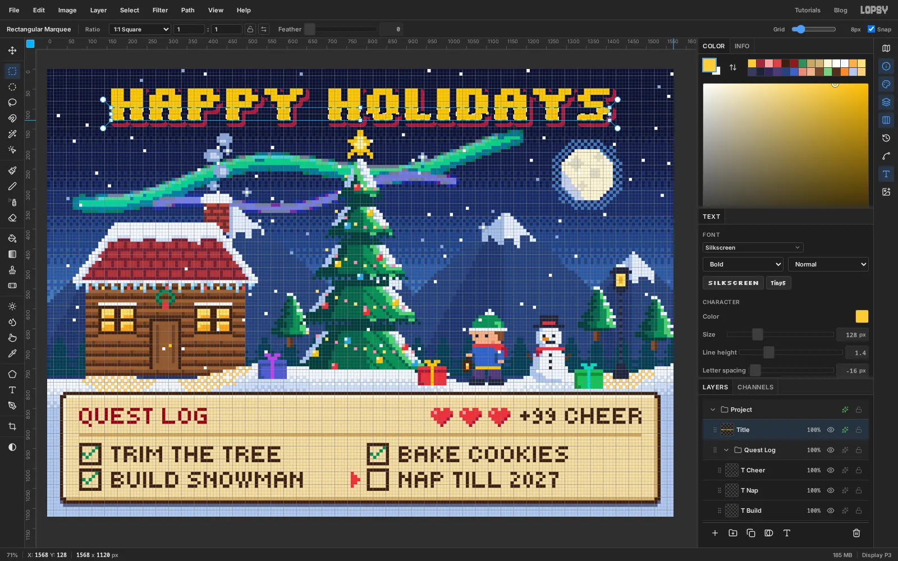

[[Cmd]]-click the `Title` thumbnail to load the letters as a selection. With
the Rectangular Marquee, hold [[Shift+Alt]] and drag a strip across the
canvas covering the **bottom four squares** of the letters. Only the lower
part of each letter stays selected.

Click **Add Layer**, name the layer `Title Shade`, set the foreground to
`#FF9D3C` and choose **Edit → Fill**. Deselect. The letters now step from
gold to orange.

## Cap the letters with snow

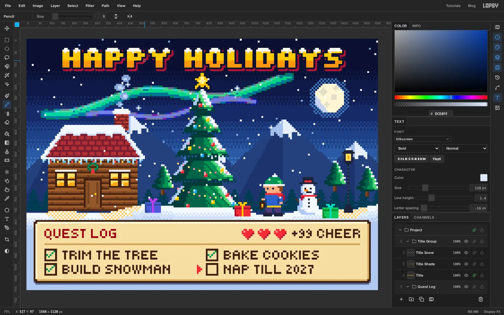

Add a layer called `Title Snow` above the shade. With the Pencil in white,
paint over the **top row** of every letter, then add a second row above it
on each flat top, stopping one square short at both ends so the snow looks
heaped. Under a few of the wider letters, click one square of `#DCE8FF` just
below the cap for a drip.

Group `Title Snow`, `Title Shade` and `Title` as `Title Group`.

## Boost the colour and export

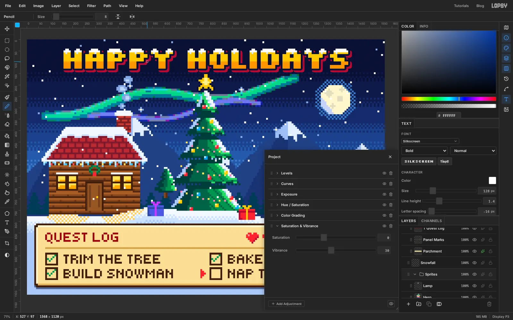

Choose **Layer → Adjustment Layer…**. A note explains that Lopsy keeps
adjustments on groups, not on separate layers. Click **Got it** and the
list for the whole project opens. It already holds Levels, Curves, Exposure,
Hue / Saturation and Color Grading, all at their neutral settings, so leave
those alone. Click
**Add Adjustment → Saturation & Vibrance** and set **Vibrance** to **30**.
Vibrance lifts the duller colours more than the bright ones, so the aurora
and the tree get richer and the reds don't clip.

Choose **File → Save Project** to keep the layers, then **File → Quick
Export PNG** for the card itself.
