A good game studio logo has to work as a big splash screen and as a tiny
icon. In this tutorial you'll make a logo sheet for an invented studio,
**Mesa Coyote**. It has a round 8-bit badge with a howling coyote on a desert
mesa, a stacked pixel-font wordmark, the palette, and three small variants: a
one-colour version, a quarter-size badge and an app icon.

The canvas is 1920 × 1280 px. Every "pixel" of the art is a 16 × 16 px cell
on the grid. Four techniques do most of the work:

- **Pixel-snapping.** Draw a smooth shape, fill it white on black, then
  Pixelate and Threshold it. Any circle or rounded shape comes out as clean
  stair-stepped cells. You'll use this for the badge, the rings, the moon and
  its halo, the coyote's outline, the one-colour version and the icon tile.
- **The Pencil at 16 px.** Each click in the middle of a cell paints exactly
  that cell. Click, then [[Shift]]-click, to paint a straight run.
- **A Gradient Map on a group.** You paint the coyote in four greys, and the
  group's Gradient Map turns them into four warm browns. That lets you recolour
  the whole sprite later by changing four colours.
- **A pixel font sized to the grid.** Jersey 10 at 298 px makes one font pixel
  16 px, so the wordmark matches the badge.

For the coyote you'll use a public domain photo by the US Fish and Wildlife
Service, [Howl (cropped)](https://commons.wikimedia.org/wiki/File:Howl_(cropped).jpg)
on Wikimedia Commons. It is only a guide: you paint the sprite yourself.

The palette:

- Background `#140A26` (not an ink)
- Outline plum `#2B0F3A`
- Sky `#2A1B5C` → `#55287F` → `#9E2F7E` → `#E05A4F` → `#FF9A3C`
- Gold `#FFD86B`, moon `#FFF0B8`
- Mesa `#B5482E`, shadow `#7A2A36`, lit lip `#FF9A3C`
- Cactus `#2FA08E`, highlight and subtitle `#5FE0C4`
- Coyote `#6E463C` / `#A06E46` / `#CD9B64` / `#F0CD96` (painted as black, `#555555`, `#AAAAAA` and white through a Gradient Map)

## Set up the canvas, the grid and guides

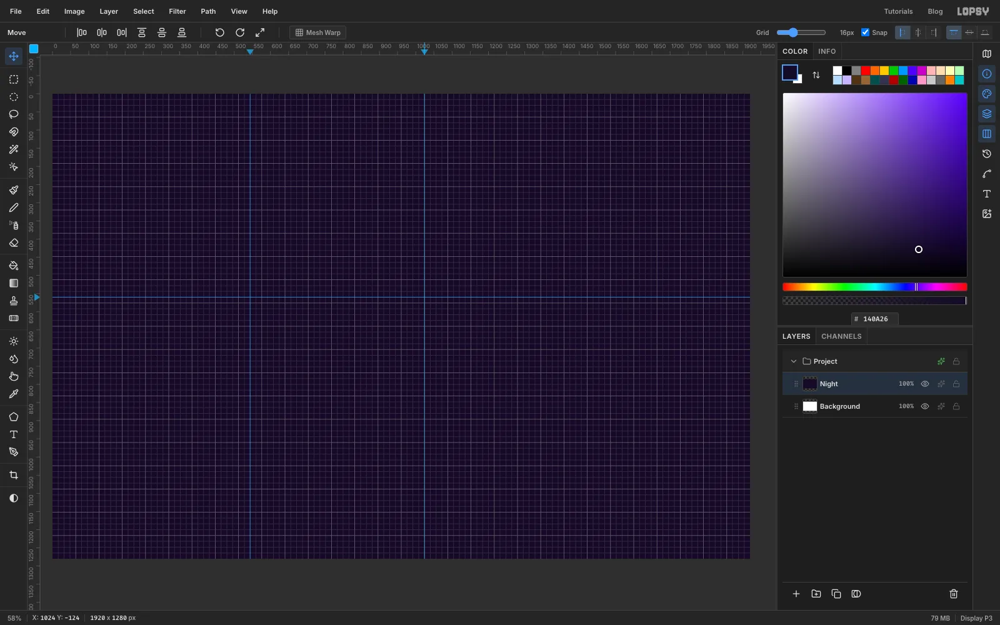

Choose **File → New**, make a **1920 × 1280** document and click **Create**.
Set the foreground colour to `#140A26` in the Color panel's hex field, choose
**Edit → Fill** and rename the layer **Night** (double-click its name).

Choose **View → Show Grid**. The grid size in the options bar is already
**16px**, and **Snap** turns on with it. Leave both on unless a step says
otherwise. Every fourth grid line is brighter, which makes cells easy to
count.

The **X** and **Y** at the bottom left of the window show the canvas position
under the pointer. In this tutorial a cell is named by its top-left corner,
and a box or a run of cells by its outer edges.

Add three guides by clicking the rulers, watching the X/Y readout as you
hover. Click the top ruler at **544**, the centre of the badge, and again at
**1024**, where the wordmark will start. Then click the left ruler at
**560**.

## Draw the badge circle

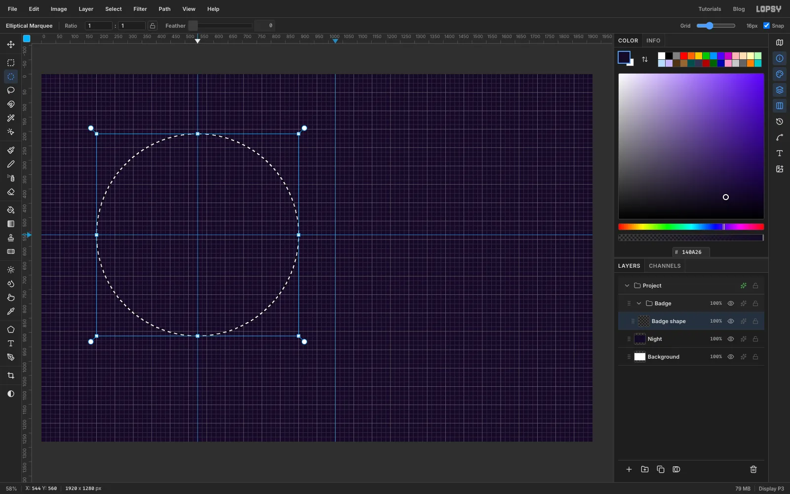

In the Layers panel, click **New Group** and name it **Badge**. With the group
selected, click **Add Layer** so the new layer lands inside the group. Name it
**Badge shape**.

Choose the **Elliptical Marquee** tool. With nothing selected, click once on
the canvas without dragging. A dialog opens where you can type the corners
exactly. Enter **From 192, 208** and **To 896, 912** and press **Select**.
This gives a circle 704 px across, centred on the two guides.

## Turn the circle into pixels

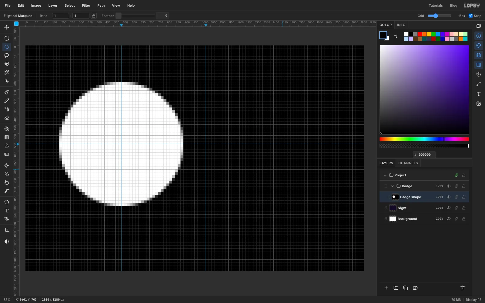

This is the pixel-snap recipe you'll repeat all through the tutorial:

1. Set the foreground to white (`#FFFFFF`) and choose **Edit → Fill**.
2. Choose **Select → Inverse**, set the foreground to black (`#000000`) and
   choose **Edit → Fill** again. The layer is now fully opaque.
3. Press [[Cmd+D]] to deselect, then choose **Filter → Pixelate…**, set
   **Block Size** to **16** and click **Apply**.

The blocks line up with the grid because the layer now covers the whole
canvas, so Pixelate starts its blocks at the canvas corner. The edge blocks are
grey, because each one averages the white and black inside it.

## Clean up with Threshold and the Magic Wand

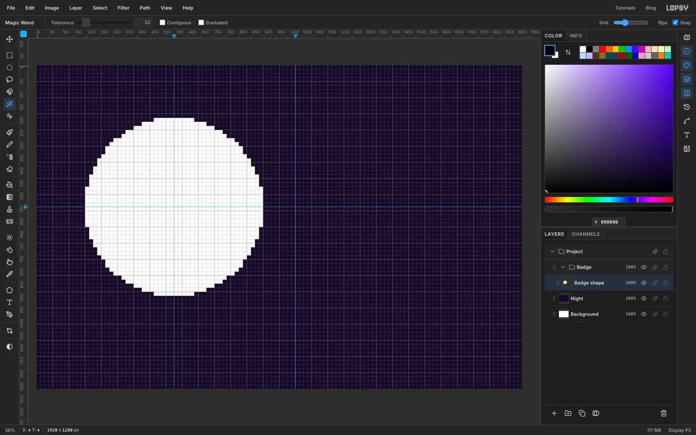

Choose **Filter → Threshold…**, leave **Level** at **128** and click
**Apply**. Every grey cell becomes either white or black, so the edge is now
a clean staircase.

Choose the **Magic Wand**, set **Tolerance** to **32** and untick
**Contiguous**. Click anywhere black, for example the top-left corner of the
canvas, press [[Delete]], then [[Cmd+D]]. What's left is a white pixel disc
on a transparent layer.

That's the whole **pixel-snap recipe**: fill white, Inverse, fill black,
deselect, Pixelate 16, Threshold 128, then a non-contiguous wand click on the
black and [[Delete]]. Later steps just say "run the pixel-snap recipe".
They also say "recolour", which means: [[Cmd]]-click the layer's thumbnail, set
the foreground colour, choose **Edit → Fill** and press [[Cmd+D]].

## Add the three rings

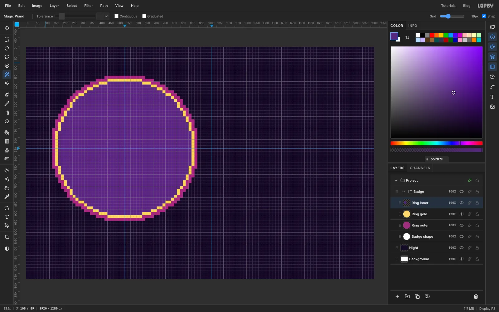

The rings are three discs stacked on top of each other, each one cell smaller
than the one under it. Click **Add Layer** and name it **Ring outer**.
[[Cmd]]-click the **Badge shape** thumbnail to load the disc as a selection.
Choose **Select → Grow…**, enter **48** and click **Apply**. Run the
pixel-snap recipe on this layer, then recolour it `#9E2F7E` (magenta).

Repeat twice more, each time [[Cmd]]-clicking **Badge shape** (not the last
ring): **Ring gold** with **Grow 32** and `#FFD86B`, then **Ring inner** with
**Grow 16** and `#55287F`. Each new layer goes above the last one, so you see
three 1-cell rings around a purple centre.

## Fill the sky in bands

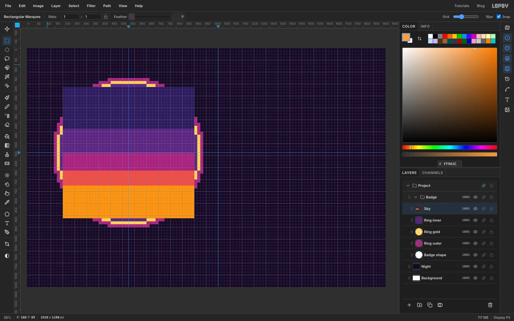

Select **Ring inner** and add a layer named **Sky**. With the **Rectangular
Marquee**, drag one band at a time from the left edge of the circle (x 192)
to the right edge (x 896), and fill each one. Grid snapping makes the edges
land on cells.

- `#2A1B5C` from y 208 to 432
- `#55287F` from 432 to 560
- `#9E2F7E` from 560 to 656
- `#E05A4F` from 656 to 736
- `#FF9A3C` from 736 to 912

Press [[Cmd+D]] when you're done. Don't worry about the corners yet. You'll
trim the bands to the circle in a moment.

## Soften the seams with a checkerboard dither

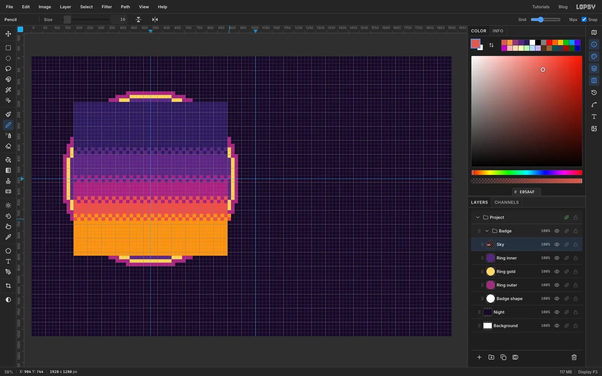

8-bit games couldn't blend colours, so they used dithering: a checkerboard of
the two colours where they meet. Choose the **Pencil**. In the options bar,
type **16** into **Size**. Now every click in the middle of a cell paints
exactly that cell.

At each seam, work on the two rows that touch it:

1. In the last row of the upper band, paint every other cell with the
   colour below.
2. In the first row of the lower band, paint the same columns with the
   colour above.

Together the two rows make a checkerboard. At the first seam (navy to
purple), skip the first cell at x 192 and start on the next one. At the next
seam start on x 192 itself, and keep alternating, so the dither teeth don't
line up from seam to seam. You only need cells inside the rings, because the
corners get trimmed next. The recent colours under the Color panel's swatch
save retyping the hex codes.

## Trim the sky to the badge

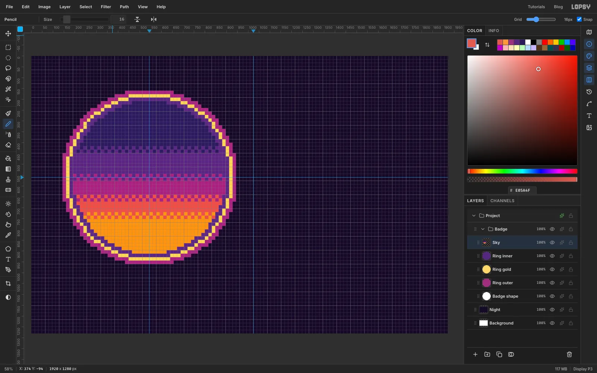

[[Cmd]]-click the **Badge shape** thumbnail, choose **Select → Inverse** and
press [[Delete]]. Everything outside the circle is gone. Press [[Cmd+D]].

You'll trim several later layers the same way.

## Add a few stars

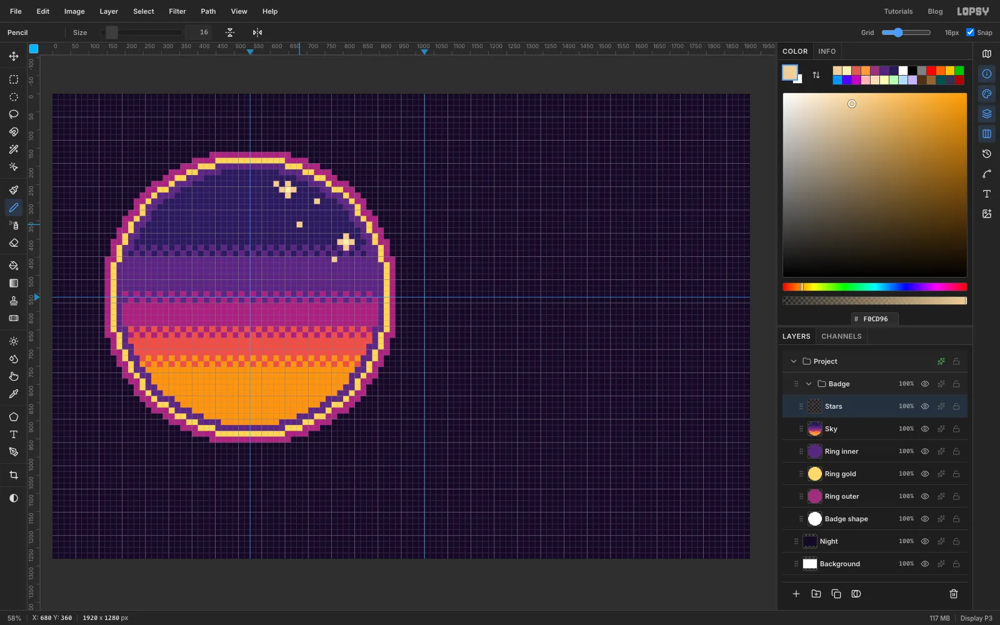

Add a layer named **Stars**. With the Pencil still at 16, paint two plus-shaped
stars in the navy part of the sky, on the right where the moon won't be. For
each one, paint the centre cell in `#FFF0B8` and the four cells around it in
`#F0CD96`. Centre them on the cells at (640, 256) and (800, 400). Add four
single `#F0CD96` cells nearby. Keep stars out of the bright bands near the
horizon.

## Paint the moon and its halo

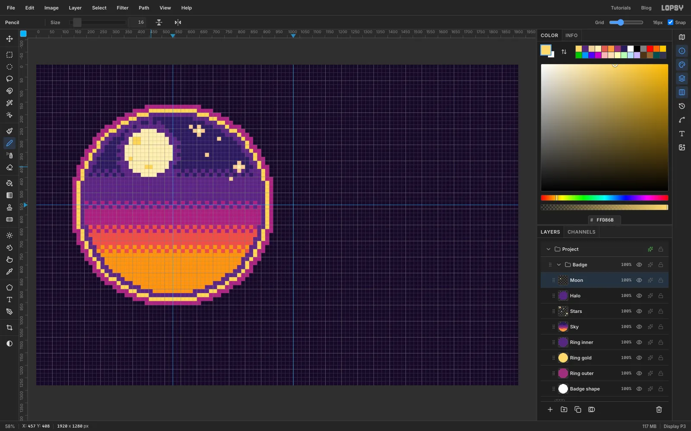

Add a layer named **Moon**. Click once with the Elliptical Marquee and type
**From 352, 256, To 544, 448**. Run the pixel-snap recipe, then recolour the
disc `#FFF0B8`. With the Pencil, paint a few craters in `#FFD86B`: a 2 × 2
block near the upper left and two smaller ones lower down. Keep them away from
the right side of the moon, which the coyote's muzzle will cover.

For the halo, select the **Stars** layer and add a layer named **Halo**, so
it sits under the moon. [[Cmd]]-click the **Moon** thumbnail, choose **Select →
Grow…** with **16**, run the recipe and recolour it `#55287F`. That gives a
solid 1-cell ring. Make sure nothing is selected, then paint every other cell
one ring further out with the Pencil in the same purple, so the glow fades.
Trim the Halo to the badge the same way as the sky.

## Block in the mesa

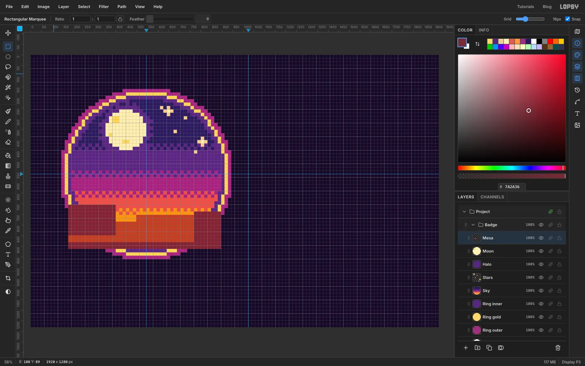

Select **Moon** and add a layer named **Mesa**. Build the landscape from
rectangular marquees and **Edit → Fill**:

1. A distant butte in `#7A2A36`: x 176 to 400, y 704 to 848.
2. The ground: `#B5482E` from y 848 to 880 and `#7A2A36` from 880 to 912,
   both across the whole badge (x 176 to 896).
3. The mesa body in `#B5482E`: x 496 to 768, y 752 to 848, plus a lower step
   on its left from x 400 to 496, y 784 to 848.
4. The lit lip in `#FF9A3C`: a one-cell strip along the top of the mesa
   (y 736 to 752) and of the step (y 768 to 784).
5. The shadowed right side in `#7A2A36`: x 768 to 896, y 736 to 880.

Press [[Cmd+D]].

## Add rock layers and the cactus

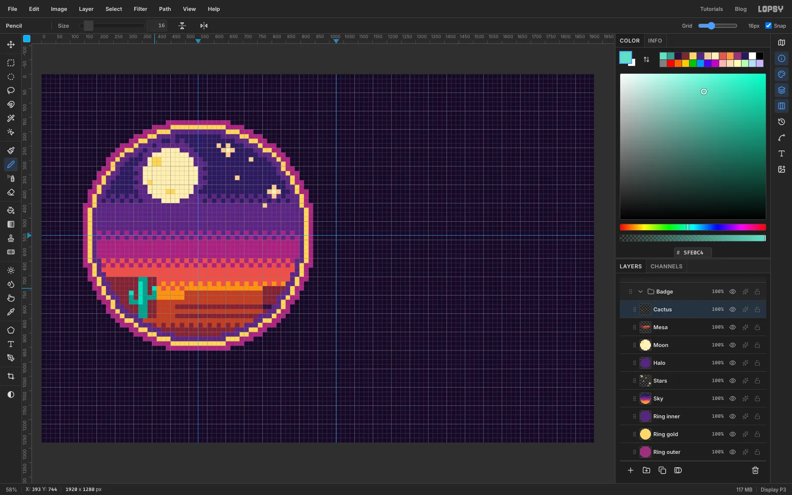

With the Pencil and `#7A2A36`, draw two rock strata across the lit face of
the mesa. Click the cell at the left end and [[Shift]]-click the cell at the
right end: the rows at y 800 and y 832, cells x 464 to x 752. Continue the
same two lines across the shadowed side in `#2B0F3A`, cells x 768 to x 880.
Then dither the ground: paint every other cell of the row at y 864 in
`#7A2A36`. Trim the layer to the badge.

Add a layer named **Cactus** and draw a saguaro in `#2FA08E`:

- The trunk is two cells wide (x 336 and x 352), from y 704 down to the
  ground, ending with the row at y 832.
- The left arm is three cells at x 304, from y 752 to y 784, joined to the
  trunk by the cell at (320, 784).
- The right arm is three cells at x 384, from y 736 to y 768, joined by the
  cell at (368, 768).

Add a `#5FE0C4` highlight down the trunk's left column from y 720 to y 784,
and on the top cell of each arm.

## Paste the reference photo

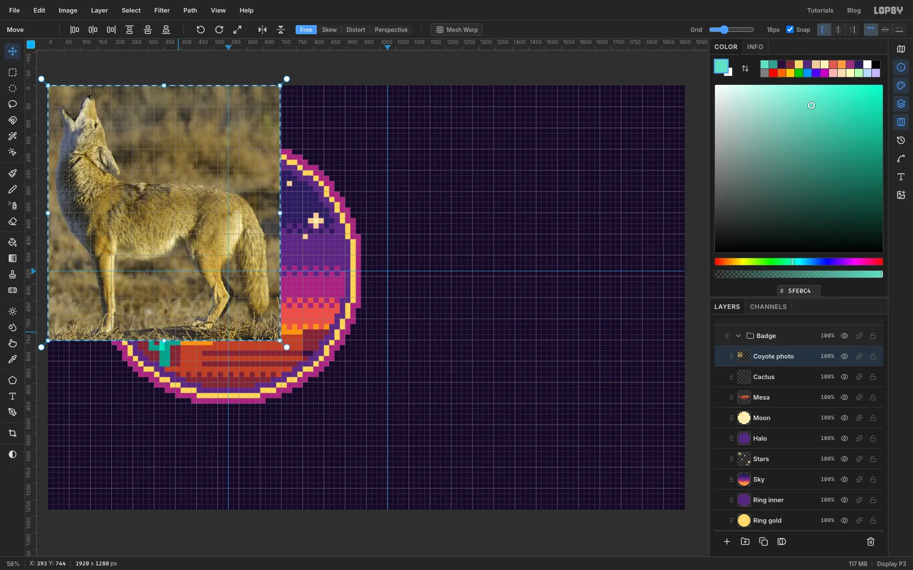

Open the [coyote photo](https://commons.wikimedia.org/wiki/File:Howl_(cropped).jpg)
in your browser, right-click it and choose **Copy Image**. The screenshots use
a copy trimmed close to the coyote, but the whole photo works the same way.
Click **Cactus** in the Layers panel and press [[Cmd+V]]. The photo lands in
the top-left corner as a new layer, selected, with the Move tool active.
Rename it **Coyote photo**.

## Scale the photo to the badge

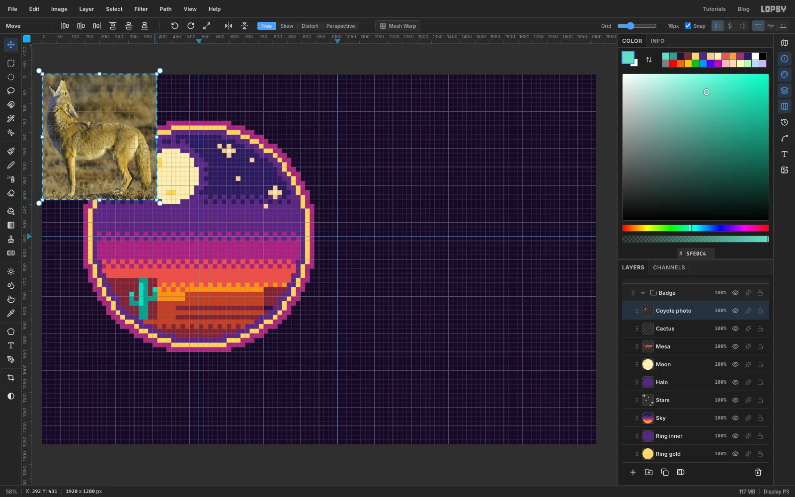

Hold [[Cmd]] and drag the bottom-right corner handle up and to the left. [[Cmd]]
keeps the proportions. Stop when the coyote is about 27 cells (430 px) tall
from nose to paws. Press [[Cmd+D]] to commit the scale, then drag the photo so
the coyote stands on the mesa's orange lip with its nose just in front of the
moon.

## Trace the coyote with the Lasso

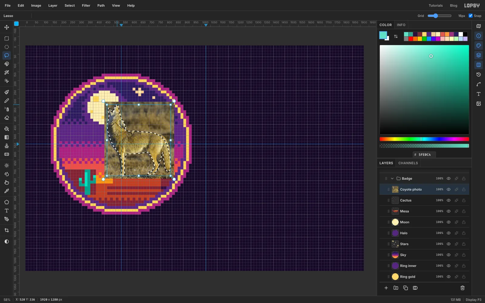

Choose the **Lasso** and drag around the coyote, close to its fur. Take in the
open jaws, the laid-back ear, both front legs, the hind leg and the hanging
tail. It doesn't have to be perfect, because this is only a guide.

## Cut the coyote out

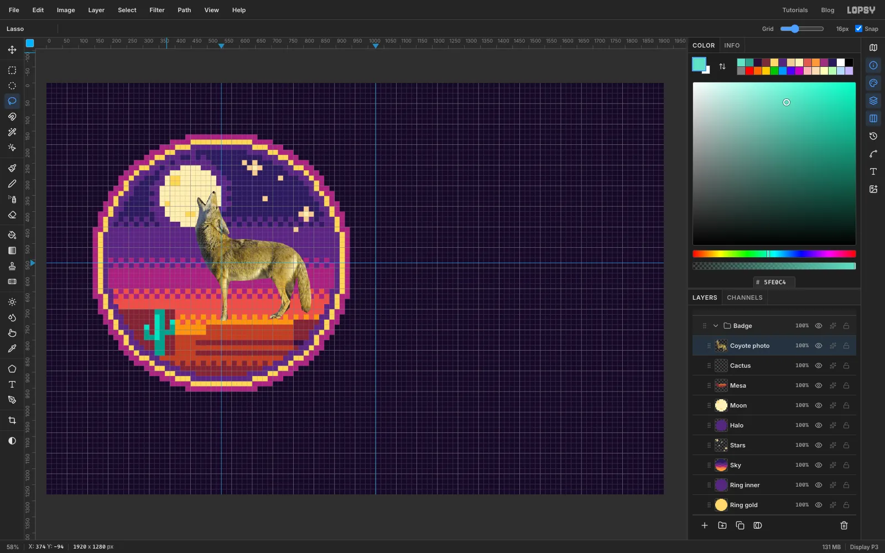

Choose **Select → Inverse**, press [[Delete]] and then [[Cmd+D]]. Only the
coyote is left on the layer.

## Pixelate the photo into a guide

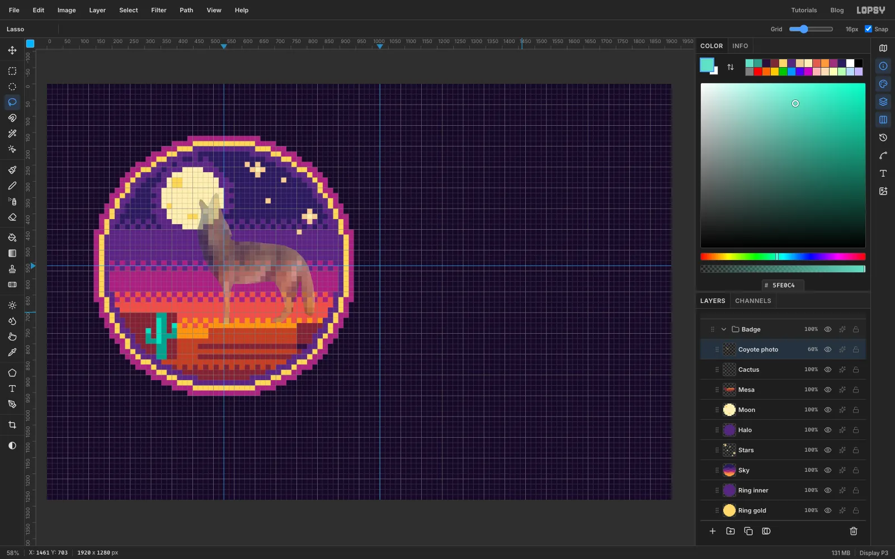

Choose **Filter → Pixelate…** with **Block Size 16**. Now you can see roughly
which cells belong to the coyote and how light each one is. Click the opacity
value on the layer's row and set it to **60%**, so you can see your own cells
over it.

## Read the coyote chart

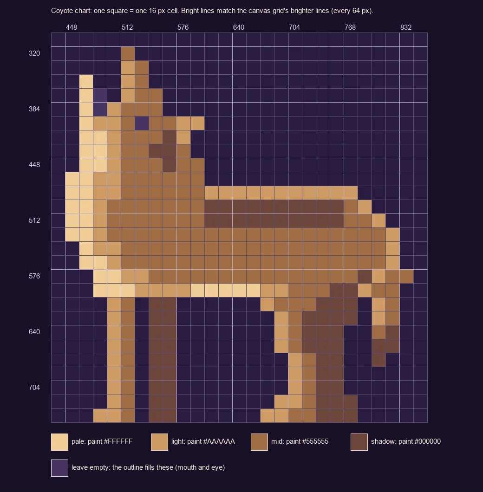

The pixelated photo shows where the coyote is, but a good sprite needs
cleaner shapes than a photo gives you. Use this chart as your pattern. Its
bright lines match the canvas grid's brighter lines, and the labels are canvas
pixels. The nose tip is the single cell at x 512, y 320. The bottom row of the paws is
at y 736, the same row as the mesa's orange lip, so the coyote stands on it.

These details came from the photo, then got exaggerated so they read at this
size:

- The upper jaw is longer than the lower one, with the mouth left empty.
- The ear sticks out behind the eye.
- The back is level, with a dark saddle along it.
- The far legs and the tail tip are the darkest tone.
- The throat, chest and belly are pale.

## Set up a Gradient Map for the coyote

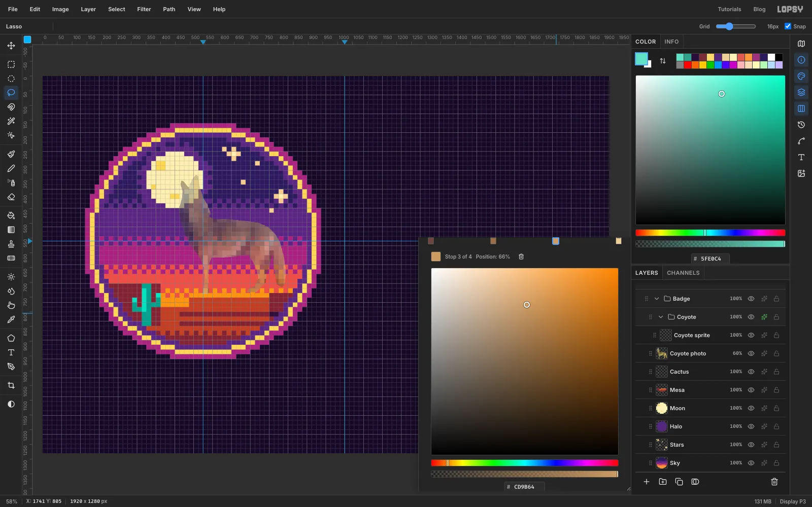

Select **Coyote photo** and click **New Group**. Name the group **Coyote**,
then click **Add Layer** to put a layer named **Coyote sprite** inside it.

Click the **✦** button on the Coyote group's row to open its effects drawer.
Click **Add Adjustment → Gradient Map**. Click the left stop and type
`#6E463C` in the picker's hex field, then click the right stop and type
`#F0CD96`. Click the gradient bar a third of the way along to add a stop. The
readout under it should say about 33%. Make it `#A06E46`. Then add another at
about 67% and make it `#CD9B64`. Close the drawer. Getting the two middle
stops close to a third and two thirds matters: that's where the two greys fall,
so they come out as exactly those browns.

Now anything painted in the group in **black, `#555555`, `#AAAAAA` or white**
comes out as these four browns.

## Paint the light tone

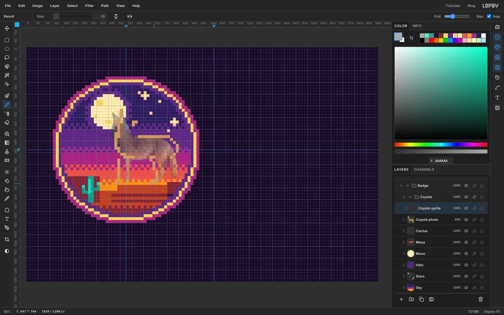

Select **Coyote sprite**, choose the Pencil (Size 16) and set the foreground to
`#AAAAAA`. Following the chart, paint every light-tan cell. Work row by row
from the top, reading each row's y from the chart. Click a cell, then
[[Shift]]-click the last cell in the same row to paint a whole run at once.

## Paint the mid tone

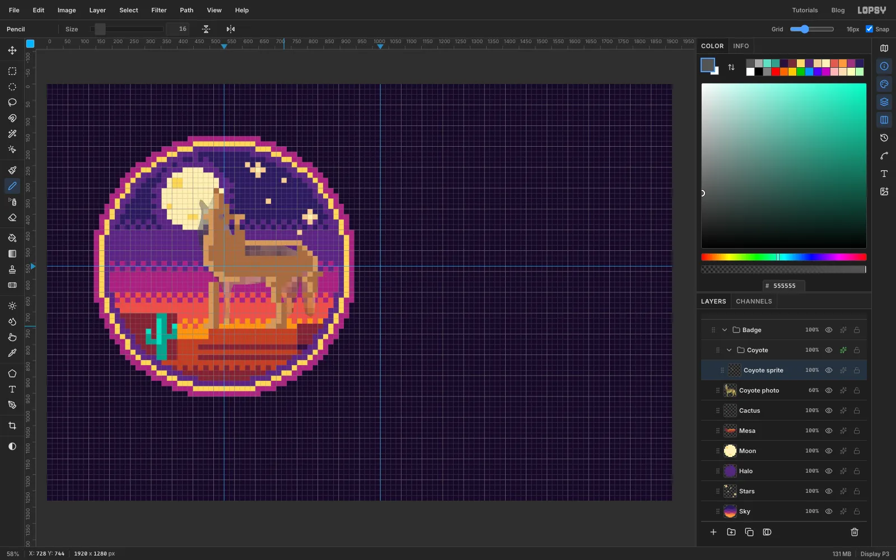

Set the foreground to `#555555` and paint all the medium-brown cells. This is
the biggest fill: most of the head, neck and body.

## Paint the shadows

Set the foreground to black (`#000000`) and paint the dark-brown cells: the
inner ear, the saddle along the back, the far front leg, the far hind leg and
the tail tip.

## Paint the pale fur

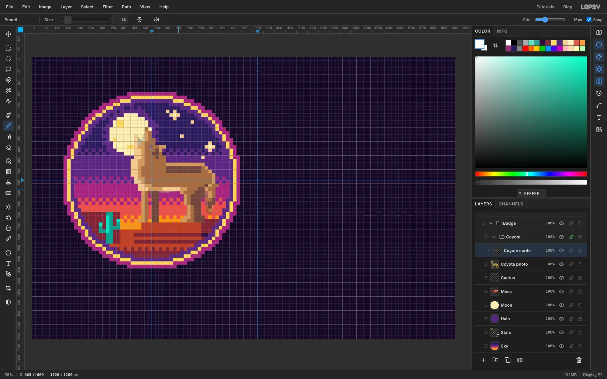

Set the foreground to white and paint the pale cells down the throat, chest
and belly. Leave the mouth and eye cells marked "leave empty" on the chart
unpainted. The outline will show through them.

## Delete the guide

Select **Coyote photo** and click **Delete Layer**. The sprite stands on its
own now.

## Add the outline

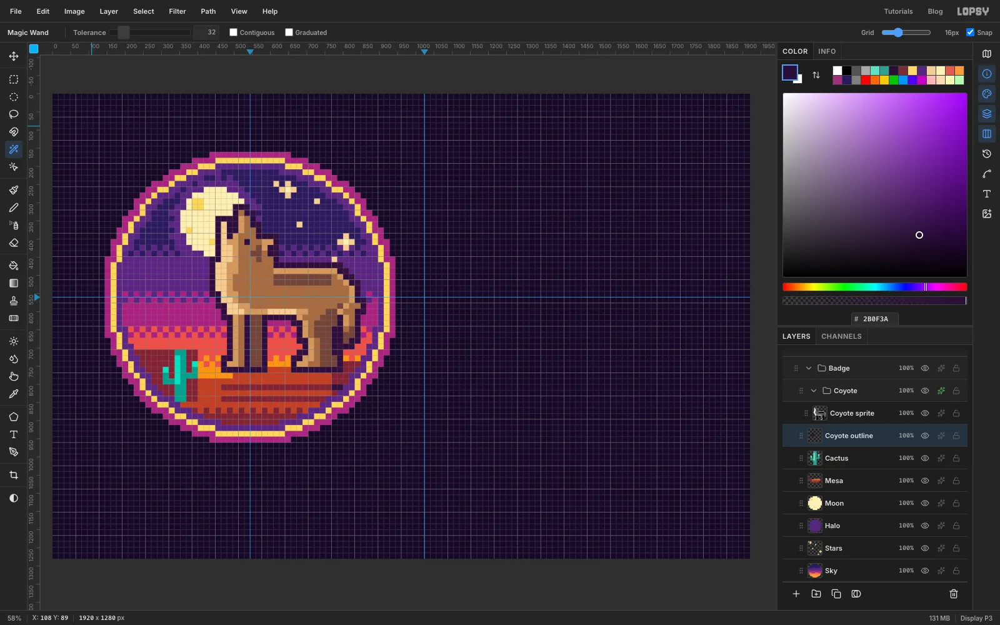

Select **Cactus** and add a layer named **Coyote outline**. It sits under the
Coyote group. [[Cmd]]-click the **Coyote sprite** thumbnail, choose **Select →
Grow…** with **16**, and run the pixel-snap recipe on this layer. Recolour the
result `#2B0F3A`.

The outline is one cell wide all the way round. It also fills the empty
mouth and eye cells.

## Type GAME STUDIO and COYOTE

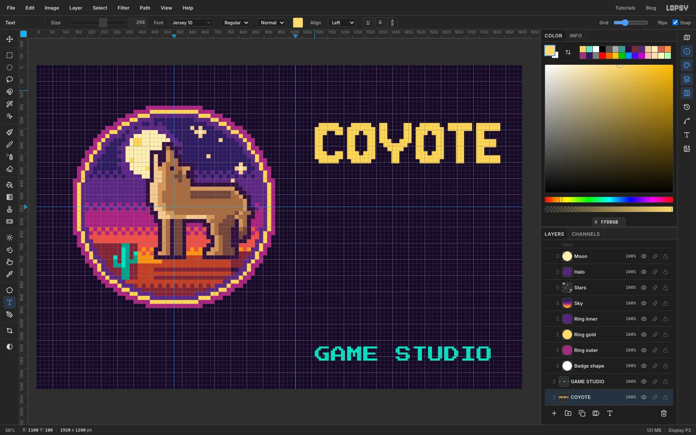

Type the lower line first. A click just below an existing text layer can land
inside its text box and edit it instead of starting a new one.

Select the **Night** layer, so new type isn't added to the badge. Choose the
**Text** tool. In the options bar, set **Size** to **64** and the font to
**Press Start 2P**, and set the foreground colour to `#5FE0C4`. New text
takes the foreground colour. Click near the bottom right of the canvas, type
**GAME STUDIO** and press [[Tab]] to finish.

Select **Night** again. Set the font to **Jersey 10**, **Size** to **298**
and the foreground to `#FFD86B`. Click near the top right, type **COYOTE**
and press [[Tab]]. At 298 px, one pixel of Jersey 10 is almost exactly 16 px,
so the letters match the badge's cells.

## Add MESA and line up the wordmark

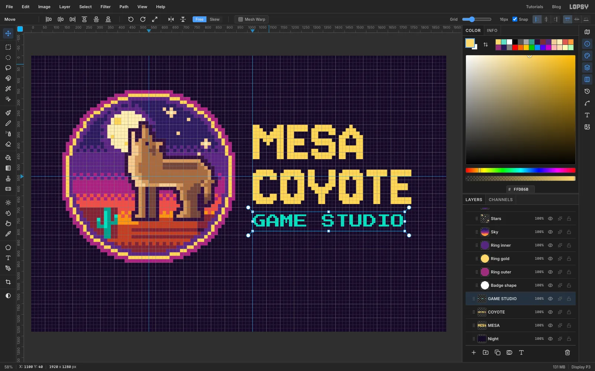

Select **Night**, then click near the very top of the canvas and type
**MESA** with the same settings. Use the Move tool to put each word's left
edge on the **1024** guide:

- **MESA** with the top of its letters at **y 320**
- **COYOTE** at **y 528**
- **GAME STUDIO** at **y 736**

To place them exactly, untick **Snap** in the options bar, nudge with the
arrow keys (1 px per press), then tick **Snap** again.

## Split the letters into two colours

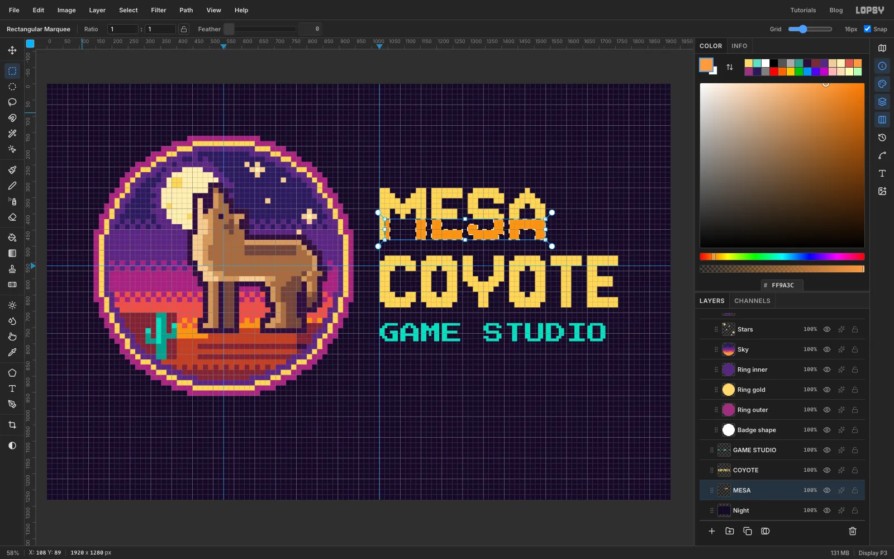

Arcade logos often split a word into two colours. Select **MESA** and click
**Rasterize Layer** at the bottom of the Layers panel. [[Cmd]]-click its
thumbnail to select the letters. Choose the Rectangular Marquee, hold
[[Shift]] and [[Alt]], and drag a box from just left of the word at **y 416**
to past its right end and below the letters. [[Shift]] and [[Alt]] together keep only
the overlap, so just the lower part of the letters stays selected.

Fill it with `#FF9A3C` and deselect. Do the same for **COYOTE**, starting the
box at **y 624**. The split falls at the same row of font pixels in both
words.

## Give the wordmark a hard drop shadow

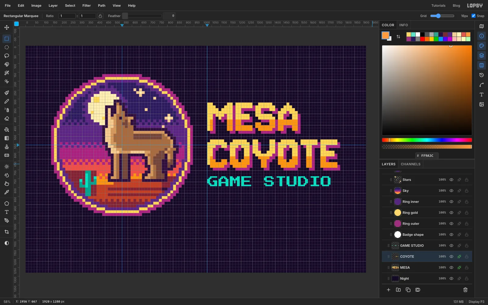

Open **MESA**'s effects with its **✦** button and turn on **Drop Shadow**.
Set the colour to `#9E2F7E`, **Offset X** and **Offset Y** to **16**,
**Blur** and **Spread** to **0**, and **Opacity** to **100**. A shadow with no
blur is exactly one cell, so it looks like pixel art. Do the same for
**COYOTE**.

## Add the palette bar

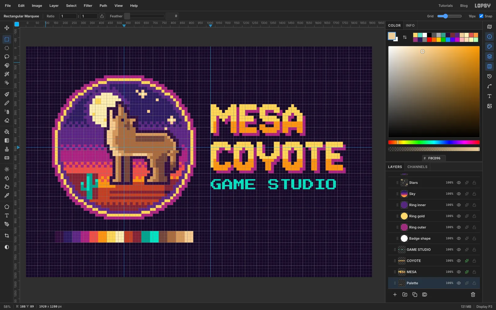

Select **Night** and add a layer named **Palette**. With the Rectangular
Marquee, draw sixteen chips, each 48 × 64 px, side by side from x 160 to 928
at y 1024. Fill them in this order: `#2B0F3A`, `#2A1B5C`, `#55287F`,
`#9E2F7E`, `#E05A4F`, `#FF9A3C`, `#FFD86B`, `#FFF0B8`, `#B5482E`, `#7A2A36`,
`#2FA08E`, `#5FE0C4`, `#6E463C`, `#A06E46`, `#CD9B64`, `#F0CD96`.

These are every ink on the sheet. A palette bar is a promise, so if you add a
colour to the art, add it here too.

## Build the one-colour version

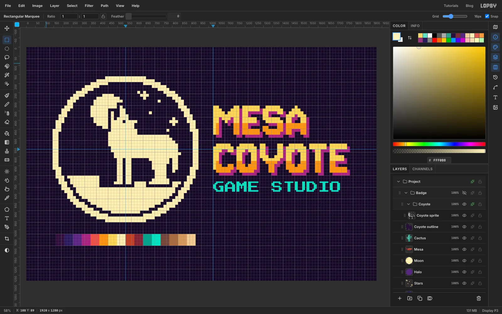

Brands need a version that prints in one ink. Select **Night** and add a
layer named **One-bit**. It sits under the Badge group, so click the eye on
the **Badge** row to hide the group while you work. Set the foreground to
`#FFF0B8`, then build the layer from the badge's own shapes:

1. [[Cmd]]-click **Ring outer** and fill. Then [[Cmd]]-click **Ring inner**
   and press [[Delete]]. That leaves a thick ring.
2. [[Cmd]]-click **Moon** and fill. Do the same for **Stars** and **Mesa**.
3. [[Cmd]]-click **Coyote outline** and press [[Delete]]. This cuts a gap
   where the coyote will go.
4. [[Cmd]]-click **Coyote sprite** and fill.

Press [[Cmd+D]] and show the Badge group again.

## Shrink the one-colour version

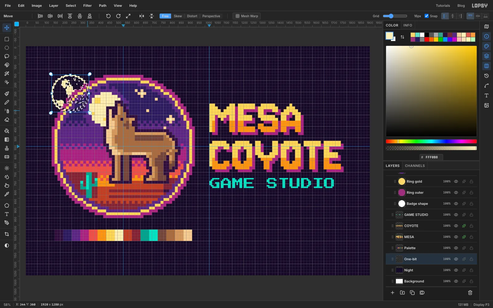

[[Cmd]]-click the **One-bit** thumbnail, so the transform box hugs the badge
instead of the whole canvas. With the Move tool, hold [[Cmd]] and drag the
bottom-right corner handle in until the box is about a quarter of its size,
**13 cells (208 px)** across. The handle snaps to the grid, so it stops there
easily. Press [[Cmd+D]], then drag it to the bottom row so its top-left corner
is at (1024, 880).

Scaling blurs pixel edges, so snap it back to pixels. [[Cmd]]-click its
thumbnail and run the pixel-snap recipe with **Block Size 4** instead of 16,
then recolour it `#FFF0B8`. At this size one 16 px cell is about 4 px.

## Copy the full-colour badge

With the Rectangular Marquee, select the badge from (144, 160) to
(944, 960), which takes in the outer ring. Choose **Edit → Copy Merged**. It
copies what you see, Gradient Map included, rather than a single layer. Press
[[Cmd+D]].

## Paste the mini badge

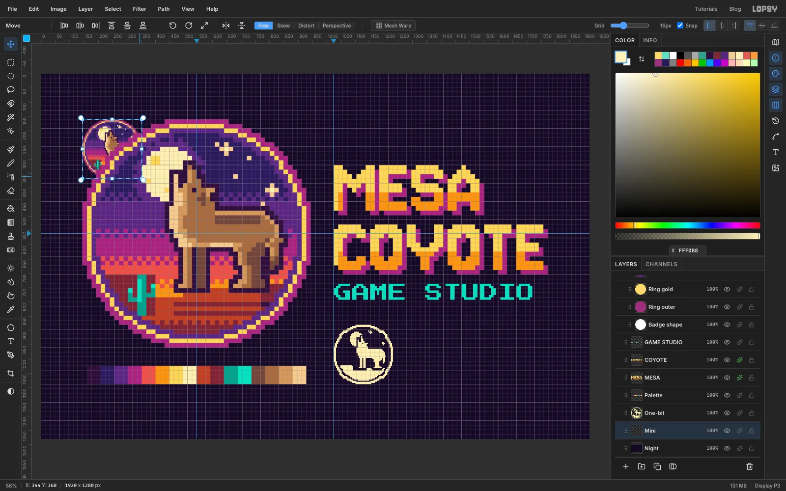

Select **Night** and choose **Edit → Paste**. The copy lands exactly where the
badge is, selected. You won't see it, because it's under the Badge group, but
its transform box shows where it is. Name it **Mini**.

Hold [[Cmd]] and drag its bottom-right handle in to 13 cells (208 px) across,
like the one-colour version. Press [[Cmd+D]] and drag it to (1296, 880), so
the gaps on both sides of it are 64 px. Then choose **Filter → Pixelate…**
with **Block Size 4**. That evens out the softest edges, so it reads as pixel
art again.

## Make the app icon tile and select its art

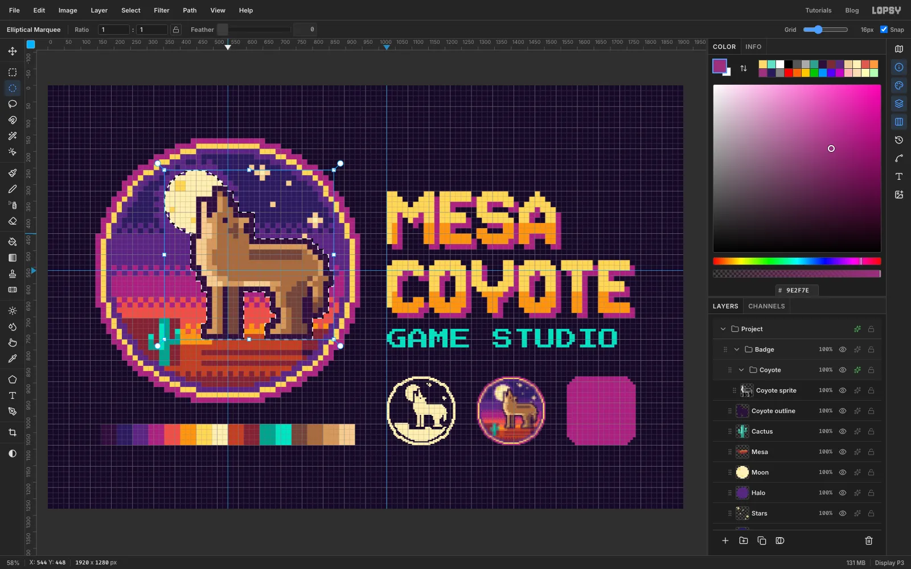

Select **Night** and add a layer named **Icon tile**. Drag a 208 × 208 px
Rectangular Marquee with its top-left corner at (1568, 880). Choose
**Select → Shrink…** with **40**, then **Select → Grow…** with **40**. This
rounds the corners. Run the pixel-snap recipe with **Block Size 8**, which
gives the corners 8 px steps, a size between the badge's cells and the
variants'. Recolour it `#9E2F7E`.

Next, select the art for the icon:

1. [[Cmd]]-click the **Coyote outline** thumbnail. The outline covers the
   whole coyote, so this selects all of it.
2. Choose the Elliptical Marquee, hold [[Shift]] and drag over the moon.
   [[Shift]] adds to the selection.
3. Choose **Edit → Copy Merged** and press [[Cmd+D]].

## Paste and fit the icon art

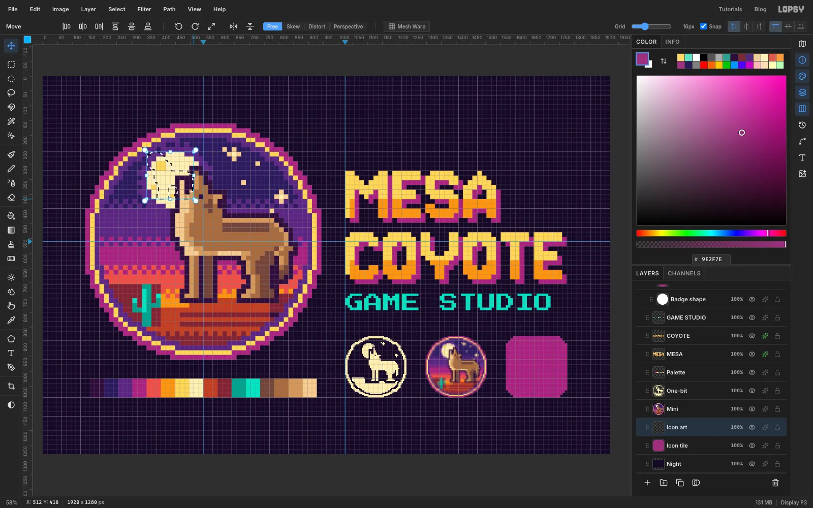

Select **Icon tile** and choose **Edit → Paste**. Name the new layer **Icon
art**. Hold [[Cmd]] and drag its bottom-right handle in until the art is about
11 cells (176 px) wide, so it fits the tile with some breathing room. Press
[[Cmd+D]] and drag it onto the tile, with the coyote's paws near the bottom
edge.

Then run **Pixelate** to make it crisp again. For Block Size, take 16 times
your scale and round it. At about a third of the size that's **5**.

## Label the bottom row

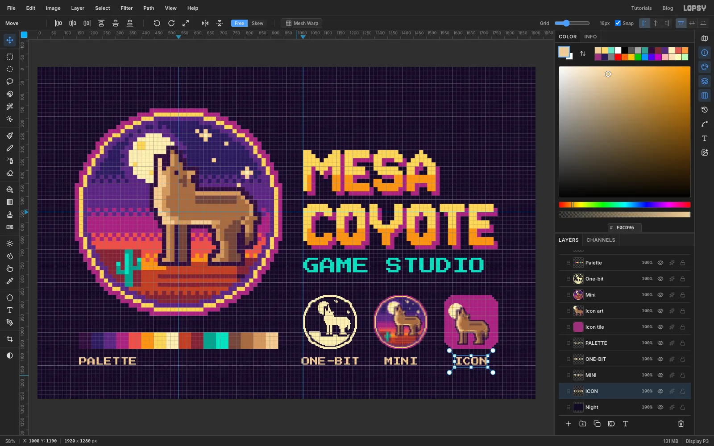

Select **Night**. With the Text tool, set **Press Start 2P**, **Size 32** and
the foreground `#F0CD96`, then type **PALETTE**, **ONE-BIT**, **MINI** and
**ICON**, each in an empty spot. Select Night again before each one. At 32 px,
Press Start 2P draws 4 px pixels, small enough to sit quietly under the
art.

Put the top of every label at **y 1120**. Line **PALETTE** up with the left
end of the bar, and centre each other label under its variant.

## Add CRT scanlines to the badge

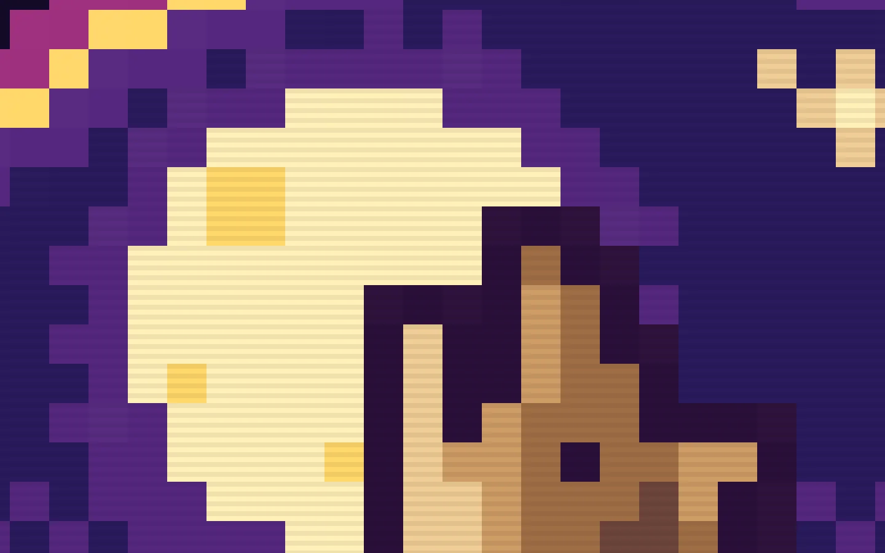

First make a pattern tile. Add a temporary layer. Click once with the
Rectangular Marquee and type **From 0, 0, To 4, 2**, then fill it black. Press
[[Cmd+D]], click once again and type **From 0, 0, To 4, 4**. Choose **Edit →
Define Pattern**, deselect and delete the temporary layer.

Expand the **Badge** group if it's collapsed, select its row and click **Add
Layer**. The new layer lands at the top of the group. Name it **Scanlines**.
Choose **Edit → Fill with Pattern…**, pick the pattern you just made and click
**Apply**. Trim it to **Badge shape** as before and set the layer's opacity to
**6%**. Any more and the moon looks striped. The close-up above is at twice
actual size. At normal size the lines are just a texture.

## Finish with a few stars and export

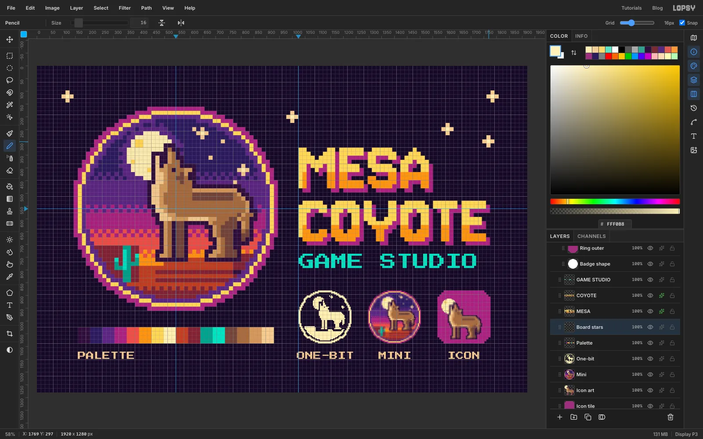

Select **Palette** and add a layer named **Board stars**. Paint five
plus-shaped stars with the Pencil, as before: arms in `#F0CD96` and centres
in `#FFF0B8`. Keep them at least 96 px from the canvas edges and well clear of
the type.

Choose **File → Quick Export PNG** for the image and **File → Save Project**
to keep the layers.
