Chiptune bands make music on old game consoles, so their album covers often
borrow the look of the games: a big striped logo, a little scene of sprites
and a menu waiting for you to press Start. In this tutorial you'll make the
cover for **Goblin Quartet: Dungeon Sessions** as if it were the title screen
of a forgotten 1987 cartridge.

The canvas is 2048 × 2048 px, but you'll treat it as a 128 × 128 screen. Every
"pixel" of the art is a 16 × 16 px cell. The grid shows the cells, and the
Pencil at 16 px paints one cell per click when you click in the middle of
one. Lines are a click and a [[Shift]]-click, as usual. You'll build the wall from one
brick tile and a pattern fill. You'll paint one goblin with mirror symmetry
and turn it into a band of four with duplicates and Magic Wand palette swaps.
Then you'll set the logo in a pixel font and give it NES-style colour bands,
an outline and a drop shadow.

Nothing in this picture is rotated or scaled. Free rotation and scaling
resample pixel art and blur its edges, so everything is placed with
whole-cell moves and nudges, and recoloured with colour swaps.

The palette:

- Night sky `#0C0820`, stars `#BCD8FC` / `#FCFCFC`
- Bricks `#1E1446` / `#34247A` / `#5040A8`
- Battlements `#241860` / `#4A3A9A` / `#6A5AC0` / `#8C7CE4`
- Window frame `#7464D0` / `#1E1446`, sill `#9C90E0`
- Window sky `#120A3C` / `#2A1878` / `#5030A8` / `#9048B8`
- Moon `#FCFCA0` / `#F8D840` / `#C89818`
- Torch iron `#141018` / `#5C5C70`, flame `#F83800` / `#FC9838` / `#FCE4A0`
- Torch light `#B0507C` / `#F08830` (Color layer)
- Torch warmth `#3C2C48` / `#784020` (Screen layer)
- Stage `#A8641C`, lip `#E8A848`, seams `#6C3C10`, front edge `#3C1C08`
- Goblin skin `#00702A` / `#28B830` / `#8CE868`, outline `#000000`, eyes `#F8E070`, tongue `#D82800`
- Goblin tunic `#5C2C00` / `#9C4A00` / `#D07818`, buckle `#F8B800`
- GOBLIN stripes `#FCF0A0` / `#F8D000` / `#F89C00` / `#F05800` / `#C82800`
- QUARTET stripes `#FCFCFC` / `#A8E4FC` / `#3CBCFC` / `#0078F8` / `#0050C0` / `#003494`
- Logo shadow `#5A30B0`, subtitle `#E0D8FC`
- Wall shade `#FFFFFF` / `#C8C0E8` / `#9888C8` (Multiply)

## Set up a 16 px grid and guides

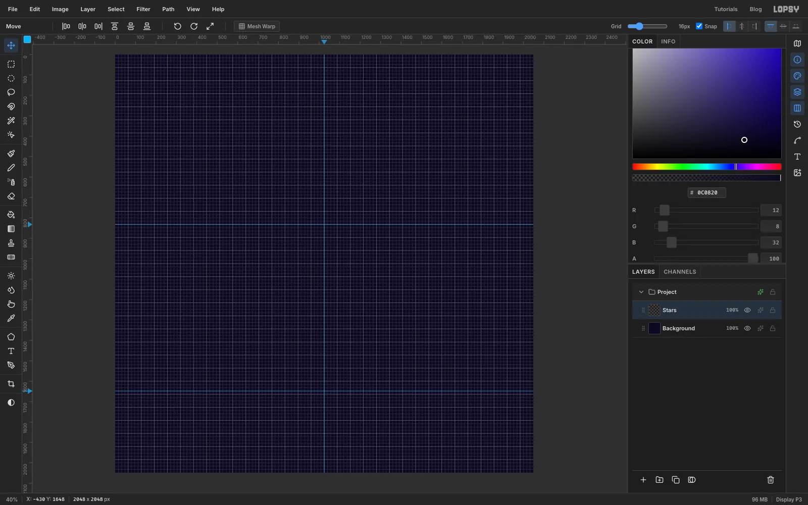

Choose **File → New**, make a **2048 × 2048** document and click **Create**.
Select the **Background** layer, set the colour to `#0C0820` in the Color
panel and choose **Edit → Fill**. Rename **Layer 1** to **Stars**.

Turn on **View → Show Grid**. In the options bar, drag the **Grid** slider to
**16px** and make sure **Snap** is ticked. Marquees and Move drags now land
on whole cells.

Hold [[Cmd]] and click the middle of the top ruler. Cmd-clicking a ruler
snaps the guide to a layout fraction, so this one lands exactly on the centre
line at 1024. Then add two horizontal guides on the left ruler, at **832**
(the top of the castle wall) and **1648** (the top of the stage). Guides beat
the grid when a marquee snaps, so they must be exact. Zoom to 100%, and watch
the Y readout in the status bar until it shows 832 (then 1648) before you
click.

> **Tip:** The Pencil doesn't snap to the grid. Its square is centred on
> the pixel under the pointer, so aim for the middle of a cell. Zoom to
> 400% or more for sprite work. Each cell is then 64 screen pixels wide,
> and a click near its centre is easy. The X/Y readout should end in 8
> after a multiple of 16, such as 856 or 1224.

## Scatter pixel stars

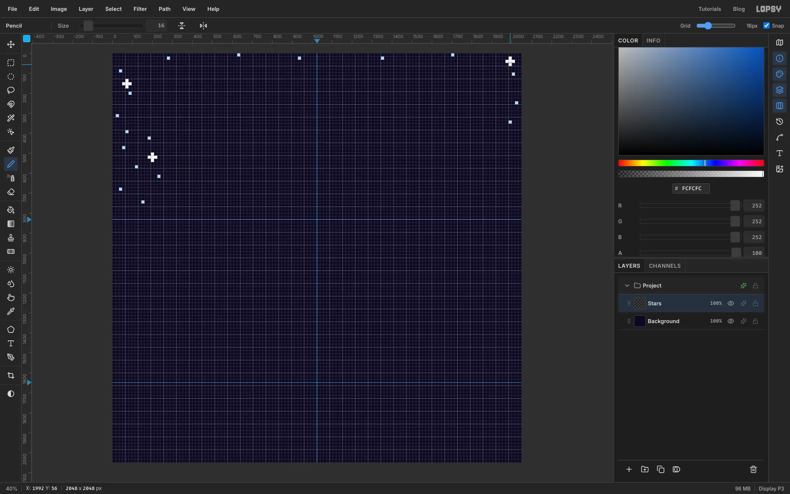

Pick the **Pencil** (N) and set its **Size** to **16** in the options bar.
The Pencil paints hard square dabs, so one click in the middle of a cell
fills that cell. On the **Stars**
layer, click single stars in `#BCD8FC` along the very top of the canvas and
down both sides. Keep the middle of the top half empty, because the title
goes there.

For a twinkle, switch to `#FCFCFC`, click a cell, then click the cells
directly above, below, left and right of it to make a small plus. Make
three: one near the top-left corner, one near the top-right corner and one a
little lower on the left.

> **Tip:** Keep every star at least two cells away from where the lettering
> will be. A dot next to a letter reads as part of the letter.

## Copy a cluster of stars to the other side

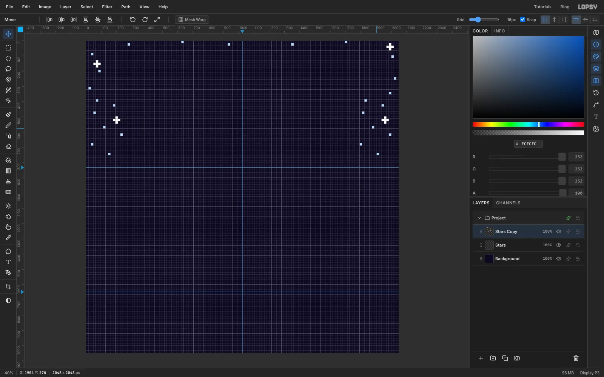

Pick the **Rectangular Marquee** (M) and drag a box around the stars in the
lower-left corner of the sky: the left 18 cells, from y 384 down to the top
of the wall area at 768. Press [[Cmd+C]], then [[Cmd+V]]. The paste lands in place on a
new layer. Rename it **Stars Copy** and press [[Cmd+D]].

Switch to the **Move** tool (V) and drag the copy to the right until it sits
against the right edge (1760 px across, at the same height). Snap keeps it
on the grid. Choose **Layer → Merge Down** to fold it back into **Stars**.

## Paint one brick tile

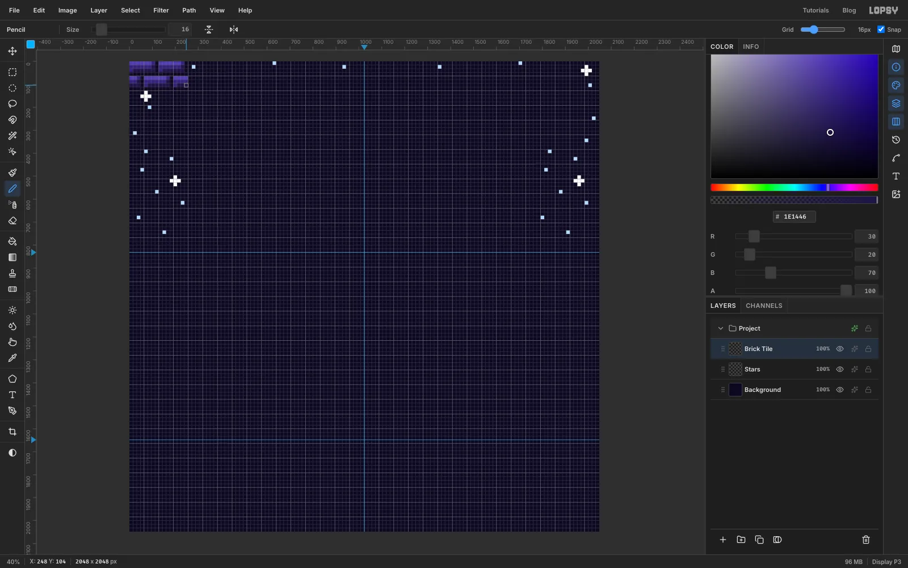

Add a layer called **Brick Tile**. Old consoles drew backgrounds from small
tiles, and you'll do the same.

With the Rectangular Marquee, drag a box in the top-left corner from 0, 0 to
256, 128. That's 16 × 8 cells. Fill it with `#0C0820` for the mortar and
deselect.

With the Pencil, paint two courses of bricks:

- Each brick is 7 cells wide and 3 cells tall, with a 1-cell mortar gap on
  its right and below it.
- The top course starts at the left edge.
- The bottom course is offset 4 cells to the right, and wraps round the
  tile's edge.
- Fill each brick with `#34247A`.
- Paint its top row, except the last cell, in `#5040A8` for the lit edge.
- Paint its bottom row, except the first cell, and the last cell of its
  middle row in `#1E1446` for the shadow.

## Define the tile as a pattern

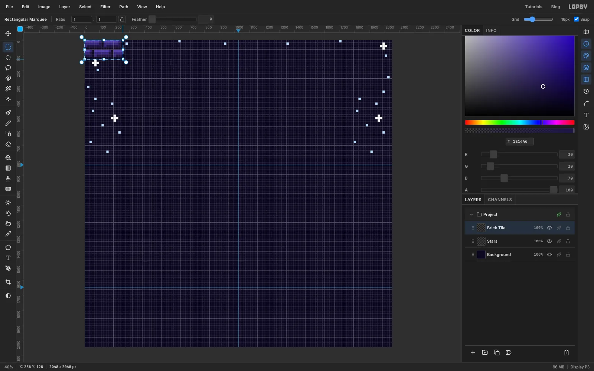

Drag the marquee from 0, 0 to 256, 128 again so it hugs the tile, and choose
**Edit → Define Pattern**. Press [[Cmd+D]], then delete the **Brick Tile**
layer with the trash button at the bottom of the Layers panel. The pattern is
kept.

## Fill the wall with the brick pattern

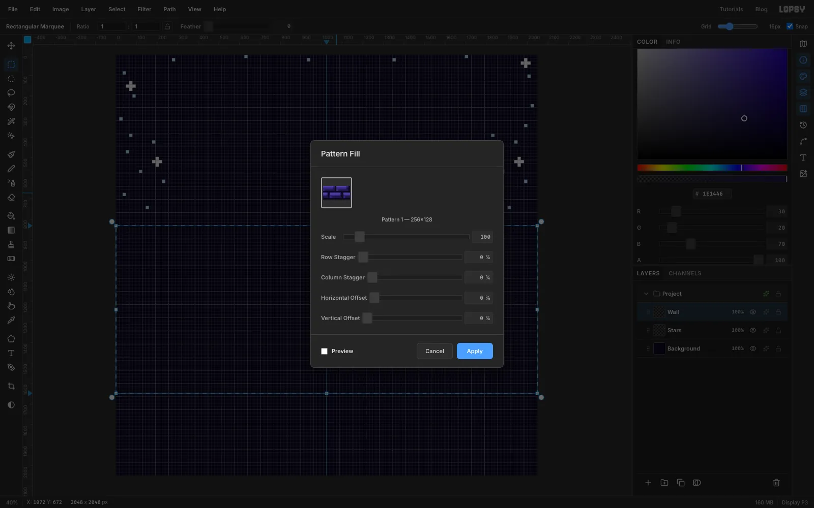

Select **Stars** and add a layer called **Wall**. Drag a marquee from the
left edge at the 832 guide to the right edge at the 1648 guide.

Choose **Edit → Fill with Pattern…**, click the brick tile and leave Scale at
100 and every offset at 0. Click **Apply** and deselect. The pattern is
lined up with the document's top-left corner, and 832 is a multiple of one
brick course (64 px), so the wall starts cleanly on a mortar line.

## Add battlements

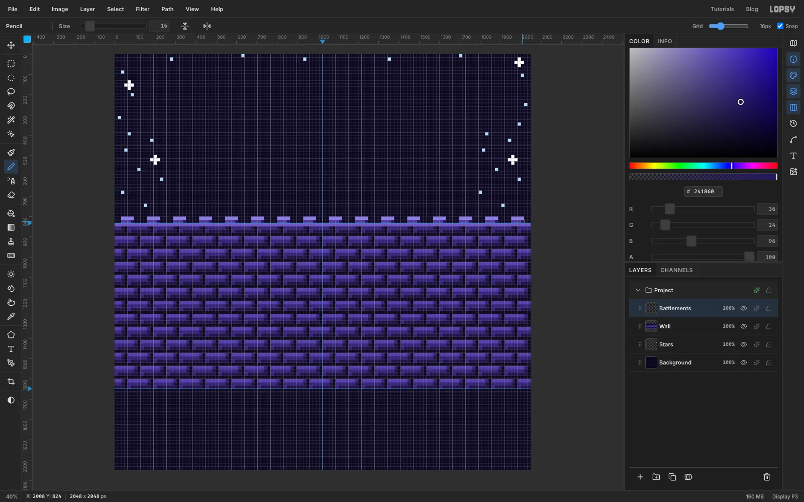

Add a layer called **Battlements**. With the Pencil:

1. In `#6A5AC0`, click the left end of the top row of the wall (y 832) and
   [[Shift]]-click the right end. That's the coping ledge.
2. On the two rows above the ledge, paint 16 merlons, each 4 cells wide with
   a 4-cell gap. Start the first one 2 cells in from the left edge.
   - Each merlon's top row is `#8C7CE4`.
   - Its bottom row is `#4A3A9A`.
   - The right-hand cell of the bottom row is `#241860`.

The light top and shaded side make the merlons read as solid stone, not as
one more course of bricks.

## Draw the window frame

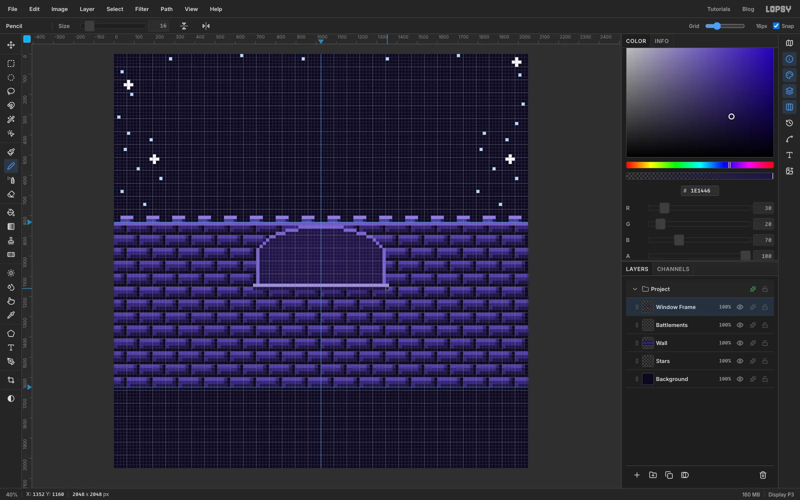

Add a layer called **Window Frame**. The window opening is 36 cells wide,
from x 736 to 1312, centred on the middle guide. Its round top peaks at
y 880 and its sides are straight from y 960 down to y 1136.

Every arch is painted as rows centred on the middle guide, one
[[Shift]]-click run per row. Work from the top down.

1. The outer frame, in `#7464D0`, starts two cells above the opening, at
   y 848. Its rows are 14, 22, 28, 32, 34, 36 and 38 cells wide, then 40
   cells on every row from y 960 down to y 1136.
2. The dark rim, in `#1E1446`, goes over it, starting one cell lower at
   y 864. Its rows are 14, 22, 28, 32, 34 and 36 cells wide, then 38 from
   y 960 down.

That leaves a light outer frame and a dark inner rim.

For the sill, paint a `#9C90E0` row from x 688 to 1360 along the bottom of
the window (y 1136), then a `#1E1446` row under it.

## Fill the window with flat sky bands

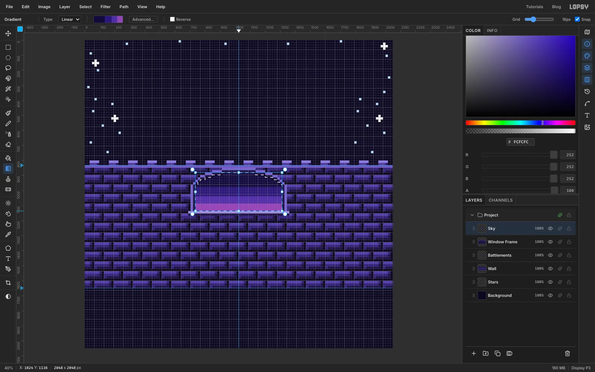

Add a layer called **Sky** and paint the opening itself in white with
Pencil runs. It starts at y 880, and its rows are 14, 22, 28, 32 and 34
cells wide, then 36 from y 960 to the sill. [[Cmd]]-click the **Sky** thumbnail to select the opening.

Pick the **Gradient** tool from the toolbox, keep **Linear**, and open
**Advanced…**. Click the bar to add a stop, drag it while the readout
shows its position, and type its colour in the **Hex** field. Pair the
stops two percent apart, so the gradient comes out as four nearly flat
bands, the way an NES sky is banded:

- `#120A3C` at 0% and 37%
- `#2A1878` at 39% and 61%
- `#5030A8` at 63% and 80%
- `#9048B8` at 82% and 100%

Click **Done**, then drag straight down from the top of the window to the
bottom.

## Snap the sky bands to the pixel grid

Press [[Cmd+D]]. Choose **Filter → Pixelate…**, set **Block Size** to **16**
and click **Apply**. Each block becomes one flat cell. Where a soft band
edge fell inside a cell, it becomes a single in-between row, like the
stepped colour ramps in old game skies. The sky now sits on the same grid
as everything else.

## Paint the moon

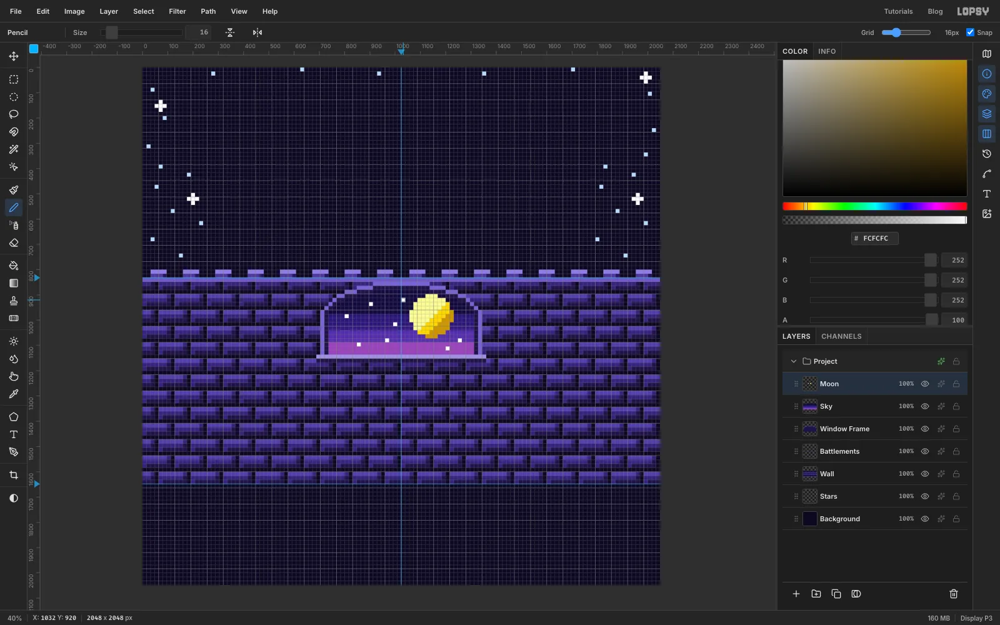

Add a layer called **Moon**. In the right half of the window, paint an
11-cell-wide round moon centred around x 1144, y 984:

- Rows of 3, 7, 9, 9, 11, 11, 11, 9, 9, 7 and 3 cells, from top to bottom.
- `#FCFCA0` on the upper-left side.
- `#F8D840` through the middle.
- `#C89818` on the lower-right rim.

Click eight single white stars around the moon, keeping them inside the
window.

## Hang two torches

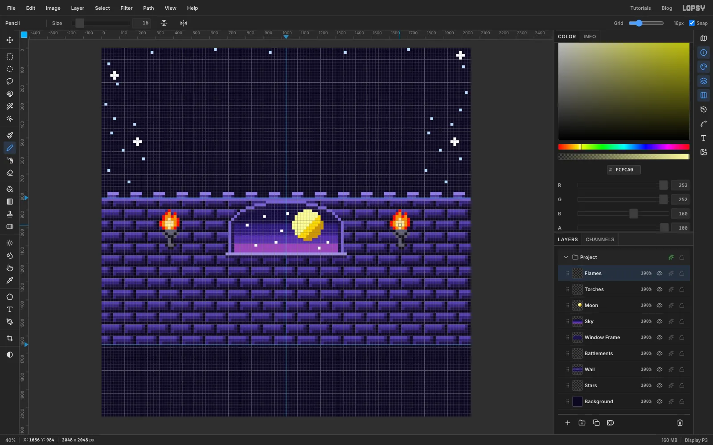

Add a layer called **Torches**. On each side of the window, centred on
x 384 and x 1664, paint an iron bracket 7 rows tall, starting at y 1008.
From the top, its rows are 4, 6, 4, 2, 2, 4 and 2 cells wide. That's a cup
on a narrow stem with a small foot. Use `#5C5C70` with `#141018` for the
shadowed cells.

Add a layer called **Flames**. Just above each bracket, starting at y 896,
paint a flame 7 rows tall. Its rows are 1, 3, 4, 6, 7, 7 and 5 cells wide,
leaning slightly to the left. It's red `#F83800` on the outside, orange
`#FC9838` inside, and a `#FCE4A0` core with one `#FCFCA0` hot cell near the
bottom.

## Paint stepped light pools

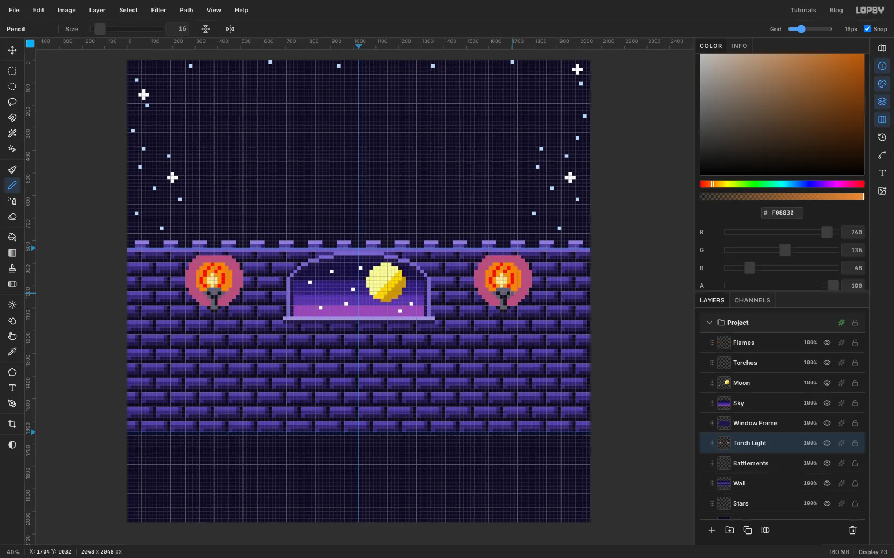

Select **Battlements** and add a layer called **Torch Light**. It lands just
above Battlements.

With the Pencil, paint a stepped disc in `#B0507C` around each torch,
centred on x 384 and x 1664. Start at y 864, one cell below the ledge,
with rows 10, 12, 14, 14, 16, 16, 16, 16, 16, 14, 14, 12, 10 and 8 cells
wide.

Then paint a smaller `#F08830` disc on the same centres, starting at y 896,
with rows 6, 8, 10, 10, 10, 10, 10, 8 and 6 cells wide.

## Recolour the bricks with the Color blend mode

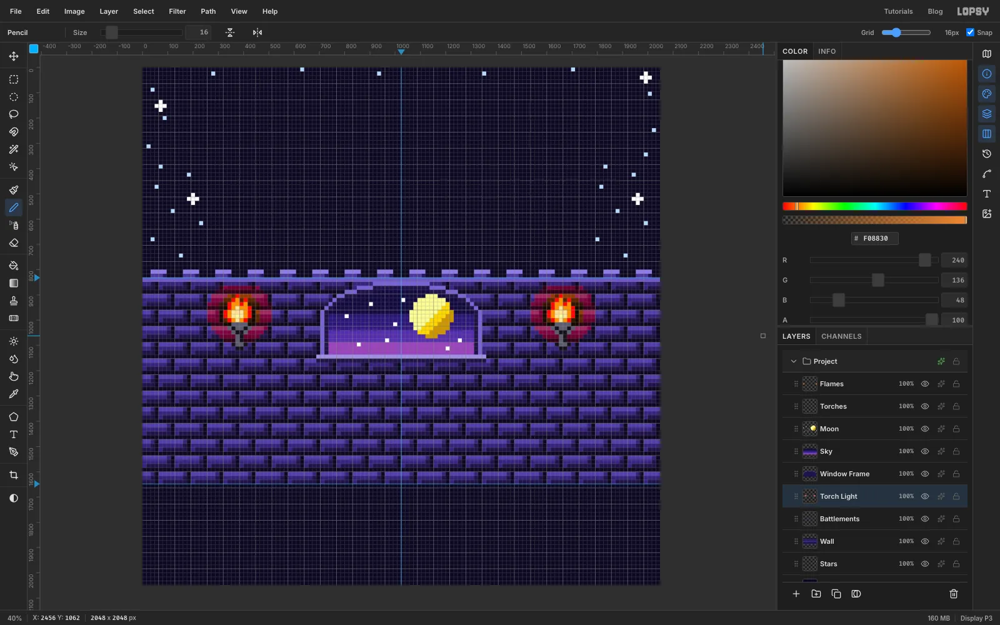

Open the **Torch Light** layer's effects button and set the **Blend** to
**Color**. A Color layer keeps the brightness of the bricks underneath and
only changes their hue. The bricks inside the rings turn warm, but every
mortar line and highlight stays.

## Brighten the light with a Screen copy

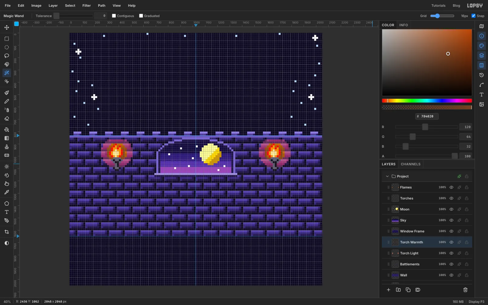

The Color layer recoloured the bricks but left them as dark as before, so
they look scorched rather than lit. Choose **Layer → Duplicate Layer**,
click the copy's row in the Layers panel, and rename it **Torch Warmth**.

Pick the **Magic Wand** (W), set **Tolerance** to **0** and untick
**Contiguous**. On **Torch Warmth**:

1. Click a pink cell. Both outer rings are selected. Fill them with
   `#3C2C48`.
2. Click an orange cell and fill both inner discs with `#784020`.

Deselect, and set this layer's blend mode to **Screen**. Screen only ever
lightens, so the bricks inside the rings brighten by steps.

## Give the flames a glow

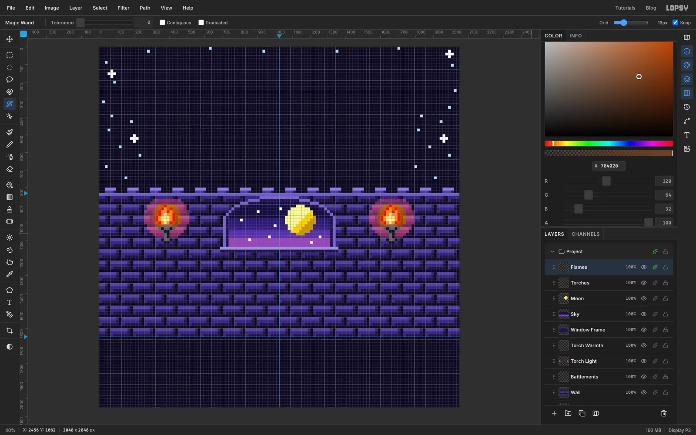

Select **Flames**, open its effects and turn on **Outer Glow**: colour
`#FC7820`, **Size** 40, **Opacity** 70. This is the only soft effect in the
scene, so keep it on the flames themselves.

## Lay the wooden stage

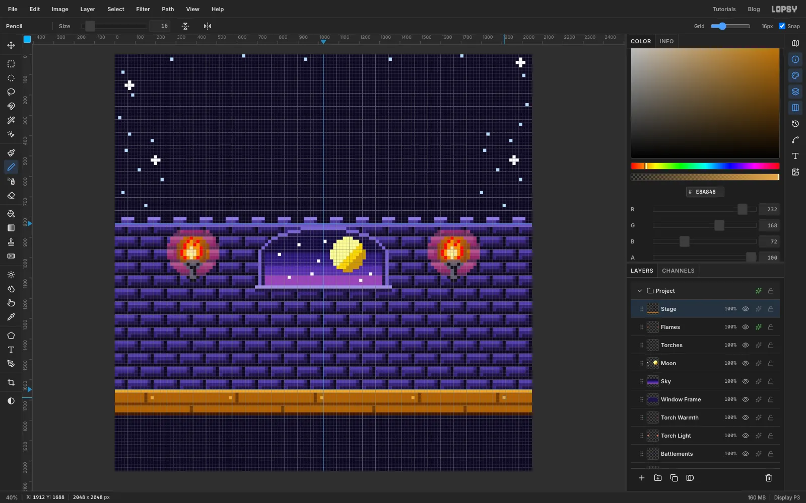

Select **Flames** and add a layer called **Stage**. With the Rectangular
Marquee, drag from the left edge at the 1648 guide down eight cells to
y 1776, across the full width. Fill it with `#A8641C` and deselect.

With the Pencil, draw three full-width lines. Click a cell at the left edge
and [[Shift]]-click the same row at the right edge:

- The lip on the top row (y 1648) in `#E8A848`.
- A seam between the planks on the fifth row (y 1712) in `#6C3C10`.
- The front edge on the bottom row (y 1760) in `#3C1C08`.

Add short vertical plank joints in `#6C3C10`, three cells tall in the top
plank and two in the bottom one, staggered. Click a few `#E8A848` nail heads
near the joints.

## Plan the goblin sprite

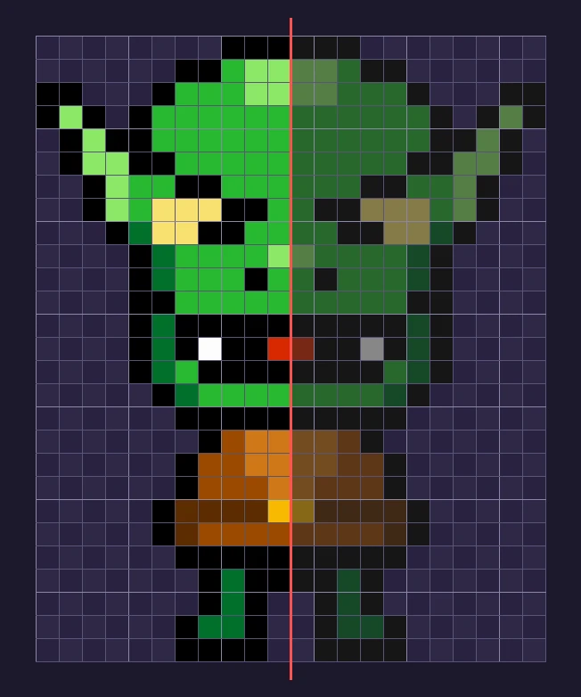

This chart is the goblin, cell for cell. It's 22 cells wide and 27 tall, and
it's symmetrical, so you only need to paint the left half. The dimmed right
half is what the mirror will paint for you.

From the top down:

- **Head:** a tuft and the ears in three greens.
- **Face:** an angry brow, yellow `#F8E070` eyes with black pupils, a long
  nose and a black grin with a white fang and a red `#D82800` tongue at the
  centre.
- **Body:** a brown tunic with a gold `#F8B800` belt buckle, then two thin
  legs and feet.

Every shape has a one-cell black outline.

## Paint half a goblin with symmetry

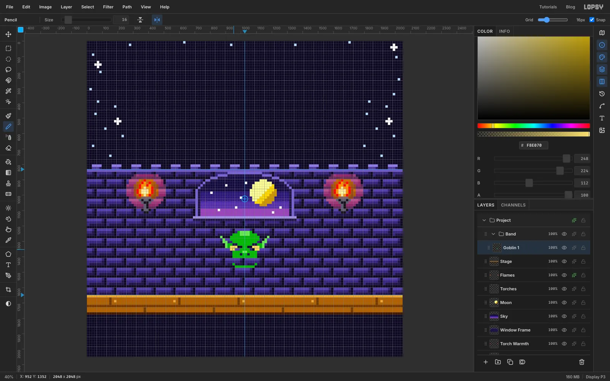

Select **Stage** and click **New Group** at the bottom of the Layers panel.
Name the group **Band**. With **Band** selected, click **Add Layer**. The new
layer goes inside the group. Name it **Goblin 1**.

Pick the Pencil and turn on **Symmetry Vertical** in the options bar. Every
dab is now mirrored across the centre line of the canvas, your guide at
1024.

Paint the left half of the chart. Paint each colour run with a click and a
[[Shift]]-click. The sprite's left edge is at x 848 and its top at y 1216,
so its feet land on the stage lip. Start with the greens and the eyes. The
right half appears as you go.

## Finish the first goblin

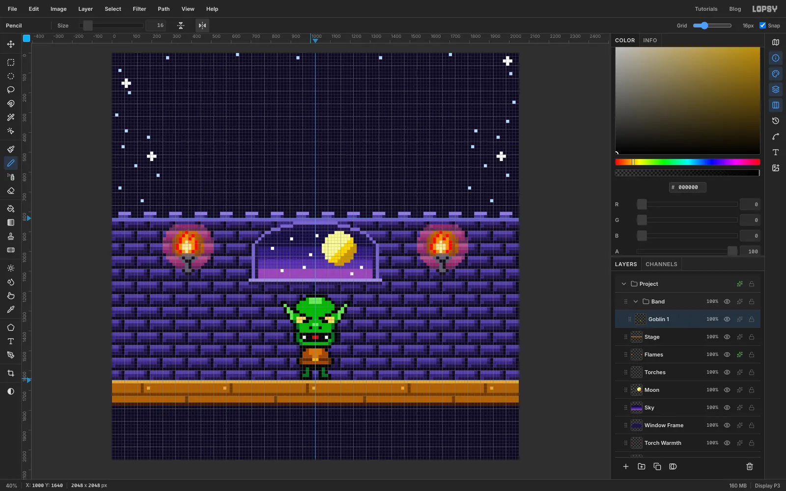

Work through the remaining colours: eyes, teeth, tongue, tunic and buckle.
Do the black outline last. Then turn **Symmetry Vertical** off again.

## Duplicate the goblin into a quartet

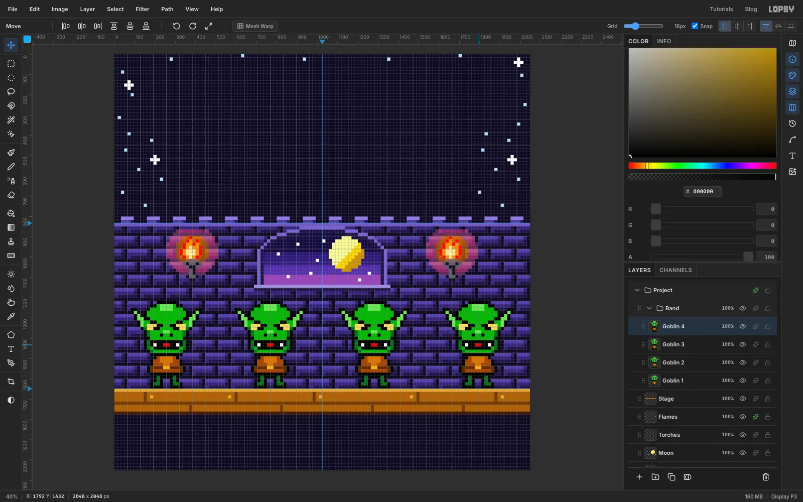

Choose **Layer → Duplicate Layer** three times. After each duplicate, click
the copy's row so the copy is the active layer. Name the copies **Goblin 2**,
**Goblin 3** and **Goblin 4**.

With the **Move** tool and Snap on, drag each goblin sideways to its spot.
Keep each one at the same height:

- **Goblin 1** goes 768 px left, so its left edge is at x 80.
- **Goblin 2** goes 256 px left, to x 592.
- **Goblin 3** goes 256 px right, to x 1104.
- **Goblin 4** goes 768 px right, to x 1616.

## Palette-swap the goblins

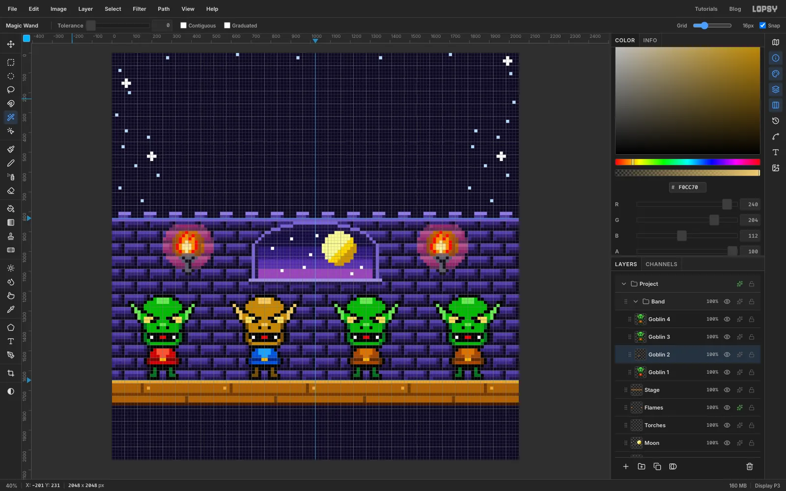

NES games reused one sprite in different colours. You'll do the same with
the **Magic Wand**, still at Tolerance 0 with Contiguous off. Select a
goblin's layer and:

1. Click one cell of a colour. Every cell of that exact colour is selected.
2. Set the new colour and choose **Edit → Fill**.
3. Press [[Cmd+D]] and move on to the next colour.

The tunic colours are `#9C4A00` (mid), `#D07818` (light) and `#5C2C00`
(dark). The skin colours are `#28B830`, `#8CE868` and `#00702A`.

- **Goblin 1:** a red tunic, `#C02000` / `#F86040` / `#701000`.
- **Goblin 2:** a blue tunic, `#0050D8` / `#4CA0FC` / `#002080`, and ochre
  skin, `#C08A28` / `#F0CC70` / `#704C00`.
- **Goblin 3:** a teal tunic, `#008878` / `#38D8C0` / `#004840`, and teal
  skin, `#20B898` / `#80F0C8` / `#006858`.
- **Goblin 4:** a purple tunic, `#7038D0` / `#A880FC` / `#3A1C80`, and lime
  skin, `#88C800` / `#C8F070` / `#406800`.

## Plan the instruments

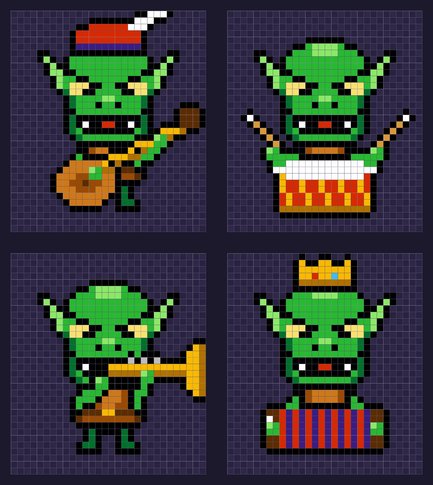

Each instrument goes on its own layer above its goblin, with the arms that
hold it. That way the body underneath stays untouched. The chart shows each
goblin with its instrument on the same 16 px cells. Line each instrument up
with the goblin's eyes and feet on the canvas. The chart's darker lines
fall every 4 cells.

- **Lute:** a round `#D07818` body with a dark sound hole, held low on the
  left, and a gold neck rising to the right to a brown pegbox. Also a red cap
  with a `#3A1C80` brim and a white feather.
- **Drum:** a red drum with gold zig-zags and a white head, in front of the
  legs, and two `#D89838` sticks raised outward with white tips.
- **Horn:** a gold horn running from the mouth to a flared bell on the right,
  with three `#BCBCBC` valves.
- **Accordion:** red and `#3A1C80` bellows in stripes between two brown end
  boards, with white buttons on the left. Also a gold crown with a red and a
  `#3CBCFC` jewel.

## Paint the lute and the drum

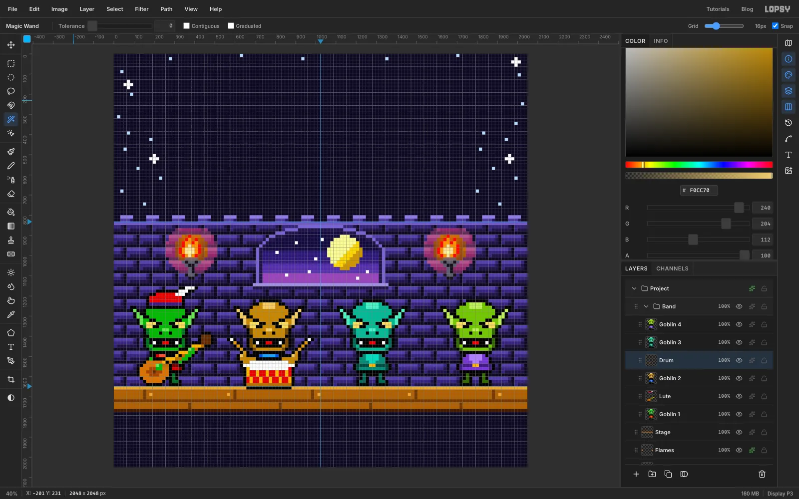

Select **Goblin 1**, add a layer called **Lute** and paint the lute, the
cap and the two arms from the chart. The arms are two cells thick, in
`#28B830` with a `#8CE868` highlight on each hand. Outline everything in
black.

Select **Goblin 2**, add a layer called **Drum** and paint the drum, the
sticks and the arms. The arms on the chart are green, so recolour them to
this goblin's skin with the Magic Wand on the **Drum** layer:

- `#28B830` becomes `#C08A28`.
- `#8CE868` becomes `#F0CC70`.

## Paint the horn and the accordion

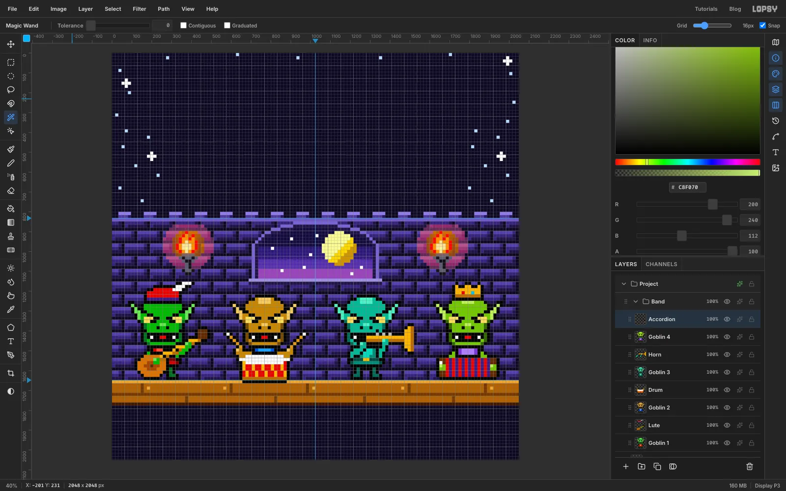

Select **Goblin 3**, add a **Horn** layer and paint the horn and arms. Then
wand-swap the arms to `#20B898` / `#80F0C8`.

Select **Goblin 4**, add an **Accordion** layer and paint the accordion, the
crown and the arms. Then wand-swap the arms to `#88C800` / `#C8F070`.

Collapse the **Band** group with its arrow. If you ever need to move the
whole band, select the group with the **Move** tool active. An arrow key
then moves all eight layers by one cell.

## Type the title in a pixel font

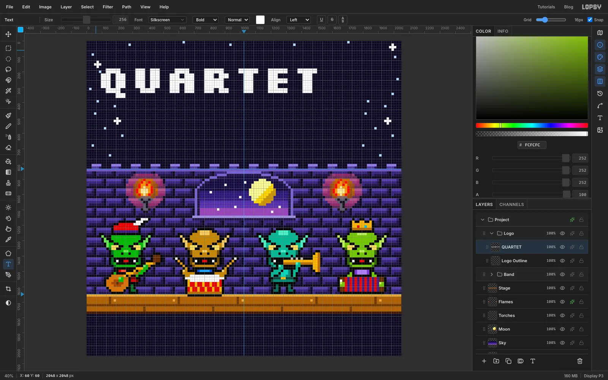

With **Band** still selected and collapsed, click **New Group** and name it
**Logo**. Click **Add Layer** to put a layer inside it, and name it
**Logo Outline**. Keep it selected, so the type you add next lands above
it.

Pick the **Text** tool (T). In the options bar, choose **Silkscreen**, set
**Font weight** to **Bold** and **Size** to **256**, and set the colour to
white. Silkscreen is drawn on a 5-pixel-tall grid, so at 256 px each of its
pixels is exactly two cells. Click in the empty sky near the top left, type
**QUARTET** and press [[Tab]] to commit. Then click **Rasterize Layer** at
the bottom of the Layers panel.

Type **GOBLIN** the same way at **384** px, which is three cells per font
pixel, and rasterize it too.

## Line the title up on the grid

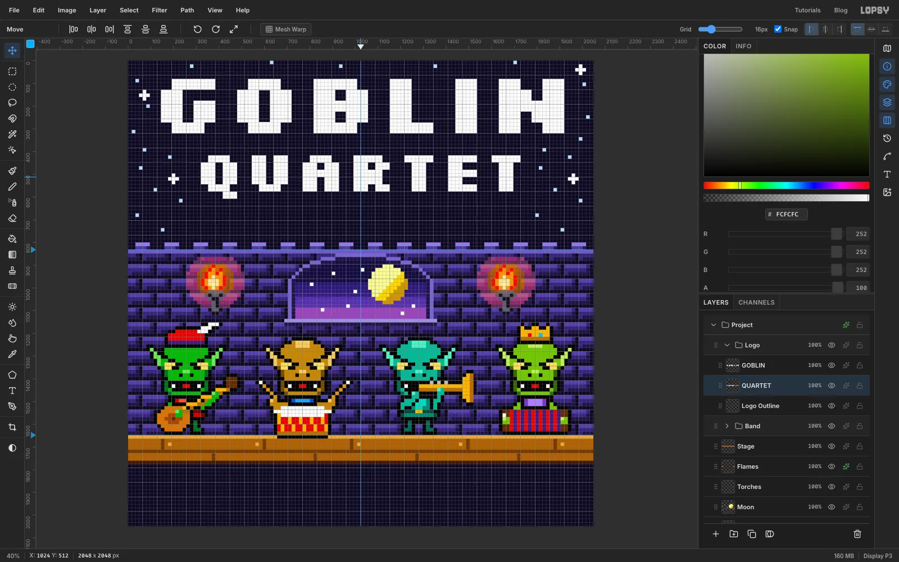

With the **Move** tool and Snap on, drag **GOBLIN** until the top-left
corner of its letters sits at **144, 80**. That leaves a four-cell margin
above it, counting the outline you'll add. Drag **QUARTET** to **320, 416**.
Snap puts the letters' pixels exactly on the grid.

## Select one stripe of the letters

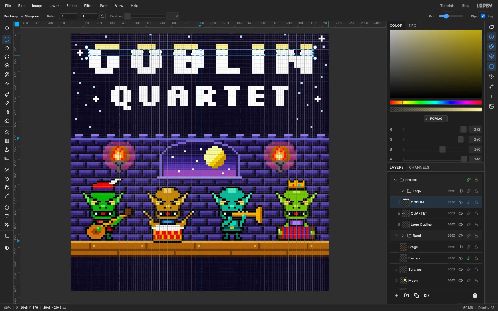

NES logos were often coloured in horizontal stripes, one colour per row of
pixels. GOBLIN's letters are five font pixels tall, and each is 48 px, so it
gets five stripes.

[[Cmd]]-click the **GOBLIN** thumbnail to select the letters. Pick the
Rectangular Marquee. Hold [[Shift+Alt]] and drag a band across the whole
canvas from y 80 to y 128. [[Shift+Alt]] intersects, so only that stripe of
the letters stays selected. Fill it with `#FCF0A0`.

The screenshot shows the next round: the first stripe is already pale
yellow, and the letters have been reselected and intersected with the second
band, y 128 to 176.

## Stripe the whole title

Repeat for the other four stripes of GOBLIN, 48 px each, reselecting the
letters each time with [[Cmd]]-click:

- y 128–176 in `#F8D000`
- y 176–224 in `#F89C00`
- y 224–272 in `#F05800`
- y 272–320 in `#C82800`

QUARTET's font pixels are 32 px tall. Give it six stripes from y 416. The
sixth is the tail of the Q.

- `#FCFCFC`
- `#A8E4FC`
- `#3CBCFC`
- `#0078F8`
- `#0050C0`
- `#003494`

## Fill the outline layer

Select **Logo Outline** and set the colour to black:

1. [[Cmd]]-click the **GOBLIN** thumbnail and choose **Edit → Fill**.
2. [[Cmd]]-click the **QUARTET** thumbnail and fill again.
3. Deselect.

You now have black copies of both words hidden under the letters.

A pixel outline should have square corners. The Stroke effect and
**Select → Grow** round them off, so spread the black by whole cells
instead. Choose **Layer → Duplicate Layer**, click the copy's row, and with
the **Move** tool press [[Left]] once. With the grid on, one press moves
exactly one cell. Choose **Layer → Merge Down**.

## Finish the square outline

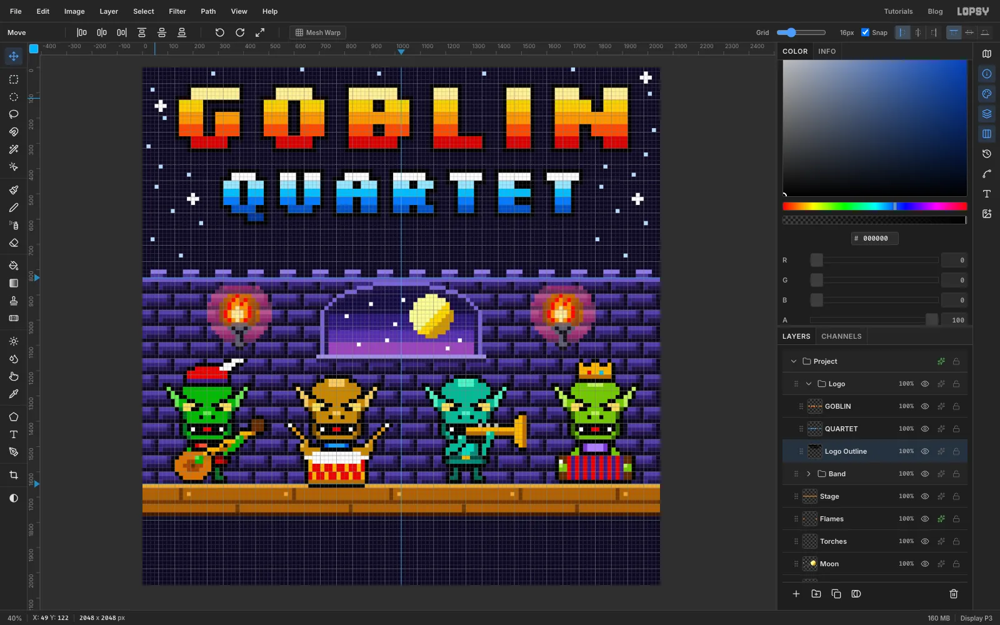

Repeat the duplicate, nudge and merge three more times: once with [[Right]],
once with [[Up]] and once with [[Down]]. The black now extends one cell past
the letters on every side. The corners come out square because each copy
moves in a straight line.

## Drop an extruded shadow

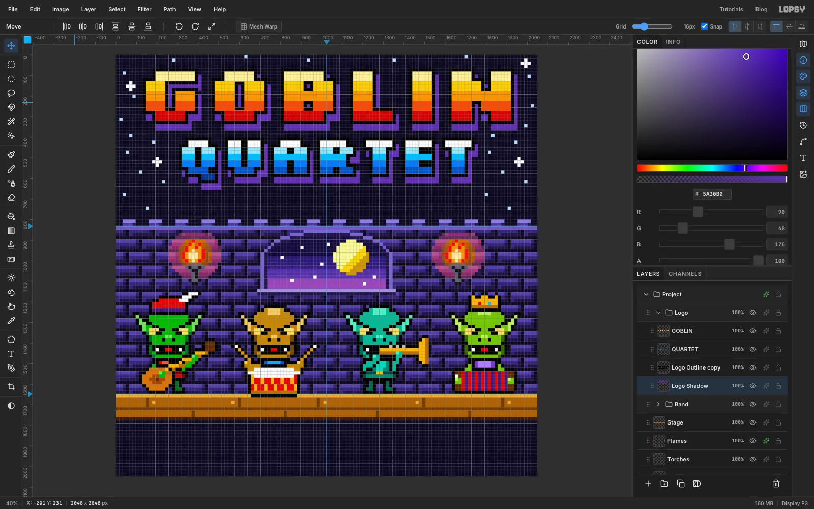

Duplicate the outline layer once more. The copy, **Logo Outline copy**,
stays on top as the outline. You can rename it **Logo Outline** if you
like, but the screenshots keep the default name. Click the original **Logo Outline** underneath
and rename it **Logo Shadow**.

[[Cmd]]-click its thumbnail, fill it with `#5A30B0` and deselect. With the
**Move** tool, press [[Down]] twice and [[Right]] once.

## Set the subtitle

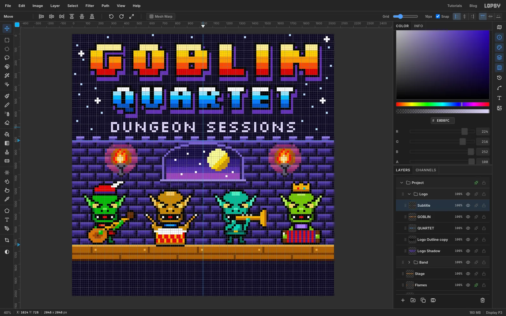

Select **GOBLIN**, so the subtitle lands inside the **Logo** group. Then
pick the **Text** tool:

- Font **Silkscreen**, **Font weight** **Regular**, **Size** **128**.
- At 128 px, one font pixel is one cell.
- Colour `#E0D8FC`.

Type **DUNGEON SESSIONS** in empty sky, press [[Tab]] and rasterize it.
Rename the layer **Subtitle** and drag it to **304, 688**.

There are now two cells between QUARTET's shadow and the subtitle, and two
cells between the subtitle and the merlons.

## Draw the menu box

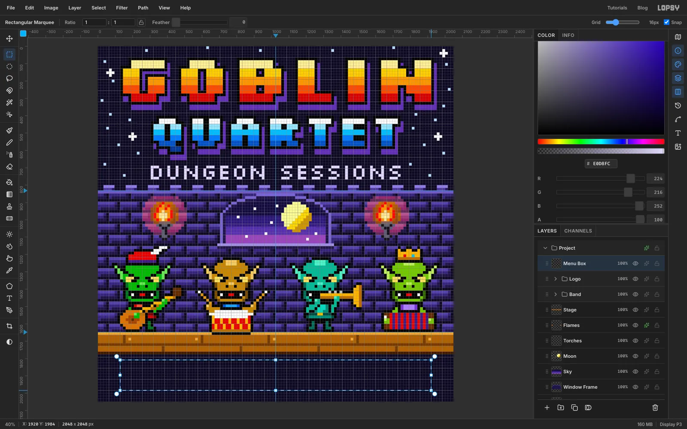

Collapse the **Logo** group and, with it selected, click **Add Layer**. A
new layer next to a collapsed group goes above the group, not inside it.
Name it **Menu Box**.

With the Rectangular Marquee, drag from **128, 1808** to **1920, 1984**.
That's 112 × 11 cells, with two cells of space below the stage and four
cells above the bottom edge of the canvas.

## Give the box a rounded pixel border

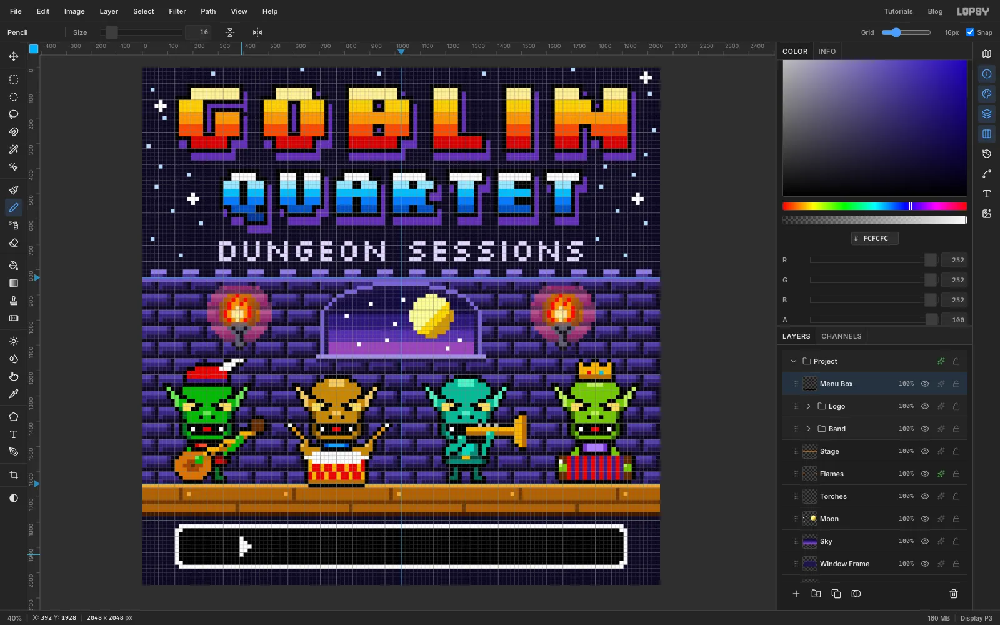

Fill the marquee with white. Choose **Select → Shrink…**, enter **16** and
fill again with black. That leaves a white border one cell wide. Deselect.

Round the corners the way game menus do. With the Pencil:

- Click each of the box's four outer corner cells in `#0C0820`, so they
  disappear.
- Click the four cells diagonally inside them in white, so the border turns
  the corner.

For the cursor, paint a small white arrow pointing right. It's five rows of
1, 2, 3, 2 and 1 cells, starting at x 384 and y 1856.

## Write the menu

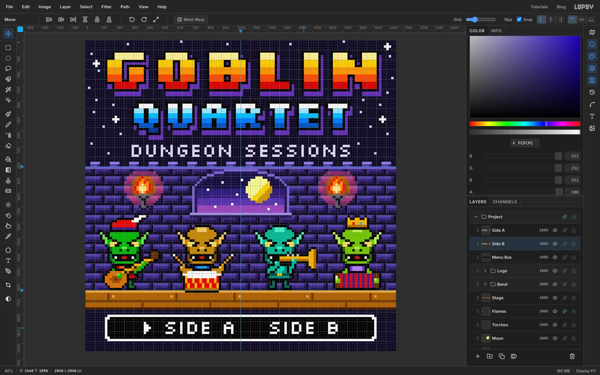

With **Menu Box** selected, use the Text tool with Silkscreen Regular at
**128**, white, to type **SIDE A** and **SIDE B** as two separate layers.
Rasterize both, and name the layers **Side A** and **Side B**.

Drag **SIDE A** to **528, 1856** and **SIDE B** to **1216, 1856**. This
gives:

- six cells (96 px) between the cursor and the S, so it reads as a cursor
  and not as part of the word;
- equal padding left and right inside the box: 15 cells on each side;
- two cells above and below the letters.

## Shade the lower wall

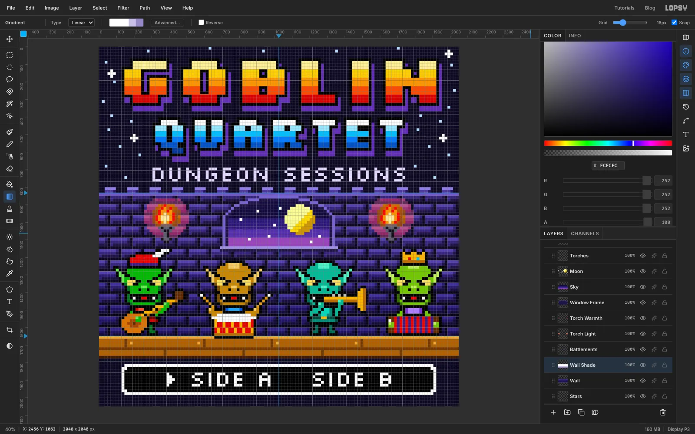

Select **Wall** and add a layer called **Wall Shade**. Marquee the wall,
from the 832 guide to the 1648 guide across the full width.

With the Gradient tool, make hard stops:

- `#FFFFFF` at 0% and 56%
- `#C8C0E8` at 58% and 77%
- `#9888C8` at 79% and 100%

Drag from the top of the wall to the stage. Deselect and set the layer's
blend mode to **Multiply**. White leaves the bricks alone, and the two
lilac steps darken the lower wall behind the band.

## Make a scanline tile

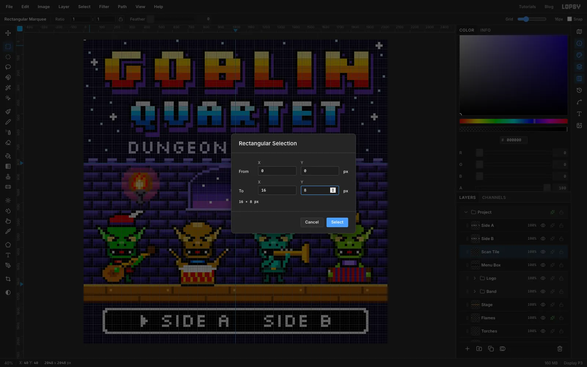

Select **Menu Box** and add a layer called **Scan Tile**. Untick **Snap** in
the options bar, because this tile is smaller than one cell.

With the Rectangular Marquee and nothing selected, click the canvas once
without dragging. The **Rectangular Selection** dialog opens.

1. Enter From **0, 0** To **16, 8**, click **Select** and fill with white.
2. Open the dialog again, enter From **0, 6** To **16, 8**, and fill with
   black.
3. Select **0, 0** to **16, 8** once more and choose **Edit → Define
   Pattern**.
4. Deselect and delete the **Scan Tile** layer.

## Lay the scanlines over the scene

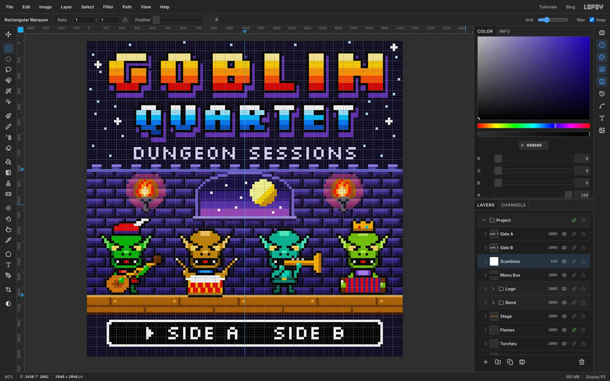

Add a layer called **Scanlines**. Choose **Select → All**, then **Edit →
Fill with Pattern…**, pick the new 16 × 8 tile and click **Apply**. Deselect,
set the blend mode to **Multiply** and the layer opacity to **14%**. Tick
**Snap** again.

The new layer sits just above **Menu Box**, so the scanlines cover the
whole picture except the **Side A** and **Side B** text, which stays crisp
on top.

Keep it subtle. Strong scanlines chop each cell into stripes and muddy small
details like the goblins' faces.

## Add a phosphor glow

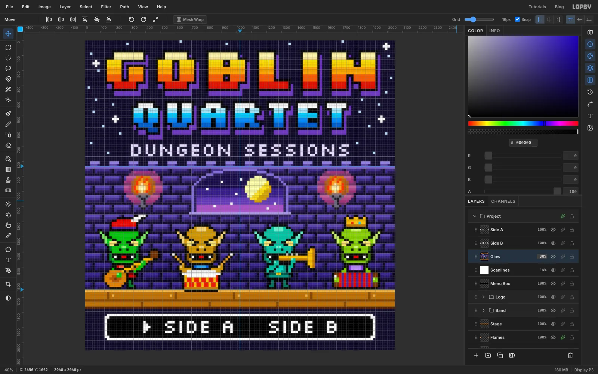

With **Scanlines** selected:

1. Choose **Select → All**, then **Edit → Copy Merged**, and deselect.
2. **Edit → Paste** puts a flat copy of the whole picture on a new layer.
   Rename it **Glow**.
3. Choose **Filter → Gaussian Blur…** with **Radius** **24**.
4. Set the blend mode to **Screen** and the opacity to **30%**.

The bright colours now bloom softly, like an old TV. The pixels underneath
stay sharp.

Choose **File → Quick Export PNG** to export the cover, and **File → Save
Project** to keep the layers.
