Opossums are up all night, and they have the trail camera photos to prove it.
In this tutorial you'll turn one of those photos into a T-shirt print styled as
the title screen of a forgotten 1987 game: **Insomniac Opossum**. The score
display counts the hours it has been awake, the sleep bar is nearly empty, and
the only way to win is to press Start and play dead.

The head isn't drawn from scratch. You'll cut it out of a real photo, then let
**Pixelate** and **Posterize** turn it into chunky blocks of flat tone. Those
blocks give you believable shading that would be hard to invent by hand. After
that you'll swap the greys for a limited palette and paint the character on
top: the fur pattern, tired eyes, nose and whiskers.

The photo is [Didelphis virginiana 367934275.jpg](https://commons.wikimedia.org/wiki/File:Didelphis_virginiana_367934275.jpg)
by henrya, on Wikimedia Commons, released under **CC0** (public domain). Download
the original 2048 × 1152 px file. Any front-on photo of an animal's face on a
dark background will work the same way.

**How the grid works.** The canvas is 2880 × 3616 px, but you'll treat it as a
screen of 180 × 226 chunky pixels, called **cells** here. Each cell is 16 × 16 px.
A position like "cell 48, 22" means column 48, row 22, counting from 0 at the top
left. Multiply by 16 to find it on the rulers: cell 48, 22 starts at x 768, y 352.

**Habits for the whole tutorial:**

- The Pencil doesn't snap to the grid. Its 16 px square is centred on the pixel under the pointer, so aim for the exact centre of a cell. Zoom to 100% or more, and check the X and Y readout in the status bar: each should be a multiple of 16 plus 8, such as 776 and 360 for cell 48, 22. Hold [[Space]] and drag to pan.
- A line is a click on the first cell, then [[Shift]]-click on the last.
- To get an exact selection, press [[Cmd]]+[[D]] so nothing is selected, then click once with a marquee tool without dragging. A dialog opens with **From X / Y** and **To X / Y** boxes. Type the numbers and press [[Enter]]. If something is already selected, the click only deselects it. Exact numbers matter in this tutorial because everything has to land on the 16 px grid.
- Double-click a layer's name to rename it. The icons at the bottom of the Layers panel include **+** (Add Layer), two overlapping squares (Duplicate Layer) and the bin (Delete Layer). Hover over one to see its name.

Free rotation and scaling blur pixel art, so you'll only use them **before** an
element is pixelated. After that, everything moves by whole cells.

The palette:

- Shirt `#0A0A12` (the background, not an ink)
- Sky `#003048` → `#00586C` → `#008C8C` → `#00A89C`
- Ring `#B8F8D8`, moon `#FCE0A8`, halo `#123C38` (Screen layer)
- Stars `#70E8D8` / `#FCFCFC`, pines `#06161E`
- Fur `#FCFCFC` / `#C4D4DC` / `#7C98A8` / `#34566A` / `#10202C`
- Ears `#2A3848` / `#546878`, inner ear `#F8A8B8`, ear tips `#FCE0A8`
- Eyes `#000000` / `#B8F818`, veins `#F83800`
- Eye bags `#6848B0` / `#9880D8`
- Nose `#F87898` / `#F8A8B8` / `#B83060`
- INSOMNIAC stripes `#FCFCFC` / `#B8F8D8` / `#40D8C8`
- OPOSSUM stripes `#FCE0A8` / `#F8B800` / `#F87818` / `#F83800` / `#B81800`, extrusion `#7C1800`
- Small type `#F87818` / `#40D8C8` / `#F87898` / `#C4D4DC` / `#94B0BC`
- Sprite tail `#F8A8B8` / `#D86888`, ear `#546878`

## Set up the shirt and the 16 px grid

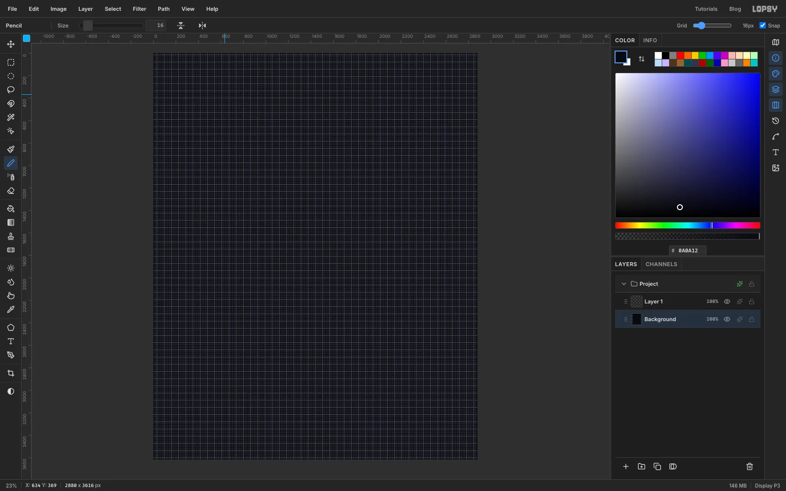

Choose **File → New**, enter **2880 × 3616** px and click **Create**. The height
matters: Lopsy's grid is centred on the document, and 3616 px is an even number
of cells (226). That puts the grid lines on exact multiples of 16, so they line
up with the blocks Pixelate makes later.

Click the **Background** layer, set the colour to `#0A0A12` in the Color panel,
and choose **Edit → Fill**. This colour stands in for the shirt.

Turn on **View → Show Grid**. In the options bar, check that **Grid** says
**16px** and **Snap** is ticked. Press [[N]] for the **Pencil** and set **Size** to
**16**, so one click paints one cell.

Toggle the grid off and on with **View → Show Grid** as you like while you work.
It's hidden in most of the following screenshots so you can see the art. Whenever
you nudge something by a whole cell, the grid has to be on.

## Make a stepped circle with a stencil

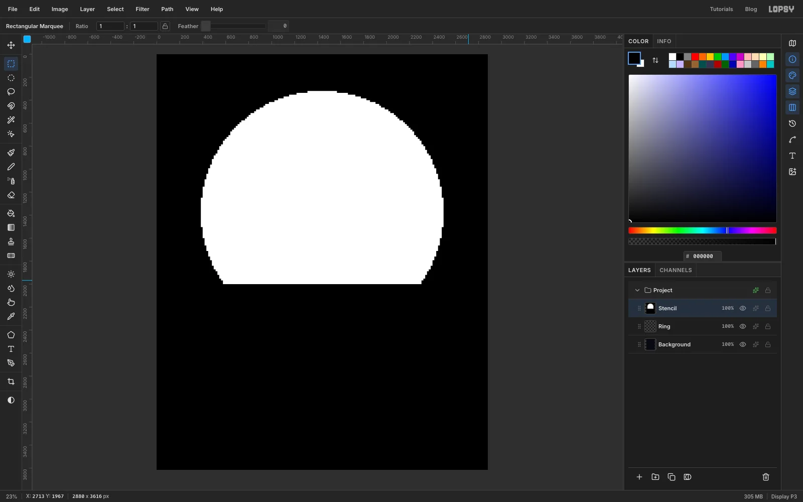

A selection circle has a smooth edge, which would look wrong here. This trick gives you a perfect stair-stepped circle. You'll use it several times, always on a temporary **Stencil** layer at the top of the stack, so you can see what you're doing.

Rename **Layer 1** to **Ring**, and leave it empty for now. Click **Add Layer** and name the new layer **Stencil**. Then:

1. Set the colour to `#000000` and choose **Edit → Fill**.
2. Choose the **Elliptical Marquee** from the toolbox and click once on the canvas. Enter From **384, 320** and To **2496, 2432**. Set the colour to `#FFFFFF` and choose **Edit → Fill**.
3. Flatten the bottom of the circle so it can sit on the title. Press [[Cmd]]+[[D]], press [[M]] for the **Rectangular Marquee**, click once and enter From **0, 2000** and To **2880, 3616**. Fill it with `#000000`, then press [[Cmd]]+[[D]].
4. Choose **Filter → Pixelate** and set **Block Size** to **16**. Click **Apply**.
5. Choose **Filter → Threshold** and set **Level** to **128**. Click **Apply**.

Pixelate averages each 16 px block, and Threshold forces each block to pure black or white. That leaves a shape made of whole cells. The rest of this tutorial calls those five steps "make a stencil".

## Add the ring and the sky

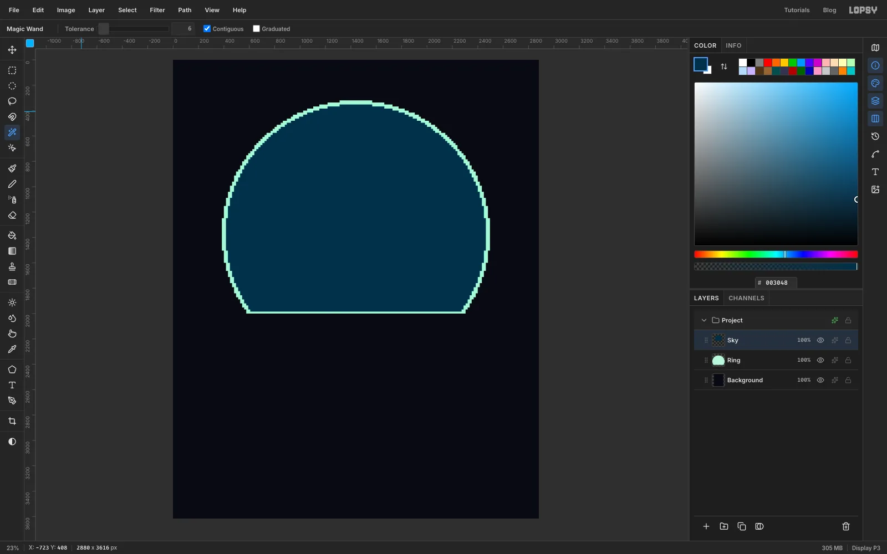

Press [[W]] for the **Magic Wand**. Set **Tolerance** to **6**, tick **Contiguous**, and click inside the white shape. Delete the **Stencil** layer with the bin icon. The selection stays behind. Click the **Ring** layer, set the colour to `#B8F8D8`, choose **Edit → Fill**, and press [[Cmd]]+[[D]].

Now do the same for the sky, with a slightly smaller circle. With **Ring** still active, click **Add Layer** and name it **Sky**. Click **Add Layer** again, name it **Stencil**, and make a stencil with these numbers:

- Elliptical Marquee: From **416, 352**, To **2464, 2400**, filled with `#FFFFFF`
- Rectangular Marquee: From **0, 1984**, To **2880, 3616**, filled with `#000000`
- **Pixelate** Block Size **16**, then **Threshold** Level **128**

Press [[W]] and click inside the white shape. Delete **Stencil**, click **Sky**, fill the selection with `#003048`, and press [[Cmd]]+[[D]].

The sky stops one row above the ring's base, so the ring closes neatly along the bottom.

## Paint three dither tiles

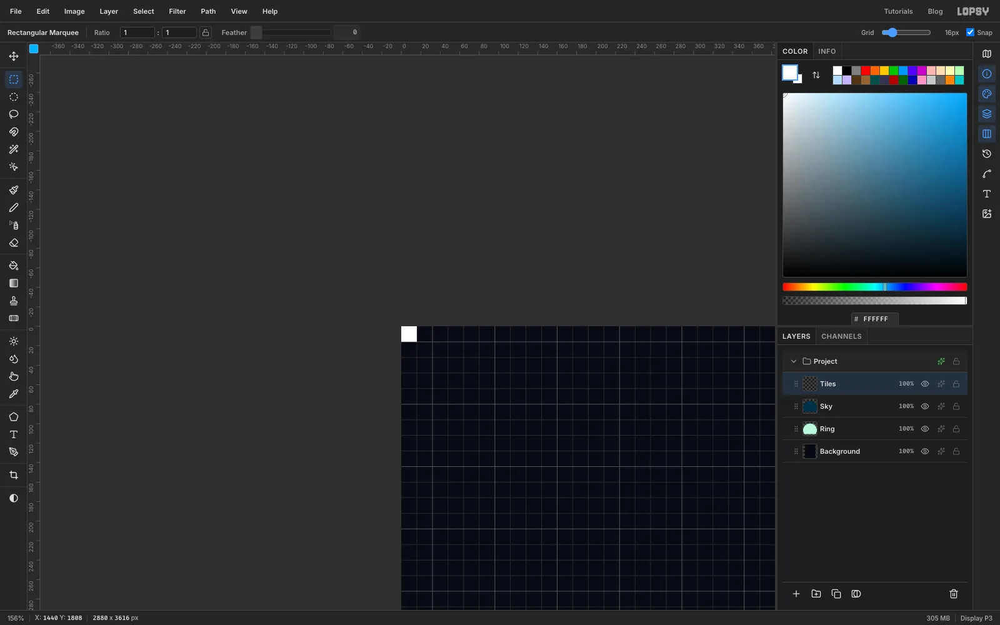

Old consoles couldn't do smooth gradients, so artists blended two colours with
checker patterns called **dither**. You'll make three pattern tiles: 25%, 50%
and 75% coverage.

Click the **Sky** layer, click **Add Layer**, and name it **Tiles**. Zoom in on the top left corner of the canvas. Press [[N]] and set the colour to `#FFFFFF`.

1. Click the first cell (cell 0, 0). Press [[M]], click once on the canvas and enter From **0, 0**, To **32, 32**. Choose **Edit → Define Pattern**, then press [[Cmd]]+[[D]]. That's Pattern 1, with one cell of four filled.
2. Press [[N]] and click cell 1, 1, the cell diagonally below the first. Select the same 32 × 32 area, define it as a pattern again, and press [[Cmd]]+[[D]]. That's Pattern 2, a checkerboard.
3. Press [[N]] and click cell 1, 0, the cell to the right of the first. Select the same area, define it once more, and press [[Cmd]]+[[D]]. That's Pattern 3, with one cell of four empty.

Delete the **Tiles** layer with the bin icon, then choose **View → Fit to Screen**.

> **Tip:** Patterns last only for the current session. If you reload the page, you'll
> have to define them again.

## Fill the first dither band

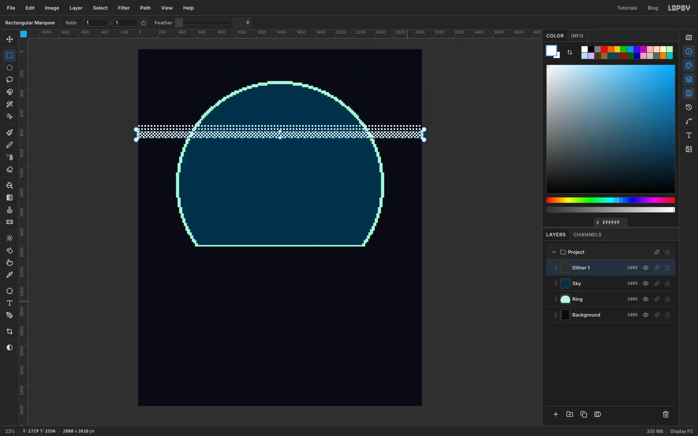

Click the **Sky** layer, click **Add Layer**, and name it **Dither 1**. You'll build a
band from sparse to dense, each step 4 cells (64 px) tall, across the whole width.

For each row below, use the click-once dialog on the **Rectangular Marquee**, then
choose **Edit → Fill with Pattern...**, click the pattern and click **Apply**. Press
[[Cmd]]+[[D]] before the next one.

- From **0, 768**, To **2880, 832**: Pattern 1
- From **0, 832**, To **2880, 896**: Pattern 2
- From **0, 896**, To **2880, 960**: Pattern 3

The pattern dialog lists the tiles in the order you defined them. Hover over one to see its
size.

## Tint the band with Color Overlay

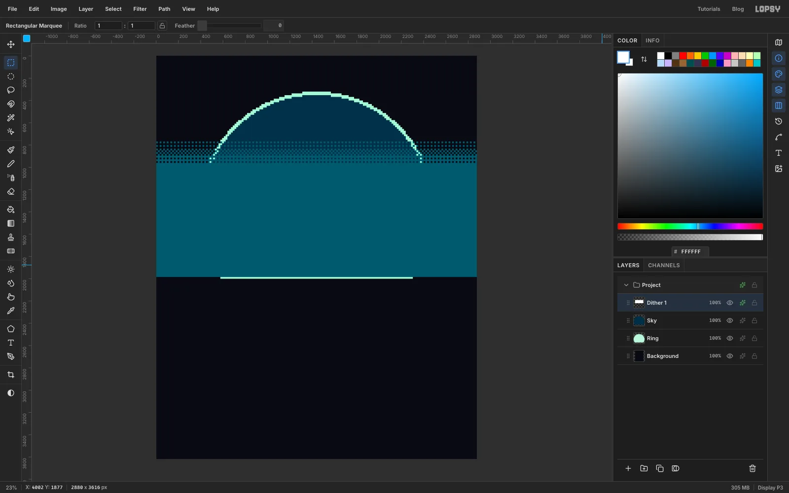

Finish the band with a solid block beneath it. Press [[M]], click once and enter From
**0, 960**, To **2880, 1984**. Fill it with `#FFFFFF` using **Edit → Fill**, then press
[[Cmd]]+[[D]].

Click the sparkle icon on the **Dither 1** row to open the effects drawer. Tick
**Color Overlay** and set its colour to `#00586C`. Close the drawer.

Painting everything white and colouring it with an overlay means you can retune
each sky colour later with one change.

## Add the other two bands

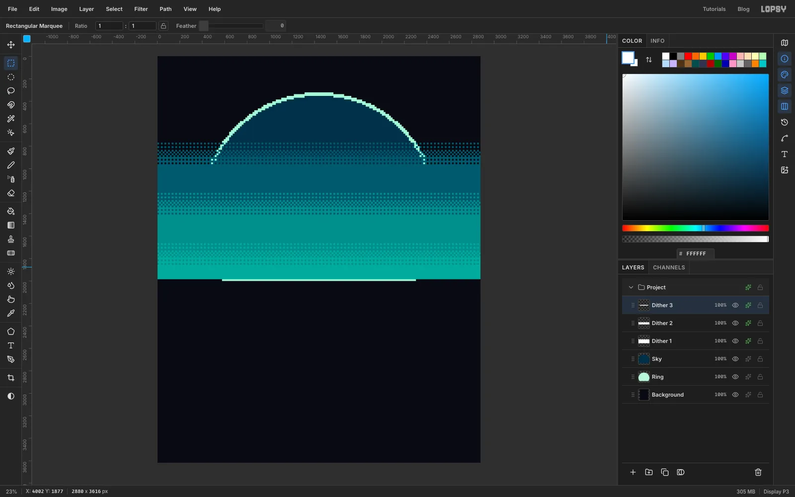

Click **Dither 1**, click **Add Layer**, name it **Dither 2**, and repeat with these
numbers. Then do the same on a **Dither 3** layer above it.

**Dither 2**

- From **0, 1216**, To **2880, 1280**: Pattern 1
- From **0, 1280**, To **2880, 1344**: Pattern 2
- From **0, 1344**, To **2880, 1408**: Pattern 3
- From **0, 1408**, To **2880, 1984**: **Edit → Fill** with `#FFFFFF`
- **Color Overlay** `#008C8C`

**Dither 3**

- From **0, 1664**, To **2880, 1728**: Pattern 1
- From **0, 1728**, To **2880, 1792**: Pattern 2
- From **0, 1792**, To **2880, 1856**: Pattern 3
- From **0, 1856**, To **2880, 1984**: **Edit → Fill** with `#FFFFFF`
- **Color Overlay** `#00A89C`

The bands spill out past the ring for now. You'll trim them in a moment.

## Rotate a crescent moon on a stencil

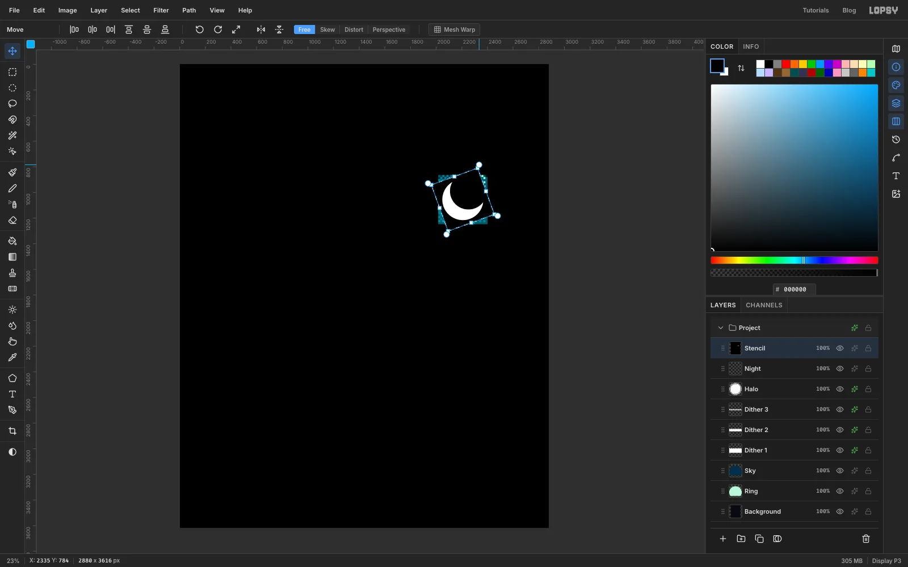

**First, the halo**, a soft patch of light with a checker edge.

1. Click **Dither 3**, click **Add Layer** and name it **Halo**.
2. Click **Add Layer**, name it **Stencil**, and make a stencil from a white Elliptical Marquee, From **1952, 832**, To **2400, 1280**. This one has no flat base. Press [[W]], click inside the white disc, and delete **Stencil**. Click **Halo**, choose **Edit → Fill with Pattern...** with Pattern 2, and press [[Cmd]]+[[D]].
3. Do the same with a smaller stencil, From **2000, 880**, To **2352, 1232**. This time click **Halo** and use **Edit → Fill** with `#FFFFFF`. Press [[Cmd]]+[[D]].
4. Open the effects drawer on **Halo**. Set **Blend** to **Screen** and turn on **Color Overlay** in `#123C38`. Close the drawer.

**Then the moon.** With **Halo** active, click **Add Layer** and name it **Night**. Click **Add Layer** again and name it **Stencil**.

1. Fill the layer with `#000000`. Fill an Elliptical Marquee, From **2048, 896**, To **2368, 1216**, with `#FFFFFF`.
2. Bite the crescent out by filling a second Elliptical Marquee, From **2128, 864**, To **2416, 1152**, with `#000000`. Press [[Cmd]]+[[D]].
3. Turn the grid off (**View → Show Grid**). With it on, rotation snaps to 15° steps.
4. Press [[M]], click once and enter From **2016, 864**, To **2400, 1248**. Press [[V]] for the **Move** tool and drag the round handle just outside a corner of the box to tilt the moon about 20° anticlockwise. Press [[Cmd]]+[[D]] to commit it.
5. Run **Pixelate** 16 and **Threshold** 128. The rotated curve becomes clean steps.

Rotating here is safe because the pixelate step comes afterwards.

## Fill in the moon, stars and pines

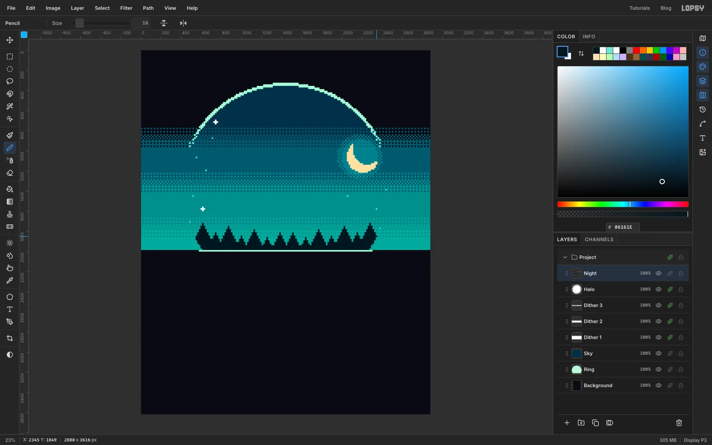

Press [[W]] and click inside the white crescent, with **Contiguous** still ticked. Delete **Stencil**, click **Night**, set the colour to `#FCE0A8`, choose **Edit → Fill**, and press [[Cmd]]+[[D]]. Turn the grid back on so you can count cells.

Stay on **Night** and press [[N]] for the Pencil, still at Size 16.

- **Small stars:** about a dozen single cells of `#70E8D8`, scattered around the sides of the sky. The head will cover the middle, so don't bother with that.
- **Big stars:** three small crosses of `#FCFCFC`, 5 cells each, in the upper left, the right and the lower left.
- **Pines:** set the colour to `#06161E`. Each pine is a triangle of vertical lines, all ending on row 123 (y 1968). Click the top cell of a column, then [[Shift]]-click down to row 123. Each column is 2 cells shorter than the one beside it, so the sides stay at a steady slope. Make about sixteen pines of mixed height, 8 to 17 cells tall, from one side of the sky to the other, overlapping them slightly. Fill the gaps at the base with a low band of 3 rows.

Keep the pines pointing up with clear tips. If they're too even, they start to look like icicles hanging from the title.

## Trim everything to the sky

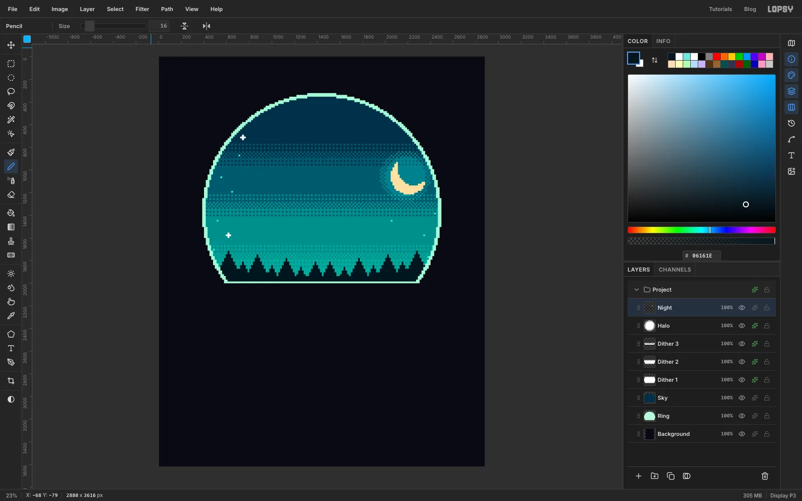

Click the **Sky** layer. Hold [[Cmd]] and click its thumbnail to select its shape, then choose
**Select → Inverse**. The selection is now everything outside the sky.

Click each of these layers in turn and press [[Delete]] on each: **Dither 1**, **Dither 2**,
**Dither 3**, **Halo**, **Night**.

Press [[Cmd]]+[[D]].

## Paint the ears with Symmetry

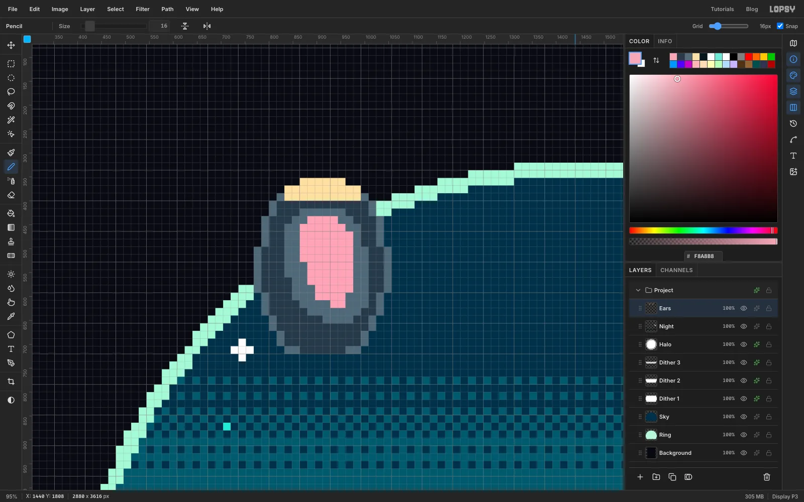

Click **Night**, click **Add Layer**, and name it **Ears**. Press [[N]], and click the **Symmetry
Vertical** button in the options bar, the second of the two mirror icons after Size. Whatever you paint on the left now appears mirrored on the right,
around the middle of the document.

Paint the left ear in the area from cell 48, 22 to cell 65, 44, as in the picture:

1. An upright oval of `#2A3848`.
2. A ring 2 cells wide of `#546878`, inside the oval and on its outer edge.
3. A long pink centre of `#F8A8B8`, about 7 cells wide and 13 cells tall, with a slight lean.
4. The top 3 rows in cream, `#FCE0A8`. Real opossums have pale ear tips, and this also stops the dark
   ears vanishing into a dark shirt.

**Click Symmetry Vertical again to turn it off.** While it's on, a [[Cmd]]-press on the canvas moves
the mirror's centre instead of doing anything else, and that would block the scaling in the next
few steps.

## Drop in the trail camera photo

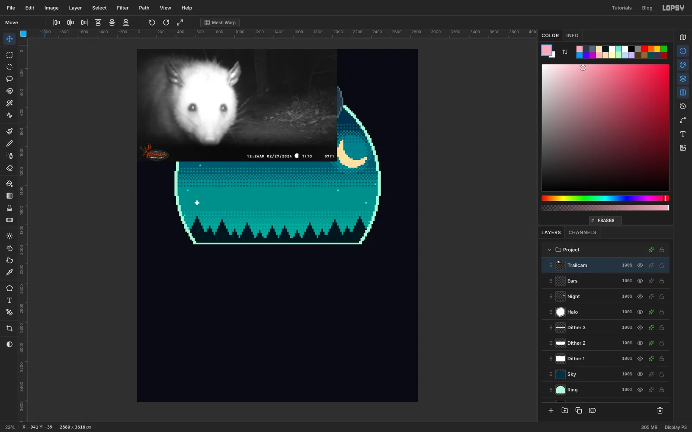

Make sure **Ears** is the active layer. Drag the photo from your computer onto the canvas. It arrives as
a new layer in the top left corner. Rename it **Trailcam** and press [[Cmd]]+[[D]] if anything is
selected.

The photo is a perfect starting point. The face is blown out to a bright white, the background is nearly
black, and the eye sockets are soft dark smudges.

## Lasso just the head

Press [[L]] for the **Lasso**. Trace around the head in one continuous drag and close the loop:

- Start at the crown, between the ears.
- Go down the outside of each cheek, staying on the fur.
- Taper in to a narrow chin, just below the nose.
- Leave out the ears, the body on the left and the background. You've already painted better ears.

Make it close to symmetrical, even if the photo isn't. A narrow, pointed head reads as an opossum. A wide
one looks like a rat.

Choose **Select → Inverse** and press [[Delete]], then press [[Cmd]]+[[D]].

## Scale the head up

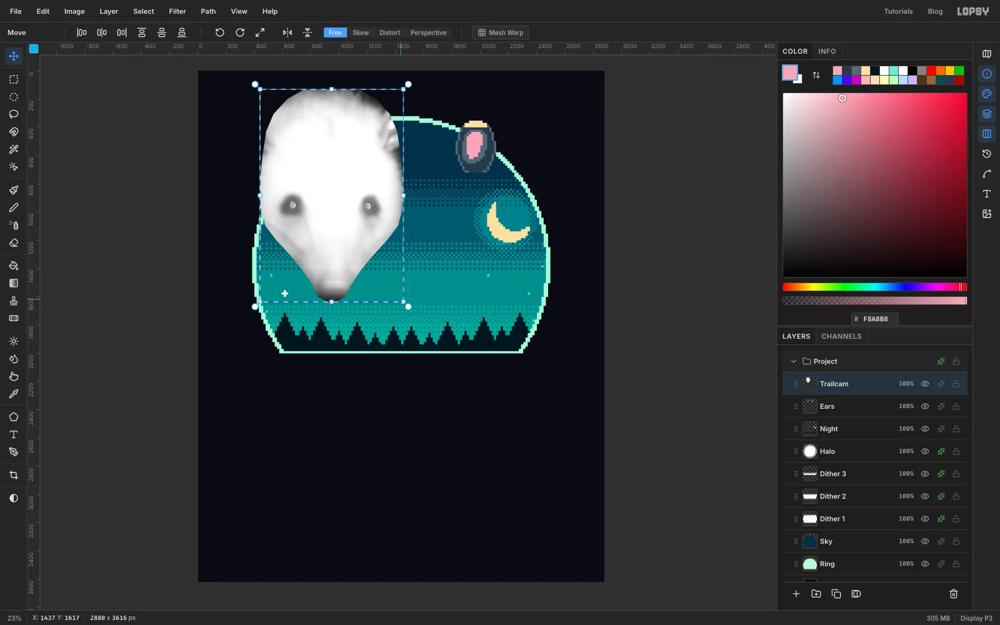

Turn the grid off if it's on, because you want this placement to be free.

Press [[M]] and drag a marquee around the head, keeping it tight. Press [[V]] for the **Move** tool. Hold
[[Cmd]] and drag the bottom right corner handle outward until the head is **75% bigger** than it was,
about 1,015 px wide and 1,505 px tall. Judge it on the rulers. Holding [[Cmd]] keeps the proportions.

At this zoom the round rotate handle sits right beside the corner square. If the box starts to turn
instead of growing, press [[Cmd]]+[[Z]] and grab just inside the corner.

Press [[Cmd]]+[[D]] to commit the scale. Enter doesn't commit a Move-tool transform.

## Place the head on the roundel

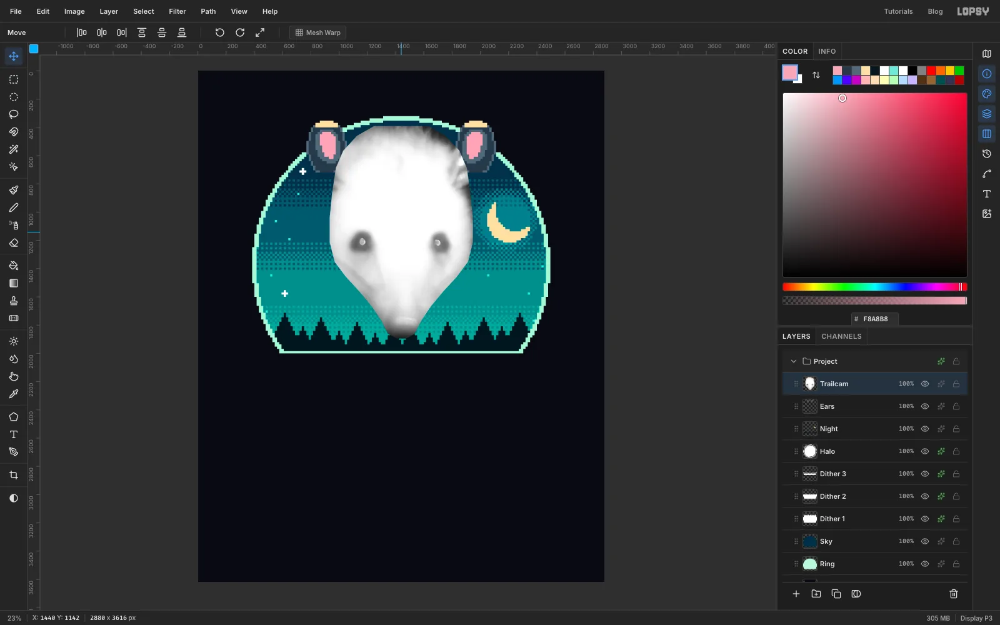

With nothing selected and the **Move** tool still active, drag the head so it's centred on the
middle of the canvas, x 1440, with the top of its head around y 390. The chin should end
just above the base of the sky, near y 1890, and the ears should sit behind the top corners of the head.
The rulers help you judge this.

Soft edges are fine, since this is the last moment the head will look like a photo.

## Back the head with black

Pixelate leaves transparent areas alone, so a cut-out would keep its smooth outline. To get stair-stepped
edges, the layer has to be solid first.

Click the **Trailcam** layer. Hold [[Cmd]] and click its thumbnail, then choose **Select → Inverse**. Set the
colour to `#000000`, choose **Edit → Fill**, and press [[Cmd]]+[[D]].

The whole layer is now opaque, and it covers everything underneath for a moment.

## Pixelate the head

Choose **Filter → Pixelate**, set **Block Size** to **16**, and click **Apply**.

Each 16 px block becomes a flat average of the photo beneath it. Since the layer now fills the whole
canvas, the blocks line up exactly with your grid.

## Posterize it to six tones

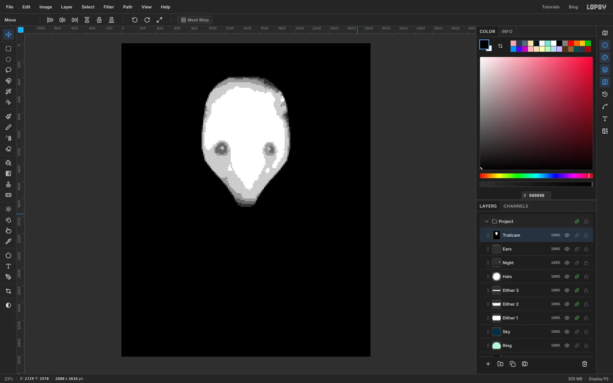

Choose **Filter → Posterize**, set **Levels** to **6**, and click **Apply**.

Every block snaps to one of six greys: black, four in-between tones and white. This is where you get the
natural shading: darker around the rim and the eye sockets, and bright across the forehead and muzzle.

## Swap the greys for the palette

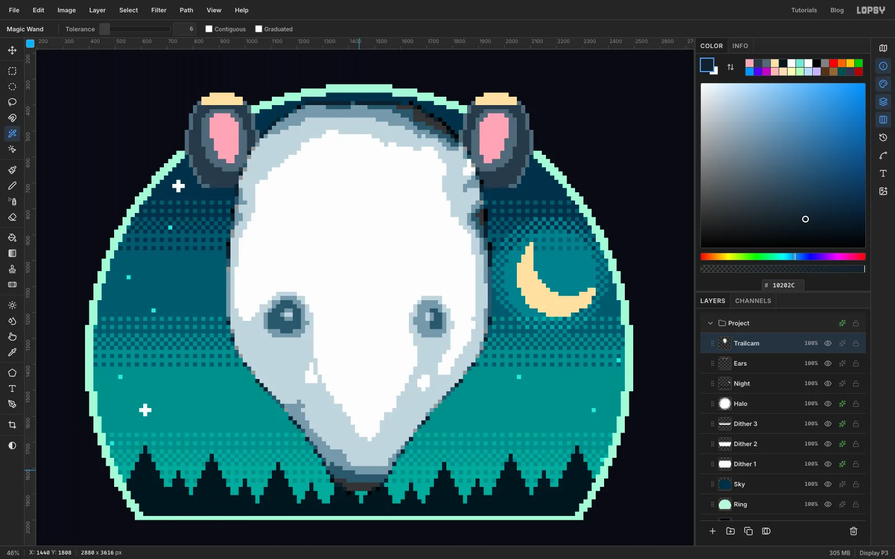

First remove the black. Press [[W]], keep **Tolerance** at **6** with **Contiguous** ticked, and click the
black in a corner of the canvas. Press [[Delete]], then [[Cmd]]+[[D]]. The sky and ears come back. Any black
enclosed inside the head stays, which is what you want.

Now **untick Contiguous**. With it off, one click selects every matching block across the layer. For each
pair below, click a block of that grey, choose **Edit → Fill** with the new colour, and press [[Cmd]]+[[D]].
Work from lightest to darkest:

- White becomes `#FCFCFC`
- Light grey (`#CCCCCC`) becomes `#C4D4DC`
- Mid grey (`#999999`) becomes `#7C98A8`
- Darker grey (`#666666`) becomes `#34566A`
- Darkest grey (`#333333`) becomes `#10202C`

You can check a block's grey with the **Eyedropper**, [[I]]. The cool blue tint is what ties the head to the
night sky.

## Paint the fur pattern

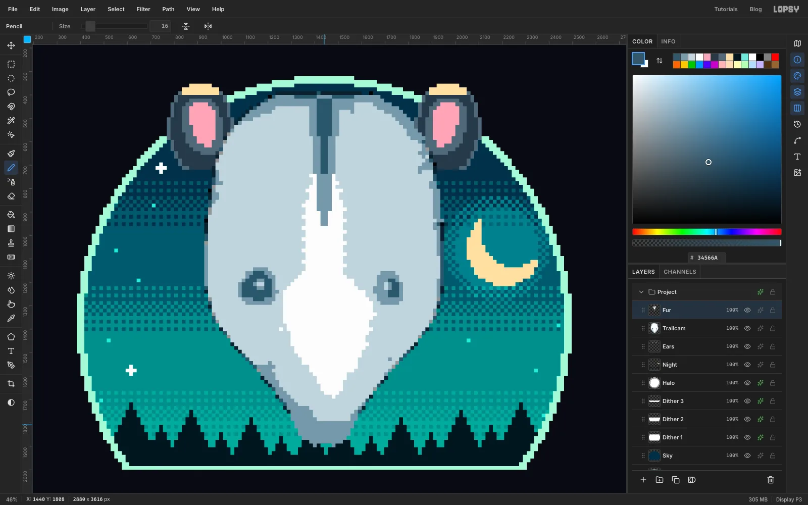

At this point the head is a big white blob, more like a ghost than an opossum. Real ones have a white face with greyer fur around it, so you'll cover the white and paint a narrow part of it back.

Click **Trailcam**. Press [[W]], with **Contiguous** still unticked, and click a white block. Click **Add Layer** and name it **Fur**. Set the colour to `#C4D4DC`, choose **Edit → Fill**, and press [[Cmd]]+[[D]]. All the white is now pale grey.

Press [[N]], turn the grid on if it's off, and paint on **Fur** with Shift-click lines:

1. **Paint the blaze back in `#FCFCFC`.** It starts about 6 cells wide at the brow near row 46 and stays narrow down the forehead. It widens between the eyes to about 26 cells across the muzzle around row 80, then narrows towards the nose. Make the edge slightly ragged by going in and out a cell, so it reads as fur rather than a cut shape.
2. **Shade the rim.** Paint the outer 2 cells of the head in `#7C98A8` wherever they're pale grey, for a rounded skull. Cover the dark chin in the same colour.
3. **Tidy up.** Paint out any odd specks or dark diagonals from the photo. On the right cheek, around rows 48 to 58, square up the edge so it matches the left side.
4. **Add the crown stripe.** Paint a tapering stripe from between the ears (row 26) down to the brow (row 59): `#34566A` in the middle and `#7C98A8` either side. Start it 8 cells wide and narrow it as it goes down.

## Add the eyes with Symmetry

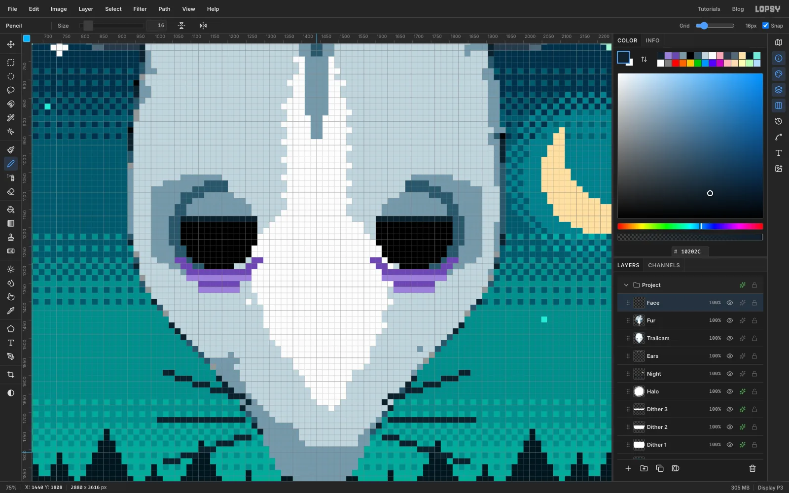

Hold [[Cmd]] and click the **Trailcam** thumbnail to select the head's shape, then click the **Fur** layer. Press [[N]] and turn **Symmetry Vertical** back on.

Paint soft patches around the eyes, centred on cell 73, 75. Use `#34566A` within about 8 cells of the centre and `#7C98A8` just beyond that, keeping to the side of the head rather than the blaze. The selection keeps the paint on the head. Press [[Cmd]]+[[D]].

Click **Add Layer** and name it **Face**. With Symmetry still on, paint the left side and let the right follow:

1. **Eye:** a black (`#000000`) circle 13 cells wide, from cell 67, 69 to cell 79, 81.
2. **Heavy lid:** cover the top 4 rows of the eye in flat `#7C98A8`, and add a 1-cell lash line of `#10202C` on row 73, right across the eye. A flat lid is what makes the eye look tired.
3. **Bags:** starting on row 80, paint a crescent under the eye, 6 rows deep, alternating `#6848B0` and `#9880D8`.
4. **Whiskers:** three thin lines of `#10202C` fanning out from the muzzle, starting near rows 104, 107 and 110 and each about 15 cells long. Use [[Shift]]-clicks with a slight slope for the outer two.

Turn **Symmetry Vertical** off before going on.

## Finish the face by hand

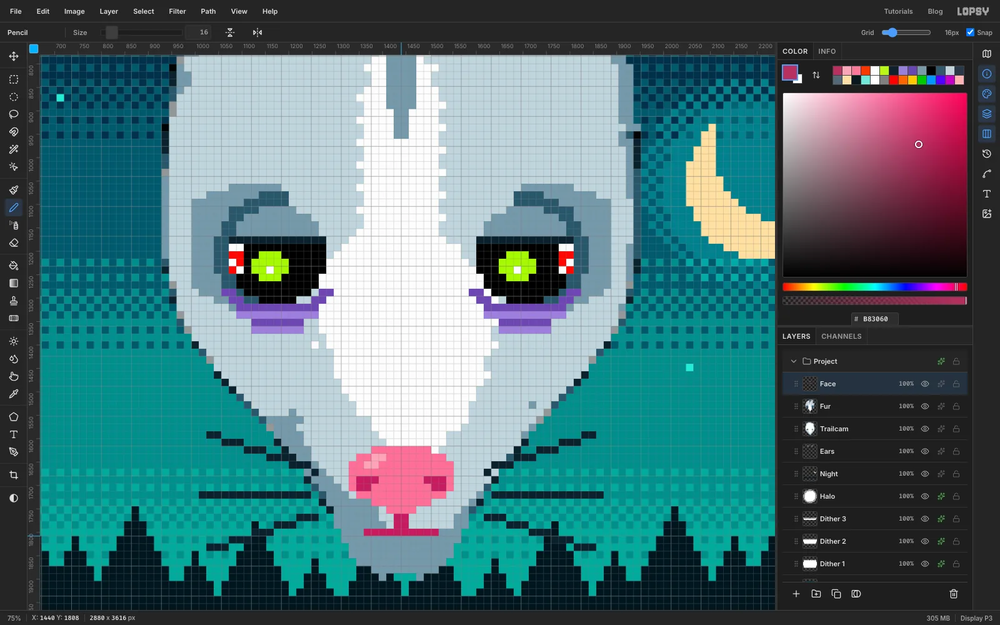

Paint these on the **Face** layer with Symmetry off. A mirrored glint would make the opossum look cross-eyed, so both glints sit on the same side of their eyes.

- **Glint:** a small oval of `#B8F818`, 5 cells wide and 4 tall, starting at cell 70, 75 in the left eye and cell 103, 75 in the right. Put a single `#FCFCFC` cell in
  the middle. This is the green shine you see in real night-time animal photos.
- **Bloodshot corners:** at the outer corner of each eye, paint a wedge of `#FCFCFC` 2 cells wide and 4 tall, on rows 74 to 77.
  Then add a few cells of `#F83800` inside each wedge as veins.
- **Nose:** a rounded shape 14 cells wide and 9 tall, from cell 83, 101, in `#F87898`. Add a highlight of `#F8A8B8` on the upper left
  and two nostril patches of `#B83060`.
- **Mouth:** a 2-cell-wide line of `#B83060` going down from the nose for 2 rows, then a 10-cell-wide line across, on row 112.

That's the hero finished. Look at it from across the room. If it reads as an exhausted opossum rather than a white rat, you're done.

## Set INSOMNIAC with colour bands

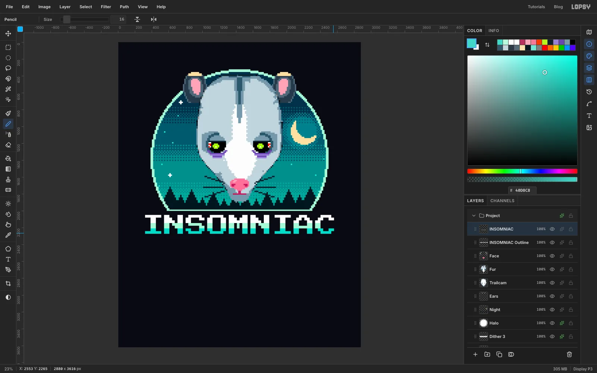

Click the **Face** layer and press [[T]] for the **Text** tool. Choose the font **Press Start 2P**, **Size 256**, and set the colour to `#FFFFFF`.
Click in the empty space below the roundel, type **INSOMNIAC**, and press [[Tab]] to commit it.

At Size 256 each font pixel is exactly 2 cells wide. Click **Rasterize Layer** at the bottom of the Layers panel and rename the
layer **INSOMNIAC Outline**. Now place it. With the grid on, press [[V]] and drag the word so its top left corner lands at x 320, y 2048. On a rasterized layer, the corner of the letters snaps to the grid.

Click **Duplicate Layer**, click the new copy's row, and rename it **INSOMNIAC**.

**Colour bands.** [[Cmd]]-click the **INSOMNIAC** thumbnail so paint stays inside the letters, then press [[N]]. Paint Shift-click lines straight across the word, one row of cells at a
time. The word is 14 rows tall, from row 128 to row 141:

- Rows 128 to 133: `#FCFCFC`
- Rows 134 to 137: `#B8F8D8`
- Rows 138 to 141: `#40D8C8`

Press [[Cmd]]+[[D]].

**Outline.** Click **INSOMNIAC Outline**, [[Cmd]]-click its thumbnail, and fill it with the shirt colour `#0A0A12`. Press [[Cmd]]+[[D]]. Now turn on the grid and thicken it by one cell in each direction:

1. Click **Duplicate Layer**, then click the copy's row.
2. Press [[V]] and press an arrow key once to move it one cell.
3. Choose **Layer → Merge Down**.

Do that once each for left, right, up and down. This makes square pixel corners. Select → Grow and the Stroke effect would round them.

## Build OPOSSUM with a solid extrusion

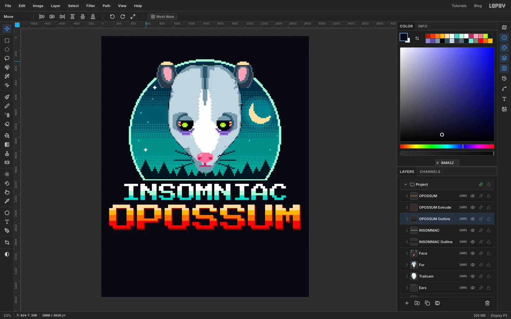

Click the **INSOMNIAC** layer. Press [[T]], set **Size 384**, colour `#FFFFFF`, click in the empty space
below, type **OPOSSUM**, and press [[Tab]]. At this size each font pixel is 3 cells wide.

Click **Rasterize Layer**, rename it **OPOSSUM Outline**, press [[V]] and drag it so the letters start at x 112, y 2336, with the grid on so they snap.

Click **Duplicate Layer** twice. Name the middle copy **OPOSSUM Extrude** and the top copy **OPOSSUM**, clicking each row before you rename it.

**Bands.** [[Cmd]]-click the **OPOSSUM** thumbnail and paint rows across the word with the Pencil. It's 21 rows tall, from row 146 to row 166:

- Rows 146 to 150: `#FCE0A8`
- Rows 151 to 154: `#F8B800`
- Rows 155 to 159: `#F87818`
- Rows 160 to 165: `#F83800`
- Row 166: `#B81800`

Press [[Cmd]]+[[D]].

**Extrusion.** Click **OPOSSUM Extrude**, [[Cmd]]-click its thumbnail, fill it with `#7C1800`, and press [[Cmd]]+[[D]]. With the grid on and the
Move tool active, press the right arrow once and the down arrow once.

**Outline.** Click **OPOSSUM Outline**, [[Cmd]]-click its thumbnail, fill it with `#0A0A12`, and press [[Cmd]]+[[D]]. Then duplicate, nudge and merge as before, five
times: first one cell right *and* one cell down, then left, right, up and down. The first pass makes the outline wrap around the extrusion too.

## Add the score display and small type

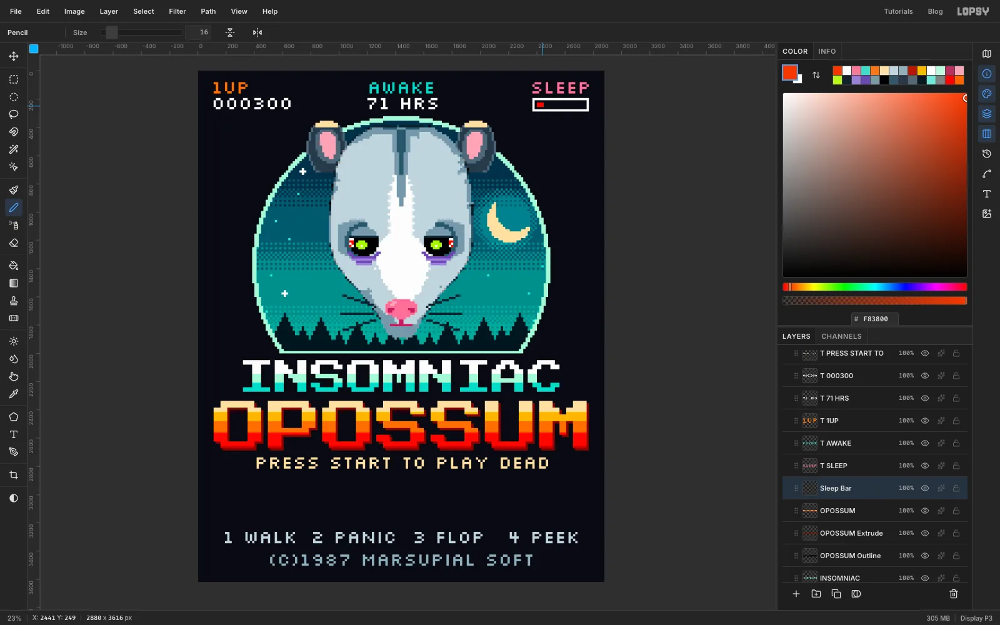

All the small type is **Silkscreen** at **Size 128**, where one font pixel is one cell. For each line:

1. Click the **OPOSSUM** layer, press [[T]], and set the size and colour.
2. Click in clear space, type the text, and press [[Tab]].
3. Click **Rasterize Layer**. Press [[V]] and, with the grid on, drag the line into place. Rasterizing makes the corner of the letters snap to the grid, so each line stays crisp.

The position is where the top left of the letters should land.

- `(C)1987 MARSUPIAL SOFT`, `#94B0BC`, cell 32, 214
- `1 WALK`, `#C4D4DC`, cell 12, 204
- `2 PANIC`, `#C4D4DC`, cell 51, 204
- `3 FLOP`, `#C4D4DC`, cell 96, 204
- `4 PEEK`, `#C4D4DC`, cell 138, 204
- `PRESS START TO PLAY DEAD`, `#FCE0A8`, cell 26, 171
- `000300`, `#FCFCFC`, cell 7, 12
- `71 HRS`, `#FCFCFC`, cell 75, 12
- `1UP`, `#F87818`, cell 7, 5
- `AWAKE`, `#40D8C8`, cell 76, 5
- `SLEEP`, `#F87898`, cell 148, 5

For the sleep bar, click the **OPOSSUM** layer, click **Add Layer** and name it **Sleep Bar**. Press [[N]] and draw a `#FCFCFC` box with Shift-click lines, from cell 148, 12 to cell 172, 17. Then
paint a tiny red `#F83800` fill inside it, 3 cells wide and 2 tall, from cell 150, 14. Nearly empty: that's the joke.

Check the margins: the score display, OPOSSUM and the sprites should all stop 7 cells from each edge of the shirt.

## Paint the first sprite

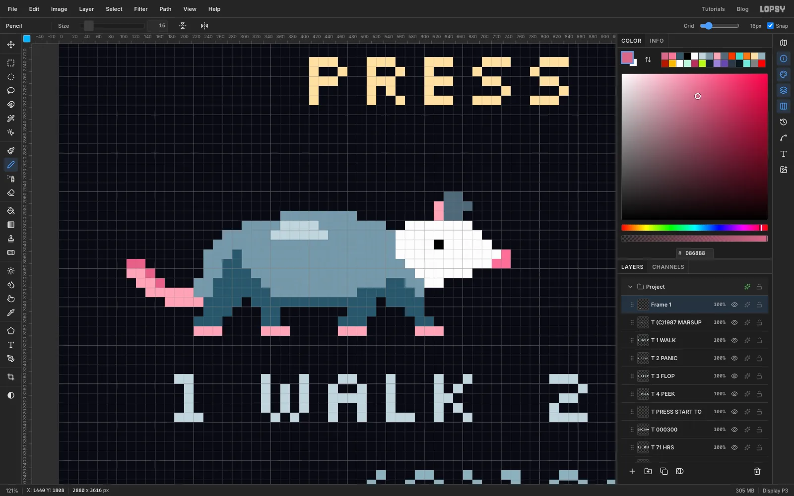

Click the top text layer (the **(C)1987** line), click **Add Layer** and name it **Frame 1**. This sprite is 40 cells wide and 15 tall, from cell 7, 185, and it's painted a cell at a time. With the grid on, count cells from the close-up.

1. **Body:** a long oval of `#7C98A8`, with an arched back, from column 15 to column 37.
2. **Shading:** `#34566A` along the belly and hind quarters, and for the legs on the far side. Add a small highlight of `#C4D4DC` on the back.
3. **Head:** a wedge of `#FCFCFC` pointing right, ending at a `#F87898` nose. Add a single black `#000000` cell for the eye.
4. **Ear:** `#546878`, sticking up behind the head, with a `#F8A8B8` edge.
5. **Tail:** a long, bare `#F8A8B8` tail running down and back from the rump, with a little `#D86888` at the tip.
6. **Legs:** four short `#34566A` legs in a walking pose, with `#F8A8B8` feet on the bottom row.

## Duplicate it for the panic frame

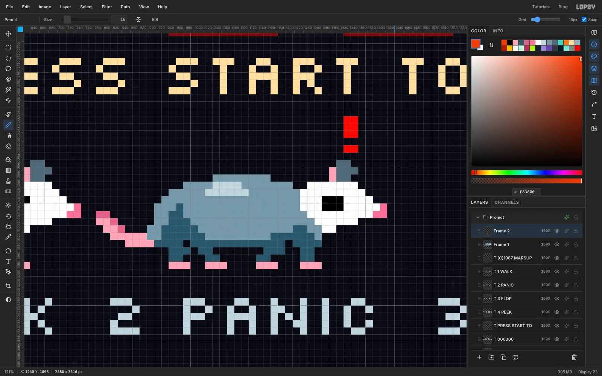

Click **Duplicate Layer**, click the copy's row, and rename it **Frame 2**. Press [[V]] with the grid on. Drag the copy **42 cells to the right**, so it starts at cell 49, 185. Snap keeps its top left corner on the grid. Watch that it doesn't shift up or down.

Now change the pose:

1. Press [[M]], click once with nothing selected, and enter From **784, 3152**, To **1424, 3200**. That's the bottom 3 rows of the sprite. Press [[Delete]], then [[Cmd]]+[[D]].
2. Press [[N]] and repaint the legs pulled together, in the same colours.
3. Make the eye wide: a 3 × 2 block of `#000000` in place of the single cell.
4. Add a red `#F83800` exclamation mark above the head, 2 cells wide: 3 rows for the stroke, a gap of 1 row, and 1 row for the dot.

## Flip a copy on its back

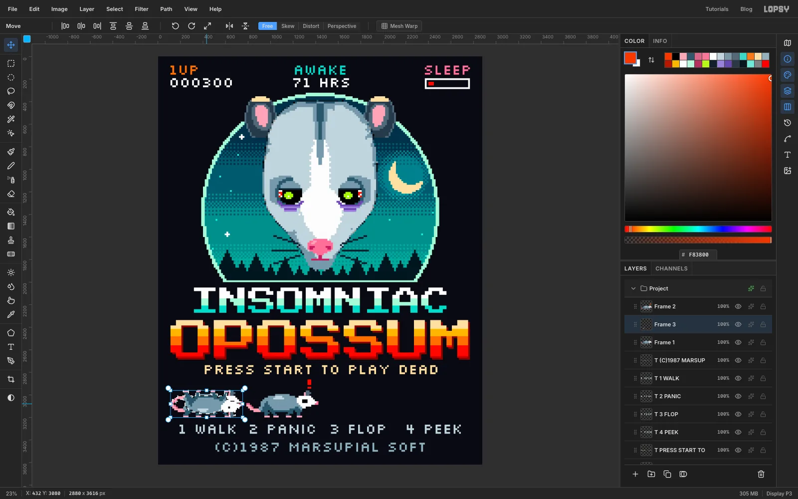

Opossums really do fall over and play dead. Happily, flipping a sprite is safe because no pixels get resampled.

Click **Frame 1**, click **Duplicate Layer**, click the copy's row and rename it **Frame 3**. Press [[M]], click once, and enter From **112, 2960**, To **752, 3200** to select the whole sprite.
Press [[V]] and click **Flip Vertical** in the options bar. Press [[Cmd]]+[[D]].

With the **Move** tool and the grid on, drag it **84 cells to the right**, to start at cell 91, 185.

## Lower it and add the dead face

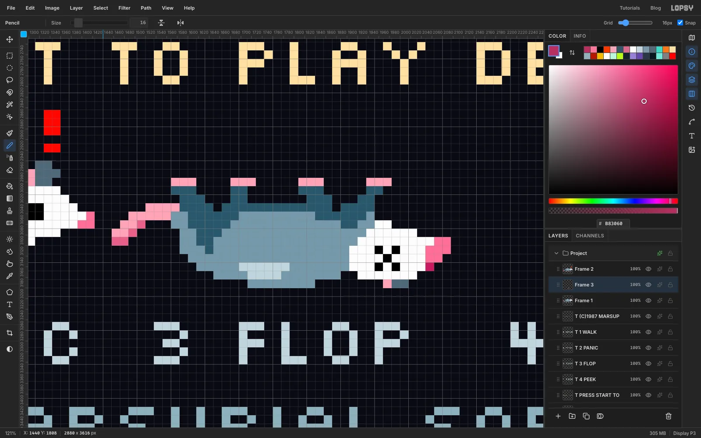

The ears are on the bottom now and they're holding the body up in the air. Press [[M]], click once, and enter From **1456, 3168**, To **2096, 3200** to select the bottom 2 rows. Press [[Delete]], then [[Cmd]]+[[D]].

Press [[V]] with the grid on and press the down arrow **twice**, so the back rests on the ground line you'll draw soon.

Press [[N]] and paint:

- **X eye:** 5 black `#000000` cells in an X, on the white head.
- **Tongue:** 2 × 2 cells of `#F87898` at the tip of the snout, with one `#B83060` cell below.

## Duplicate it for the last gag

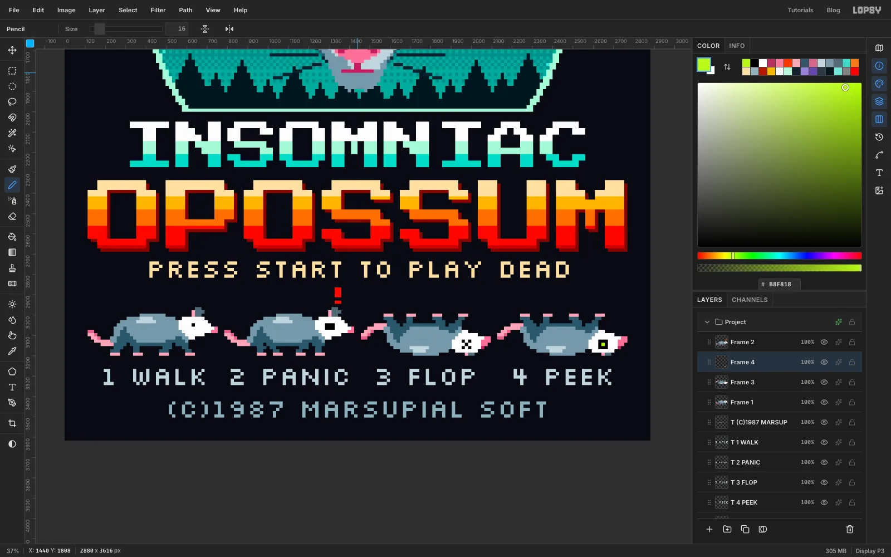

The fourth frame is the punchline: it's only pretending.

With **Frame 3** active, click **Duplicate Layer**, click the copy's row and rename it **Frame 4**. Press [[V]] and drag it **42 cells to the right**, to start at cell 133.

Press [[N]]. Paint over the X with `#FCFCFC`, then paint a 3 × 3 black eye in the same place, with a single `#B8F818` cell in the centre. It's peeking to check whether you've left.

## Draw the ground line

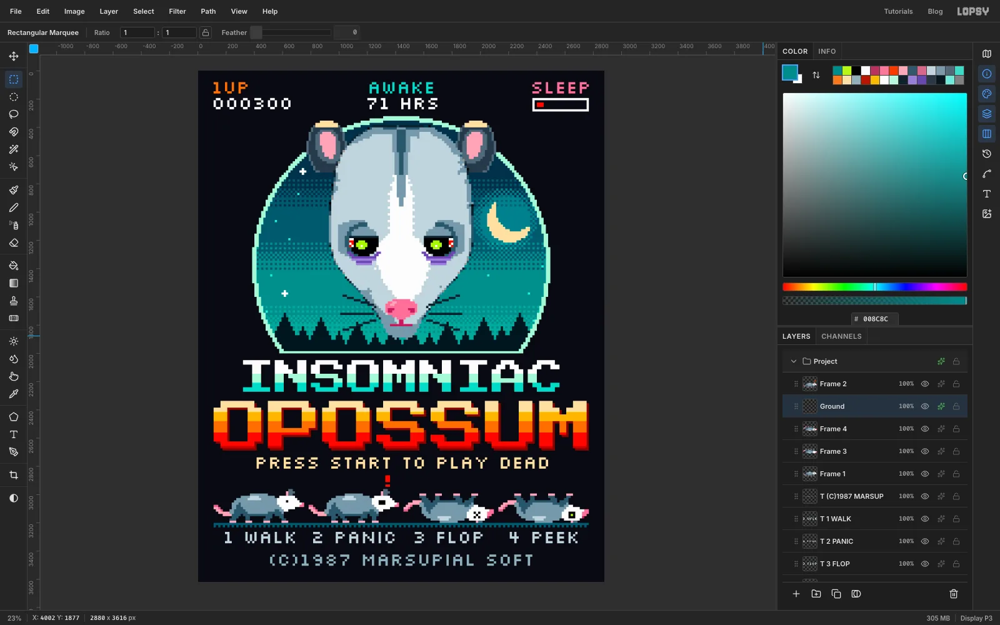

Click **Add Layer** and name it **Ground**. Press [[N]] and draw one straight line from cell 7, 200 to cell 172, 200, using click and [[Shift]]-click. Any colour will do for now.

For the broken row beneath it, press [[M]], click once and enter From **112, 3216**, To **2768, 3232**. Choose **Edit → Fill with Pattern...**, use Pattern 2, and press [[Cmd]]+[[D]].

The line and the checker row are different colours at this point. Open the effects drawer and turn on **Color Overlay** in `#00586C` to bring them together as one dark teal.

## Group the layers and export

Tidy the Layers panel. For each set below, click the bottom layer, [[Shift]]-click the top layer, and click **Group Layers** at the bottom of the panel. Rename each group.

- **Roundel**: **Ring** up to **Night**
- **Opossum**: **Ears** up to **Face**
- **Title**: **INSOMNIAC Outline** up to **OPOSSUM**
- **Type**: **Sleep Bar** up to the **(C)1987** line
- **Sprites**: **Frame 1** up to **Frame 2**. The duplicates landed in the middle of the stack, so this range also takes in Frames 3 and 4 and Ground.

Now you can click a group and nudge it with the arrow keys while the grid is on, to move the whole thing by exact cells.

> **Tip:** To check your colour count, choose **Image → Mode → Indexed Color**, click **Convert**, and look at the palette in the Color panel. Then press [[Cmd]]+[[Z]] to get your layers back.

Turn the grid off and choose **View → Fit to Screen**. Choose **File → Quick Export PNG** for the picture and **File → Save Project** to keep the layers.

For the printer, hide the **Background** layer before exporting if they want a transparent file. The dark outlines are painted in the shirt colour, so they'll need to print as ink if the shirt is a different colour.
