Joshua Tree National Park gets less than four inches of rain a year. That's what *xeric* means: adapted to a very dry place. The park's namesake yucca survives on it. This poster puts a year of that climate on one screen, styled like a level from an old 8-bit console. The top half is the stage: a desert at dusk. The bottom half is the HUD, with two charts that share one month axis.

The data is real. It's the NOAA 1991–2020 climate normals for Twentynine Palms, the station at the park headquarters. The red line is the average daily high for each month. The blue stacks are average rainfall, counted in water blocks of 0.05 inches each.

Everything sits on an **8 px grid**, so one grid cell is one "pixel" of the 8-bit picture. Marquees snap to it, and most shapes are built from rectangles.

The main things you'll learn:

- dithering flat colour bands with a checkerboard pattern and an intersected selection
- building pixel shapes from stacked marquees, stepped lassos and **Pencil** lines
- turning one drawn tree into a distant silhouette with **Duplicate**, **Flip**, scale and **Color Overlay**
- charting real numbers with a pattern tile sized to the chart, so every bar fills with whole blocks
- setting pixel fonts and lining a monospaced row up with chart columns using letter spacing

The palette:

- Sky `#1B0B3A` → `#3A0F5C` → `#6E1A6E` → `#B22D6B` → `#E8573F` → `#FF9A3C` → `#FFD25A`
- Sun `#FFE45C` / `#FFB23C` / `#FF4E6A`
- Mesas `#7A2A62` / `#3B1240`
- Sand `#D98A4A`, strata `#B8663A` / `#F0A860`, pebbles `#7A3E28` / `#FFD08A`
- Yucca trunk `#4A2A1A`, bark `#8A5A32`, leaves `#3E7A2E` / `#9CD447` / `#1F4A1A`
- Dead leaves `#2A160C`, ground shadow `#B07A9A`, far tree `#5A2050`
- Window `#120A24`, rule and gridlines `#4A3A78`, border `#FFF1C2`
- Small type lavender `#9C8CD0`, axis title `#B4A8E8`
- Heat line `#FF4A3A`, coins `#FFC34A`
- Rain blocks `#3A8DFF`, highlight `#A8E4FF`, shade `#1E4FB8`

> **Tip:** Positions are given in document pixels, as `x, y`. The status bar at the bottom left shows where your cursor is. While the grid is showing with Snap on, marquees land on the 8 px grid. Mac key names are used; on Windows and Linux use Ctrl for Cmd.

> **Tip:** "Fill" means: set the foreground colour in the Color panel's hex field, then choose **Edit → Fill**. Press [[Cmd+D]] before you draw a new marquee, because pressing inside an existing selection drags its outline instead of starting a new one.

## Set up the canvas and the 8 px grid

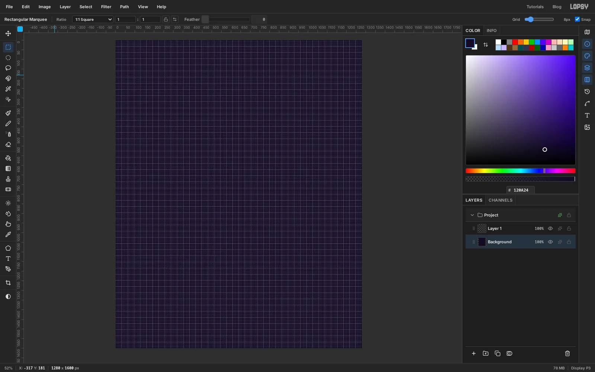

Create a new document `1280` × `1600` px. Choose **View → Show Grid**. With the **Rectangular Marquee** ([[M]]) active, the grid controls appear at the right of the options bar. Drag the **Grid** slider to **8px** and tick **Snap**.

Click the `Background` layer and fill it with the window colour, `#120A24`. It shows wherever nothing else is painted, so the gaps between chart elements stay dark.

## Paint the sky in flat bands

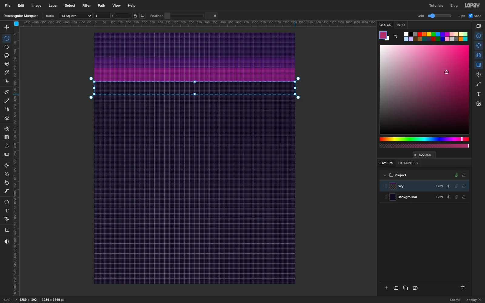

Old consoles couldn't draw smooth gradients, so the dusk sky is seven flat bands. Rename `Layer 1` to `Sky`. For each band, drag a marquee across the full width of the canvas and fill it:

1. `#1B0B3A` from the top down to y `160`. This band is tall on purpose: the title sits in it.
2. `#3A0F5C` from `160` to `232`
3. `#6E1A6E` from `232` to `312`
4. `#B22D6B` from `312` to `392`
5. `#E8573F` from `392` to `464`
6. `#FF9A3C` from `464` to `528`
7. `#FFD25A` from `528` to `608`

Deselect when you're done.

## Make a checkerboard pattern

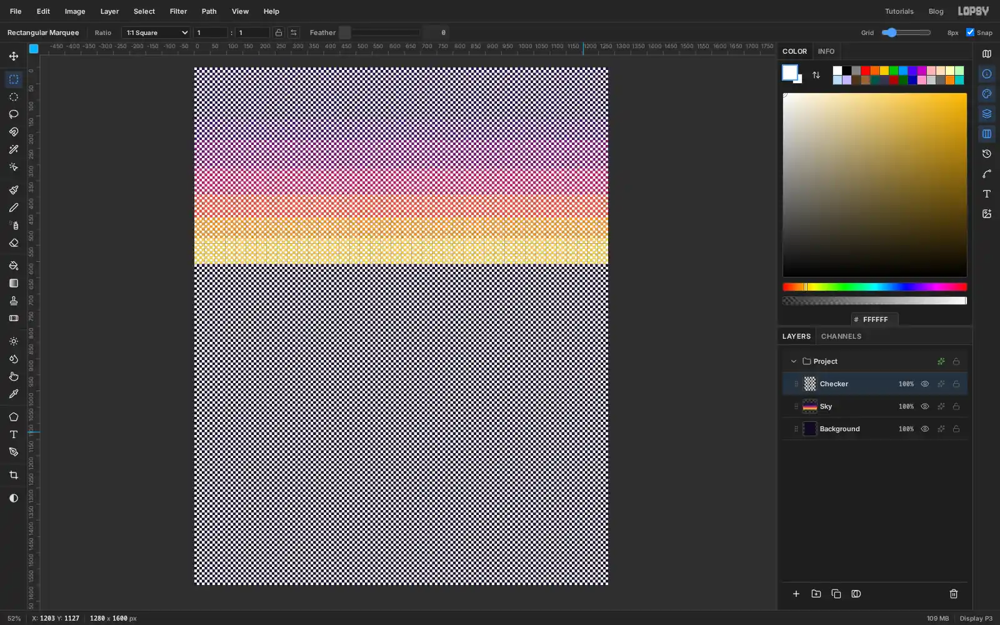

A checkerboard is the classic way to blend two flat colours in pixel art. You'll use it as a stencil.

1. Add a layer named `Checker`. In the top-left corner, fill one grid cell white (`0, 0` to `8, 8`), and the cell diagonally below it (`8, 8` to `16, 16`).
2. Select the 16 × 16 square around both cells and choose **Edit → Define Pattern**.
3. Select all ([[Cmd+A]]), press [[Delete]] and deselect.
4. Choose **Edit → Fill with Pattern…** and click **Apply** with your new pattern.

The checkerboard covers the whole layer. Pattern fills line up with the canvas's top-left corner, so every check sits exactly on the grid.

## Dither the seams between bands

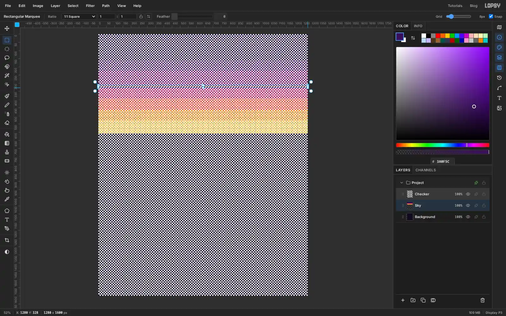

Now blend each seam. You work on the `Sky` layer but borrow the checker's pixels as a selection.

For each seam, starting with the one at `160`:

1. The checker covers the whole canvas while you work. That's fine; it's only a stencil. Click the `Sky` layer and drag a marquee across the full width, two cells (16 px) tall, at the top of the lower band. For the first seam that's `160` to `176`.
2. Hold **Cmd+Shift+Alt** and click the `Checker` layer's thumbnail. That intersects the strip with the checker, so only every other cell stays selected.
3. Fill with the colour of the band *above* the seam.

Repeat for the seams at `232`, `312`, `392`, `464` and `528`. When they're all done, delete the `Checker` layer.

## Scatter pixel stars

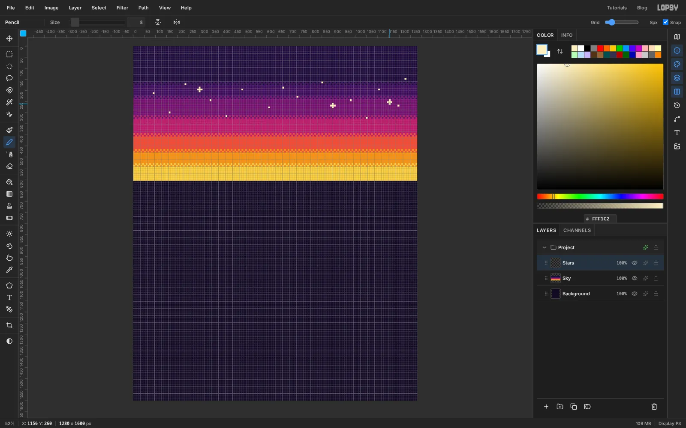

Add a layer named `Stars`. Pick the **Pencil** ([[N]]) and set its **Size** to `8`, so a click paints a block the size of one grid cell. Click near the middle of a cell so the block lines up with the grid. Set the colour to cream `#FFF1C2` and click about fifteen single stars into the upper three bands, keeping them away from each other.

For a few brighter stars, draw a plus: click one cell left of the centre, then **Shift**-click one cell right of it. Then click one cell above and **Shift**-click one cell below. **Shift**-click draws a straight line from the last point.

Don't worry about stars near the top. You'll clean up around the title later.

Now hide the grid with **View → Show Grid**. From here on some pieces are half a cell thick, and Snap only works while the grid is showing, so hiding it lets you draw them. You'll turn it back on at the end.

## Build the sun from rows

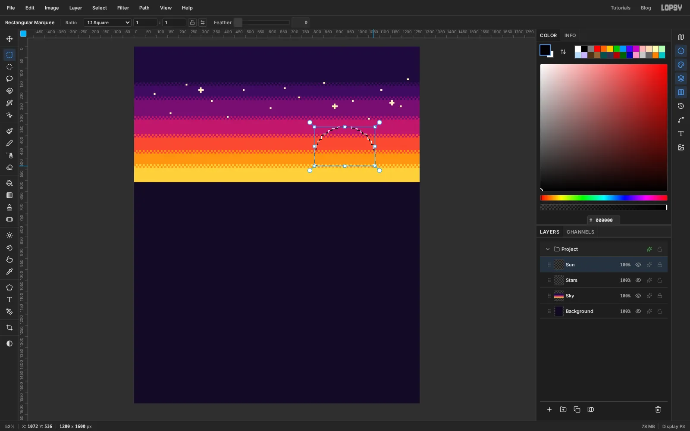

A pixel circle is a stack of rows, each a little wider than the one above. Add a layer named `Sun`. The sun is centred at `944, 496` with a radius of 136 px, and only its top shows above the mesas.

Drag the top row first, then hold **Shift** and drag each row below it. Every row is centred on x `944`. From the top down:

- `360`–`368`: 64 px wide
- `368`–`376`: 112 px
- `376`–`384`: 144 px
- `384`–`392`: 160 px
- `392`–`400`: 192 px
- `400`–`416`: 208 px
- `416`–`424`: 224 px
- `424`–`440`: 240 px
- `440`–`464`: 256 px
- `464`–`528`: 272 px (the full width)

Rows near the top widen quickly and rows near the middle barely change, which is what makes it read as round. Below `528` the mesas will cover it.

Fill the whole selection with the deepest sun colour, coral `#FF4E6A`.

## Band and stripe the sun

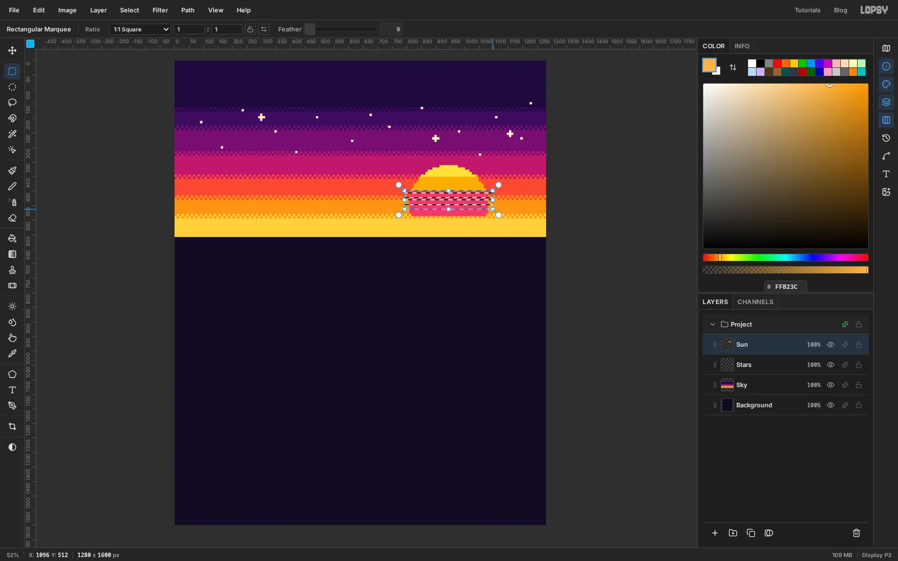

Give the sun paler bands at the top, using the same intersect trick as the sky:

1. Drag a marquee from just above the sun down to y `400`. **Cmd+Shift+Alt**-click the `Sun` thumbnail so only the sun is selected, and fill it yellow `#FFE45C`.
2. Drag from `400` to `448`, intersect with the `Sun` thumbnail again, and fill it amber `#FFB23C`.

Now cut the stripes that make it a retro sun. Shift-drag three horizontal strips across the sun, a little wider than it: one cell tall at `448` and at `472`, and two cells tall at `496`. Press [[Delete]] and deselect. The stripes get thicker towards the horizon, which makes the sun look like it's sinking.

## Lasso the stepped mesas

Mesas are flat-topped, so in pixel art they're just steps. Add a layer named `Mesa Far`. With the **Lasso** ([[L]]), drag a path that only moves straight across or straight up and down, one or two cells at a time. Start off the left edge at y `600`, climb to about `500`, then step along the horizon, and come back down off the right edge. The tops should sit between `496` and `560`. Close the loop along the bottom.

Fill it with plum `#7A2A62`.

Add a layer named `Mesa Near` and do the same lower down, with the tops between `560` and `600`. Fill it with dark plum `#3B1240`. The darker, lower range reads as closer.

> **Tip:** Lasso edges that run straight across or straight up on whole pixels stay crisp, so a stepped lasso shape needs no clean-up.

## Lay down the sand

Add a layer named `Ground`. Select from `0, 608` to the right edge at `768` and fill it with sand `#D98A4A`.

Desert sand in 8-bit games is drawn as long flat strata. Build the darker strata as one selection: drag a first strip, then **Shift**-drag the others. Make them one or two cells tall and between 200 and 500 px long, staggered so no two line up. Leave gaps between rows. Fill them with `#B8663A`.

Do the same with a few shorter strips in the gaps, and fill those with pale sand `#F0A860`.

## Scatter pebbles

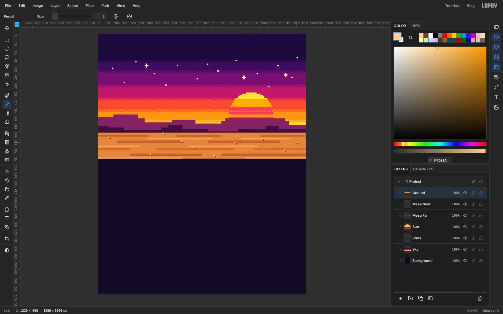

Deselect. With the **Pencil** at size `8`, click about ten pebbles across the sand in `#7A3E28`. Then switch to `#FFD08A` and click one cell up and to the left of each pebble. That one highlight cell makes each pebble look round, with light coming from the top left.

## Draw the Joshua tree's limbs

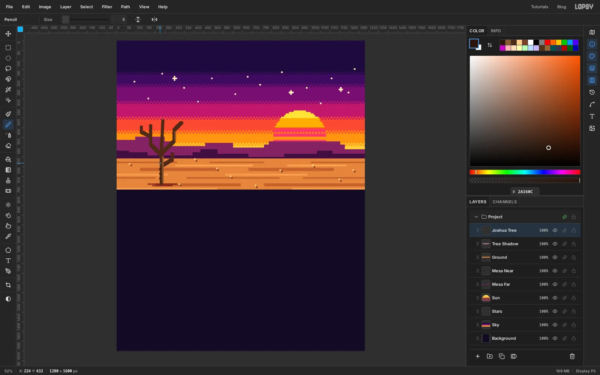

First, a ground shadow. Click `Ground` and add a layer named `Tree Shadow`. Select a strip one cell tall from `160, 736` to `312, 744`, then Shift-add a shorter strip under it (`184, 744` to `288, 752`). Fill with `#B07A9A`, deselect, and set the layer's blend mode to **Multiply** in its effects drawer. Multiply darkens the sand under it instead of covering it.

Add a layer named `Joshua Tree` above it. Pick the **Pencil**, set **Size** to `16` and the colour to trunk brown `#4A2A1A`. Draw the limbs as click-and-Shift-click chains. A Joshua tree's arms go up, kink, and go up again:

- The trunk, from `232, 736` straight up to `232, 576`.
- A left arm from `232, 592` up and left to `176, 536`, then straight up to `176, 440`. Add a short side arm off it to `128, 472` and up to `128, 448`.
- A right arm from `232, 584` to `296, 520`, up to `296, 464`, then out to `336, 424`.
- A centre arm from the top of the trunk up to `240, 416`.
- A low arm from `232, 648` to `288, 616` and up to `288, 584`.

Drop the size to `8`. Draw a lighter bark line down the right side of the trunk in `#8A5A32`, then click a few dark `#2A160C` marks down its left side. These are the dead leaves that hang on a real Joshua tree's trunk.

## Add the spiky leaf rosettes

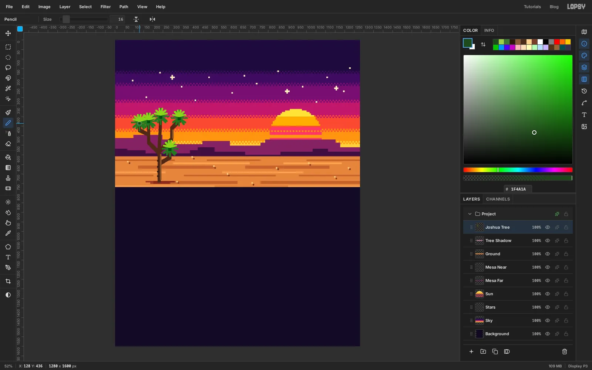

Joshua tree leaves grow in spiky balls at the ends of the arms. Draw each one as a starburst with the **Pencil** at size `8`:

1. In dark green `#3E7A2E`, click the end of an arm, then **Shift**-click about five cells away. Click the centre again and **Shift**-click in another direction. Go all the way round, one spike every 30° or so, twelve spikes in all.
2. Switch to light green `#9CD447` and add shorter spikes on the top half only, starting one cell above the centre. The light top makes the rosette look lit from above.
3. Set the size to `16` and click a dark `#1F4A1A` core into the middle.

Do this at each of the five arm tips.

## Duplicate, flip and shrink a second tree

A second, distant tree balances the sun.

1. With `Joshua Tree` selected, click **Duplicate Layer** in the Layers panel and rename the copy `Far Tree`.
2. Choose **Image → Flip Horizontal**. The copy mirrors in place.
3. **Cmd**-click the `Far Tree` thumbnail to select its pixels. Switch to the **Move** tool ([[V]]), hold **Cmd** and drag the bottom-right handle up and to the left until the tree is half its height. **Cmd** keeps the proportions. Press [[Enter]] to apply and deselect.

## Turn it into a distant silhouette

Drag the small tree with the **Move** tool until its base sits on the horizon, at about `1104, 600`, partly in front of the sun.

Open its effects drawer (the **fx** button on its row), turn on **Color Overlay** and set it to `#5A2050`. The whole tree becomes one flat colour, just like the mesa behind it, which pushes it into the distance.

## Build the game window

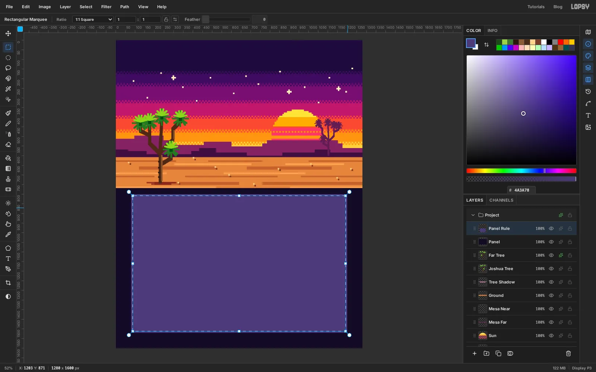

The charts live in a game window.

1. Add a layer named `Panel`. Select from `64, 784` to `1216, 1536` and fill it with `#120A24`.
2. Add a layer named `Panel Rule`. Keep the selection, choose **Select → Shrink…** and shrink it by `16`. Fill with `#4A3A78`.
3. Shrink again by `8` and press [[Delete]]. That leaves a ring one cell wide inside the window.

## Notch the corners and add the border

Old game windows have cut corners. Click the `Panel` layer and select the 8 × 8 cell in each of its four corners: drag the first one, then **Shift**-drag the other three. Press [[Delete]] and deselect.

Open the panel's effects drawer:

- **Stroke**: width `8`, colour cream `#FFF1C2`. The stroke follows the notches, so the corners step in.
- **Drop Shadow**: offsets `16` and `16`, **Blur** `0`, **Opacity** `60`, black. Blur 0 gives the hard-edged shadow that pixel art needs.

## Draw dashed gridlines

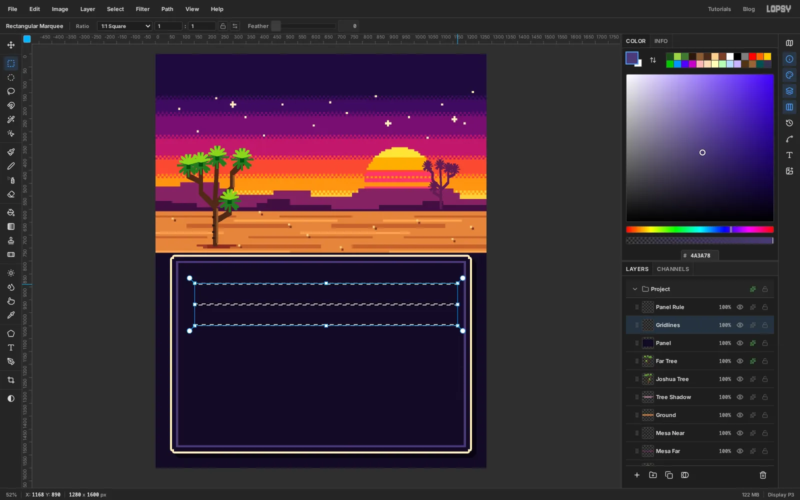

The temperature chart runs from `1064` at 56°F upwards, at 4 px per degree. So 60°F is at y `1048`, 80°F at `968` and 100°F at `888`.

1. Add a layer named `Gridlines`. In the top-left corner, fill a dash from `0, 0` to `8, 4` with `#4A3A78`. Select `0, 0` to `16, 4` (the dash plus a gap) and **Define Pattern**. Press [[Delete]].
2. Drag a strip 4 px tall from x `152` to `1168`, centred on y `1048`. Shift-add the same strip at `968` and at `888`.
3. **Fill with Pattern**, using the dash pattern, and deselect.

Finish the chart area with a solid divider: **Pencil** at size `8` in the same colour, click at `116, 1084` and **Shift**-click at `1164, 1084`.

## Plot the temperature line

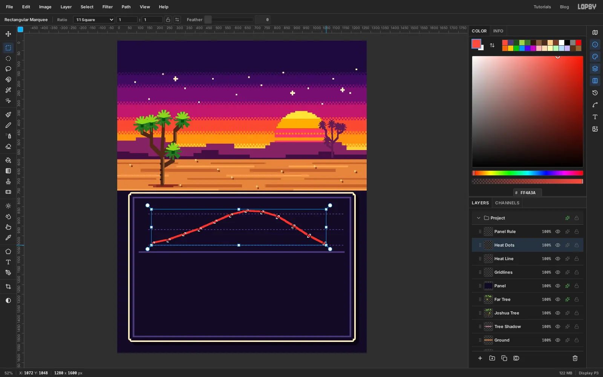

The twelve months are columns 80 px apart. January's column runs from x `160` to `208`, so its centre is `184`. Each later month is 80 px further right, ending with December at `1064`.

The average highs, January to December, are 63, 67, 74, 81, 90, 99, 104, 103, 97, 85, 72 and 62°F. Each degree is 4 px, and 56°F sits on y `1064`, so a point's y is `1064 − (temperature − 56) × 4`. So January is at `184, 1036` and July at `664, 872`.

1. Add a layer named `Heat Line`. With the **Pencil** at size `8` in red `#FF4A3A`, click January's point and **Shift**-click each month after it in turn.
2. Add a layer named `Heat Dots`. Drag a 16 × 16 marquee centred on January's point. Shift-add one on each of the other eleven.

## Turn the points into coins

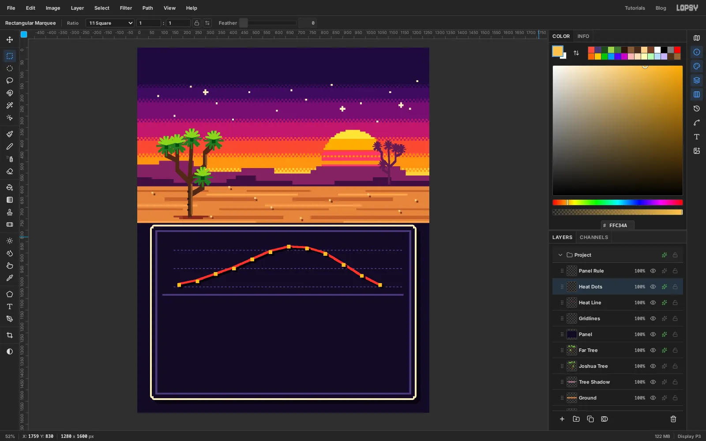

Fill the twelve squares with gold `#FFC34A` and deselect.

Give both `Heat Line` and `Heat Dots` a **Drop Shadow** with offsets `8` and `8`, **Blur** `0` and **Opacity** `80`, in black. Now the line seems to float above the gridlines like a sprite.

## Make a water-block tile

Each rain block stands for 0.05 inches. You'll draw one, then stack it with a pattern.

Click `Heat Dots` and add a layer named `Rain Blocks`. In the top-left corner, build one block:

1. Fill `0, 8` to `48, 24` with blue `#3A8DFF`.
2. Fill the top half-cell (`0, 8` to `48, 12`) and the left edge (`0, 8` to `8, 24`) with light blue `#A8E4FF`.
3. Fill the bottom half-cell (`8, 20` to `48, 24`) and the right edge (`40, 12` to `48, 24`) with `#1E4FB8`.

Now select `0, 0` to `80, 24`. That's the block plus the gaps on its right and above it. **Define Pattern**, press [[Delete]] and deselect.

The tile is 80 px wide, the same as the column spacing, and 24 px tall, one block plus a gap.

## Mark out the rain columns

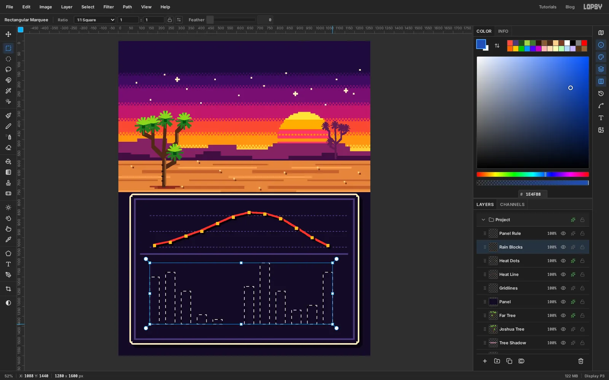

The rainfall, January to December, in inches: 0.50, 0.56, 0.35, 0.12, 0.05, 0.00, 0.40, 0.65, 0.34, 0.15, 0.19 and 0.56. Divide each by 0.05 and round to get the number of blocks: 10, 11, 7, 2, 1, 0, 8, 13, 7, 3, 4 and 11.

Every column stands on y `1440`, and each block adds 24 px. So January's column is 10 × 24 = 240 px tall: drag from `160, 1200` down to `208, 1440`. Hold **Shift** for each of the others, 80 px further right each time. Skip June.

## Fill the columns with blocks

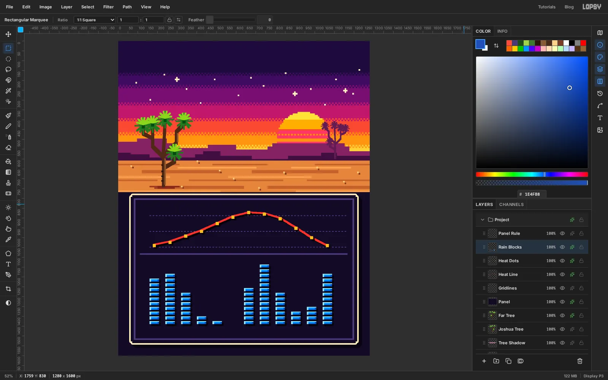

Choose **Edit → Fill with Pattern…** and apply the water-block pattern. Because the tile is exactly as wide as the column spacing and as tall as one block, and the baseline is a multiple of 24, every column fills with whole blocks.

Deselect and give `Rain Blocks` the same hard **Drop Shadow** as the line: `8`, `8`, blur `0`, opacity `80`.

> **Tip:** This is a good moment to test undo. Press [[Cmd+Z]] a few times until the blocks disappear, then [[Cmd+Shift+Z]] the same number of times. They come back exactly as they were.

## Mark June's zero

June had no rain at all. A missing bar can look like missing data, so mark it on purpose.

Add a layer named `June Slot`. With the **Pencil** at size `4` in `#4A3A78`, draw a small rectangle the size of one block in June's slot, just above the baseline: click one corner, then **Shift**-click the other three corners and back to the start.

## Set the title

Click a non-text layer such as `Far Tree` first, so the Text tool starts a new text instead of editing an old one.

New text layers are named after what you type. Rename them as you go if you like; the steps below use short names such as `Title`, `Months` and `Legend`.

1. Pick the **Text** tool ([[T]]), font **Jersey 25**, size `168`, cream `#FFF1C2`. Click anywhere in the empty sky and type `XERIC YUCCAS`. Press [[Tab]] to finish.
2. With the **Move** tool, centre it across the canvas in the top band, about `96` px down. Arrow keys nudge it one pixel at a time.
3. Give it a **Drop Shadow** in magenta `#B22D6B` with offsets `8` and `8`, blur `0`, opacity `100`.
4. Click `Far Tree` again. Set **VT323**, size `48`, yellow `#FFC34A`, and type `MONTHLY RAIN & HEAT IN JOSHUA TREE, CALIFORNIA`. Centre it under the title, about `192` px down.

> **Tip:** Jersey 25 has wide, open letters. Some pixel fonts close up the gap in a C at large sizes, so it reads as an O. Check the title at full size before you commit to a font.

## Tidy the stars around the title

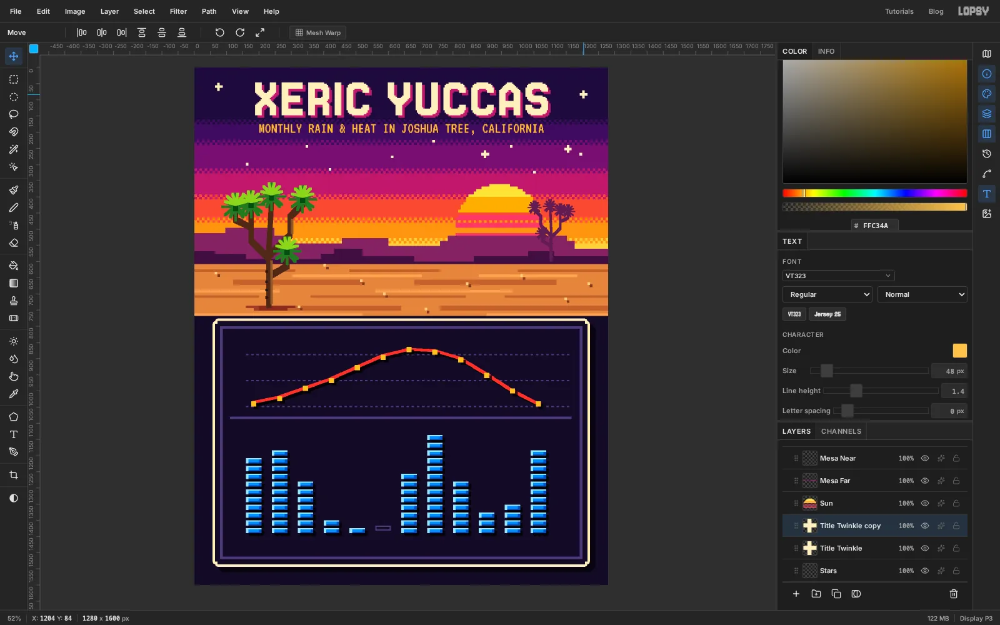

A few stars now crowd the subtitle. Click the `Stars` layer.

1. Pick the **Eraser** ([[E]]), set the size to `24`, and click each single star above about y `220`.
2. Press [[M]] for the **Rectangular Marquee**, drag a small marquee around the twinkle at about `300, 196`, and press [[Cmd+X]] to cut it, then [[Cmd+V]]. The paste lands in place as a new layer. Rename it `Title Twinkle`, deselect, and drag it to the left of the title.
3. **Duplicate Layer** and drag the copy to the right of the title, a little lower, so the two don't look mirrored.

## Add the HUD line and the ticks

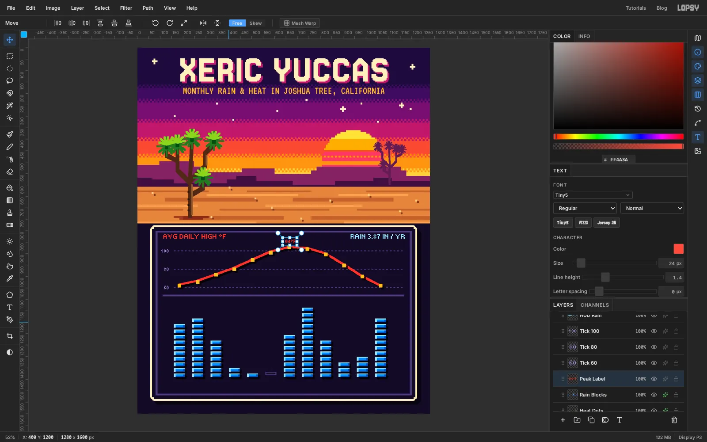

Game screens show the score along the top. Here the HUD names the two charts. Before each new text, click `Rain Blocks` so the Text tool starts a fresh layer instead of editing the last one.

1. **Tiny5**, size `32`, red `#FF4A3A`: type `AVG DAILY HIGH °F`. Move it so its left edge sits at x `112`, centred on y `824`.
2. Same size, light blue `#A8E4FF`: type `RAIN 3.87 IN / YR` and line its right edge up with x `1168`. 3.87 is the yearly total.
3. **Tiny5**, size `24`, lavender `#9C8CD0`: type `100`, `80` and `60` as three texts. Line their right edges up at x `136`, each centred on its gridline.
4. Size `24` again, in red: type `104°F` and centre it just above the July coin. Labelling the peak directly saves the reader from tracing it back to the axis.

## Label every column

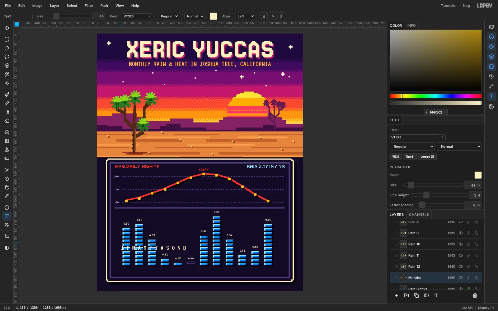

With **Tiny5** at size `20` in cream, type each month's rainfall as its own text: `0.50`, `0.56` and so on. Centre each one on its column, about 20 px above the top block. June's `0.00` goes above the empty slot.

The labels make the exact values readable. The blocks still show the shape at a glance.

## Space the month initials to the columns

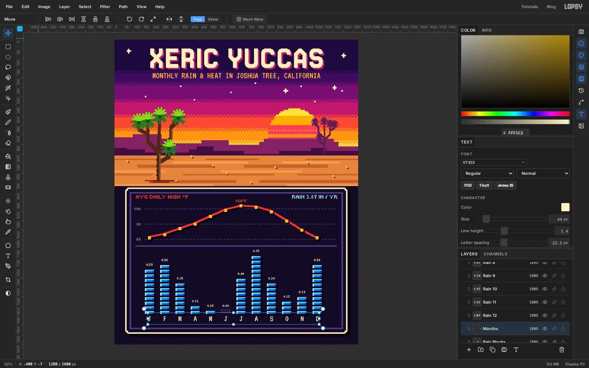

Type all twelve initials as one line: **VT323**, size `44`, cream, `J F M A M J J A S O N D` with a space between each pair.

VT323 is monospaced, so every character, space included, is the same width. Each initial plus its space has to span exactly one 80 px column, so each character needs to be 40 px wide. At this size a VT323 character is about 17.5 px wide, so open the **Text** panel and set **Letter spacing** to `22.5`. Move the line so it's centred under the columns, just below the baseline.

> **Tip:** Letter spacing sticks to the Text tool. Before you type the next text, click a non-text layer and set **Letter spacing** back to `0`.

## Add a legend

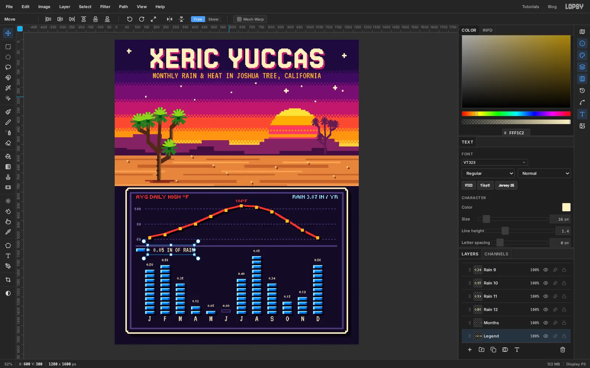

The reader needs to know what one block means. Take one straight out of the chart:

1. Click `Rain Blocks` and drag a marquee around January's bottom block (`160, 1416` to `208, 1440`).
2. Press [[Cmd+C]], then [[Cmd+V]]. The block pastes in place as a new layer. Rename it `Legend Block` and deselect.
3. With the **Move** tool, drag it to the left margin, just under the divider (`112, 1096`).
4. **VT323**, size `36`, cream: type `= 0.05 IN OF RAIN` and line it up just right of the block, centred on it.

## Rotate an axis title

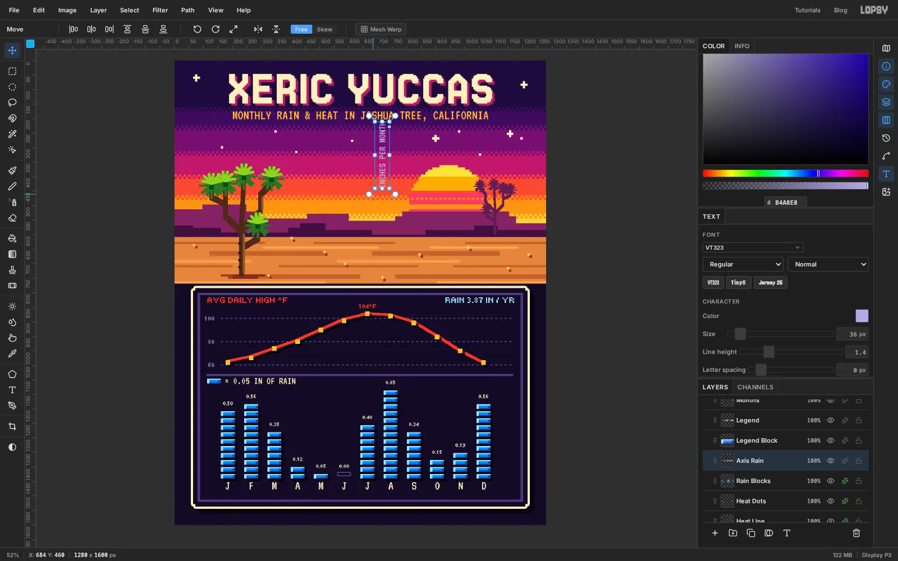

1. **VT323**, size `36`, light lavender `#B4A8E8`: type `INCHES PER MONTH` anywhere in open space.
2. With the **Move** tool, grab the round handle just outside the text's top-left corner. Hold **Cmd** to snap to 15° steps and drag counter-clockwise until the text stands upright, reading bottom to top. Release and press [[Enter]].
3. Move it into the left margin of the rain chart, centred at about `116, 1300`.

> **Tip:** The white squares on the corners scale the text. The round handles a little further out rotate it. If you grab a square by mistake, the text stretches or flips instead; press [[Cmd+Z]] and try again a little further out.

## Credit the data

Click `Panel` and type the source in **VT323**, size `30`, lavender: `DATA: NOAA 1991-2020 CLIMATE NORMALS, TWENTYNINE PALMS, CA (JOSHUA TREE NP)`. Centre it in the strip under the window, at about y `1570`.

## Group the trees and nudge them as one

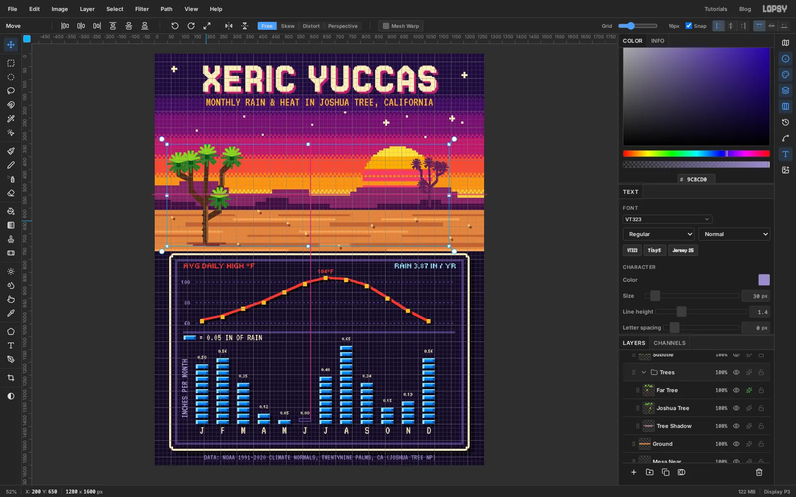

Click `Tree Shadow`, **Shift**-click `Far Tree` to select it with everything in between, and choose **Layer → Group Layers**. Rename the group `Trees`.

Check the balance. The big tree sits a little too close to the centre, so with the `Trees` group selected, take the **Move** tool and drag it a few cells left. With **Snap** on, the group lands on the grid. Everything inside moves together, shadow included.

Before you drag, turn the grid back on with **View → Show Grid**, so Snap works again. When the trees sit where you want them, hide the grid and you're done. Save the project with **File → Save Project**, and export it with **File → Quick Export PNG**.

> **Tip:** Want to try another place? The same layout works for any weather station. Change the HUD total, the line points and the block counts, and the rest stays as it is.
