On a ZX Spectrum, a game took several minutes to load from cassette. While you
waited, the loading screen appeared a bit at a time: first the black-and-white
picture, row by row, then the colour, while the border flickered with yellow
and blue stripes. Chiptune bands still borrow that look. In this tutorial
you'll make the cover for **Quayside Kraken** by the (made-up) band **The
Tidecallers**, stopped at the moment the colour is half loaded.

The Spectrum's limits are what make the style, so you'll follow them:

- **One pixel is 8 × 8 px.** The finished cover is 2048 × 2048 px. The
  picture area is 1792 px, which is 224 Spectrum pixels across, inside a
  128 px border.
- **The picture is 1 bit.** Every pixel is on (ink) or off (paper). Tone
  comes from dithering, a pattern of dots.
- **Colour comes in 8 × 8-pixel cells** (64 × 64 px here). Each cell has
  one ink colour, so when two objects share a cell they both take its colour.
  That "colour clash" is part of the look, and you'll use it on purpose.

The picture starts as two photos from Wikimedia Commons: Andy Li's
[Newhaven Breakwater Lighthouse](https://commons.wikimedia.org/wiki/File:Newhaven_Breakwater_Lighthouse_2025-03-21.jpg)
(CC0) and a plate of a giant Pacific octopus from the *Bulletin of the United
States Fish Commission*,
[Enteroctopus dofleini](https://commons.wikimedia.org/wiki/File:Enteroctopus_dofleini.jpg)
(public domain). You'll cut the octopus out, stand it up behind the
breakwater, and turn the whole scene into a 1-bit dither with **Indexed
Color**. After that it's pixel work: a hand-drawn lighthouse, pattern-filled
stone and waves, a dithered beam and a pixel-blackletter title. Colour goes on
last, on a single **Multiply** layer.

You'll use:

- **Magic Wand**, **Rectangular** and **Elliptical Marquee** (with [[Shift]]
  to add and [[Shift]]+[[Option]] to intersect), the exact-corners marquee
  dialog, the **Pen** tool and **Path to Selection**
- the Move tool's scale handles and **Rotate 90° CW**, a group move
- **Flatten Image**, **Canvas Size**, **Image Size**, **Image → Mode**
  (**Grayscale**, **Indexed Color** with dithering, **RGB**)
- the filters **Pixelate**, **Threshold**, **Brightness/Contrast**,
  **Invert**, **Add Noise** and **Motion Blur**
- the **Pencil**, the **Brush**, the **Gradient** tool, **Define Pattern**
  and **Fill with Pattern**
- the **Screen** and **Multiply** blend modes, **Merge Down**, the grid with
  **Snap**, and text in **Jacquard 24** and **Tiny5**

The palette. The first two rows are the Spectrum's bright colours. The border
can only use the normal (darker) ones.

- Paper `#000000`, ink `#FFFFFF`
- Bright cyan `#00FFFF`, bright magenta `#FF00FF`, bright yellow `#FFFF00`
- Bright red `#FF0000`, bright blue `#0000FF`
- Border blue `#0000D7`, border yellow `#D7D700`
- Moon `#E9E5D3`, craters `#C4BEA8`, moon glow `#3C3C3C` → `#000000`
- Noise grey `#808080`

> **Note:** Shortcuts are written for a Mac. On Windows use [[Ctrl]] wherever it says [[Cmd]], and [[Alt]] for [[Option]].

> **Tip:** Pixel art needs exact positions, so many steps give them. The X / Y readout in the status bar shows where the pointer is. To draw a rectangle exactly, choose the Rectangular Marquee, press [[Cmd]]+[[D]] so nothing is selected, then click once on the canvas without dragging. A dialog opens where you can type the corners. When a step says text "starts at" a point, it means the top-left corner of the visible letters, not of the text box.

## Make an oversized canvas and drop in the lighthouse

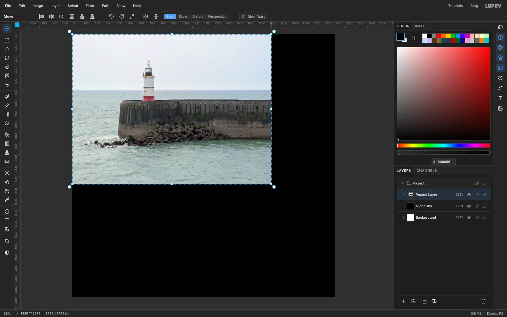

Choose **File → New** and make a **2400 × 2400** document. It's bigger than
the picture will be, so the photos can hang over the edges while you arrange
them. Later you'll crop it to 1792 × 1792.

Rename *Layer 1* to *Night Sky* and fill it with black (`#000000`, then
**Edit → Fill**).

Drag the lighthouse photo from your desktop onto the canvas. It lands in the
top-left corner with its transform handles showing. Hold [[Cmd]] and drag the
bottom-right handle out until the photo is **1820 px** wide, then press
[[Return]]. Rename the layer *Quay*.

## Place the quay and remove its sky

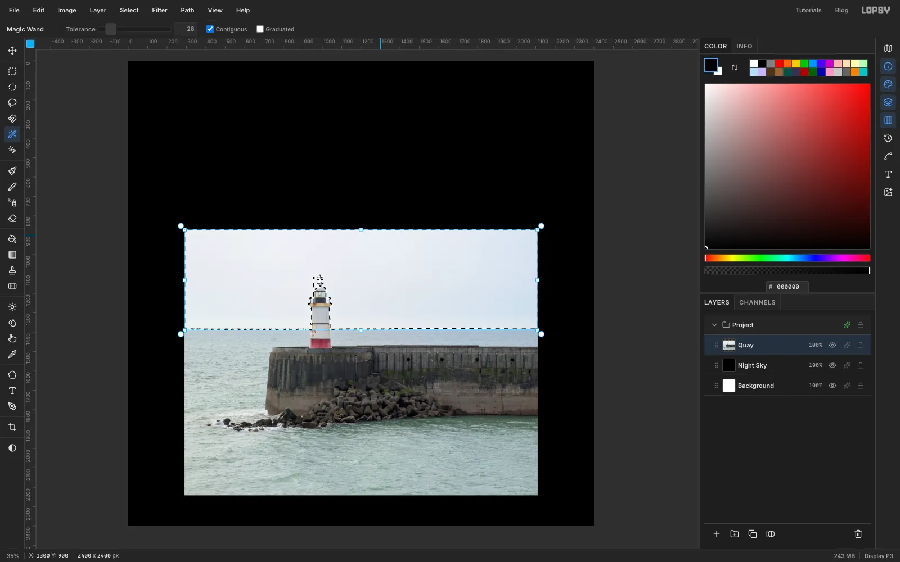

With the **Move** tool, drag the photo down and right until its top-left
corner is at **290, 872**. The lighthouse is now a little left of centre in
the middle of the canvas.

Choose the **Magic Wand**, set **Tolerance** to **28** and leave
**Contiguous** on. Click the sky to the left of the lighthouse, then
[[Shift]]-click the sky to its right and above the breakwater. Check that the
lantern isn't selected, then press [[Delete]] and [[Cmd]]+[[D]]. The black
Night Sky layer shows through.

## Hang a moon

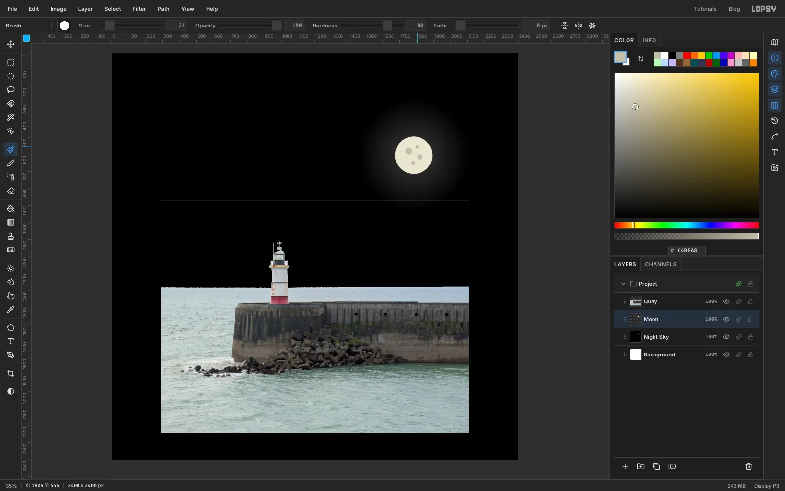

Select **Night Sky** and choose the **Gradient** tool. Set **Type** to
**Radial**, click **Advanced…** and make two stops: `#3C3C3C` on the left and
`#000000` on the right. Drag from **1784, 604** about **330 px** to the right.
That's the moon's glow.

Click **Add Layer** and name the layer *Moon*. With the **Elliptical
Marquee**, drag a circle from **1674, 494** to **1894, 714** and fill it with
`#E9E5D3`. Press [[Cmd]]+[[D]]. Switch to the **Brush**, set the colour to
`#C4BEA8`, and click four craters on the moon at sizes **44**, **34**,
**28** and **22**.

## Bring in the octopus

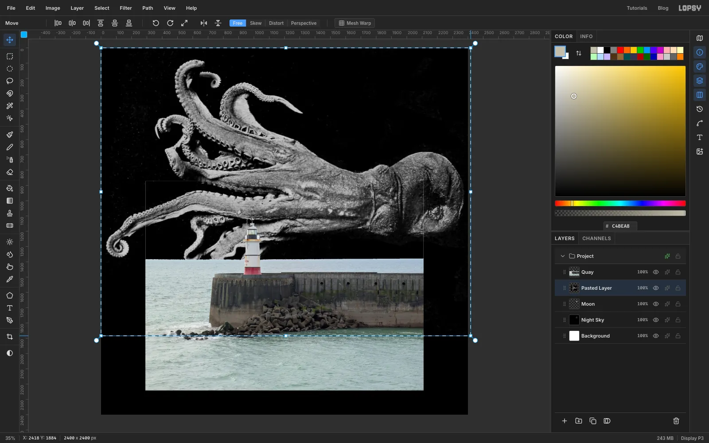

Keep **Moon** selected so the octopus lands above it, then drag the octopus
photo onto the canvas. Hold [[Cmd]] and drag its bottom-right handle out until
it's **2418 px** wide, then press [[Return]]. Rename the layer
*Kraken*.

## Stand the octopus up

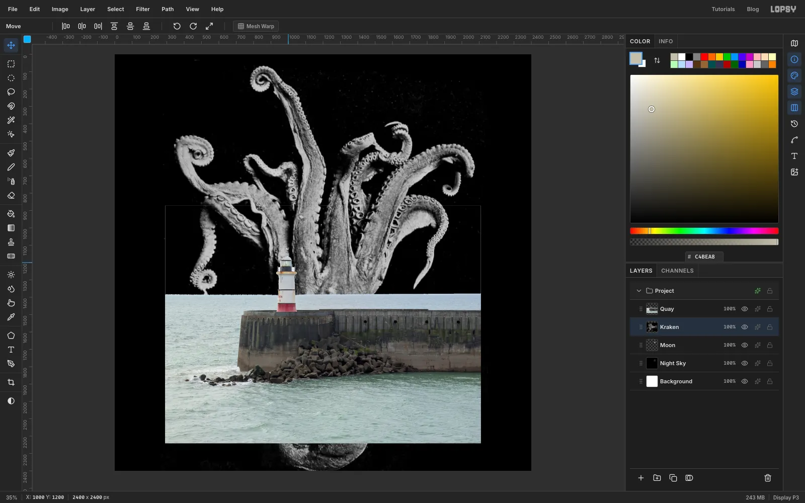

In the plate, the arms point left. To make them rise out of the sea, turn
the plate a quarter turn clockwise: with the **Move** tool active, click
**Rotate 90° CW** in the options bar.

## Put the kraken behind the quay

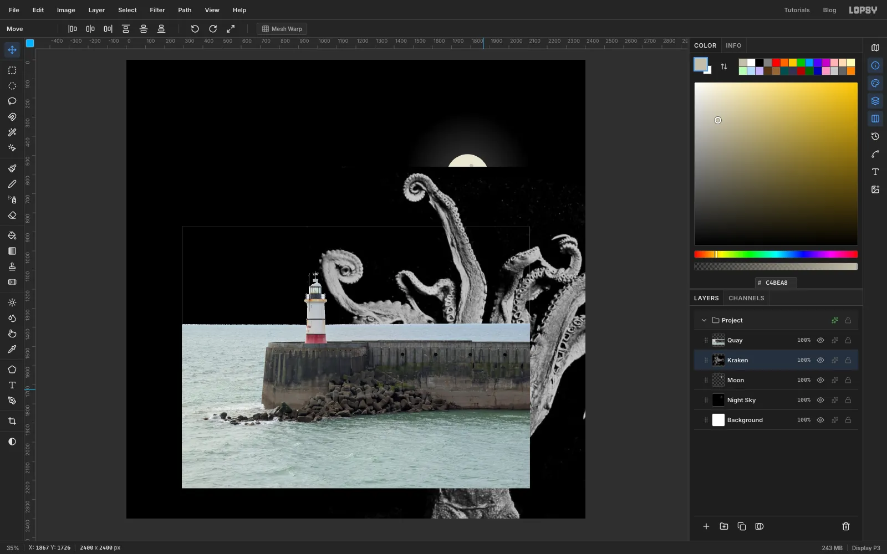

Drag the octopus so the plate's top-left corner sits at **934, 559**. Its
arms now rise behind the breakwater to the right of the lighthouse. Kraken is
below Quay in the Layers panel, so the breakwater and the sea hide its body.

## Cut out the octopus

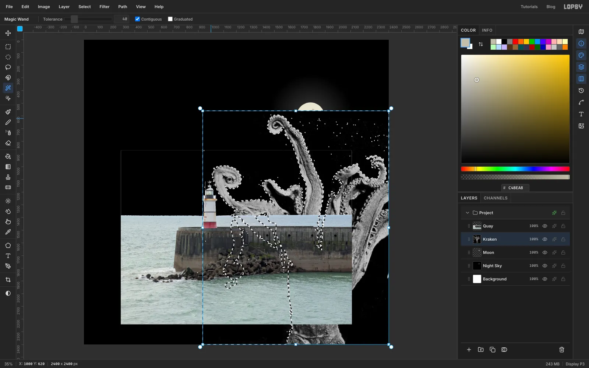

With **Kraken** selected, choose the **Magic Wand**, set **Tolerance** to
**40**, and click the black background between the arms. Press [[Delete]]
and [[Cmd]]+[[D]]. The moon shows again behind the arms.

## Grade the scene for night

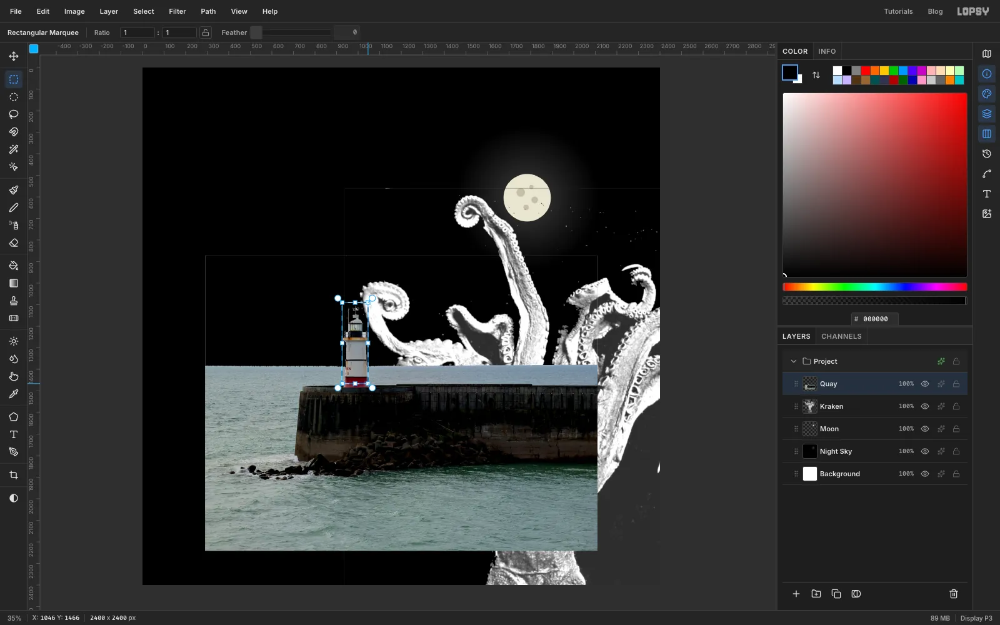

The dithering step later turns light into dots, so now is the time to decide
what should be bright:

1. Select **Kraken** and choose **Filter → Brightness/Contrast…** with
   **Brightness 30**, **Contrast 25**. The arms become the brightest thing in
   the picture.
2. Select **Quay** and apply **Brightness −20**, **Contrast 10**.
3. Draw a rectangular marquee round the lighthouse tower, from about
   **926, 1090** to **1046, 1466**. Apply **Brightness 45**, **Contrast 20**
   so the white tower stays white. Press [[Cmd]]+[[D]].

## Light the lantern

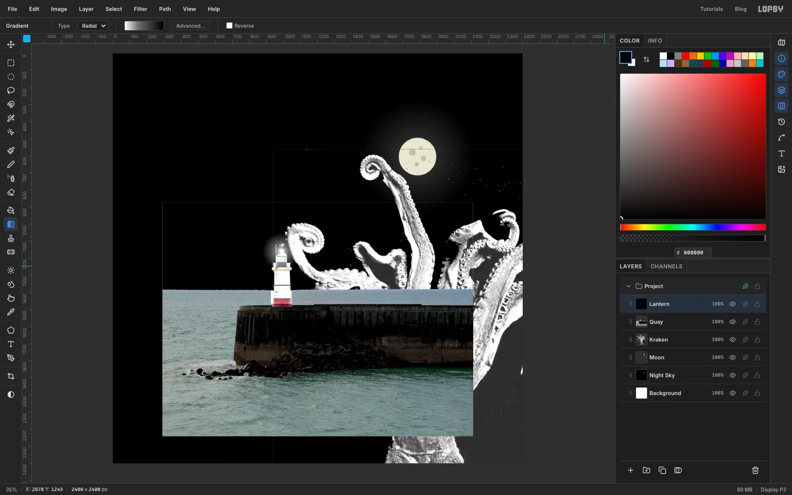

With **Quay** selected, click **Add Layer** and name the layer *Lantern*. Set
up a radial gradient with three stops: `#FFFFFF` at the left, `#6E6E6E` about
a third of the way along, and `#000000` at the right. Drag from the middle
of the lantern (about **986, 1160**) **110 px** to the right.

Open the layer's effects (the ✦ button), set the **Blend Mode** to
**Screen** and close the panel. The black disappears and only the glow is
left.

## Crop to the Spectrum screen

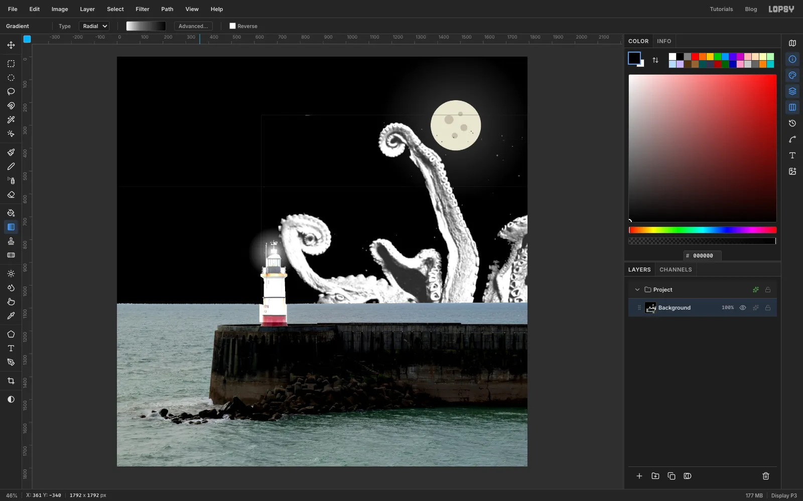

Choose **Layer → Flatten Image**. Then choose **Image → Canvas Size…**, set
**1792 × 1792**, leave the anchor in the centre and click **Apply**. The
pasteboard is trimmed away.

## Pixelate and shrink to Spectrum resolution

Choose **Filter → Pixelate…** with **Block Size 8** and click **Apply**.
Every block is now the average of the photo under it.

Then choose **Image → Image Size…** and set **224 × 224**. Each 8 px block
becomes one pixel, which gives you the scene at the Spectrum's own
resolution.

## Convert to grayscale

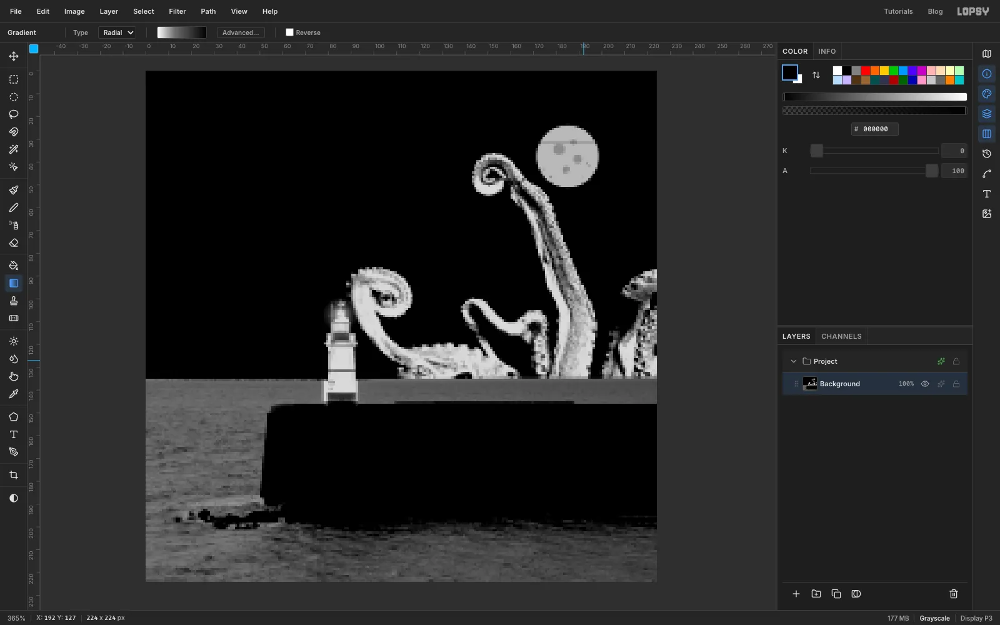

Choose **Image → Mode → Grayscale**. Then apply **Brightness/Contrast** with
**Brightness −25** and **Contrast 20**, so the sea turns a darker grey while
the arms stay light.

## Give Indexed Color pure black and white to aim for

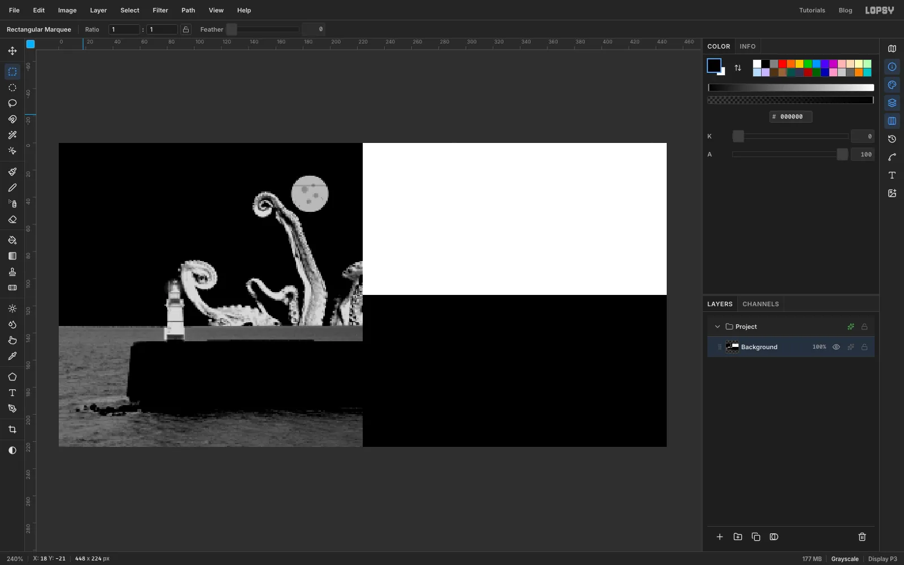

Next, **Indexed Color** will reduce the picture to two colours. It picks
those colours by averaging the picture's own tones, and here it would pick
black and a mid grey. Everything lighter than that grey would come out flat,
with no dots. To make it pick black and near-white, give it some of each to
average.

Choose **Image → Canvas Size…**, set **448 × 224**, click the **left middle**
anchor and click **Apply**. Fill the top half of the new strip, from
**224, 0** to **448, 112**, with white, and the bottom half with black.

## Dither to two colours

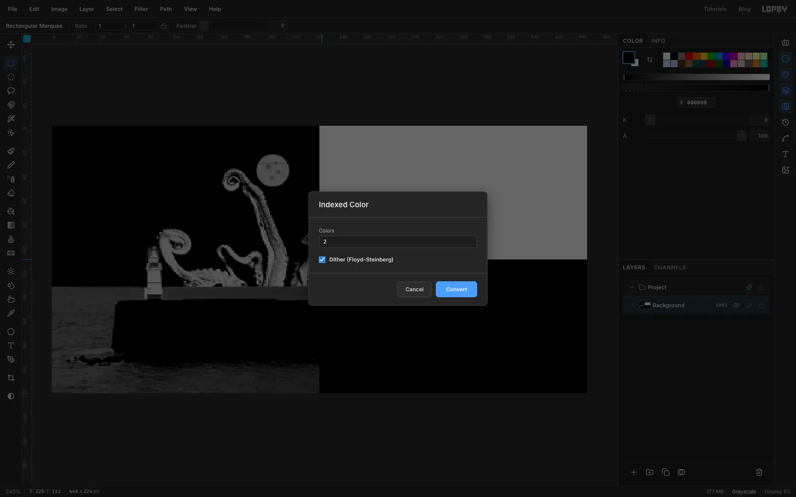

Choose **Image → Mode → Indexed Color…**. Set **Colors** to **2**, tick
**Dither (Floyd–Steinberg)** and click **Convert**.

## Check the dither

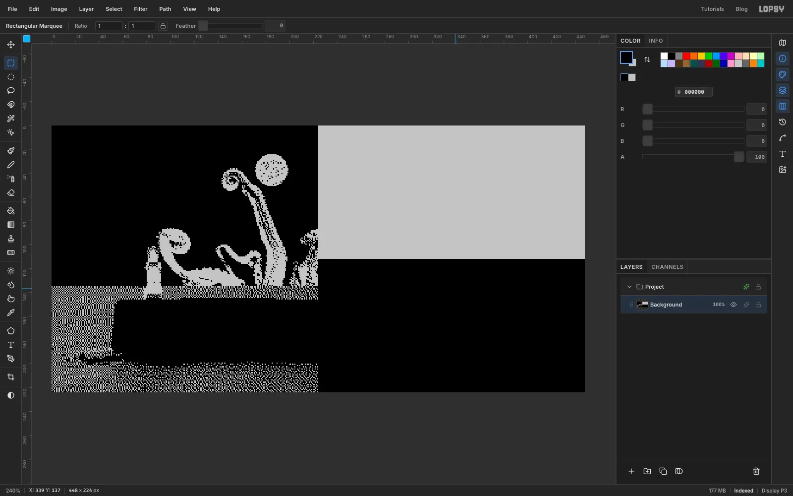

Zoom in and check the result. The picture is now just black and a light
grey, and the tones are spread as dots: the moon, the arms and the sea are
all dithered. If the sea came out flat, undo and check the two swatches.

## Clean up to pure black and white

Choose **Image → Mode → RGB Color**. Then apply **Filter → Threshold…** with
**Level 128** to snap the two greys to pure black and white.

Finally, choose **Image → Canvas Size…** with **224 × 224** and the **left
middle** anchor to cut the swatches off again.

## Scale it back up

Choose **Image → Image Size…** and set **1792 × 1792**. Each pixel is now
8 × 8 px, but scaling up softens the edges, so the dots look rounded.

## Make the pixels crisp

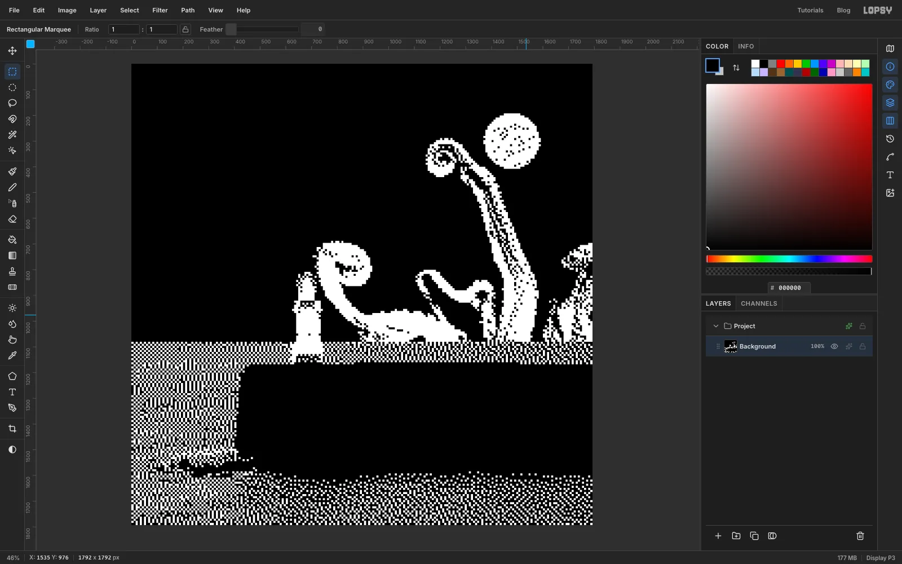

Apply **Pixelate** with **Block Size 8**, then **Threshold** at **128**.
Every Spectrum pixel is a hard 8 × 8 square again.

## Make room for the border and show the attribute grid

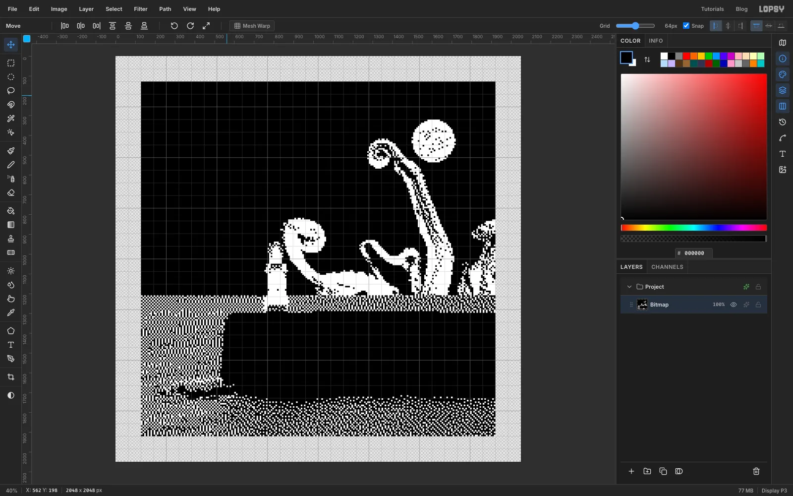

Choose **Image → Canvas Size…** and set **2048 × 2048** with the centre
anchor. That adds the 128 px border round the picture.

Rename the layer *Bitmap*. Choose **View → Show Grid**, drag the **Grid**
slider in the options bar to **64px** and make sure **Snap** is ticked. Each
grid square is one colour cell. You'll switch the grid to 8 px for the
pixel drawing and back to 64 px for the colour.

## Plan the lighthouse sprite

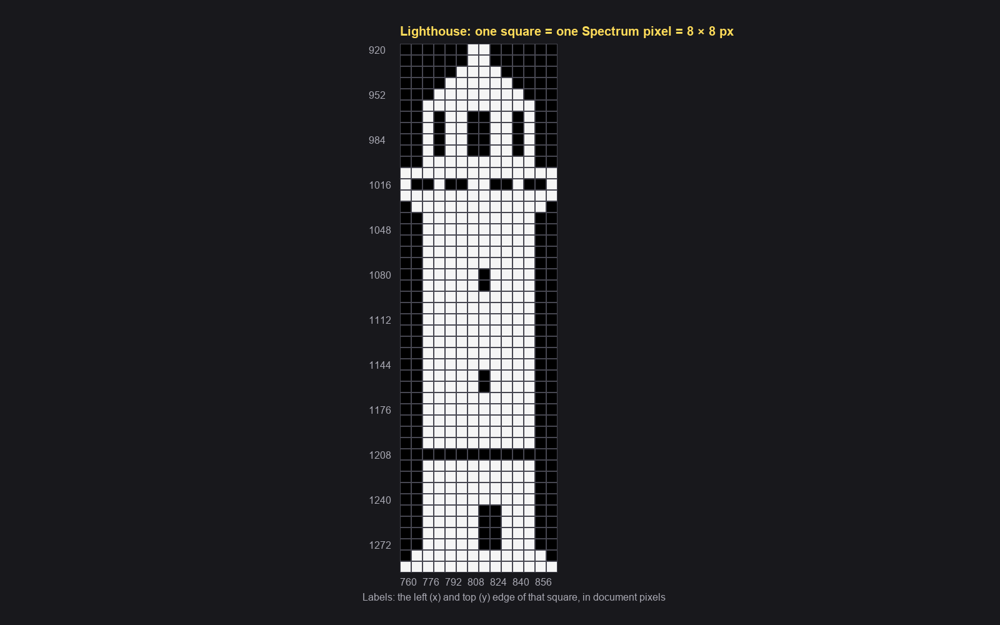

At this size the photo's lighthouse has dithered into a white blob. Redraw it
as a sprite, one square per Spectrum pixel. The numbers give the left edge
of every second column and the top edge of every fourth row, in document
pixels.

## Clear a space for the lighthouse

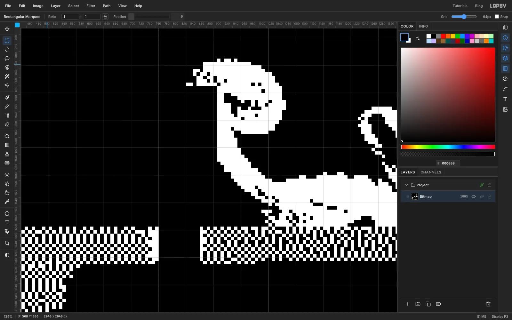

For the pixel work, set the **Grid** slider to **8px** and untick **Snap**,
so each grid square is one Spectrum pixel. Zoom in on the lighthouse to 300 %
or more. Select
**Bitmap** and fill two exact rectangles with black: **744, 880** to
**904, 1208** (the lantern and tower, plus a gap against the arm), and
**768, 1208** to **864, 1296** (the base, which stands in the sea).

## Draw the lighthouse

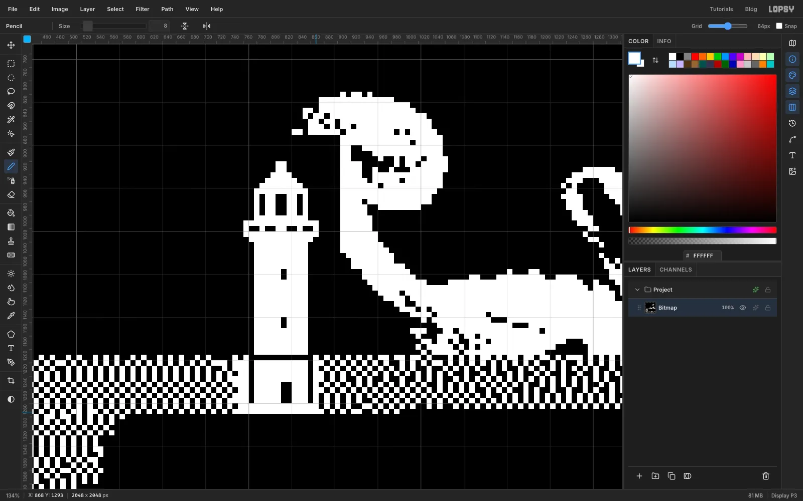

Choose the **Pencil**, set **Size** to **8** and the colour to white. A dab
of 8 px fills one grid square exactly when you click in its middle, so stay
zoomed in.
Work down the chart row by row. Click the first pixel of each run, then
[[Shift]]-click the last one to draw the line between them.

## Give the arms suckers

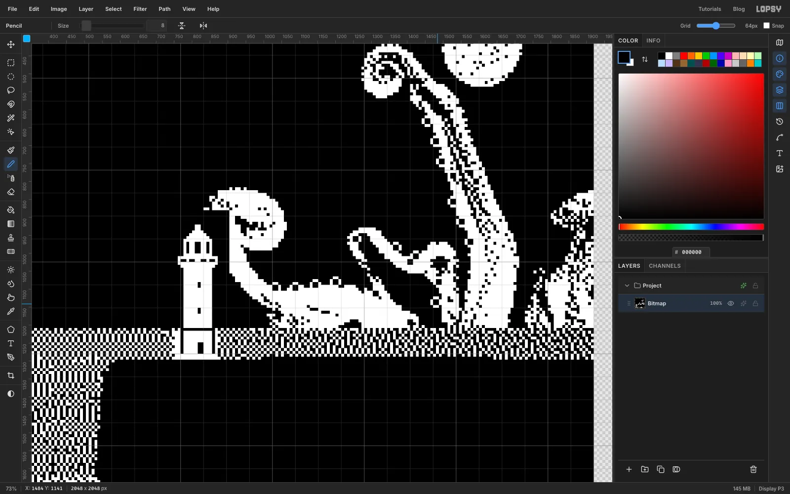

With the dither alone, the arms could belong to a sea serpent. Suckers make
them an octopus. Each sucker is a small ring in a 4 × 4 square: two white
pixels on each side, the four corners left black, and a 2 × 2 black hole in
the middle. It's also drawn in the tile chart a few steps on.

With the Pencil at 8 px, draw a ring every 7 Spectrum pixels (56 px) or so,
centred on the edge of the arm. Go down the inner (left) edge of the tall
arm, then along the top edge of the low arm that curls over the lighthouse.
Draw the white pixels first, then switch to black and click the four hole
pixels, because the inside of the arm is already white.

## Scatter stars

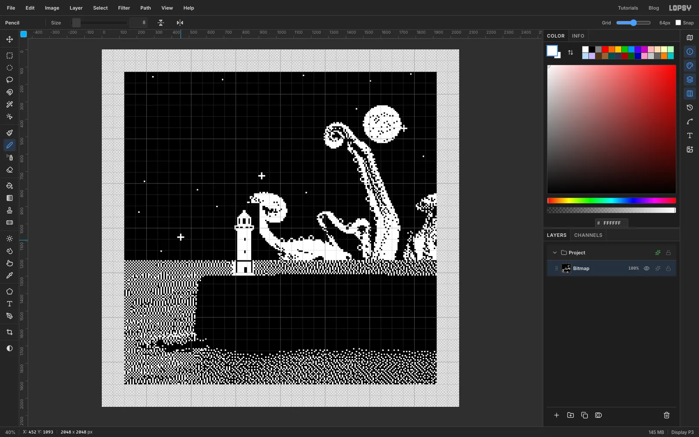

Still on **Bitmap** with the white Pencil, click single pixels around the
sky for stars, keeping clear of where the title will go (the top-left
quarter). For three bigger twinkles, draw a 5 × 5 plus sign: a five-pixel
line across, then two pixels above and two below the middle.

## Make the dither tiles

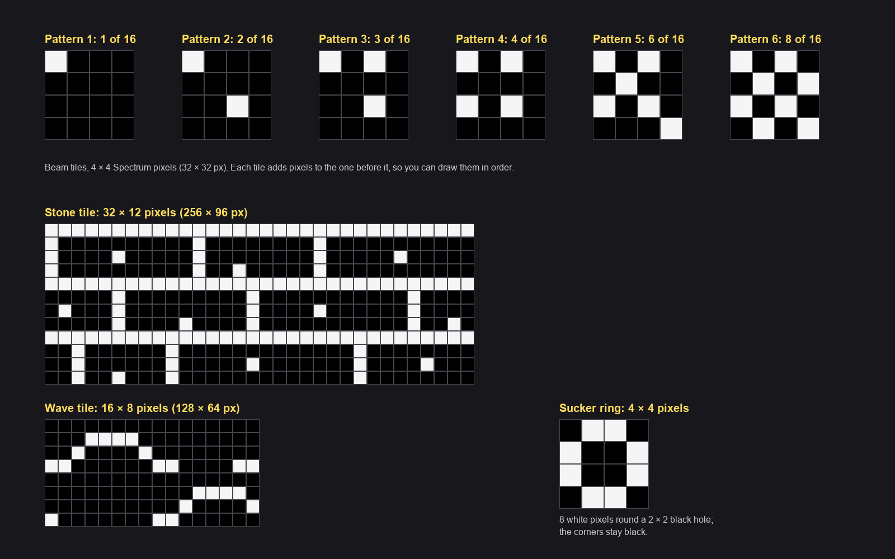

The beam fades from dense dots near the lamp to sparse ones far away. That
takes six small patterns. Each is a 4 × 4-pixel tile from the same ordered
(Bayer) dither, and each one adds pixels to the one before it, so
neighbouring bands blend and you can draw them one after another.

Select **Bitmap**, click **Add Layer** and name the layer *Beam*. Fill it
with black and set its blend mode to **Screen**, so the black is see-through
and only white will show.

With the white Pencil at 8 px, draw the tiles in an empty patch of sky, with
the tile's top-left corner at **1600, 192**. Start with **1 of 16**: click
its single pixel, select **1600, 192** to **1632, 224** and choose **Edit →
Define Pattern**. Add the next pixels to make **2 of 16** and define it
again, and so on up to **8 of 16**. Then fill the square with black.

The patterns are numbered in the order you define them, **Pattern 1** (1 of
16) to **Pattern 6** (8 of 16). If you've defined patterns before in this
session, the numbers start higher, so go by the thumbnails.

## Select the beam

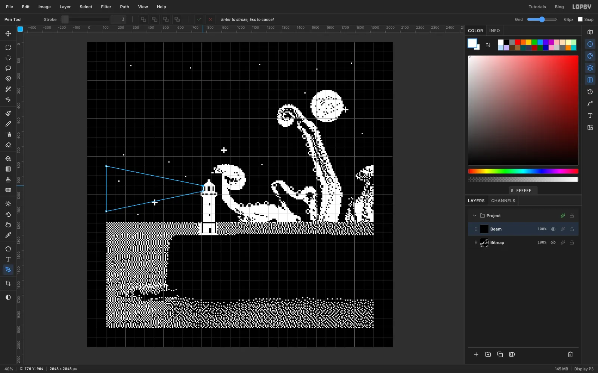

Choose the **Pen** tool and click four corners: the top of the lantern glass
at **776, 964**, the left edge of the picture at **128, 832** and
**128, 1136**, and the bottom of the glass at **776, 1000**. Click the first
point again to close the path.

In the **Paths** panel, click **Path to Selection**. Keep the path, because
you'll use it five more times. Choose **Edit → Fill with Pattern…**, pick
**Pattern 1** and click **Apply**. The whole cone gets the sparsest dots.

## Fill the beam in rings

Now fill denser rings nearer the lamp. Each ring is the cone intersected
with a circle centred on the lantern at **776, 982**:

1. Click **Path to Selection** again.
2. Choose the **Elliptical Marquee**, hold [[Shift]]+[[Option]] and drag a
   circle round the lantern. Only the part of the cone inside the circle
   stays selected.
3. Fill with the next pattern.

The circles, biggest first (zoom out so the whole drag fits on screen):

- **216, 422** to **1336, 1542** (radius 560), **Pattern 2**
- **316, 522** to **1236, 1442** (radius 460), **Pattern 3**
- **416, 622** to **1136, 1342** (radius 360), **Pattern 4**
- **516, 722** to **1036, 1242** (radius 260), **Pattern 5**
- **616, 822** to **936, 1142** (radius 160), **Pattern 6**

Then press [[Cmd]]+[[D]] and delete the path in the Paths panel.

## Snap the beam to the pixel grid

The cone's sloping edges cut some dots in half. Apply **Pixelate** at **8**
and **Threshold** at **128** to the Beam layer to turn every half dot into
a whole pixel or nothing.

## Draw a stone tile

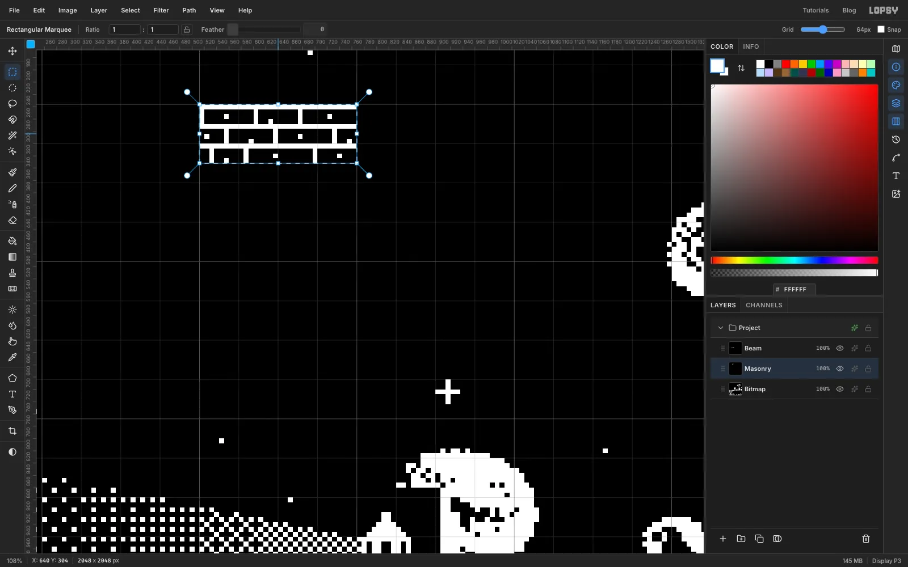

The breakwater is a flat black slab. Give it stone courses.

Select **Bitmap**, click **Add Layer**, name it *Masonry*, fill it with black
and set it to **Screen**. With the 8 px grid showing and the white Pencil at
8 px, draw the stone tile from the chart with its top-left corner at
**512, 256**. That's three courses
of blocks, the joints staggered from course to course, and a speck or two in
each block.

Select **512, 256** to **768, 352** and choose **Edit → Define Pattern**
(**Pattern 7**). Fill the selection with black.

## Fill the breakwater with stone

With the **Rectangular Marquee**, select the breakwater from **560, 1296** to
**1920, 1648** and **Fill with Pattern** using **Pattern 7**. Press
[[Cmd]]+[[D]].

## Draw a wave tile

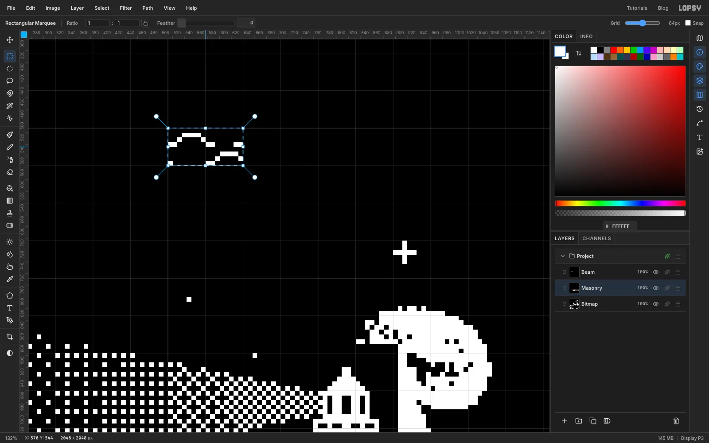

The dithered sea in front of the breakwater is noisy. A wave pattern reads
as water at a glance.

Still on **Masonry**, draw the wave tile from the chart with its top-left
corner at **512, 512**. Select **512, 512** to **640, 576**, choose **Define
Pattern** (**Pattern 8**) and fill the selection with black.

## Select the sea

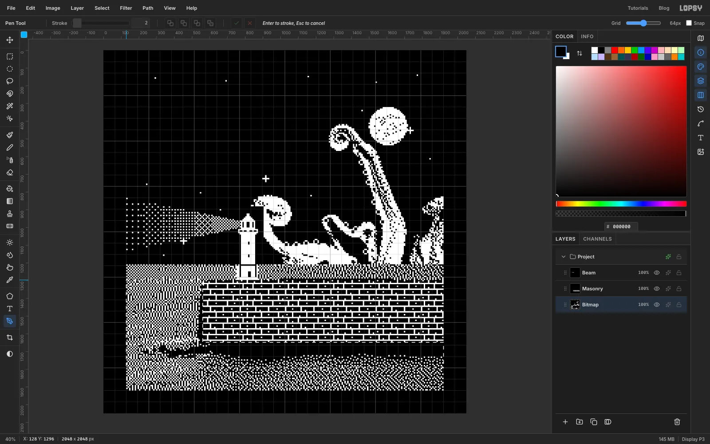

Select the sea in front of the breakwater with the Rectangular Marquee, from
**128, 1296** to **560, 1792**. Then hold [[Shift]] and drag from
**560, 1648** to **1920, 1792** to add the strip below the breakwater.

## Fill the sea with waves

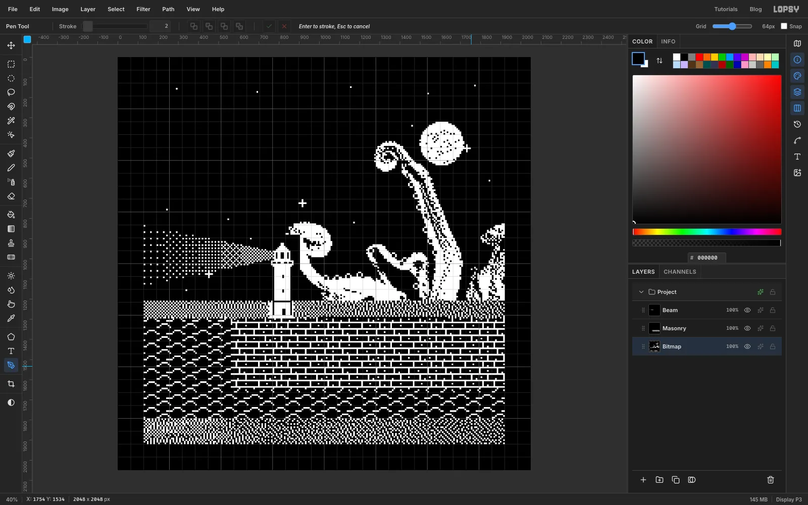

Select **Bitmap**, so the waves replace the dither instead of adding to it,
and **Fill with Pattern** using **Pattern 8**. Press [[Cmd]]+[[D]].

## Paint the band name on the wall

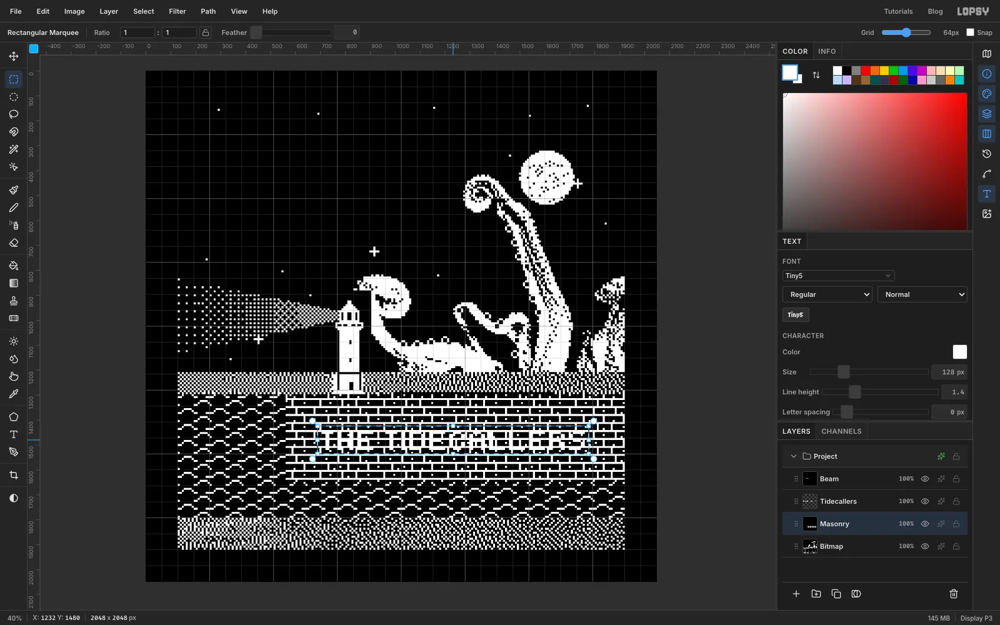

Select **Masonry**, choose the **Text** tool and set the font to **Tiny5**,
**Size 128**, colour white. At 128, one Tiny5 pixel is 16 px, exactly
two Spectrum pixels. Click on the wall and type **THE TIDECALLERS**, then
press [[Tab]]. Rename the layer *Tidecallers*. With the Move tool, nudge it
with the arrow keys until the letters start at **704, 1440**. Both numbers
are on the 16 px lattice, so every edge lands on a whole Spectrum pixel.

On **Masonry**, fill an exact rectangle from **688, 1424** to
**1776, 1536** with black. That's a painted sign panel one font pixel (two
Spectrum pixels) wider than the letters all round.

## Merge the wall into the picture

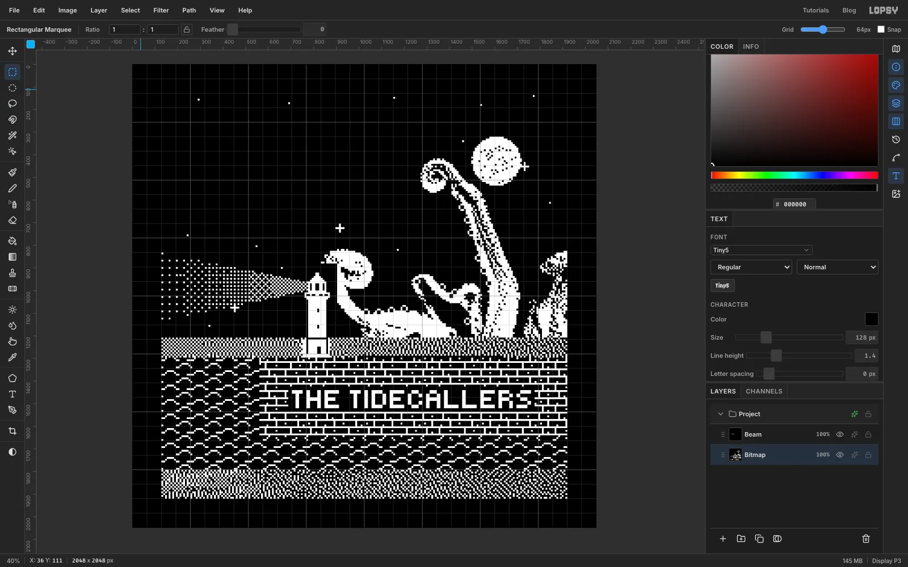

Select **Tidecallers**, click **Rasterize Layer**, then choose **Layer →
Merge Down** to merge it into Masonry. Choose **Merge Down** again to merge
Masonry into Bitmap. The Screen blend bakes in, and the stones, waves and
name are now part of the 1-bit picture.

## Choose where the colour stops loading

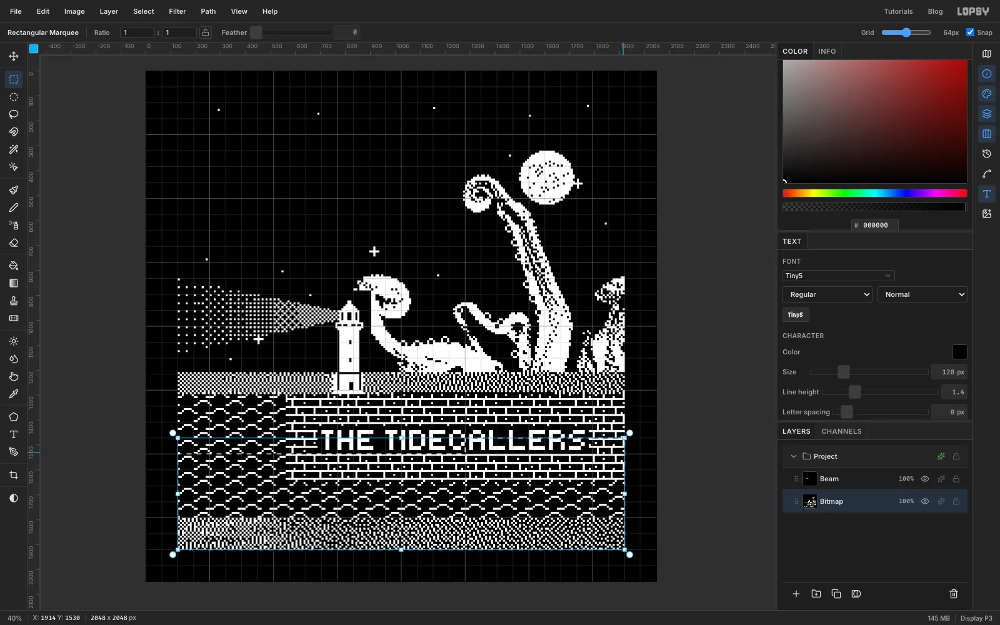

The Spectrum loads colour one cell at a time, left to right and top to
bottom. The cover freezes partway through the row that holds the band name,
so the missing colour lands on something you can read.

Tick **Snap** again. On **Bitmap**, drag a marquee over the bottom six rows
of cells, from **128, 1536** to **1920, 1920**. Then hold [[Shift]] and
drag from **1280, 1472** to **1920, 1536** to add the end of the row above.

## Show the unloaded part as black on white

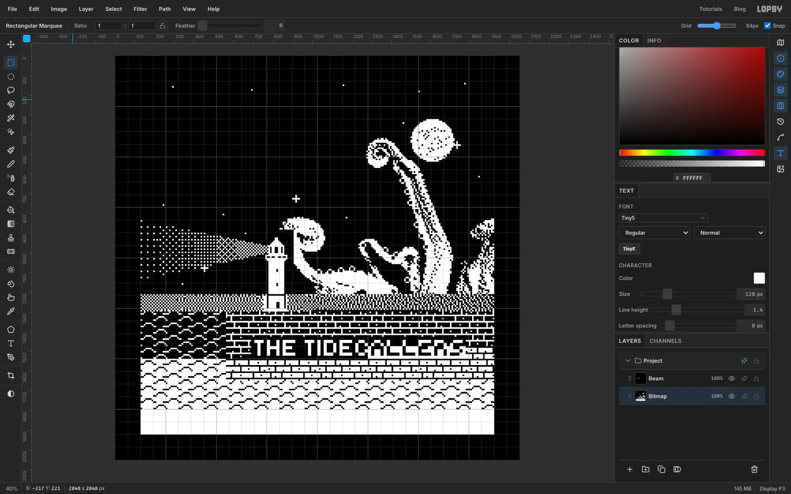

Where no colour has arrived, a Spectrum shows its default: black ink on white
paper. Choose **Filter → Invert**. The stones, waves and the bottom of the
letters turn black on white.

Then select the bottom two rows, **128, 1792** to **1920, 1920**, and fill
them with white. That's where the computer prints its message.

## Add the loading message

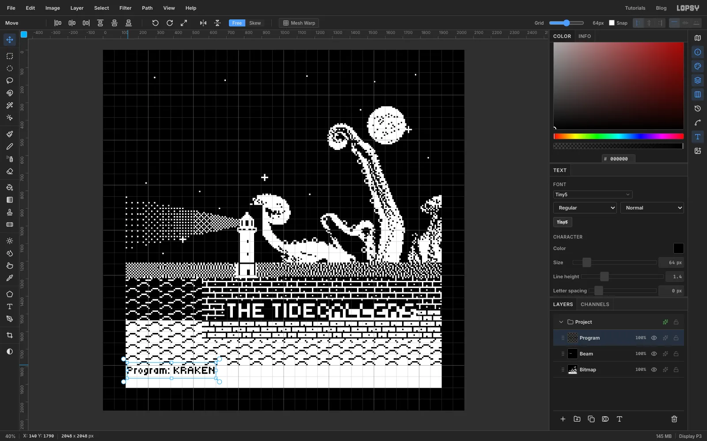

Untick **Snap**. Select **Beam**, choose the **Text** tool, set **Tiny5** at
**Size 64** (one font pixel = one Spectrum pixel) in black, and click in the
white strip. Type **Program: KRAKEN**, press [[Tab]] and rename the layer
*Program*. Nudge it until the text starts at **136, 1800**. This is the line the Spectrum prints when it
finds a program on the tape.

## Type the title

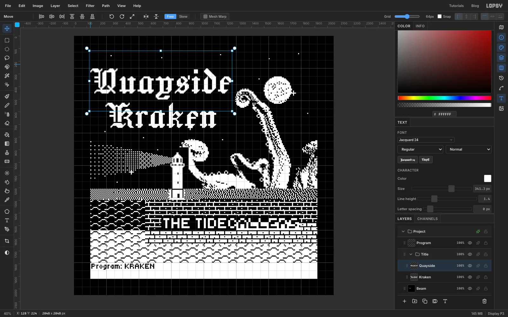

Select **Beam** and click **New Group** in the Layers panel. Name the group
*Title*, so both lines can be moved together.

Choose **Jacquard 24**, a pixel blackletter, in white. Each of its pixels is
3/128 of the font size, so at **Size 341.33** one font pixel is exactly
8 px. Type the lower line first, so your click doesn't land
inside an existing text box: click in empty sky, type **Kraken** and press
[[Tab]]. Then click above it, type **Quayside** and press [[Tab]].

Nudge them with the Move tool and the arrow keys so Quayside starts at
**128, 256** and Kraken at **248, 528**. That's one cell left of and one cell
below where they belong, so you can place the pair with a single group move
next.

## Move the title into place

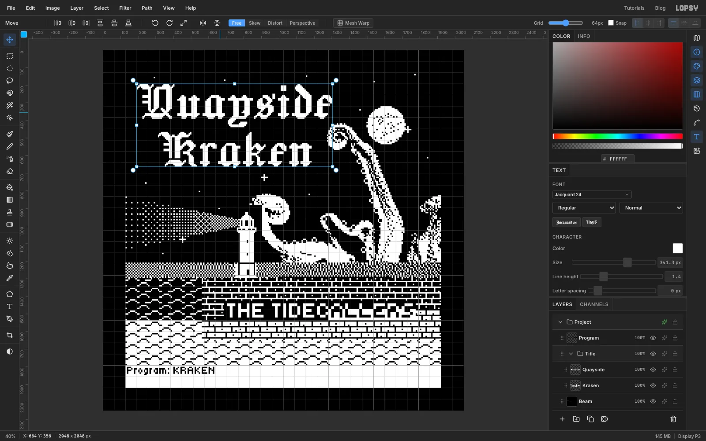

Click the **Title** group row and drag the title with the Move tool, **64 px**
right and **64 px** up. Quayside now starts at **192, 192**, one cell in from
the top-left corner of the picture. Kraken sits centred under it, starting at
**312, 464**. Check both in the status bar, because the colour stripes later
split the lines at exact rows.

## Paint the title into the picture

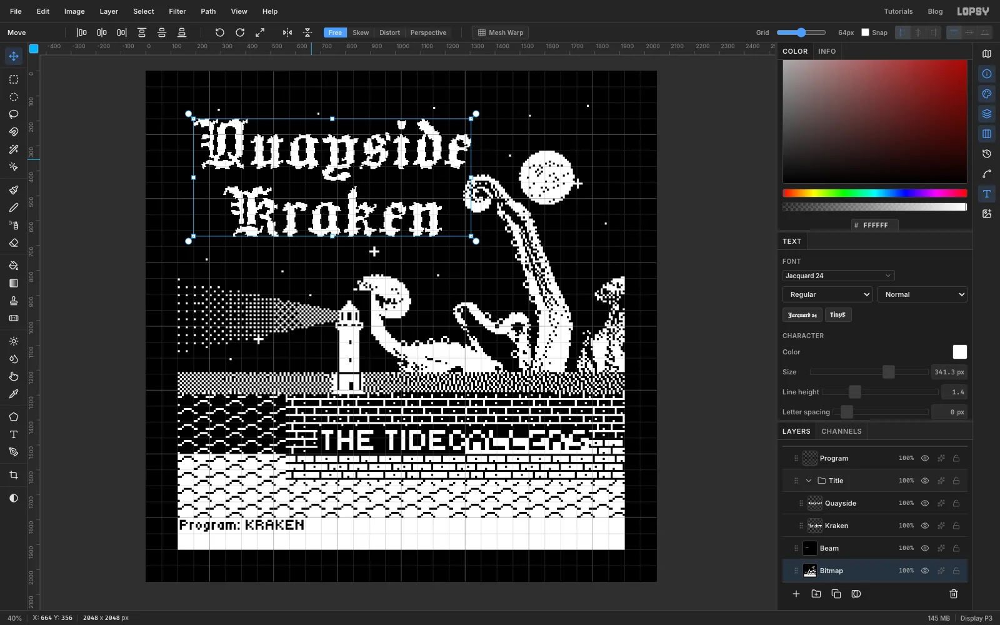

On a Spectrum, the title would be part of the picture, so make it part of
the bitmap. [[Cmd]]-click the **Quayside** thumbnail to select its letters,
then [[Cmd]]+[[Shift]]-click the **Kraken** thumbnail to add them. Select
**Bitmap**, fill the selection with white and press [[Cmd]]+[[D]].

Then select the **Title** group and click **Delete Layer**. The group and
both text layers go, and the title stays in the picture.

## Snap the title to the pixel grid

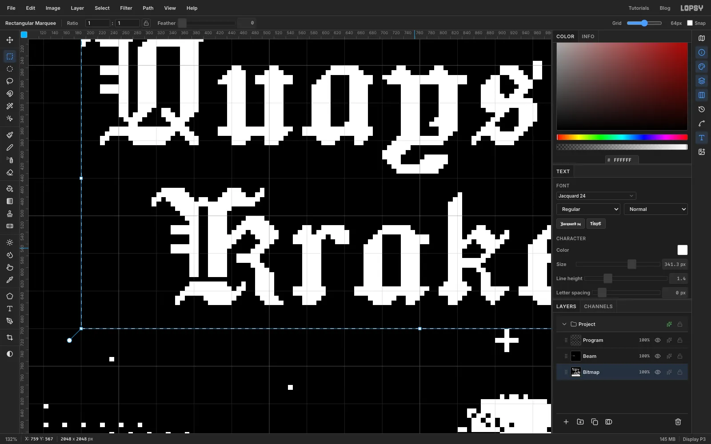

The type is smooth at its edges, and Spectrum pixels have no in-between
greys. Select the title area, **192, 192** to **1344, 704**, and apply
**Pixelate** at **8** and **Threshold** at **128**. Every edge snaps to a
whole Spectrum pixel.

## Fix the Q

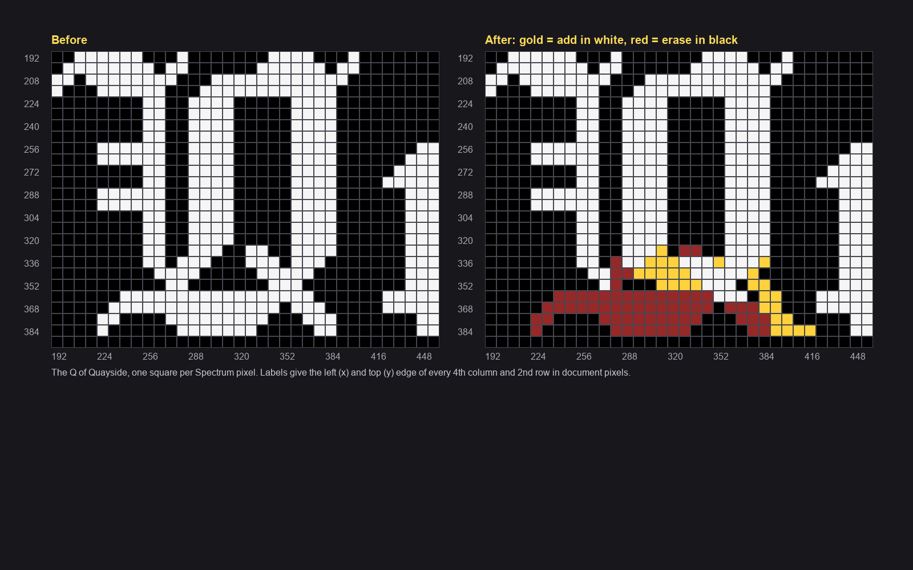

In this blackletter, the bottom of the Q is open with a small cross under it,
so at a glance "Quayside" reads as "Uuayside". Fix it on **Bitmap** with the
8 px grid showing and the Pencil at 8 px, using the chart:

- In white, fill the gold squares. They close the bottom of the bowl with
  two solid rows and draw a tail two pixels thick that runs down and to the
  right.
- In black, fill the red squares. That removes the little cross and the flat
  swash under the letter.

## Start the colour layer

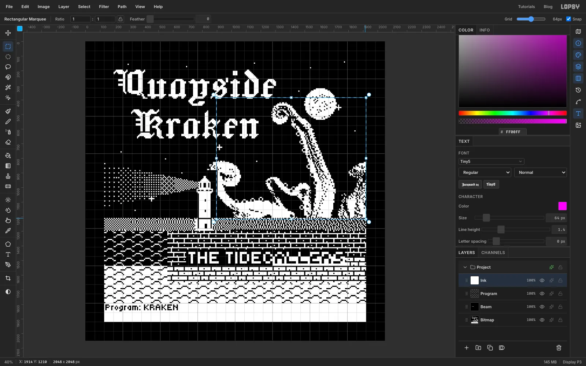

Select **Program** and click **Add Layer**. Name the layer *Ink*, fill it
with white and set its blend mode to **Multiply**. White leaves the picture
alone. Any other colour tints the white pixels in that cell and leaves the
black ones black, which is how the Spectrum's ink works.

Set the **Grid** back to **64px** and tick **Snap**. From now on, every
colour is a marquee dragged from cell corner to cell corner and filled with
**Edit → Fill**.

## Colour the kraken, the moon and the beam

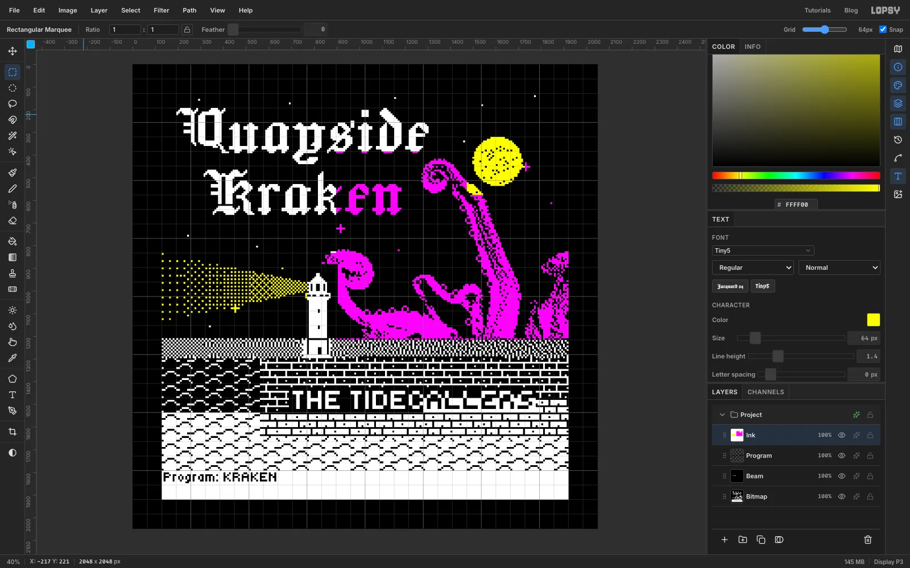

Fill these areas in this order. Each one paints over the cells before it:

1. Bright magenta `#FF00FF`: **896, 384** to **1920, 1216** for the arms,
   plus the single cell **832, 832** to **896, 896** for the tip of the curl.
2. Bright yellow `#FFFF00`: **1472, 320** to **1728, 576** for the moon. The
   arm next to it turns yellow too, which is the colour clash you want.
3. Bright yellow: **128, 832** to **768, 1152** for the beam, and
   **768, 960** to **896, 1024** for the lantern.

## Colour the title and the sea

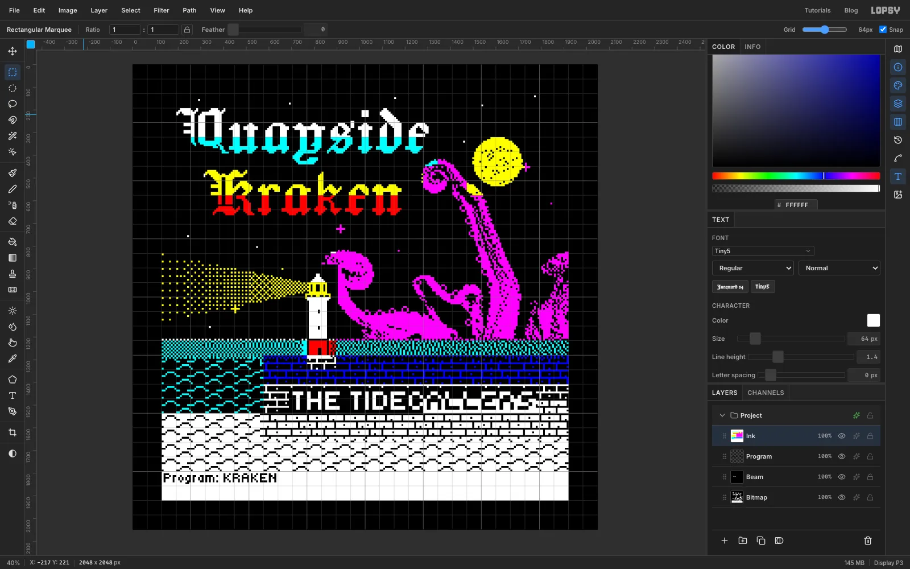

Give the title Spectrum-style colour stripes, one per row of cells:

- Bright cyan `#00FFFF`: **192, 320** to **1344, 448**. That's the lower
  half of Quayside. Its top half stays white.
- Bright yellow: **320, 448** to **1280, 576**, the top of Kraken.
- Bright red `#FF0000`: **320, 576** to **1280, 704**, the bottom of Kraken.

Then the sea and the quay:

- Bright cyan: **128, 1216** to **1920, 1280**, the distant sea.
- Bright red: **768, 1216** to **896, 1280**, the lighthouse base.
- Bright cyan: **128, 1280** to **576, 1536**, the waves.
- Bright blue `#0000FF`: **576, 1280** to **1920, 1408**, the top of the
  wall.
- White: **768, 1280** to **896, 1344**, so the lighthouse plinth stays
  white.

Leave everything else white. That includes the band name, and above all the
unloaded rows, which must stay black on white.

## Make the border noise

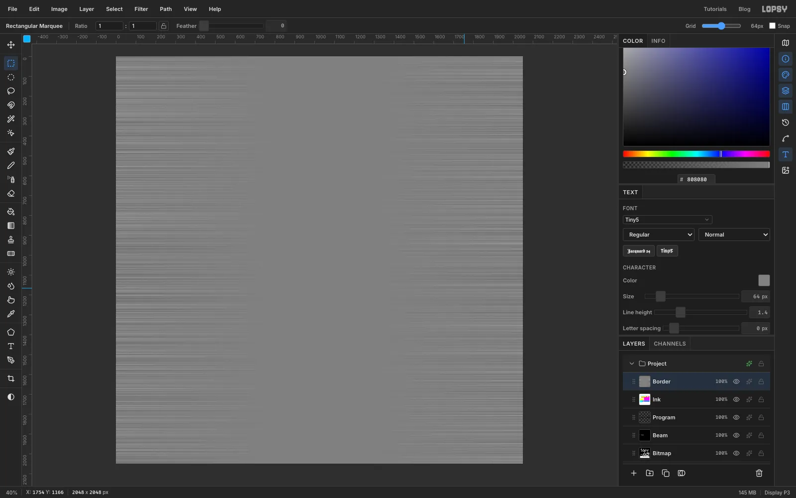

While a Spectrum loads, the border flickers with thin yellow and blue
stripes that break off at random points.

Select **Ink**, click **Add Layer** and name the layer *Border*. Fill it with
`#808080`. Choose **Filter → Add Noise…** with **Amount 100** and **Mono**,
then **Filter → Motion Blur…** with **Angle 0** and **Distance 1500**. Each
row now drifts slowly between a little lighter and a little darker than
mid-grey.

## Turn the noise into stripes

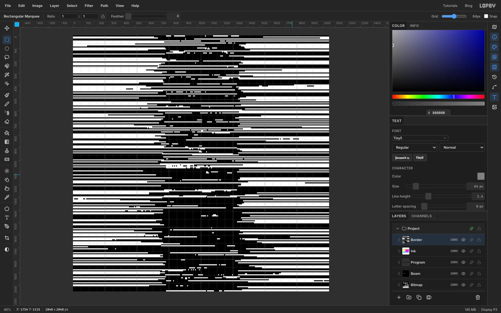

Apply **Pixelate** at **8** and **Threshold** at **128**. Each row of
Spectrum pixels becomes black or white, with breaks where the row crosses
the middle grey.

## Colour the border

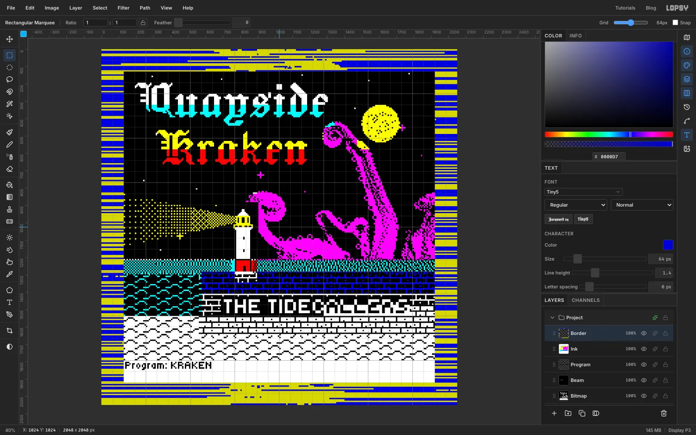

Choose the **Magic Wand**, set **Tolerance** to **10**, untick
**Contiguous**, and click a white stripe. Fill the selection with
`#D7D700`. Choose **Select → Inverse** and fill with `#0000D7`. These are
the Spectrum's normal yellow and blue, because the border can't show the
bright ones.

Finally, select the picture area, **128, 128** to **1920, 1920**, and press
[[Delete]] to clear the stripes from it. Press [[Cmd]]+[[D]] and export
with **File → Quick Export PNG**.
