This card is for someone turning eighty who'd rather you didn't make a fuss.
You'll make a fuss anyway: a huge painted **80**, a row of **eighty hand-drawn
tally marks**, and a very small note that says *just eighty*.

The style comes from the New York School of the 1950s:

- Joan Mitchell's tangled, high-colour strokes on a scrubbed white ground
- Franz Kline's fat black gestures, with paint that runs out partway through
- Cy Twombly's scratchy lines, like crayon on a wall

Clean digital strokes look wrong in this style, so most of this tutorial is
about making brushes that behave like paint. You'll spray a cloud of coloured
dots, turn the cloud into a **colour brush tip**, and drag it. Each dot leaves
its own streak, so one stroke looks like a brush loaded with several colours.

Along the way you'll use:

- **Spray**, **Edit → Define Color Brush** and **Edit → Define Brush**
- the Brushes modal's **Taper**, the **Fade** slider and the Smudge tool
- **Copy**, **Paste** and the Move tool's scale and rotate handles
- groups, guides and arrow-key nudges
- **Copy Merged**, **Emboss**, **Hue/Saturation**, **Add Noise** and **Motion Blur**
- Multiply and Overlay blend modes
- point text painted through a selection

Here are the colours:

- Ground `#F2EEE3`, warm stain `#F3D2B4`
- Whites `#FBF8F1` / `#E8E2D4` / `#D6DEE2` / `#F6E4DE` / `#FFFFFF` / `#E2DCCD`
- Hot `#C9321F` / `#B5281E` / `#D9481E` / `#EDA62A` / `#8E1634` / `#6E1226`
- Bloom `#E97F95` / `#C93A5E` / `#F7C4CC` / `#FBE3DF` / `#8E1A40` / `#B98A8E`
- Gold `#E9AC1C` / `#C98A18` / `#F4CE4E` / `#A86B12` / `#F8E084` / `#6E4A14`
- Cool `#1E2F9E` / `#0F6D5A` / `#2F6FC7` / `#14206E` / `#6FA6C8` / `#6F9C50`
- Mud `#7D6652` / `#5A5C69` / `#9C8468` / `#3A3A44` / `#B59A6B` / `#6E4538` / `#8C93A0` / `#4C3A30`
- Ink `#141110` / `#2A2623` / `#0B0A09` / `#1E1B22` / `#332E2A`

## Start a landscape card

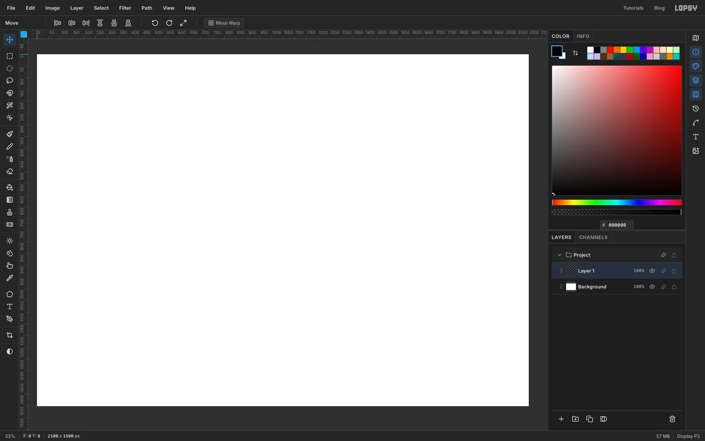

A 7 × 5 inch card at 300 dpi is 2100 × 1500 pixels. Open [Lopsy](/). In the **New Document** dialog, set the unit to **Pixels**, set **Width** to `2100` and **Height** to `1500`, and click **Create**.

## Lay the ground and the guides

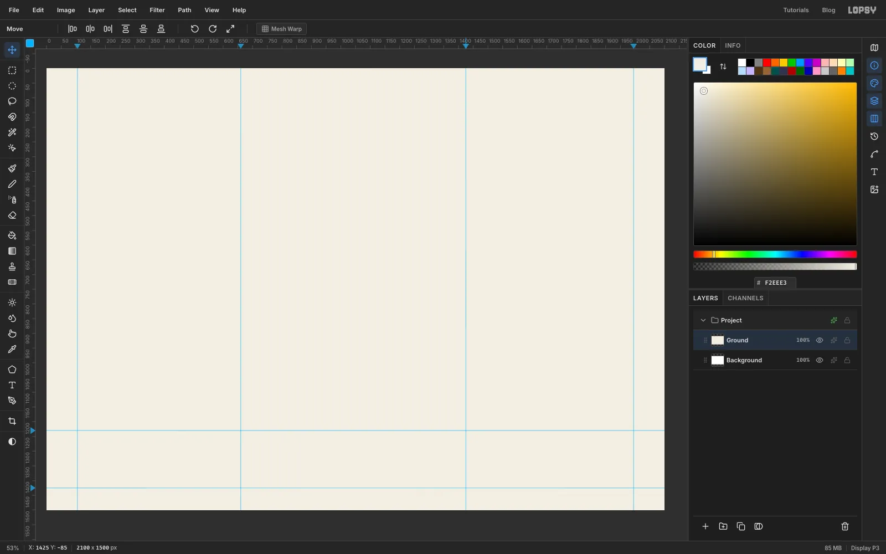

1. Double-click `Layer 1` in the Layers panel and rename it `Ground`.
2. Set the foreground to `#F2EEE3` and choose **Edit → Fill**.
3. Click the top ruler at about `105` and `1995` for the side margins, then at `660` and `1425` to mark the middle of each numeral. The status bar shows your cursor position if you want to check.
4. Click the left ruler at `1230` and `1425`. Those two guides fence off the band at the bottom where the tally marks and the words will go. Keep the colour out of it. The white scrub you'll paint later can run through.

## Spray your first colour tip

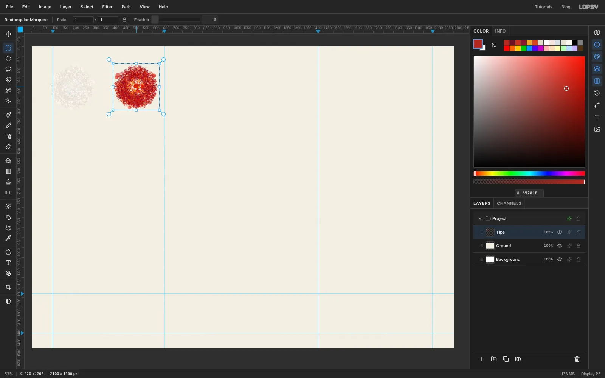

A brush tip made of scattered dots paints streaks in whatever direction you drag it, like the bristles of a real brush. You'll make nine of these discs in a grid, so leave clear space between them and keep them away from the guides. A marquee edge that snaps to a guide can clip dots, or turn off **View → Snap to Guides** while you work.

1. Click **Add Layer** and name the layer `Tips`. It's a scrap layer you'll delete later.
2. Press [[J]] for the **Spray**. In the options bar set **Size** `220`, **Density** `40`, **Opacity** `100` and **Softness** `10`.
3. Set the foreground to `#FBF8F1` and click once near the top left of the canvas. That sprays a disc of chunky dots.
4. Set **Size** to `66` and **Density** to `30`. Pick each of these colours in turn and scribble a quick spiral over the disc: `#FBF8F1`, `#E8E2D4`, `#D6DEE2`, `#F6E4DE`, `#FFFFFF`, `#E2DCCD`. The small dots become your fine bristles.
5. Press [[M]] and drag a marquee around the disc, leaving a little room on every side.
6. Choose **Edit → Define Color Brush…**, type `Whites` and confirm. Press [[Cmd+D]] to deselect.

Lopsy now has a tip called `Whites`, and it's the active brush. That matters, because **Spray stamps with the active brush tip**. If you spray again now you'll get tiny copies of `Whites`, whatever your foreground colour. So before each new tip, press [[B]], click the tip thumbnail at the left of the options bar to open the **Brushes** modal, click **Hard Round** on the **Presets** tab, close the modal, and press [[J]] to go back to the Spray.

Now make `Hot` to the right of the first disc. At Size `220` and Density `40`, click once each with `#C9321F` and `#B5281E`. Then at Size `66` and Density `30`, spiral `#C9321F`, `#D9481E`, `#EDA62A`, `#8E1634`, `#C9321F`, `#6E1226` and `#B5281E`. The screenshot shows it just before **Define Color Brush…**.

## Make the rest of the tips

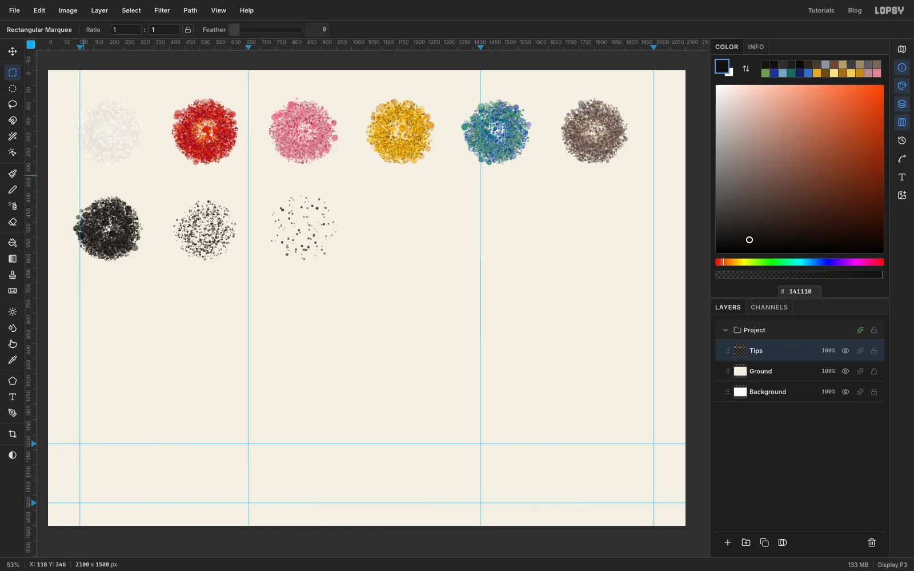

Make four more colour tips the same way. Reset to **Hard Round** before each one, spray the two big colours once each at Size `220` and Density `40`, spiral the rest at Size `66` and Density `30`, then marquee the disc and use **Define Color Brush…**:

- `Bloom`: big `#E97F95`, `#C93A5E`. Spirals `#F7C4CC`, `#C93A5E`, `#FBE3DF`, `#8E1A40`, `#E97F95`, `#B98A8E`.
- `Gold`: big `#E9AC1C`, `#C98A18`. Spirals `#F4CE4E`, `#A86B12`, `#E9AC1C`, `#F8E084`, `#6E4A14`, `#E9AC1C`.
- `Cool`: big `#1E2F9E`, `#0F6D5A`. Spirals `#2F6FC7`, `#14206E`, `#0F6D5A`, `#6FA6C8`, `#1E2F9E`, `#6F9C50`.
- `Mud`: big `#7D6652`, `#5A5C69`. Spirals `#9C8468`, `#3A3A44`, `#B59A6B`, `#6E4538`, `#8C93A0`, `#4C3A30`.

Start a second row for the next one. `Ink` is the black for the numerals. Spray `#141110` twice at Size `220`, then spiral `#141110`, `#2A2623`, `#0B0A09`, `#1E1B22`, `#332E2A` and `#141110`, and define it as a colour tip too.

The last two tips use **Edit → Define Brush…** instead. A plain Define Brush keeps only the shape, so these two paint in whatever foreground colour you choose. Reset to Hard Round before each, and keep the foreground at `#141110`.

- `Drag` is a dry brush. Set Spray **Size** `66` and **Density** `14`, and spiral twice over an empty patch, about as wide as the other discs. Marquee it and choose **Define Brush…**.
- `Tear` is a nearly empty brush. Set Spray **Size** `80` and **Density** `14`. Click seven times in a ring and once in the middle, so you get a thin scatter about as wide as the others. Marquee it and define it the same way. Gaps here are the point: they'll let the canvas show through.

Click the `Tips` layer and click **Delete Layer**. The brushes stay, but only until you reload the page, so paint the rest of the card in one sitting. The Brushes modal's **Export** button will save them to a file if you need a break.

## Scrub in the white ground

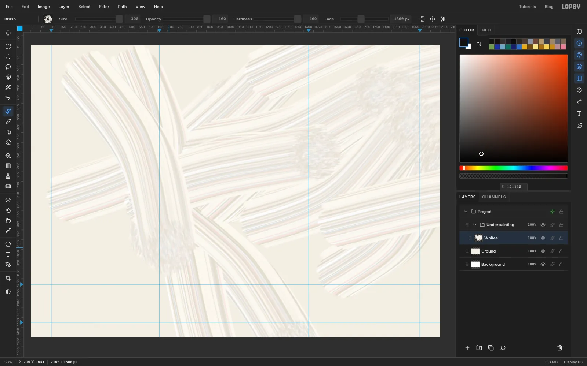

Mitchell's white is never flat, because she painted it as hard as the colours.

From here on, **pick** a tip means this: press [[B]], open the Brushes modal, go to the **Presets** tab and click the tip. That resets Size, Opacity, Taper, Fade, Angle and Texture, so set those after you pick. The Shape tab shows the same grid, but clicking there only swaps the tip and keeps everything else, so don't pick from it.

1. Click the `Ground` row and click **New Group**. Name the group `Underpainting`.
2. With the group selected, click **Add Layer** and name the layer `Whites`.
3. Pick `Whites`. On the **Shape** tab set **Size** to `300`. Close the modal and set **Fade** in the options bar to `1300`.
4. Paint about 16 long strokes all over the canvas, including the bottom band, each roughly half the card's width. Most should rise to the right, and the rest should fall steeply. Bow them a little, from the shoulder.

**Fade** fades a stroke out over that many pixels, then paints nothing more until you let go. A loaded colour tip stays opaque until almost the end, so the paint seems to run out instead of stopping dead. If a stroke dies before you've finished, raise Fade.

Keep moving while you paint. If you stop for a second and a half, the brush smooths the stroke and drops its taper and fade.

## Warm up the middle

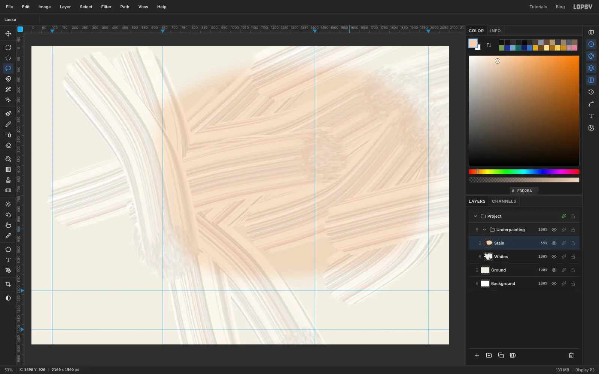

The painting will lean to the right, so the warmth should too.

1. Click **Add Layer** and name it `Stain`. Set the foreground to `#F3D2B4`.
2. Press [[L]] and lasso a big lopsided blob. Start left of centre, go over the top and out to the right edge, and come back along the top of the bottom band.
3. Choose **Select → Feather…** with `90`, then **Edit → Fill**. Press [[Cmd+D]].
4. Click the ✦ button on the layer's row and set the blend mode to **Multiply**. Close the drawer.
5. Choose **Filter → Add Noise…** with **Amount** `8` and **Mono**.
6. Click the opacity figure on the row and drag the slider that appears to about `55%`.

## Paint one huge gesture

Every painting like this needs one mark far bigger than the others. Paint it on its own layer, well inside the canvas, so you can copy it whole.

1. Click the `Underpainting` row and click the arrow beside it to collapse the group. With the group's row still selected, click **New Group** and name it `Riot`. A new layer or group goes inside an open group but beside a collapsed one, which is why you collapse first. You'll do this again later.
2. Click **Add Layer** and name it `Red Sweep`.
3. Pick `Hot`. On the **Shape** tab set **Size** `215` and **Taper** `1150`, then set **Fade** to about `800`. Taper's slider stops at 1000, so type bigger values into its number box.
4. Start a little right of the `1425` guide, about two-thirds of the way down the canvas, and sweep up and to the left in one S-curve until you're close to the top. It should be nearly 800 px long.

**Taper** narrows the stroke as it travels, like a brush lifting off the canvas.

## Copy the gesture and shrink it

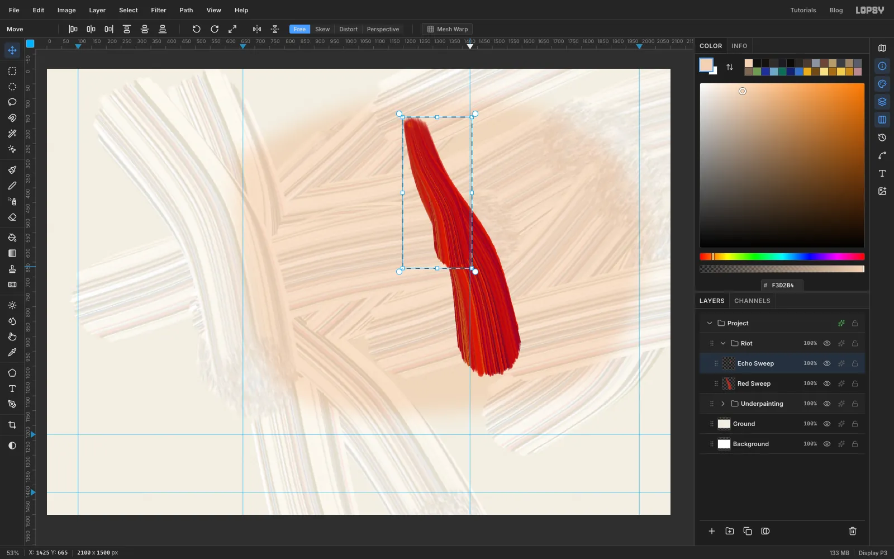

1. Press [[M]] and drag a marquee around the whole sweep, with a margin on every side.
2. Press [[Cmd+C]] and then [[Cmd+V]]. Rename the new layer `Echo Sweep` and press [[Cmd+D]].
3. Press [[M]] again, drag a fresh marquee closely around the copy, and press [[V]] for the Move tool.
4. Hold [[Cmd]] and drag the bottom-right corner handle inward until the copy is a bit over half its size. [[Cmd]] keeps the proportions.
5. Press [[Cmd+D]] to commit.

## Turn the copy on its side

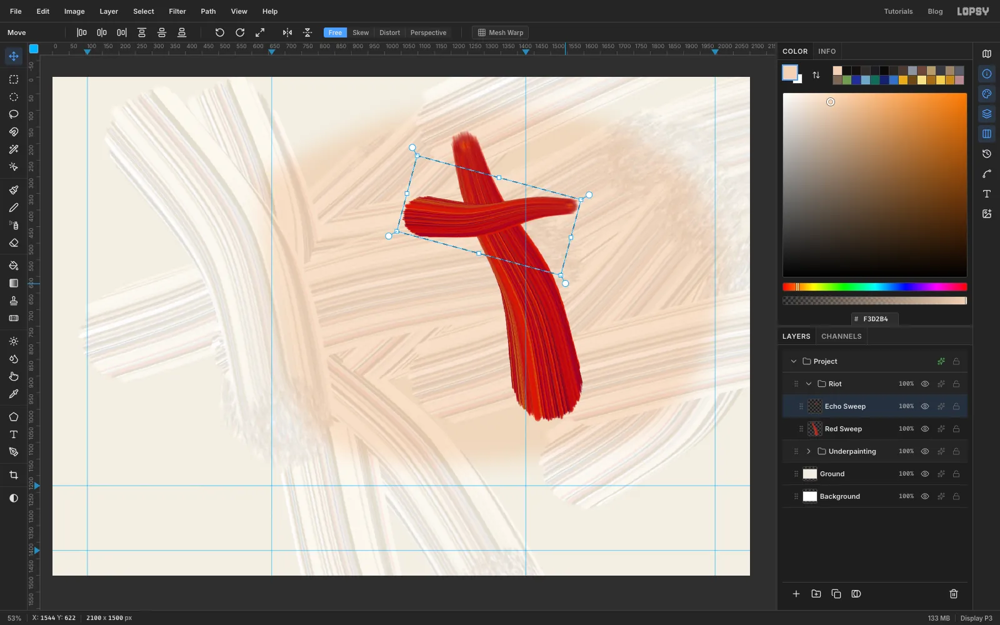

Press [[M]] and drag another marquee around the small copy. Press [[V]], then drag the round rotate handle just outside the top-right corner clockwise by a little more than a quarter turn, about `105°`. Press [[Cmd+D]].

## Place both sweeps

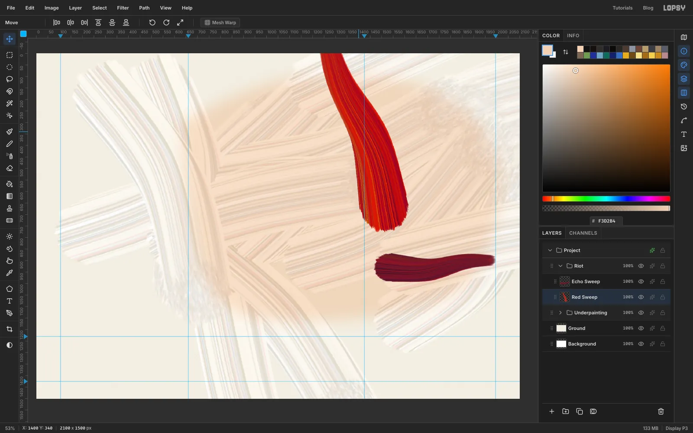

1. Choose **Filter → Hue/Saturation…** with **Hue** `-14`, **Saturation** `-18` and **Lightness** `-14`, so the copy turns a darker crimson.
2. Drag the copy with the Move tool to the lower right, so its centre sits at about `1730, 930`.
3. Click the `Red Sweep` row and drag that stroke straight up by about 260 px, so its thin end runs off the top of the canvas. Lopsy keeps pixels that hang past the edge. A stroke leaving the canvas tells the eye the painting is bigger than the card.

## Throw in the gold

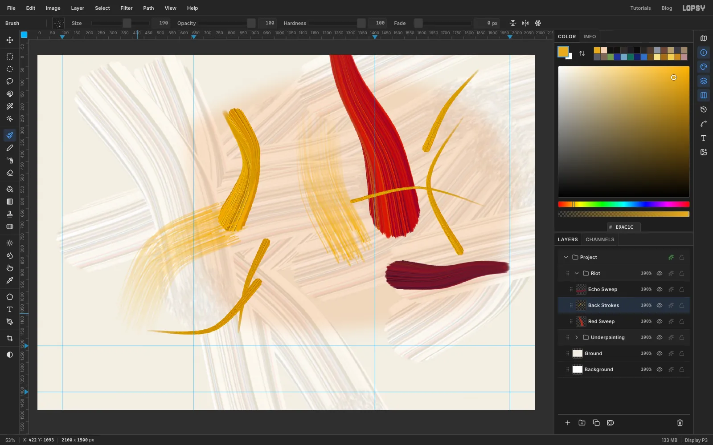

The danger from here on is that every stroke ends up the same size. Change the width on nearly every stroke, and keep the marks to the middle and right.

1. With `Red Sweep` still selected, click **Add Layer** and name it `Back Strokes`. It sits above `Red Sweep` and below `Echo Sweep`.
2. Pick `Gold` and drag the Brushes modal over the right-hand panels. It has no backdrop, so you can leave it open and keep painting.
3. Paint 7 strokes, each about a quarter of the card's width, with sizes jumping around: `16`, `34`, `70`, `120`. Start them near the middle and flick outward, with a few straight up or down.

Before each stroke, set **Taper** a bit longer than the stroke you're about to paint, and **Fade** about equal to it. Thin strokes can take more Taper. A stroke that lifts and fades doesn't end in a round stamp of dots, which is the giveaway of a tip like this.

Now pick `Tear`, set the foreground to `#E9AC1C`, and drag two wide dry passes at Size `150` and `190`, with **Fade** about their length. This is what a brush looks like when it's nearly out of paint.

## Add pink and blue-green

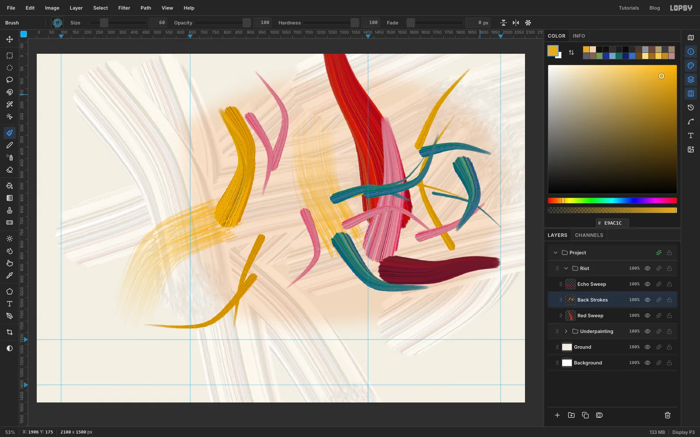

Keep going on the same layer, with the same habits. Pick `Bloom` and paint 6 strokes at sizes from `18` up to `150`. Then pick `Cool` and paint 7 shorter ones, from a hairline `14` up to `84`.

Let them cross each other. Each new stroke covers what's beneath it, so a thin blue across a fat pink reads as depth.

## Add mud, red and the big slabs

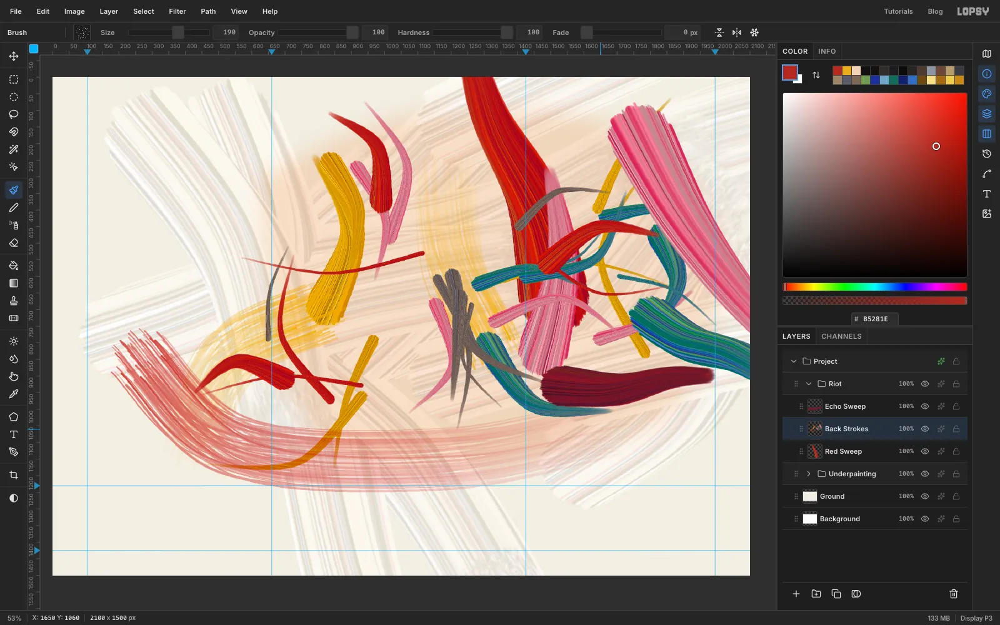

Clean colours alone look like a party flag, so dirty them.

1. Pick `Mud` and paint 6 strokes at sizes `16` to `70`. Keep them left of the crowded right edge.
2. Pick `Hot` and paint 7 more, at sizes `14` to `120`.
3. Pick `Bloom`, set **Size** `200`, **Taper** `1400` and **Fade** about `750`, and drag one slab from the top right, down and out past the right edge of the canvas.
4. Pick `Cool`, set **Size** `130`, **Taper** `1200` and **Fade** about `430`, and drag another from the middle of the right side out past the same edge. Running these off the canvas means you never see their ends.
5. Pick `Tear`, set the foreground to `#B5281E`, **Size** `190` and **Fade** about `1500`. Drag one long drained stroke from the left side, curving down and right under where the numerals will go, and finish about three-quarters of the way across. Stay above the `1230` guide the whole way.

## Cut back in with white

Mitchell cut into her colour with white, and that's where the air comes from. Pick `Whites` and paint 5 strokes at sizes `40`, `90` and `150`, right through the busiest parts. Use the same Taper and Fade habit as before. Don't be polite about it.

## Dirty it up

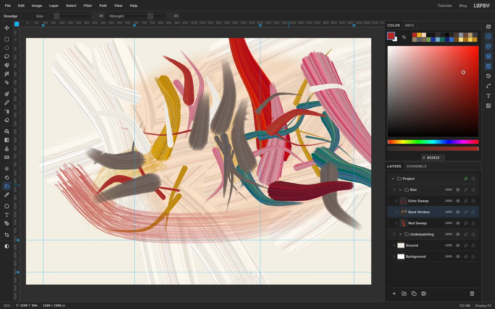

1. Pick `Mud`. On the Shape tab set **Opacity** to `15`, **Size** `120` and **Taper** `700`. Drag about 6 short strokes where colours cross, with **Fade** about each stroke's length. A colour tip builds up within a stroke, so these come out as soft grey-brown drags, much stronger than 15% suggests.
2. Press [[R]] for the **Smudge** tool. Set **Size** `30` and **Strength** `65`, and make about 8 short drags across places where two colours meet, so one pulls into the other.
3. With `Back Strokes` selected, choose **Filter → Hue/Saturation…** and set **Saturation** to `-22`. Everything calms down a little, and it reads less like candy.

## Fill the counters

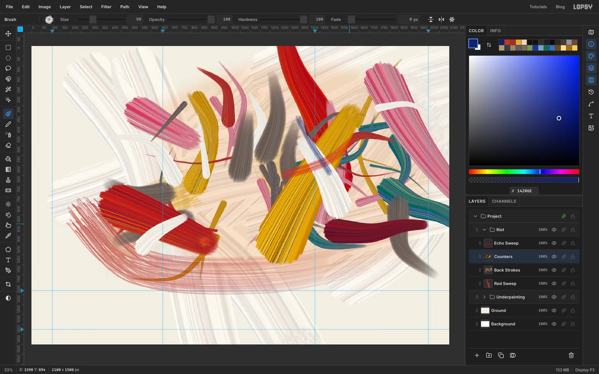

The holes in the numerals are the brightest places on the card, because the black will frame them. You're painting them before the numerals exist, so here's where they'll be. The 0 will be about 620 px wide and 900 tall, centred on the right guide, with its hole around `1425, 650`. The 8 will sit on the left guide, with its top hole near `670, 380` and its bottom hole near `660, 880`. Check against the picture.

Click **Add Layer** and name it `Counters`. Press [[B]] and use these marks. Where a Taper is given, set **Fade** to about the stroke's length too.

**Inside the 0:**

1. Pick `Gold`, **Size** `250`, **Taper** `1180`: one slab from the lower left of the hole to the upper right, about 740 px long.
2. Pick `Whites`, **Size** `140`, **Taper** `800`: scrub back down across the gold, from lower right to upper left.
3. Pick `Tear`, **Size** `46`, foreground `#C9321F`: a dry slash across the middle, from upper right to lower left. Leave Fade at `0`.
4. Keep `Tear`, **Size** `30`, foreground `#14206E`: a thin dark slash down from the top of the hole.

**Inside the 8:**

1. Pick `Bloom`, **Size** `170`, **Taper** `800`: a slab across the top hole, going down to the right.
2. Pick `Mud`, **Size** `30`, **Taper** `320`: a thin slash across the pink the other way.
3. Pick `Hot`, **Size** `215`, **Taper** `1200`: a slab across the bottom hole, going down to the right.
4. Pick `Whites`, **Size** `90`, **Taper** `460`: a scrub up across the red.

Then choose **Filter → Hue/Saturation…** with **Saturation** `-10`.

## Paint the first slash of the 8

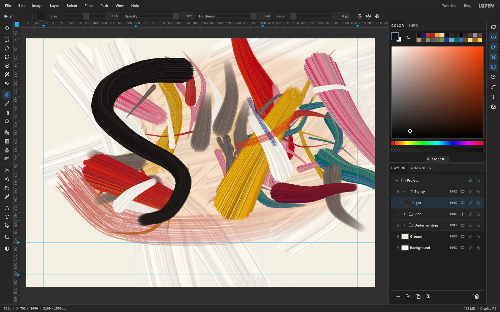

Don't draw an outline. A big 8 is two or three hits with a loaded brush, and the width should change as you go.

1. Click the `Riot` row, collapse the group, keep its row selected, and click **New Group**. Name it `Eighty`.
2. Click **Add Layer** and name it `Eight`.
3. Pick `Ink`. Set **Size** `165`, **Taper** `2900` and **Fade** about `1640`.
4. Start past where the top of the 8 will be, at the upper right, near `930, 190`. Sweep left over the top, down the left of the top bowl, diagonally through the waist to the lower right, around the outside of the bottom, and stop at the bottom middle. It's one long S.

If it comes out stiff, undo it and go again, faster. The stroke should thin noticeably by the time it reaches the bottom. The screenshots show Fade back at `0` because I reset it after each stroke.

## Finish the 8 with an empty brush

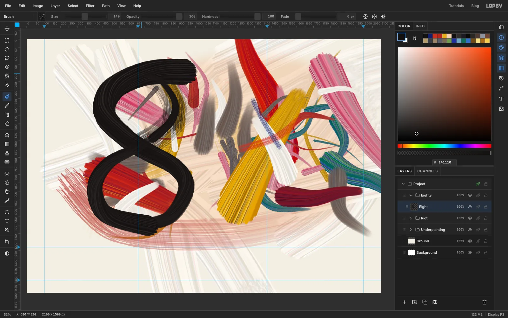

1. Pick `Ink` again, with **Size** `130`, **Taper** `1450` and **Fade** about `875`. Start at the bottom middle, overlapping the end of your first stroke. Sweep left around the bottom, up the lower left, and stop in the waist.
2. Pick `Ink` once more, with **Size** `56`, **Taper** `900` and **Fade** about `500`. Start at the waist and go up around the right of the top bowl to the top. This thin line makes sure the 8 still reads as an 8.
3. Pick `Tear` and set the foreground to `#141110`. At **Size** `150` and **Fade** about `400`, drag from the waist up to the right, past the 8 and into the space between the numerals. That's the overshoot.
4. At **Size** `140` and **Fade** about `400`, drag up the right side of the top bowl and over to the top, right on top of the thin line from step 2.

The torn black over that thin line is the part that looks most like paint running out.

## Paint the 0

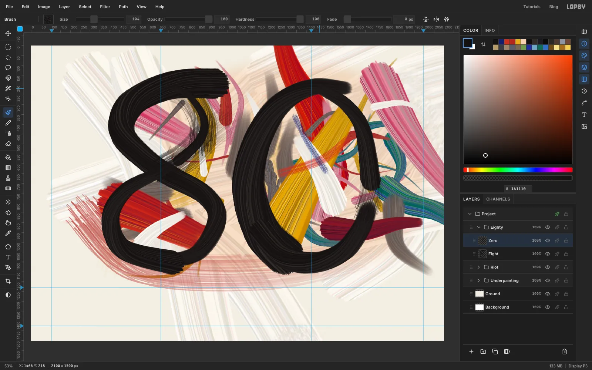

The 0 has a much bigger width change than the 8. The left side is huge and the top is about a quarter of that.

1. Click **Add Layer** and name it `Zero`.
2. Pick `Ink`, **Size** `215`, **Taper** `1640`, **Fade** about `1250`. Start at the bottom, left of centre on the 0's guide. Go up the left side, around the top, and stop at the upper right. The stroke should be over 200 px wide at the start and about 50 at the end.
3. Pick `Ink`, **Size** `135`, **Taper** `2000`, **Fade** about `750`. Start inside the fat lower left of the first stroke, so the join is hidden. Go along the bottom and up to the lower part of the right side.
4. Pick `Tear` with the foreground still `#141110`, **Size** `120`, **Fade** about `190`, and drag up the right side for about 200 px. This is a short dry break.
5. Pick `Ink`, **Size** `104`, **Taper** `1250`, **Fade** about `585`. Start at the top of the dry break and go up the right side and over to the top, joining the first stroke.

## Lean the numbers

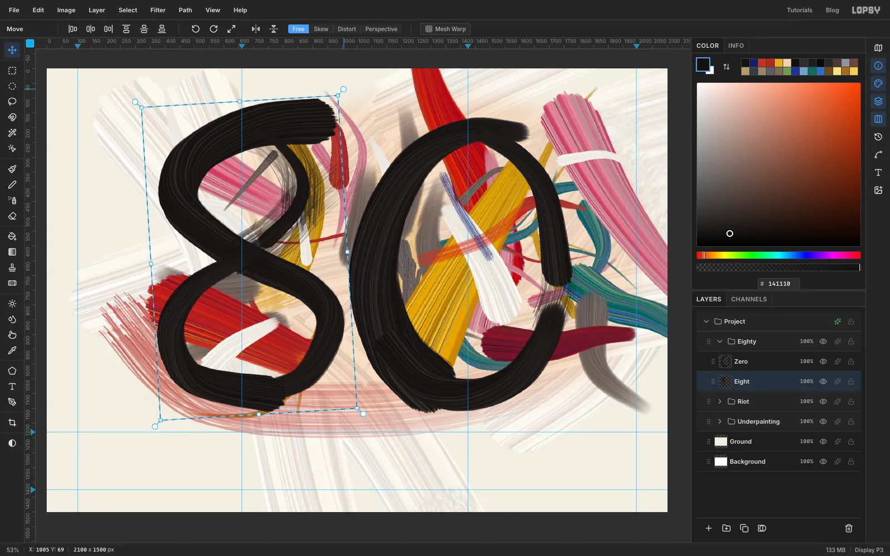

Upright numerals look typeset, so give them a tilt.

1. Click the `Eight` row, press [[M]] and drag a marquee around the whole 8.
2. Press [[V]] and drag the rotate handle about `3.5°` anticlockwise. Press [[Cmd+D]].
3. Click the `Zero` row and do the same, with [[M]] then [[V]], turning it about `3°` clockwise. Press [[Cmd+D]].
4. Click the `Eighty` group's row. With the Move tool active, press [[Shift+Up]] once to lift both numbers 10 px together.

## Tie the numbers into the paint

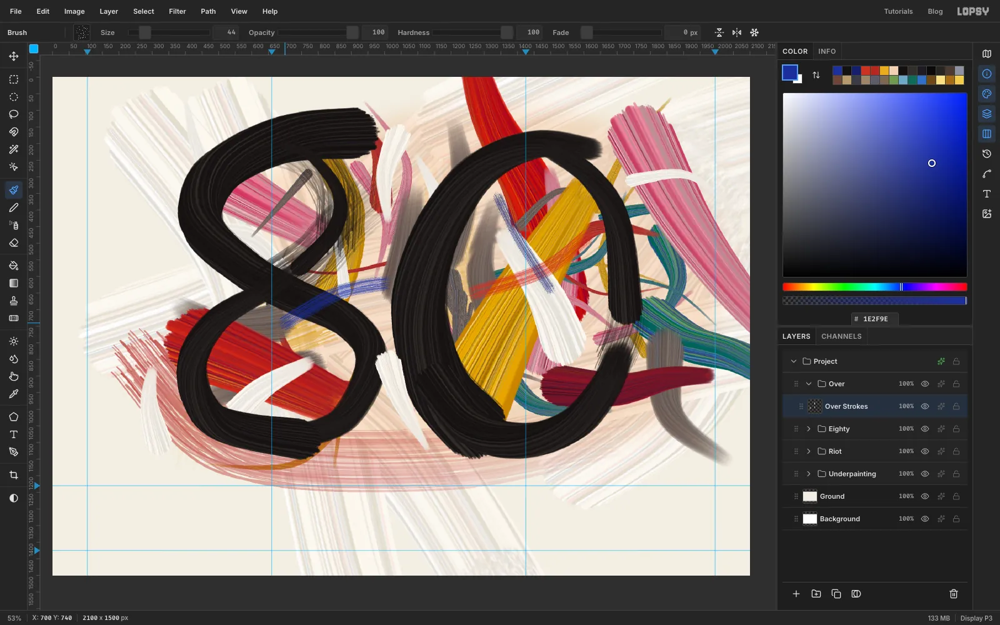

The numerals are sitting on top of the painting like a sticker. A few strokes over the black fix that.

1. Click the `Eighty` row, collapse it, keep its row selected and click **New Group**. Name it `Over`.
2. Click **Add Layer** and name it `Over Strokes`.
3. Pick `Whites`, **Size** `80`, **Taper** `340`, **Fade** about `280`. Paint three short strokes that bite into the black edge: one above the gap between the numerals, one low in that gap, and one at the lower left of the 8.
4. Pick `Tear`, set the foreground to `#1E2F9E` and **Size** to `44`. With Fade at `0`, drag one dry blue slash across the waist of the 8.

## Give the paint some thickness

This step adds a slight relief to the streaks. Stay subtle: too much and every stroke looks like a die-cut sticker.

1. Click the `Over` row and collapse it.
2. Press [[Cmd+Shift+C]] (**Edit → Copy Merged**), then [[Cmd+V]]. Press [[Cmd+D]] and rename the layer `Impasto`.
3. Choose **Filter → Emboss…** with **Strength** `16` and **Angle** `315`.
4. Set the layer's opacity to about `60%`.

From here on, everything goes above `Impasto`, so these last marks stay flat and sharp, the way a crayon line would.

## Scratch in the oil stick

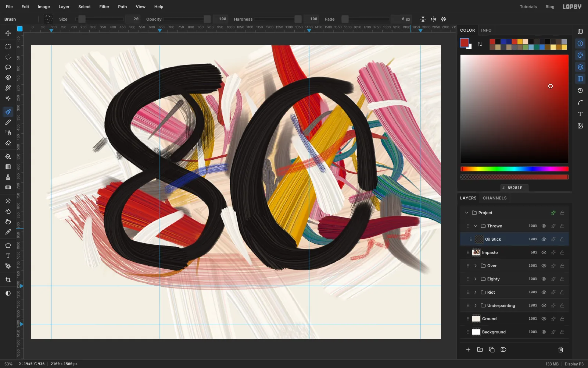

1. With `Impasto` selected, click **New Group** and name it `Thrown`. Click **Add Layer** and name it `Oil Stick`.
2. Pick `Tear` and set the foreground to `#141110`. Starting left of the 8, scribble a jagged line to the right across the waist in short bursts. Lift every 50 to 120 px, leave a small gap, and change **Size** each time, between `24` and `44`. Keep the zigzags irregular, because a regular rhythm reads as a machine.
3. Set the foreground to `#B5281E` and do a smaller scrawl at the lower right at sizes `20` to `32`.

At these sizes `Tear` leaves a grainy line that skips, a lot like wax on canvas.

## Let a few drips run

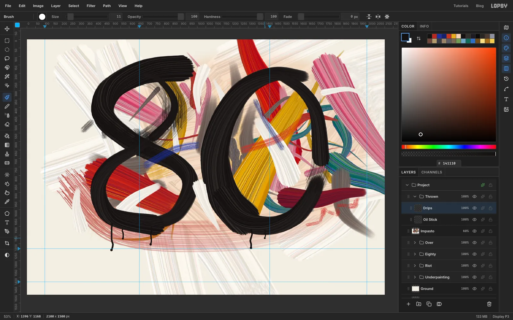

Click **Add Layer** and name it `Drips`. Pick **Hard Round** and set the foreground to `#141110`.

Paint each drip downward from inside the black edge, letting it wander a little from side to side. Then raise **Size** by half and click once at the bottom to make the bead. Three drips hang from the 8 and two from the 0, and each one stops at a different height. Stop them all above the `1230` guide, except the longest, which can end just past it.

Good sizes are `7` to `10`. Don't reach for Taper here: a drip stays about the same width as it runs, and a tapered one looks like a pin.

## Flick some spatter

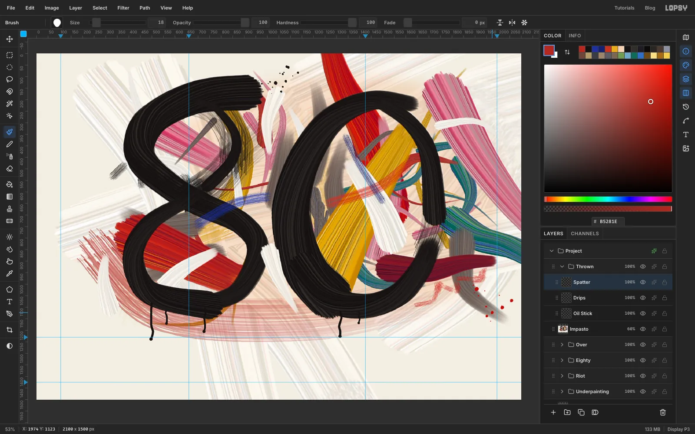

1. Click **Add Layer** and name it `Spatter`.
2. Pick the **Oblong** preset. On the Shape tab, click the angle dial so the oval points in the direction your paint is flying.
3. With the foreground still `#141110`, click about 16 times in a loose cluster off the tip of the 8's first stroke, up and to the right, changing **Size** between `4` and `30`. Use lots of tiny specks and only a couple of big ones, and let them spread out as they travel.
4. Point the dial down and to the right, set the foreground to `#B5281E`, and do the same off the crimson stroke at the lower right.

If you can see a line of dots, it's too neat. Undo a few and scatter them more.

## Count to eighty

1. Click the `Thrown` row and collapse it. Click **Add Layer** and name it `Tally`.
2. Pick **Hard Round**, **Size** `8`. On the **Texture** tab choose **Grain** with blend mode **Multiply** and **Scale** `60`. Set the foreground back to `#141110`.
3. Close the modal and zoom in if you want to. Starting at the left margin guide, draw four quick downward strokes about 12 px apart, ending about 30 px above the lower guide. Make some shorter and some taller, and let them lean. Slash across them from lower left to upper right. That's five years.
4. Do it fifteen more times, spacing the bundles 65 to 95 px apart. Press `[` and `]` now and then to change the size between `6` and `9`.

Yes, that's eighty strokes, and it takes about four minutes. Don't copy and paste: the unevenness is what makes it look like someone counted. If one slash goes wild and hits the next bundle, keep it.

## Add the words

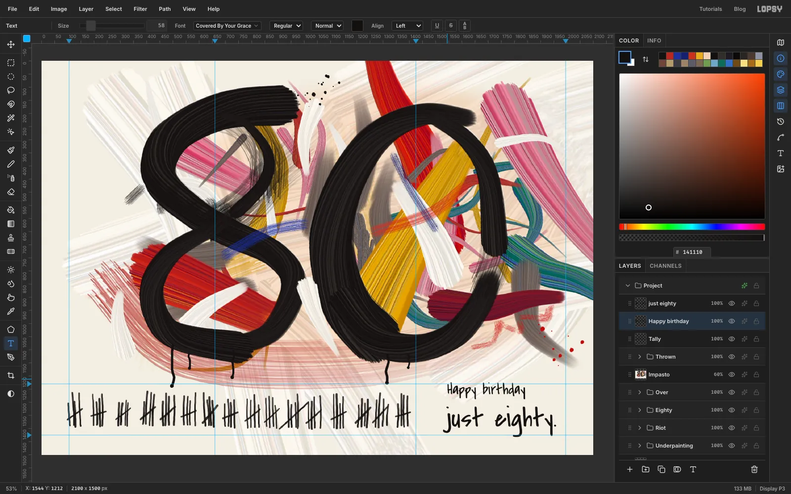

The joke wants to be quiet.

1. Press [[T]] for the Text tool. With `Tally` still selected, set **Size** `104`, pick the font **Covered By Your Grace** and check the foreground is still `#141110`.
2. Click in the empty ground at about `1540, 1290`, type `just eighty.` and press [[Tab]] to commit. Its baseline should line up with the feet of the tally marks. Rename the layer `just eighty`.
3. Click the `Tally` row, so the next change doesn't restyle the text you just made. Set **Size** to `58`, click about 80 px above *just eighty* with the left edges roughly lined up, and type `Happy birthday`. Press [[Tab]].

Make the lower line first, because a click just under existing text can land inside its box and edit it.

## Run the marker dry

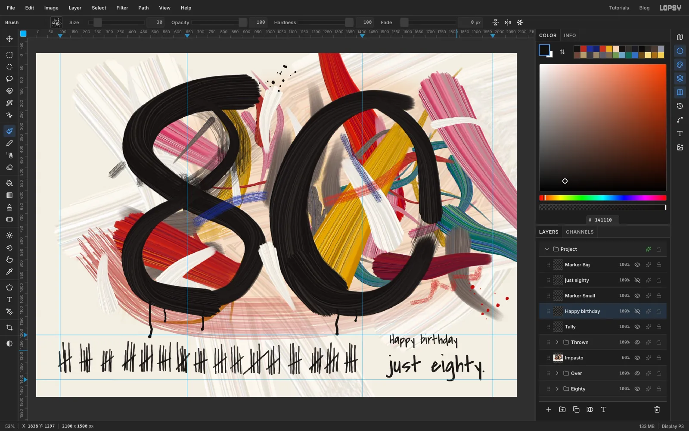

Those letters are too perfect, so repaint them with the dry brush.

1. Click the `just eighty` row and click **Add Layer**. Name it `Marker Big`.
2. Hold [[Cmd]] and click the thumbnail of the `just eighty` layer. Its letters are now a selection. Click the `Marker Big` row.
3. Pick `Drag`, **Size** `44`, foreground `#141110`. Pull straight down through the words, moving about 18 px to the right each time, from one end of the line to the other. The streaks now run along the stems, as they would with a marker.
4. Press [[Cmd+D]]. Click the `just eighty` row and click its eye to hide it.
5. Do the same for `Happy birthday`, with a new layer `Marker Small` and `Drag` at **Size** `30`, moving about 13 px each time.

## Add the canvas weave

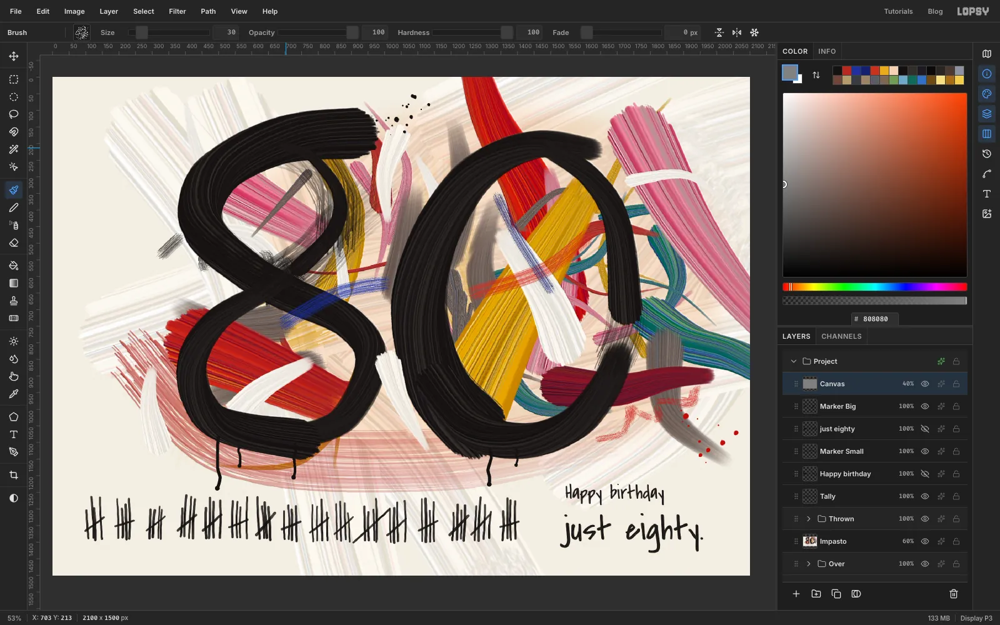

1. Click the top layer, `Marker Big`, click **Add Layer** and name it `Canvas`.
2. Set the foreground to `#808080` and choose **Edit → Fill**.
3. Choose **Filter → Add Noise…** with **Amount** `40` and **Mono**, then **Filter → Motion Blur…** with **Angle** `0` and **Distance** `7`.
4. Choose **Filter → Add Noise…** with **Amount** `30` and **Mono**, then **Filter → Motion Blur…** with **Angle** `90` and **Distance** `5`.
5. Click ✦ on the layer's row, set the blend mode to **Overlay** and close the drawer. Set the opacity to about `40%`.
6. Choose **View → Show Guides** to hide the guides.

Save it with **File → Save Project**, and use **File → Quick Export PNG** for the printer. Print it on heavy cream stock, and write something rude inside.
