Abstract expressionism suits a pottery studio. The movement was about the hand, the gesture and the material, and so is throwing a pot. In this tutorial you'll paint a flier for **Pinch & Bisque**, an invented neighbourhood ceramics studio, on a 1200 × 1600 px page (a 3:4 flier, about 8 × 10.7 in at 150 dpi).

The top of the page is a painting, built from three ideas borrowed from the 1950s New York painters:

- **Helen Frankenthaler's soak stains.** She thinned paint until it ran like watercolour and poured it onto raw canvas. You'll get translucent pools with darker "tide lines" where the pigment settles at the edges.
- **Franz Kline's black strokes.** He made big, fast strokes with a house-painter's brush, so the edges break up into dry bristle streaks. You'll draw the pot and the potter's wheel this way, with a custom bristle brush.
- **Jackson Pollock's drops and skeins.** He flung paint off a stick, leaving teardrop splashes and long looping lines.

The bottom of the page is calm and gridded: a stacked condensed title, an info column and a footer. The contrast between the two halves is what makes the flier work.

Along the way you'll use:

- **Add Noise**, **Motion Blur**, **Gaussian Blur** and **Smoke** for the canvas and stains
- the **Lasso**, **Elliptical Marquee**, **Select → Shrink / Feather** and **⌘-click** to select layer pixels
- **Inner Glow**, **Stroke**, and the **Multiply**, **Overlay** and **Soft Light** blend modes
- the **Smudge**, **Dodge / Burn**, **Sponge**, **Eraser** and **Clone Stamp** tools
- **Edit → Define Brush…** to make a bristle brush tip, plus brush **Taper** and **Speed Size**
- **Copy**, **Paste**, scaling and rotating with the **Move** tool, and rotating a whole group
- a **layer mask** with a gradient, and group adjustments (**Hue / Saturation**, **Vignette**)
- live text in **Barlow Condensed** and **Knewave**

The palette:

- Raw canvas `#E6DCC6`
- Cobalt `#2C4F94`, its tide line `#142A5C`
- Terracotta `#B65A35`, its tide line `#6E2A14`
- Ochre `#D9A43C`, celadon `#8DB09A`
- Ink `#1C1A17`, glaze cream `#EEE4CF`
- Splash cream `#F3EDDF`, cadmium `#E2B33A`, red `#B3362B`

> **Note:** Shortcuts are written for a Mac. On Windows use [[Ctrl]] wherever it says [[Cmd]].

Positions are given in document pixels as `x, y` where things need to line up. The status bar at the bottom of the window shows the pointer's **X** and **Y**. The stains and strokes are freehand, so match them roughly by eye from the screenshots.

Two habits will save you trouble. Before you start a new piece of text, click a layer that isn't text. Otherwise picking a font, size or colour restyles the selected text layer instead of setting up the new one. And start each new piece of text in an empty patch of canvas, then move it into place with the **Move** tool. A click on or just under existing text edits that text instead.

## Prime a raw canvas

1. Choose **File → New** and make a **1200 × 1600** px document.
2. Click **Background**, set the foreground colour to `#E6DCC6` and choose **Edit → Fill**.
3. Double-click **Layer 1** and rename it `Canvas Weave`. Fill it with `#808080`.
4. Choose **Filter → Add Noise…** with **Amount** `40` and **Mono**, then **Filter → Motion Blur…** with **Angle** `0` and **Distance** `7`. That gives you horizontal threads.
5. Do it again for the vertical threads: **Add Noise** `30` **Mono**, then **Motion Blur** with **Angle** `90` and **Distance** `5`.
6. Click the ✦ button on the layer's row to open the effects drawer, set the blend mode to **Soft Light**, then click the opacity figure on the row and drag it to `45%`.

The grey disappears and leaves a faint cross-weave, like unprimed cotton duck.

## Drop the layout guides

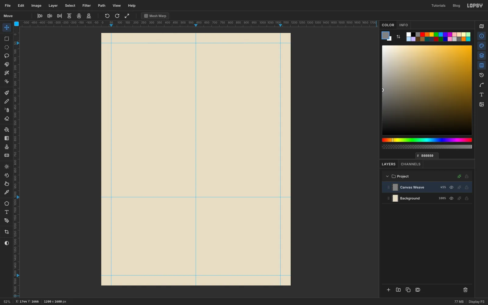

Click the top ruler at `x 64`, `600` and `1136` to drop three vertical guides: the two margins and the centre. Then click the left ruler at `y 64`, `1040` and `1536`. The guide at `1040` is where the painting stops and the type starts.

## Lasso the first pour

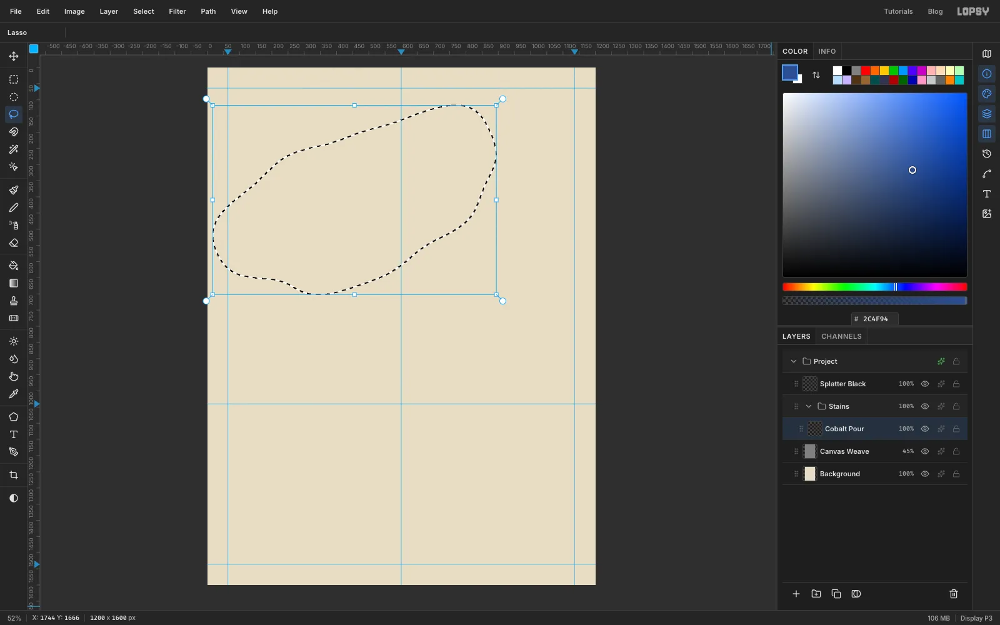

1. Click `Canvas Weave` and click **Add Layer**. Name it `Splatter Black` and leave it empty for now. It will hold the black drops later, and it has to sit at the top level of the Layers panel, above the stains.
2. Click `Canvas Weave` again and click **New Group** at the bottom of the Layers panel. Name the group `Stains`. It goes between `Canvas Weave` and `Splatter Black`.
3. With `Stains` selected, click **Add Layer** (it goes inside the group) and name it `Cobalt Pour`.
4. Pick the **Lasso**. Draw a lumpy oval about 820 px wide and 500 px tall, centred near `470, 420` and tilted up to the right. Let the outline bulge in and out a little as you go: real poured paint never makes a clean oval.

## Soak the pour into the canvas

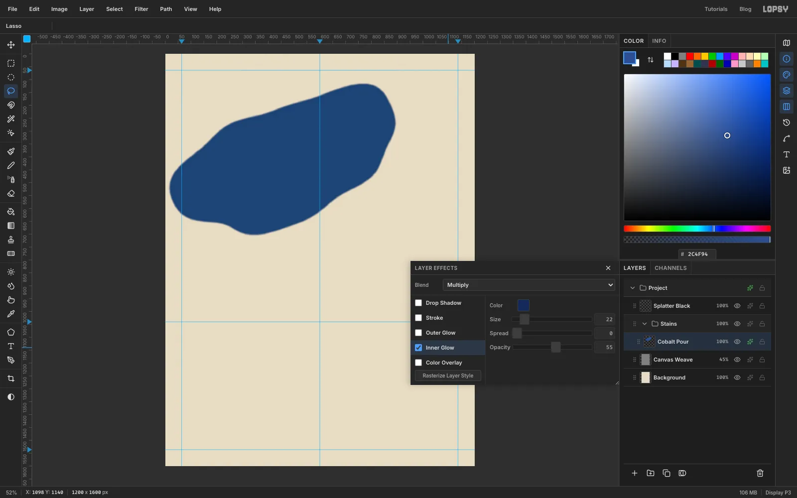

1. Set the foreground to `#2C4F94`, choose **Edit → Fill** and press [[Cmd+D]] to deselect.
2. Choose **Filter → Gaussian Blur…** with **Radius** `7`. The hard lasso edge softens into a soaked-in edge.
3. Open the effects drawer and set the blend mode to **Multiply**, so the canvas weave shows through the paint.
4. Turn on **Inner Glow** with colour `#142A5C`, **Size** `22` and **Opacity** `55`. This is the tide line: the darker rim where pigment collects as a pool dries.
5. Close the drawer and set the layer's opacity to `66%`.

## Pour the other three stains

Make each stain on its own new layer inside `Stains`, the same way: Lasso, fill, Gaussian Blur, then blend mode and opacity.

- `Terracotta Pool`: about 600 × 430, centred near `840, 650`, tilted down to the right so it overlaps the blue. Fill with `#B65A35`, **Gaussian Blur** `7`, blend mode **Normal**, **Inner Glow** in `#6E2A14` (size `22`, opacity `55`), opacity `85%`.
- `Ochre Wash`: about 420 × 250, centred near `950, 200`, running off the right edge. Fill with `#D9A43C`, **Gaussian Blur** `10`, **Normal**, opacity `72%`.
- `Celadon Bleed`: about 460 × 280, centred near `210, 820`, running off the left edge. Fill with `#8DB09A`, **Gaussian Blur** `12`, **Multiply**, opacity `78%`.

The terracotta and ochre stay on Normal on purpose. They overlap the blue a lot, and Multiply on top of Multiply turns those overlaps into brown-black mud. On Normal the overlaps stay coloured and translucent. The celadon can stay on Multiply because it's pale and only just touches the blue.

## Let a few tendrils wick out

Thinned paint creeps along the canvas threads. Pick the **Smudge** tool with **Size** `40` and **Strength** `75`.

- On `Cobalt Pour`, start just inside the edge and drag outward about 40 px, curving slightly as you go. Do it once on the upper edge and once at the lower left.
- On `Celadon Bleed`, drag one short tendril out of the right edge.

Keep it to these three. More tendrils start to look like fins.

## Dodge where the paint ran thin

Pick the **Dodge / Burn** tool. Set **Mode** to **Dodge**, **Exposure** `14` and **Size** `200`.

1. On `Cobalt Pour`, make one long sweep from the lower left of the pool up to its top right, then a shorter sweep under it.
2. On `Terracotta Pool`, make one sweep from its top left down through the middle.

These lighter paths read as places where the paint thinned out as it flowed.

## Burn the tide lines

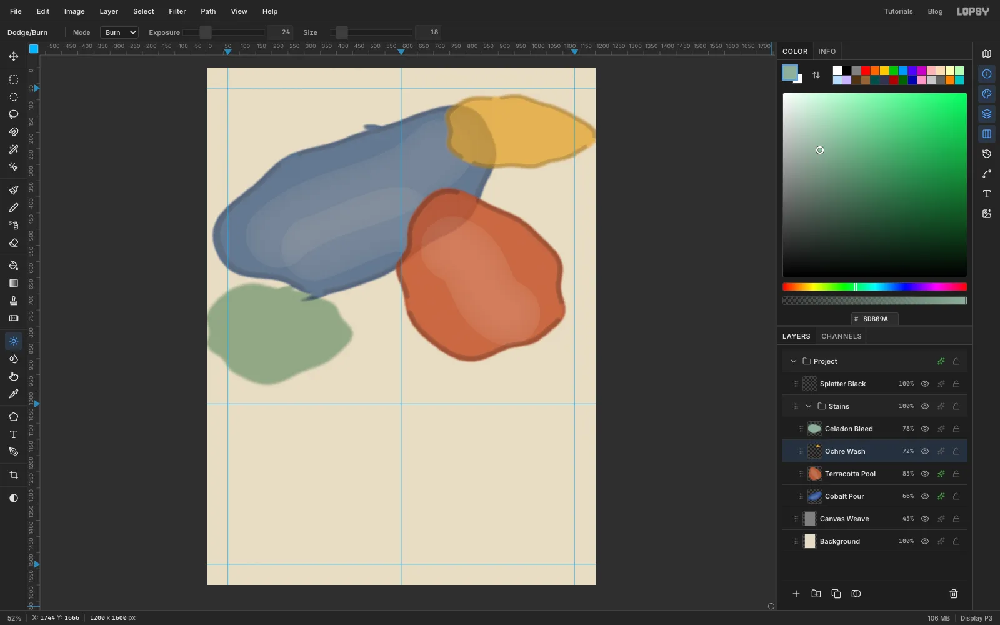

Switch **Mode** to **Burn**, with **Exposure** `24` and **Size** `18`. On `Cobalt Pour`, trace all the way round the pool just inside its edge, in three overlapping arcs. Do the same on `Terracotta Pool` and `Ochre Wash`.

Each arc is its own undo step, so if one comes out too dark, press [[Cmd+Z]] and trace it again.

## Sponge and cool the ochre

Straight ochre is a little loud next to the soft blues. Click `Ochre Wash`, pick the **Sponge** tool with its defaults (**Mode** Desaturate, **Strength** `50`, **Size** `30`) and make one slow drag across the middle of the stain.

Then choose **Filter → Hue/Saturation…** with **Hue** `-6` and **Saturation** `-18`. That pulls it toward the colour of a fired glaze.

## Select all four stains at once

1. [[Cmd]]-click the thumbnail of `Cobalt Pour` to load its pixels as a selection.
2. [[Cmd+Shift]]-click the thumbnails of `Terracotta Pool`, `Ochre Wash` and `Celadon Bleed` to add each of them.
3. Choose **Select → Shrink…** with `12`, then **Select → Feather…** with `14`.

Shrinking keeps the next texture off the very edges, so the tide lines stay crisp. Feathering softens the boundary so the texture doesn't stop at a visible line.

## Mottle the pigment with Smoke

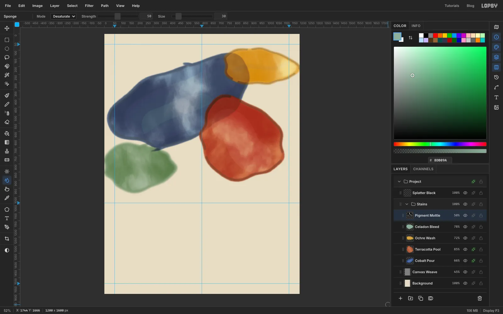

1. Click `Celadon Bleed` and click **Add Layer**. Name the new layer `Pigment Mottle`.
2. With the selection still active, choose **Filter → Smoke…** with **Scale** `6` and **Turbulence** `70`. Press [[Cmd+D]].
3. Set the layer to **Overlay** at `50%`.

The smoke turns the flat fills into pooled, uneven pigment.

## Make a bristle brush tip

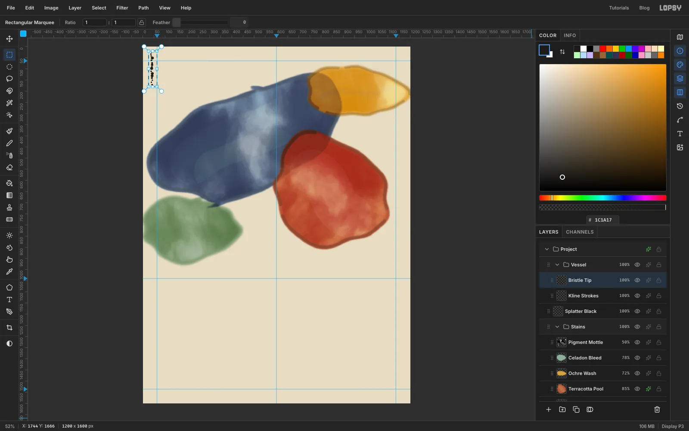

Kline's strokes break up at the edges because a big brush runs out of paint. You'll make a brush tip that's a column of bristles.

1. Click `Splatter Black` and click **New Group**. Name it `Vessel`. It goes above `Splatter Black`, at the top level. Inside it, add a layer called `Kline Strokes`.
2. Add one more layer called `Bristle Tip`. Set the foreground to `#1C1A17`, pick the **Brush** with the **Hard Round** preset and **Hardness** `100`.
3. Near the top-left corner, click a column of dots straight down from about `40, 26` to `40, 174`. Vary the **Size** between `6` and `15` and leave small, uneven gaps. A wobble of a few pixels left and right makes it look hand-made.
4. Drag a **Rectangular Marquee** tightly around the column, choose **Edit → Define Brush…** and name it `Bristle Column`.
5. Deselect and delete the `Bristle Tip` layer with the trash button.
6. Add a new `Bristle Tip` layer and do the same again, this time with the dots in a horizontal row from about `26, 40` to `174, 40`. Name that brush `Bristle Row`, then delete the layer.

Each dot in the tip drags a streak when you paint. A column of dots makes streaks for strokes that run sideways, and a row of dots makes streaks for strokes that run downward.

## Set up the stroke brush

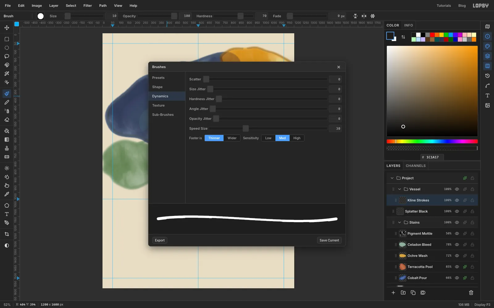

Click `Kline Strokes`. Open the Brushes dialog with the brush-tip button at the left of the Brush options bar. On **Presets** pick **Hard Round**. On **Shape** set **Hardness** `70` and **Spacing** `4`. On **Dynamics** set **Speed Size** `30` with **Faster is Thinner**.

Speed Size thins a stroke where you move fast and fattens it where you slow down, like a real loaded brush. Close the dialog.

## Paint the pot's lip

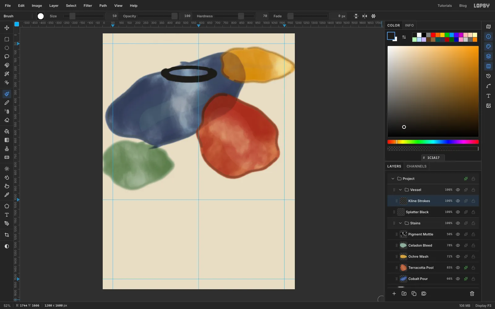

The rim is an ellipse centred on `540, 250`, about 300 px wide and 76 px tall.

1. Set **Size** `26` and paint the back half of the ellipse, from its left end over the top to its right end.
2. Set **Size** `50` and paint the front half in one sweep, starting a little behind the left end, going round the bottom and carrying on past the right end.

A heavier front makes the rim read as a round opening seen from slightly above.

## Throw the walls, foot, wheel and diagonal

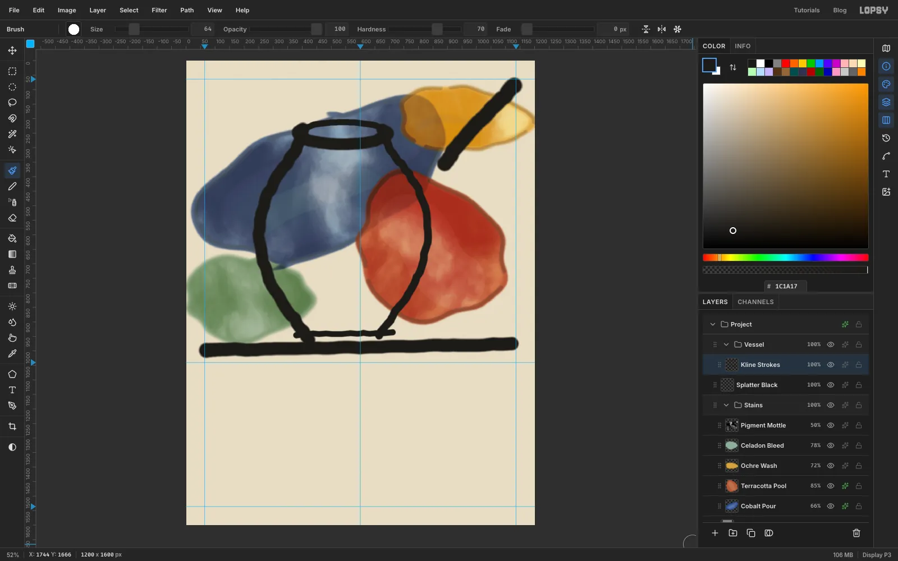

Paint each of these as one confident stroke. Don't go back over them.

- **Left wall**, Size `52`: start at the left end of the rim, swell out to its widest (about `x 250`) halfway down, then curve back in to the foot at about `424, 962`.
- **Right wall**, Size `34`: start at the right end of the rim, swell out to about `x 832`, then curve back in to about `664, 948`. Making it lighter than the left wall gives the pot a light side and a shadow side.
- **Foot**, Size `26`: a slightly wavy line joining the bottoms of the two walls.
- **Wheel**, Size `60`: a long stroke across the page just above the `1040` guide, from near the left edge to near the right margin, rising very slightly.
- **Diagonal**, Size `64`: from near the top-right corner (about `1130, 86`) down to about `890, 356`, where it meets the top of the rust stain. It cuts in like the edge of a big Kline canvas.

## Drag the bristle brushes along the strokes

1. Open the Brushes dialog, pick the `Bristle Column` preset, set **Spacing** `1` and **Speed Size** `0`, and close it.
2. Paint along the wheel bar twice, once at **Size** `72` and once at `66`, each running only about 10 px past the bar's ends. Then paint once along the diagonal at **Size** `76`.
3. Pick the `Bristle Row` preset (Spacing and Speed Size stay as you just set them) and paint along the left wall at **Size** `62` and along the right wall at **Size** `42`.

Keep each bristle pass only a little wider than the stroke under it. That way the streaks fray the edges. Much wider, and they turn into ruled lines floating beside the stroke.

## Smear the wet ends

Pick **Smudge** with **Size** `60` and **Strength** `80`. Drag each end of the wheel bar outward, about 60 px past where it ends. Then drag the lower end of the diagonal down and to the left. This is the paint dragging as the brush lifts off.

## Run glaze off the lip

1. Click `Kline Strokes`, add a layer called `Glaze Drips` and set the foreground to `#EEE4CF`. Pick the **Brush**, open the Brushes dialog and choose the **Hard Round** preset, with **Hardness** `85` and **Speed Size** `0`.
2. In the Brushes dialog's **Shape** tab, **Taper** makes a stroke start at a point and grow to full size over that many pixels. Each drip hangs from the front of the rim, at about `y 288`. Paint each one from its bottom end **up** to the rim, so it starts thin and is full width where it leaves the lip. Reopen the dialog to set each drip's Taper before you paint it:
   - at `x 468`: 172 px long, **Size** `14`, **Taper** `138`
   - at `x 534`: 252 px long, **Size** `16`, **Taper** `202`
   - at `x 602`: 108 px long, **Size** `12`, **Taper** `86`
3. Set **Taper** back to `0`. At the bottom of each drip, click a dab about one and a half times the drip's size. Then click a smaller dab a few pixels to one side and lower, so each bead is lopsided.
4. With **Smudge** at **Size** `22` and **Strength** `55`, drag each bead down about 18 px so it sags.

## Load a brush for flung drops

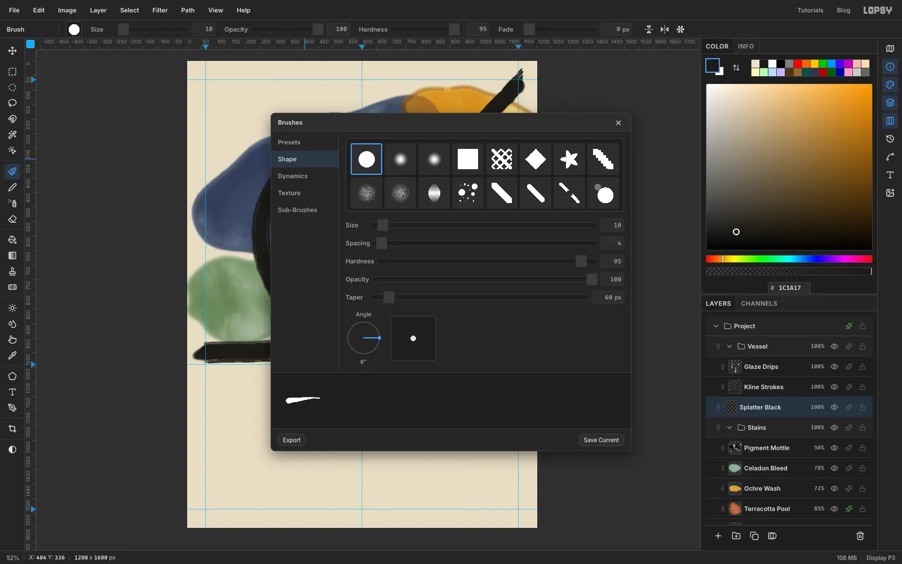

Click `Splatter Black`, pick the **Brush** again (Smudge is still selected from the last step) and set the foreground to `#1C1A17`. In the Brushes dialog pick **Hard Round**, set **Hardness** `95` and **Taper** `60`, and close it.

A flung drop has a round head and a tail that thins to a point. With Taper on, drawing each drop from the end of its tail back to the head does that in one stroke.

## Fling the black drops

For each drop, press at the tip of the tail and drag 20–120 px back to where the drop landed. Point the tails in every direction.

- Put about seven around the left wall, five around the right wall and four near the diagonal, plus a little cluster around `330, 190` above the rim. Keep them more than 170 px away from `1008, 792`, where the stamp will go.
- Vary the **Size** a lot, from `5` to `28`. A few big drops among many small ones looks thrown. Drops that are all the same size look stamped.
- Set **Size** `7`, then `4`, and click a few droplets just beyond the ends of some tails. Finish with a sprinkle of **Size** `3` specks. Taper only affects drags, so these single clicks come out as round dots.

## Pour the skeins

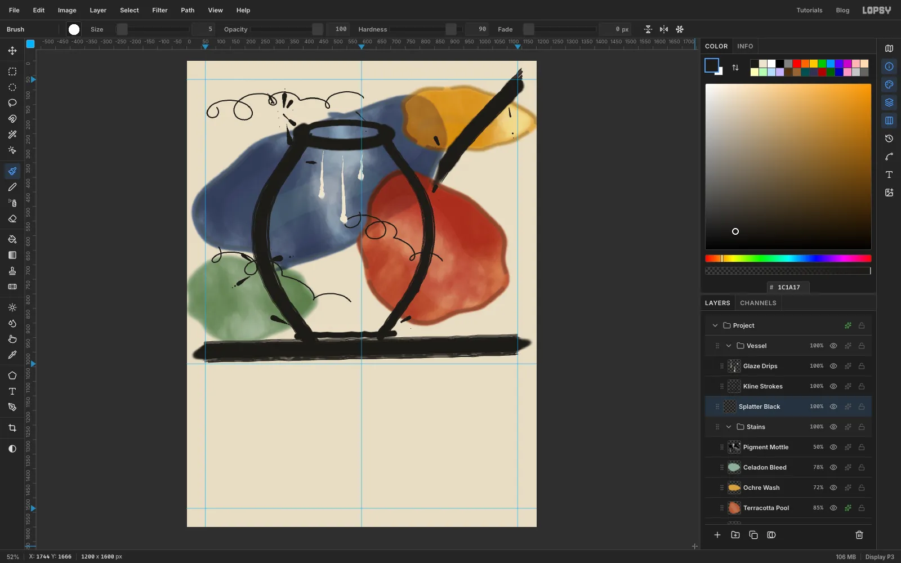

Set **Taper** back to `0` and **Size** to `5`. Paint three long, continuous looping lines without lifting:

- across the top, from about `70, 160` to `560, 120`, with five loose loops
- from `560, 520` down to `830, 680`, crossing the rust stain
- from `80, 640` to `520, 820`, crossing the green stain

Keep the loops round and uneven, never angular. Pollock's lines curve because the paint is falling, not being drawn.

## Add the coloured drops

1. Click `Glaze Drips` and add a layer called `Splatter Colour`. Set **Taper** to `50`.
2. Flick nine short drops of `#F3EDDF` (Size `6`–`16`) over the blue and the rust, four of `#E2B33A` (Size `5`–`12`) and three of `#B3362B` (Size `5`–`11`). Keep these tails short, just a little longer than the drop itself.
3. Set **Taper** back to `0`.

Cream drops show up best on the dark stains. Keep the yellow and red sparse: they're accents.

## Copy a few loops

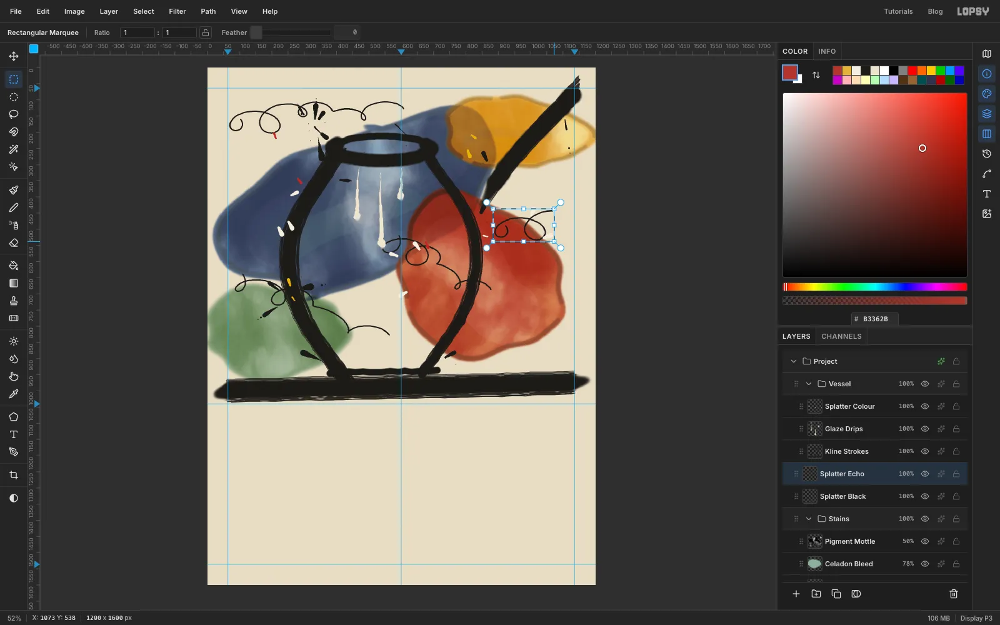

The rust stain on the right could use a few more lines. Rather than paint new ones, borrow some.

1. Click `Splatter Black`. With the **Rectangular Marquee**, drag a box around the two or three loops at the start of the first skein, at the top left.
2. Press [[Cmd+C]], then [[Cmd+V]]. The copy lands on a new layer above, in the same spot, and the Move tool is picked for you. Rename the layer `Splatter Echo`.
3. Drag the copy about 820 px right and 330 px down, onto the rust stain.

## Scale the copy

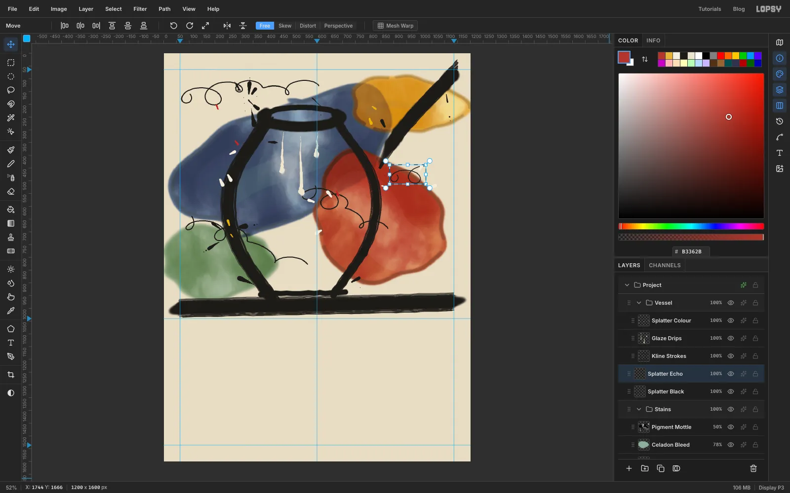

Draw a **Rectangular Marquee** tightly around the moved loops, so the transform box hugs them rather than the whole layer. Pick the **Move** tool, hold [[Cmd]] and drag the bottom-right corner handle inward until the box is about three quarters of its size. [[Cmd]] keeps the proportions.

## Rotate the copy

Move the pointer just outside the top-right corner of the box until it shows the rotate cursor, then drag round until the loops are turned about 135°. Press [[Cmd+D]] to commit.

Turned and smaller, the loops read as a new throw rather than a copy. If you don't like where they landed, [[Cmd+Z]] steps back through the rotation, the scale and the move one at a time.

## Rule the footer on a grid

1. Click `Splatter Echo`, click **New Group** and name it `Type`. Inside it, add a layer called `Footer Rule`.
2. Choose **View → Show Grid**. The grid is a quick way to see how much room the bottom 560 px gives you: about two-thirds of the width for the title and one-third for the info column. If **View → Snap to Grid** is ticked, untick it, because the type won't sit on grid lines.
3. Pick the **Pencil**, set **Size** `3` and the colour to `#1C1A17`. Click at `64, 1482`, then hold [[Shift]] and click at `1136, 1482` for a straight rule between the margins.
4. Choose **View → Show Grid** again to hide the grid.

## Stack the title

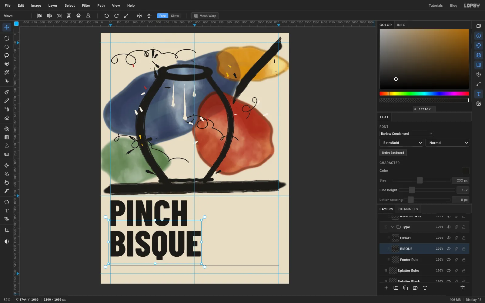

1. Click `Footer Rule`. Pick the **Text** tool, choose **Barlow Condensed**, set the weight to **ExtraBold**, **Size** `232` and colour `#1C1A17`. Click an empty spot, type `PINCH` and press [[Tab]] to finish.
2. With the **Move** tool, place it so the top-left of the P sits at `60, 1068`, just under the bar.
3. Click `Footer Rule` again and type `BISQUE` the same way. Place it with its left edge lined up with PINCH, leaving a gap of about 30 px between the bottom of PINCH and the top of BISQUE.
4. Double-click each text layer's name and rename it `PINCH` and `BISQUE`, so they're easy to find later.

The left edges sit at `60` rather than on the `64` guide on purpose. At this size the letters' side bearings make them look indented, and nudging them 4 px left lines them up by eye with the footer.

## Add the ampersand, info column and footer

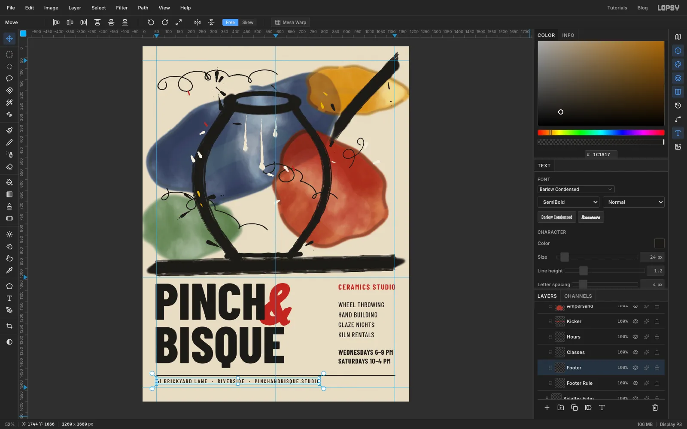

Click `Footer Rule` before each new piece of text, and rename each layer after you type it (the names are in bold below). The Text panel's **Letter spacing** and **Line height** carry over to the next piece of text, so set both every time. Where a step doesn't mention them, use letter spacing `0` and line height `1.2`.

1. **Ampersand:** `&` in **Knewave**, **Size** `210`, colour `#B3362B`. Place it so it overlaps the right stem of PINCH's H by about 24 px, with its bottom 6 px above BISQUE.
2. **Kicker:** `CERAMICS STUDIO` in Barlow Condensed **Bold**, **Size** `34`, colour `#B3362B`. In the **Text** panel set **Letter spacing** to `3`. Place it with its right edge on the `1136` guide and its top at `1072`, level with the top of PINCH.
3. **Hours:** `WEDNESDAYS 6–9 PM` and `SATURDAYS 10–4 PM` on two lines (press [[Return]] between them), Barlow Condensed **Bold** `31`, `#1C1A17`, letter spacing `1`, **Line height** `1.3`. Line its left edge up with the kicker, and put its last baseline on BISQUE's baseline (about `y 1428`).
4. **Classes:** `WHEEL THROWING`, `HAND BUILDING`, `GLAZE NIGHTS` and `KILN RENTALS` on four lines, Barlow Condensed **Medium** `31`, `#1C1A17`, letter spacing `1`, line height `1.45`. Line it up on the same left edge, with equal gaps above and below it.
5. **Footer:** `41 BRICKYARD LANE  ·  RIVERSIDE  ·  PINCHANDBISQUE.STUDIO` (two spaces either side of each dot), Barlow Condensed **SemiBold** `24`, `#1C1A17`, letter spacing `4`, with its top-left at `64, 1500`.

## Cut the stamp rings

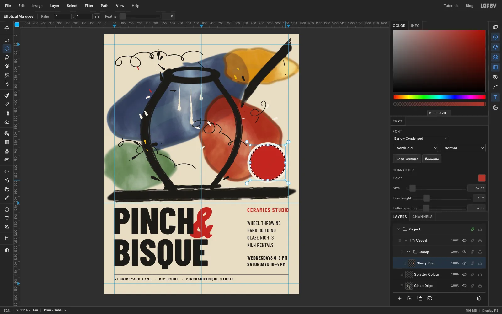

1. Click `Splatter Colour` and click **New Group**. Name it `Stamp`. It sits at the top of the `Vessel` group, over the painting. Inside it, add a layer called `Stamp Disc`.
2. With the **Elliptical Marquee**, draw a circle centred on `1008, 792` with a radius of `125`, from `883, 667` to `1133, 917`. Set the foreground to `#F3EDDF` and fill it.
3. Draw a circle on the same centre with radius `112`, from `896, 680` to `1120, 904`. Set the foreground to `#B3362B` and fill it.
4. Draw one more with radius `108`, from `900, 684` to `1116, 900`. Set the foreground back to `#F3EDDF`, fill it and deselect.

That leaves a thin red ring inside a cream disc.

## Edge the stamp

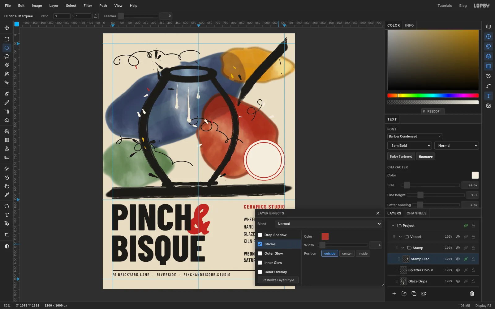

Open the effects drawer for `Stamp Disc` and turn on **Stroke** with **Width** `4` in `#B3362B`. Don't add a drop shadow: a stamp is printed flat on the paper, not stuck on top of it.

## Set the stamp text

Click `Stamp Disc` before each piece of text, centre each one on `x 1008`, and rename the layers as shown:

- **Price:** `$35` in Barlow Condensed **ExtraBold** `104`, `#1C1A17`, letter spacing `0`, with its top at `750`
- **Stamp Top:** `FIRST CLASS` in **Bold** `24`, `#B3362B`, letter spacing `3`, with its top at `712`
- **Stamp Bottom:** `CLAY + FIRING` in **SemiBold** `18`, `#B3362B`, letter spacing `2`, with its top at `854`

Check that both small lines sit comfortably inside the red ring, with roughly equal space above FIRST CLASS and below CLAY + FIRING.

## Tilt the whole stamp

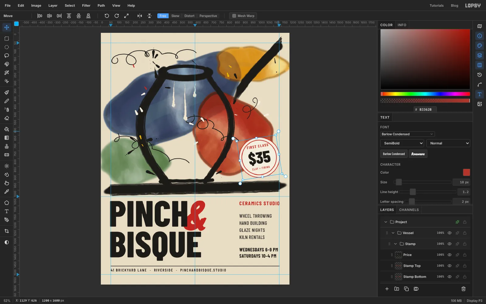

Click the `Stamp` group's row and press [[Cmd+D]] so nothing is selected. Pick the **Move** tool. The handles frame the whole group. Drag the rotate handle just outside the top-right corner a little anticlockwise, about 9°.

Rotating the group turns the disc and all three lines of live text together, and the text stays editable.

## Tilt the ampersand

The layout is set, so untick **View → Show Guides** to hide the guides. Then click the `Ampersand` layer and pick the **Move** tool. Its handles frame the whole line of text, which is taller than the glyph. Drag the rotate handle at the top-right corner about 10° anticlockwise. The ampersand leans like it was brushed on quickly.

## Fade the mottle above the wheel

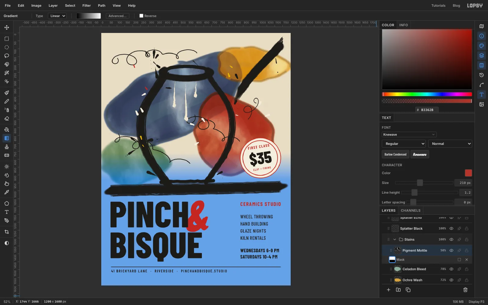

1. Click `Pigment Mottle` and click **Add Mask** at the bottom of the Layers panel. Click the mask thumbnail that appears under the layer's row, so you're painting on the mask instead of the layer.
2. Pick the **Gradient** tool, set a linear gradient from black to white, and drag from `600, 930` straight up to `600, 760`.

The blue overlay shows where the mask hides the layer. The mottle now fades out before the wheel bar, so the stains look calmer near the type. Click the layer's name to leave mask editing.

## Clone a few drops

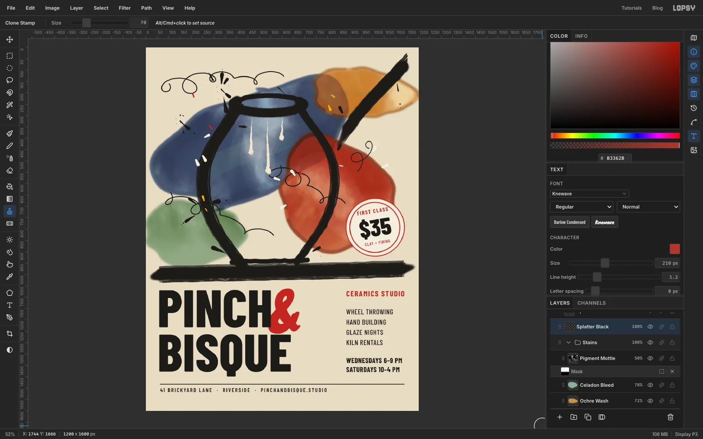

With everything in place, the blue stain left of the pot looks a little empty. Click `Splatter Black` and pick the **Clone Stamp** with **Size** `70`. [[Alt]]-click the cluster of drops above the rim at about `330, 190` to set the source. Then paint one short dab around `175, 340`. The empty patch gets a few drops that match the rest.

## Grade the stains as a group

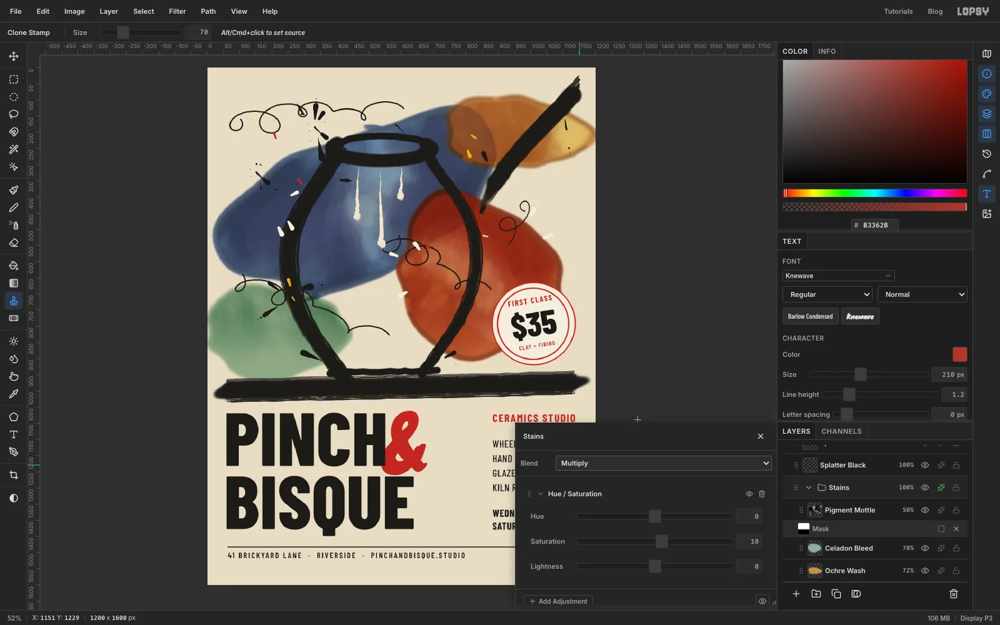

1. Click the ✦ button on the `Stains` group's row. A group's drawer shows its blend mode and its adjustments.
2. Set the group's **Blend** to **Multiply**.
3. Click **+ Add Adjustment**, choose **Hue / Saturation** and set **Saturation** to `10`.

Any adjustment makes the group render on its own first, so without the Multiply the blue pool would stop multiplying onto the canvas and turn hard and bright. Setting the whole group to Multiply puts that soaked-in look back.

## Add a faint vignette

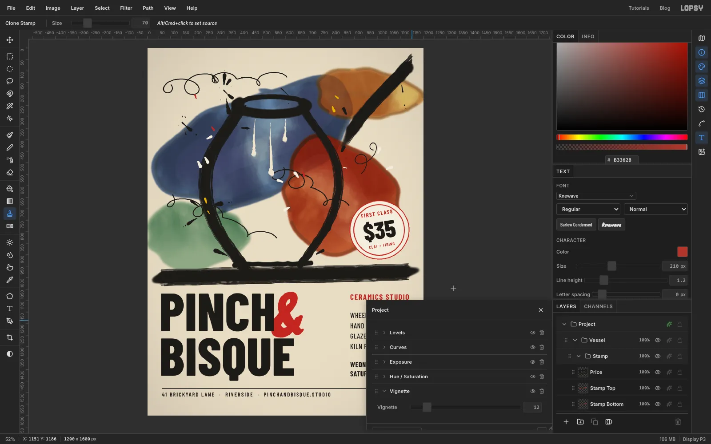

Click the ✦ button on the top `Project` group's row. It already has Levels, Curves, Exposure and Hue / Saturation, which every new document starts with and which do nothing until you change them. Click **+ Add Adjustment**, choose **Vignette** and set it to `12`. The corners darken slightly and pull the eye in.

## Finish with a print grain

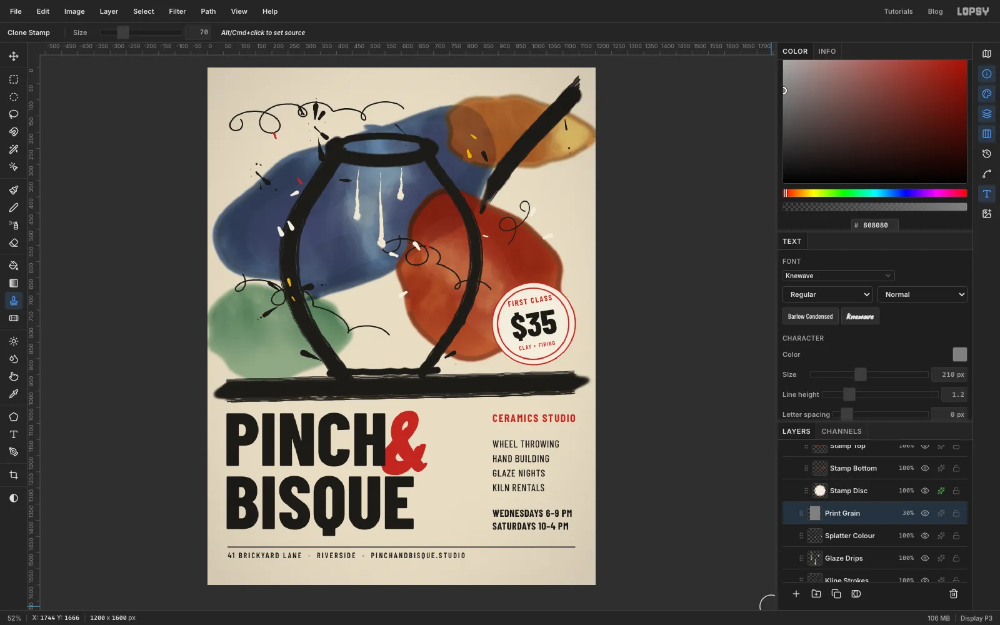

1. Click `Splatter Colour` (inside `Vessel`) and add a layer called `Print Grain`.
2. Fill it with `#808080`, choose **Filter → Add Noise…** with **Amount** `22`, **Mono** and **Gaussian**, and set it to **Overlay** at `30%`.

`Print Grain` sits near the top of `Vessel`, under only the `Stamp` group, and `Vessel` is above everything else. So the grain covers the painting and the type alike, and they look printed on the same sheet. Export with **File → Quick Export PNG**, and save the project with **File → Save Project** so you can change the price and the hours next term.
