Before printed labels, orchards marked their apple crates with stencils. Each
colour had its own cut sheet of oiled manila, called a *plate*. You laid the
plates on the crate end one after another and sprayed through them. Small
punched holes in the same place on every plate, the *registration holes*,
kept the colours lined up.

In this tutorial you'll make **Fowler Orchard**, a 2400 × 1700 px contact
sheet for an invented farm. Five manila plates are taped to a weathered barn
wall: a mustard barn star, a barn-red rooster with two apples, the navy
FOWLER lettering with a ribbon, green laurels and leaves, and a cream plate
for the lettering on the ribbon and the highlights. The sixth cell is the
*proof*, a pine crate end sprayed with all five plates.

The rooster comes from an old woodcut:
[Rooster Crowing](https://commons.wikimedia.org/wiki/File:Rooster_Crowing.png)
on Wikimedia Commons, released as **CC0** (no rights reserved). Download the
480 × 640 px original. Any bold rooster or weathervane silhouette works the same way.

The trick that makes the whole set easy: every plate is designed in the
**same spot inside its own cell**. That way a single drag moves any plate's
artwork onto the proof in register.

Along the way you'll use:

- **Add Noise**, **Motion Blur** and **Clouds** for barn boards and pine, plus the **Pencil** with [[Shift]]-click straight lines
- ruler **guides** with **Snap to Guides**, and the exact-corners marquee dialog
- **New Group**, **Add Layer**, layer effects (**Drop Shadow**, **Stroke**, **Inner Glow**) and the **Multiply**, **Overlay** and **Soft Light** blend modes
- the **Pen** tool, with **Path to Selection** for closed shapes and [[Enter]] to stroke open paths
- dropping in a photo, **Desaturate**, **Threshold**, the **Magic Wand**, **Grow**, **Shrink** and **Select → Inverse**
- [[Cmd]]-clicking layer thumbnails to cut one layer with another, copy and paste, and **Merge Down**
- scaling and rotating with the **Move** tool, including rotating whole groups
- **Text** in Stardos Stencil, Covered By Your Grace, Permanent Marker and Special Elite, and **Rasterize Layer**
- the **Spray** tool and a soft **Brush** for overspray, and a **layer mask** with brush jitter for worn paint
- undo and redo

The palette:

- Barn boards `#6B5B4A`, seams `#241D16`, seam light `#95826A`
- Manila `#BC9C68`, oil `#7A5528` / `#5E3F1A`, cut edge `#7E5A2C`
- Pine `#DDC395`
- Mustard `#C29C4C`, barn red `#92342B`, navy `#27324D`, leaf green `#556A3A`, cream `#EDE4CB`
- Pencil `#393633`, marker `#B3261E`, tape `#E1D6B6`, typewriter ink `#2A2522`

## Paint the barn wall

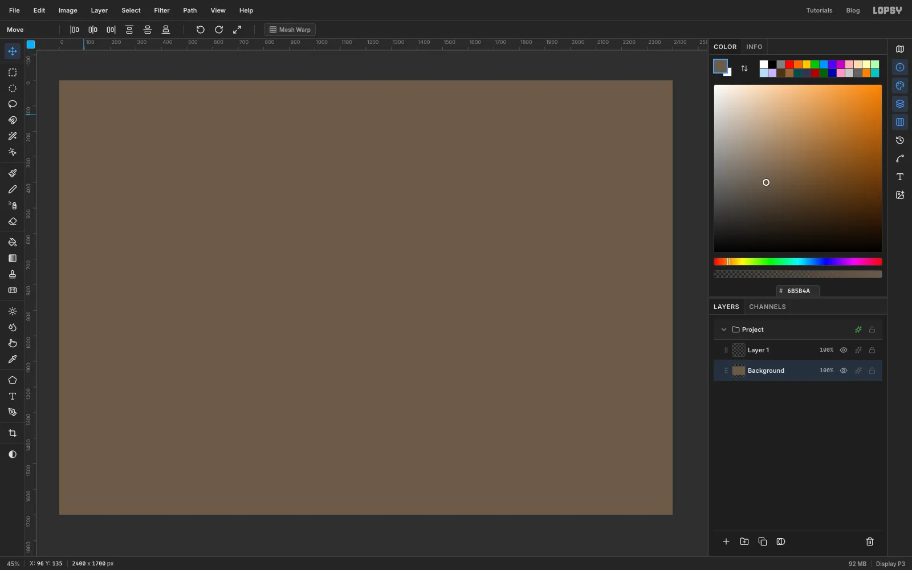

1. Choose **File → New**, set **Width** `2400`, **Height** `1700`, **Pixels**, **White** background, and click **Create**.
2. Click **Background** in the Layers panel, set the foreground colour to `#6B5B4A` and choose **Edit → Fill**.

## Tone the planks

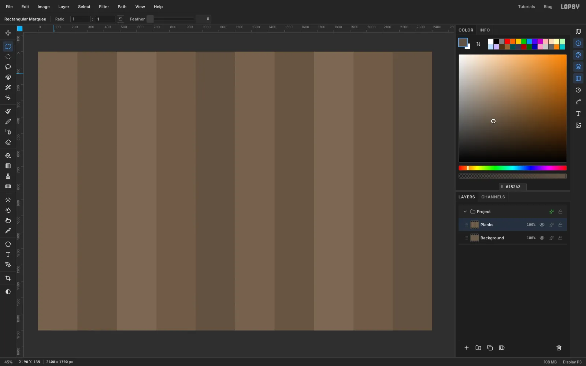

A barn wall is ten boards, each 240 px wide, and no two weathered the same.

1. Double-click **Layer 1** and rename it `Planks`.
2. Pick the **Rectangular Marquee** and, with nothing selected, click once on the canvas without dragging. The **Rectangular Selection** dialog opens. (If a selection is active, that click only deselects it, so press [[Cmd+D]] first. The same goes for every exact-corners dialog in this tutorial.) Enter **From X** `0`, **From Y** `0`, **To X** `240`, **To Y** `1700` and click **Select**.
3. Fill it with **Edit → Fill** in `#736250`.
4. Press [[Cmd+D]], then repeat for each board, moving 240 px right each time (`240`–`480`, `480`–`720` and so on). Cycle through `#655645`, `#7A6855`, `#6E5D4B`, `#615242` and back to `#736250`.
5. Deselect with [[Cmd+D]].

## Streak in the wood grain

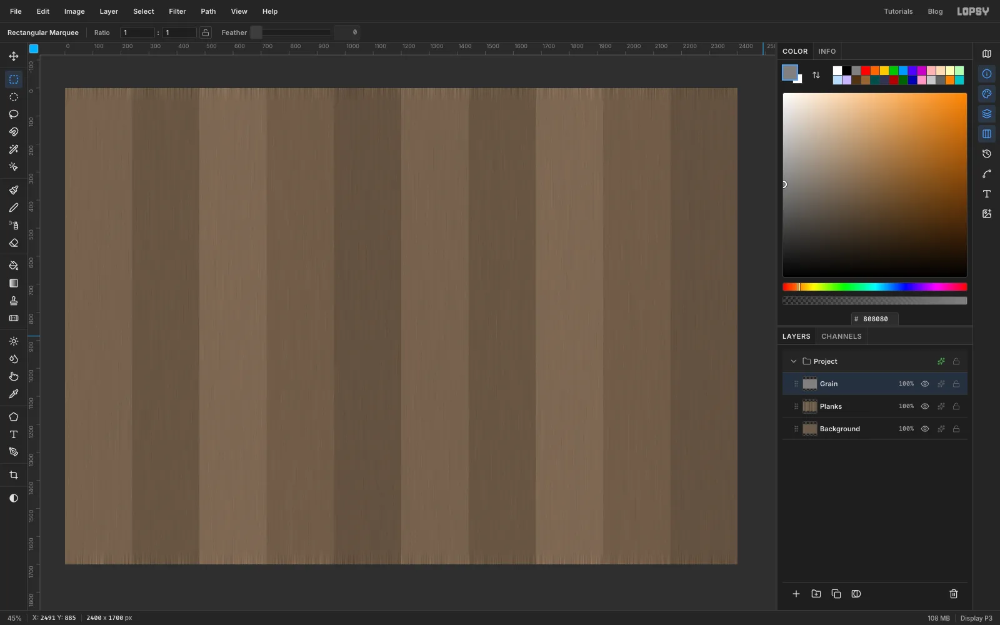

1. Click **Add Layer**, name it `Grain` and fill it with mid grey `#808080`.
2. Run **Filter → Add Noise…** with **Amount** `100` and **Mono**.
3. Run **Filter → Motion Blur…** with **Angle** `90` and **Distance** `100`. The speckles stretch into vertical streaks.
4. Open the layer's effects drawer (the ✦ button on its row) and set the blend mode to **Overlay**. Grey disappears in Overlay, so only the light and dark streaks show.

## Weather the boards

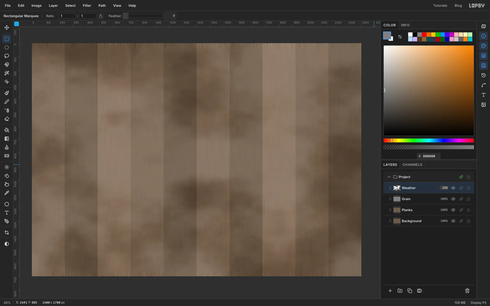

1. Add a layer called `Weather` and run **Filter → Clouds…** with **Scale** `4`.
2. Set its blend mode to **Soft Light** and its opacity to `35%`. Any stronger and the wall turns blotchy and fights with the plates.

## Draw the seams and nails

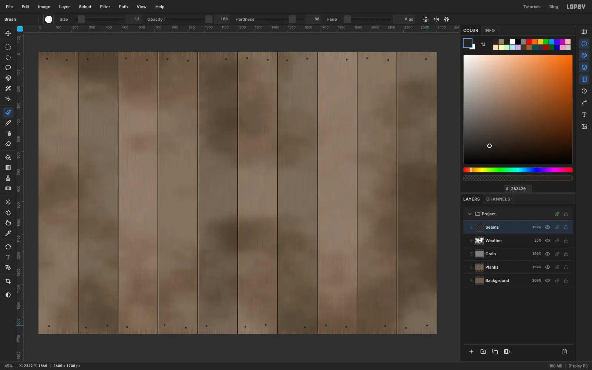

1. Add a layer called `Seams`. Pick the **Pencil**, set **Size** `5` and colour `#241D16`.
2. At each board edge (`x 240`, `480`, `720` …) click at the top of the canvas, hold [[Shift]] and click at the bottom. Shift-click draws a straight line from the last point.
3. Set **Size** `2` and colour `#95826A` and draw a second line 4 px to the right of each seam. That's the lit edge of the next board.
4. Pick the **Brush** at **Size** `12` in `#2A2420` and click a few nail heads along the top and bottom of the wall. Leave some boards with one nail, some with two, and keep them slightly uneven.

## Lay out the grid with guides

The sheet is a 3 × 2 grid of 700 × 660 px cells, with 60 px between the columns and 70 px between the rows.

1. Zoom in on each spot so a ruler click lands on the exact pixel. Click the top ruler at `x 90`, `790`, `850`, `1550`, `1610` and `2310`. Each click drops a vertical guide (watch **X** in the status bar).
2. Click the left ruler at `y 100`, `760`, `830` and `1490`.
3. Make sure **View → Snap to Guides** is ticked.

## Start the first plate

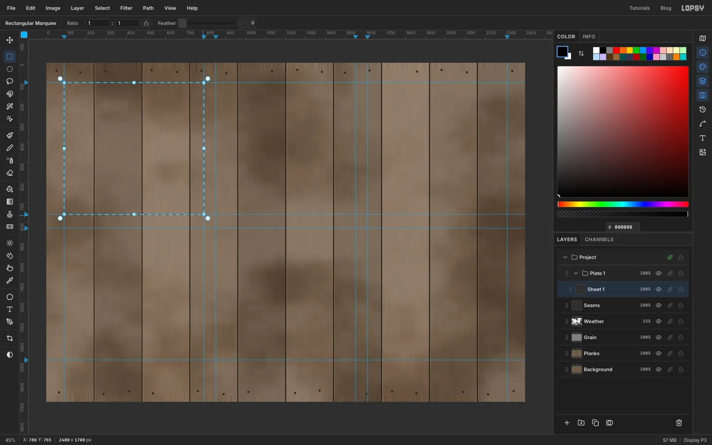

Each plate gets its own group, so it can be tilted as one piece later.

1. Click `Seams`, click **New Group** and rename the group `Plate 1`.
2. With the group selected, click **Add Layer**. The layer goes inside the group. Rename it `Sheet 1`.
3. With the **Rectangular Marquee**, drag from the top-left of the first cell to its bottom-right. The marquee snaps onto the guides, so you don't have to be exact.

## Make the oiled manila sheet

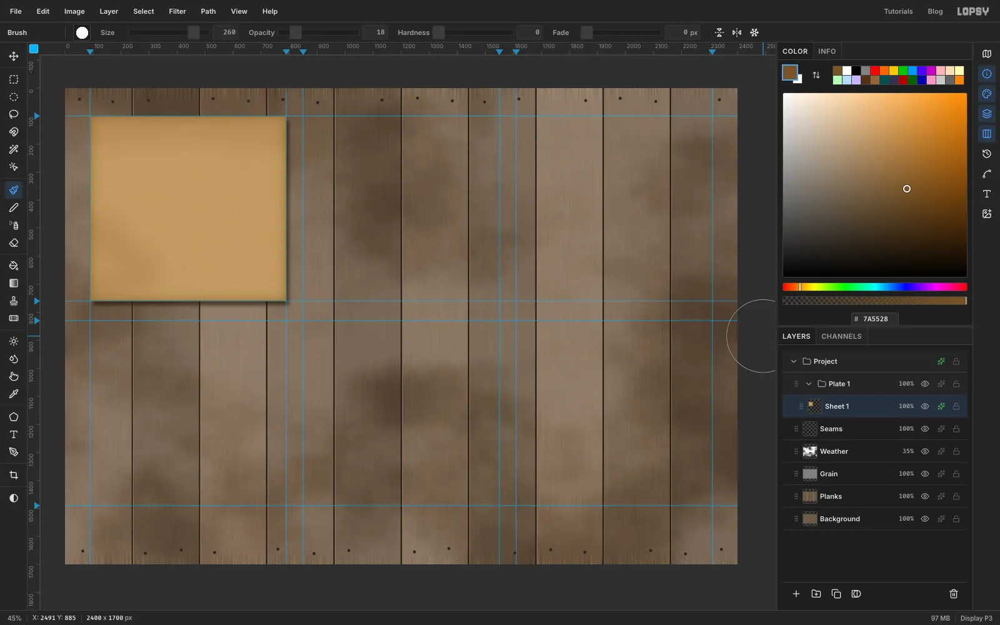

1. Fill the selection with manila `#BC9C68` and run **Filter → Add Noise…** with **Amount** `12` and **Mono**, for a paper tooth.
2. Pick the **Brush** with **Size** `260`, **Hardness** `0` and **Opacity** `18%`, in `#7A5528`. While the marquee is still active, paint a stroke along the top edge and a curling one in the bottom-left corner. The selection keeps the oil stains on the sheet. Deselect.
3. In the effects drawer, turn on:
   - **Drop Shadow**: colour `#1A120B`, **Offset X** `10`, **Offset Y** `16`, **Blur** `18`, **Opacity** `60`
   - **Stroke**: colour `#7E5A2C`, **Width** `2`, position **inside**, for the cut edge
   - **Inner Glow**: colour `#5E3F1A`, **Size** `60`, **Opacity** `55`. Oil soaks in darker along every edge, and later along every cut too.

## Add the other four sheets

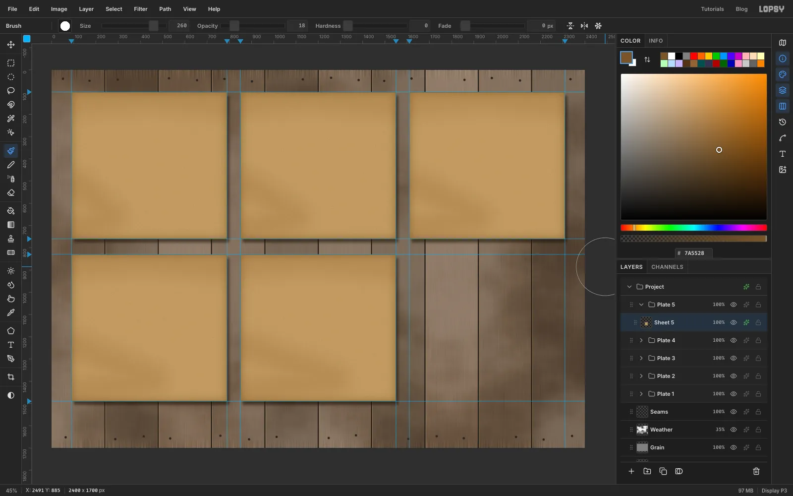

1. Collapse `Plate 1` with its arrow and keep it selected, then click **New Group**. With a collapsed group selected, the new group lands beside it instead of inside. Name it `Plate 2`.
2. Inside it, repeat steps 2 and 3 of *Start the first plate* and all of *Make the oiled manila sheet*, effects included, for `Sheet 2` in the second cell. Move the oil strokes about a little so the sheets don't match.
3. Do the same for `Plate 3`, `Plate 4` and `Plate 5` in the next three cells.

## Build the pine crate end

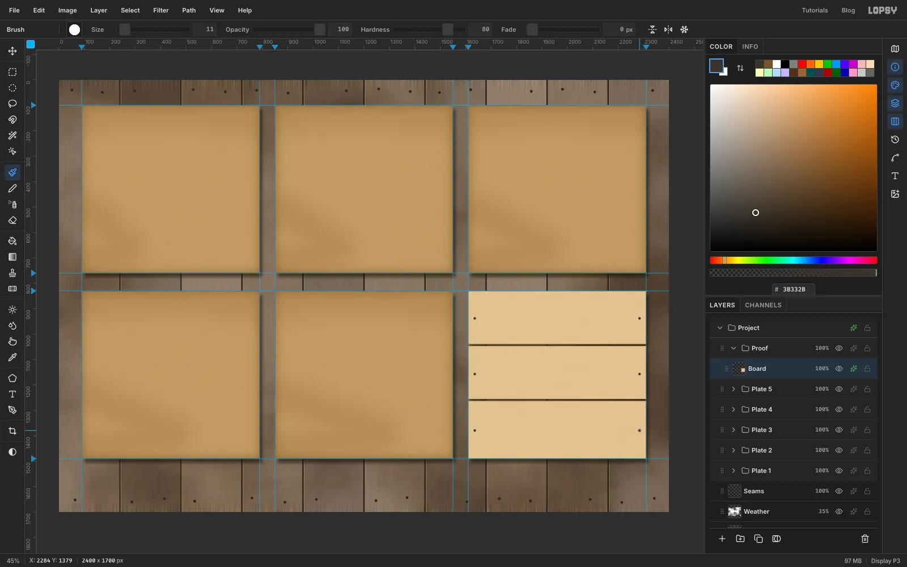

1. Collapse `Plate 5`, select it, and add a group called `Proof` with a layer `Board` inside.
2. Open the marquee dialog and select a rectangle 60 px wider than the last cell on both sides: **From** `1550`, `830`, **To** `2370`, `1490`. Fill it with pine `#DDC395`.
3. Run **Add Noise…** at `40`, **Mono**, then **Motion Blur…** at **Angle** `0`, **Distance** `90` for horizontal grain. The extra width keeps the blur from fading at the ends.
4. Press [[Cmd+D]], open the dialog again and select the cell exactly (`1610`, `830` to `2310`, `1490`), choose **Select → Inverse** and press [[Delete]] to trim the extra.
5. Cut two 6 px gaps between the boards (deselect before each dialog): select `1610`, `1040` to `2310`, `1046` and press [[Delete]], then the same at `y 1256`–`1262`.
6. Give `Board` the same **Drop Shadow** as the sheets and a 2 px inside **Stroke** in `#A5824F`. With the Brush at **Size** `11` in `#3B332B`, click one nail near each end of every board.

## Draw the barn star with the Pen

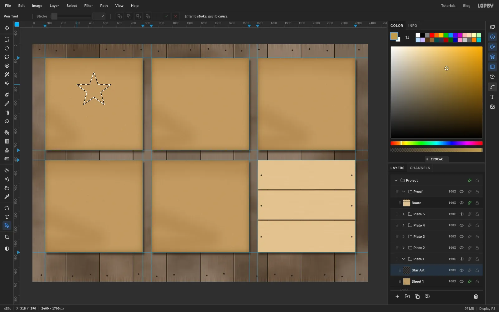

**Plate 1** is the mustard plate: a five-point barn star in a ring.

1. Expand `Plate 1`, click `Sheet 1` and add a layer called `Star Art` above it.
2. Pick the **Pen** tool. The star is centred at `x 440`, `y 330`, with its outer points 128 px from the centre and its inner points 51 px. Watching **X** and **Y** in the status bar, click these ten points in order, starting at the left-most one: 318, 290 · 410, 289 · 440, 202 · 470, 289 · 562, 290 · 489, 346 · 515, 434 · 440, 381 · 365, 434 · 391, 346. Click the first point again to close the path.
3. Open the **Paths** panel and click **Path to Selection**. Keep the path for now.
4. Fill the selection with mustard `#C29C4C`.

## Add the ring, bridges and registration holes

1. Deselect, then with the **Elliptical Marquee** click once to open its dialog and select **From** `256`, `146` **To** `624`, `514` (a 184 px radius around the star centre). Fill it.
2. Deselect and select **From** `272`, `162` **To** `608`, `498` (radius 168) and press [[Delete]]. That leaves a 16 px ring. The delete also clears the star, so click **Path to Selection** again, fill it again, and then click **Delete Path**.
3. A ring cut all the way round would let the centre of the stencil fall out. Leave four *bridges*: select a rectangle across the ring at the top and bottom (14 wide × 24 tall) and at the left and right (24 wide × 14 tall), and press [[Delete]] each time.
4. Add the registration holes: two 18 px circles, centred 30 px in from the left and right edges of the cell at half its height (`x 120` and `x 760`, `y 430`). Fill them.

Every plate gets these two holes in exactly the same place.

## Cut the plate

1. [[Cmd]]-click the `Star Art` thumbnail. Its shape loads as a selection.
2. Click `Sheet 1` and press [[Delete]].

Hide `Star Art` for a moment to check. The wall shows through the cut, the drop shadow falls into it, and the Inner Glow darkens the cut edges like oil-soaked card.

## Spray the star onto the proof

1. Show `Star Art`, click its row, [[Cmd]]-click its thumbnail and press [[Cmd+C]].
2. Expand `Proof`, click `Board` and press [[Cmd+V]]. The copy lands in place, right above `Board`. Rename it `Mustard` and deselect.
3. With the **Move** tool, drag it 1520 px right and 730 px down, into the same spot in the sixth cell. Finish with the arrow keys until its registration dots sit exactly the same distance from the board's edges as the holes on the plate.
4. Delete the `Star Art` layer. The plate is cut and the colour is on the proof.

## Drop in the rooster woodcut

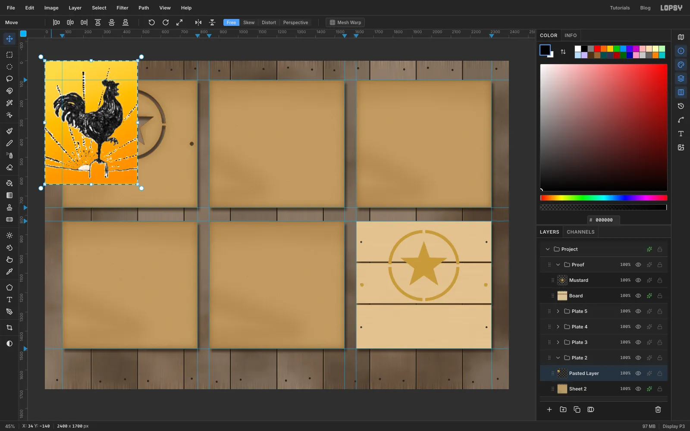

**Plate 2** is barn red: the rooster and two apples.

1. Collapse `Plate 1`, expand `Plate 2` and click `Sheet 2`.
2. Drag the downloaded rooster file onto the canvas. It arrives at full size in the top-left corner as a new layer above `Sheet 2`. Deselect with [[Cmd+D]] and rename the layer `Red Art`.

## Turn the woodcut into black and white

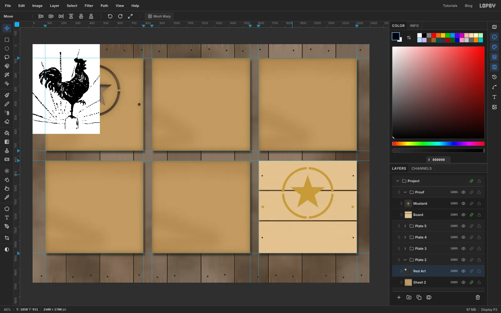

1. Run **Filter → Desaturate**.
2. Run **Filter → Threshold…** with **Level** `110`. The orange background turns white and the ink turns solid black.

## Select the bird with the Magic Wand

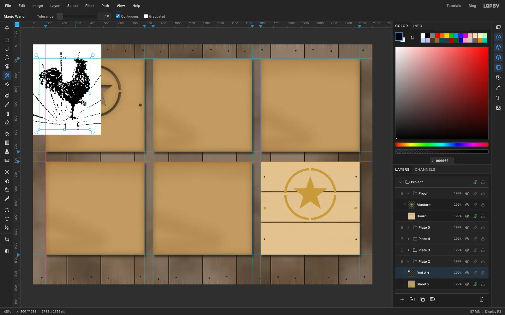

1. Pick the **Magic Wand**, set **Tolerance** `10` and tick **Contiguous**.
2. Click the middle of the rooster's black body. The wand takes everything joined to it, including the post, but not the loose rays.
3. Woodcut hatching leaves small white flecks inside the selection. Run **Select → Grow…** `5` and then **Select → Shrink…** `5`. Growing closes the small holes and shrinking brings the outline back, so you get one clean shape.

## Clear everything but the rooster

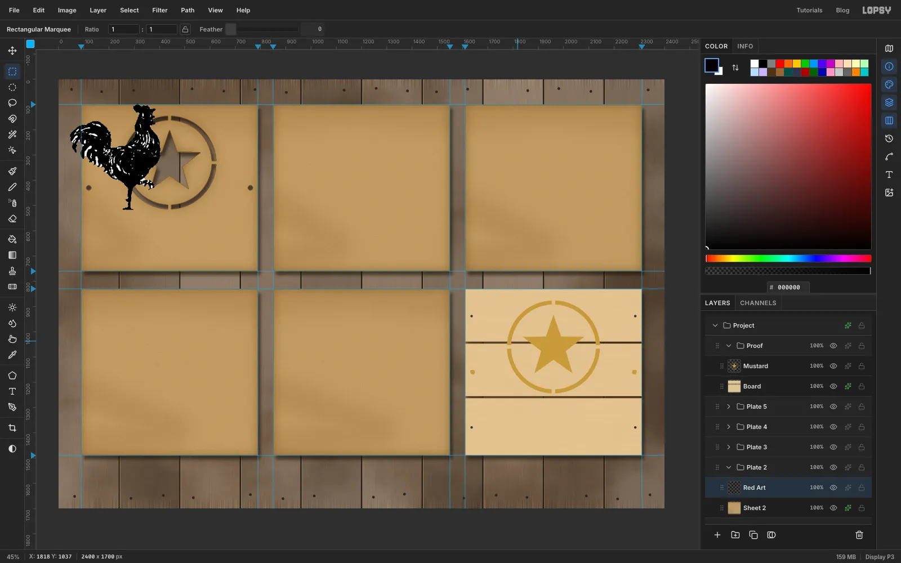

1. Choose **Select → Inverse** and press [[Delete]]. The background and the rays disappear.
2. Marquee the post below the feet (from the bottom of the feet to the bottom of the layer, across the full width) and press [[Delete]].
3. [[Cmd]]-click the `Red Art` thumbnail, fill the selection with barn red `#92342B` and deselect.

## Scale the rooster down

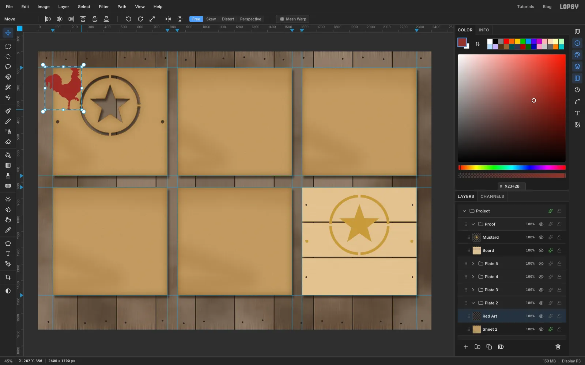

1. Draw a rectangular marquee a couple of pixels larger than the rooster.
2. Pick the **Move** tool, hold [[Cmd]] and drag the bottom-right corner handle up and left until the rooster is about 260 px tall. Holding Cmd keeps the proportions.
3. Press [[Cmd+D]] to commit the scale.

Press [[Cmd+Z]] and [[Cmd+Shift+Z]] once each to compare. The scale undoes and redoes cleanly.

## Place the rooster on the plate

With the **Move** tool, drag the rooster onto the second plate. Centre it
horizontally, with the top of its comb 100 px below the top of the sheet. The rooster then is centred where plate 1's ring centre sits,
a little above the middle of the cell. Use the arrow keys for the last few pixels.

## Cut stencil bridges into the rooster

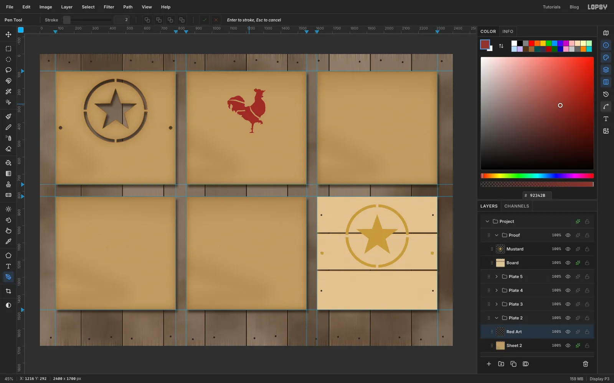

A solid rooster would cut out as one big hole and the plate would flop. Real
stencils break shapes with thin *bridges* that double as drawing.

1. With the **Pen**, draw a thin closed sliver, about 7 px wide, across the tail from the back to the outside edge. Click down one side and back up the other. **Path to Selection**, press [[Delete]], and **Delete Path**.
2. Do the same lower down the tail, and once more for a wing line that starts in the dip of the back and curves down through the breast and out the front.
3. The threshold lost the open beak. Pen a small triangle pointing up and right from the face, turn it into a selection and fill it red.

## Add the apples and holes

1. With the elliptical marquee dialog, select a 64 × 58 px ellipse centred 104 px in from the left of the cell and 584 px down. Fill it red.
2. Delete a 14 × 13 px ellipse at the top of the apple for the stem notch.
3. Repeat for a second apple centred 104 px in from the right.
4. Add the two registration holes in the same place as on plate 1, and fill them red.

## Cut plate 2

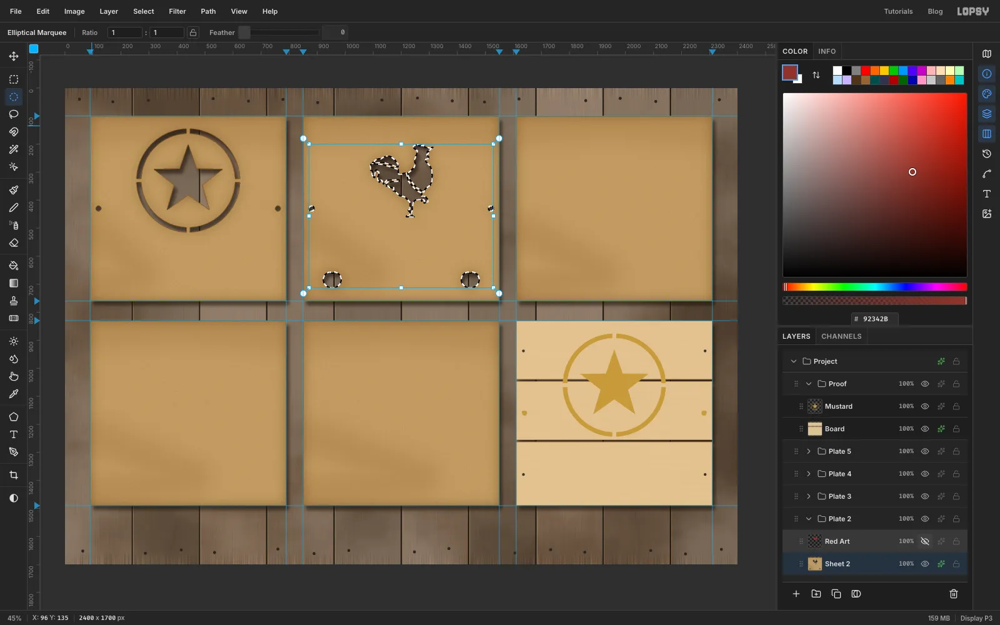

[[Cmd]]-click the `Red Art` thumbnail, click `Sheet 2` and press [[Delete]].
The bridges stay as thin strips of manila across the cut.

## Spray the red onto the proof

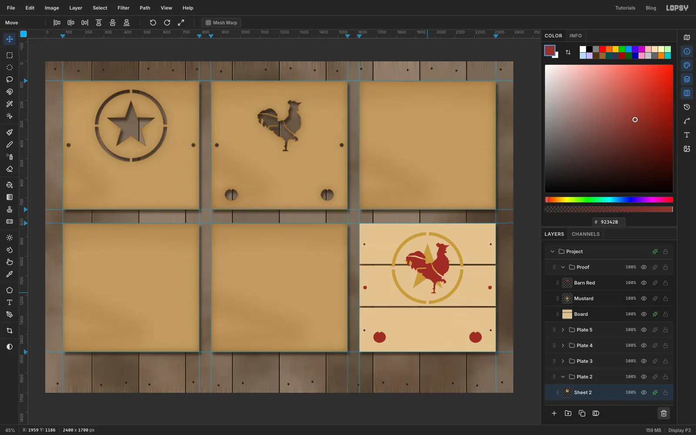

Copy the art onto the proof the same way as before:

1. Click `Red Art`, [[Cmd]]-click its thumbnail, press [[Cmd+C]].
2. Click `Mustard` in the `Proof` group and press [[Cmd+V]], so the paste lands above the mustard. Rename it `Barn Red` and deselect.
3. Move it 760 px right and 730 px down, and nudge until the red registration dots sit right on top of the mustard ones.
4. Delete `Red Art`.

## Cut the ribbon for plate 3

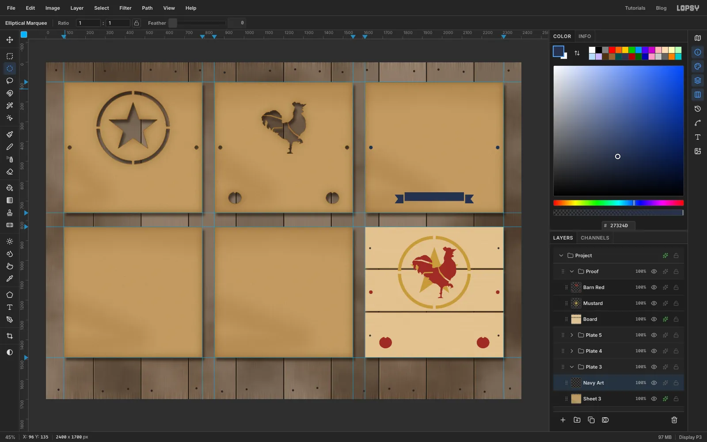

**Plate 3** is navy: the name and a ribbon under it.

1. Collapse `Plate 2`, expand `Plate 3`, click `Sheet 3` and add a layer `Navy Art`.
2. Select a 300 × 44 px rectangle from 200 px to 500 px across the cell, 556 px to 600 px down, and fill it with navy `#27324D`.
3. With the **Pen**, draw each tail as a five-point shape, a little lower than the band and pointing outward with a V notch cut into its end. Leave a 6 px gap between each tail and the band. That gap is the fold of the ribbon and a bridge at the same time. **Path to Selection**, fill, **Delete Path**.
4. Add the registration holes in navy.

## Set FOWLER in a stencil face

1. Pick the **Text** tool. Choose **Stardos Stencil**, weight **Bold**, **Align** **Center**, size `123`, colour navy.
2. Click in the empty middle of the plate, type `FOWLER` and press [[Tab]] to commit.
3. Stardos Stencil already has stencil breaks in every letter, so the counters of the O and R won't fall out.

## Fit the name over the ribbon

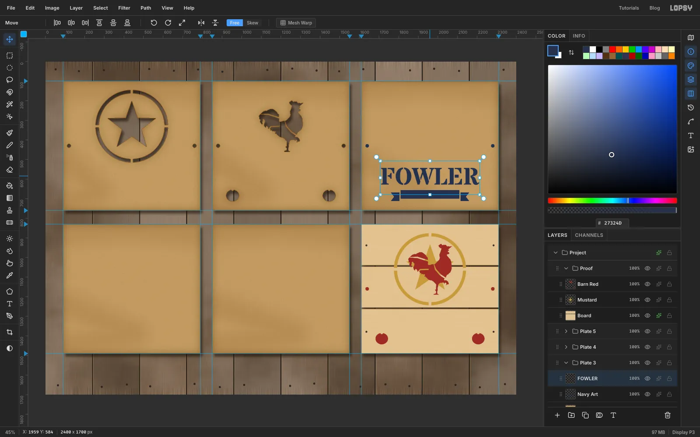

At size 123 the word is 500 px wide, the same as the space between the apples.

1. With the **Move** tool, centre it over the ribbon with its baseline about 27 px above the band. Arrow keys move it 1 px, [[Shift]] + arrows 10 px.

## Merge the lettering into the art

1. Click **Rasterize Layer** at the bottom of the Layers panel.
2. Choose **Layer → Merge Down** to merge the lettering into `Navy Art`.

## Cut plate 3 and spray the navy

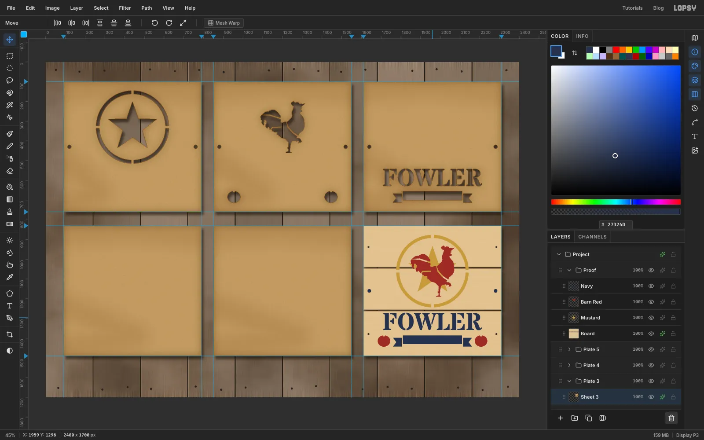

1. [[Cmd]]-click the `Navy Art` thumbnail, click `Sheet 3` and press [[Delete]].
2. Click `Navy Art`, [[Cmd]]-click its thumbnail and press [[Cmd+C]]. Click `Barn Red` in the proof and press [[Cmd+V]]. Rename it `Navy`, move it 0 px across and 730 px down (plate 3 sits directly above the proof), and line up the dots.
3. Delete `Navy Art`.

## Draw the laurel sprigs

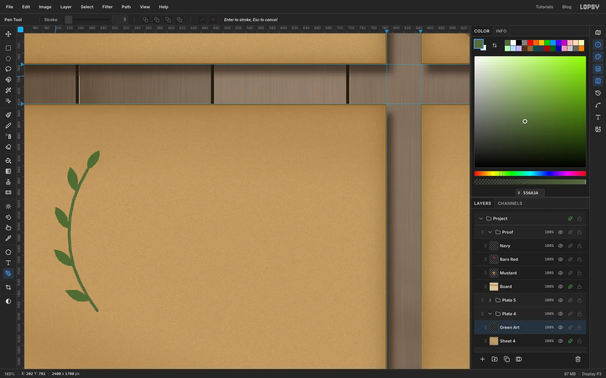

**Plate 4** is leaf green: a laurel sprig either side of the ring, and a leaf on each apple.

1. Collapse `Plate 3`, expand `Plate 4`, click `Sheet 4`, add a layer `Green Art`, and set the colour to `#556A3A`.
2. Zoom in on the left side of the plate. Pick the **Pen**, set its **Stroke** to `5`, and click a gentle arc about 30 px outside where the ring sits, from the lower left up to the upper left. It follows the ring from plate 1, which in this cell would be centred at `x 440`, `y 1060` with a radius of 184. Press [[Enter]]. On an open path, Enter strokes it onto the layer as the stem. Delete the path in the **Paths** panel.
3. Pen four pointed leaves along the outside of the stem, each about 46 × 18 px and angled up towards the tip, plus a smaller leaf at the tip. Close each one, **Path to Selection**, fill, **Delete Path**.
4. Do the mirror image on the right.

## Add the apple leaves and cut plate 4

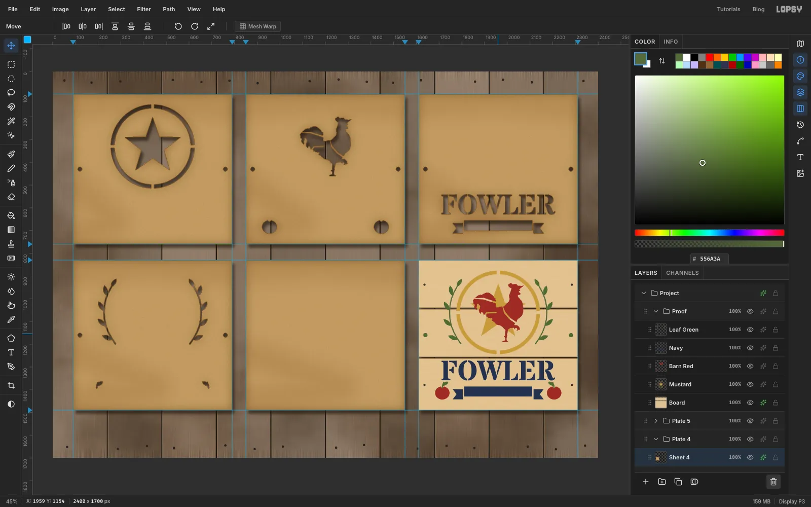

1. Above each apple, stroke a short stem with the Pen and [[Enter]], then pen a small leaf leaning outward.
2. Add the registration holes in green.
3. Cut `Sheet 4` with the art, paste the art above `Navy` on the proof as `Leaf Green`, move it 1520 px right and line it up. Then delete `Green Art`.

## Cut the cream highlight plate

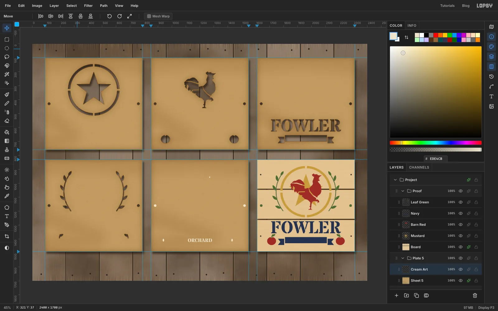

**Plate 5** puts cream on top of the other colours.

1. Collapse `Plate 4`, expand `Plate 5`, click `Sheet 5`, add a layer `Cream Art`.
2. Plate 5 sits directly below plate 2, so everything is 730 px straight down from where it is on plate 2. Fill these in cream `#EDE4CB` with the elliptical dialog:
   - a 10 × 20 px glint at the upper left of each apple: `934`, `1398` to `944`, `1418` and `1426`, `1398` to `1436`, `1418`
   - an 8 px dot for the eye: `1266`, `952` to `1274`, `960`
   - the two registration holes, as before.
3. Type `ORCHARD` in **Stardos Stencil Bold** at size `36`, colour cream. Centre it on where the ribbon band sits: 200–500 px across the cell and 556–600 px down, so `x 1050`–`1350`, `y 1386`–`1430`. Rasterize it and **Merge Down**.

## Spray the cream and finish the proof colours

Cut `Sheet 5`, paste the art above `Leaf Green` on the proof as `Cream`, move
it 760 px right and line it up. Then delete `Cream Art`. The proof now shows all five plates in register.

## Mist overspray onto plate 1

A used stencil is coated in its own colour around the cuts. Paint stops dead at
the cut edges, because whatever went through the hole landed on the crate.

1. Expand `Plate 1`, click `Sheet 1` and add a layer `Overspray 1` above it.
2. [[Cmd]]-click the `Sheet 1` thumbnail. The selection is the manila *without* the holes.
3. Set the foreground to mustard. Pick the **Brush** with **Size** `240`, **Hardness** `0` and **Opacity** `40%`, and drag two soft strokes across the design for a tint.
4. Pick the **Spray** tool with **Size** `70`, **Density** `100`, **Opacity** `70%` and **Softness** `30`, and zig-zag over the design in rows about 35 px apart. Make the cloud rounder than the design and keep its edges ragged. A small Size gives fine droplets. At big sizes the dots grow up to a quarter of the Size and look like measles.

Mustard is close to the manila, so plate 1 needs these strong settings. The other plates use about `22%` for the brush and `40%` for the spray. Go a little lighter on navy, the darkest colour, but not so light that it turns grey.

## Overspray the other plates and label them in pencil

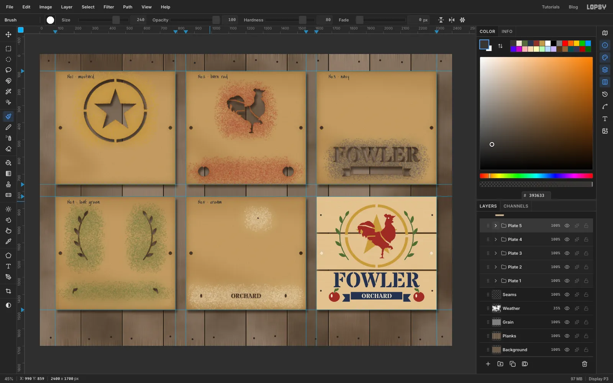

Repeat the overspray for plates 2 to 5, each on its own `Overspray` layer above its sheet:

- **Plate 2:** one cloud around the rooster and one along the apples.
- **Plate 4:** two separate clouds over the laurels, not one blob across the empty middle, and a third along the apple leaves.
- **Plate 5:** keep it small: the ribbon lettering, the glints and the eye.

Then label each plate:

1. With the plate's overspray layer selected, pick the **Text** tool with **Covered By Your Grace**, size `32`, colour `#393633`, **Align** **Left**.
2. Click about 70 px in from the left edge, near the top of the plate, and type the label (on a Mac, [[Option+Shift+9]] types the `·`): `No.1 · mustard`, `No.2 · barn red`, `No.3 · navy`, `No.4 · leaf green` or `No.5 · cream`. Press [[Tab]].
3. Click **Rasterize Layer**.

Keep at least 15 px between a label and any cut. The corner tape goes on later, so leave the first 60 px at the corners clear.

## Merge the proof colours and sand off the dots

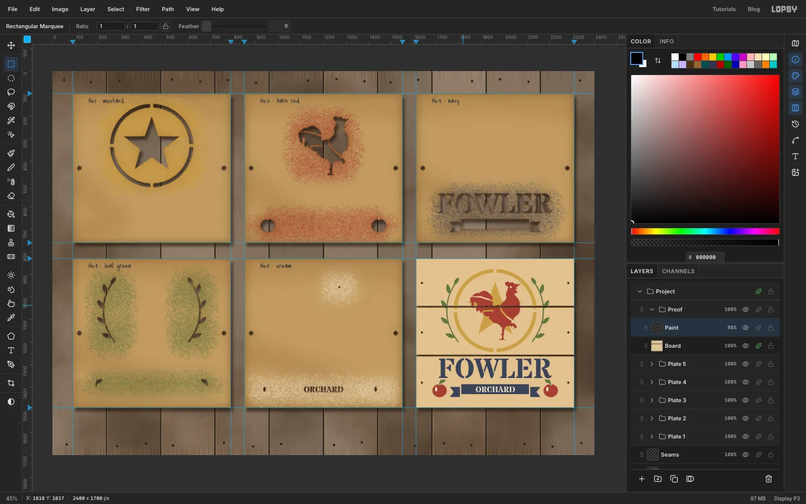

1. Expand `Proof`, click `Cream` and choose **Layer → Merge Down** four times. Rename the result `Paint` and set its opacity to `88%`, so a little of the wood shows through every colour.
2. The registration dots did their job, but a buyer wouldn't see them. Select a 26 px circle over each one and press [[Delete]].
3. Spray passes straight through the gaps between the boards. Select each 6 px gap again and press [[Delete]] on `Paint` too.

## Let the wood grain through the paint

1. Click `Board`, [[Cmd]]-click its thumbnail, press [[Cmd+C]].
2. Click `Paint` and press [[Cmd+V]]. A copy of the board lands above the paint. Name it `Grain Over`.
3. Set it to **Multiply** at `70%`. The grain now runs through every colour, as if the paint soaked into the wood.

## Wear the paint with a layer mask

A crate gets knocked about, so the paint should chip a little.

1. Click `Paint`, click **Add Mask**, then click the mask thumbnail to edit the mask.
2. Pick the **Brush** at **Size** `9`, **Hardness** `70`, **Opacity** `85%`. Click the brush preview at the left of the options bar to open the **Brushes** panel, and set **Spacing** `140`, **Size Jitter** `80` and **Opacity Jitter** `50`. The stroke breaks into separate nicks of different sizes.
3. Drag short strokes along the plank edges, across a corner of the ring and through the bottom of the lettering. On a mask the Brush always hides, whatever the colour.
4. Click the mask thumbnail again to stop editing, and set the brush **Spacing** and jitters back to what they were (`25` and `0` here).

> **Tip:** Use the Brush, not the Spray, on masks. In mask edit mode the Spray doesn't paint the mask.

## Write the marker note

1. With `Paint` selected, pick the **Text** tool with **Permanent Marker**, size `34`, colour `#B3261E`. Click in the top-left corner of the pine and type `proof OK!`. Press [[Tab]] and rasterize it.
2. Marquee around the note, pick the **Move** tool and drag the round rotation handle just outside a corner about 6° anticlockwise. Press [[Cmd+D]] to commit. Hand-written notes are never level.
3. Collapse `Proof`.

## Tilt each plate a little

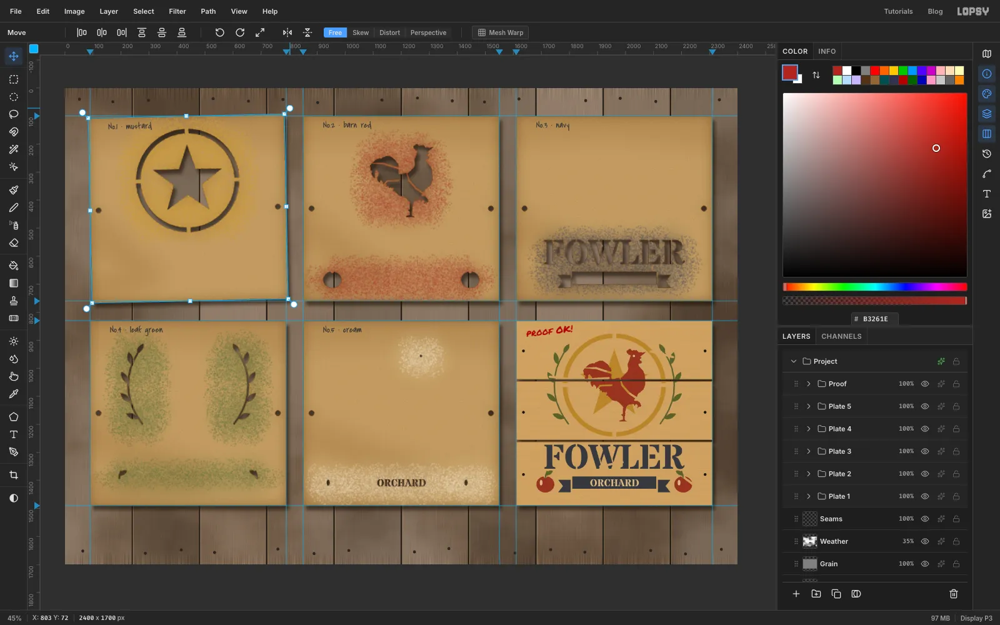

Pinned-up sheets never hang square.

1. Click the `Plate 1` group row and press [[Cmd+D]] so nothing is selected. With the **Move** tool, handles appear round the whole group.
2. Drag the rotation handle just outside the top-right corner a little upward, about a degree anticlockwise, so the top-right corner rises 10 to 15 px. Press [[Cmd+D]].
3. Tilt the others by a degree or so too, alternating direction, so neighbours lean different ways. Give the proof a little more (about a degree and a half clockwise), because it's a nailed board, not a sheet.

If a group has a marquee drawn on it, Lopsy asks you to deselect first. A selection would transform only part of the group.

## Tape the plates to the wall

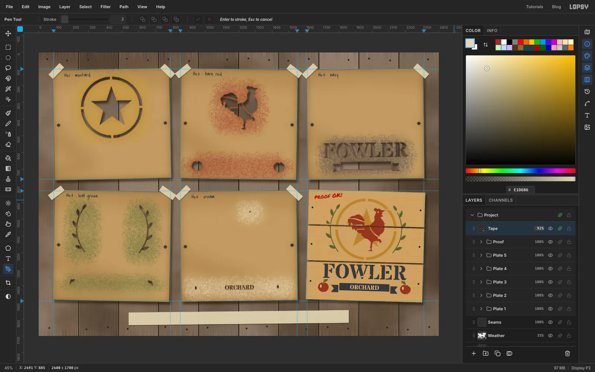

1. Click the `Proof` group and add a layer `Tape`. It goes at the top of the stack, above every group.
2. With the **Pen**, draw a rectangle about 95 × 38 px over each top corner of each plate, tilted about 40° so it crosses the corner. **Path to Selection**, fill with `#E1D6B6`, **Delete Path**. Vary the angles a few degrees. The proof is nailed, so it gets no tape.
3. Draw one long strip, about 1320 × 76 px and a hair off level, centred in the bottom margin for the title.
4. Run **Add Noise…** at `14`, **Mono**, give the layer a **Drop Shadow** (**Offset** `2`, `4`, **Blur** `6`, **Opacity** `40`) and set its opacity to `92%`.

## Type the title on the tape

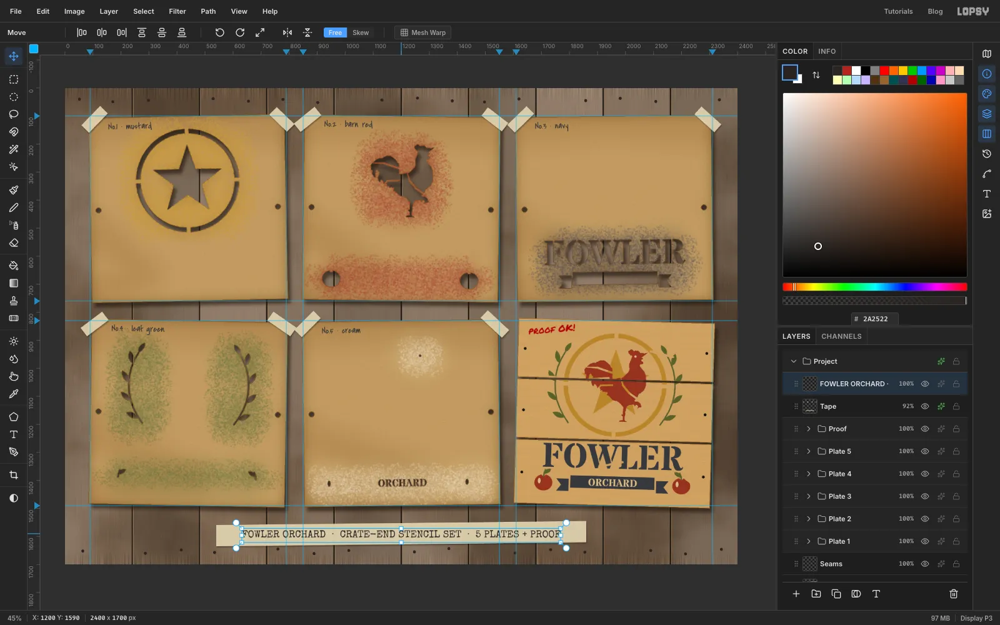

1. Pick the **Text** tool with **Special Elite**, size `36`, colour `#2A2522`. Click above the strip and type `FOWLER ORCHARD  ·  CRATE-END STENCIL SET  ·  5 PLATES + PROOF`. Press [[Tab]].
2. With the **Move** tool, centre it on the strip, with even space above and below and at least 50 px of tape at each end.
3. Choose **File → Save Project**, then **File → Export…** for the PNG.

