Mid-century travel posters and Hollywood one-sheets sold the American
landscape in a handful of flat inks: a sky that fades from navy to apricot,
a sun drawn as stacked discs, a hero shape in silhouette and a slab-serif
title with a hard offset shadow. This tutorial uses those tricks for a
made-up film, **Kill Devil Wind**, about the Wright brothers' first powered
flight at Kill Devil Hills, near Kitty Hawk, on 17 December 1903.

It's a 1200 × 1800 px one-sheet (the 2:3 movie poster shape). The sky,
sun and dunes are drawn by hand. The Flyer and Wilbur come from the famous
photograph of that first flight: you'll trace the wings, pull the rigging out
with a **Threshold**, and turn Wilbur into a silhouette.

The photo is [Wright First Flight 1903Dec17 (full restore 115)](https://commons.wikimedia.org/wiki/File:Wright_First_Flight_1903Dec17_(full_restore_115).jpg)
on Wikimedia Commons. It was taken by John T. Daniels and is in the public
domain. Download the 3840 px version and crop it to a wide strip around the
Flyer and Wilbur, about 2360 × 820 px, with a little sky above the top wing
and some sand below the skids. Any editor will do, or open it in Lopsy and
use the **Crop** tool.

The cast and crew names on the poster are invented.

Along the way you'll use:

- the **Gradient** tool, **Halftone**, **Elliptical Marquee** exact sizes and **Select → Shrink**
- the **Lasso** and **Edit → Fill** for clouds, dunes and the Flyer's wings, and the **Pen** tool for wind lines
- the **Brush** with **Taper**, inside a layer's own selection, for rim light, ripples and beach grass
- **Copy** and **Paste** in place, **Threshold**, the **Magic Wand**, the **Pencil** and the **Eraser** on the photo
- layer effects (**Stroke**, **Color Overlay**, **Drop Shadow**), **Group Layers**, and moving, scaling, flipping and rotating with the **Move** tool, with undo and redo
- live **Text** in Ultra, Oswald, Yellowtail and League Gothic, skewed and rotated without rasterizing
- ruler **guides** with **Snap to Guides**, **Add Noise** and a border made from marquees

The palette:

- Sky `#22365A` → `#5A7C9E` → `#E2A97E` → `#F5DCA2`
- Sun `#EFAE5A`, `#F4C676`, `#F8DB9C`, core `#FBEBC4`
- High clouds `#6F8DAE`, cloud rim `#A7BCD2`
- Low clouds `#E4A486`, cloud rim `#F6D2AE`
- Dunes rose `#9A5A6A`, rust `#A6633F`, umber `#5C3326`
- Rim light `#CC9296` / `#E7A774` / `#9A5640`, ripples `#8C4D30`
- Beach grass `#2A1820` / `#B0603A`
- Ink navy `#1C2A44`, cream `#F2E5C5`, flag red `#B5372B`, billing tan `#D9C3A0`

Positions are given in document pixels. Watch **X** and **Y** in the status
bar at the bottom of the window as you move the pointer. Hand-drawn shapes
like the clouds, dunes and grass only need to be close.

## Set up the poster and paint the sky

1. Choose **File → New**, set **Width** `1200` and **Height** `1800`, and click **Create**.
2. Choose **View → Show Rulers** if the rulers aren't showing.
3. Double-click **Layer 1** in the Layers panel and rename it `Sky`.
4. Pick the **Gradient** tool and set **Type** to **Linear**. Click **Advanced…**, set the left stop to `#22365A` and the right stop to `#F5DCA2` with the **Hex color** field. Click the bar about halfway along to add a stop and make it `#5A7C9E`, then click at about 80% for a fourth stop, `#E2A97E`. Click **Done**.
5. Drag straight down from the top edge of the canvas to `y 1180`. Everything below that stays pale gold. The dunes will cover it.

## Add a halftone print texture

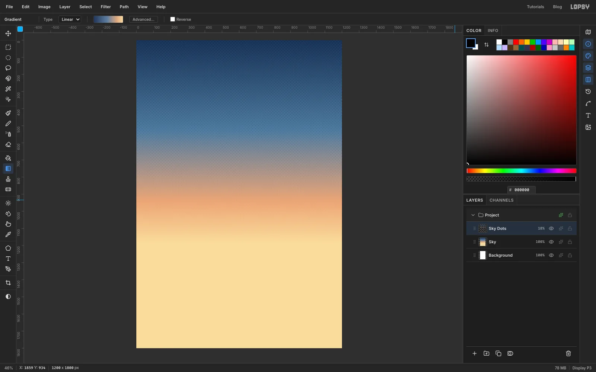

Old posters were printed, so the sky gets a faint dot screen.

1. With `Sky` selected, click **Duplicate Layer** at the bottom of the Layers panel and rename the copy `Sky Dots`.
2. Choose **Filter → Halftone…**, set **Dot Size** to `12`, leave **Angle** at `45`, and click **Apply**.
3. Open the layer's effects drawer with the effects button on its row, set the blend mode to **Multiply**, and close the drawer.
4. Click the opacity on the `Sky Dots` row and set it to `18%`. The dots should be barely there.

## Draw the halo rings

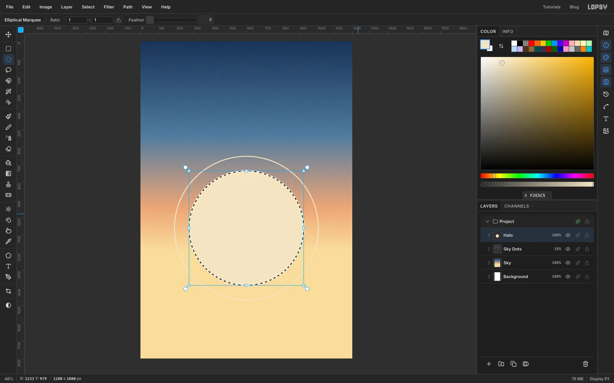

Two thin rings around the sun hint at the sun's glare and, later, at the Flyer breaking through it.

1. Click **Add Layer** and name it `Halo`. Set the foreground colour to `#F2E5C5`.
2. Pick the **Elliptical Marquee** and click the canvas once without dragging. In the dialog, set **From** to `190`, `650` and **To** to `1010`, `1470`, and press [[Enter]]. That's a circle of radius 410 around `x 600`, `y 1060`.
3. Choose **Edit → Fill**, then **Select → Shrink…** with **Amount** `5`, and press [[Delete]]. You're left with a 5 px ring.
4. Do the same for a radius-330 circle: **From** `270`, `730`, **To** `930`, `1390`. Fill, shrink by `5` and delete.
5. Press [[Cmd+D]] and set the layer's opacity to `28%`.

## Build a screen-printed sun

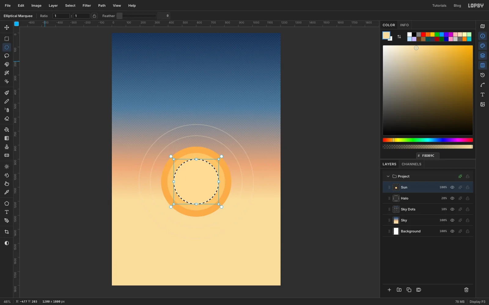

A soft gradient sun looks airbrushed. Four flat discs look printed.

1. Click **Add Layer** and name it `Sun`.
2. Make four circles centred on `x 600`, `y 1060` with the Elliptical Marquee dialog, filling each with **Edit → Fill** before you make the next one:
   - radius `250` (from `350`, `810` to `850`, `1310`): `#EFAE5A`
   - radius `205` (from `395`, `855` to `805`, `1265`): `#F4C676`
   - radius `160` (from `440`, `900` to `760`, `1220`): `#F8DB9C`
   - radius `112` (from `488`, `948` to `712`, `1172`): `#FBEBC4`
3. Press [[Cmd+D]].

## Draw flat cloud bands

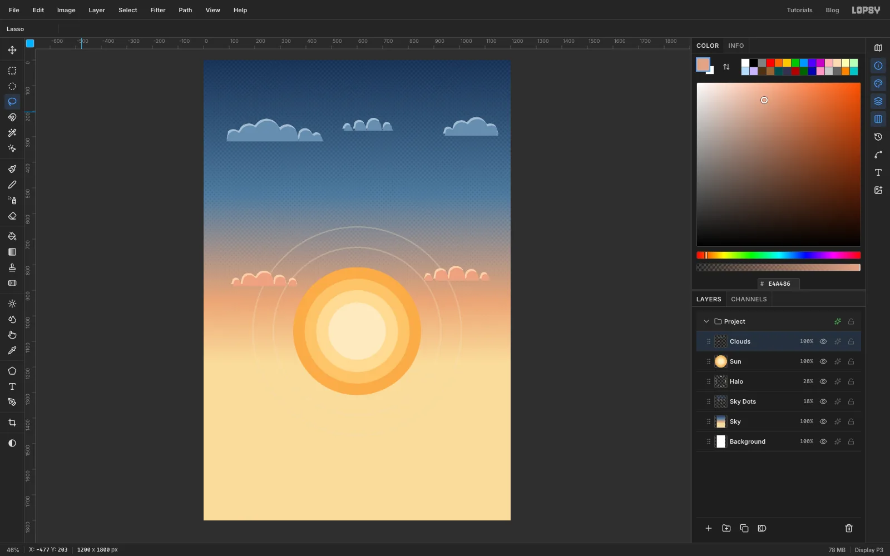

Americana clouds are flat-bottomed rows of bumps in two tones.

1. Click **Add Layer** and name it `Clouds`.
2. Set the colour to the rim tone `#A7BCD2`. With the **Lasso** (`L`), draw the big cloud at the left, between about `y 240` and `y 310` and from `x 60` to `x 470`: start at the bottom-left, drag a row of five or six round bumps along the top, then come straight back along a flat bottom to where you started. Choose **Edit → Fill**.
3. Draw two more the same way: a small one in the middle around `y 230`–`270` (`x 530`–`750`), and one at the right around `y 240`–`290` (`x 930`–`1160`). Leave clear sky above them for the tagline.
4. Set the colour to `#6F8DAE`. Lasso each cloud again, about 8 px lower and starting a few pixels to the right, and fill it. The paler rim peeks out along the tops of the bumps.
5. Repeat with the warm tones for two low clouds either side of the sun: rims in `#F6D2AE`, bodies in `#E4A486`, with their flat bottoms at about `y 880` on the left (`x 90`–`380`) and `y 860` on the right (`x 850`–`1130`).
6. Press [[Cmd+D]].

## Draw the wind lines with the Pen

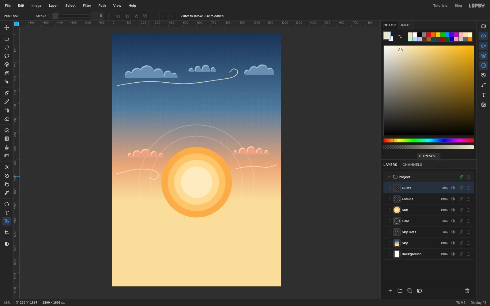

1. Click **Add Layer** and name it `Gusts`. Set the colour to `#F2E5C5`.
2. Pick the **Pen** tool (`P`) and set **Stroke** to `5`.
3. Draw a long, gently waving line across the sky below the clouds, from the left edge at about `y 370` to about `x 860`, `y 310`. Drag at each point to pull out smooth handles. Finish with three short points that curl back on themselves, like a breath of wind. Press [[Enter]] to stroke it.
4. In the **Paths** panel, click **Delete Path** so the overlay goes away. The stroke stays.
5. Draw a short line on the right of the sun at about `y 950`, from `x 880` to the right edge, and a short line with a curl at the left, from the left edge at `y 1000` to about `x 330`, curling back near `x 260`, `y 1020`. Press [[Enter]] and delete each path.
6. Set the layer's opacity to `80%`.

## Lasso the three dunes

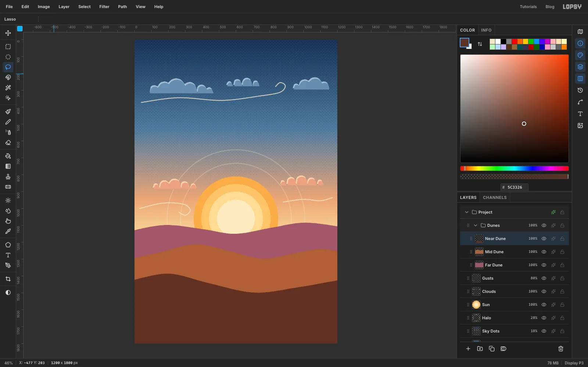

1. Click **New Group** at the bottom of the Layers panel and name it `Dunes`. Layers you add now go inside it.
2. Click **Add Layer** and name it `Far Dune`. With the Lasso, drag a gently rolling line from just off the left edge at about `y 1135`, dipping to about `y 1150` in the middle so the sun sinks behind it, and rising to about `y 1085` near `x 1010`. Carry on off the right edge, then go down below the canvas, across, and back up to the start. Set the colour to `#9A5A6A` and choose **Edit → Fill**.
3. Add a layer called `Mid Dune` and lasso a second line: a crest at about `x 360`, `y 1212`, a hollow at `x 760`, `y 1300`, and a rise to `y 1240` near `x 1100`, closing it below the canvas the same way. Fill it with `#A6633F`.
4. Add `Near Dune`: from `y 1430` at the left, a hump near `x 200`, `y 1386`, a low point at `x 700`, `y 1500`, and up to `y 1420` at the right edge, again closing below the canvas. Fill it with `#5C3326`. Press [[Cmd+D]].

## Add rim light and wind ripples

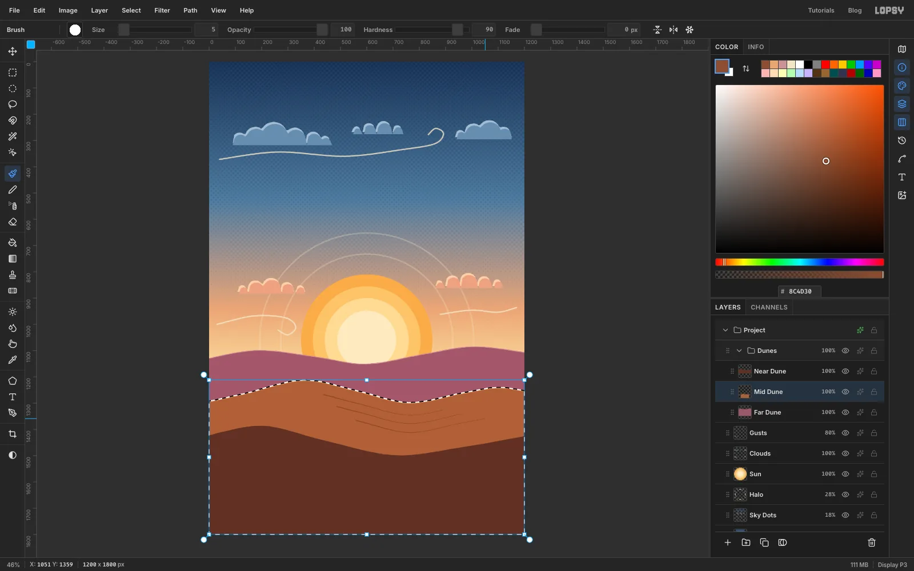

The sun is behind the dunes, so each crest catches a thin line of light. Painting inside each dune's own selection keeps the edges crisp.

1. [[Cmd]]-click the `Mid Dune` thumbnail to load its outline as a selection, and click its row to make it active.
2. Pick the **Brush**. Open the brush settings (the tip thumbnail at the left of the options bar) and set **Size** `12`, **Hardness** `100`, **Taper** `0`. Set the colour to `#E7A774` and paint along the dune's top edge. Only the lower half of the brush lands inside the selection, so you get a crisp rim.
3. For the ripples, set the colour to `#8C4D30` and the brush **Size** to `5`. In the brush settings, set **Taper** to `400`. Taper is a distance: the stroke thins to nothing over that many pixels. Paint three lines that follow the crest's curve on the lee side, about 50, 80 and 115 px below it, starting at `x 430`, `480` and `540` and running to the right for about 350–400 px each.
4. Press [[Cmd+D]] and set **Taper** back to `0`. Do the rim on `Far Dune` with `#CC9296` at size `10`, and on `Near Dune` with `#9A5640` at size `10`, each inside its own [[Cmd]]-click selection. Leave those two without ripples.
5. Press [[Cmd+D]], click `Mid Dune` and run **Filter → Add Noise…** with **Amount** `8` and **Mono**, for a little sand grain.

## Paint the beach grass

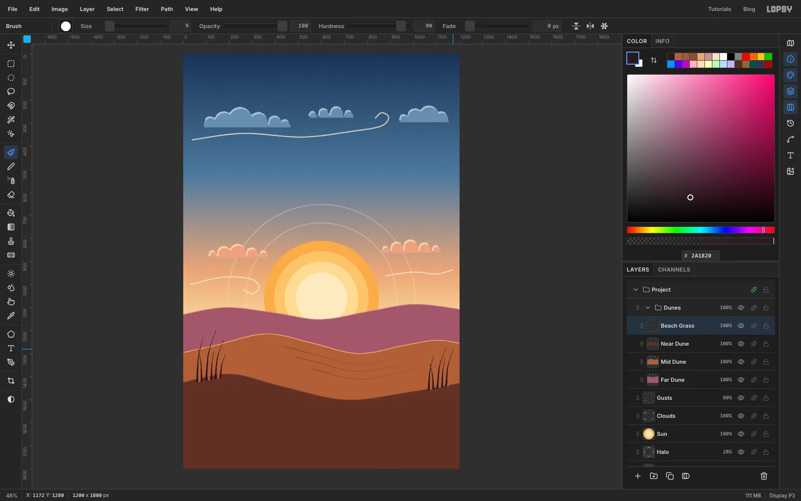

1. Click `Near Dune`, click **Add Layer** and name it `Beach Grass`.
2. Set the brush **Size** to `9`, **Hardness** `100`, and **Taper** to roughly the length of each blade (try `180`). Each stroke starts full width at the root and thins to a point.
3. Set the colour to `#B0603A` and paint three blades in each clump: from the near dune's edge near `x 70`–`150` on the left and `x 1080`–`1150` on the right, each 110–190 px tall, mostly leaning right with the wind and one leaning back.
4. Switch to `#2A1820` and paint five or six more blades per clump in front, at different heights between 95 and 220 px. Keep the tips at least 40 px away from where the title will go (roughly `x 210`–`990`) and inside the frame (`x 50`–`1150`).

## Drop in the 1903 photo

1. Click the collapse arrow on the `Dunes` group, then click the group's row so the photo lands above it.
2. Drag your cropped photo onto the canvas. Lopsy puts it on a new layer and fits it to the poster's width, about 1200 × 419 px, centred vertically. The top of the photo is at about `y 691`.
3. Rename the layer `Photo`.

## Lift Wilbur onto his own layer

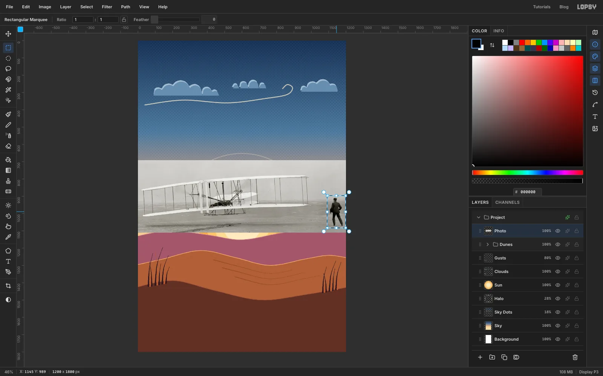

1. With the **Rectangular Marquee**, drag a snug box around Wilbur at the right edge of the photo, from just above his cap to just below his feet, keeping clear of the wing tip.
2. Press [[Cmd+C]], then [[Cmd+V]]. The copy pastes in place on a new layer. Rename it `Wilbur`.

## Turn Wilbur into a silhouette

1. Choose **Filter → Threshold…**, set **Level** to `110`, and click **Apply**. Wilbur goes black and the sand goes white.
2. Pick the **Magic Wand**, set **Tolerance** to `30`, untick **Contiguous**, and click the white sand. Press [[Delete]], then [[Cmd+D]].

## Trace the wings

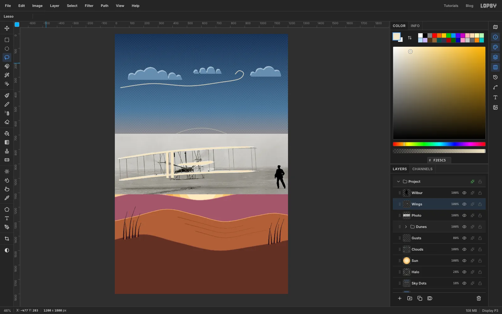

A threshold of the wings leaves ragged edges, so trace them instead. The photo underneath is your guide.

1. Click `Photo`, click **Add Layer** and name it `Wings`. Set the colour to `#F2E5C5`.
2. Zoom in so the Flyer fills the window. With the Lasso, drag along the top edge of the upper wing from its left tip to its right tip, then back along its bottom edge. Wings are thin, so stay just outside the photo's white. Choose **Edit → Fill**.
3. Trace and fill the lower wing the same way, and the long pale elevator shape in the middle of the Flyer.
4. Finish with the two white posts that stand up at the front of the Flyer, just left of centre, as two thin rectangles from the top wing down to the skids.
5. Press [[Cmd+D]].

## Pull the rigging out with a threshold

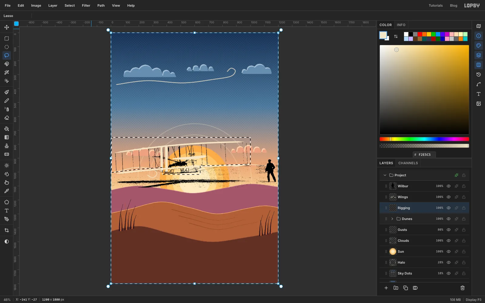

1. Click `Photo` and rename it `Rigging`.
2. Run **Filter → Threshold…** with **Level** `135`. The struts, wires, engine and the pilot go black.
3. With the Magic Wand (Contiguous still off), click the white sky and press [[Delete]].
4. With the Lasso, draw around the Flyer itself: above the top wing, down past the lower wing's ends, and under the skids in the middle. Leave out Wilbur's old spot and the sand. Choose **Select → Inverse** and press [[Delete]], then [[Cmd+D]].

## Re-ink the struts

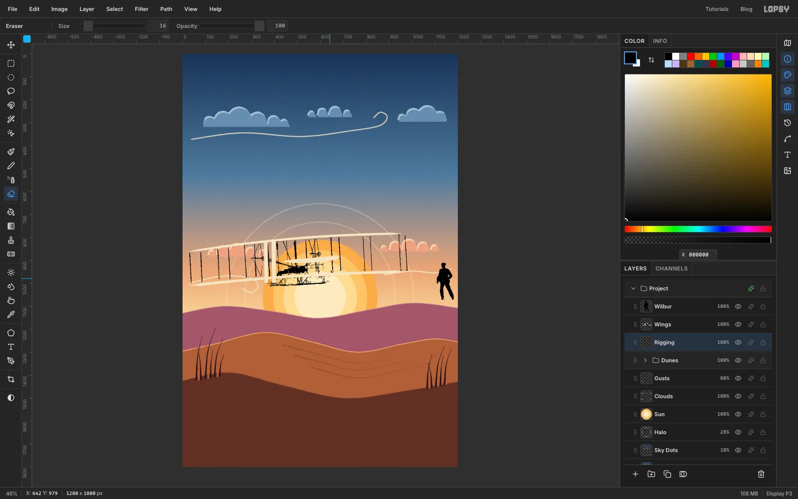

The threshold breaks some of the thin struts into dashes. Ink them back in by hand.

1. Pick the **Pencil** (`N`), set **Size** to `2` and the colour to black.
2. For each upright strut, click where it meets the top wing and [[Shift]]-click where it meets the bottom wing. There are fourteen: two near each wing tip, and the rest spaced along both sides of the engine.
3. Pick the **Eraser** (`E`) at **Size** `16` and wipe away the leftover sand speckle between the skids under the engine, and any dust just past the skids' right-hand ends.

## Ink the Flyer and Wilbur

1. Click `Wings`, open its effects drawer and turn on **Stroke** with **Width** `2` and the colour `#1C2A44`.
2. Click `Rigging` and turn on **Color Overlay** in `#1C2A44`.
3. Do the same **Color Overlay** on `Wilbur`. The whole poster now uses one navy ink.

## Group the Flyer

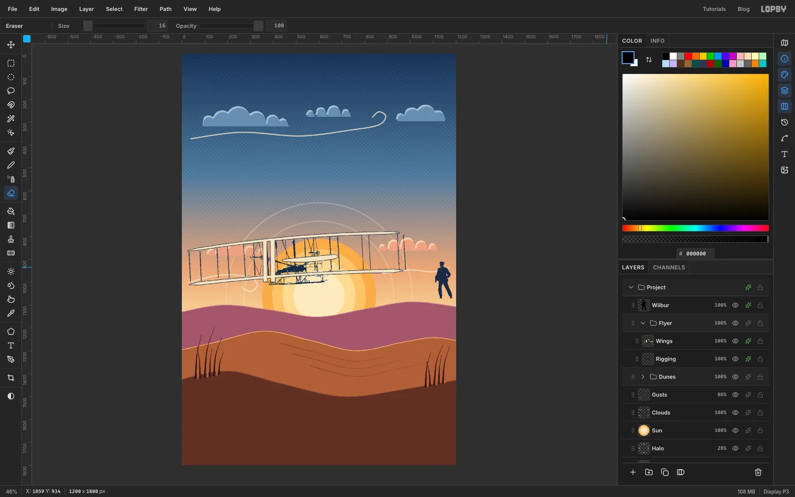

1. Click `Wings`, then [[Shift]]-click `Rigging` so both are selected.
2. Click **Group Layers** at the bottom of the Layers panel and rename the group `Flyer`. `Wings` stays above `Rigging` inside it.

## Move and scale the Flyer as one piece

With a group selected and no marquee, the **Move** tool's handles frame everything in the group.

1. Press [[Cmd+D]] to make sure nothing is selected, and pick the **Move** tool (`V`).
2. Drag the Flyer up until it's centred at about `x 588`, `y 585`, above the sun.
3. Hold [[Cmd]] and drag the bottom-right corner handle outward until the Flyer is about 10% bigger, roughly 1050 px wide. [[Cmd]] keeps the proportions.

## Tilt the Flyer into a climb

1. Drag the round rotation handle at the top-right corner upward, about 6°, so the Flyer climbs toward the right.
2. Press [[Escape]] to finish. Rotating and scaling shift it a little, so drag it back until it's centred at about `x 588`, `y 585` again.
3. Press [[Cmd+Z]] three times and watch that last move, the tilt and the scale come off, then [[Cmd+Shift+Z]] three times to bring them back exactly as they were.

## Flip and enlarge Wilbur

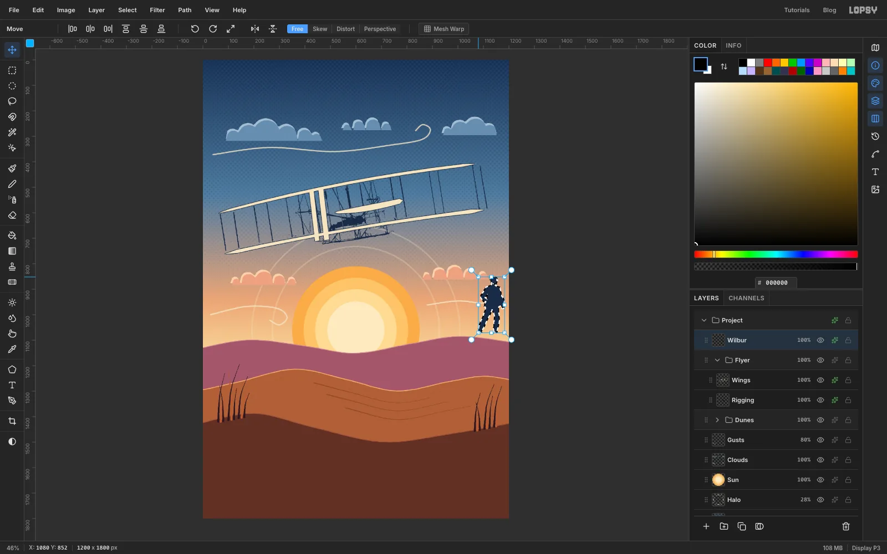

1. Click `Wilbur` and [[Cmd]]-click its thumbnail to select him.
2. With the Move tool, click **Flip Horizontal** in the options bar so he faces the Flyer.
3. Hold [[Cmd]] and drag his top-left handle up and out until he's about 135% of his size, about 220 px tall. Press [[Cmd+D]].

## Stand Wilbur on the dune

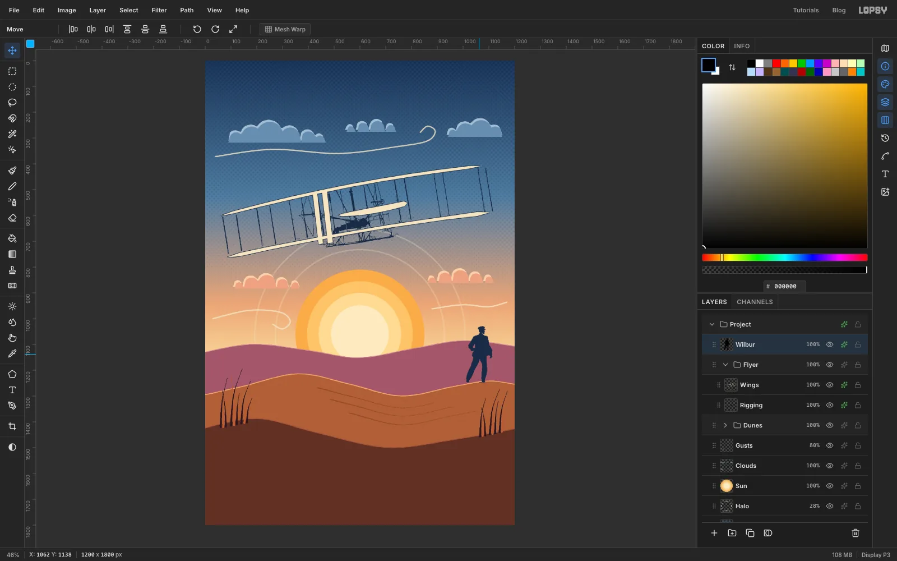

Drag Wilbur down onto the right-hand crest of the rust dune, so he's centred at about `x 1062` with his feet at `y 1247`, right on the rim light. Leave at least 40 px between him and the frame edge.

## Knock the halo out around the Flyer

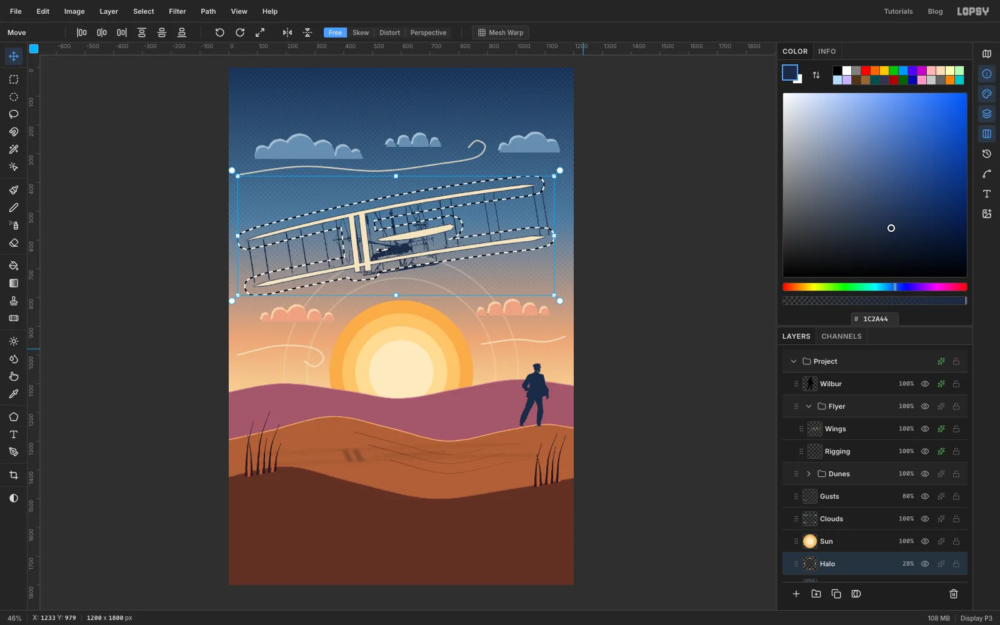

The halo rings shouldn't run into the wings.

1. Click `Halo`, then [[Cmd]]-click the `Wings` thumbnail.
2. Choose **Select → Grow…** with **Amount** `30` and press [[Delete]]. The rings now stop well short of the Flyer. Press [[Cmd+D]].

## Set the title

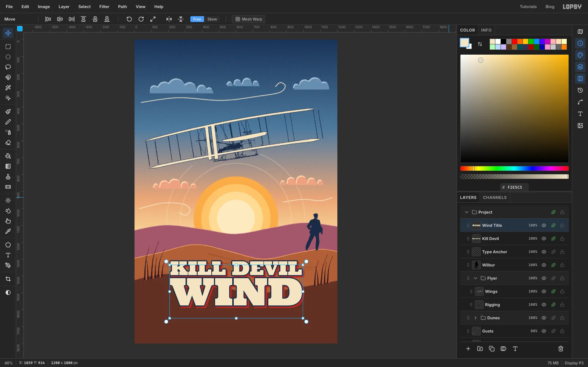

Text options restyle whichever text layer is selected, so start each new line from a plain raster layer.

1. Click `Wilbur`, click **Add Layer** and name it `Type Anchor`. Leave it empty.
2. Pick the **Text** tool (`T`). Choose **Ultra**, **Size** `226`, **Align** **Center**, and the colour `#F2E5C5`. With **Center** set, the point you click becomes the middle of the line. Click at `x 600`, `y 1380`, type `WIND` and press [[Tab]]. Double-click the new layer's name and rename it `Wind Title`.
3. Click `Type Anchor` again. Set **Size** to `114`, click higher up in empty space at `x 600`, `y 1190`, type `KILL DEVIL` and press [[Tab]]. Rename the layer `Kill Devil`. (Clicking inside the WIND text box would edit WIND instead, which is why you start higher.)
4. Switch to the **Move** tool and nudge `Kill Devil` down with the arrow keys (hold [[Shift]] for 10 px steps) until the letters run from about `y 1312` to `y 1394`. Nudge `Wind Title` so its letter tops sit at about `y 1412`, about 18 px under KILL DEVIL.
5. On each of the two layers, turn on **Stroke** with **Width** `6` in `#1C2A44`, and **Drop Shadow** with **Offset X** `8`, **Offset Y** `8`, **Blur** `0`, **Opacity** `100` and the colour `#B5372B`. A zero blur gives the hard offset shadow of a two-colour print.

## Skew the title forward

Text stays live when you transform it, so you can lean it like italics without rasterizing.

1. Click `Wind Title`, pick the Move tool and click **Skew** in the options bar.
2. Drag the top-middle handle about 50 px to the right. The bottom stays put and the letters lean forward.
3. Skewing shifts the letters right, so nudge `Wind Title` with the arrow keys until it's centred on `x 600` again.
4. Do the same on `Kill Devil`, dragging only about 26 px so both lines lean at the same angle, and re-centre it. Click **Free** to leave Skew mode.

## Group and tilt the title

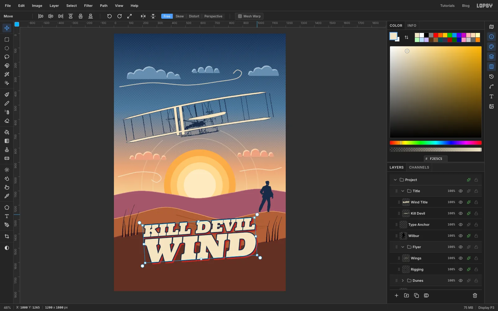

1. Click `Kill Devil`, [[Shift]]-click `Wind Title`, click **Group Layers** and rename the group `Title`.
2. Press [[Cmd+D]], then drag the top-right rotation handle up about 4° so the title climbs with the Flyer. Press [[Escape]].
3. With the group still selected, drag it up about 26 px. It moves as one piece and leaves room for the ribbon below.
4. Press [[Cmd+Z]] and [[Cmd+Shift+Z]] a couple of times to check the tilt and the move come off and go back cleanly.

## Set the names and the tagline

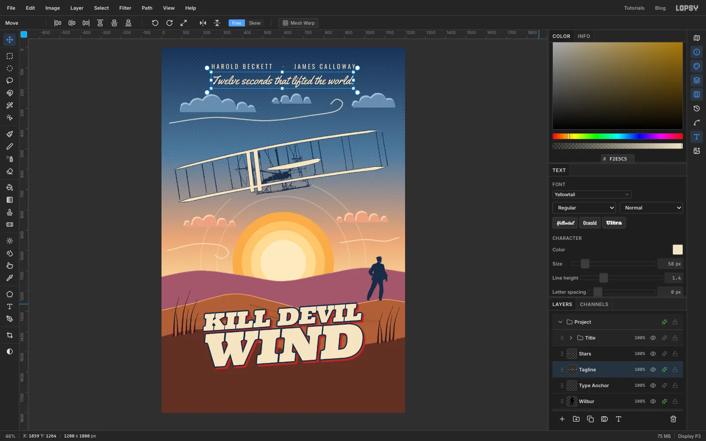

1. Click `Type Anchor`. With the Text tool, choose **Oswald**, **Size** `30` (Align is still **Center**), click at `x 600`, `y 72` and type `HAROLD BECKETT   ·   JAMES CALLOWAY` (three spaces either side of the dot). Press [[Tab]] and rename the layer `Stars`.
2. Open the **Text** panel and set **Letter spacing** to `8`. With the Move tool and arrow keys, fine-tune it so the letters are centred on `x 600` at about `y 92`.
3. Click `Type Anchor` again, choose **Yellowtail** at **Size** `58`, click at `x 600`, `y 130` and type `Twelve seconds that lifted the world.` Press [[Tab]] and rename it `Tagline`. New text keeps the last letter spacing, so set it back to `0` for the script. Nudge it so it's centred at about `y 166`.
4. Give the tagline a soft **Drop Shadow**: offset `3` / `3`, **Blur** `4`, **Opacity** `60`, in `#1C2A44`.

## Draw the date ribbon on guides

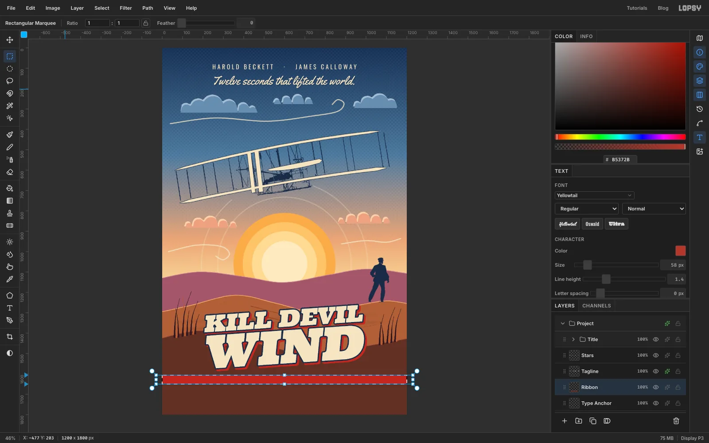

1. Check that **View → Snap to Guides** is ticked. Click the left ruler at `y 1606` and again at `y 1650` to place two guides.
2. Click `Type Anchor`, click **Add Layer** and name it `Ribbon`.
3. With the Rectangular Marquee, drag from just off the left edge a little above the top guide to just off the right edge a little below the bottom guide. The top and bottom edges snap onto the guides.
4. Fill it with `#B5372B` and press [[Cmd+D]].
5. With the Pencil at **Size** `3` and the colour `#F2E5C5`, click the left edge at `y 1599` and [[Shift]]-click the right edge for a cream rule above the band. Do the same at `y 1657` for one below it.

## Add the date line and billing block

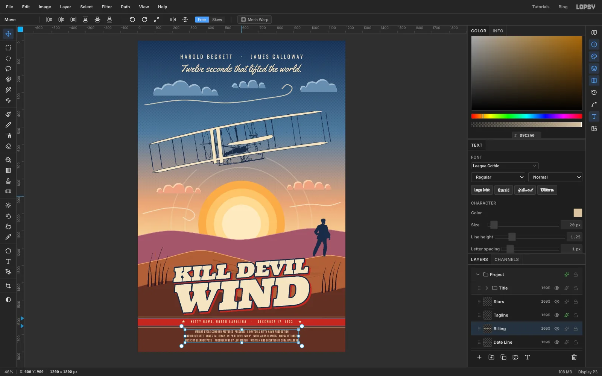

1. Click `Ribbon` so the new text goes above it. With the Text tool, choose **Oswald**, **Size** `26`, colour `#F2E5C5`. The ribbon sits inside the WIND text's box, so click just below it at `x 600`, `y 1690` and type `★   KITTY HAWK, NORTH CAROLINA   ·   DECEMBER 17, 1903   ★`. You can copy the stars from this page. Press [[Tab]], rename the layer `Date Line`, and set **Letter spacing** to `6`.
2. With the Move tool, nudge it up with [[Shift]]+arrow until it's centred in the red band, about `x 600`, `y 1630`. It's all capitals with no descenders, so centre the letters themselves.
3. Click `Ribbon` again, then with the Text tool choose **League Gothic**, **Size** `20` and the colour `#D9C3A0`. Click at `x 600`, `y 1682` and type the billing block as three lines (press [[Enter]] between them), then press [[Tab]] and rename the layer `Billing`:
   - `WRIGHT CYCLE COMPANY PICTURES  PRESENTS  A DAYTON & KITTY HAWK PRODUCTION`
   - `HAROLD BECKETT   JAMES CALLOWAY   IN  "KILL DEVIL WIND"   WITH  AMOS FENWICK   MARGARET OAKES`
   - `MUSIC BY ELEANOR VOSS    PHOTOGRAPHY BY LEVI MARSH    WRITTEN AND DIRECTED BY CORA HALLORAN`
4. Set **Letter spacing** to `1` and **Line height** to `1.25`, then nudge the block so it's centred at about `x 600`, `y 1707`, with even space between the lower cream rule and the bottom of the poster.

## Add grain and a poster border

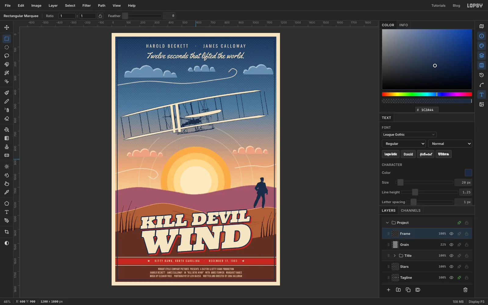

1. Untick **View → Show Guides**.
2. Click the `Title` group's row (collapsed), click **Add Layer** and name it `Grain`. Choose **Select → All**, fill it with `#808080`, and press [[Cmd+D]].
3. Run **Filter → Add Noise…** with **Amount** `30` and **Mono**. Set the blend mode to **Overlay** and the opacity to `22%`.
4. Add a layer called `Frame`. Pick the **Rectangular Marquee**, click the canvas once without dragging, set **From** `26`, `26` and **To** `1174`, `1774`, and press [[Enter]]. Choose **Select → Inverse**, set the colour to `#F2E5C5` and choose **Edit → Fill**.
5. In the same way, select from `38`, `38` to `1162`, `1762` and fill it with `#1C2A44`. Then select from `42`, `42` to `1158`, `1758` and press [[Delete]], leaving a 4 px navy keyline. Press [[Cmd+D]].
6. Choose **File → Save Project** to keep the layers, and **File → Quick Export PNG** for the poster.
