Old anatomy atlases have a look all their own. They're hand-coloured engravings on warm paper, with arteries picked out in red and veins in blue. Every structure gets a small letter and a hairline leader, and a key in the margin says what each letter means. In this tutorial you'll borrow that language to present an app.

The app is **Nerve Tonic**, a breathing app for toning the vagus nerve. The board is 1600 × 1200 px. The left column is set like the title page of a plate. One phone shows a breathing session, with a heart-and-lungs engraving inside a dial. A second phone, tilted, shows the day's readings next to an engraving of the vagus nerve. Gold leader lines tie the screens back to a lettered key, the way an atlas would.

Along the way you'll use:

- **guides**, **groups**, the **Shape** tool's click-to-size dialog, and transforming a whole group with its rotation handle
- **Magic Wand** with Contiguous off, the **Healing Brush**, the **Eraser**, and marquee **Delete** to clean up scanned engravings
- **Multiply** to drop white paper out of an image, **Unsharp Mask** and **Hue/Saturation**
- ring selections built with the **Elliptical Marquee** and [[Alt]], and **Sunburst** to rule the dial's tick marks
- a **layer mask** faded with a **Gradient**
- **Define Pattern** and **Edit → Fill with Pattern** for graph paper, and the **Pen** tool for a smooth chart line
- **Copy**, **Paste** and **Merge Down**
- **Text** in Gloock, IM Fell English, Instrument Sans and IBM Plex Mono, including recolouring one line inside a text layer
- the **Drop Shadow**, **Stroke**, **Inner Glow**, **Outer Glow** and **Color Overlay** effects, **Clouds**, **Add Noise**, and undo and redo

The palette is a dark green backdrop, bone and paper tones, and the three inks of an anatomy plate:

- Backdrop `#141D1C` → `#2E3E3A`
- Bone type `#EDE3CC`, screen paper `#F1E8D4`, paper edge `#B79F74`
- Arterial red `#B3342B`, light red `#D9604F`
- Nerve gold `#D8B54A`
- Ink `#221E1A`, phone bezel `#0D1110`, bezel rim `#44504C`
- Screen type `#8A7A5C`, muted italic `#6E6150`, hairlines `#CDBB95`

The three engravings come from Henry Gray's *Anatomy of the Human Body* (1918), which is in the public domain. On Wikimedia Commons they are **Gray490.png** (the heart and lungs from the front), **Gray793.png** (the course of the vagus nerve) and **Gray961.png** (the larynx, trachea and bronchi). Download the original PNGs. They're small, black line work on white paper, and the first two are hand-coloured.

> **Tip:** Positions are given as `x, y` in document pixels. The status bar at the bottom left shows where your cursor is. Mac key names are used; on Windows and Linux use Ctrl for Cmd.

> **Tip:** "Fill with a colour" means type the hex into the Color panel's **Hex** field, then choose **Edit → Fill**. Press [[Cmd+D]] before you draw a new marquee, so the new drag doesn't move the old outline.

> **Tip:** The **Shape** tool draws from the centre outwards. Click once without dragging and a **Shape Size** dialog opens, where you type the exact width and height. The shape is centred on the point you clicked. Every phone part in this tutorial is made that way.

> **Tip:** With a text layer selected, the Text tool's font and size controls restyle that layer. So before you set up a new piece of type, click a plain (non-text) layer, then click on an empty part of the canvas to start typing. You can drag the type into place with the **Move** tool afterwards and fine-tune it with the arrow keys.

## Set up the board and the backdrop

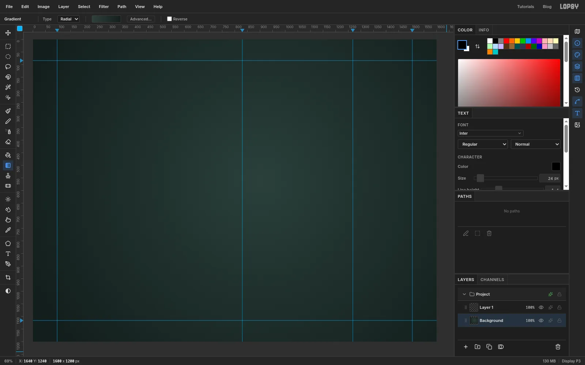

1. Choose **File → New**, set **Width** `1600` and **Height** `1200`, and click **Create**.
2. Click the top ruler at x `96`, `830`, `1268` and `1504`. The outer two are the board's margins, and the middle two are the centres of the two phones. Click the left ruler at y `84` and `1116` for the top and bottom margins.
3. Click `Background`. Pick the **Gradient** tool, set **Type** to **Radial**, and in **Advanced…** set the left stop to `#2E3E3A` and the right stop to `#141D1C`. Drag from just above the middle of the board (about `900, 560`) out past the bottom-right corner.

The light falls slightly above centre, behind where the phones will stand, like a lamp on a dissecting table.

## Mottle it with Clouds

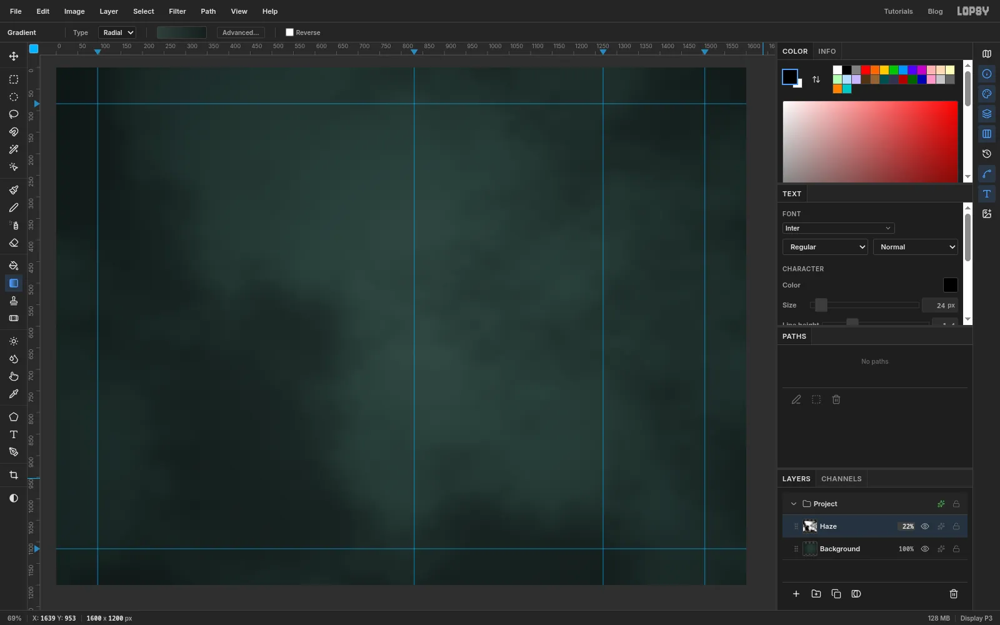

1. A new document comes with an empty `Layer 1` above `Background`. Double-click it and rename it `Haze`.
2. Choose **Filter → Clouds…**, set **Scale** to `4` and click **Apply**. The layer fills with grey clouds.
3. Open the layer's effects (the ✦ button on its row). The blend mode menu sits at the top of that drawer. Set it to **Overlay** and close the drawer. Every later blend mode change happens in the same place. Click the opacity on the row and set it to `22%`.

Overlay lightens and darkens the green without greying it, so the backdrop looks like old cloth, not flat paint.

## Knock the paper out of the bronchial tree

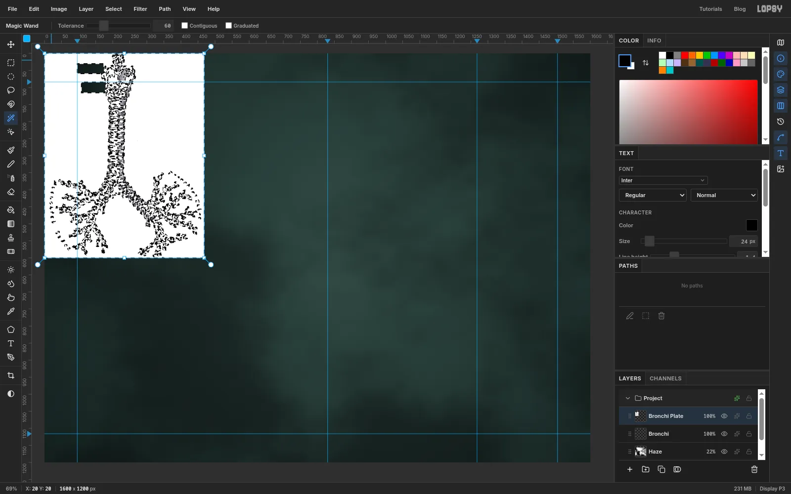

1. Drag **Gray961.png** from your file browser onto the canvas. It lands as a new layer in the top-left corner. Rename it `Bronchi Plate`.
2. The engraving has two small printed labels beside the larynx near the top. Drag a **Rectangular Marquee** around each one and press [[Delete]]. They'd only read as stray text later.
3. Pick the **Magic Wand** ([[W]]), set **Tolerance** to `60` and turn **Contiguous** off. Click the white paper. Every white pixel in the drawing is selected, including the paper inside the cartilage rings.
4. Press [[Delete]], then [[Cmd+D]].

All that's left is the line work, with transparency where the paper was.

## Ghost it behind the board

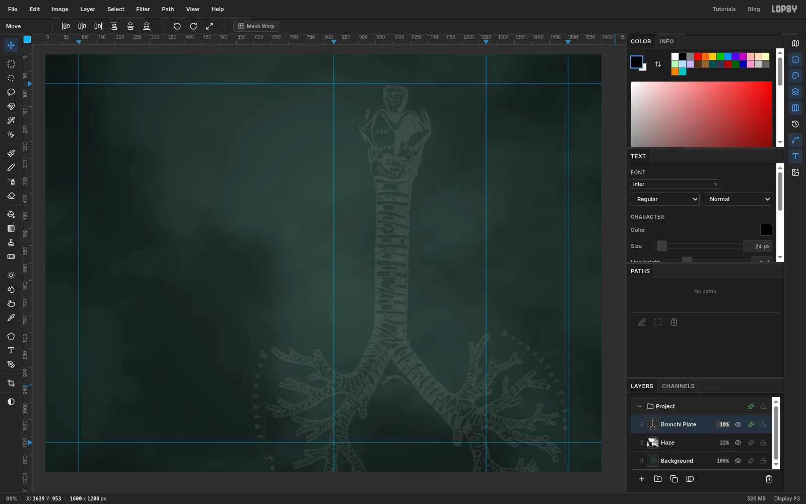

1. [[Cmd]]-click the `Bronchi Plate` thumbnail to select its pixels, and pick the **Move** tool ([[V]]).
2. Hold [[Cmd]] and drag the bottom-right handle outwards until the drawing is about twice its size. [[Cmd]] keeps the proportions. Press [[Cmd+D]].
3. Drag the drawing so the trachea runs down the gap between the two phone guides and the bronchi spill off the bottom edge.
4. Open its effects and turn on **Color Overlay** with the colour `#EDE3CC`. Set the layer's opacity to `10%`.

At 10% it's a watermark. You notice it in the gaps but never read it as content.

## Build the first phone

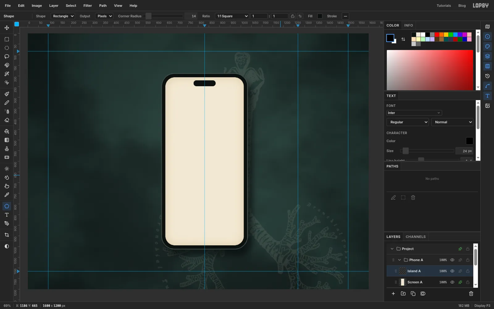

1. With `Bronchi Plate` active, click **New Group** in the Layers panel and name it `Phone A`. Click **Add Layer** and name it `Body A`.
2. Pick the **Shape** tool ([[U]]). Set **Shape** to **Rectangle**, **Output** to **Pixels**, **Corner Radius** `58`, the fill swatch to `#0D1110` and the stroke to none. Click once on the guide at `830, 600` and create a **400 × 820** shape.
3. Add a layer called `Screen A`. Set the fill to `#F1E8D4` and **Corner Radius** to `44`, then click the same point and create a **368 × 788** shape. That leaves a 16 px bezel all round.
4. On `Screen A`, run **Filter → Add Noise…** with **Amount** `5`, **Mono** and **Gaussian**. Then turn on **Inner Glow**: **Size** `70`, **Opacity** `40`, colour `#B79F74`. The edges of the screen darken slightly, like old paper.
5. On `Body A`, turn on **Drop Shadow** (**Offset X** `22`, **Offset Y** `30`, **Blur** `44`, **Opacity** `60`, colour `#030606`) and **Stroke** (**Width** `3`, colour `#44504C`, position **Outside**). The stroke is a dull metal rim that keeps the black body from sinking into the dark backdrop.
6. Add a layer called `Island A`, set the fill to the bezel colour and **Corner Radius** `14`, and create a **104 × 28** shape at `830, 234`.

## Heal the labels out of the heart and lungs

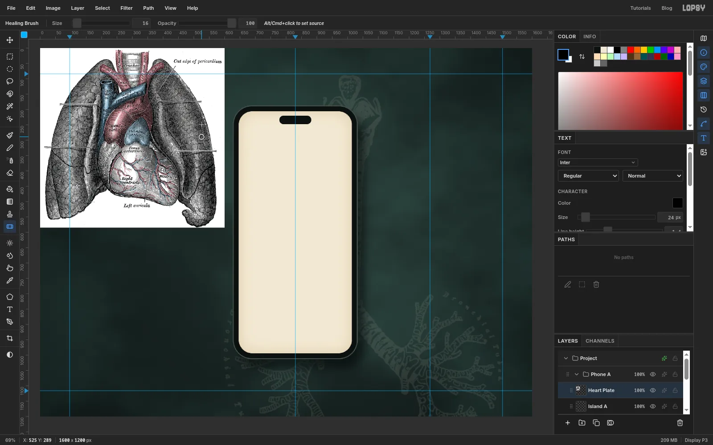

1. Click `Island A`, then drag **Gray490.png** onto the canvas. Rename the new layer `Heart Plate`.
2. The engraving is lettered RIGHT LUNG and LEFT LUNG, and has four label pins across the lungs. A designer would retouch those out. Pick the **Healing Brush** (from the toolbox) and set **Size** to `16`.
3. [[Alt]]-click a patch of lung texture just above the words RIGHT LUNG (about 40 px above them). Then paint short horizontal strokes across the lettering, one row at a time. The brush copies texture from the source, offset by the same amount, and matches it to the tone around the stroke.
4. Do the same for LEFT LUNG.
5. Leave the small italic labels inside the heart (*Trachea*, *Arch of aorta* and so on). At phone size they read as hatching, and they're part of the period look.
6. Set **Size** to `14` and do the four pins. They're the double lines across each lung. For each pin, [[Alt]]-click about 20 px below it, then drag along it from end to end. Treat the two leader lines that run in from outside the drawing the same way.

Work slowly and pick your source from texture that runs the same way as the area you're covering. If a stroke looks smeared, [[Cmd+Z]] and try a source a little further away.

## Clear the captions

The two captions, *Cut edge of pericardium* and *Left auricula*, sit on bare paper. You don't need to heal them.

1. Drag a **Rectangular Marquee** around each caption and press [[Delete]].
2. Look along the outside edges of the lungs for leftover grey ends of the pins. Remove those with the **Eraser** ([[E]]) at **Size** `8` to `12`, and press [[Cmd+D]].

Deleted areas are transparent, not white. That's fine: the next step makes white invisible anyway.

## Scale the plate down

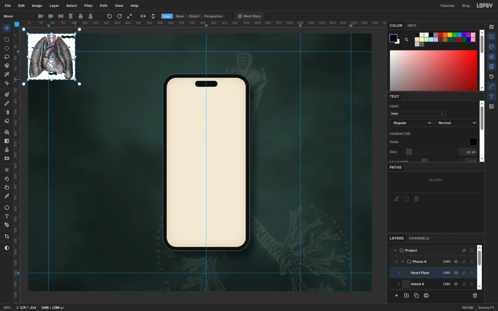

1. [[Cmd]]-click the `Heart Plate` thumbnail and pick the **Move** tool.
2. Hold [[Cmd]] and drag the bottom-right handle up and to the left until the engraving is about **219 px wide**. Press [[Cmd+D]].

Scaling down sharpens the look of an engraving, because the hatching gets finer. Scaling up does the opposite, so start from the biggest file you can find.

## Multiply it onto the screen

1. Drag the plate onto the screen so it's centred on `830, 542`.
2. In its effects drawer, set the blend mode to **Multiply**. White multiplies to nothing, so the paper disappears and the engraving looks printed on the cream.
3. Run **Filter → Unsharp Mask…** with **Amount** `0.6` and **Radius** `1` to bring back the line work after scaling. Then run **Filter → Hue/Saturation…** with **Saturation** `-18`, so its reds and blues match the board's inks rather than fighting them.

## Draw the dial rings

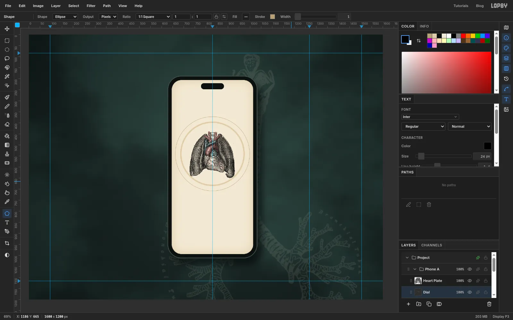

1. Click `Island A` and add a layer called `Dial`, so the rings sit under the plate.
2. Pick the **Shape** tool and set **Shape** to **Ellipse**, the fill to none (open the fill swatch and click **Remove fill**), and the stroke to `#DDCDAA` with **Width** `6`. Click at `830, 540` and create a **286 × 286** circle. This is the track the breath moves along.
3. Change the stroke to `#B79F74` with **Width** `1`, and create a **336 × 336** circle at the same point.

## Rule the tick marks with Sunburst

The tick marks are a ring of Sunburst rays, clipped by a ring-shaped selection.

1. Add a layer called `Ticks`.
2. Pick the **Elliptical Marquee**. Click once on the canvas without dragging: an **Elliptical Selection** dialog opens with **From** and **To** fields. Enter `667, 377` and `993, 703` and click **Select**. That's a circle of radius 163 around the dial centre.
3. Hold [[Alt]] and drag a second circle from about `676, 386` to `984, 694` (radius 154) to subtract it. Alt-drags have no dialog, so watch X and Y in the status bar. A pixel or two out doesn't matter, because the ring only clips the rays. You're left with a 9 px ring.
4. Set the foreground to `#9A8660` and run **Filter → Sunburst…** with **Rays** `72`, **Width** `22`, **Center X** `52` and **Center Y** `45`. Leave the rest at their defaults and click **Apply**.

The centre sliders are percentages of the document, and 52% × 45% lands within 2 px of the dial centre. Inside a 9 px ring nobody can see the difference.

## Add the red hour ticks

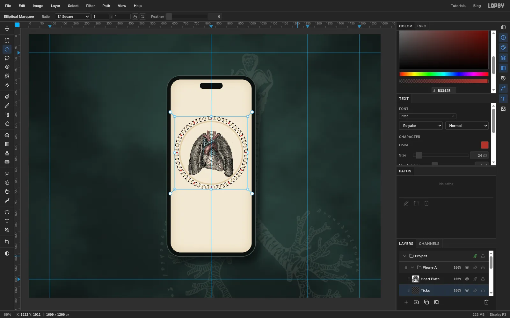

1. Make a wider ring the same way: a circle of radius 166 (`664, 374` to `996, 706`), minus one of radius 151 (`679, 389` to `981, 691`).
2. Set the foreground to `#B3342B` and run **Sunburst** again with **Rays** `12` and **Width** `5`.
3. If the ticks look too heavy or too light, press [[Cmd+Z]]. The red ticks go but the ring selection comes back with them, so you can run Sunburst again with another **Width** straight away. (I tried `14` first. It looked clumsy next to the fine ticks.) When you're happy, press [[Cmd+D]].

## Cut the breath arc

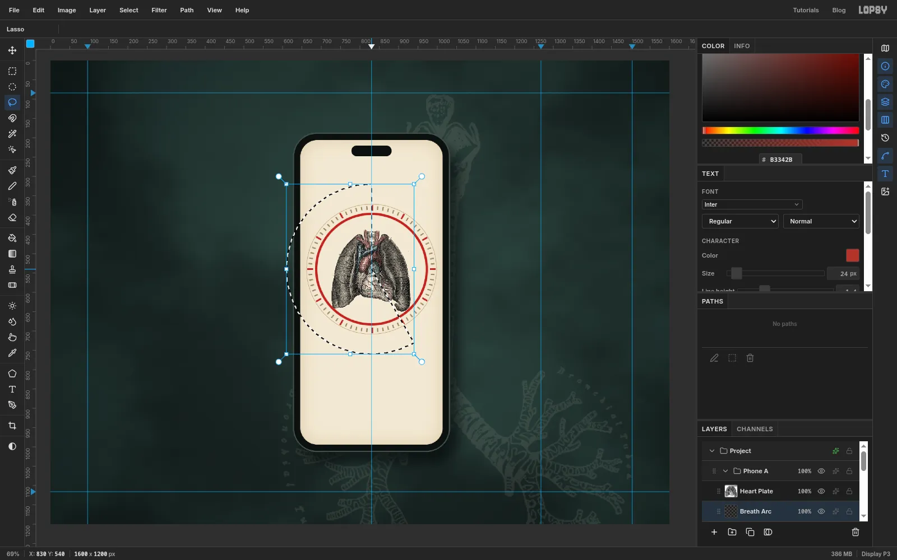

The arc shows how far through the inhale you are.

1. Add a layer called `Breath Arc`. Make a ring selection from radius 146 (`684, 394` to `976, 686`) minus radius 140 (`690, 400` to `970, 680`). Fill it with `#B3342B`. That's a red ring right on top of the tan track.
2. Pick the **Lasso** ([[L]]) and draw a wedge from the dial centre. Go out past four o'clock, round the bottom and the left side, and back in at twelve o'clock. Close it back at the centre.
3. Press [[Delete]], then [[Cmd+D]].

What's left is a red arc from twelve o'clock clockwise to about four o'clock.

## Put a glowing dot on the end of the arc

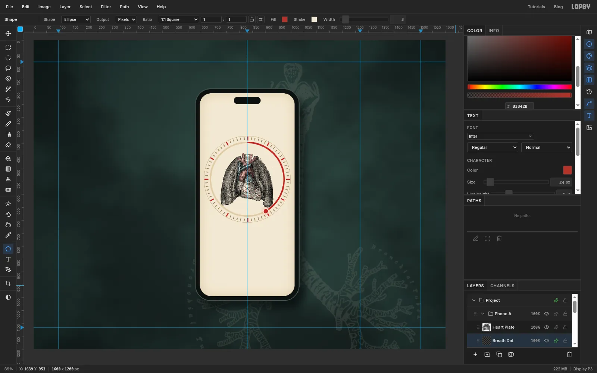

1. Add a layer called `Breath Dot`.
2. With the **Shape** tool, set the shape to **Ellipse**, the fill to `#B3342B` and the stroke to `#F1E8D4` at **Width** `3`. Click at the end of the arc (about `902, 664`) and create a **20 × 20** circle.
3. Turn on **Outer Glow**: **Size** `16`, **Opacity** `55`, colour `#D9604F`.

The paper-coloured rim cuts the dot out of the arc so it reads as a handle.

## Set the status bar and the header

1. Click `Breath Dot` and add an empty layer called `Battery A`. It's your starting point for the type on this screen, and it'll hold the battery icon too.
2. Type `9:41` in **Instrument Sans SemiBold**, size `15`, colour `#221E1A`, and move it so it starts at `684, 229`, level with the island.
3. Click `Battery A` again (typing made the text layer active) and draw the battery with the **Shape** tool. Make a **24 × 12** rectangle at `966, 235` with no fill, a `#221E1A` stroke at **Width** `1.5` and **Corner Radius** `3`. Then remove the stroke, set the fill to `#221E1A` and **Corner Radius** `1`, and add a **16 × 6** bar at `964, 235` and a **2 × 5** nub at `980, 235`.
4. Click `Battery A` again and type `FIG. I — RESPIRATIO` in **Instrument Sans Medium**, size `11`, colour `#B3342B`. In the **Text** panel set **Letter spacing** to `3`. Move it so it starts at `684, 282`.
5. Type `Breathe` in **Gloock**, size `40`, colour `#221E1A`, with letter spacing `0`, and place it just below at `682, 302`.
6. Type `3 of 8` in **IBM Plex Mono**, size `13`, colour `#8A7A5C`. Move it so its right edge is at x `976` and the bottoms of its letters line up with the bottom of *Breathe*.

Lining up the small session count with the title's baseline is what makes the header look designed, not just placed.

## Add the phase and the cadence

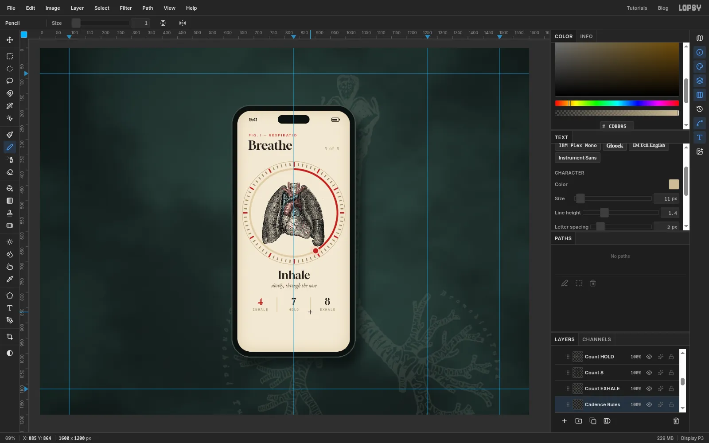

Start every piece of type from `Battery A`, and centre each one horizontally on the point given. The three counts are spaced 110 px apart, a third of the screen each, so the rules can fall exactly halfway between them.

1. `Inhale` in **Gloock**, size `36`, `#221E1A`, centred on x `830` with its top at y `728`.
2. `slowly, through the nose` in **IM Fell English Italic**, size `18`, `#6E6150`, centred on x `830` at y `770`.
3. Three counts in **Gloock**, size `30`, with their tops at y `818`: `4` in `#B3342B` centred on x `720`, then `7` on x `830` and `8` on x `940` in `#221E1A`.
4. Under them, `INHALE`, `HOLD` and `EXHALE` in **IBM Plex Mono**, size `11`, `#8A7A5C`, letter spacing `2`, at y `852`.
5. Add a layer called `Cadence Rules`. Pick the **Pencil** ([[N]]), **Size** `1`, colour `#CDBB95`. Click at `775, 816`, then [[Shift]]-click at `775, 864` to draw a straight rule. Draw a second one at x `885`.

The current phase is the only red number, so you can see at a glance where you are in the cycle.

## Make the Begin button

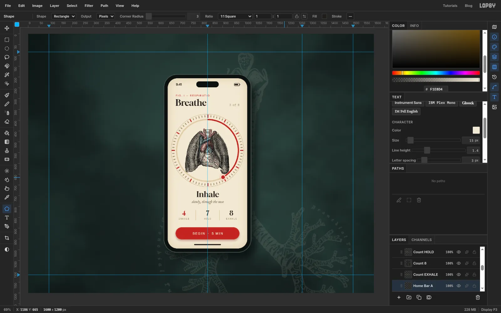

1. Click `Cadence Rules` and add a layer called `Button A`. Create a **296 × 56** rectangle at `830, 924` with **Corner Radius** `28` and fill `#B3342B`.
2. Turn on **Drop Shadow** (**Offset X** `0`, **Offset Y** `6`, **Blur** `14`, **Opacity** `35`, colour `#5A1712`) and **Inner Glow** (**Size** `10`, **Opacity** `30`, colour `#F08A70`). The inner glow gives the pill a slight lift.
3. Type `BEGIN · 5 MIN` in **Instrument Sans SemiBold**, size `15`, colour `#F1E8D4`, letter spacing `3`. Centre it on the pill, both ways.
4. Add a layer called `Home Bar A` and create a **124 × 5** rectangle at `830, 976` with **Corner Radius** `3` and fill `#221E1A`.

The label is all capitals, so no letter hangs below the baseline. That means the visible letters are the whole box, and centring them on the pill centres them optically too. A label like *Begin* would need nudging up a pixel or two, because the *g* drags its box down.

## Build the second phone

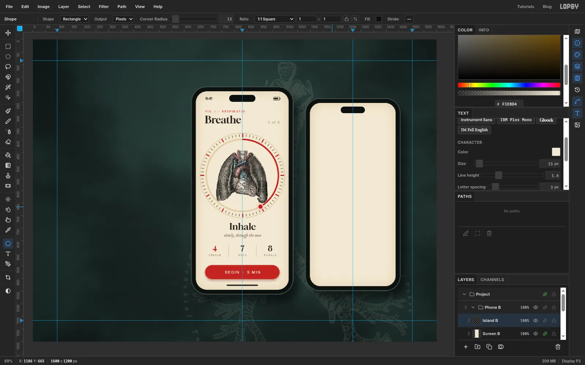

1. Click the arrow on the `Phone A` row to collapse it, then click the row and press **New Group**. Name the new group `Phone B`. Because `Phone A` is collapsed, the new group lands beside it, not inside it.
2. Build the phone the same way as the first, centred on `1268, 616`: a **372 × 760** body with **Corner Radius** `56`, and a **340 × 728** screen with **Corner Radius** `42`. Give it the same Add Noise and effects.
3. Add a **96 × 26** island with **Corner Radius** `13` at `1268, 280`.

It's built upright. You'll tilt it once everything is on it.

## Clear the labels from the vagus nerve

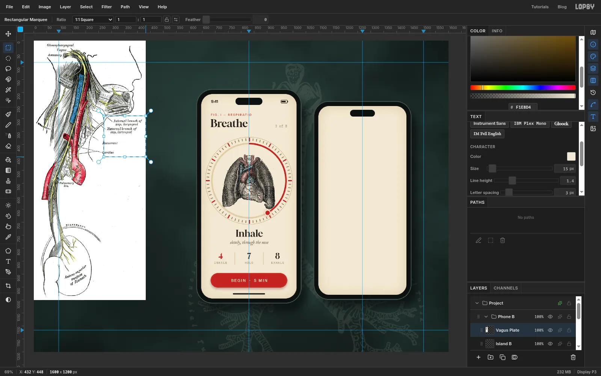

1. Click `Island B` and drag **Gray793.png** onto the canvas. Rename it `Vagus Plate`.
2. The branch names (*Internal branch of sup. laryngeal* and the rest) are stacked to the right of the neck. Drag a **Rectangular Marquee** around that column and press [[Delete]].
3. Do the same for *Glossopharyngeal*, *Vagus* and *Accessory* at the top left. Use three small marquees and stop each one short of the nerve. Press [[Cmd+D]].

At phone size these labels would be grey specks. They'd look like dirt, not lettering.

## Scale it and multiply it in

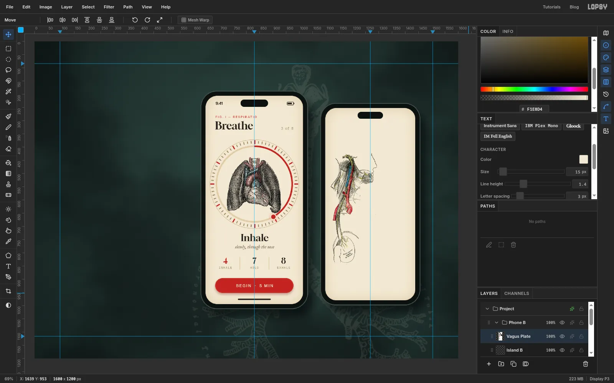

1. [[Cmd]]-click the thumbnail, pick the **Move** tool, and [[Cmd]]-drag the bottom-right handle in until the engraving is about **186 px wide** (43%). Press [[Cmd+D]].
2. Move it so its top-left corner sits at `1114, 414`, on the left of the screen.
3. Set the blend mode to **Multiply**.

The nerve now runs from the base of the skull, past the heart, to the stomach. The stomach is more than this screen needs.

## Fade the stomach out with a gradient mask

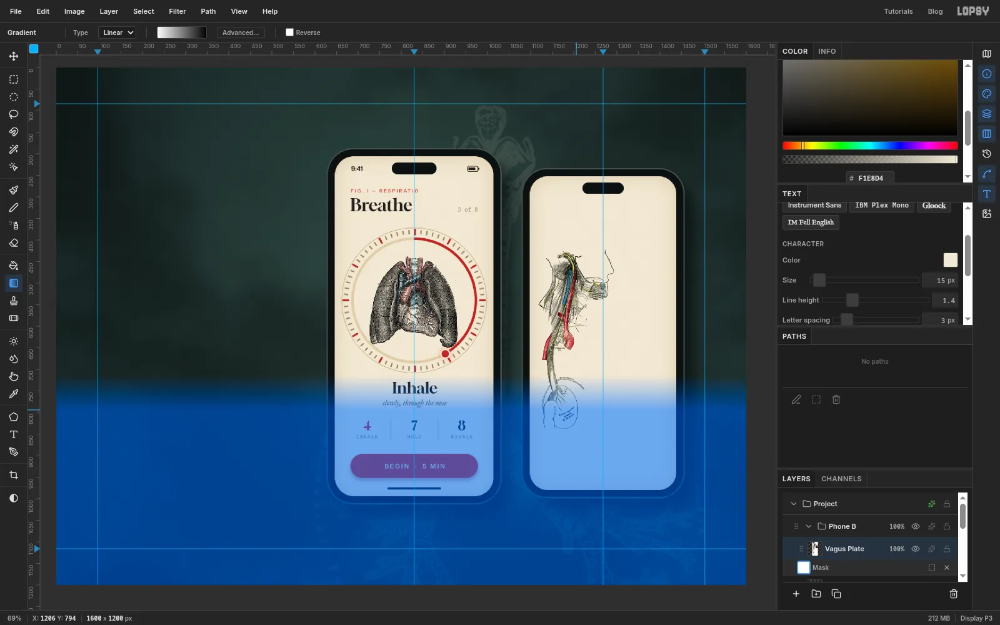

1. Click **Add Mask** at the bottom of the Layers panel.
2. Click the new mask's thumbnail (**Edit mask for Vagus Plate**). This step matters. **Add Mask** leaves the layer's pixels as the paint target, so a stroke straight away would paint over the engraving itself.
3. Pick the **Gradient** tool, set **Type** to **Linear**, and in **Advanced…** set white on the left and black on the right.
4. [[Shift]]-drag from about `1206, 714` (just under the heart) down to `1206, 794`.
5. Click the `Vagus Plate` row to leave mask edit mode.

The blue overlay shows what the mask hides. A gradient fade like this is clean and even. If you paint a fade with a soft brush instead, you'll usually see the strokes.

## Add the readings

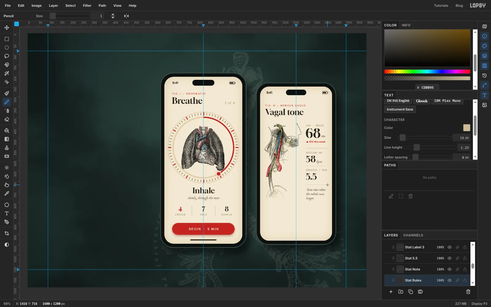

Start with the top of the screen, the same way as on the first phone. Click `Island B` and add an empty layer called `Battery B` to type from.

- `9:41` in **Instrument Sans SemiBold** size `15`, `#221E1A`, starting at `1128, 275`, and a battery like the first one centred at `1404, 281`.
- `FIG. II — NERVUS VAGUS` in **Instrument Sans Medium** size `11`, `#B3342B`, letter spacing `3`, at `1124, 338`.
- `Vagal tone` in **Gloock** size `38`, `#221E1A`, at `1122, 356`.

The readings column starts at x `1316`, just clear of the engraving's profile. The labels are `#8A7A5C`, the numbers `#221E1A` and the units `#6E6150`.

1. `HRV · RMSSD` in **IBM Plex Mono**, size `11`, `#8A7A5C`, letter spacing `1`, at y `432`.
2. `68` in **Gloock**, size `58`, `#221E1A`, at y `450`. Put `ms` in **IM Fell English Italic** size `20` just after it, sitting on the same baseline.
3. `▲ 12% this week` in **Instrument Sans SemiBold**, size `12`, `#B3342B`, about 14 px under the number.
4. `RESTING HR` at y `560`, `58` in **Gloock** size `40` with its top at y `578`, and `bpm` in the italic beside it on the same baseline.
5. `BREATHS / MIN` at y `642`, then `5.5` in **Gloock** size `40` with its top at y `660`.
6. `Tone rises when`, `the exhale runs`, `longer.` on three lines (press [[Enter]] between them) in **IM Fell English Italic**, size `16`, `#5E5242`, **Line height** `1.25`, at y `732`.
7. Add a layer called `Stat Rules` and draw three 100 px **Pencil** rules in `#CDBB95` at y `544`, `626` and `716`, starting at x `1316`.

The engraving and the numbers sit side by side, so the drawing works like a figure beside the text it illustrates.

## Make graph paper with a pattern

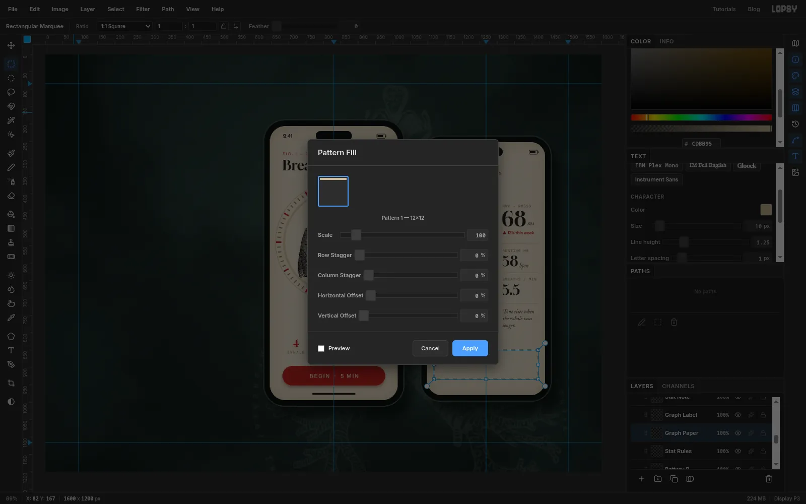

1. Type the chart title `HRV · LAST 7 NIGHTS` in **IBM Plex Mono** size `10`, `#8A7A5C`, letter spacing `1`, at `1118, 828`.
2. Add a temporary layer called `Grid Tile`. Somewhere empty, draw a short vertical and a short horizontal **Pencil** line (**Size** `1`, `#CDBB95`) that cross. Make a 12 × 12 marquee whose top-left corner sits on the crossing, and choose **Edit → Define Pattern**. Then delete the `Grid Tile` layer.
3. Add a layer called `Graph Paper`, drag a marquee from `1118, 850` to `1418, 934`, choose **Edit → Fill with Pattern…** and click **Apply**. Press [[Cmd+D]].
4. Draw a **Pencil** baseline across the bottom of the grid, from `1118, 934` to `1418, 934`, in `#8A7A5C`.

Patterns only last for the session, so define this one when you need it and don't reload in between.

## Draw the trace with the Pen

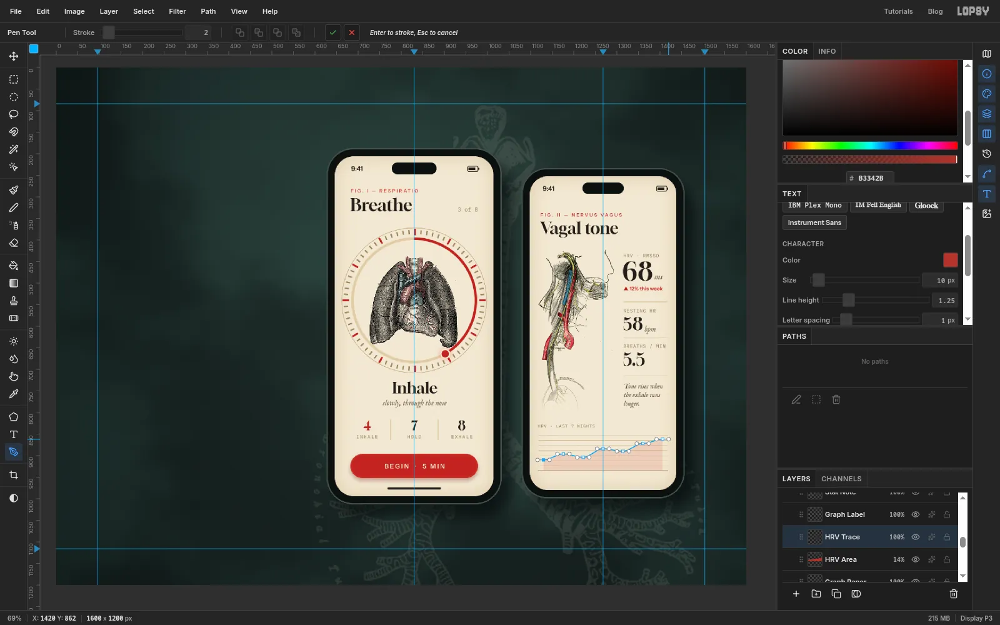

The chart has seven nights, rising overall. The points are at x `1130`, `1176`, `1222`, `1268`, `1314`, `1360` and `1406`, with y `910`, `896`, `904`, `884`, `890`, `872` and `862`.

1. Add a layer called `HRV Area`. With the **Lasso**, drag from the baseline under the first point up through all seven points and back down to the baseline under the last one. It only needs to sit under the line, because the trace will cover its top edge. Fill with `#B3342B`. Press [[Cmd+D]] and set the layer to `14%`.
2. Add a layer called `HRV Trace`. Pick the **Pen** tool ([[P]]), set **Stroke** to `2` and the foreground to `#B3342B`.
3. At each point in turn, press and drag about 14 px to the right before letting go. The drag pulls out handles, so the line bends smoothly through each point instead of turning a sharp corner.
4. Press [[Enter]]. The path is saved in the Paths panel and stroked onto the layer in red.

## Copy and paste the data points

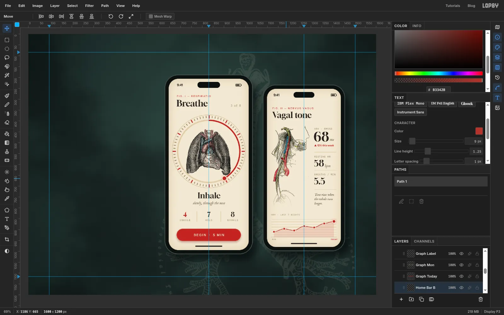

1. A selected path stays drawn on the canvas whatever tool you pick. Open the **Paths** panel and click `Path 1` to deselect it.
2. Add a layer called `HRV Dots` and make a **10 × 10** ellipse on the first point, with fill `#B3342B` and a `#F1E8D4` stroke at **Width** `2`.
3. [[Cmd]]-click its thumbnail and press [[Cmd+C]], then [[Cmd+D]]. Press [[Cmd+V]]. The copy pastes in place as a new layer, so drag it onto the second point and choose **Layer → Merge Down**. Repeat for the next four points.
4. For the last night, add a layer called `Today Dot` with a **15 × 15** dot, a **3** px rim and an **Outer Glow** (**Size** `14`, **Opacity** `55`, `#D9604F`).
5. Label the ends: `MON` in `#8A7A5C` and `TODAY` in `#B3342B`, both **IBM Plex Mono** size `9`, centred under the first and last points.
6. Add a **120 × 5** home bar at `1268, 964`.

## Set the title and colour one line of it

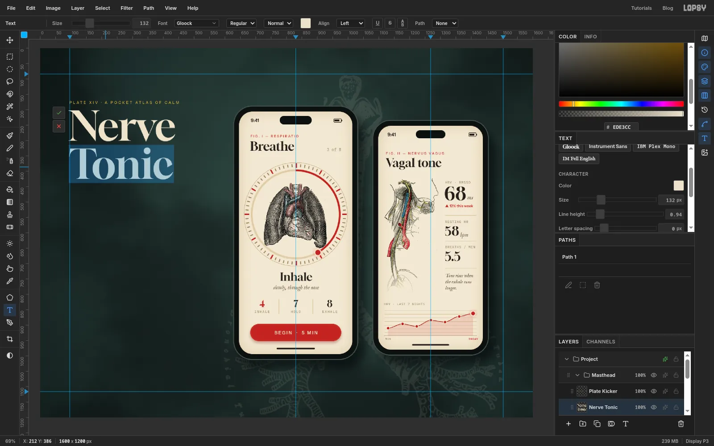

1. Collapse both phone groups, click `Phone B`, and make a **New Group** called `Masthead`. Inside it, add an empty layer called `Masthead Anchor` and start every piece of type from it.
2. Type `PLATE XIV · A POCKET ATLAS OF CALM` in **Instrument Sans Medium**, size `12`, `#D8B54A`, letter spacing `4`, starting at `96, 172`.
3. Type `Nerve`, press [[Enter]], and type `Tonic`, in **Gloock**, size `132`, `#EDE3CC`. Set **Line height** to `0.94`, so the two words lock together like a wordmark. Place it at `92, 202`. That's 4 px left of the margin, so the N's serif, not its box, lines up with the column.
4. With the **Text** tool, click the title once to start editing, then click on *Tonic* to put the cursor in that line. Press [[End]], then [[Shift+Home]] to select the whole line.
5. Click the **Text color** swatch in the options bar, enter `#D8B54A`, and click the swatch again to close it. Only *Tonic* turns gold. Click the ✓ to commit.

Recolouring part of the text keeps the title as one layer, so the two words keep their spacing if you resize it later.

## Write the subtitle, blurb and key

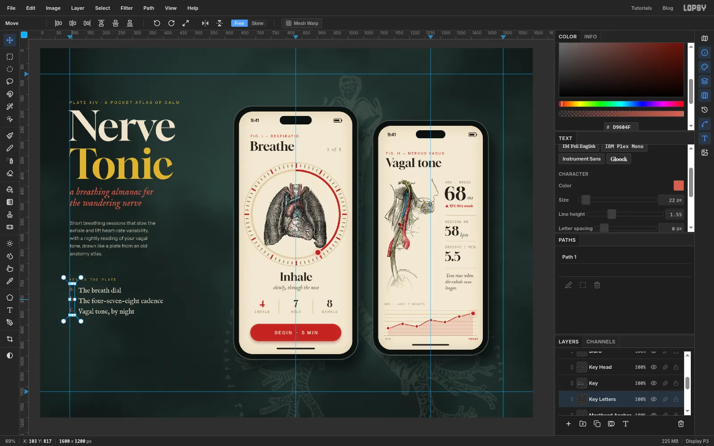

1. `a breathing almanac for` / `the wandering nerve` in **IM Fell English Italic**, size `32`, `#D9604F`, **Line height** `1.15`, at `96, 452`.
2. The blurb in **Instrument Sans** size `16`, `#C9C0AA`, **Line height** `1.55`, at `96, 562`, broken into short lines with [[Enter]]: *Short breathing sessions that slow the / exhale and lift heart-rate variability, / with a nightly reading of your vagal / tone, drawn like a plate from an old / anatomy atlas.*
3. `KEY TO THE PLATE` in **IBM Plex Mono** size `11`, `#D8B54A`, letter spacing `3`, at `96, 748`.
4. The key in two text layers, so the entries share a left edge however wide each letter is. Put `The breath dial` / `The four-seven-eight cadence` / `Vagal tone, by night` in **IM Fell English** size `22`, `#EDE3CC`, **Line height** `1.55`, at `124, 778`. Put `a.` / `b.` / `c.` in the same font, size and line height, in `#D9604F`, at `96, 778`.

The key spells out *four-seven-eight* in words. IM Fell English has old-style figures, which sit at different heights, and next to the lining numbers on the phone they'd look like a mismatch.

## Add the badge and the footer

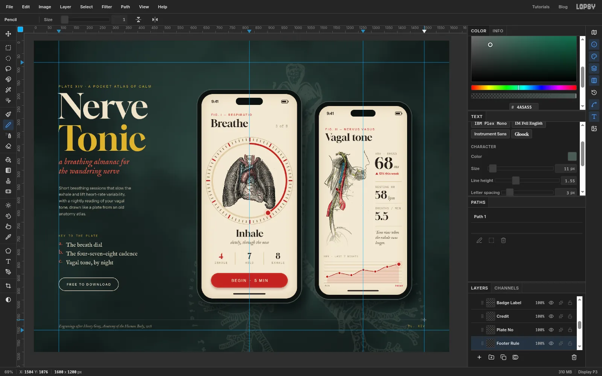

1. Add a layer called `Badge`. Pick the **Shape** tool: **Rectangle**, **Corner Radius** `25`, no fill, `#EDE3CC` stroke at **Width** `1.5`. Press at `211, 939` and drag out to `326, 964`. The shape grows from where you pressed, so this gives a pill from x `96` to `326`, on the left margin.
2. Type `FREE TO DOWNLOAD` in **Instrument Sans SemiBold** size `12`, `#EDE3CC`, letter spacing `3`, and centre it on the pill both ways.
3. Credit the engravings: `Engravings after Henry Gray, Anatomy of the Human Body, 1918` in **IM Fell English Italic** size `15`, `#9C9580`, at `96, 1094`. Then `PL. XIV` in **IBM Plex Mono** size `11`, `#D8B54A`, letter spacing `3`, with its right edge at `1504`.
4. Add a layer called `Footer Rule` and draw a **Pencil** line from `96, 1076` to `1504, 1076` in `#4A5A55`.

## Tilt the second phone

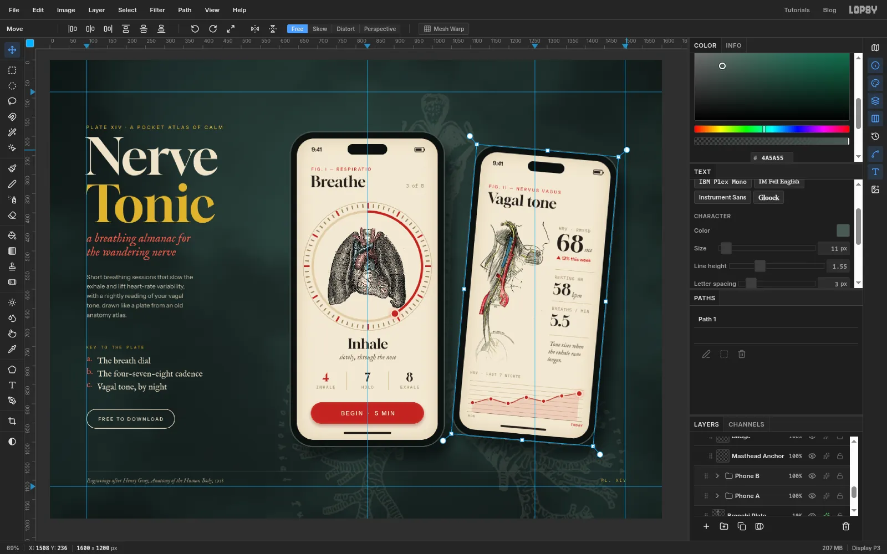

1. Press [[Cmd+D]] so nothing is selected. Click the `Phone B` group row and pick the **Move** tool. The transform box wraps everything in the group: the body, its shadow, the screen, the engraving and all the type.
2. Hover just outside the top-right corner until the pointer turns into a curved arrow, then drag down to rotate the group about **5°** clockwise. Press [[Enter]] to commit.
3. If you overshoot, [[Cmd+Z]] puts the whole group back upright in one step. Rotate again.

The tilt is what makes the board feel like objects on a table rather than a flat screenshot. Keep it small. Past 8° or so the second phone starts to look as if it's falling over.

## Letter the callouts

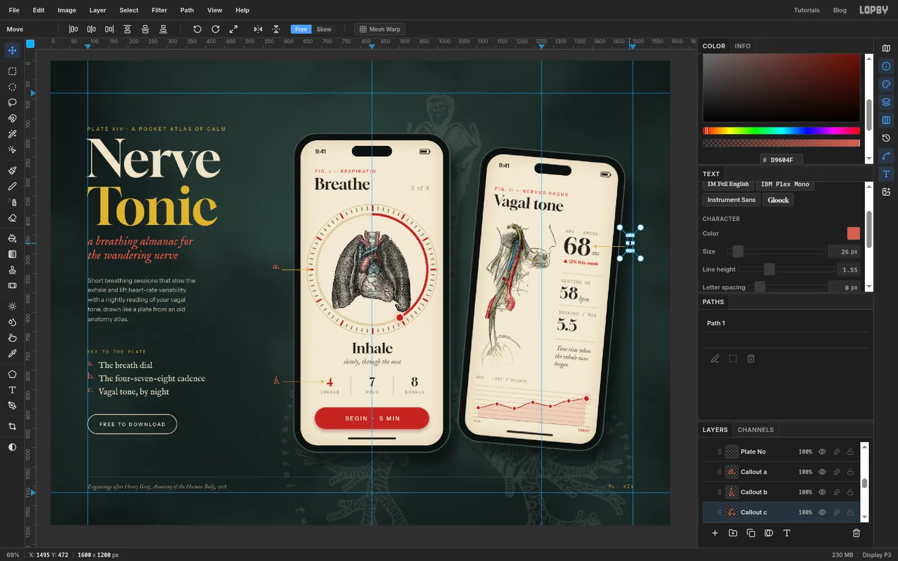

This is the anatomy-plate trick: letter the parts and tie them to the key. The **a** and **b** leaders start just inside the gap left of the first phone, and **c** comes in from the right margin. Each one ends a few pixels short of the thing it points at, so the dot doesn't touch it.

1. Click `Footer Rule` and add a layer called `Leaders`. Pick the **Pencil**, **Size** `1`, colour `#D8B54A`. Draw three straight lines with click and [[Shift]]-click:
   - **a**: from `598, 540` to `668, 540`, ending on the dial's left edge
   - **b**: from `598, 829` to `702, 829`, ending just short of the red 4
   - **c**: from `1484, 472` to just right of the *68* on the tilted phone (about `1420, 472`)
2. Add a layer called `Leader Dots` and put a **7 × 7** `#D8B54A` ellipse on the inner end of each line.
3. Type `a.`, `b.` and `c.` in **IM Fell English Italic** size `26`, `#D9604F`. Put **a** and **b** just left of their lines, with their right edges at x `590`, and **c** just right of its line at x `1490`. Centre each one vertically on its line.

Keep the leaders dead straight and horizontal, and keep every letter inside the margins. Engravers' leaders never curve, and that's half of what makes the plate look precise.

## Add a vignette and print grain

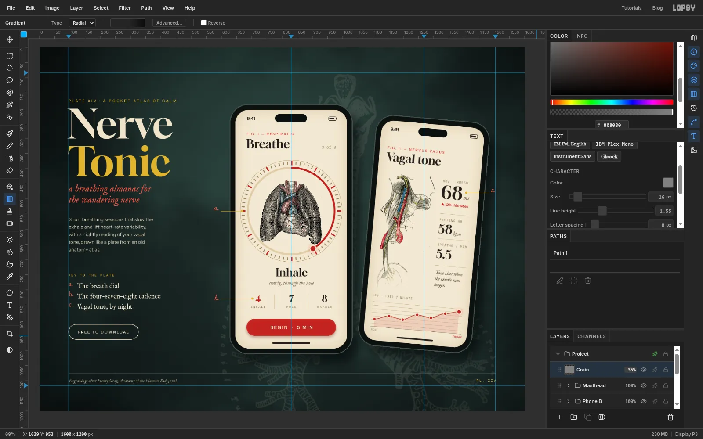

1. Click `Bronchi Plate` and add a layer called `Vignette`. Pick the **Gradient** tool, set **Type** to **Radial** and open **Advanced…**. Click under the ramp at about 55% to add a third stop. Click each stop and set it to black, then drag the picker's opacity strip: `0%` for the left and middle stops, `75%` for the right one. The middle 55% stays clear and the edges darken. Drag from `880, 600` out past the bottom-right corner, and set the layer to `70%`. It sits under the phones, so only the backdrop darkens.
2. Collapse the `Masthead` group, click its row, and click **Add Layer** so the new layer lands above the group, at the top of the stack. Name it `Grain`. Choose **Select → All**, fill with `#808080`, press [[Cmd+D]], and run **Add Noise** with **Amount** `18`, **Mono** and **Gaussian**. Set it to **Overlay** at `35%`.

The grain covers the phones too, which pulls the crisp UI and the old engravings into the same printed surface.

## Line up the key's baselines

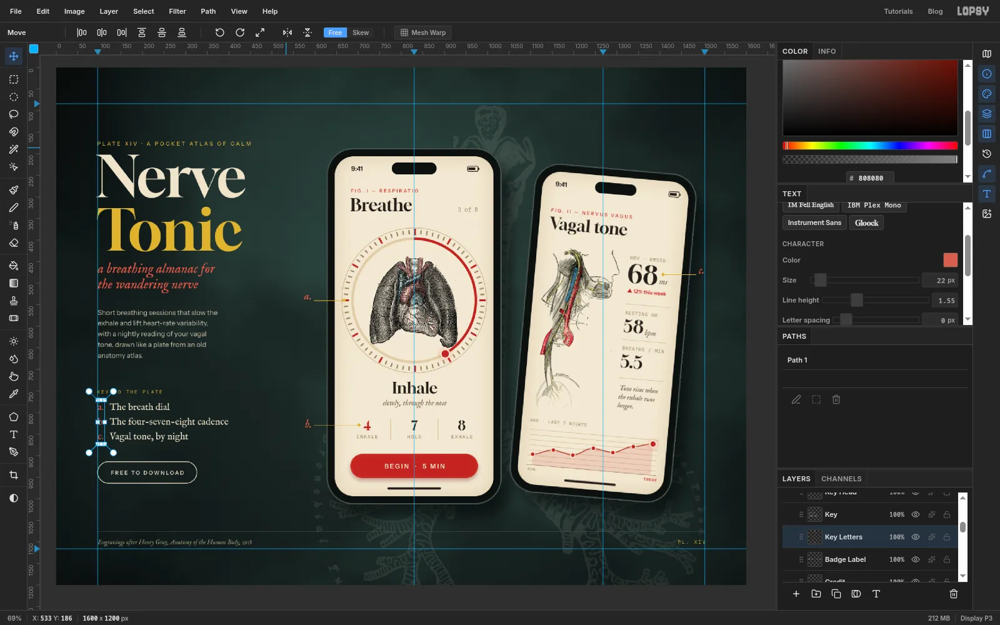

Zoom in on the key. Two text layers placed by their top edges won't always share baselines, because each layer's box is cropped to its own letters. Here the letters sat about 6 px high.

1. Click the `a. b. c.` layer and pick the **Move** tool.
2. Press [[Down]] until the bottom of the *a.* sits on the same line as the bottom of *The breath dial*. Here that took six presses.

Check the other two lines as well. Because the two layers share a font, size and line height, getting the first line right fixes all three.

## Export

Turn the guides off with **View → Show Guides**, then choose **File → Quick Export PNG** for the board and **File → Save Project** to keep every layer, mask and effect editable.

To present the other screens of the app, duplicate `Phone B`, replace the engraving (Gray's has plates for every organ), and change the readings. The backdrop, key and callout style will tie a whole series of boards together.
