Anti-aesthetic design goes after ugliness on purpose: clashing colours, type stretched out of shape, flash photography that flattens everything, and the leftovers of a 1970s kitchen. The joke only works if every ugly choice is plainly deliberate, so the hard part is keeping the craft tidy underneath it.

This tutorial makes the one-sheet for **Boiled Onion**, an imaginary slow-cinema film in which an onion is boiled for three hours and twelve minutes. The poster borrows the look of the 1970s diet recipe cards that famously made food look grim. There's swirling wallpaper, a wipe-clean gingham cloth, a fancy plate holding something sad, and credits typed onto an index card.

You'll learn:

- Making two seamless **patterns** and laying one into perspective with **Distort**
- Cutting out photos with the **Elliptical Marquee** and the **Lasso**
- Retouching a photo with a feathered patch, **Clone Stamp**, local **Hue/Saturation** and blur
- Slumping the onion with **Liquify**
- Stretching type like old WordArt, and setting text on a curved **Pen** path
- Rotating whole **groups** with live text inside, and a root **Color Grading** adjustment

The document is **2400 × 3600 px**, a 2:3 one-sheet.

Lopsy names a text layer after its first few characters and a pasted layer **Pasted Layer**. The screenshots show the rows renamed (double-click a name to rename it) to things like **Showing**, **Facts** or **3 Hours**, so the Layers panel is easier to follow. Rename yours the same way if you like. The steps only depend on the names they ask you to give.

Both photos are free to use, from Wikimedia Commons:

- [Hard-to-peel onion skin](https://commons.wikimedia.org/wiki/File:Hard-to-peel_onion_skin.jpeg), CC0. A big yellow onion, half peeled, glistening.
- [Dinner Plate, 1955.121](https://commons.wikimedia.org/wiki/File:Unknown_artist_-_Dinner_Plate_-_1955.121_-_Cleveland_Museum_of_Art.jpg), Cleveland Museum of Art, CC0. A gold-banded plate with a blue monogram.

Download them at full size. Lopsy fits a dropped photo to the page width, so you don't need to crop them first.

The fonts are free Google Fonts, chosen to look like defaults or cheap 70s display faces:

- **Caprasimo**, a fat Cooper Black-style serif, for ONION and the card title
- **Arimo** (Arial) for BOILED, the bars, the plate rim and the clipping's credits
- **Tinos** (Times) Italic for the review quotes
- **Cousine** (Courier) for the typed recipe
- **Comic Neue** (Comic Sans) for the sticker

The palette:

- Wallpaper `#8A8A2B`, `#6F7420`, `#D29A1E`, `#4E2316`, `#E5816A`
- Gingham `#F2E6C4`, `#EDB4A0`, `#E5816A`
- ONION `#FFE27A` → `#D29A1E` → `#C8431E` → `#E5816A`
- Ink and outlines `#4E2316`
- Cream type `#F2E6C4`
- Sticker yellow `#FFE600`, sticker red `#C8101E`
- Recipe card `#F4EACB` with rules `#7FB6C2`
- Dishwater `#BDB57E`

## Make the wallpaper tile

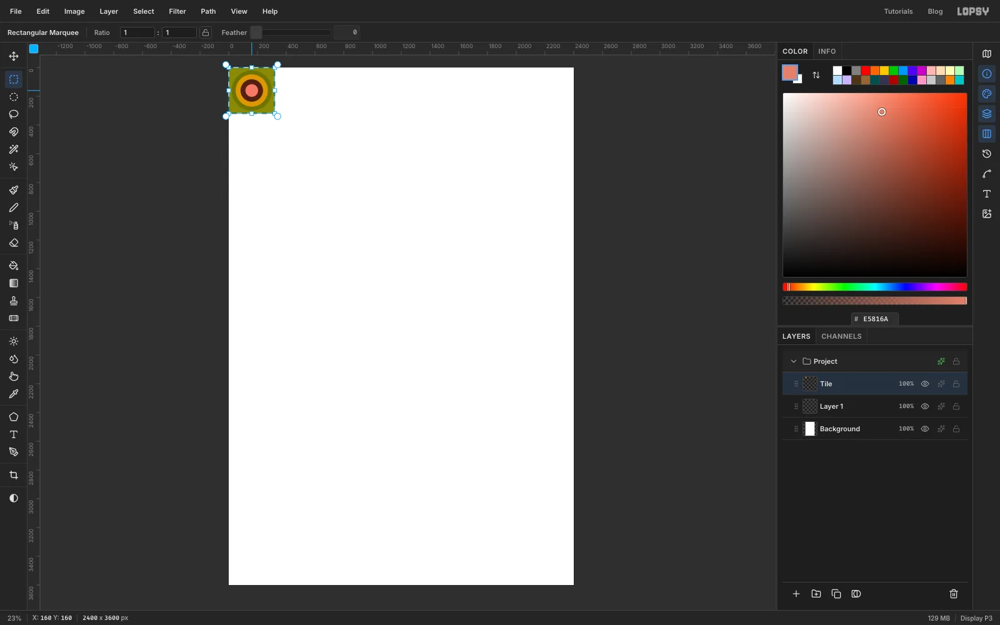

Choose **File → New**, set **Width** to 2400 and **Height** to 3600 pixels, and click **Create**. Click **Add Layer** (+) in the Layers panel and double-click the new layer's name to rename it **Tile**. (The empty **Layer 1** that comes with a new document isn't used. You can leave it or delete it.)

The tile is built from exact squares and circles. With nothing selected, a single click (no drag) with a marquee tool opens a box where you can type the corners.

1. Press [[M]] for the Rectangular Marquee and click once on the canvas. Type **From** 0, 0 and **To** 320, 320, and press Enter. Set the foreground colour to `#8A8A2B` and choose **Edit → Fill**.
2. Press [[⌘D]], pick the **Elliptical Marquee** from the toolbox, and click once. Every circle is centred on 160, 160. Make one 280 px across (From 20, 20 To 300, 300) and fill it `#6F7420`.
3. Press [[⌘D]] before each new circle. Fill a 224 px circle (48 to 272) with `#D29A1E`, a 156 px circle (82 to 238) with `#4E2316`, and an 88 px circle (116 to 204) with `#E5816A`.
4. Select the whole square again (0, 0 to 320, 320 with the Rectangular Marquee) and choose **Edit → Define Pattern**.

Press [[Delete]] and [[⌘D]] to clear the tile for the next one.

## Make the gingham tile

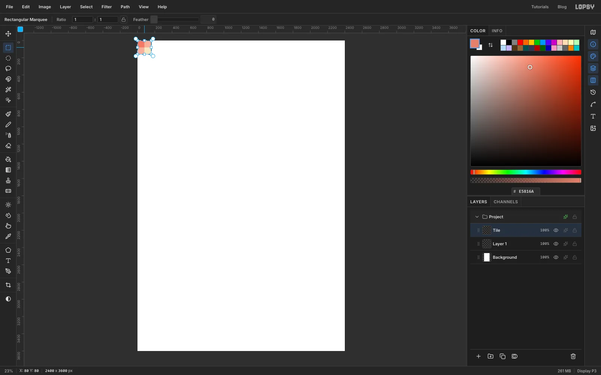

Gingham is two sets of see-through stripes crossing, so one square has three tones: the background, the single-stripe colour and the darker crossing. On the same **Tile** layer, use the click-once Rectangular Marquee and press [[⌘D]] between each fill:

1. 0, 0 to 160, 160: `#F2E6C4` (the cream background)
2. 0, 0 to 80, 160: `#EDB4A0` (a vertical stripe)
3. 0, 0 to 160, 80: `#EDB4A0` (a horizontal stripe)
4. 0, 0 to 80, 80: `#E5816A` (where they cross)

Select 0, 0 to 160, 160, choose **Edit → Define Pattern**, then press [[Delete]] and [[⌘D]].

## Paper the wall

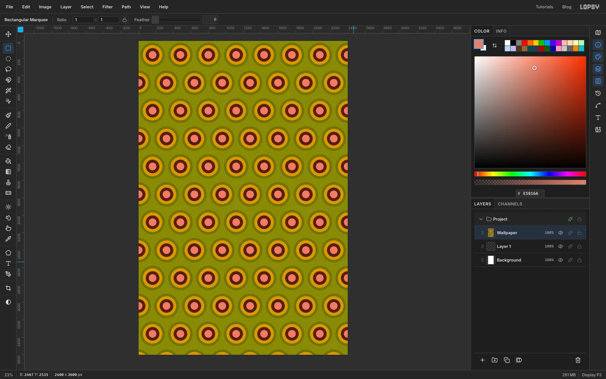

Rename the empty **Tile** layer to **Wallpaper**. Choose **Edit → Fill with Pattern…**, click the first swatch (the circles), set **Row Stagger** to 50 so alternate rows shift by half a tile, and click **Apply**.

It should look properly awful. Keep it, because the title will sit on it.

## Lay the tablecloth

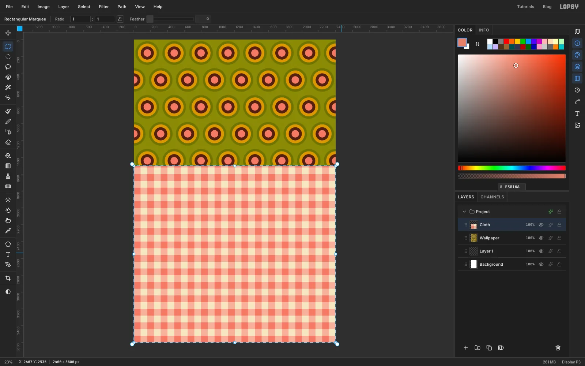

Click **Add Layer** and name it **Cloth**. With the Rectangular Marquee, click once and select from 0, 1500 to 2400, 3600. That's the full width, from 1500 px down to the bottom.

Choose **Edit → Fill with Pattern…**, pick the second swatch (the gingham), leave **Row Stagger** at 0, and click **Apply**. Keep the selection.

## Tip the cloth into perspective

Press [[V]] for the Move tool and click **Distort** in the options bar. Drag the bottom-left corner handle about 900 px straight out to the left, past the edge of the page, and the bottom-right handle the same distance to the right. Leave the top corners alone.

The checks now widen towards you, so the table seems to lie flat and run back to the wall. Click **Free** in the options bar to leave Distort, then press [[⌘D]]. The marquee outline stays on the original rectangle until you deselect.

## Drop in the plate

Click the **Cloth** row so the photo lands above it. Drag the plate photo from your desktop onto the canvas. Lopsy fits it to the page width on a new layer and selects it. Rename the layer **Plate** and press [[⌘D]].

## Cut the plate out

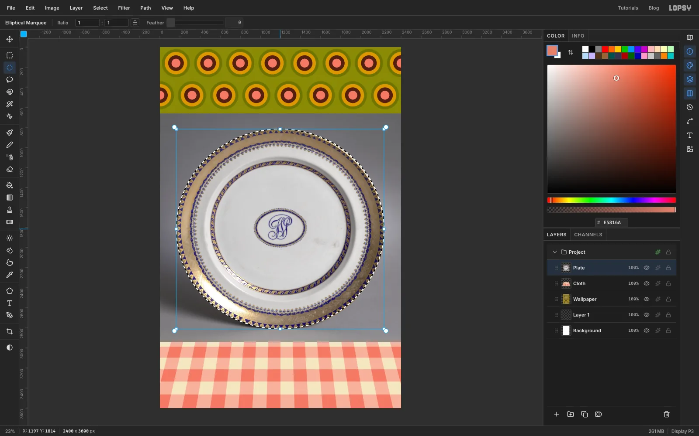

Pick the **Elliptical Marquee** and drag an ellipse that just touches the outside of the gold rim on all four sides. The plate in this photo is almost round, about 2070 px wide and 1990 px tall. If the marching ants cut into the gold anywhere, press [[⌘D]] and try again.

Choose **Select → Inverse**, press [[Delete]] to remove the grey backdrop, and press [[⌘D]].

## Lay the plate on the table

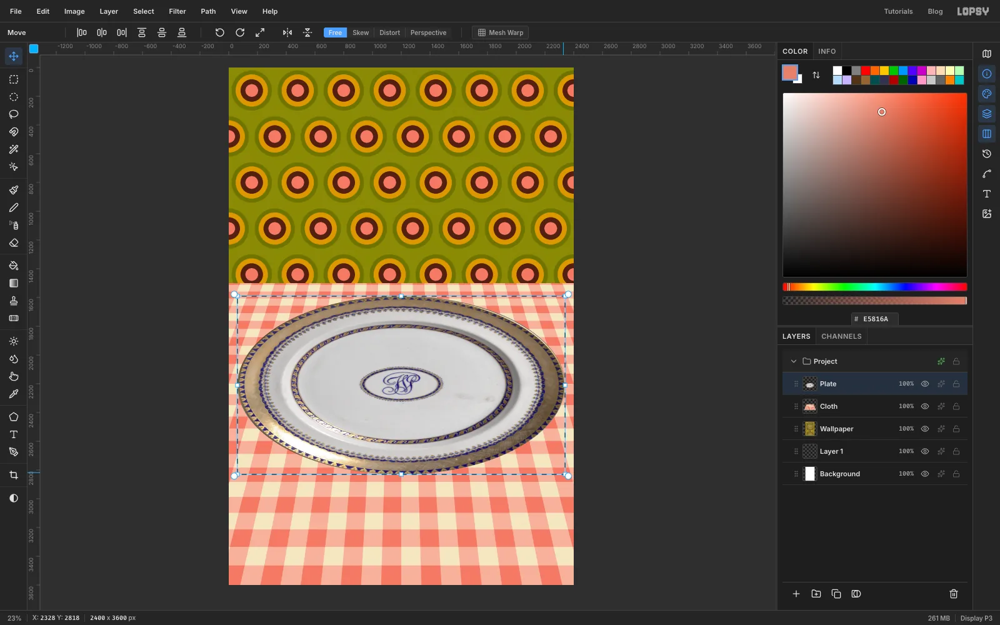

A plate on a table is seen at an angle, so it needs to be much wider than it is tall.

1. Draw a Rectangular Marquee tightly around the plate and press [[V]].
2. Drag the top-left corner handle down and slightly left, until the plate's top edge is just below the horizon at about 1590 px and its left edge is about 60 px from the page edge.
3. Drag the bottom-right handle out to about 60 px from the right edge and down to about 2830 px.

The plate is now the full width of the page and a little under two-thirds of its original height. Press [[⌘D]].

## Give the plate a flash shadow

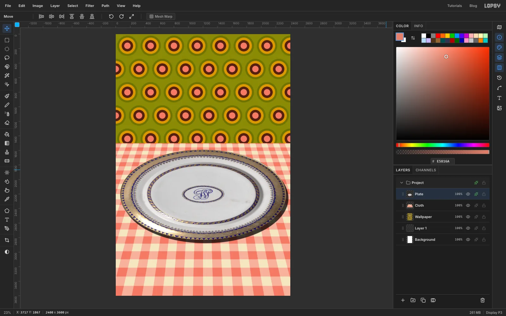

Cheap flash photography throws a hard shadow down and to one side. Click the effects button (the sparkle icon) on the Plate row to open the effects drawer. Tick **Drop Shadow** and set **Offset X** 34, **Offset Y** 46, **Blur** 6 and **Opacity** 75. Close the drawer.

## Drop in the onion

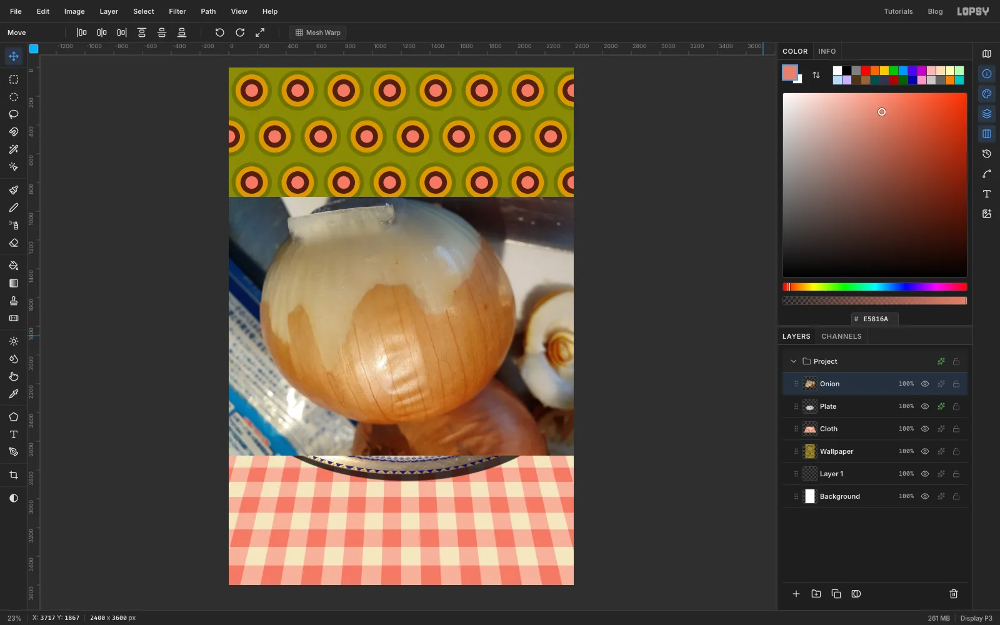

With **Plate** active, drag the onion photo onto the canvas. Rename the new layer **Onion** and press [[⌘D]].

The top of this onion has a torn flap of skin standing up, which will look like packing tape once the colour comes out. Paint it out before cutting the onion free.

## Patch over the torn flap

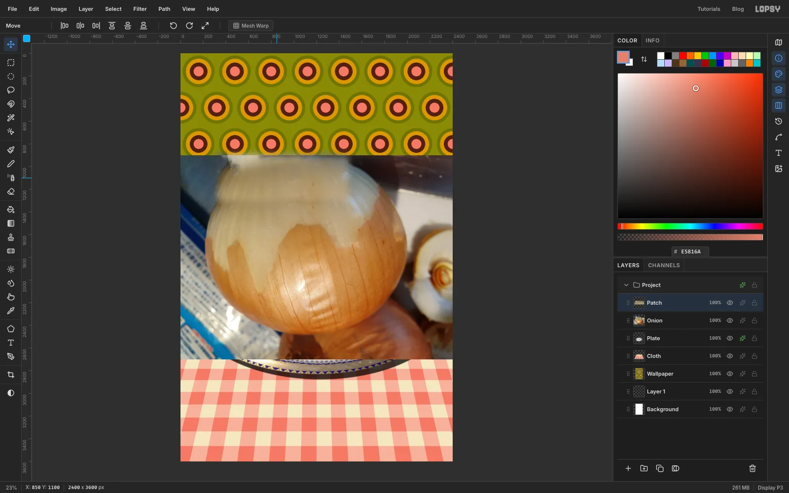

1. With the Rectangular Marquee ([[M]]), drag a wide box over the clean, smooth onion just below the flap. It should be a little wider than the flap and about 400 px tall.
2. Choose **Select → Feather…** and set it to 70, so the copy has soft edges.
3. Press [[⌘C]], [[⌘D]], then [[⌘V]]. The copy pastes in place on a new layer called **Pasted Layer**.
4. Press [[⌘D]], press [[V]], and drag the copy straight up by about 200 px (watch the ruler) until it covers the flap.
5. Choose **Layer → Merge Down**.

There's also a small brown speck just above the middle of the onion. Press [[S]] for the Clone Stamp and set **Size** to 60. `Option`-click clean skin just to the left of the speck to set the source, then paint a short stroke over it.

## Trace the onion

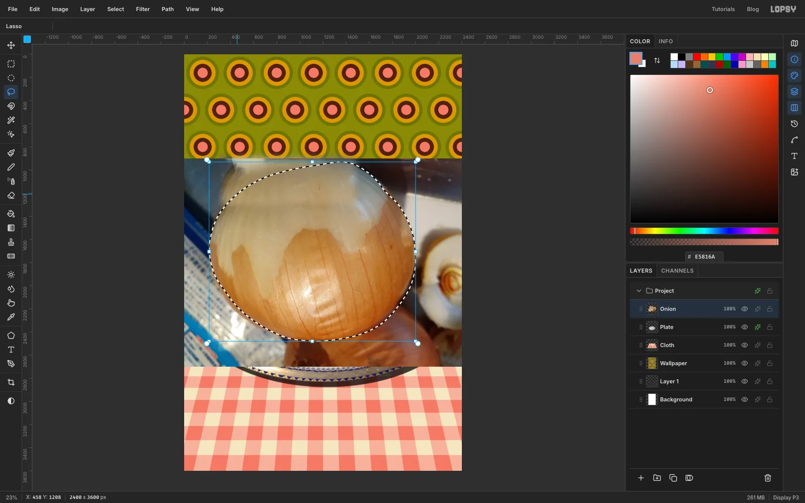

Press [[L]] for the Lasso. Trace around the onion in one smooth curve. Go over the crown where the patch now is, rather than in and out around the old flap, and keep inside the onion's edge so none of the dark background comes with it.

Choose **Select → Feather…** and set it to 2, just enough to soften the cut.

## Cut the onion free

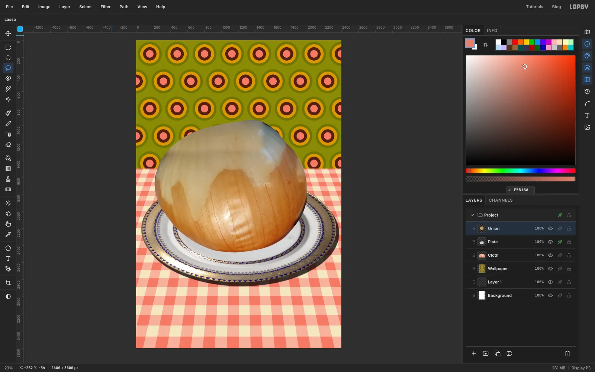

Choose **Select → Inverse**, press [[Delete]] and press [[⌘D]]. The packaging and the other onions are gone, and the onion sits on the plate.

## Boil the colour out of it

Choose **Filter → Hue/Saturation…** and set **Hue** 8, **Saturation** −46 and **Lightness** 8. Click **Apply**. The bright yellow becomes the grey-beige of a vegetable boiled for far too long.

## Even out the skin

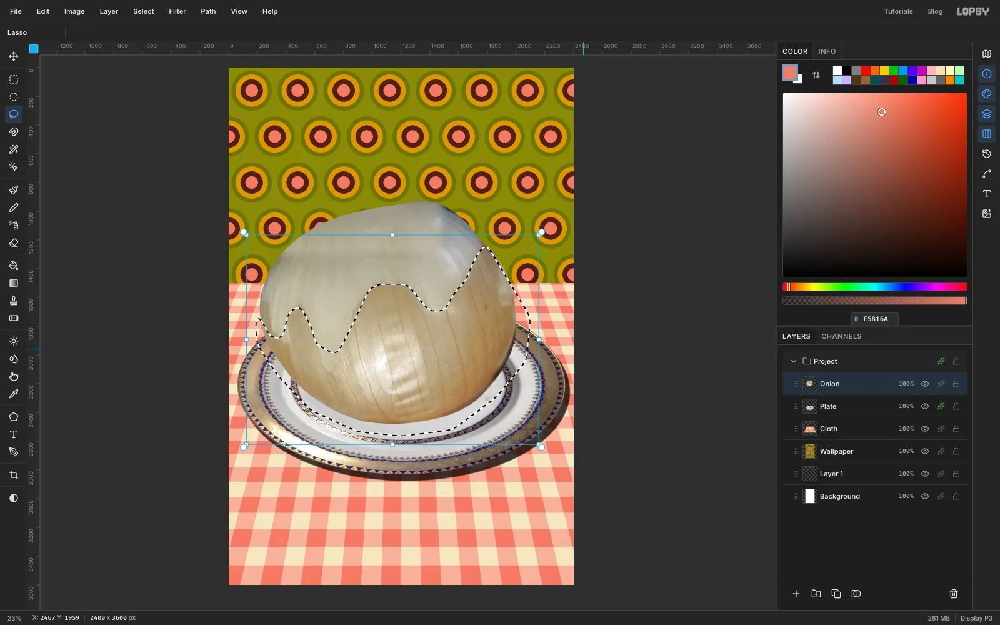

The unpeeled lower half is still darker and warmer than the peeled top, with a jagged line between them. A real boiled onion is one colour all over.

1. With the Lasso, draw loosely around the tan part. Follow the zigzag peel line along the top, and go wide around the bottom.
2. Choose **Select → Feather…** and set it to 60, so the change fades in over a wide band.
3. Choose **Filter → Hue/Saturation…** and set **Hue** 0, **Saturation** −35 and **Lightness** 16. Click **Apply**, then press [[⌘D]].

## Soften the leftovers

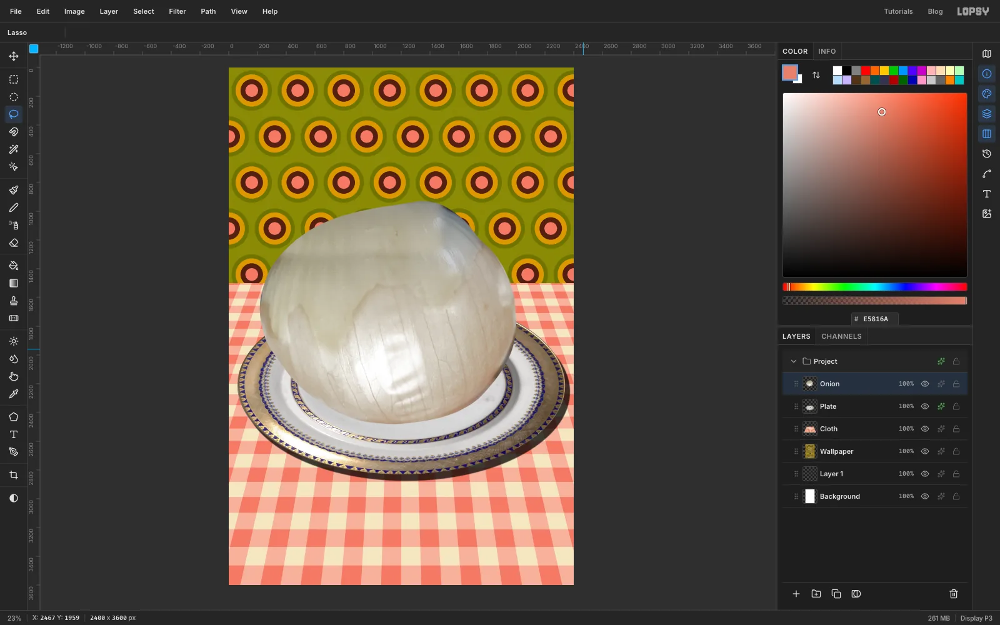

Two hard details still give the photo away: a faint ridge where the peel used to end, and a wrinkled reflection low in the middle.

1. Lasso a wide band across the onion that takes in the old peel ridge, from about 1430 px down to 1740 px. Feather it by 60, choose **Filter → Gaussian Blur…** with **Radius** 12, and press [[⌘D]].
2. Lasso an oval about 350 × 430 px around the wrinkled reflection low in the middle. Feather it by 50, run **Gaussian Blur** with **Radius** 14, and press [[⌘D]].

## Slump it with Liquify

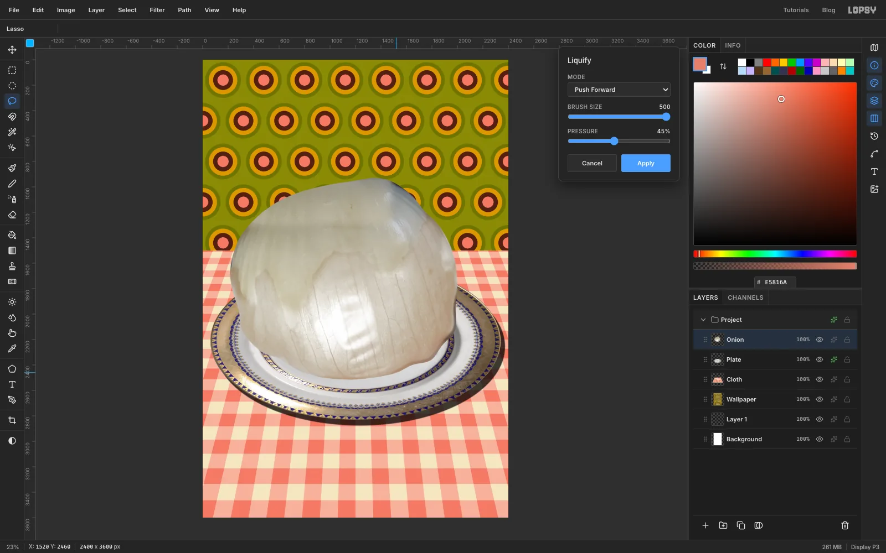

Choose **Filter → Liquify…**. Leave the mode on **Push Forward** and set **Brush Size** to 500 and **Pressure** to 45. Push the onion so it sags under its own weight:

1. Drag the lower-left shoulder about 200 px out to the left and down. Do the same again a little lower.
2. Mirror both drags on the lower-right shoulder.
3. Make five short drags, each about 90 px straight down, spaced evenly along the bottom edge. Keep them short and even, or the hem goes scalloped like a curtain.

Click **Apply**.

## Warm the crown

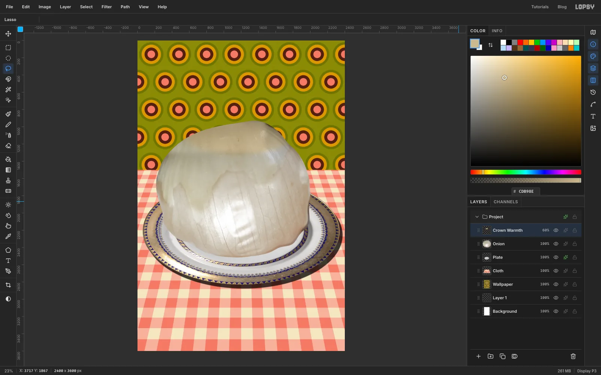

First, make it look wet. Press [[O]] for Dodge / Burn and set **Mode** to Dodge, **Exposure** 22 and **Size** 110. Make one short stroke down over the shine low on the front of the onion. Dodge shares its Size with the Brush, so check the Brush size when you next use it.

The patched crown is now cooler and greyer than the rest. To warm it:

1. Click **Add Layer** and name it **Crown Warmth**.
2. With the Lasso, draw a wide loose oval over the top third of the onion. Feather it by 80.
3. Set the colour to `#CDB98E` and choose **Edit → Fill**.
4. `⌘`-click the **Onion** thumbnail to load the onion's outline, and choose **Select → Inverse**.
5. Click the **Crown Warmth** row again, press [[Delete]] so the colour stays on the onion only, and press [[⌘D]].

Open the effects drawer (the sparkle icon on the row) and set **Blend** to **Color**. Then click the **100%** readout on the layer row and drag its slider to 60%.

## Pour in the water

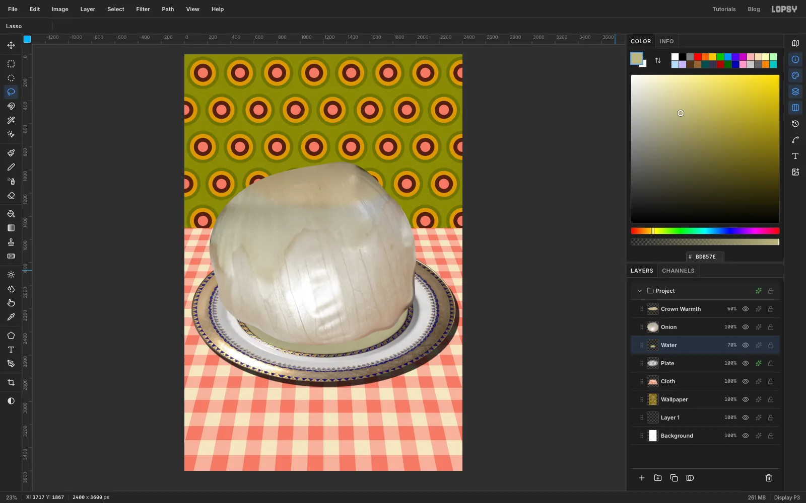

Click the **Plate** row and add a layer called **Water**. It sits above the plate and under the onion.

With the Elliptical Marquee, drag a smooth oval just inside the inner gold ring of the plate, centred under the onion. In the screenshots it's about 1460 px wide and 745 px tall. Feather it by 16, fill it with `#BDB57E`, and press [[⌘D]]. In the effects drawer's **Blend** menu choose **Multiply**, and set the opacity on the layer row to 70%. The water now tints the plate's pattern instead of covering it.

## Lay the onion's shadow on the plate

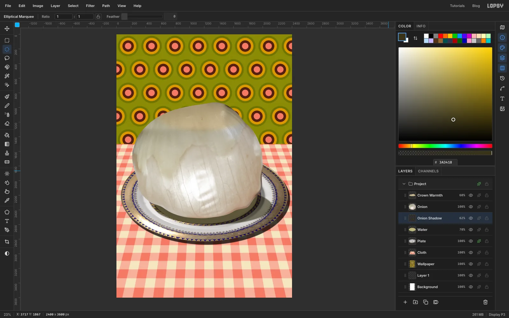

Add a layer called **Onion Shadow** above Water. With the Elliptical Marquee, drag a wide flat oval under the onion's base, about as wide as the onion and a quarter as tall. Shift it a little to the right, away from the flash.

Feather it by 10, fill it with `#3A3418` and press [[⌘D]]. Set it to **Multiply** at 62%. The shadow lies flat on the plate the way a flash shadow would.

## Add a meniscus and shade the underside

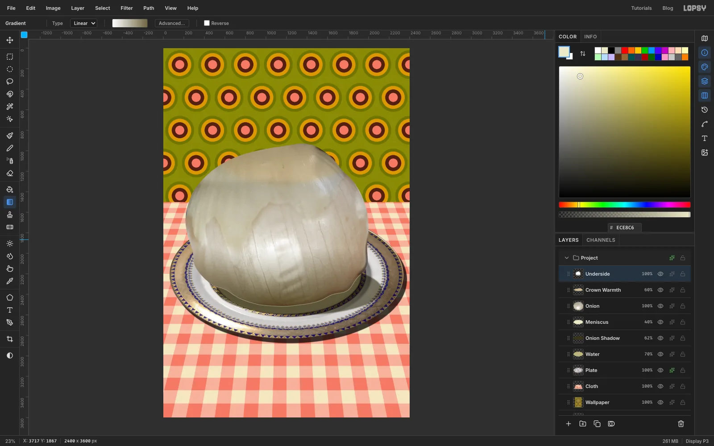

Liquid creeps up against anything standing in it, which makes a bright line where they meet.

1. Add a layer called **Meniscus**. `⌘`-click the **Onion** thumbnail, click the **Meniscus** row again, and choose **Select → Grow…** with 5.
2. Fill with `#ECE8C6`. Then `⌘`-click the **Water** thumbnail, choose **Select → Inverse**, click the **Meniscus** row and press [[Delete]], so the line only shows over the water. Press [[⌘D]].
3. Run **Gaussian Blur** with **Radius** 2 and set the layer to 40% opacity.

Next, shade the underside. Click the **Crown Warmth** row, `⌘`-click the **Onion** thumbnail, and add a layer called **Underside**. Pick the **Gradient** tool from the toolbox (it has no shortcut). Click **Advanced…** and set two stops, `#FFFFFF` and `#6F6642`. Drag straight down from just below the onion's middle (about 1950 px) to its bottom edge. Press [[⌘D]] and set the layer to **Multiply**.

## Stick a cherry in it

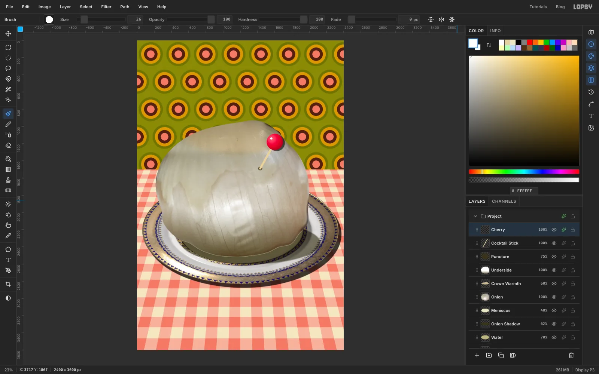

A 70s garnish makes it worse in exactly the right way.

1. With **Underside** active, add a layer called **Puncture**. Draw a small Elliptical Marquee, about 50 × 40 px, where the stick will go in on the onion's upper right. Feather it by 5, fill it with `#3A3418`, press [[⌘D]] and set it to 75%.
2. Add a layer called **Cocktail Stick**. Press [[B]] and set **Hardness** to 100 in the options bar. Set **Size** to 24 and the colour to `#E7D3A0`. Click on the puncture, then `Shift`-click about 330 px up and to the right.
3. Add a layer called **Cherry**. Draw a 190 px circle with the Elliptical Marquee at the top of the stick. Pick the Gradient tool, set it to **Radial**, and in **Advanced…** set the stops to `#FF6C7C`, `#D40F2F` at 45% and `#5F0515`. Drag from the ball's upper left to just past its lower right. Press [[⌘D]].
4. Run **Gaussian Blur** with **Radius** 2 to smooth the gradient. With the Brush at **Size** 26 and white, click once on the upper left for a highlight.
5. Give the Cherry layer a **Drop Shadow**: **Offset X** 22, **Offset Y** 12, **Blur** 4, **Opacity** 60.

## Set and stretch ONION

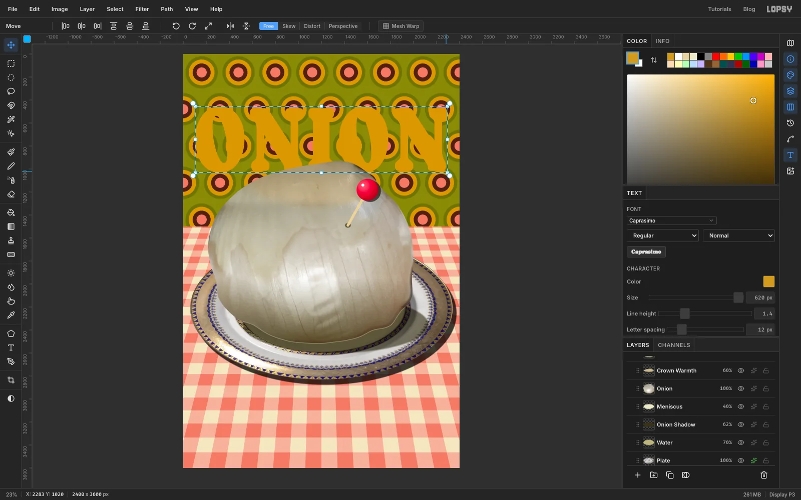

The title sits under the plate, so the onion's crown can overlap it. Click the **Cloth** row first, so the type lands above the cloth and under everything else.

1. Press [[T]]. In the options bar choose **Caprasimo**, size **620**, colour `#D29A1E`. Click near the left edge, a little below the top, type `ONION` and press [[Tab]].
2. Open the **Text** panel (the T button in the right-hand strip) and set **Letter spacing** to 12, so the serifs don't fuse.
3. Click **Rasterize Layer** (the T icon at the bottom of the Layers panel). The letters are now pixels you can stretch.
4. Draw a Rectangular Marquee tightly around the letters and press [[V]]. Drag the top-left handle out to about 105 px from the left edge, with its top at about 455 px on the ruler. Drag the bottom-right handle to 105 px from the right edge, at about 1030 px.

The letters fill the width with even margins, a little taller than the font intended. The onion's crown will overlap their feet. Press [[⌘D]].

## Colour ONION, then set BOILED

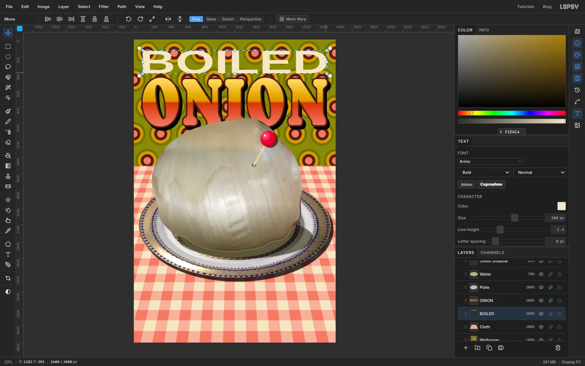

1. `⌘`-click the **ONION** thumbnail. Pick the Gradient tool, set it to **Linear**, and in **Advanced…** set four stops: `#FFE27A` at 0%, `#D29A1E` at 48%, `#C8431E` at 52% and `#E5816A` at 100%. The two middle stops are close together, so the colour snaps from yellow to red in a hard band, like airbrushed chrome. Drag from the top of the letters straight down to their feet. Press [[⌘D]].
2. In the effects drawer, tick **Stroke** with **Width** 18 and colour `#4E2316`. Tick **Drop Shadow** with **Offset X** 30, **Offset Y** 34, **Blur** 0 and **Opacity** 100.
3. Click the **Cloth** row again. Press [[T]], choose **Arimo**, size **300**, colour `#F2E6C4` and weight **Bold**. In the Text panel, set **Letter spacing** back to 0, because it carries over from ONION. Click near the top left, type `BOILED`, and press [[Tab]].
4. Click **Rasterize Layer**, marquee the letters tightly, press [[V]], and drag the corners out to the same 105 px side margins. The top goes at about 130 px, just under the top bar's space, and the bottom at about 405 px. Arial stretched three times wider than its designer meant is the anti-aesthetic look at its most obvious.

## Outline BOILED

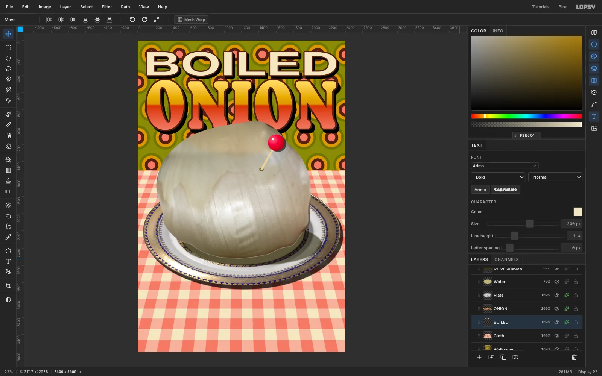

With **BOILED** active, open the effects drawer. Tick **Stroke** with **Width** 14 and colour `#4E2316`, and **Drop Shadow** with **Offset X** 22, **Offset Y** 26, **Blur** 0 and **Opacity** 100.

ONION's outline should overlap BOILED's shadow slightly. That way no thin strip of wallpaper shows between the two lines.

## Add the flash falloff

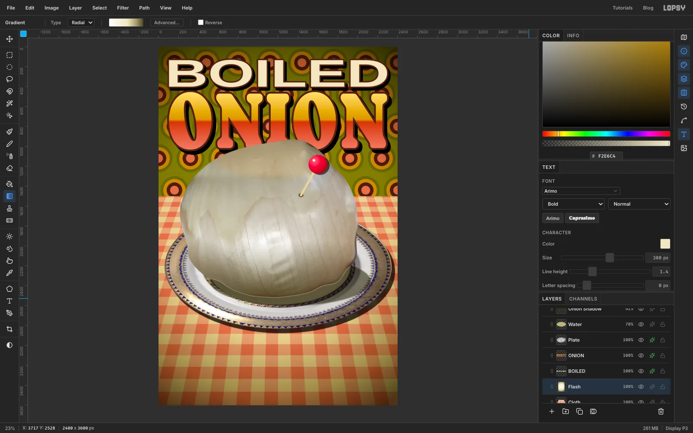

A cheap on-camera flash lights the middle and lets the edges fall into gloom. Click the **Cloth** row and add a layer called **Flash**. It sits above the cloth and under the title, so the type stays bright.

Pick the Gradient tool, set it to **Radial**, and use four stops: `#FFFFFF`, `#EFE6BE` at 55%, `#A79E6C` at 80% and `#4F4A2A`. Drag from the middle of the onion to well past the bottom-right corner of the page. Set the layer to **Multiply**.

## Add film grain

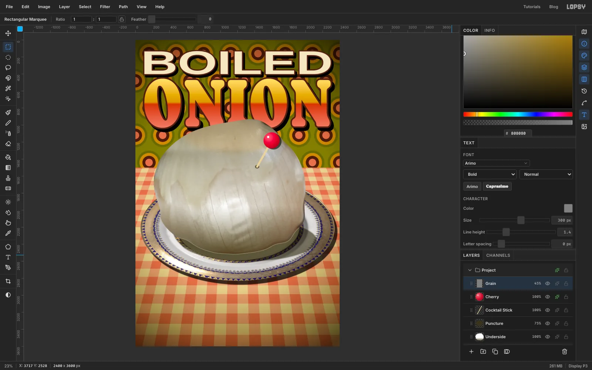

Click the **Cherry** row and add a layer called **Grain**. Select the whole page with [[⌘A]], set the colour to `#808080`, choose **Edit → Fill** and press [[⌘D]].

Choose **Filter → Add Noise…**, set **Amount** to 24, click **Mono** and **Gaussian**, and apply. Set the layer to **Overlay** at 45%.

## Add the top and bottom bars

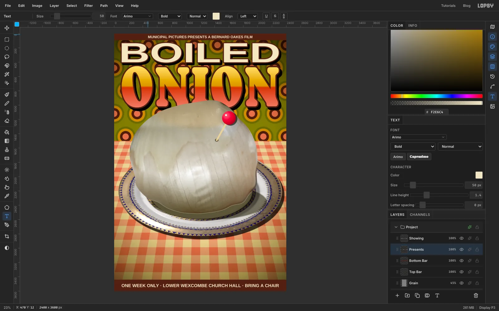

1. With **Grain** active, add a layer called **Top Bar**. Press [[M]], click once and select 0, 0 to 2400, 92. Set the colour to `#4E2316`, choose **Edit → Fill**, and press [[⌘D]].
2. Add a layer called **Bottom Bar**. Click once again and select 0, 3440 to 2400, 3600, fill it with the same brown, and press [[⌘D]].
3. Press [[T]], choose **Arimo** Bold, size **62**, colour `#F2E6C4`. Click in the bottom bar and type `ONE WEEK ONLY · LOWER WEXCOMBE CHURCH HALL · BRING A CHAIR`, then press [[Tab]].
4. Click the **Bottom Bar** row, so the next change of size doesn't restyle that line. Set the size to **50**, click in the top bar, type `MUNICIPAL PICTURES PRESENTS A BERNARD OAKES FILM` and press [[Tab]].

Press [[V]] and centre each line in its bar. Check that the gaps above and below match, and the left and right margins too.

## Cut a press clipping

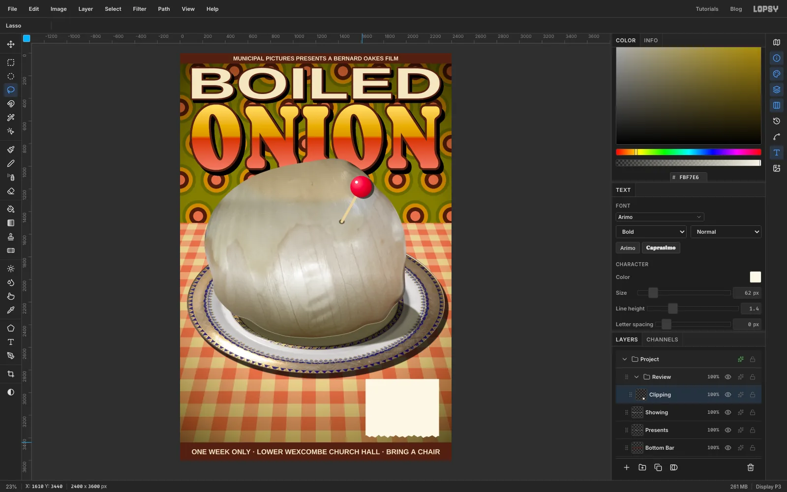

Click the **ONE WEEK ONLY…** text row (the bottom bar's text, at the top of the Layers panel), then click **New Group** and name the group **Review**. Inside it, add a layer called **Clipping**.

1. Press [[M]], click once and select a rectangle 650 × 520 px at the lower right, from 1640, 2880 to 2290, 3400. Set the colour to `#FBF7E6`, choose **Edit → Fill** and press [[⌘D]].
2. To tear the bottom, use the Lasso to drag a jagged line just above the bottom edge, with teeth of different sizes. Carry the selection down and around below the paper, then press [[Delete]] and [[⌘D]].
3. Add a **Drop Shadow** with **Offset X** 14, **Offset Y** 18, **Blur** 3 and **Opacity** 65.

## Print a still from the film

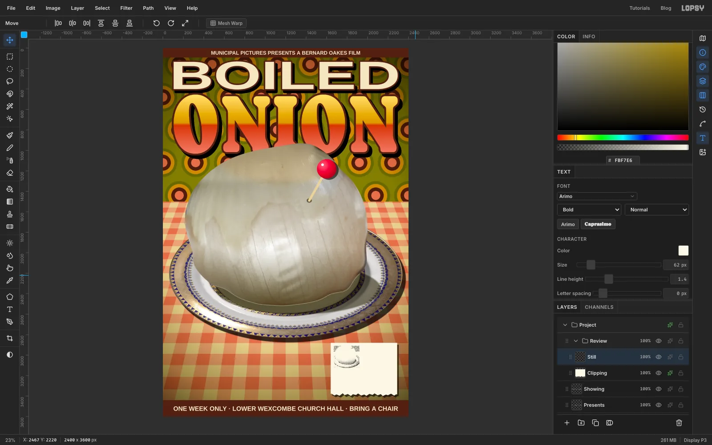

Newspapers ran tiny murky stills, so make one from the poster itself.

1. Marquee the plate and onion together and choose **Edit → Copy Merged**, which copies everything you can see. Press [[⌘D]], then [[⌘V]], and rename the new layer **Still**.
2. Marquee the pasted copy, press [[V]], hold [[⌘]] so it keeps its proportions, and drag its bottom-right corner in until it's about 250 px wide. Drag it into the top-left corner of the clipping, 30 px in from both edges, and press [[⌘D]].
3. Choose **Filter → Desaturate**. Then choose **Filter → Brightness/Contrast…** with **Brightness** 12 and **Contrast** 80. Finally choose **Filter → Halftone…** with **Dot Size** 5.

## Set the review

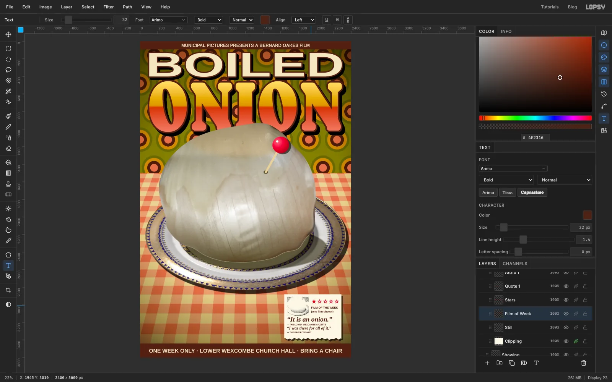

A text click inside an existing text layer edits that layer instead of starting a new one, so work from the bottom up. Click the **Still** row before each new line. Set the font, weight, style (the Normal / Italic dropdown) and colour every time, because each of them carries over from the line before.

1. `— THE PROJECTIONIST`: **Arimo** Bold, Normal, **24**, `#4E2316`, at the bottom left, about 45 px above the tear.
2. `“I was there for all of it.”`: **Tinos** Bold, Italic, **48**, `#4E2316`, just above it.
3. `— THE LOWER WEXCOMBE GAZETTE`: **Arimo** Bold, Normal, **24**, `#4E2316`, above that.
4. `“It is an onion.”`: **Tinos** Bold, Italic, **76**, `#4E2316`, under the still.
5. `★☆☆☆☆`: **Arimo** Bold, Normal, **62**, `#C8101E`, to the right of the still.
6. `FILM OF THE WEEK`, Return, `(one film shown)`: **Arimo** Bold, Normal, **32**, back to `#4E2316`, under the stars.

Leave at least 30 px between each credit and the line below it.

## Tilt the clipping

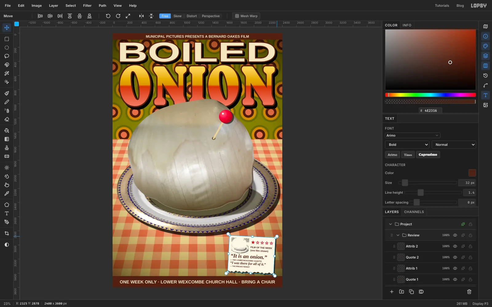

Click the **Review** group's row, press [[V]], and drag the rotate handle just outside a corner to turn the whole group about 3° clockwise. The text stays live inside the rotated group.

## Rule up a recipe card

Click the **ONE WEEK ONLY…** text row again (just below the Review group, not inside it), click **New Group**, and name the group **Recipe Card**.

1. Add a layer called **Card**. Press [[M]], click once and select 120, 2840 to 1570, 3350. Set the colour to `#F4EACB`, choose **Edit → Fill**, and press [[⌘D]]. Give it a **Drop Shadow** with **Offset X** 16, **Offset Y** 20, **Blur** 3 and **Opacity** 65.
2. Add a layer called **Rules**. Press [[N]] for the Pencil, set **Size** to 7 and the colour to `#C8101E`. Click 30 px in from the card's left edge, about 130 px below its top, and `Shift`-click 30 px in from the right edge for the red header line.
3. Set **Size** to 3 and the colour to `#7FB6C2`. Draw five more lines the same way, every 66 px below the red one.

## Type the recipe

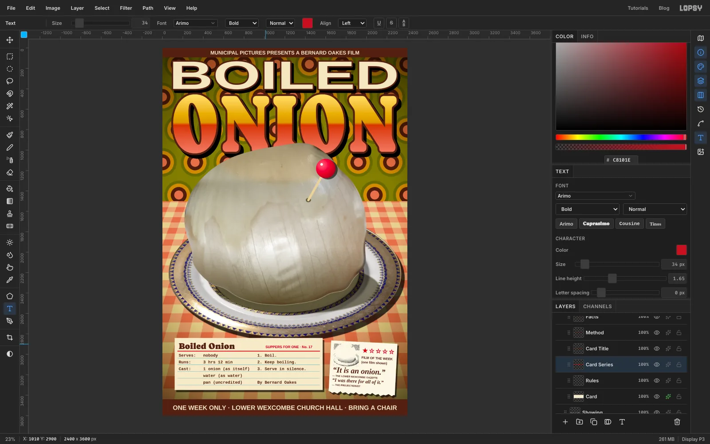

Click the **Rules** row before each new text layer. The colour is `#4E2316` unless noted, and the style is **Normal**.

1. **Cousine** Bold, **40**. Press Return between lines and use spaces to line up the columns:

   - `Serves:   nobody`
   - `Runs:     3 hrs 12 min`
   - `Cast:     1 onion (as itself)`
   - `          water (as water)`
   - `          pan (uncredited)`

   Press [[Tab]]. In the Text panel, set **Line height** to 1.65. At 40 px type that spaces the lines exactly 66 px apart, the same as the rules. Press [[V]] and nudge the block so each line sits just on a rule.
2. A second Cousine block in the right half: `1. Boil.`, `2. Keep boiling.`, `3. Serve in silence.`, a blank line, then `By Bernard Oakes`. Use the same size and line height, lined up with the first block.
3. `Boiled Onion` in **Caprasimo**, **84**, at the top left above the red rule.
4. `SUPPERS FOR ONE · No. 17` in **Arimo** Bold, **34**, colour `#C8101E`, ending at the card's right margin.

## Spill some coffee

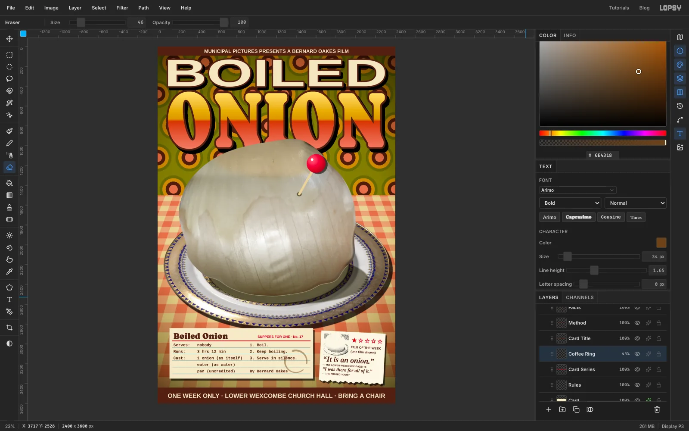

Click the **Rules** row and add a layer called **Coffee Ring**. It sits under the typing, as if the ink went on after the stain.

1. With the Elliptical Marquee, drag a circle about 236 px across over the right side of the card. Set the colour to `#6E4318`, choose **Edit → Fill**, and press [[⌘D]].
2. Drag a slightly smaller ellipse inside it, a few pixels off-centre, and press [[Delete]], leaving a ring that's thicker on one side. Press [[⌘D]].
3. Press [[E]] for the Eraser at **Size** 46 and rub out two short gaps in the ring.
4. Run **Gaussian Blur** with **Radius** 2. Set the layer to **Multiply** at 45%.

## Tilt the card

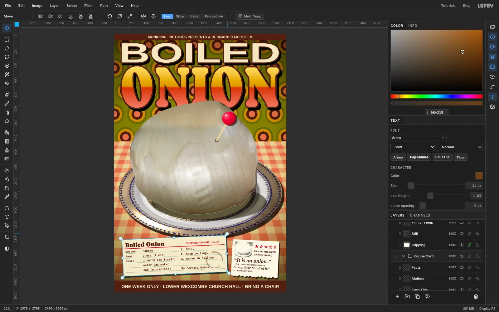

Click the **Recipe Card** group's row, press [[V]], and rotate it about 2.5° anticlockwise with the corner handle. Its bottom-left corner should stay clear of the bottom bar.

## Make a starburst sticker

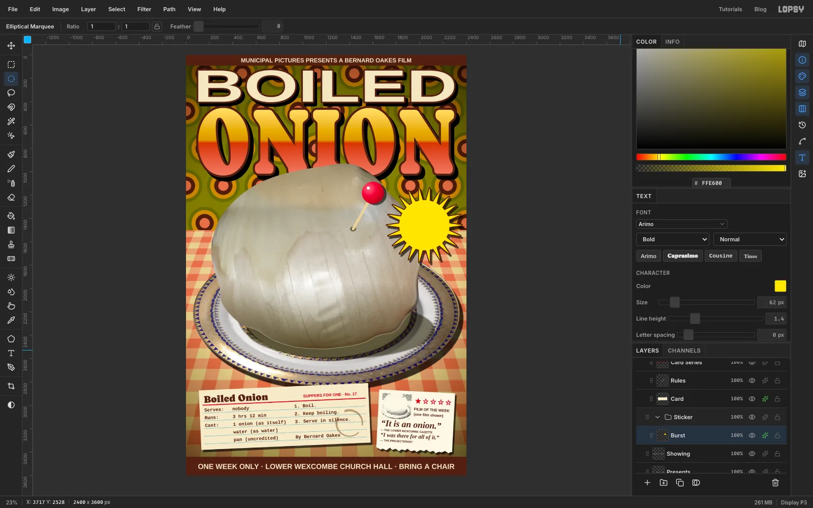

Click the **ONE WEEK ONLY…** text row again (below the other groups), click **New Group**, and name the group **Sticker**. Inside it, add a layer called **Burst**.

1. Set the colour to `#FFE600`. Choose **Filter → Sunburst…** and set **Rays** 22, **Length** 11, **Width** 100, **Taper** 100, **Center X** 85 and **Center Y** 40. Click **Apply**. You get a ring of sharp spikes to the right of the onion's shoulder.
2. Draw a 430 px circle on the centre of the burst with the Elliptical Marquee and fill it with the same yellow to make a solid middle. Press [[⌘D]].
3. Give the Burst layer a **Stroke** of **Width** 8 in `#4E2316`. Add a **Drop Shadow** with **Offset X** 14, **Offset Y** 18, **Blur** 3 and **Opacity** 65 to match the paper.

## Letter the sticker

Click the **Burst** row before each line. Use **Comic Neue** Bold Italic, and work bottom-up again:

1. `NO INTERVAL`: size **44**, colour `#4E2316`.
2. `12 MINS`: size **84**, colour `#C8101E`.
3. `3 HOURS`: size **84**, colour `#C8101E`.

Press [[V]] and centre each line across the burst, with the three lines spaced evenly. Keep every letter inside the solid middle, not on the spikes.

## Slap the sticker on at an angle

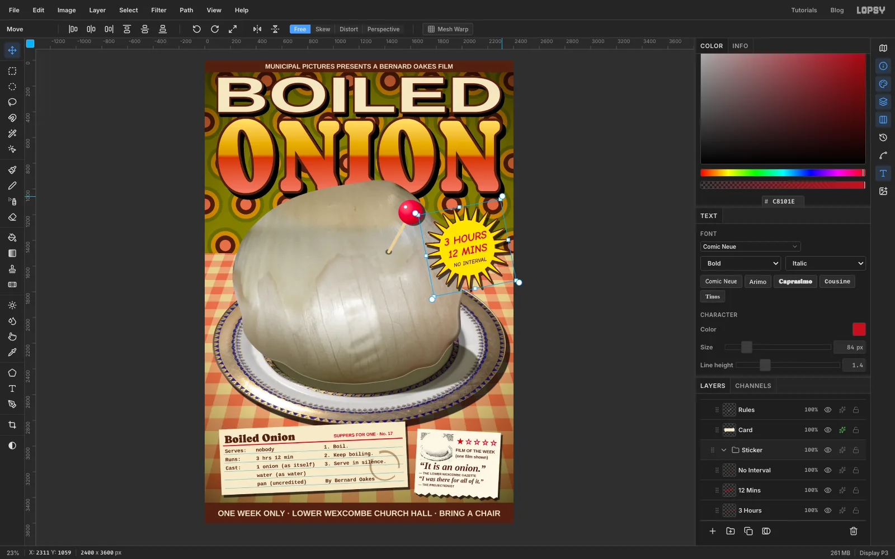

Click the **Sticker** group's row and rotate it about 11° anticlockwise with the Move tool's corner handle, the way a sticker gets slapped on by hand.

## Draw a path round the plate's rim

The plate gets a slogan, like a commemorative souvenir plate.

1. Click the **Plate** row so the text lands just above the plate.
2. Press [[P]] for the Pen. The path follows the *front* of the rim, the part nearest you below the onion, from about 7 o'clock round to 5 o'clock. Put about five points along the plain white band of the rim, between the inner gold ring and the outer gold band. Drag a little along the curve at each point so it bends smoothly. Each point shows its handles too.
3. Click the **✓** button in the options bar to finish the path.

## Set the slogan on the rim

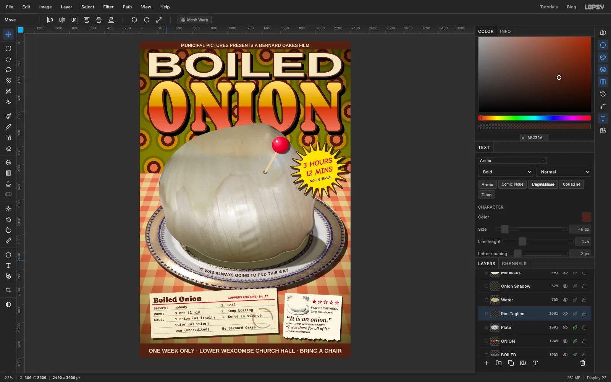

1. Press [[T]] and choose **Arimo** Bold, Normal, size **46**, colour `#4E2316`. Click somewhere empty on the cloth, type `IT WAS ALWAYS GOING TO END THIS WAY` and press [[Tab]].
2. In the options bar, set the **Path** dropdown to the path you just drew. The text jumps onto the curve. Set **Letter spacing** to 2 in the Text panel.
3. Open the **Paths** panel and click the path's row to deselect it, so the outline disappears. Don't delete the path, because the text is bound to it.

The text starts at the path's first point and stops at its end. If it isn't centred under the onion, ⌘Z back and redraw the path starting a little further round. Check that it sits evenly in the white band.

## Grade it all sickly

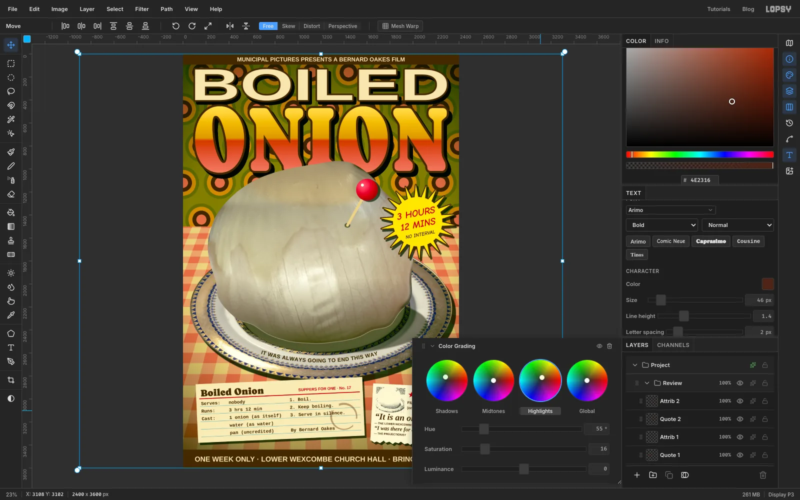

Click the **Project** group's row at the top of the Layers panel and open its effects drawer. Click **Add Adjustment → Color Grading**.

- Click the **Shadows** tab under the wheels and set **Hue** 110 and **Saturation** 18. This gives the shadows a faint green.
- Click the **Highlights** tab and set **Hue** 55 and **Saturation** 16. This turns the highlights a nicotine yellow.

Both are tints, not brightness changes, so the whole poster takes on the same tired cast of a print that's been in a shop window since 1974.

Close the drawer. Export the poster with **File → Quick Export PNG**, and save it with **File → Save Project**.

Try the same treatment on any dull food you can find a free photo of, like a boiled egg or a slice of luncheon meat. Keep the type tidy and the shadows consistent, and the ugliness will read as a decision.
