Anti-aesthetic design breaks the rules of good taste on purpose. It uses clashing colours, cheesy effects, crude cut-outs and the fonts designers love to hate. A famous version is the "clip-art cover": a cover remade as if someone had only stock photos, WordArt and an afternoon in a paint program. The joke only works when the mess is controlled. Every tacky element has to sit exactly where you meant it, read clearly from across a shop, and look ugly on purpose rather than by accident.

In this tutorial you'll make the cover of *The Yawning Yak*, a comic novel by an imaginary author, Dorothy P. Yarrow. The canvas is a 2:3 book cover, 1600 × 2400 px. The yak is a real photo, public-domain *Bos grunniens – Syracuse Zoo* from Wikimedia Commons. You'll cut it out badly, and paint a yawn onto it.

You'll use:

- **guides**, the **Gradient** tool (linear and radial, with stop opacity in the Gradient Editor) and **Filter → Sunburst**
- a dropped photo, the **Lasso**, the **Magic Wand**, **Select → Inverse**, **Shrink**, **Grow** and **Feather**, plus [[Cmd]]-click on a thumbnail to load a layer's shape
- the **Elliptical** and **Rectangular Marquee** with [[Shift]] to add and [[Shift]]+[[Option]] to intersect
- the Move tool's scale and rotate handles, **Perspective** mode, and rotating whole **groups**
- the filters **Hue/Saturation**, **Unsharp Mask**, **Chromatic Aberration** and **Add Noise**
- the layer effects **Stroke**, **Drop Shadow** and **Inner Glow**, and the **Overlay** and **Screen** blend modes
- the **Pen** tool with **Path to Selection**, the **Brush**, **Copy** and **Paste**, and **Merge Down**
- live text in **Luckiest Guy**, **Lobster**, **Bangers**, **Comic Neue** and **Tinos**

The palette:

- Sunset `#FF3EA5` → `#FF9A1F` → `#B8F400`
- WordArt yellow `#FFF200`, outline blue `#2F1BFF`
- Cyan `#00E5FF` (the word "The" and the author band)
- Lips `#E0004D`, throat `#12000A`, tongue `#FF6FA8`
- Badge and marker red `#FF1E1E`
- Hole fill `#17171F`, grain grey `#808080`

> **Tip:** On a wide-gamut (Display P3) screen, Lopsy reads typed hex codes as P3 colours, so these already-loud colours look even louder. That suits this design.

> **Note:** Shortcuts are written for a Mac. On Windows use [[Ctrl]] wherever it says [[Cmd]], and [[Alt]] for [[Option]].

## Set up the canvas and a stock-photo sunset

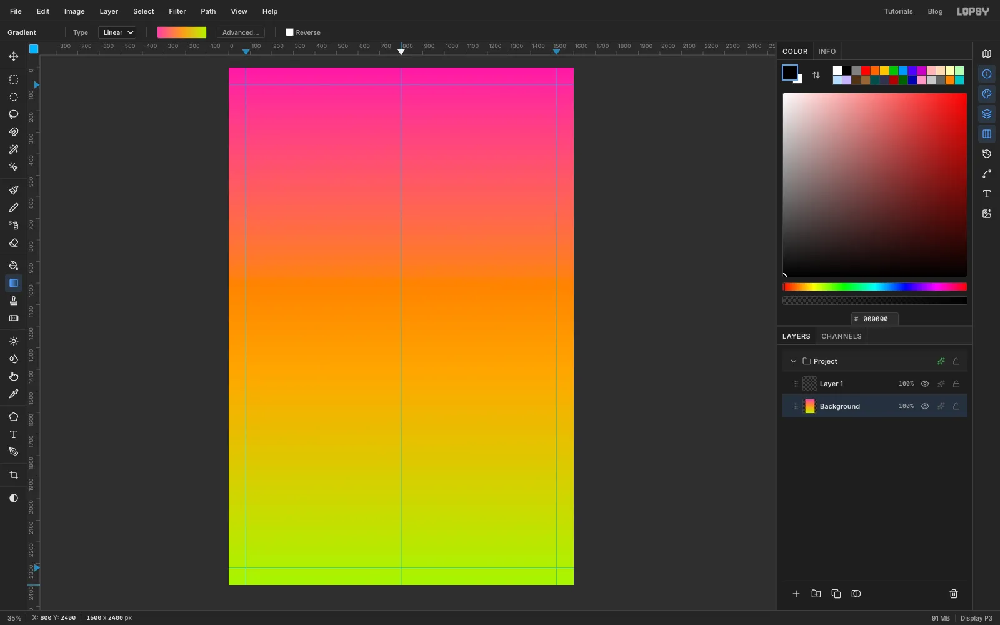

Choose **File → New**, keep the units on **Pixels**, and make the document **1600** wide and **2400** high. That's a standard 2:3 book cover.

Click the top ruler at **80**, **800** and **1520** to drop three vertical guides: two margins and the centre line. Click the left ruler at **80** and **2320** for the top and bottom margins.

Click the *Background* layer. Pick the **Gradient** tool, set the type to **Linear**, and click **Advanced…** to open the Gradient Editor. Make the left stop `#FF3EA5`, click the middle of the bar to add a stop and make it `#FF9A1F`, then make the right stop `#B8F400`. Click **Done**. Drag from the top edge of the canvas straight down to the bottom edge. Hold [[Cmd]] while you drag to snap the line to straight down.

## Add clip-art glory rays

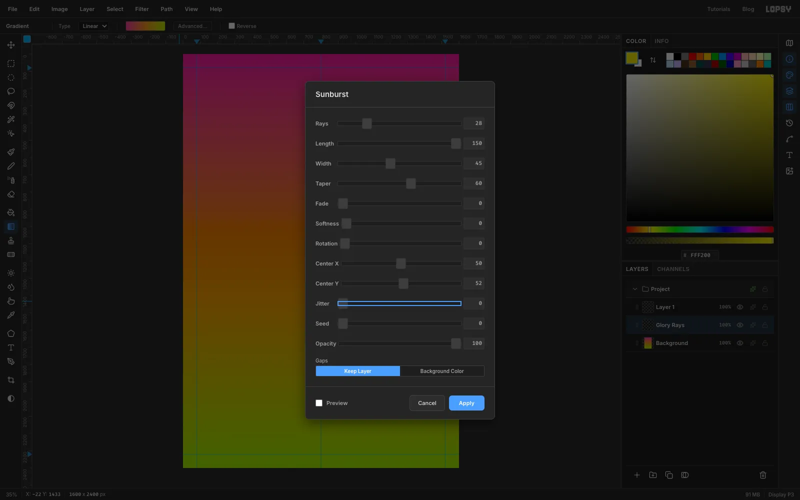

Click **Add Layer** and name the layer *Glory Rays*. Set the foreground colour to `#FFF200`. Sunburst always paints in the foreground colour.

Choose **Filter → Sunburst…** and set **Rays 28**, **Length 150**, **Width 45** and **Taper 60**. Leave **Center X** at **50** and set **Center Y** to **52**, so the rays burst from just below the middle, behind where the yak will stand. Click **Apply**.

Open the layer's effects with the ✦ button on its row and set the blend mode to **Overlay**. The rays now brighten and saturate the gradient instead of covering it, like a cheap "glory" backdrop.

## Bring in the yak photo

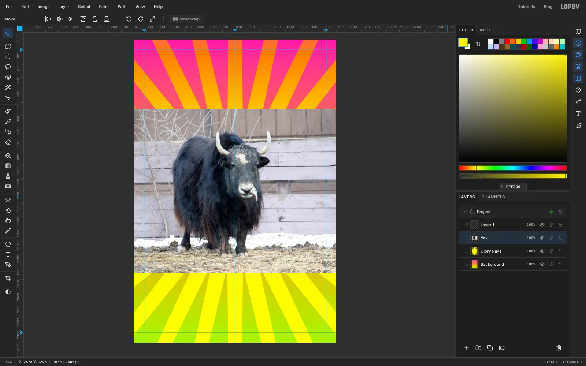

Drag the yak photo from your desktop onto the canvas. Lopsy shrinks a photo that's bigger than the document to fit inside it, and centres it. Double-click the new layer's name and call it *Yak*.

Any face-on animal photo works. A dark animal against a pale background, like this one, is the easiest to cut out.

## Cut it out with a sloppy lasso

The cut-out should look like it was done in a hurry. A loose freehand line gives you the slightly wonky, chunky edge of a bad cut-out.

Pick the **Lasso** and drag one continuous line around the yak. Stay close to the outside of the horns, and to the inside edge of each horn where it meets the head. If you leave a big gap there, a grey sliver of wall gets stuck between horn and hair. Around the body and legs, be loose: cut straight across under the belly and leave a few bits of straw.

Choose **Select → Inverse**, press [[Delete]], then [[Cmd]]+[[D]] to deselect. Only the yak is left, plus whatever wall, snow and straw the lasso caught.

## Knock out the gaps between the legs

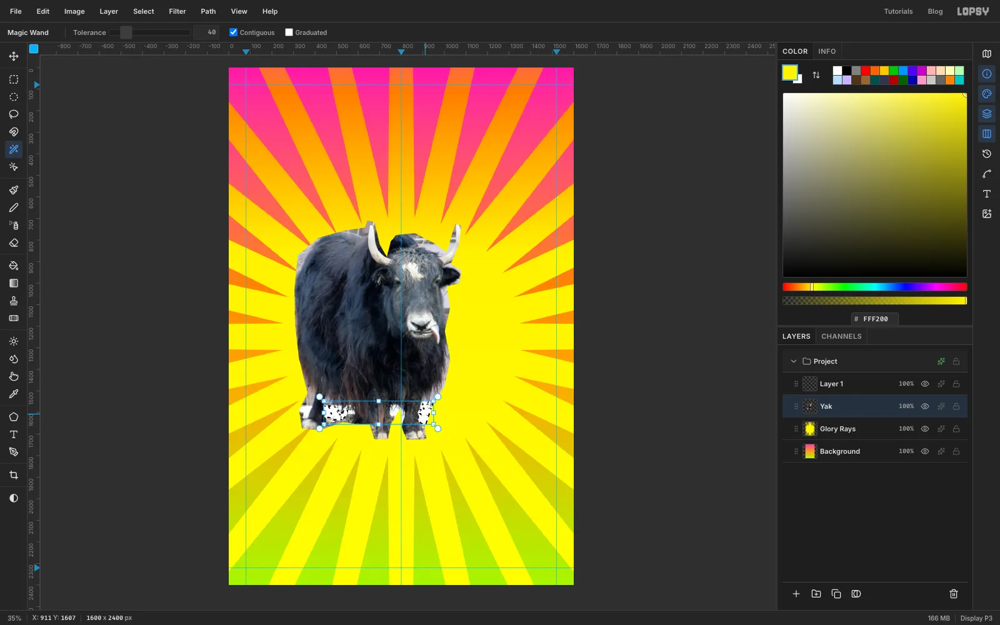

There's still pale snow and straw between the legs. Pick the **Magic Wand**, set **Tolerance** to **40**, and leave **Contiguous** on. Click a patch of snow between the legs, then [[Shift]]-click each of the other pale patches to add them. The yak is nearly black, so the wand stops cleanly at the fur.

Press [[Delete]] and deselect. A few white flecks of snow by the hooves can stay. They add to the rushed look.

## Sweep up the crumbs

Deleting with the wand leaves tiny floating crumbs, and each one will grow its own white outline when you add the sticker effect later. You'll clean them up with a trick:

1. [[Cmd]]-click the *Yak* thumbnail to select the layer's shape.
2. Choose **Select → Shrink…**, type **6**, and click **Apply**. Every crumb narrower than 12 px vanishes from the selection.
3. Choose **Select → Grow…** with **6**. The big shape grows back to its old outline, but the crumbs don't come back.
4. Choose **Select → Inverse** and press [[Delete]], then deselect.

## Plug the holes in the body

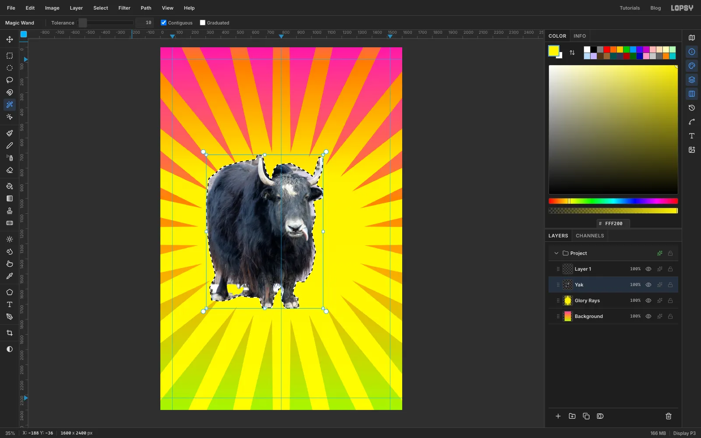

Where the wand ate right through the fur, the yak now has small see-through holes. You'll fill them with a dark colour on a layer underneath.

With the Magic Wand at **Tolerance 10**, click the empty area in a corner of the canvas. That selects everything outside the yak. Choose **Select → Inverse**: now the selection is the yak's outline with the holes filled in.

Click *Glory Rays*, click **Add Layer**, and name the new layer *Underfill*. It sits between the rays and the yak. Set the foreground to `#17171F`, choose **Edit → Fill**, and deselect. Click *Yak*, choose **Layer → Merge Down**, and rename the merged layer *Yak*. The holes now read as deep shadow between the legs.

## Paint a yawning mouth: lips and throat

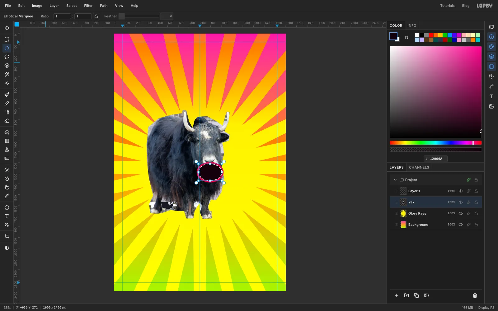

Time for the joke. You'll paint a cartoon mouth straight onto the photo, MS-Paint style. Keep *Yak* active.

Pick the **Elliptical Marquee** and drag an oval about **250 px wide** and **190 px tall** over the bottom of the muzzle. Its top edge should sit just under the nostrils. Set the foreground to `#E0004D` and choose **Edit → Fill**.

Choose **Select → Shrink…** with **16**. Set the foreground to `#12000A` and fill again. That leaves a 16 px crimson lip around a near-black throat. Keep the selection.

## Add the tongue

Hold [[Shift]]+[[Option]] and drag a second, wider-than-tall ellipse across the lower part of the mouth. It should start about halfway down the throat and run past the bottom edge. [[Shift]]+[[Option]] **intersects** the two shapes, so only the part inside the mouth stays selected.

Set the foreground to `#FF6FA8` and fill. The tongue is clipped neatly to the mouth.

## Hang two chunky teeth

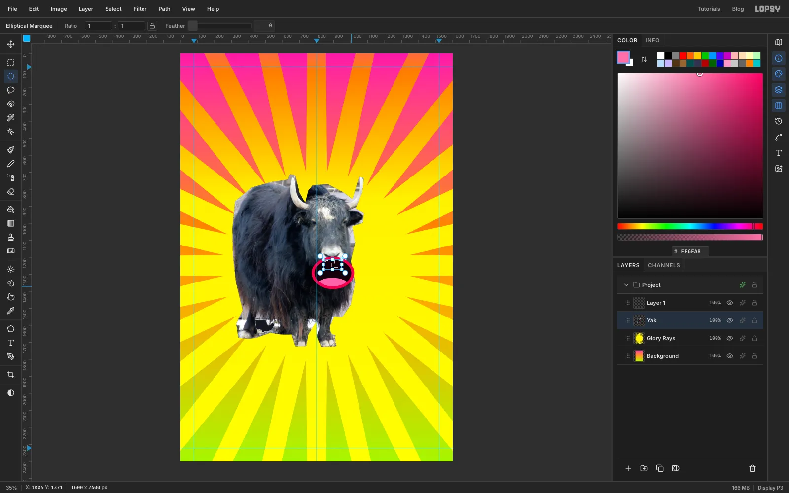

Pick the **Rectangular Marquee**. Drag a tall rectangle down from the top edge of the lip, just left of centre, about **45 px wide** and **75 px tall**. Hold [[Shift]] and drag a slightly shorter one just right of centre. Leave a small gap between them.

To trim the teeth to the inside of the mouth, pick the **Elliptical Marquee**, hold [[Shift]]+[[Option]], and drag an oval about 16 px inside the lip. Set the foreground to white, fill, and deselect.

## Stretch the yak (badly)

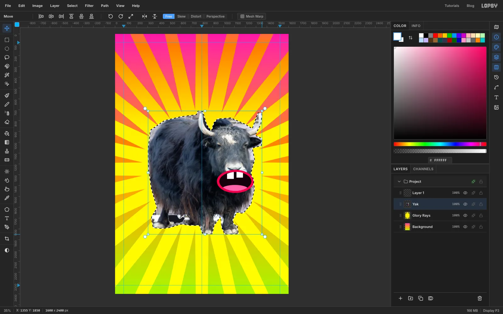

Nothing says "I don't know how to resize a photo" like a stretched one. [[Cmd]]-click the *Yak* thumbnail and switch to the **Move** tool so the transform handles appear.

Drag the **bottom-right** corner handle out *without* holding any keys. This scales the width and height separately. Make the yak about a third wider and about an eighth taller. Press [[Return]] to apply.

## Tilt it

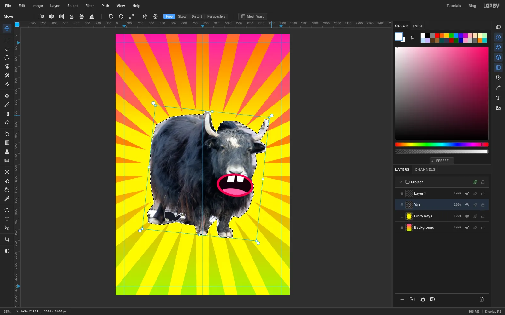

[[Cmd]]-click the thumbnail again. Move the pointer just outside the top-right corner until it turns into the rotate cursor, then drag down a little to turn the yak about **6°** clockwise. Press [[Return]] and deselect.

Drag the yak so it stands in the middle of the cover, a little below centre. Its hooves should end around 2020 on the left ruler, about 300 px above the bottom margin, so they stay clear of the author band you'll add later.

## Over-process it like a bad JPEG

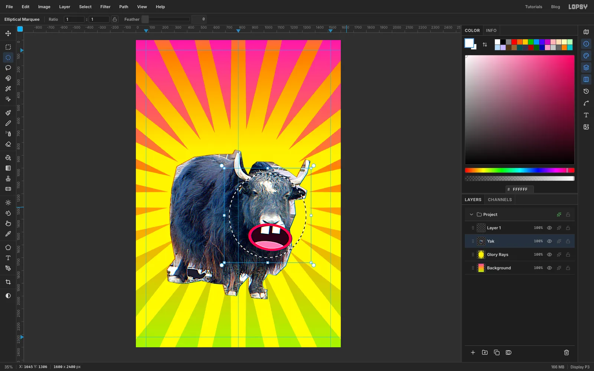

Stock photos on bad covers are always over-cooked. With *Yak* active and nothing selected:

1. **Filter → Hue/Saturation…** with **Saturation +60** and **Lightness +4**.
2. **Filter → Unsharp Mask…** with **Radius 5**, **Amount 1.6** and **Threshold 0**, which gives crunchy halos round the fur.
3. **Filter → Chromatic Aberration…** with **Amount 2** and **Direction 20**, which adds a faint red and blue fringe.

The face should look the most broken. Draw an **Elliptical Marquee** around the whole head, roughly 600 × 660 px, then choose **Select → Feather…** with **40**. Run **Chromatic Aberration** again with **Amount 9**, so the fringing is strong on the face and fades off into the body. Deselect.

> **Tip:** Keep the body subtle. At thumbnail size a heavily fringed body turns into a striped blob, and the yak stops reading as a yak.

## Make it a sticker with a hard shadow

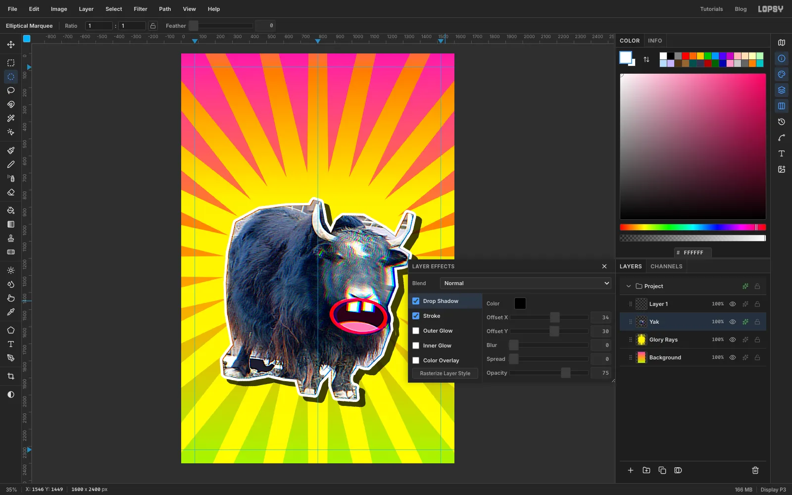

Open the yak's effects with ✦. Tick **Stroke** and set **Width 16**, the colour to white and the position to **Outside**. Tick **Drop Shadow** and set **Offset X 34**, **Offset Y 30**, **Blur 0**, **Spread 0**, **Opacity 75** and the colour to black.

A zero-blur shadow is the classic "I found the drop shadow button" look. Close the drawer.

## Type the title

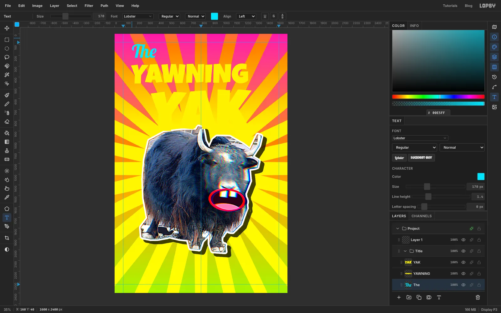

Click *Yak*, click **New Group**, and name the group *Title*. Click **Add Layer** to put an empty layer inside it, and name it *Title Base*.

Pick the **Text** tool ([[T]]). With a text layer selected, the Text tool's options restyle *that* layer. So click *Title Base* before you start each line. Type the lines bottom-up, so a click never lands inside a line you've already set. Set **Letter spacing** to **0** for each one.

- **YAK**: **Luckiest Guy**, **Size 520**, `#FFF200`. Click about a sixth of the way down the canvas and a fifth of the way in from the left, and type *YAK*. Press [[Tab]] to finish.
- **YAWNING**: **Luckiest Guy**, **Size 250**, `#FFF200`. Click above the YAK line and type *YAWNING*.
- **The**: **Lobster**, **Size 170**, `#00E5FF`. Click near the top-left margin and type *The*.

Lobster is famously overused, which makes it perfect here. Lopsy names each text layer after its text, so these layers are already called *YAK*, *YAWNING* and *The*.

## Warp YAK into WordArt

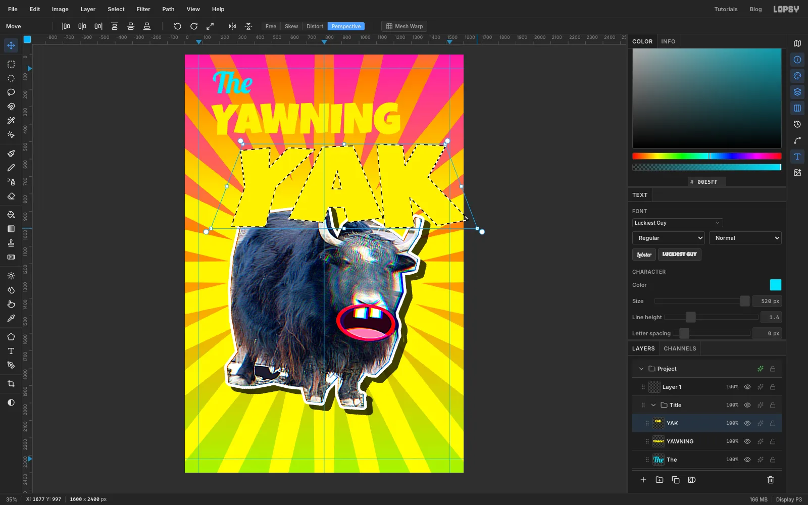

Click the *YAK* layer and press **Rasterize Layer** in the Layers panel, because perspective works on pixels.

[[Cmd]]-click the *YAK* thumbnail, switch to the **Move** tool, and [[Cmd]]-drag the bottom-right handle out until the word is about a quarter bigger. [[Cmd]] keeps the proportions. Press [[Return]].

[[Cmd]]-click the thumbnail again and choose **Perspective** in the options bar. Drag the bottom-right corner about **185 px** to the right. In Perspective mode the bottom-left corner moves out to match, so the word fans out towards the bottom like an old WordArt preset. Press [[Return]], then click **Free** to switch the mode back.

Use the arrow keys ([[Shift]]+arrow moves 10 px) to centre YAK just left of the middle guide, with its top about 520 px down. Centre YAWNING over it the same way.

## Outline, shadow and bevel

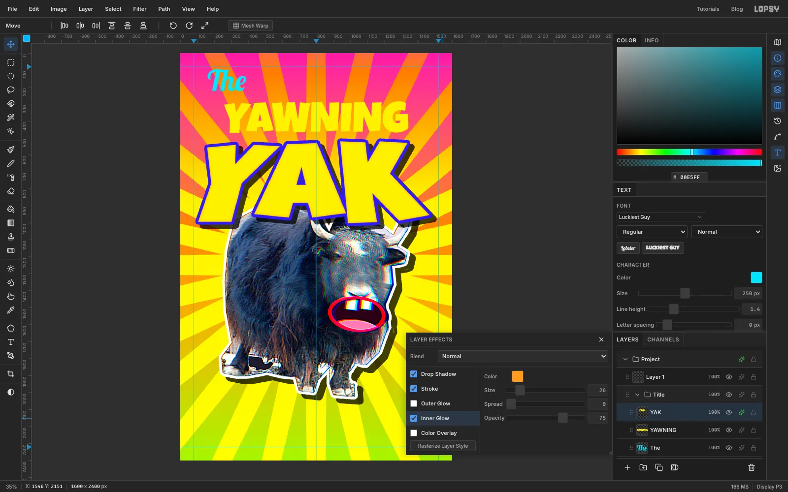

Open the effects for **YAK** and set:

- **Stroke**: **Width 18**, colour `#2F1BFF`
- **Drop Shadow**: **Offset X 26**, **Offset Y 24**, **Blur 0**, **Opacity 75**, black
- **Inner Glow**: **Size 26**, colour `#FF9A1F`. The orange glow along the inside edges fakes WordArt's cheap bevel.

Give **YAWNING** a **Stroke** of **12** in `#2F1BFF` and a **Drop Shadow** of **16 / 14** with **Blur 0**. Give **The** a **Stroke** of **8** in the same blue.

## Tilt the whole title at once

Click the *Title* group's row and make sure nothing is selected ([[Cmd]]+[[D]]). With the **Move** tool, one set of handles now frames all three words. Drag just outside the top-right corner to rotate the group about **4°** counter-clockwise, so the title climbs to the right. Press [[Return]].

## Draw a starburst with the Pen

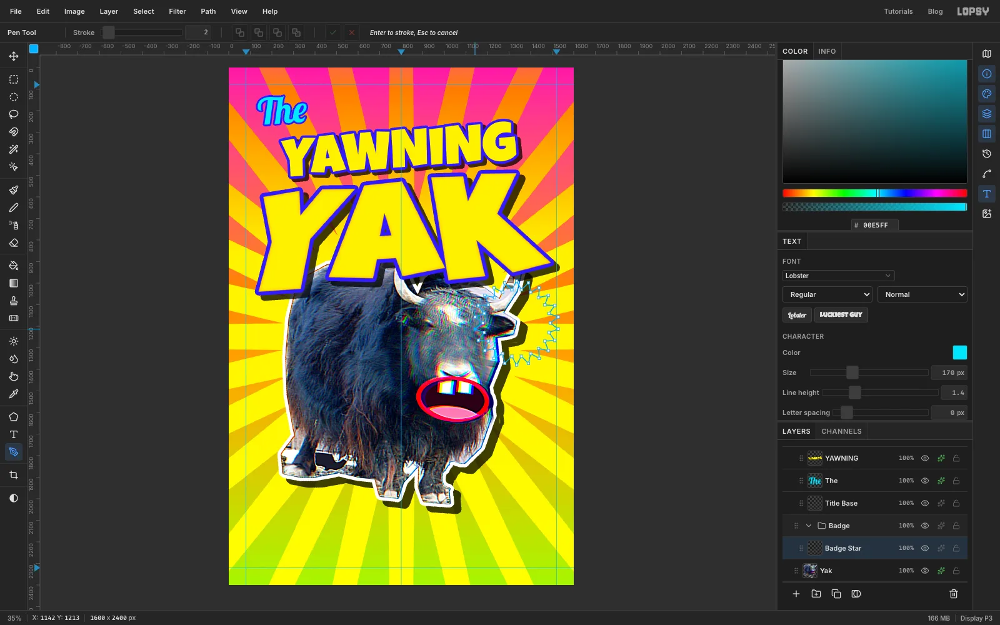

Click *Yak*, click **New Group** and name it *Badge*, then **Add Layer** named *Badge Star*.

Lopsy's Shape tool has no star, so draw one with the **Pen** tool ([[P]]). The centre goes over the yak's right shoulder, about 265 px in from the right edge and halfway down the canvas. Click your way round that centre, alternating a spike tip and a valley. Put the tips roughly 195 px from the centre and the valleys roughly 40 px closer in, for about 20–22 spikes in all. Click the first point again to close the path.

Spikes that aren't perfectly even are fine: they look hand-made. Open the **Paths** panel from the strip of panel buttons on the right, then click **Path to Selection** and **Delete Path**. Fill the selection with `#FF1E1E`, deselect, and give the layer a yellow `#FFF200` **Stroke** of **10**.

## Add the badge copy and rotate the badge

Click *Badge Star* so the next text doesn't restyle anything. Pick the **Text** tool and choose **Bangers** at **Size 70** in `#FFF200`, and set **Align** to **Center**. With centre alignment, the point you click becomes the middle of each line.

Click at the top of the star's centre and type *NOW WITH*, press [[Return]], type *40% MORE*, [[Return]], *YAK!*, then press [[Tab]]. Rename the layer *Badge Text*. In the **Text** panel, set **Line height** to **1** so the three lines pack together. Nudge the text with the arrow keys until it sits in the middle of the star, a few pixels left of centre so MORE doesn't crowd the right-hand spikes.

Click the *Badge* group, deselect, and rotate it about **14°** clockwise with the Move tool, just like the title.

## Add a speech bubble

Click *Yak* and **Add Layer** named *Bubble*. Drag an **Elliptical Marquee** about **300 × 176 px** below and to the right of the mouth, inside the right margin.

Pick the **Lasso**, hold [[Shift]], and draw a narrow wedge. Start inside the bubble's upper-left edge, go up to the lower-right corner of the mouth, and come back into the bubble a little further along. [[Shift]] adds the wedge to the oval. Fill with white, deselect, and add a black **Stroke** of **6**.

Click *Bubble*. Pick the **Text** tool and set **Comic Neue**, **Bold**, **Size 64**, black, still centre-aligned. Click in the middle of the bubble, type *yaaawn...* and press [[Tab]]. Rename the layer *Bubble Text* and nudge it until it's centred.

## Circle the joke with a marker

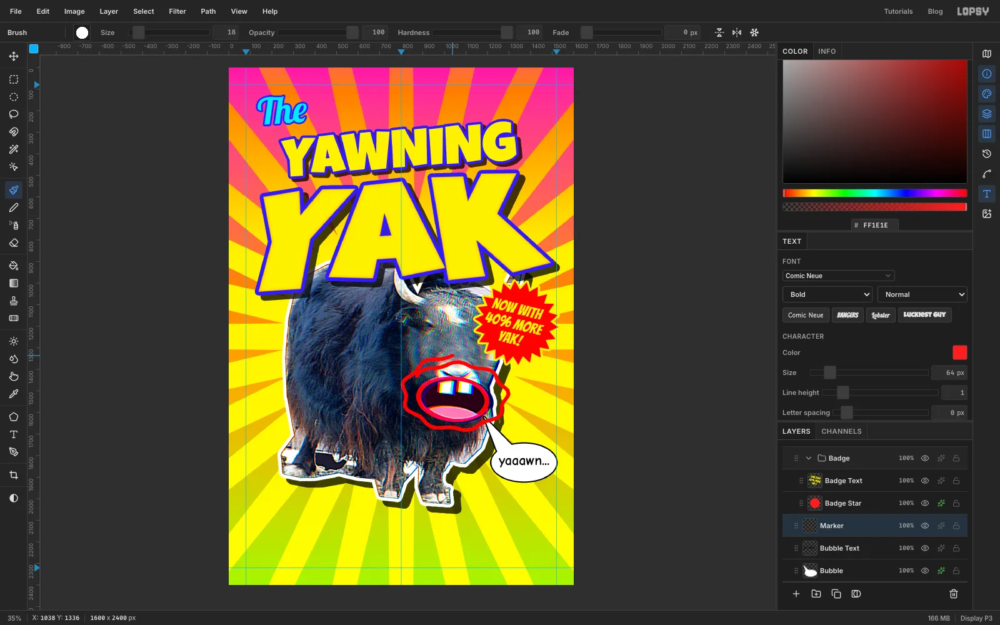

Click *Bubble Text* and **Add Layer** named *Marker*. Pick the **Brush** at **Size 18** and **Hardness 100**, and set the foreground to `#FF1E1E`.

Draw one quick, wobbly loop around the mouth, about 70 px outside the lips. Go round about one and a quarter times, so the end overshoots the start like a real annotation. Don't try to make it neat.

## Fake a lens flare

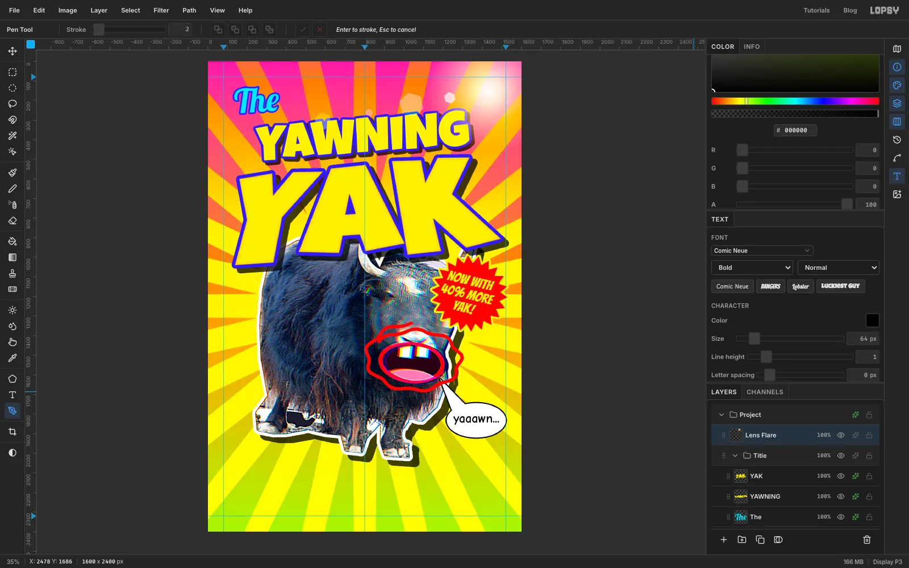

Click *Layer 1*, the empty layer that came with the new document at the top of the stack, and rename it *Lens Flare*.

Choose the **Gradient** tool, set **Type** to **Radial**, and open **Advanced…**. Set three stops:

- white `#FFFFFF` at the left with **Opacity 100**
- a pale yellow `#FFF6B0` about a fifth of the way along with **Opacity 90**
- orange `#FF9A1F` at the right with **Opacity 0**

Select each stop and set its opacity on the checkered **Opacity** bar under the colour picker. To place a stop, drag it along the bar until the **Position** readout shows the value you want. Click **Done**. Drag from a point about 170 px in from the right edge and 150 px down, 320 px to the right.

Now add the "ghosts" a real lens makes. They line up on one straight, shallow line from the sun down towards the left end of YAWNING. For each one, click the six corners of a hexagon with the **Pen** tool, then use **Path to Selection** and **Delete Path**. Set the foreground colour, and set its opacity with the **A** field in the Color panel. Then fill:

- a small white hexagon (about 60 px across) at **70%** opacity, closest to the sun
- a big cyan `#00E5FF` one (about 130 px) at **38%**
- a tiny pink `#FF3EA5` one (about 40 px) at **75%**
- a lime `#B8F400` one (about 90 px) at **40%**, furthest away

Set the opacity back to **100** when you're done. In the layer's ✦ effects drawer, set the blend mode to **Screen**.

## Add a rainbow ring

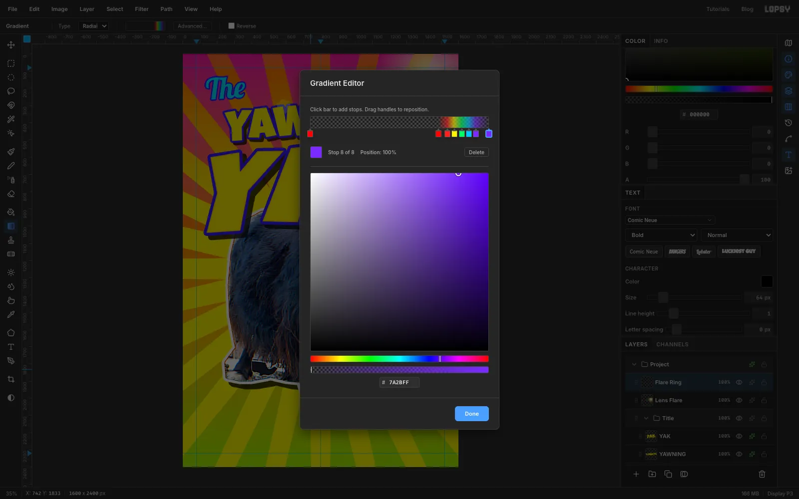

**Add Layer** named *Flare Ring*. Open the Gradient Editor again and build a thin rainbow near the outer end of the bar. Use the bar to add stops, and set the opacity on each:

- `#FF0000` at **0%** and at **72%**, both at **Opacity 0**
- `#FF2020` at **77%** (**55**), `#FFF200` at **81%** (**60**), `#00FF66` at **85%** (**60**), `#00C8FF` at **89%** (**60**) and `#7A2BFF` at **93%** (**55**)
- `#7A2BFF` at **100%** with **Opacity 0**

Drag a **Radial** gradient from the same sun centre, 300 px to the right. You get a faint rainbow halo round the sun. Set this layer's blend mode to **Screen** in its ✦ drawer too.

## Build the author band

Click *Marker* and **Add Layer** named *Band*. Drag a **Rectangular Marquee** from just off the left edge, about 250 px above the bottom, to just past the bottom-right corner. Fill it with `#00E5FF`, deselect, and give it a black **Stroke** of **8**. On the canvas you'll only see the stroke along the top edge.

Pick the **Text** tool, set **Align** to **Center**, and type the two lines bottom-up on the middle guide, clicking *Band* before each one. Rename the layers *Author* and *Quote* as you go:

- the author: **Comic Neue**, **Bold**, **Size 104**, black, *DOROTHY P. YARROW*
- the pull quote: **Tinos**, **Size 44**, black, *“I yawned on every single page.” — Gerald, next door*

Nudge them so the quote sits near the top of the band and the name sits under it, with roughly equal space above the quote and below the name.

## Paste in a tiny publisher logo

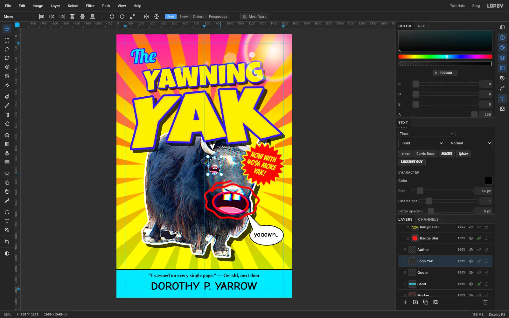

Every self-published cover needs a homemade logo. Click *Yak* and draw an **Elliptical Marquee** around its head, about 400 × 540 px, including the mouth. Press [[Cmd]]+[[C]].

Click *Quote*, then press [[Cmd]]+[[V]]. The copy lands exactly where it came from, on a new layer above the band. Name it *Logo Yak*. With the **Move** tool, [[Cmd]]-drag a corner handle inward until the oval is about 110 px wide. Press [[Return]], then drag it to the left end of the band. Give it a white **Stroke** of **5** and a **Drop Shadow** of **6 / 6** with **Blur 0**, so it looks like an oval sticker.

## Add a layer of grain

Click *Lens Flare* and **Add Layer** named *Grain*. It lands between the flare and its ring, near the top of the stack, so it covers the yak, the title and everything you add below it later. Select the whole canvas, fill it with `#808080`, and deselect.

Choose **Filter → Add Noise…** with **Amount 40**, and pick **Mono** and **Gaussian**. In the ✦ drawer set the blend mode to **Overlay**, then set the layer's opacity to **35%** with the opacity control on its row. Overlay leaves 50% grey invisible, so only the noise shows, as a fine cheap-print texture over everything.

## Fill the empty corner with a ribbon

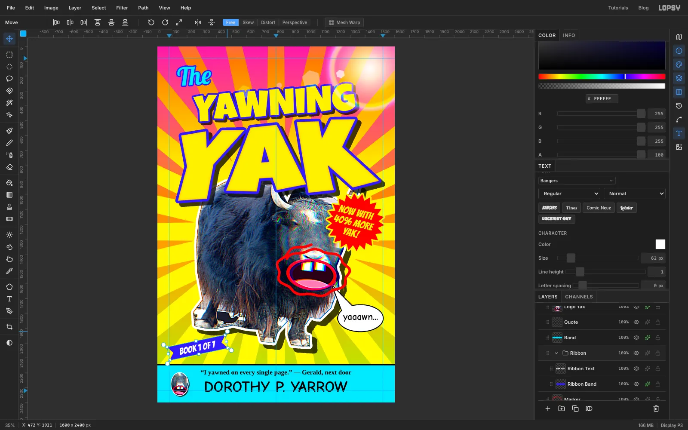

The bottom-left corner beside the yak's legs is empty, and tacky covers can't stand empty space. Click *Marker*, click **New Group** named *Ribbon*, and **Add Layer** named *Ribbon Band*.

With the **Pen**, click the six corners of a ribbon about **400 × 90 px** that starts 70 px in from the left edge, just above the band. Each end has a V-shaped notch cut about 34 px deep. Use **Path to Selection**, then **Delete Path**. Fill with `#2F1BFF` and add a yellow **Stroke** of **5**.

Click *Ribbon Band*. Pick the **Text** tool and set **Bangers** at **Size 62** in white, centred. Click in the ribbon, type *BOOK 1 OF 7*, press [[Tab]], rename the layer *Ribbon Text*, and nudge it into the middle of the ribbon. Then click the *Ribbon* group, deselect, and rotate it about **12°** counter-clockwise.

Choose **File → Save Project** to keep every layer, group and effect editable. Then use **File → Export…** for a PNG to print, post or wrap around a real book.
