Most holiday cards try to be tasteful. This one doesn't. **Anti-aesthetic** design breaks the rules on purpose, with clashing patterns, too many fonts, clip-art stickers and photos cut out with blunt scissors. It's the look of a card made at the kitchen table from the craft drawer, and when it's done well the joke is obvious and the card still reads at a glance.

The card is 1536 × 1024 px and is built in five parts:

- a patchwork quilt made from five pattern tiles you paint yourself
- a real dachshund photo, cut out with the Pen and stretched to twice its length
- a knitted sweater with ribbed cuffs and a garment label
- sticker extras: a Santa hat, googly eyes and a "NOW 40% LONGER!" starburst
- mismatched title type and a script line on a curve

You'll need one photo from Wikimedia Commons: **1 Year Old Miniature Dachshund.jpg** by Idk48, released under **CC0** (public domain), so you can use it freely. It's a red dachshund standing side-on in the grass and looking at the camera. Download the original (1179 × 792 px).

The tools you'll use:

- the **Pencil** on a 4 px grid, **Define Pattern** and **Edit → Fill with Pattern…**
- the **Rectangular** and **Elliptical Marquee**, including their exact-corners dialog, with [[Shift]] to add selections
- the **Pen** for corner-click outlines and a curved text path, plus **Path to Selection**
- [[Cmd]]-click on a layer thumbnail, **Select → Inverse** and the **Magic Wand**
- **Copy**, **paste in place**, and the **Move** tool's scale and rotation handles
- **Halftone**, **Fibers**, **Add Noise**, **Emboss**, **Brightness/Contrast** and **Liquify**
- layer effects: **Inner Glow**, **Stroke**, **Drop Shadow** and **Color Overlay**
- the **Overlay** blend mode, **Merge Down**, **Group Layers** and a group move
- text in five Google fonts: Luckiest Guy, Rye, Bowlby One, IBM Plex Mono and Pacifico

The palette is meant to clash:

- Felt teal `#23A9B8`, polka green `#2E9B4F`, fur pink `#F0569A`
- Candy red `#D7262E`, knit red `#B8232B`, cream `#F3E9CF`
- Plaid mustard `#E3A82B`, plaid band `#C8452C`, plaid crossing `#9E2A22`
- Navy `#252E62`, seam shadow `#1B2350`, title yellow `#FFE14A`
- Hat red `#E0262E`, fur white `#FFF8EC`

> **Tip:** On a wide-gamut (Display P3) screen, Lopsy reads typed hex codes as P3 colours. These codes were picked as P3 values, so they match the finished card. On an sRGB screen they come out a touch duller.

> **Note:** Shortcuts are written for a Mac. On Windows use [[Ctrl]] wherever it says [[Cmd]].

> **Tip:** Positions in this tutorial are in document pixels. While you drag, watch the **X / Y** readout at the bottom-left of the window to see where the pointer is.

## Make the card

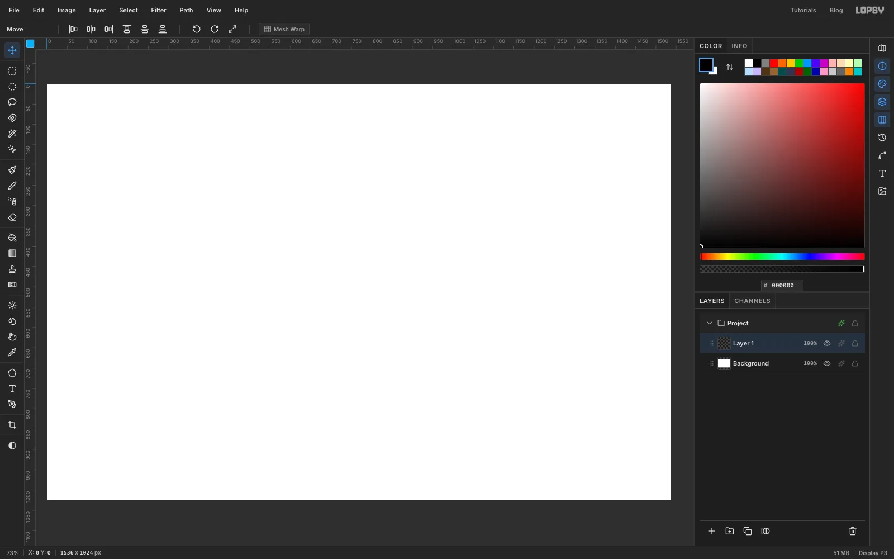

Choose **File → New**, keep the units on **Pixels**, and make the document **1536** wide and **1024** high. Lopsy gives you a *Background* layer and an empty *Layer 1*. Double-click *Layer 1* and rename it *Tiles*. This is where you'll paint the little fabric swatches that become patterns.

All five tiles sit in the top-left corner of the canvas. You'll delete them once they're saved as patterns.

## Paint the stripe, plaid, knit and rib tiles

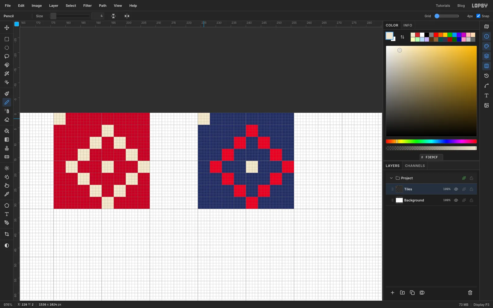

Every tile is a few flat rectangles. To fill one exactly, pick the **Rectangular Marquee** ([[M]]), press [[Cmd+D]] so nothing is selected, and click once on the canvas without dragging. A **Rectangular Selection** dialog opens. Type the **From** and **To** corners, press **Select**, set the foreground colour, and choose **Edit → Fill**.

**Candy stripe tile (48 × 48):** fill **0, 0 → 24, 48** with candy red `#D7262E` and **24, 0 → 48, 48** with cream `#F3E9CF`.

**Plaid tile (96 × 96):** fill these in order:

1. **64, 0 → 160, 96** with mustard `#E3A82B`
2. **64, 0 → 160, 24** with plaid band `#C8452C`
3. **64, 0 → 88, 96** with plaid band `#C8452C`
4. **64, 0 → 88, 24** with plaid crossing `#9E2A22`
5. **64, 56 → 160, 59** with navy `#252E62` (a pinstripe)
6. **120, 0 → 123, 96** with navy `#252E62` (a pinstripe)

**Red knit tile (32 × 32):** fill **176, 0 → 208, 32** with knit red `#B8232B`. Choose **View → Show Grid**, drag the **Grid** slider in the options bar to **4px**, and zoom in to about 1000% on the tile. Each grid square is now one stitch, eight across and eight down.

Pick the **Pencil** ([[N]]), set **Size** to **4** and the foreground to cream `#F3E9CF`. Click once in the middle of each stitch you want. Counting rows and columns from 1 at the tile's top-left:

- the centre stitch at row 5, column 5
- a diamond around it whose points are row 2 column 5, row 5 column 2, row 8 column 5 and row 5 column 8, with the stitches between them on the diagonals (12 stitches in the ring)
- one stitch in the top-left corner, row 1 column 1

**Navy knit tile:** fill **224, 0 → 256, 32** with navy `#252E62`. Click the same diamond ring in candy red `#D7262E`, then the centre and corner stitches in cream `#F3E9CF`.

**Rib tile (12 × 12):** fill **272, 0 → 280, 12** with navy `#252E62` and **280, 0 → 284, 12** with cream `#F3E9CF`.

## Save the tiles as patterns

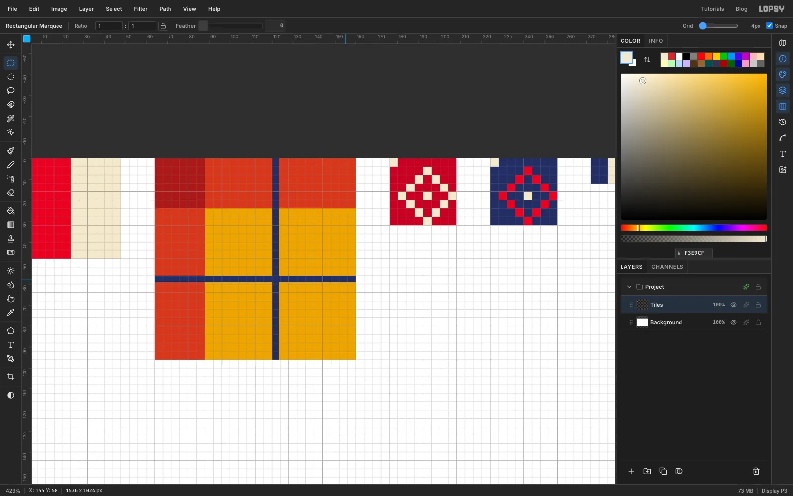

For each tile, open the exact-corners dialog with a single marquee click and select the tile exactly. Then choose **Edit → Define Pattern** and press [[Cmd+D]]. Do them in this order, so the patterns come out numbered the way the rest of this tutorial expects:

1. stripe: **0, 0 → 48, 48**
2. plaid: **64, 0 → 160, 96**
3. red knit: **176, 0 → 208, 32**
4. navy knit: **224, 0 → 256, 32**
5. rib: **272, 0 → 284, 12**

> **Note:** Defined patterns only last for this browser session. If you reload the page or reopen the project before you've used them, define them again.

Press [[Cmd+0]] to fit the canvas to the window.

## Lay a felt ground

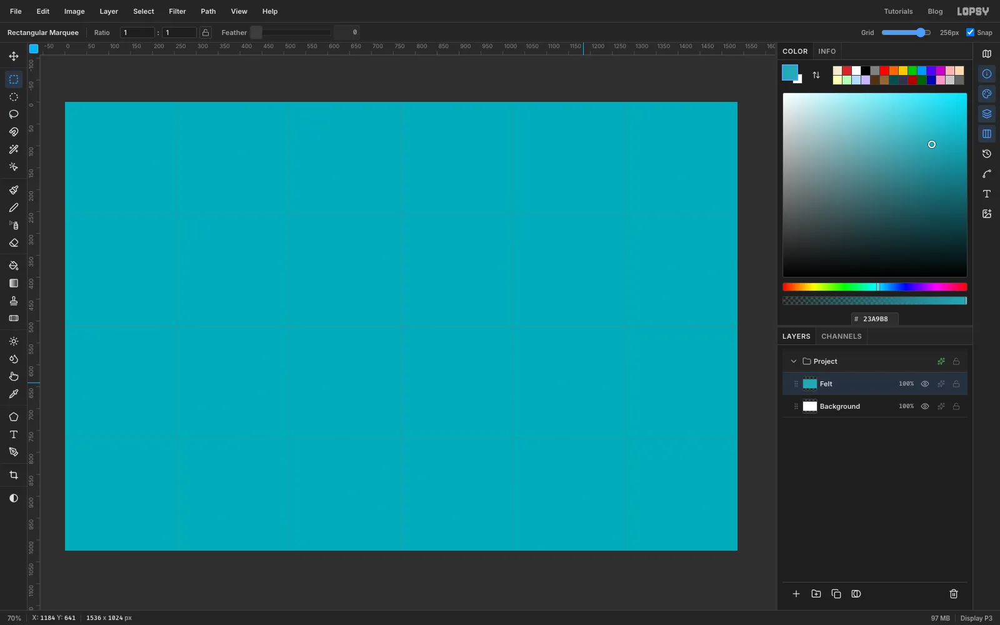

Move the **Grid** slider to **256px** and make sure **Snap** is ticked. The grid now divides the card into six columns and four rows of 256 px squares. Those are your quilt patches.

With *Tiles* still active, select **0, 0 → 300, 120** and press [[Delete]] to clear the tiles. Press [[Cmd+D]], set the foreground to felt teal `#23A9B8`, and choose **Edit → Fill**. With no selection, Fill covers the whole layer. Rename the layer *Felt*.

Choose **Filter → Add Noise…**, set **Amount 10**, pick **Mono**, and click **Apply** for a fine felt speckle.

## Patch in the candy stripes

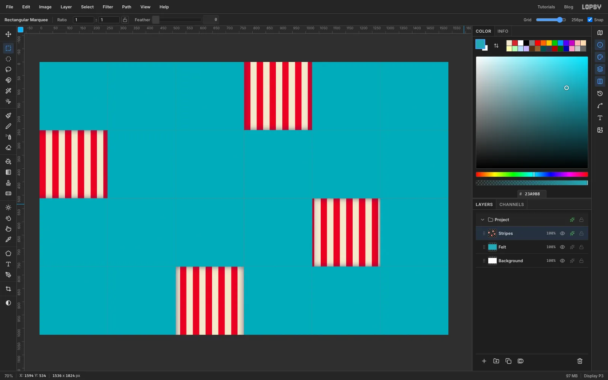

Here's the quilt layout, row by row from the top. Each word is one 256 px square:

- Row 1: knit, polka, felt, stripes, plaid, corduroy
- Row 2: stripes, plaid, corduroy, knit, polka, felt
- Row 3: corduroy, felt, knit, polka, stripes, plaid
- Row 4: polka, knit, stripes, plaid, felt, corduroy

Click **Add Layer** at the bottom of the Layers panel and name the layer *Stripes*. With the **Rectangular Marquee**, drag over the first stripe square, starting just inside one corner and ending just inside the opposite one. Snap pulls the marquee onto the grid lines. Hold [[Shift]] and drag over each of the other stripe squares to add them.

Choose **Edit → Fill with Pattern…**, click the **stripe** swatch, leave **Scale** at **100**, and click **Apply**. Press [[Cmd+D]].

Now make the square look stuffed. Click the **fx** button on the *Stripes* row to open its layer effects and tick **Inner Glow**. Set the colour to seam shadow `#1B2350`, **Size 34** and **Opacity 70**. Close the effects panel.

## Add the plaid and knit squares

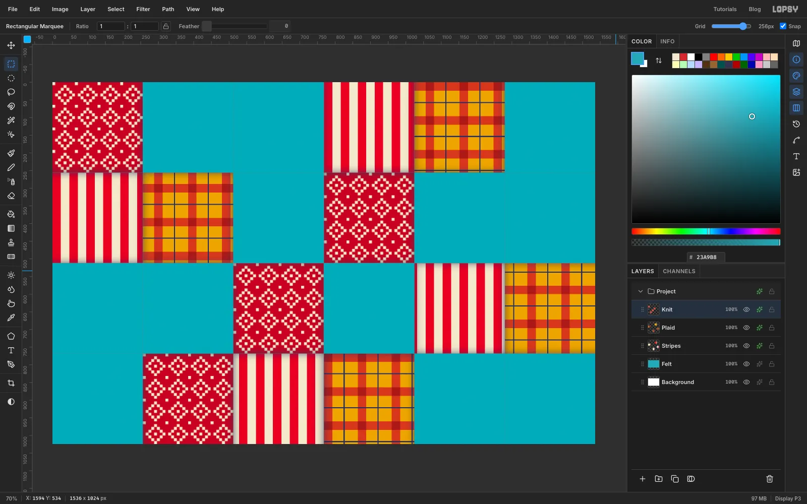

Repeat the last step twice, with a new layer each time:

- *Plaid*: select the plaid squares and fill them with the **plaid** pattern at **Scale 100**.
- *Knit*: select the knit squares and fill them with the **red knit** pattern at **Scale 200**, so each stitch is 8 px.

Give both layers the same **Inner Glow**: `#1B2350`, **Size 34**, **Opacity 70**.

## Fill the polka, corduroy and felt squares

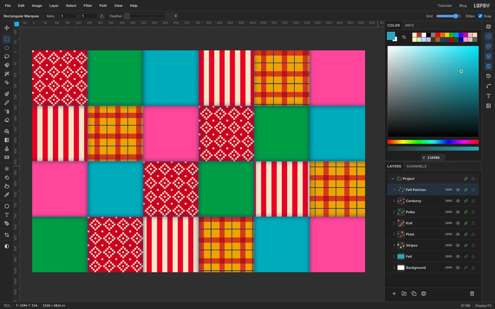

Three more layers, each with flat colour for now:

- *Polka*: select the polka squares and fill them with polka green `#2E9B4F`.
- *Corduroy*: select the corduroy squares and fill them with fur pink `#F0569A`.
- *Felt Patches*: select the felt squares, fill them with felt teal `#23A9B8`, then run **Add Noise** with **Amount 10** and **Mono**.

Press [[Cmd+D]] after each fill, and give each layer the same **Inner Glow** as before. The felt squares need their own layer so that they get the puffy edge too.

## Screen the polka dots

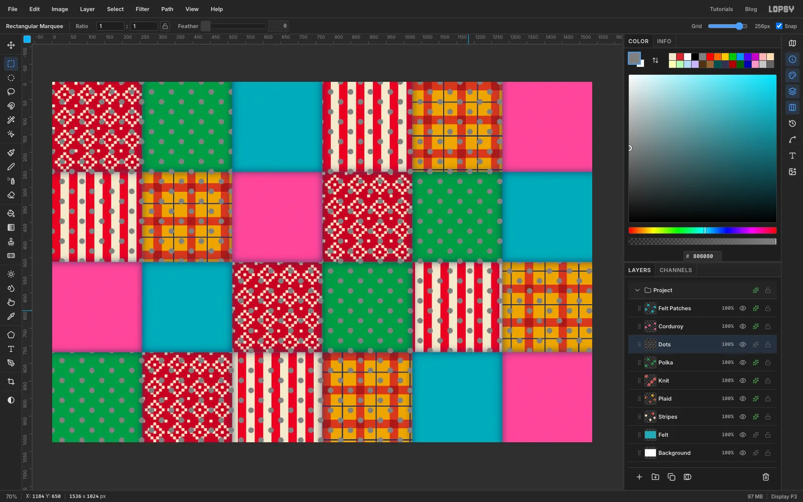

Click the *Polka* row, click **Add Layer**, and name the new layer *Dots*. Set the foreground to mid grey `#808080` and choose **Edit → Fill**.

Choose **Filter → Halftone…** and set **Dot Size 32**, **Density 0.8**, **Angle 45** and **Softness 1**. Click **Apply**. The flat grey turns into an even grid of round dots, and the gaps between them are transparent.

## Trim the dots and add corduroy wale

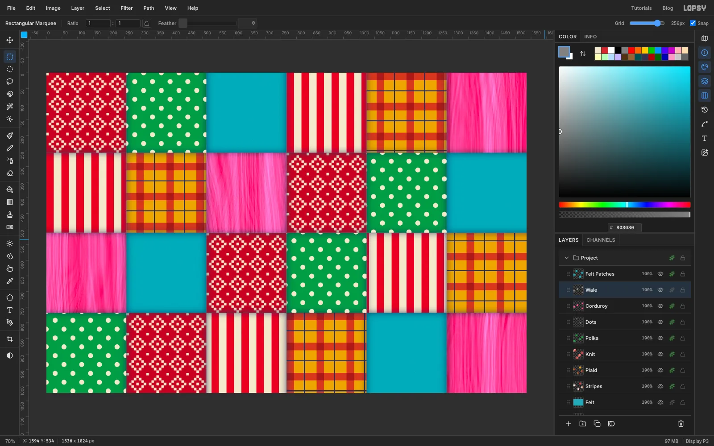

[[Cmd]]-click the *Polka* thumbnail to load the green squares as a selection. Choose **Select → Inverse**, click the *Dots* row, press [[Delete]], then [[Cmd+D]]. Open the effects for *Dots*, tick **Color Overlay**, and set it to cream `#F3E9CF`.

Click the *Corduroy* row, click **Add Layer**, and name the new layer *Wale*. Choose **Filter → Fibers…** with **Variance 24** and **Strength 40**. [[Cmd]]-click the *Corduroy* thumbnail, choose **Select → Inverse**, click *Wale*, press [[Delete]] and [[Cmd+D]]. Set the *Wale* layer's blend mode to **Overlay** in its effects panel. The pink now has a streaky wale.

## Hand-stitch the seams

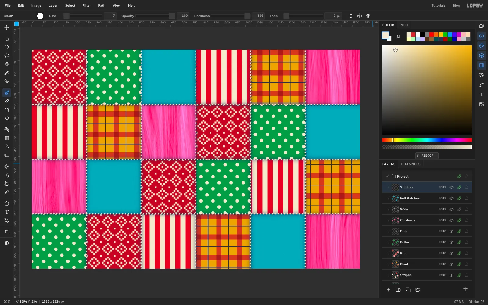

Click the *Felt Patches* row, click **Add Layer**, and name the layer *Stitches*. Choose **View → Show Grid** to turn the grid off.

Pick the **Brush** ([[B]]). Open the brush settings and set **Size 7**, **Hardness 100**, **Spacing 200** and **Opacity 100**. Spacing 200 leaves a gap after every dab, so a line comes out as a row of dots. Set the foreground to cream `#F3E9CF`.

Draw a straight stitch line along every seam. Click near the top edge of the canvas on a vertical seam, hold [[Shift]], and click near the bottom edge. Do the five vertical seams at x 256, 512, 768, 1024 and 1280, then the three horizontal ones at y 256, 512 and 768.

Give *Stitches* a **Drop Shadow** of seam shadow `#1B2350`, **Offset X 2**, **Offset Y 2**, **Blur 1**, **Opacity 80**. The stitches now look sewn into the fabric.

## Drop in the dachshund photo

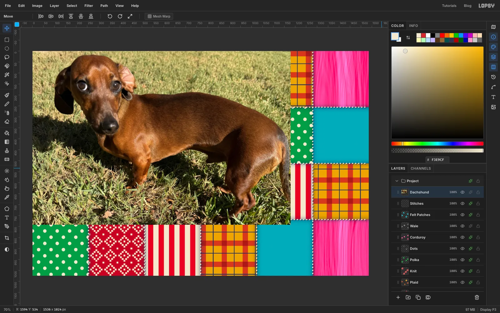

Click the *Stitches* row so the photo lands on top. Drag the downloaded photo from your folder onto the canvas. It arrives at full size in the top-left corner as a new layer. Rename it *Dachshund* and press [[Cmd+D]].

## Trace the dog with the Pen

Pick the **Pen** ([[P]]) and click your way around the dog with **corner clicks** only (don't drag). Start at the top of the head and work clockwise. Put an anchor every 30–60 px, and closer together around the ears, paws and tail. It helps to zoom in and hold [[Space]] to pan as you go.

- Stay two or three pixels **inside** the fur, so no grass comes along.
- Go round the outside of the floppy left ear, over the top of the head, round the right ear, and along the back.
- Follow the tail down to where it hangs beside the back leg and bring it to a point.
- Go down the back of the rear leg, round the paw and up the front of the leg.
- Run along the belly, round the front leg and paw, up the chest, and under the chin and nose.

Finish by clicking the first anchor again to close the path.

## Cut the dog out

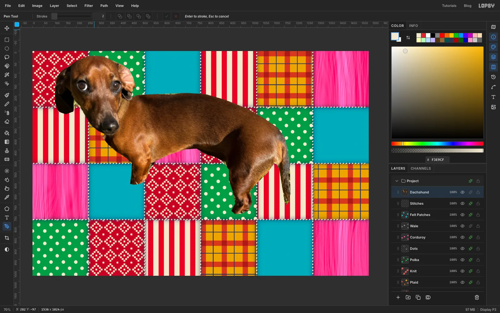

Open the **Paths** panel, click **Path to Selection**, then **Delete Path**. Choose **Select → Inverse**, press [[Delete]], and press [[Cmd+D]]. Only the dog is left.

## Shrink the dog to 70%

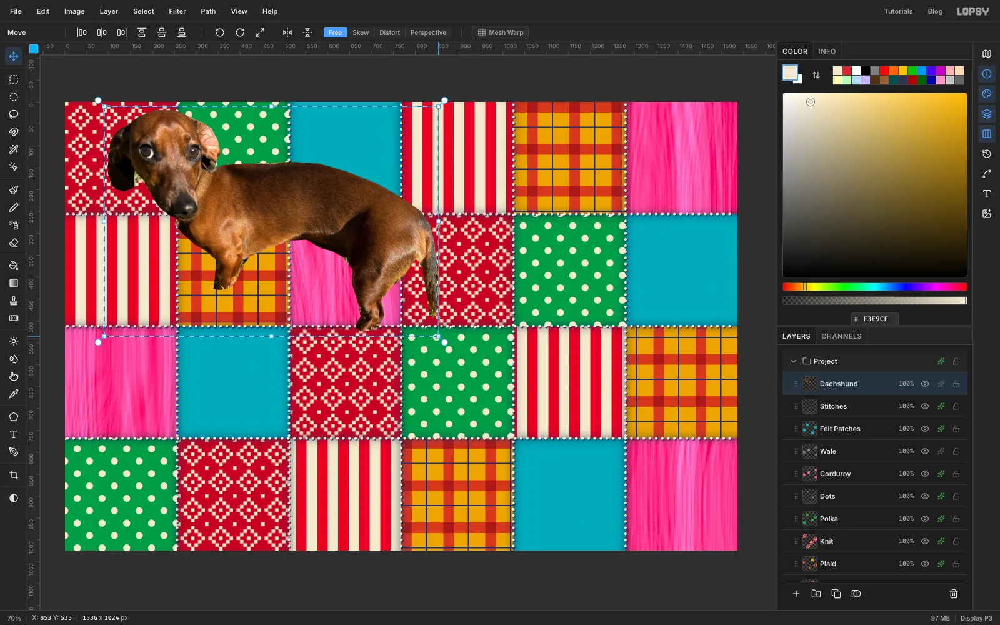

Open the marquee's exact-corners dialog and select **90, 10 → 1180, 760**, a box around the whole dog. Press [[V]] for the Move tool. Hold [[Cmd]] and drag the bottom-right handle up and left until the box ends near **853, 535**, which is 70%. [[Cmd]] keeps the proportions. Press [[Cmd+D]] to commit.

## Pull the back half away

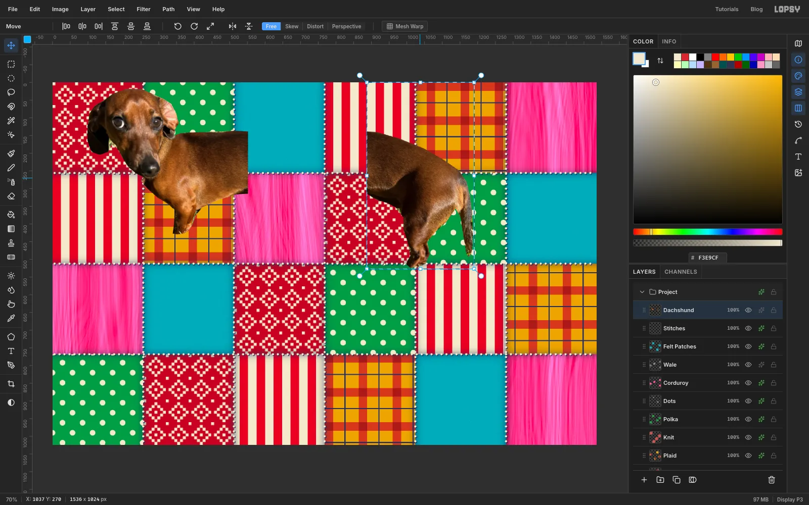

Now for the joke: make the dog longer. Press [[M]] for the Rectangular Marquee and, with the exact-corners dialog, select **552, 0 → 1191, 527**, which is everything from the middle of the back to the tail. Press [[V]] and drag it straight to the right, keeping it level, until it has moved about **336 px**. Finish with the arrow keys ([[Shift+Right]] moves 10 px, [[Right]] moves 1 px). Press [[Cmd+D]].

## Stretch a slice of body into the gap

Press [[M]] and select **517, 0 → 552, 527**. This 35 px slice is where the belly line is flattest. Press [[Cmd+C]], then [[Cmd+D]], then [[Cmd+V]]. Lopsy pastes the slice in place on a new layer and switches to the Move tool. Press [[Shift+Right]] three times and [[Right]] twice to slide it **32 px** right, so it starts a few pixels inside the body (the overlap hides the join). Press [[Cmd+D]].

Press [[M]] and select the pasted slice again: **549, 0 → 584, 527**. Press [[V]] and drag its **right-middle** handle across the gap to about x **891**, just past where the hips begin. Press [[Cmd+D]]. Choose **Layer → Merge Down** to fold the stretched slice into *Dachshund*.

> **Tip:** Stretch a pasted copy, not the original, so the untouched pixels underneath fill any soft edge where the two meet.

## Give the front leg some reach

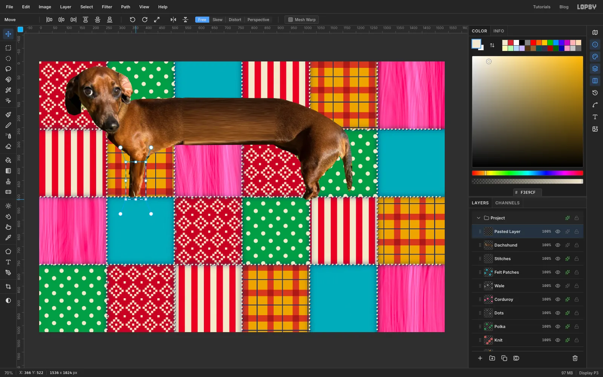

The front paw now sits much higher than the back paws, so the dog looks as if it's tipping over. Press [[M]] and select **328, 380 → 404, 432**, the lower part of the front leg. Press [[Cmd+C]], [[Cmd+D]], [[Cmd+V]] to paste a copy in place. Press [[Cmd+D]], press [[M]], and select it again with the same corners.

Press [[V]] and drag the **bottom-middle** handle down from y 432 to about y **522**, level with the back paws. Press [[Cmd+D]] and choose **Layer → Merge Down**.

## Pick off the leftover grass

A few blades of grass always sneak in along the legs. Pick the **Magic Wand** ([[W]]), set **Tolerance 24**, and tick **Contiguous**. Click a green blade, then [[Shift]]-click every other green spot you can find along the legs and belly. Press [[Delete]] and [[Cmd+D]].

> **Note:** Keep **Contiguous** on. With it off, the wand also picks up dark spots inside the ears and punches holes in the dog.

## Turn the dog into a sticker

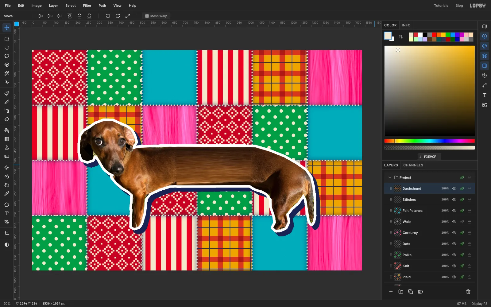

With the Move tool and no selection, drag the dog about **125 px right** and **312 px down**, then tidy it up with the arrow keys. Its body now runs from about x 224 to x 1311.

Open its effects and add:

- **Stroke**: white `#FFFFFF`, **Width 12**, position **Outside**
- **Drop Shadow**: seam shadow `#1B2350`, **Offset X 18**, **Offset Y 18**, **Blur 0**, **Spread 0**, **Opacity 100**

A blur of 0 gives the hard, printed shadow of a cheap sticker.

## Add the far front leg

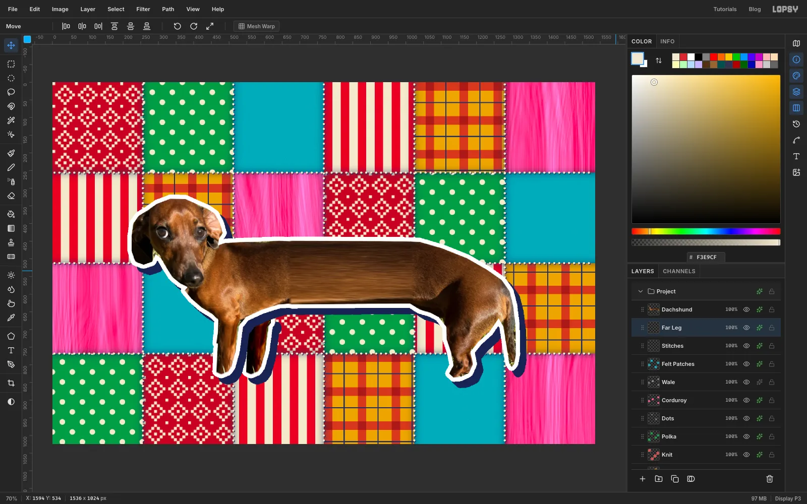

Press [[M]] and select **450, 672 → 534, 840** around the front leg. Press [[Cmd+C]] and [[Cmd+D]]. Click the *Stitches* row, then press [[Cmd+V]]. The copy lands just under *Dachshund*, so it sits behind the dog. Rename it *Far Leg*.

Press [[V]], then press [[Shift+Right]] eight times and [[Right]] four times to slide it **84 px** right. Press [[Cmd+D]]. Choose **Filter → Brightness/Contrast…** with **Brightness −25** so it reads as the leg in shadow. Give it the same **Stroke** and **Drop Shadow** as the dog.

## Mark out the sweater

Click the *Dachshund* row, click **Add Layer**, and name the layer *Sweater*. Press [[M]] and select **540, 400 → 1068, 668**, a box from behind the front leg to just before the hips. The sweater will be a simple tube, so its ends stay straight.

## Knit the sweater

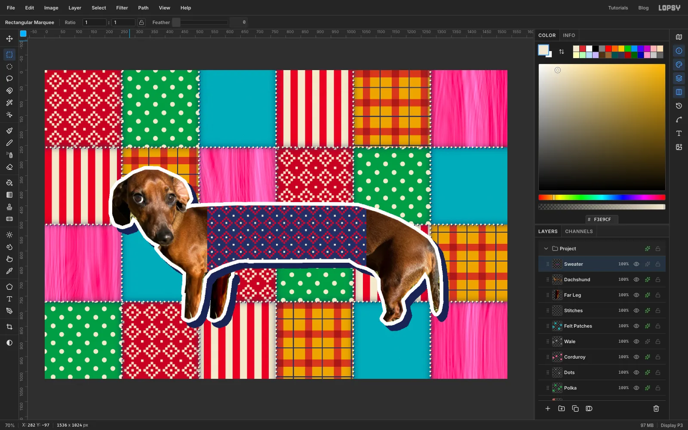

Choose **Edit → Fill with Pattern…**, click the **navy knit** swatch, set **Scale 150**, and click **Apply**. Press [[Cmd+D]].

The box spills over the dog's back and belly. To clip it, [[Cmd]]-click the *Dachshund* thumbnail, choose **Select → Inverse**, click *Sweater*, press [[Delete]] and [[Cmd+D]].

## Give the knit some texture and cuffs

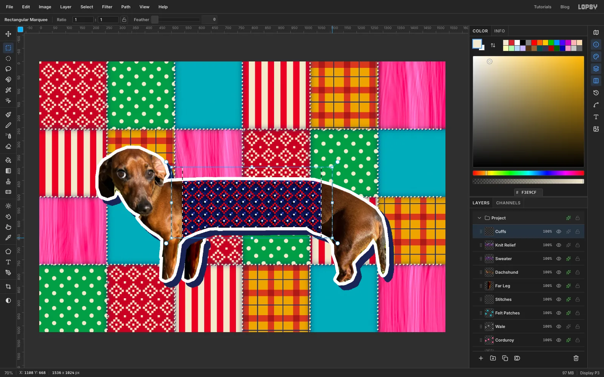

With *Sweater* active, choose **Layer → Duplicate Layer** and rename the copy *Knit Relief*. Choose **Filter → Emboss…** with **Angle 135** and **Strength 60**, then set the layer's blend mode to **Overlay** in its effects panel. The stitches now look raised.

Click *Sweater* and add an **Inner Glow**: `#1B2350`, **Size 26**, **Opacity 75**. The sweater now looks wrapped around a round body.

Click *Knit Relief*, click **Add Layer**, and name the layer *Cuffs*. Press [[M]] and use the exact-corners dialog to select **500, 400 → 542, 668** for the front cuff. Then hold [[Shift]] and drag a second marquee of the same size over the back end of the sweater, from about **1066, 400** to **1108, 668**. The dialog only opens with nothing selected, so this one is a drag. The transform box frames both strips together.

## Fill the ribbed cuffs

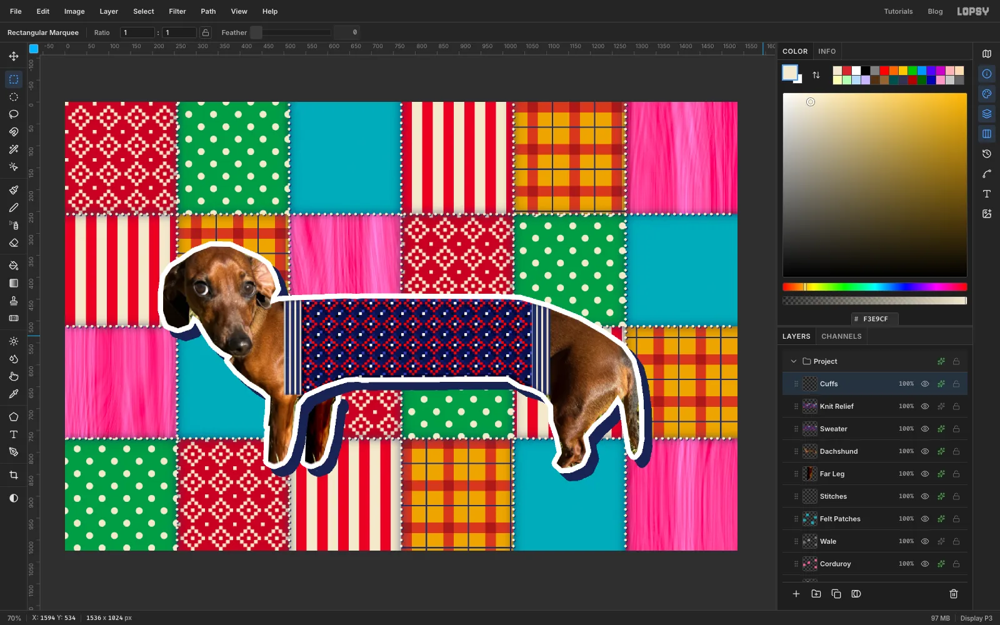

Choose **Edit → Fill with Pattern…**, click the **rib** swatch, keep **Scale 100**, and click **Apply**. Press [[Cmd+D]]. Clip the cuffs to the dog the same way: [[Cmd]]-click the *Dachshund* thumbnail, choose **Select → Inverse**, click *Cuffs*, press [[Delete]] and [[Cmd+D]].

Give *Cuffs* an **Inner Glow** of `#1B2350`, **Size 12**, **Opacity 70**.

## Puff up the nose

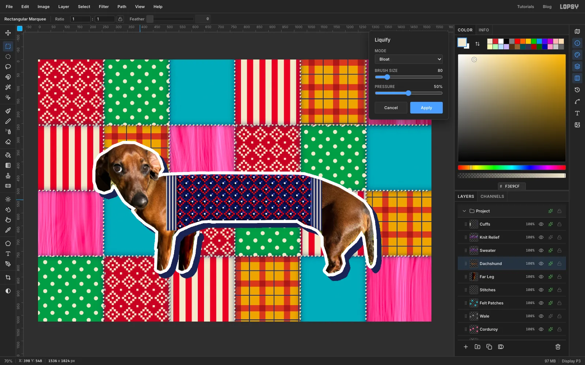

Click the *Dachshund* row and choose **Filter → Liquify…**. Set **Mode** to **Bloat** and **Brush Size** to **80**. Press on the dog's nose and make a tiny circle with the mouse, only a few pixels across, then let go. One short wiggle is enough. Click **Apply**.

## Glue on googly eyes

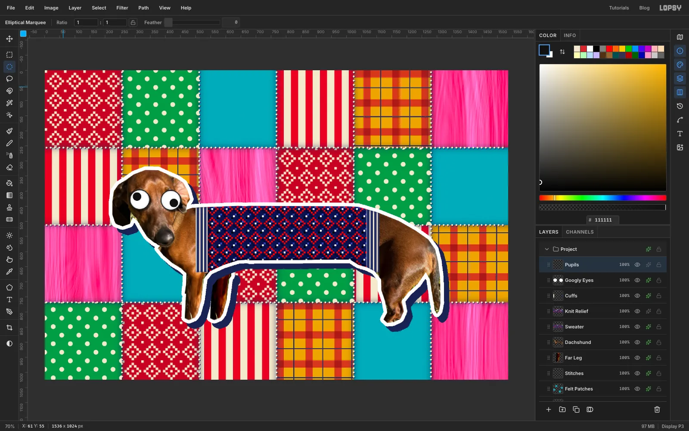

Click the *Cuffs* row, click **Add Layer**, and name the layer *Googly Eyes*. Pick the **Elliptical Marquee** and use its exact-corners dialog (click once with nothing selected) to select a circle **284, 397 → 346, 459** over the left eye. Fill it with white `#FFFFFF` and press [[Cmd+D]]. Then use the dialog again to select **387, 399 → 449, 461** over the right eye, and fill that.

Press [[Cmd+D]] and add these effects:

- **Stroke**: `#1B1B1B`, **Width 3**
- **Inner Glow**: `#7A8090`, **Size 10**, **Opacity 45**, for the curve of the plastic
- **Drop Shadow**: black, **Offset X 4**, **Offset Y 5**, **Blur 4**, **Opacity 60**

Click **Add Layer** again and name the layer *Pupils*. Set the foreground to `#111111`. Use the Elliptical Marquee's dialog for two small circles that point different ways, filling each and pressing [[Cmd+D]] in between:

- **292, 404 → 320, 432** (looking up and left)
- **414, 425 → 442, 453** (looking down and right)

## Draw a Santa hat

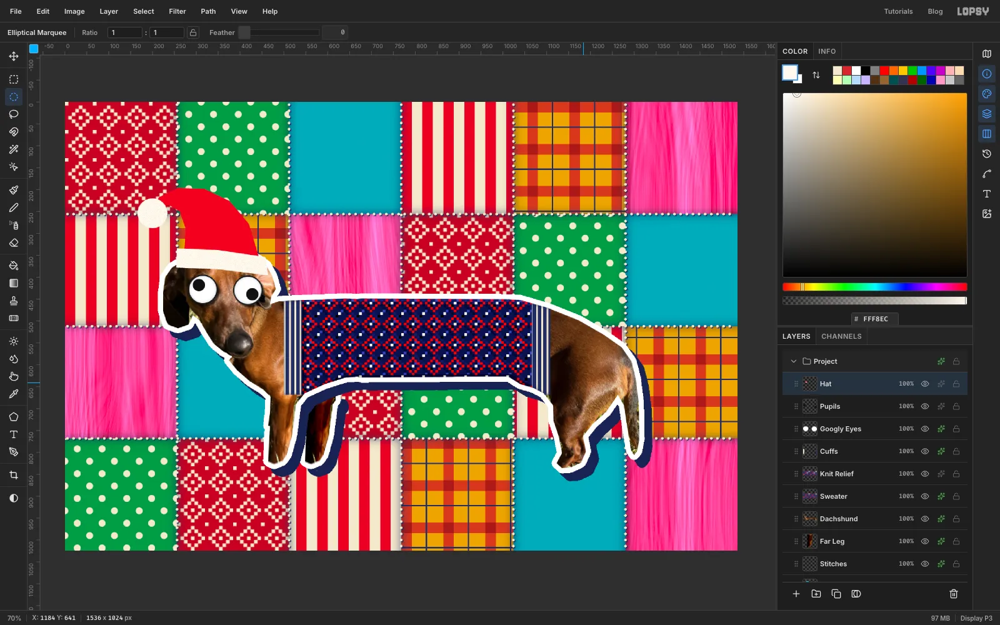

Click **Add Layer** and name the layer *Hat*. With the **Pen**, corner-click the cone of the hat in this order. It rises from the left of the crown, folds over to a tip that flops down on the left, then runs over the top and down the right side:

1. 272, 348 (left of the crown)
2. 276, 290
3. 262, 250
4. 236, 234
5. 204, 250 (the floppy tip)
6. 214, 218
7. 258, 196
8. 318, 198 (top of the fold)
9. 376, 226
10. 420, 278
11. 448, 370 (right of the crown)

Click the first anchor to close the path. In the Paths panel click **Path to Selection** and **Delete Path**, then fill with hat red `#E0262E` and press [[Cmd+D]].

Pen the brim the same way, as a slightly tilted band across the base of the cone: **256, 334 → 350, 338 → 458, 354 → 464, 396 → 352, 382 → 254, 378**, then back to the first anchor. Make it a selection, delete the path, and fill it with fur white `#FFF8EC`. Run **Filter → Add Noise…** with **Amount 40**, **Mono** and **Gaussian** to make it fluffy. Press [[Cmd+D]].

For the pom-pom, select the circle **166, 220 → 234, 288** with the Elliptical Marquee's dialog. Fill it with fur white and run the same **Add Noise**. Press [[Cmd+D]].

## Tip the hat back

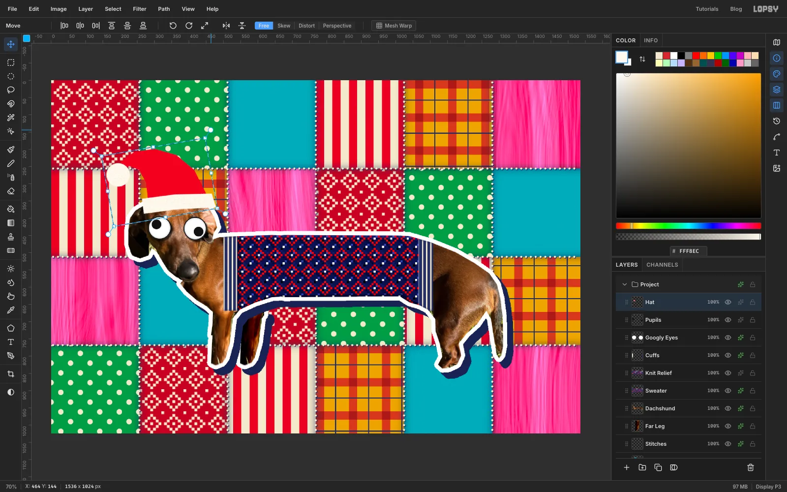

Press [[M]] and draw a rectangular marquee a little larger than the whole hat, then press [[V]]. Small round **rotation handles** appear just outside the corners of the box. Drag the top-right one to rotate the hat about **10° anticlockwise**. There's no angle readout, so judge it by eye. Press [[Cmd+D]] to commit.

## Make the hat a sticker too

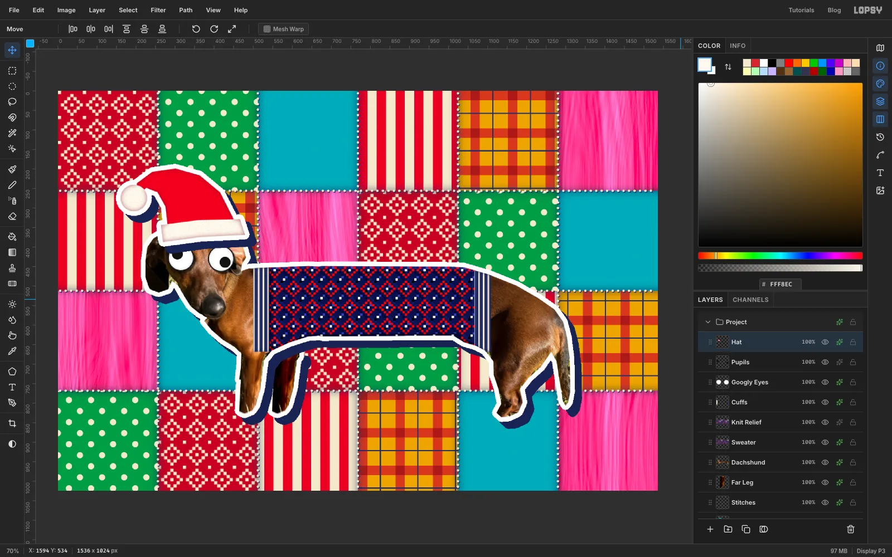

Give *Hat* the same sticker look as the dog:

- **Inner Glow**: `#6B0F1A`, **Size 18**, **Opacity 60**
- **Stroke**: white, **Width 12**, **Outside**
- **Drop Shadow**: `#1B2350`, **Offset X 18**, **Offset Y 18**, **Blur 0**, **Opacity 100**

## Set HAPPY

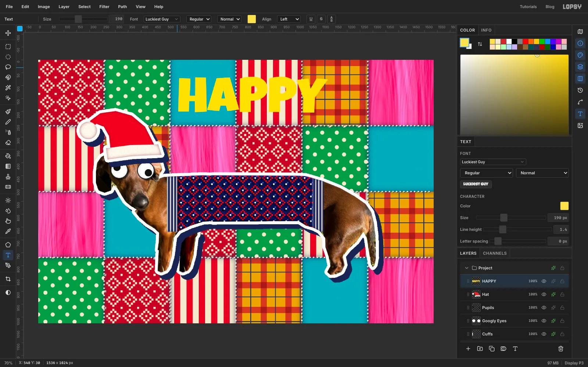

With *Hat* still active, pick the **Text** tool ([[T]]). In the options bar set the font to **Luckiest Guy**, the size to **190**, and the colour to title yellow `#FFE14A`. Check that **Letter spacing** in the Text panel is **0**. Click at about **540, 30**, type **HAPPY**, and press [[Tab]] to commit.

## Tip HAPPY to the left

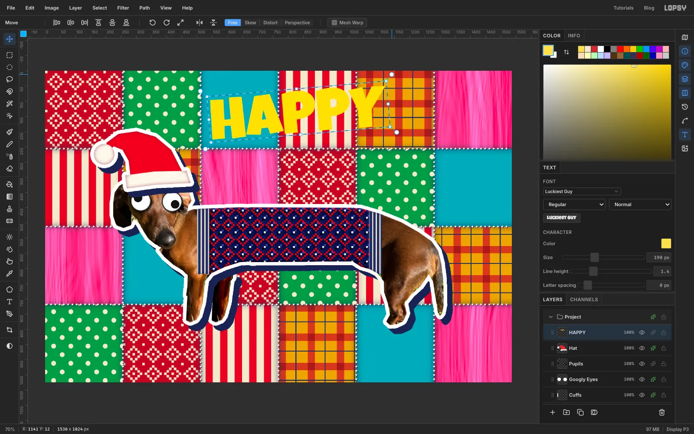

Click **Rasterize Layer** at the bottom of the Layers panel. Press [[M]], draw a marquee a little larger than the word, press [[V]], and drag a rotation handle about **5° anticlockwise**. Press [[Cmd+D]].

Add a **Stroke** of navy `#252E62`, **Width 10**, **Outside**. Then add a **Drop Shadow** of fur pink `#F0569A`, **Offset X 14**, **Offset Y 14**, **Blur 0**, **Opacity 100**.

## Clash it with HOLIDAYS!

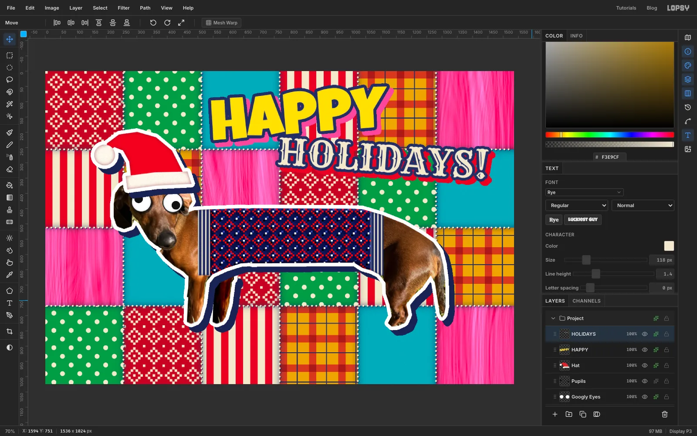

With *HAPPY* active (it's a raster layer now, so the next text won't restyle it), set the font to **Rye**, the size to **118**, and the colour to cream `#F3E9CF`. Click at about **760, 204**, type **HOLIDAYS!**, and press [[Tab]].

Rasterize it, then marquee it and rotate it about **4° clockwise** the same way, then press [[Cmd+D]]. Add a navy `#252E62` **Stroke** of **Width 9** and a candy red `#D7262E` **Drop Shadow** at **14 / 14** with **Blur 0**. All the shadows still fall down and to the right; only the colours clash.

## Slap on a starburst

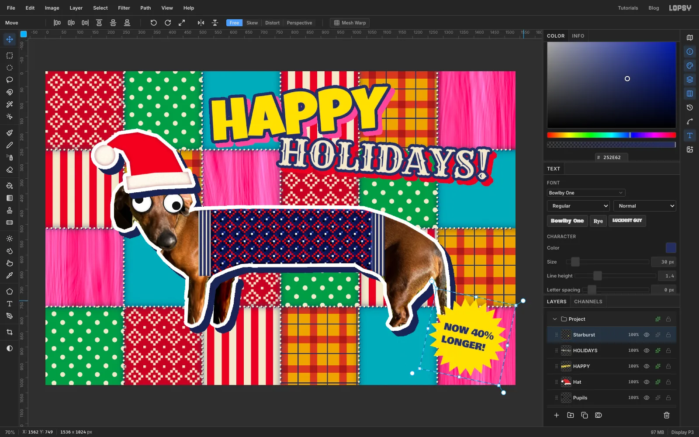

Click **Add Layer** and name the layer *Starburst*. Its centre is at **1380, 868**, overlapping the back paw. With the **Pen**, corner-click a starburst around that centre, alternating a spike tip and a dip all the way round:

- Put the tips about **128 px** from the centre and the dips about **101 px** from it, so the spikes are short and stubby.
- Place the first four tips at 12, 3, 6 and 9 o'clock, then fill in the rest by eye. That's about 22 spikes in all.
- Click the first anchor to close the path.

A little unevenness is fine: it's a cheap sticker. In the Paths panel click **Path to Selection** and **Delete Path**. Deleting the path matters, because the script line later picks its curve from the path list. Fill with title yellow `#FFE14A` and press [[Cmd+D]].

Pick the **Text** tool, set **Bowlby One**, size **30**, colour navy `#252E62`, and click inside the star. Type **NOW 40%**, press [[Return]], type **LONGER!**, and press [[Tab]]. Rasterize it and centre it on the star with the Move tool's arrow keys. Choose **Layer → Merge Down** to merge it into *Starburst*.

Press [[M]], marquee the star, press [[V]], and rotate it about **12° clockwise**. Press [[Cmd+D]]. Add a navy **Stroke** of **Width 6**, **Outside**, and a navy `#252E62` **Drop Shadow** at **18 / 18**, **Blur 0**, **Opacity 100**, so it matches the other stickers.

## Sew on the garment label

Click the *Cuffs* row, click **Add Layer**, and name the layer *Label*. Press [[M]] and select **652, 486 → 952, 598** and fill it with cream `#F3E9CF`. Press [[Cmd+D]].

Pick the **Brush** and set **Size 3**, **Hardness 100** and **Spacing 200**. Set the foreground to navy `#252E62`. Click at **661, 495**, then [[Shift]]-click **943, 495**, **943, 589**, **661, 589** and back to **661, 495**. That makes a dotted stitch border 9 px inside the edge.

Pick the **Text** tool, set **IBM Plex Mono**, size **34**, navy. Click inside the label, type **100% QUILTED**, press [[Return]], type **DACHSHUND**, and press [[Tab]]. Rasterize it, centre it on the label with the arrow keys, and choose **Layer → Merge Down**.

Press [[M]], marquee the label, press [[V]], and rotate it about **6° anticlockwise**. Press [[Cmd+D]]. Add a soft **Drop Shadow**: black, **Offset X 3**, **Offset Y 4**, **Blur 4**, **Opacity 55**.

## Draw the curve for the sign-off

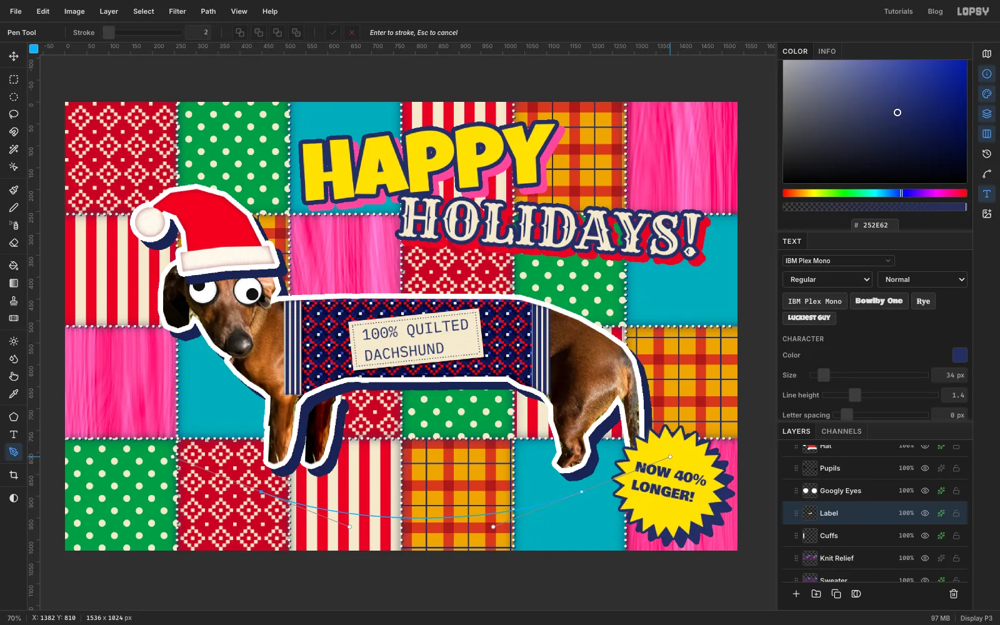

Pick the **Pen**. Press at **448, 890** and drag the handle out to about **650, 970** before releasing. Then press at **1180, 890** and drag its handle out to about **1382, 810**. The path sags gently between the two points. Click the **✓** (Commit path) button in the options bar. Don't press [[Return]], which would stroke the path with paint.

## Set the script on the curve

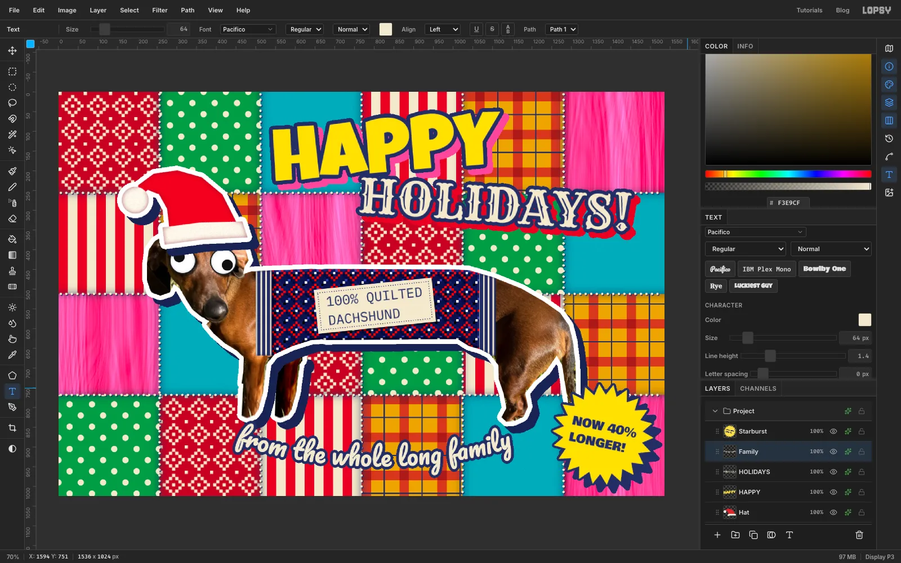

Click the *HOLIDAYS* row so the next text doesn't restyle anything. Pick the **Text** tool, set **Pacifico**, size **64**, cream `#F3E9CF`. Click in an empty spot below the dog, type **from the whole long family**, and press [[Tab]]. Rename the layer *Family*.

In the options bar, set **Path** to **Path 1**. The words jump onto the curve, starting at its left end. Add a navy **Stroke** of **Width 7**, **Outside**. Click the path in the Paths panel to hide its outline.

## Group the dog and nudge it into place

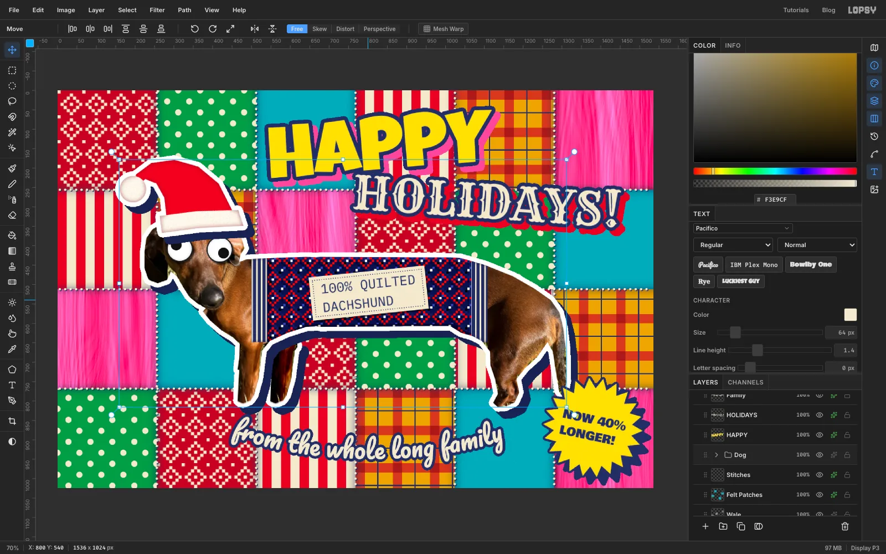

Click the *Far Leg* row and [[Shift]]-click the *Hat* row. That selects every dog layer: the dog, the sweater, its texture and cuffs, the label, eyes and hat. Choose **Layer → Group Layers** and name the group *Dog*.

With the group active and nothing selected, use the **Move** tool to drag the whole dog up **20 px**, so the script line has more room. Everything in the group moves together, effects included.

## Add photocopy grit

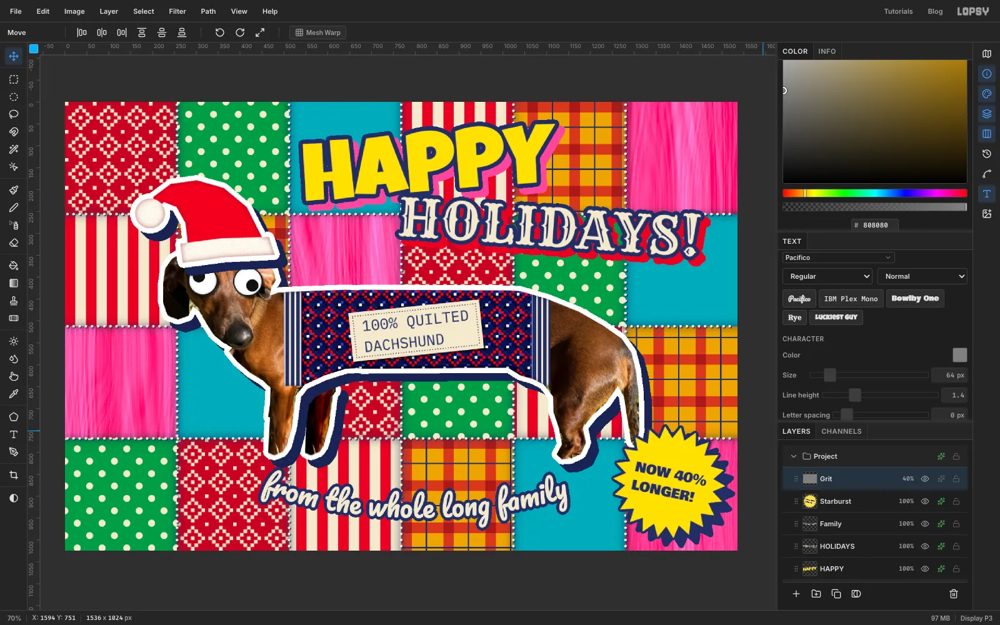

Click the *Starburst* row, click **Add Layer**, and name the layer *Grit*. Fill it with mid grey `#808080` and choose **Filter → Add Noise…** with **Amount 30**, **Mono** and **Gaussian**. In its effects panel, set the blend mode to **Overlay**. Then set the layer opacity to **40%** with the opacity control on its row. Mid grey vanishes in Overlay, so only the grain is left. It dirties the flat colours just enough to look printed.

Choose **File → Save Project** to keep the layers. Then choose **File → Quick Export PNG** for the finished card.
