Anti-aesthetic design borrows the look of things nobody "designed": the takeaway leaflet pushed through your letterbox, the corner-shop sign, the menu someone made in a word processor. It has too many fonts, WordArt titles, starbursts that shout FREE, hard drop shadows on everything and colours that fight. Done on purpose, it's funny and hard to ignore. The trick is that it still has to read: every price lines up, every sticker sits where you put it, and nothing touches the edge of the page by accident.

In this tutorial you'll build a menu for an imaginary curry house, **Vindaloo Xpress**. The two food photos are public domain on Wikimedia Commons: [Vindaloo.JPG](https://commons.wikimedia.org/wiki/File:Vindaloo.JPG) (CC0) and [Samosa fried.JPG](https://commons.wikimedia.org/wiki/File:Samosa_fried.JPG) (public domain). Crop the curry photo to a square around the plate and the samosa photo to a rectangle around the samosas before you start. Any two food photos will do.

Along the way you'll use:

- the **Sunburst** filter twice: once for background rays and once, with Taper, for a starburst sticker
- ruler **guides**, the **grid** with snapping, and the **Shape** tool's click-to-size dialog for rounded cards and pills
- a **gradient through type** (Cmd-click the text thumbnail), a hand-built **3D extrusion** with Duplicate and Merge Down, and **Perspective** transform mode
- **Chromatic Aberration** for print misregistration, and **Posterize** and **Add Noise** for a cheap-print look
- live text in **Lobster**, **Luckiest Guy**, **Racing Sans One**, **Bangers**, **Anton** and **Comic Neue**, including centred and right-aligned point text, the **Text** panel's line height and colouring one line of a text block
- **Define Pattern** for a checker strip, and **Define Color Brush** to stamp chilli icons
- the **Lasso** for clip-art shapes, **Stroke**, **Drop Shadow** and **Color Overlay** effects, and the **Eraser**
- pasting photos, scaling and rotating with the **Move** tool, copy and paste, cut and paste, and rotating whole **groups**

The palette is supposed to clash:

- Paper `#FFE41A`, menu area `#FFD21A`, rays `#FFB000`
- Takeaway red `#E3201B`, ink black `#111111`, footer blue `#1F3CFF`, white `#FFFFFF`
- Title gradient `#FFF55A` → `#FFB000` → `#FF4A00` → `#D0001E`, extrusion purple `#5A0FA8`
- Sticker pink `#FF1F8E`, lime `#8CF000`, cyan `#19D3FF`
- Chilli `#FF5A3C` → `#E3201B` → `#9E0014`, calyx `#2FB52F`, stalk `#1E7F1E`
- Flames `#FF6A00` / `#FFD200`, grain grey `#808080`

> **Tip:** On Windows and Linux, use Ctrl wherever this tutorial says Cmd. Positions are in document pixels, written `x, y`. The status bar shows where the pointer is. **Edit → Fill** fills the selection with the foreground colour, and [[Cmd+D]] deselects and commits a transform. Layer effects (Stroke, Drop Shadow and so on) live in each layer's effects drawer: click the sparkle icon on its row.

> **Tip:** New layers always land directly above the active layer, and inside a group if a group row is active. Before you add a new group next to an existing one, collapse the existing group and click its row, so the new group lands beside it rather than inside it.

## Set up the paper and guides

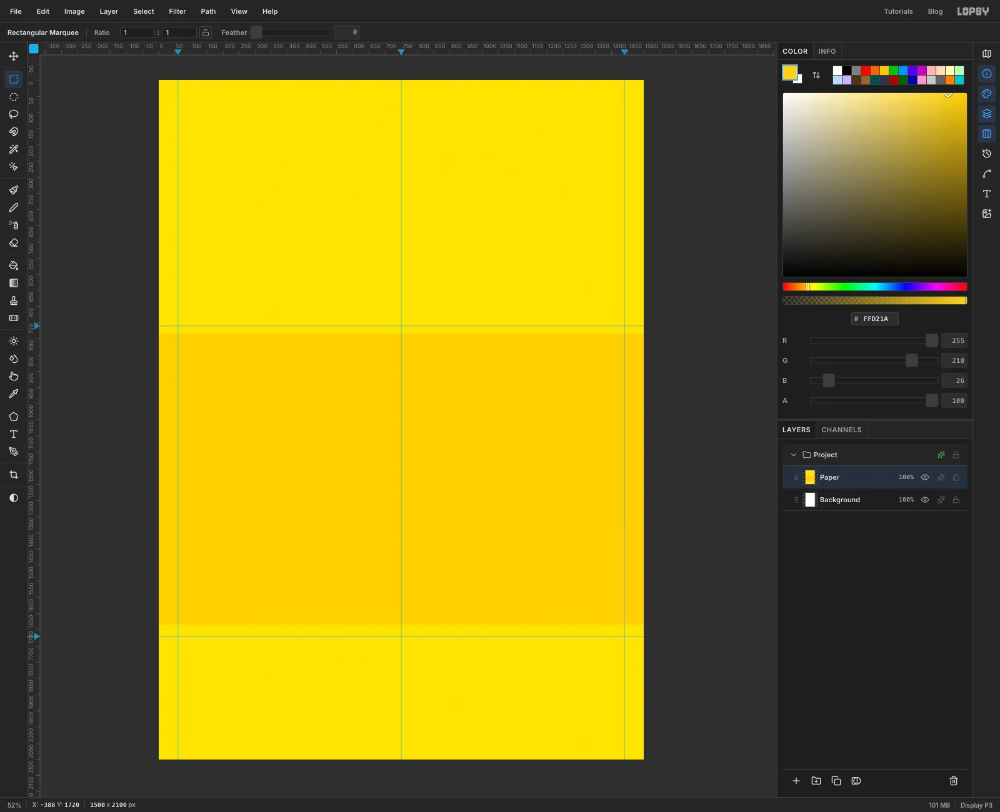

1. In the **New Document** dialog, set **Width** to `1500` and **Height** to `2100` and click **Create**.
2. Double-click **Layer 1** and rename it `Paper`. Set the foreground colour to `#FFE41A` and choose **Edit → Fill**.
3. With the **Rectangular Marquee**, select the middle of the page from about `y = 780` down to about `y = 1680`, edge to edge. Fill it with `#FFD21A` and deselect. This slightly deeper yellow will separate the menu area from the header. The red band and checker strip you add later will cover both edges.
4. Click the top ruler at `x = 60`, `750` and `1440` to drop vertical guides for the margins and the centre. Click the left ruler at `y = 760` and `y = 1720` for horizontal guides where the header and footer will end.

## Paint sunburst rays behind the header

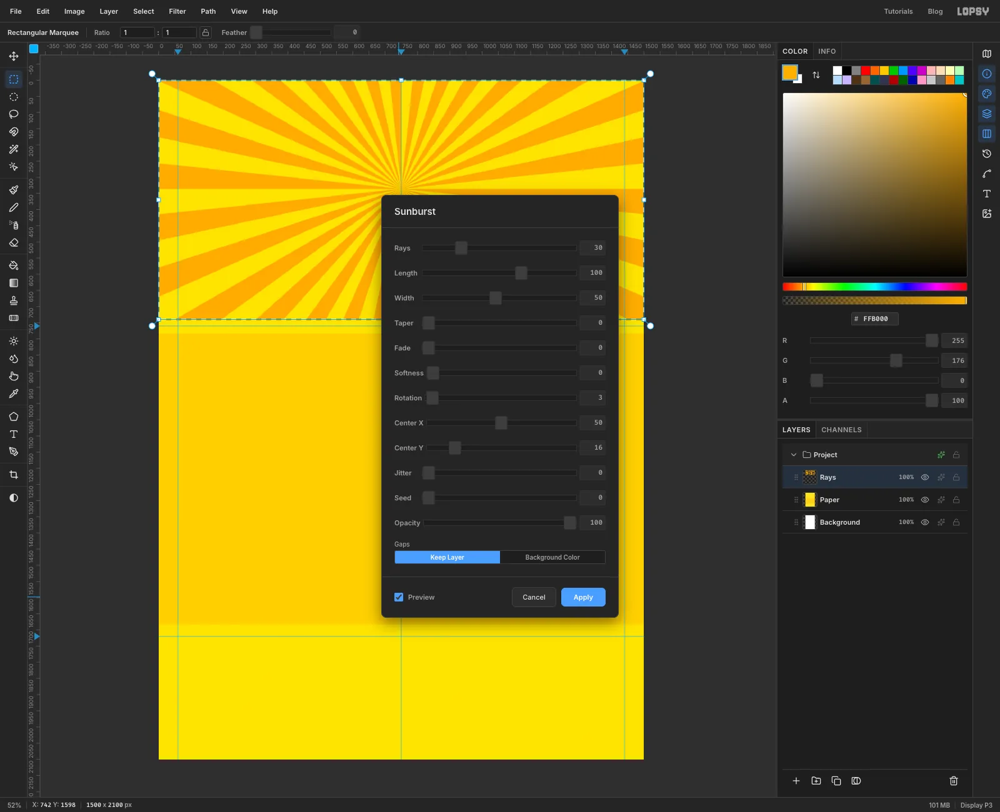

1. Click **Add Layer** in the Layers panel and name the layer `Rays`.
2. With the **Rectangular Marquee**, drag over the top of the page from the top-left corner down to `y = 740`, just above the top guide, across the full width.
3. Set the foreground colour to `#FFB000` and choose **Filter → Sunburst…**.
4. Set **Rays** to `30`, **Width** to `50`, **Length** to `100`, **Center X** to `50`, **Center Y** to `16` and **Rotation** to `3`. Tick **Preview** to see it, then click **Apply** and deselect.

The rays only fill the selection, so they stop cleanly at the bottom of the header.

## Add the red band, checker strip and footer

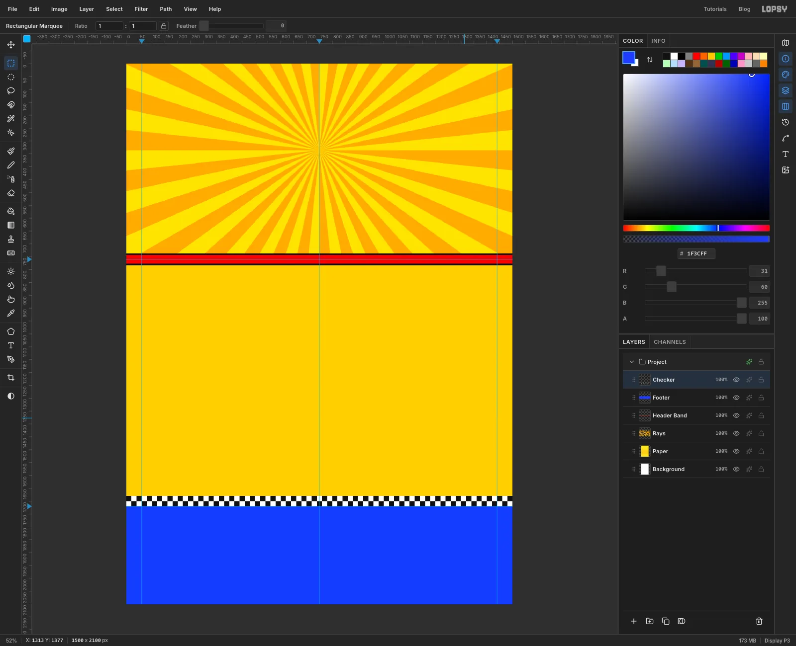

1. Add a layer named `Header Band`. Select a strip from `y = 740` to `y = 780` across the full width and fill it with `#E3201B`.
2. Choose the **Pencil**, set **Size** to `6` and the foreground to `#111111`. Click at the left edge on the top of the band, then [[Shift]]-click at the right edge to draw a straight rule. Do the same along the bottom of the band.
3. Make the checker tile on a scratch layer. Add a layer, then in the top-left corner fill a 40 × 40 square with white and two diagonally opposite 20 × 20 squares inside it with black. Select the 40 × 40 square and choose **Edit → Define Pattern**. Deselect and delete the scratch layer.
4. Click **Header Band**, add a layer named `Footer`, and fill everything from `y = 1720` to the bottom of the page with `#1F3CFF`.
5. Add a layer named `Checker`, select a strip from `y = 1680` to `y = 1720` across the full width, and choose **Edit → Fill with Pattern…** with your checker tile. Deselect.

## Type the tagline and the title

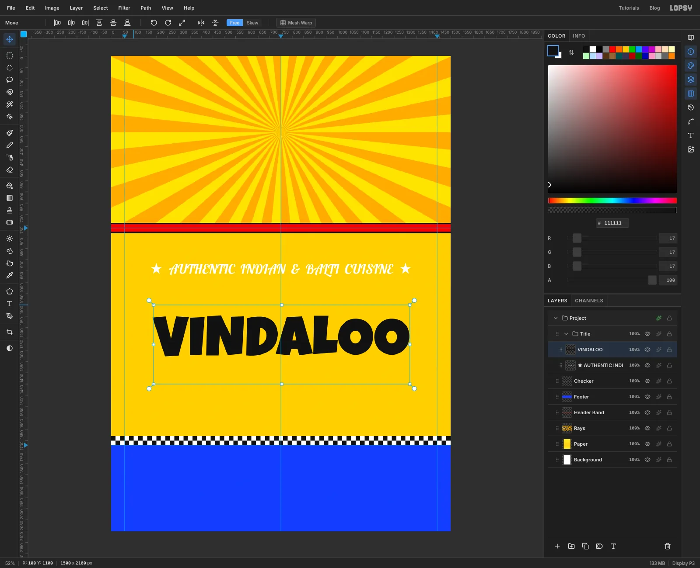

1. Click **Checker**, then click **New Group** and name the group `Title`.
2. Choose the **Text** tool and set the font to **Lobster**, **Size** `58`, colour white. Click in an empty part of the page and type `★  AUTHENTIC  INDIAN  &  BALTI  CUISINE  ★`. Use two spaces between the words, because the red **Stroke** you add in a moment fattens every letter and would close up single spaces. Press [[Tab]] to commit.
3. Switch to the **Move** tool and click **Align center horizontally** in the options bar.
4. Click the **Title** group row so the next text doesn't restyle the tagline. With the **Text** tool, choose **Luckiest Guy**, **Size** `250`, colour `#111111`, click lower down in empty canvas, type `VINDALOO` and press [[Tab]]. Centre it with **Align center horizontally** too.

> **Tip:** A text-tool click on or just beside an existing text layer edits that layer instead of starting a new one, so always start new text in empty canvas and move it afterwards.

## Move the type into place and style the tagline

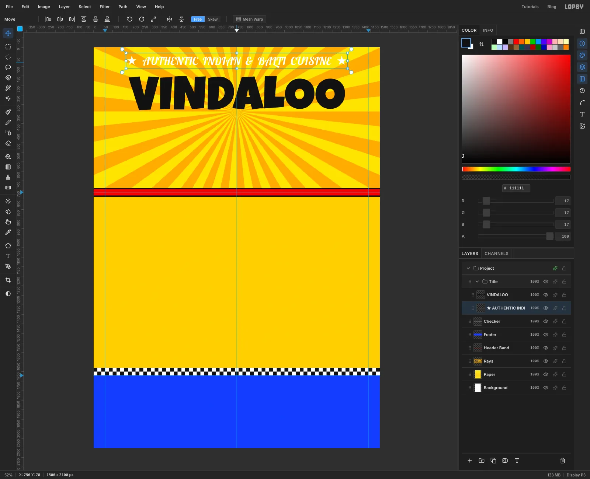

1. With the **Move** tool and the **VINDALOO** layer active, drag the word up until the tops of the letters are about 150 px from the top of the page.
2. Click the tagline's row and drag it up until it sits about 45 px from the top.
3. Open the tagline's effects drawer. Turn on **Stroke** with **Width** `5` and colour `#E3201B`. Turn on **Drop Shadow** with **Offset X** and **Offset Y** `5`, **Blur** `1` and **Opacity** `100`, in black.

A **Blur** of `1` gives a hard, cheap-looking shadow without the light seam a blur of `0` can leave around anti-aliased edges.

## Fill the title with a WordArt gradient

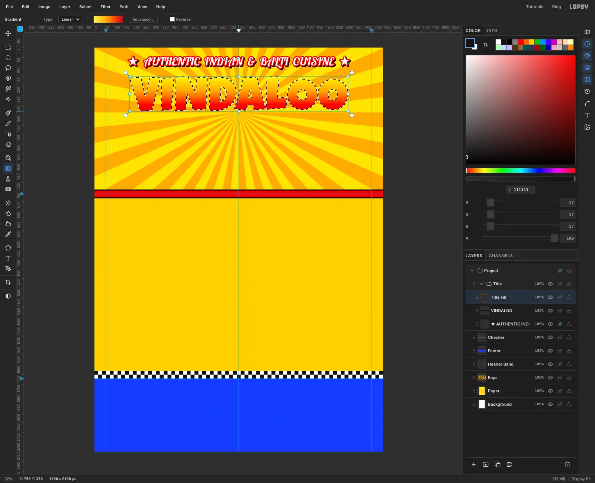

1. Click the **VINDALOO** row so the new layer will land above it, then [[Cmd]]-click its thumbnail to select the letters.
2. Add a layer named `Title Fill`.
3. Choose the **Gradient** tool, set the type to **Linear**, click **Advanced…** and set four stops: `#FFF55A` at the left, `#FFB000` at about 40%, `#FF4A00` at about 72% and `#D0001E` at the right. Click **Done**.
4. Drag straight down from the top of the letters to the bottom. Deselect.

## Build a chunky 3D extrusion

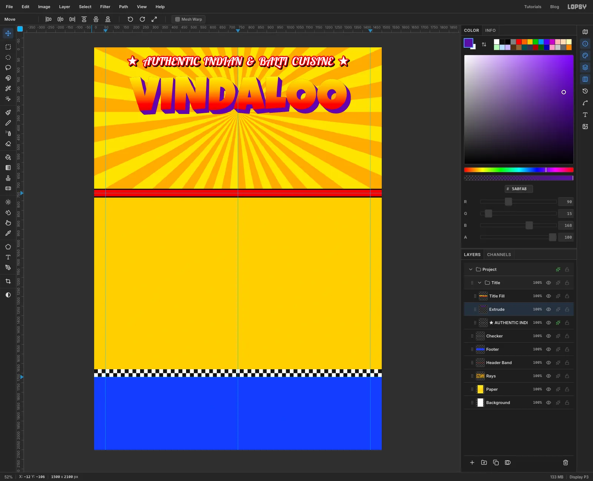

1. Click the **VINDALOO** text row and click **Rasterize Layer** in the Layers panel toolbar. Rename the layer `Extrude`.
2. [[Cmd]]-click its thumbnail, fill the selection with `#5A0FA8` and deselect.
3. Choose **Layer → Duplicate Layer** and click the copy's row. With the **Move** tool, press the right arrow 3 times and the down arrow 3 times, then press [[Cmd+E]] to **Merge Down**.
4. Repeat with 6 presses each way, then with 12 presses each way.

Each merge doubles the depth (3, then 9, then 21 px), so three merges build a solid 21 px extrusion with no gaps.

## Outline the title

1. On **Title Fill**, turn on **Stroke** with **Width** `8` in `#111111`.
2. Do the same on **Extrude**.
3. In each drawer, click **Rasterize Layer Style** to bake the outline into the pixels.
4. Click **Title Fill** and press [[Cmd+E]] to merge it into **Extrude**. Rename the merged layer `VINDALOO Art`.

## Give it the WordArt perspective

1. With the **Rectangular Marquee**, drag around the whole title, leaving a little room on every side.
2. Choose the **Move** tool and click **Perspective** in the options bar.
3. Drag the top-left corner handle about 70 px to the right. The top-right corner mirrors it, so the top of the word narrows while the bottom stays put.
4. Press [[Cmd+D]] to commit, then click **Free** again.

## Centre it and add misregistration

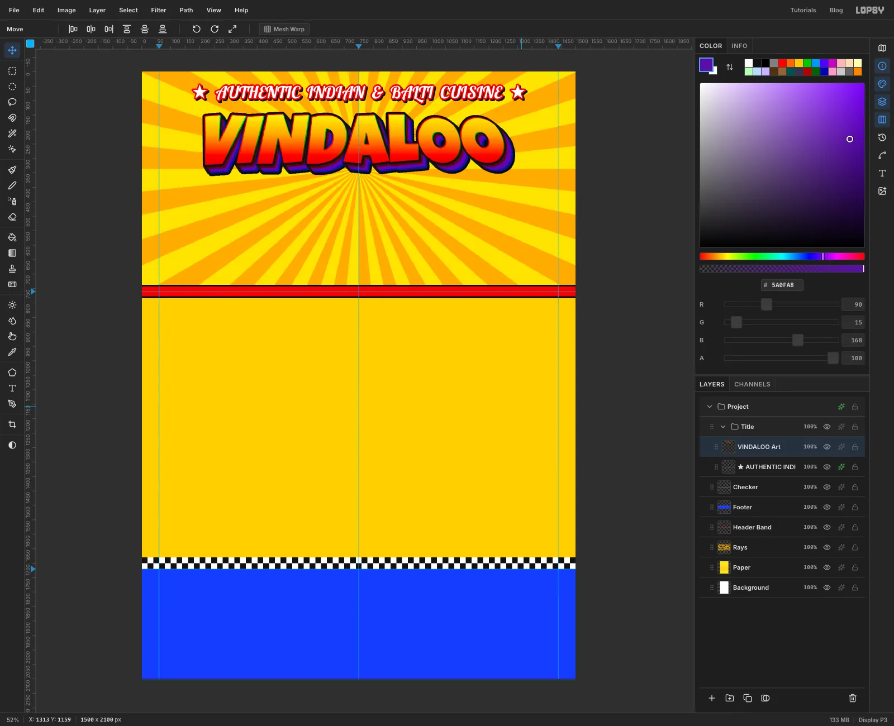

1. With **VINDALOO Art** active and nothing selected, click **Align center horizontally**. The extrusion pushed the art off-centre, and this puts the whole block back in the middle.
2. Choose **Filter → Chromatic Aberration…**, set **Amount** to `4` and **Direction** to `45`, and click **Apply**.

The split colour fringe looks like a cheap print where the inks didn't quite line up.

## Add a tilted XPRESS

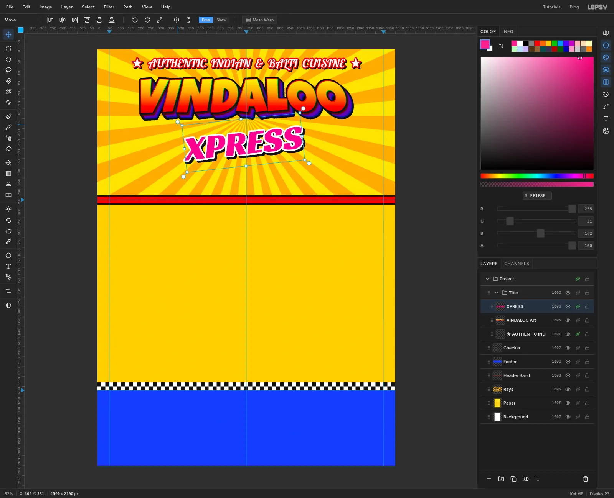

1. Click **VINDALOO Art** so the next text lands in the **Title** group without restyling anything.
2. With the **Text** tool, choose **Racing Sans One**, **Size** `170`, colour `#FF1F8E`, and set **Align** to **Center**. Point text with centre alignment is centred on the spot you click, so click on the centre line, just under the title, and type `XPRESS`. Press [[Tab]].
3. Give it a white **Stroke** of `8` and a black **Drop Shadow** with offsets `10`, **Blur** `1` and **Opacity** `100`.
4. With the **Move** tool, the text shows its own handles. Drag the round rotation handle just outside its top-left corner downwards and to the left to tilt the word about 6° anticlockwise, so it rises to the right. Press [[Cmd+D]].

The text stays live, so you can still edit it later.

## Draw speed lines

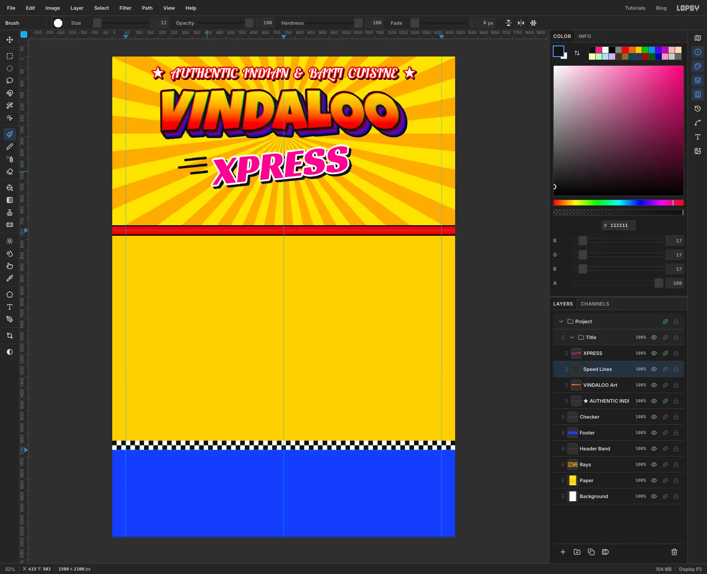

1. Click **VINDALOO Art** and add a layer named `Speed Lines`.
2. Choose the **Brush**, set **Hardness** to `100`, **Size** to `12` and the foreground to black.
3. Draw three straight lines to the left of the X. For each one, click where the line starts, then [[Shift]]-click where it ends, a little before the X. Tilt them to match the word: each line should rise slightly to the right. Make the middle one the longest.

## Lasso a clip-art chilli

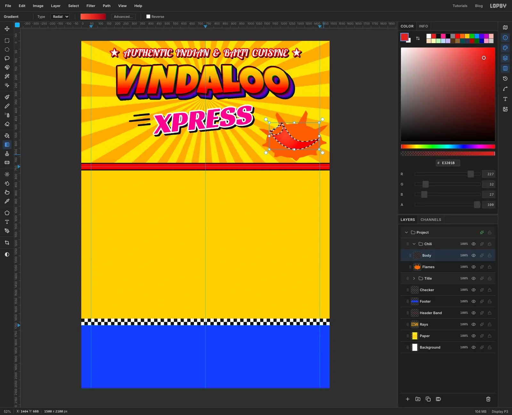

1. Collapse the **Title** group, click its row and click **New Group**. Name the group `Chili`.
2. Add a layer named `Flames`. With the **Lasso**, draw a rough, spiky flame shape on the right of the header, roughly 300 × 190 px, with longer tongues on top. Fill it with `#FF6A00` and deselect.
3. Add a layer named `Body`. With the **Lasso**, draw a fat curved chilli inside the flames: round at the stem end on the upper left, tapering to a point that hooks up at the lower right.
4. Choose the **Gradient** tool, set it to **Radial** with stops `#FF5A3C`, `#E3201B` and `#9E0014`, and drag from the upper part of the chilli down and to the right. Deselect.

## Give the chilli a face and a cap

1. Add a layer named `Calyx`. Lasso a spiky green crown over the round end of the chilli and fill it with `#2FB52F`. With the **Brush** at **Size** `20` in `#1E7F1E`, paint a curved stalk sticking up out of the crown.
2. Add a layer named `Highlight`. With a white brush at **Size** `14`, paint one stroke along the upper back of the chilli, away from where the face will go. Set the layer's opacity to `70%`.
3. Add a layer named `Face`. Lasso a D-shaped mouth on the lower half of the chilli and fill it black, then lasso a thinner strip along the top of the mouth and fill it white for teeth. For the eyes, use the **Elliptical Marquee**: select an oval just above the mouth and fill it with white, then a smaller oval inside it, nudged towards the tip, filled with black for the pupil. Repeat for the second eye beside it. With a **Size** `9` black brush, add a short slanted brow above each eye by clicking and [[Shift]]-clicking.
4. Give **Body** a black **Stroke** of `8` and **Calyx** a black **Stroke** of `7`.
5. Click **Flames**, [[Cmd]]-click its thumbnail, choose **Select → Shrink…** with `22`, and fill with `#FFD200` for a yellow core. Deselect and give **Flames** a black **Stroke** of `7`.

## Rotate the whole chilli group

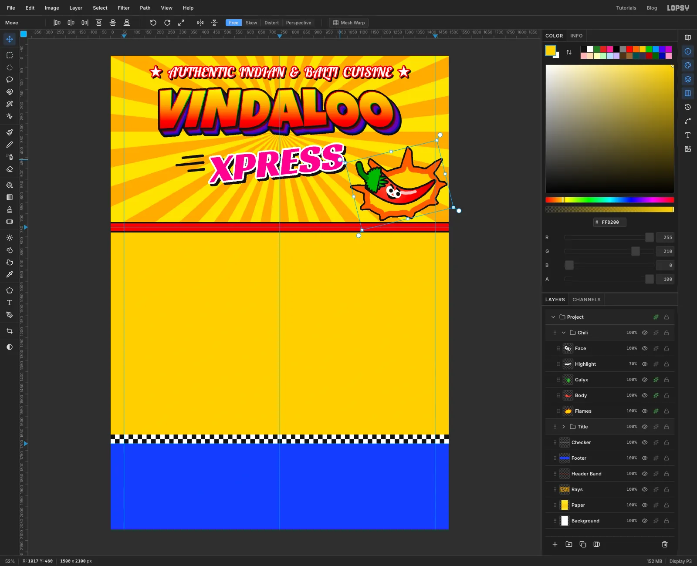

1. Deselect, then click the **Chili** group's row.
2. With the **Move** tool, the handles frame everything in the group. Drag the top-left rotation handle downwards to turn the mascot about 14° anticlockwise.
3. Press [[Cmd+D]].

## Make a starburst sticker with Sunburst

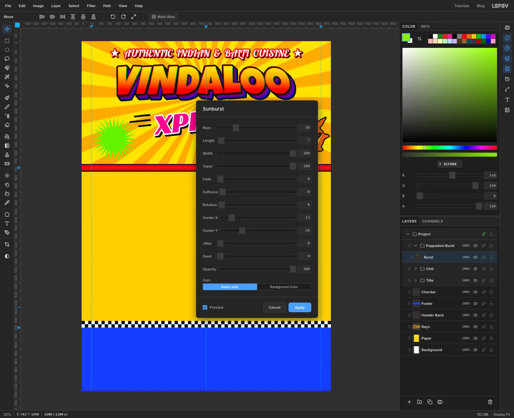

1. Collapse **Chili**, click its row, click **New Group** and name the group `Poppadom Burst`. Add a layer named `Burst`.
2. Set the foreground to `#8CF000` and choose **Filter → Sunburst…**.
3. Set **Rays** to `28`, **Width** to `100`, **Taper** to `100`, **Length** to `7`, **Center X** to `13` and **Center Y** to `28`, and click **Apply**. With a high **Taper**, each ray becomes a spike that is widest at the centre, so the burst becomes a star.
4. With the **Elliptical Marquee**, draw a circle about 210 px across on the centre of the burst (hold [[Cmd]] to keep it round), fill it with the same lime and deselect. This gives the sticker a solid middle for text.
5. Give **Burst** a black **Stroke** of `5` and a black **Drop Shadow** with offsets `8`, **Blur** `1`.

## Letter the sticker

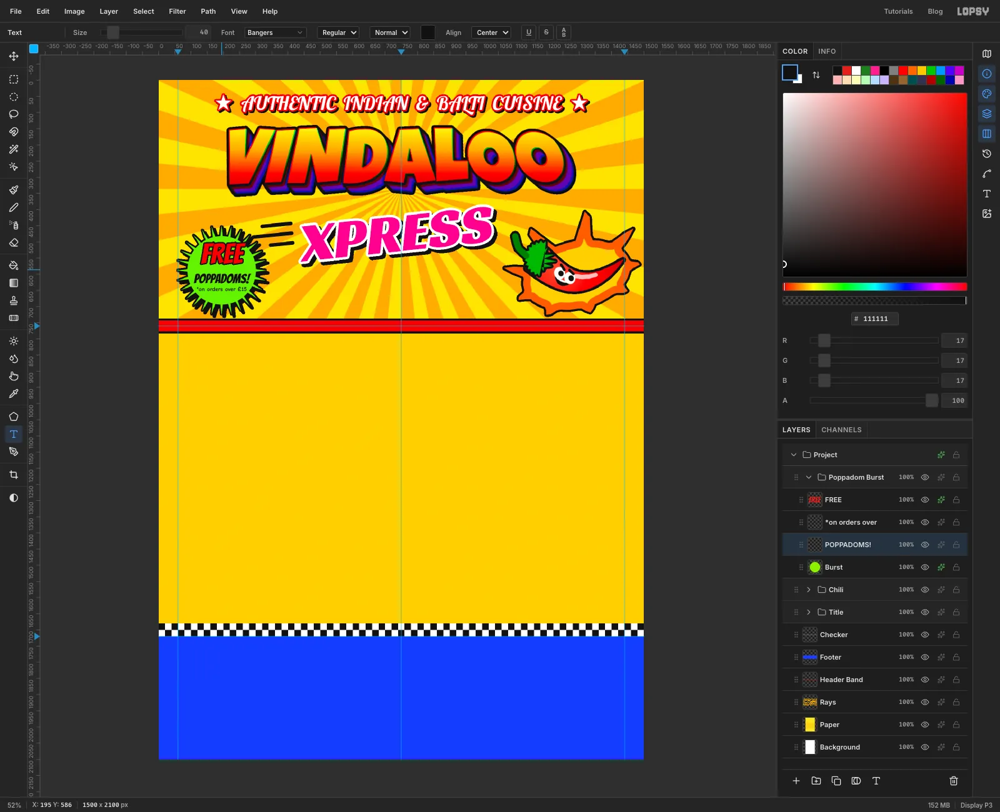

Work from the bottom line upwards. Each new click is then above the text you've already placed, so it can't land on an existing line and edit it by mistake.

1. With the **Text** tool set to **Align: Center** and black, choose **Comic Neue**, **Bold**, **Size** `18`. Click a little below the centre of the sticker and type `*on orders over £15`. Press [[Tab]].
2. Click the **Burst** row. Switch to **Bangers**, **Size** `40`, click just above the note and type `POPPADOMS!`.
3. Click **Burst** again. Set **Size** to `88` and the colour to `#E3201B`, click near the top of the circle and type `FREE`. Give it a black **Stroke** of `4`.

## Make the curries card

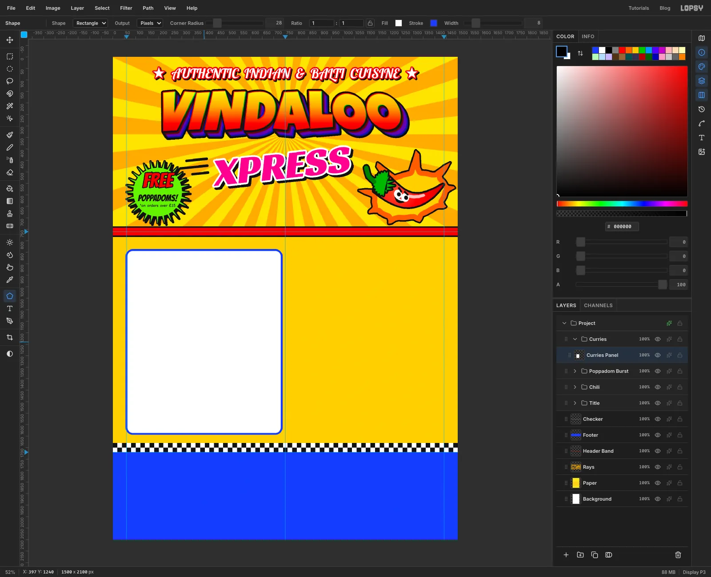

1. Collapse **Poppadom Burst**, click its row, click **New Group** and name the group `Curries`. Add a layer named `Curries Panel`.
2. Choose the **Shape** tool, set **Shape** to **Rectangle**, **Output** to **Pixels**, **Corner Radius** to `28`, the fill to white, the stroke to `#1F3CFF` and **Width** to `8`.
3. Click once (don't drag) at `397, 1240`. In the **Shape Size** dialog, type `675` × `800` and press [[Enter]]. The card is centred on your click, filling the left column from `60` to `735`.
4. Give it a black **Drop Shadow** with offsets `14` and **Blur** `1`.

## Add a section tab

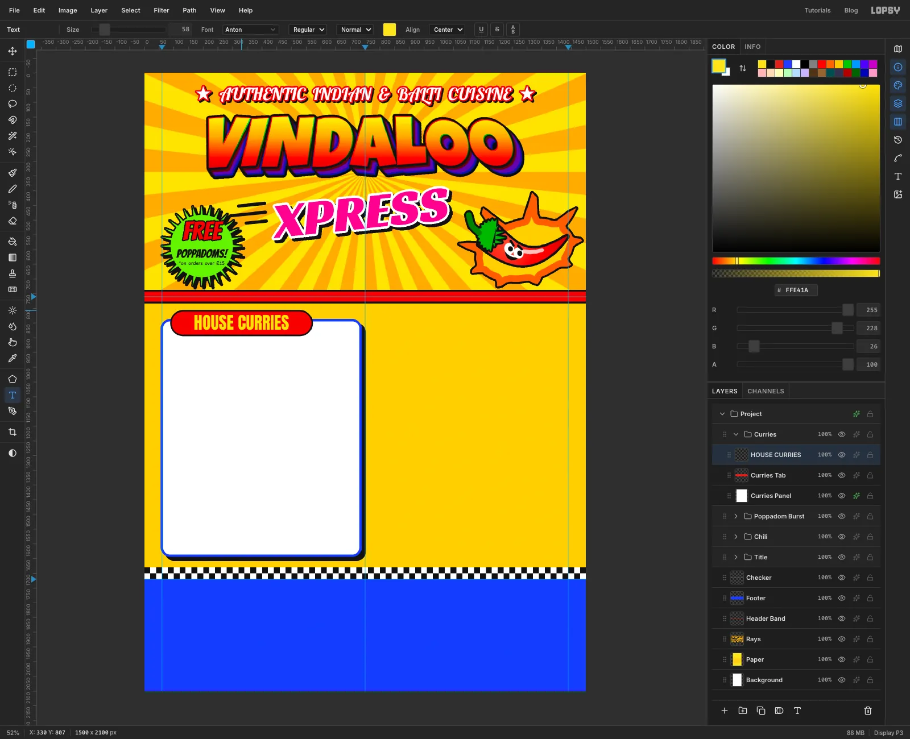

1. Add a layer named `Curries Tab`. Set the Shape fill to `#E3201B`, the stroke to black, **Width** to `5` and **Corner Radius** to `42`. Click at `330, 850` and make it `480` × `84`.
2. With the **Text** tool, choose **Anton**, **Size** `58`, colour `#FFE41A`, **Align: Center**, click just above the middle of the pill and type `HOUSE CURRIES`.

## Type the curry list

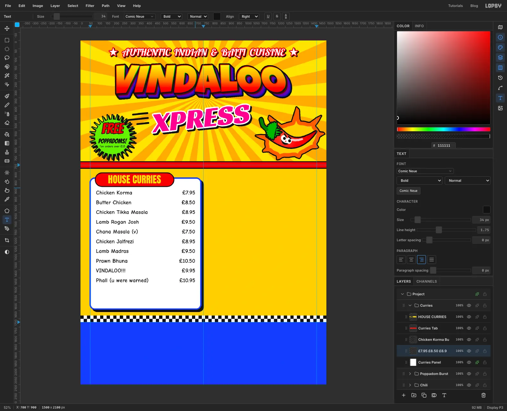

1. Click **Curries Panel** so the list lands above the card.
2. Open the **Text** panel from the panel toolbar on the right and set **Line height** to `1.75`.
3. With the **Text** tool, choose **Comic Neue**, **Bold**, **Size** `34`, black, **Align: Left**. Click at about `95, 900` and type the dish names, pressing [[Enter]] after each: `Chicken Korma`, `Butter Chicken`, `Chicken Tikka Masala`, `Lamb Rogan Josh`, `Chana Masala (v)`, `Chicken Jalfrezi`, `Lamb Madras`, `Prawn Bhuna`, `VINDALOO!!!`, `Phall (u were warned)`. Press [[Tab]].
4. Click **Curries Panel** again, set **Align** to **Right**, click at `700, 900` and type the prices in the same order: `£7.95`, `£8.50`, `£8.95`, `£9.50`, `£7.50`, `£8.95`, `£9.50`, `£10.50`, `£9.95`, `£10.95`. Press [[Tab]].

Right-aligned point text ends at the spot you click, so the prices line up on their right edges.

## Colour one line of the list

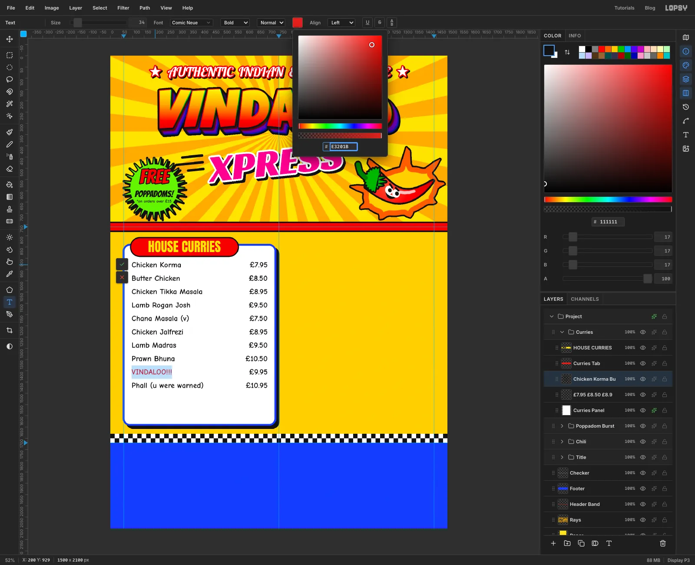

1. With the **Text** tool, click just after `warned)` at the end of the last line to start editing the list with the caret there.
2. Press the up arrow once to move to the `VINDALOO!!!` line, then press [[End]] and [[Shift+Home]] to select that line.
3. Click the **Text color** swatch in the options bar, type `E3201B` in the hex field and press [[Enter]]. Click the swatch again to close the picker, then press [[Tab]].

Only the selected characters change colour, so the house special shouts in red.

## Define a chilli icon brush

1. Click **Curries Panel** and add a scratch layer named `Icon`.
2. In an empty spot, lasso a tiny chilli about 60 px long and fill it with `#E3201B`, then lasso a little cap on its round end and fill it with `#2FB52F`.
3. Drag a marquee snugly around it and choose **Edit → Define Color Brush…**. Name it `Chili Icon` and click OK.
4. Deselect and delete the **Icon** layer. The new brush is now active.

A colour brush keeps the red and green, so every click stamps a full-colour chilli.

## Stamp heat ratings

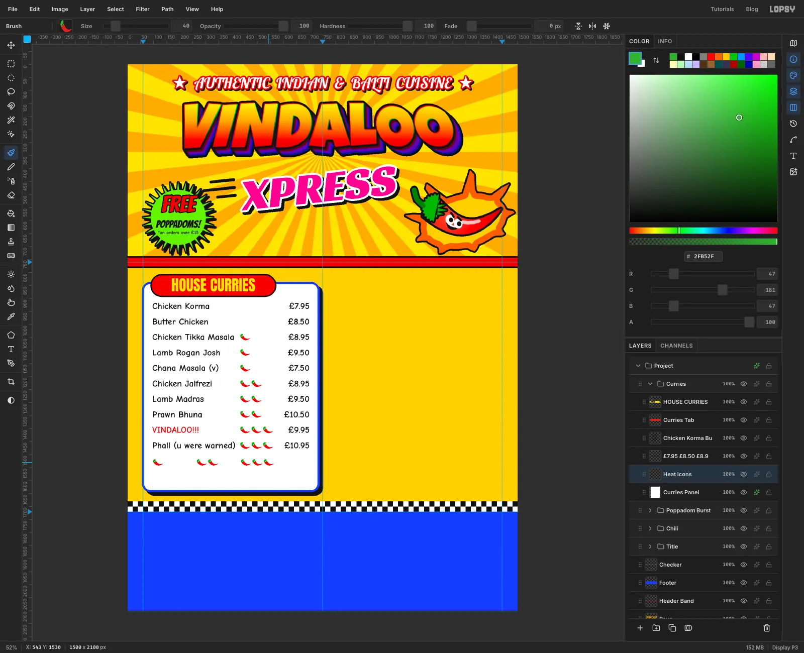

1. Click **Curries Panel** and add a layer named `Heat Icons`.
2. Choose the **Brush** and set **Size** to `40`.
3. Click once per chilli, in one column starting just right of **Chicken Tikka Masala** and **Phall (u were warned)**, the longest names, centred on each line: one for Tikka Masala, Rogan Josh and Chana Masala, two for Jalfrezi, Madras and Bhuna, and three for Vindaloo and Phall. Space the icons in a row about 44 px apart.

## Add a heat key and a footnote

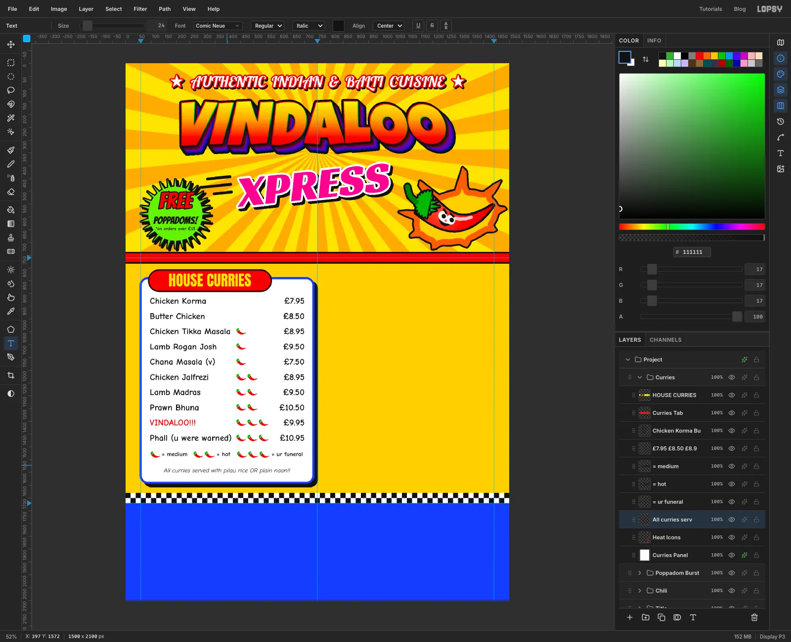

1. On **Heat Icons**, stamp a row of chillies on one line about 50 px below the list: one at the card's left margin, lined up with the dish names, then a pair about a third of the way across, then three starting just right of the middle.
2. With the **Text** tool in **Comic Neue Bold**, **Size** `24`, **Align: Left**, type `= medium`, `= hot` and `= ur funeral` just right of each group. Click the **Heat Icons** row before each one, so you start fresh text each time instead of editing the last one.
3. Click **Heat Icons**, set the style to **Italic**, the weight to **Regular** and **Align** to **Center**, click at `397, 1572` and type `All curries served with pilau rice OR plain naan!!`.

## Tilt the tab and its label together

1. Deselect. Click the **HOUSE CURRIES** text row, then [[Shift]]-click **Curries Tab** to select both.
2. With the **Move** tool, drag the top-left rotation handle down slightly to tilt them about 3° anticlockwise. Press [[Cmd+D]].

The text stays live inside the rotation.

## Paste the curry photo

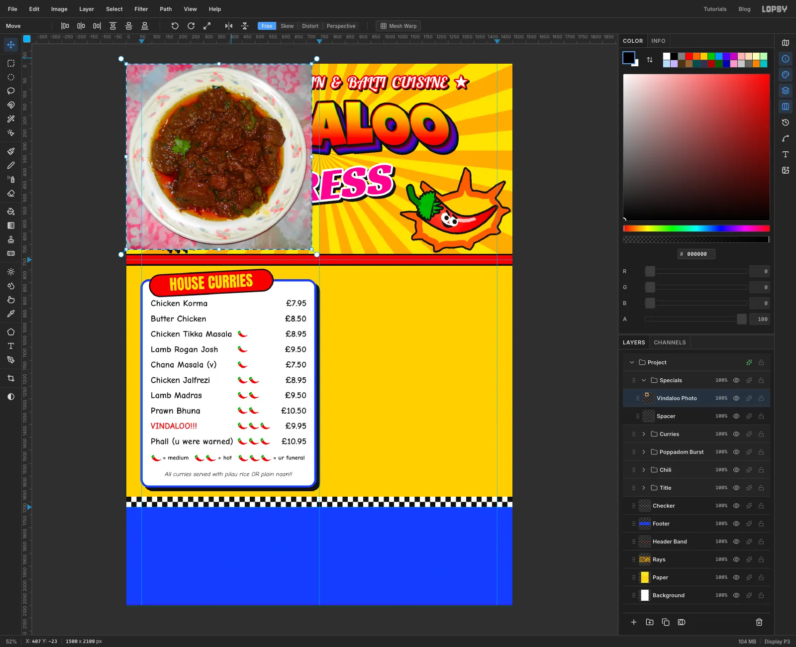

1. Collapse **Curries**, click its row, click **New Group** and name the group `Specials`. Add an empty layer named `Spacer`. You'll reuse it for the starters card later.
2. Copy your cropped curry photo in another app and press [[Cmd+V]] in Lopsy. It lands at the top-left of the canvas on a new layer, already selected, with the **Move** tool active.
3. Rename the layer `Vindaloo Photo`.

## Scale it down

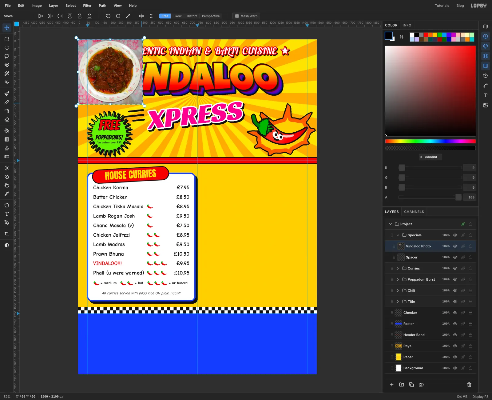

Scale the photo while it's fully on the canvas: pixels that hang off the edge during a transform are cropped when you commit.

1. Hold [[Cmd]] and drag the bottom-right corner handle up and to the left until the photo is about 400 px square. [[Cmd]] keeps the proportions.
2. Press [[Cmd+D]] to commit.
3. Drag the photo into the right-hand column so it sits beside the top of the curries card.

## Cut the plate out

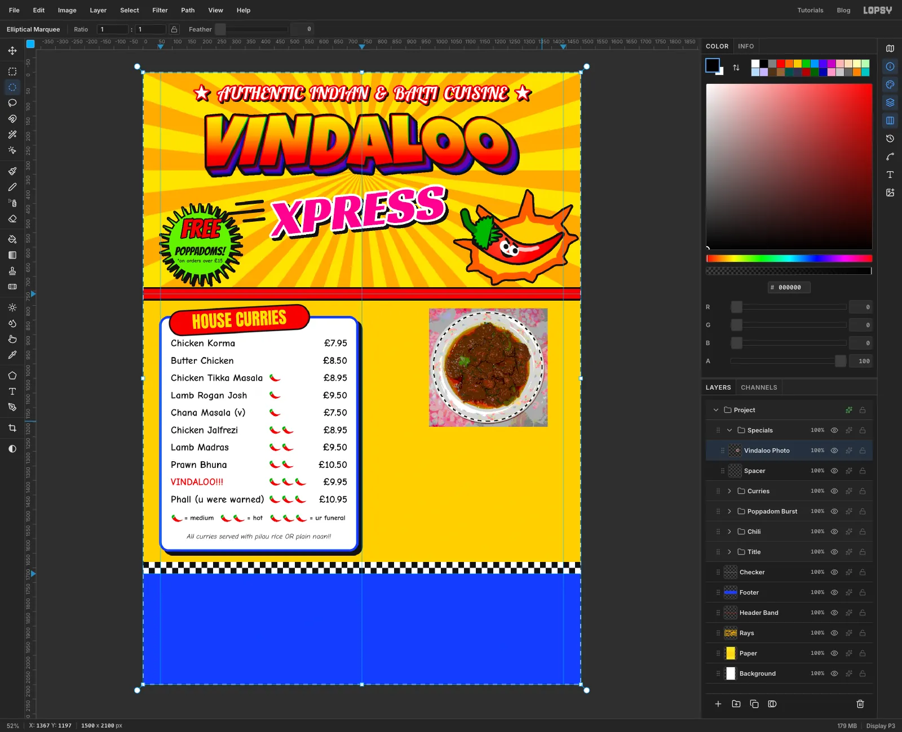

1. Deselect and choose **Filter → Posterize…** with **Levels** `7` for a cheap, over-processed print look.
2. With the **Elliptical Marquee**, hold [[Cmd]] and draw a circle around the plate's rim.
3. Choose **Select → Inverse** ([[Cmd+Shift+I]]) and press [[Delete]]. Deselect.
4. Give the layer a white **Stroke** of `14` and a black **Drop Shadow** with offsets `12` and **Blur** `1`.

## Add the samosa photo at an angle

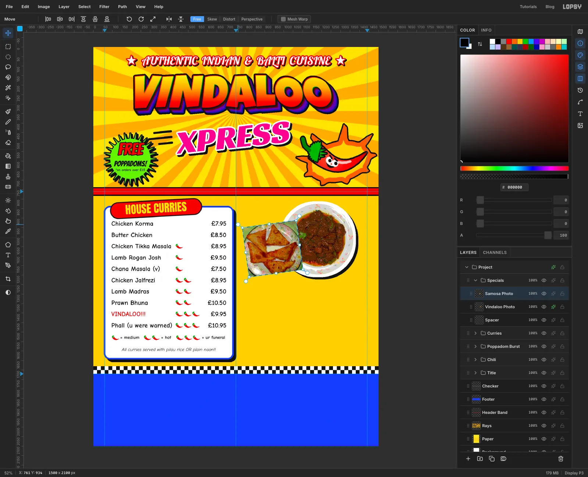

1. Paste the samosa photo, rename it `Samosa Photo`, and scale it with [[Cmd]] from the bottom-right handle to about 280 px wide. Press [[Cmd+D]].
2. Drag it so it overlaps the lower-left of the curry plate, then deselect and apply **Posterize…** with `7` again.
3. [[Cmd]]-click the **Samosa Photo** thumbnail to select the photo. With the **Move** tool, drag the top-left rotation handle downwards to turn it about 8° anticlockwise, then press [[Cmd+D]].

## Frame the photos like prints

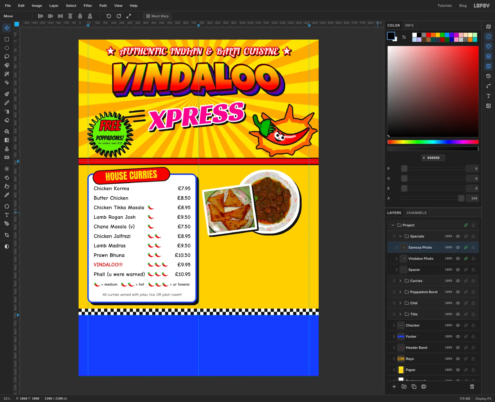

Give **Samosa Photo** a white **Stroke** of `12` and a black **Drop Shadow** with offsets `10` and **Blur** `1`. The two photos now read as prints stuck on the page.

If the plate's border sits too close to the right margin, click the **Specials** group's row, choose the **Move** tool, deselect, and press [[Shift+Left]] to nudge both photos 10 px left as one unit.

## Draw the starters card on the grid

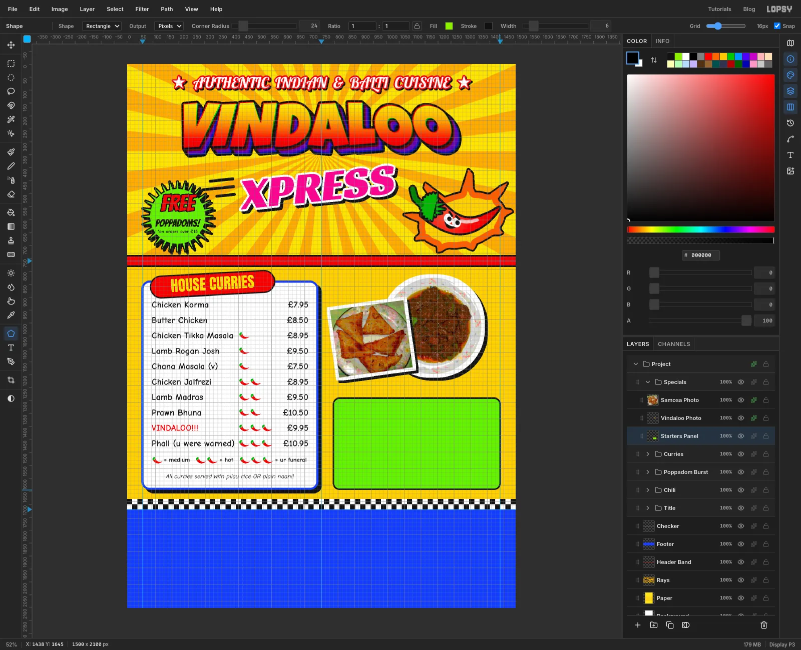

1. Click the **Spacer** layer and rename it `Starters Panel`.
2. Choose **View → Show Grid**. This turns on snapping, with grid lines every 16 px.
3. With the **Shape** tool, set the fill to `#8CF000`, the stroke to black, **Width** to `6` and **Corner Radius** to `24`.
4. Shapes grow from their centre. Press at about `1120, 1472` and drag to the right guide at about `1440, 1648`. Both points snap to the grid, so the card runs from `800` to `1440` across.
5. Choose **View → Show Grid** again to hide it, and give the card a black **Drop Shadow** with offsets `14` and **Blur** `1`.

## Fill in starters and sides

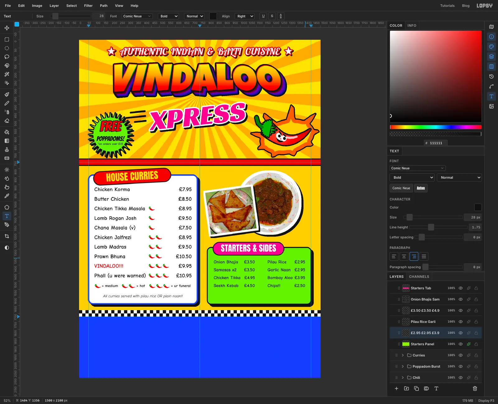

1. Add a layer named `Starters Tab` and draw a `#FF1F8E` pill with a black stroke of `5` and **Corner Radius** `40`, clicked at `1052, 1298` and sized `440` × `80`. Type `STARTERS & SIDES` on it in white **Anton**, **Size** `52`, **Align: Center**.
2. Click **Starters Panel**. Leave the **Text** panel's **Line height** at `1.75`. In **Comic Neue Bold**, **Size** `28`, black, click about 35 px in from the card's left edge, just under the tab, and type four left-aligned lines: `Onion Bhajis`, `Samosas x2`, `Chicken Tikka`, `Seekh Kebab`.
3. Click **Starters Panel** before each new block. Add their prices right-aligned, clicking on the same line just left of the card's centre so the prices end there: `£3.50`, `£3.50`, `£4.95`, `£4.50`.
4. Add the second column left-aligned, starting just right of the card's centre: `Pilau Rice`, `Garlic Naan`, `Bombay Aloo`, `Chips!!`. Then add its prices right-aligned, clicking about 35 px in from the card's right edge: `£2.95`, `£2.95`, `£3.95`, `£2.50`.

## Shout about the meal deal

1. Click **Starters Panel** and add a layer named `Deal Pill`. Draw a `#FF1F8E` pill with a black stroke of `4` and **Corner Radius** `30`, clicked at `1120, 1594` and sized `540` × `60`.
2. With **Anton**, **Size** `36`, white, **Align: Center**, type `MEAL DEAL 4 TWO: ONLY £24.99!!` centred on the pill.

White on pink is far easier to read than thin red text straight on lime.

## Set the footer type

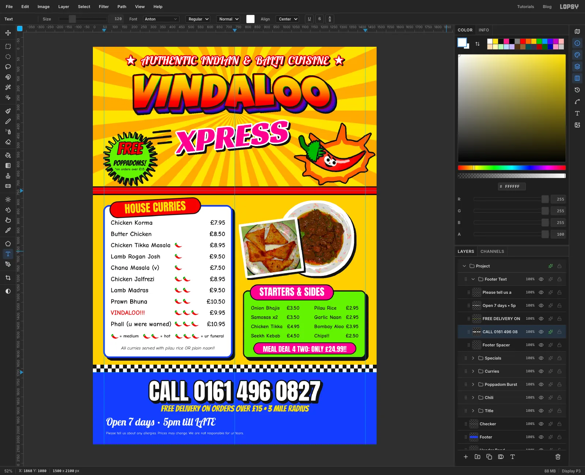

1. Collapse **Specials**, click its row, click **New Group** and name the group `Footer Text`. Add an empty layer inside it so new text lands in the group.
2. Work from the bottom up, and click the empty layer in the group before each new line. In white **Comic Neue**, **Regular**, **Size** `19`, **Align: Left**, click at about `70, 2026` and type `Please tell us about any allergies. Prices may change. We are not responsible for ur tears.` That keeps it about 50 px clear of the bottom trim.
3. In white **Lobster**, **Size** `54`, click at about `70, 1934` and type `Open 7 days • 5pm till LATE`.
4. In `#FFE41A` **Bangers**, **Size** `46`, **Align: Center**, click at about `750, 1872` and type `FREE DELIVERY ON ORDERS OVER £15 • 3 MILE RADIUS`.
5. In white **Anton**, **Size** `120`, **Align: Center**, click at about `750, 1715` and type `CALL 0161 496 0827`. Give it a black **Drop Shadow** with offsets `9` and **Blur** `1`, and a black **Stroke** of `6`.
## Set up a dotted brush for the coupon

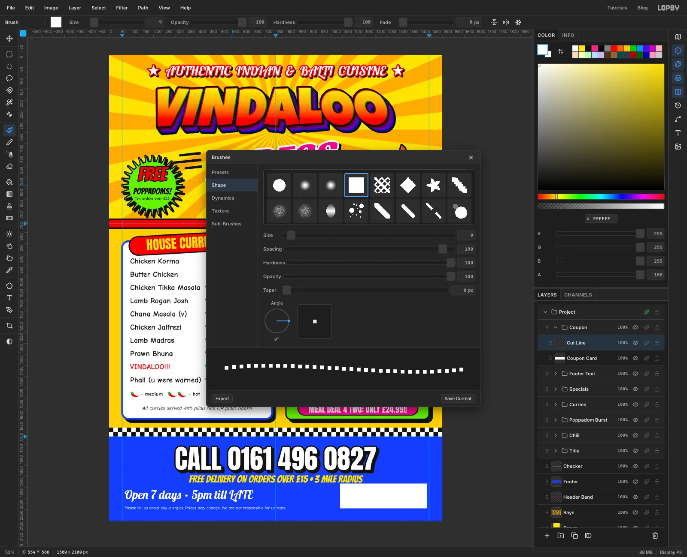

1. Collapse **Footer Text**, click its row, click **New Group** and name the group `Coupon`.
2. Add a layer named `Coupon Card`. With the **Shape** tool, set the fill to white, remove the stroke, set **Corner Radius** to `0`, click at `1235, 1988` and make a `390` × `112` card in the bottom-right corner.
3. Add a layer named `Cut Line` and choose the **Brush**. Click the brush tip in the options bar to open the **Brushes** window. Pick the **Square** preset, then on the **Shape** tab set **Size** to `9`, **Spacing** to `190` and **Hardness** to `100`. Close the window.

## Draw the coupon

1. With black, click about 12 px inside the card's top-left corner, then [[Shift]]-click each of the other corners in turn and finish back at the first. The wide spacing turns each line into a row of square dots.
2. In black **Comic Neue Bold**, **Size** `21`, **Align: Center**, click just below the middle of the card and type `✂ cut me out • orders over £20`.
3. Click **Cut Line**. In `#E3201B` **Bangers**, **Size** `50`, click near the top of the card and type `FREE NAAN!`.

## Tilt the coupon

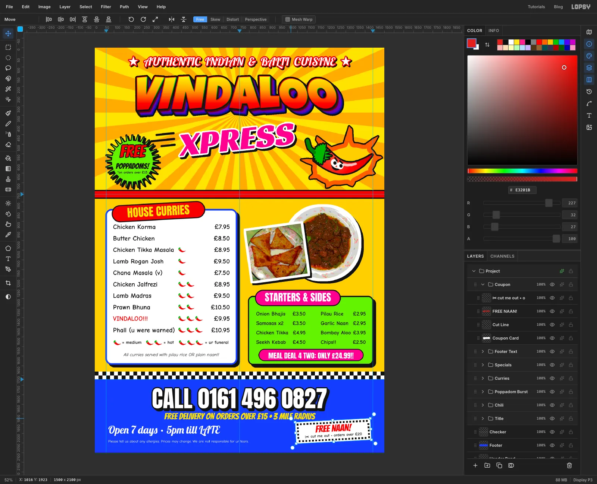

Deselect, click the **Coupon** group's row and drag the **Move** tool's top-left rotation handle downwards to turn the whole coupon about 3° anticlockwise. Press [[Cmd+D]]. Tilting it this way lifts the right end, which keeps the lower left corner clear of the delivery line.

## Tilt the poppadom sticker

Collapse the open groups, click **Poppadom Burst** and drag the **Move** tool's top-left rotation handle downwards to rotate the whole group about 10° anticlockwise. Press [[Cmd+D]]. A slapped-on sticker never sits square.

## Copy the sticker for a second badge

1. Expand **Poppadom Burst** and click the **Burst** layer. Drag a marquee around the whole sticker and press [[Cmd+C]].
2. Collapse **Poppadom Burst**, expand **Specials**, and click **Samosa Photo**.
3. Press [[Cmd+V]]. Content copied inside Lopsy pastes in place, on a new layer above the active one, so the copy lands inside **Specials** above both photos. Rename it `Hot Burst`.

Only the pixels are copied, not the text or the effects, so the copy is a plain lime starburst. For now it hides the original sticker's lettering; you'll shrink it and move it away in the next step.

## Scale the copy down

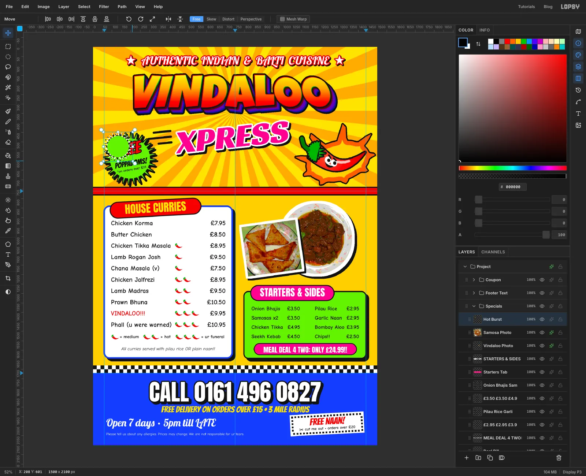

1. With the **Move** tool, hold [[Cmd]] and drag the copy's bottom-right corner handle in to about 55% of its size. Press [[Cmd+D]].
2. Drag it onto the top-right rim of the curry plate, so it overlaps both the plate and the yellow background.

## Turn it into a cyan NO.1 SELLER badge

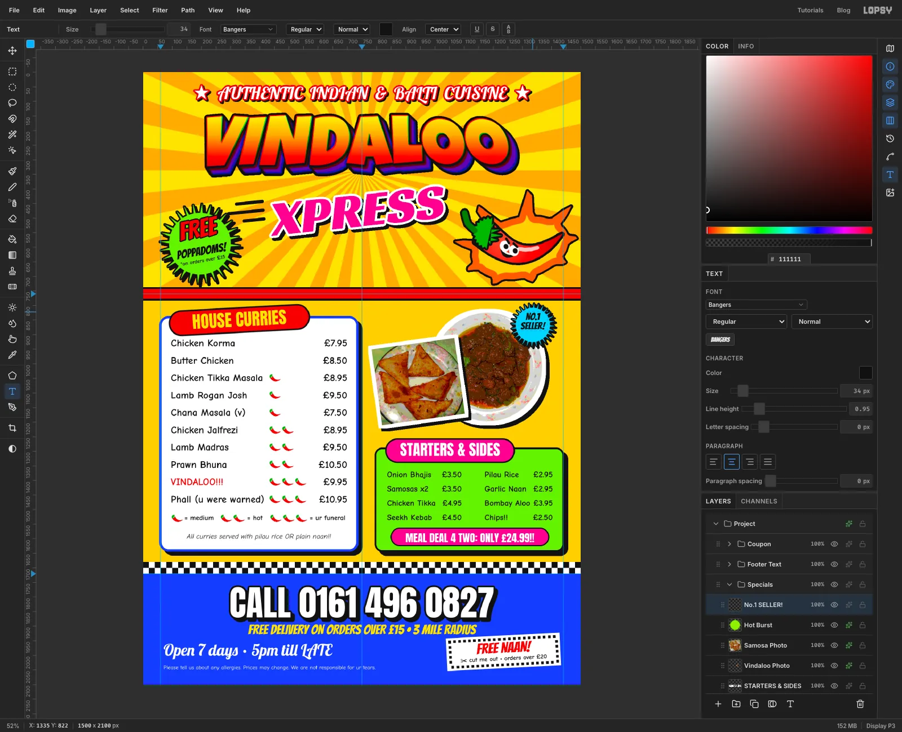

1. In **Hot Burst**'s effects drawer, turn on **Color Overlay** with `#19D3FF`, **Stroke** with **Width** `4` in black, and **Drop Shadow** with offsets `6` and **Blur** `1`.
2. In the **Text** panel, set **Line height** to `0.95`. In black **Bangers**, **Size** `34`, **Align: Center**, click a little above the badge's centre and type `No.1`, press [[Enter]], and type `SELLER!`.

## Move the heat key onto its own layer

1. Expand **Curries** and click **Heat Icons**.
2. Drag a marquee around just the key's chillies at the bottom of the card. Press [[Cmd+X]], then [[Cmd+V]]. They're pasted back in exactly the same place, on a new layer.
3. Rename that layer `Legend Icons` and deselect.

Now you can nudge or recolour the key without touching the icons in the list.

## Fade the speed lines with the Eraser

1. Expand **Title** and click **Speed Lines**.
2. Choose the **Eraser**, set **Size** to `90`, and drag once down through the left ends of the three lines.

This trims the left ends back unevenly with the Eraser's soft edge, so the three lines start at different points and trail off more like motion lines.
## Add photocopy grain

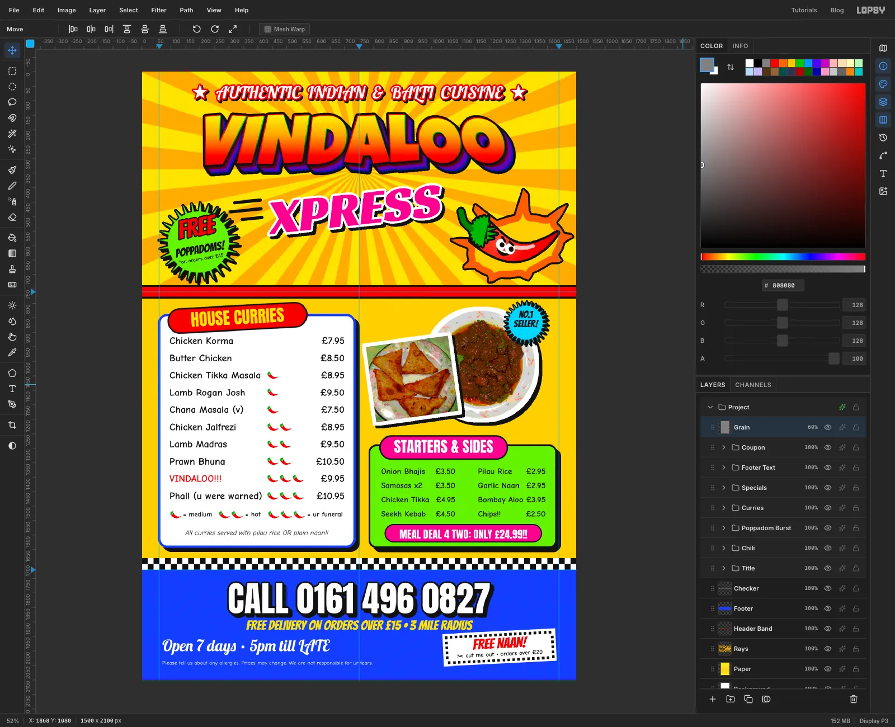

1. Collapse every group, click the top group (**Coupon**) and add a layer named `Grain`.
2. Fill it with `#808080`, then choose **Filter → Add Noise…** with **Amount** `60`, **Mono** and **Gaussian**, and click **Apply**.
3. Set its blend mode to **Overlay** in the effects drawer and its opacity to `60%`.

Mid-grey disappears in Overlay, so only the noise shows, as a fine grain across the leaflet. Save the project with **File → Save Project** and export it with **File → Quick Export PNG**.
