Anti-design breaks the rules on purpose. It uses clashing colours, the
fonts every computer ships with, visible construction lines and screen
furniture that has no business being on a poster. Done well, it's still
carefully controlled. Every "mistake" is placed, aligned and finished, so
the viewer can tell it's a decision.

In this tutorial you'll make a poster for **Faulty Utopia**, an imaginary
film about the Pruitt-Igoe housing project in St. Louis. Its 33
eleven-storey blocks opened in 1954–55. The first was demolished on
16 March 1972, and that's the date on the poster. The poster is
**1200 × 1800 px**. It uses two frames from the U.S. Department of
Housing and Urban Development's photos of the second, televised
demolition in April 1972, which are in the public domain in the US.
Download *Pruitt-igoe collapse-series.jpg* from Wikimedia Commons. It's
four frames stacked top to bottom, each about 1890 × 1150 px. Before you
start, crop the first frame (the block still standing) and the third (the
block falling) into two separate JPEGs with any image viewer's crop tool.

Along the way you'll use:

- **Gradient Map** on groups to turn photos into blue and pink duotones
- the Move tool's **scale and rotation handles** on photos, on live text and on a whole group
- marquee **slices**, **Pixel Stretch** and **Pixelate** for glitches, and the **Clone Stamp**
- live text stretched with handles and set to the **Difference** blend mode
- **Color Overlay**, **Stroke**, **Drop Shadow** and **Inner Glow** effects
- the **Pencil** with [[Shift]]-click lines for Windows 98 bevels and construction lines
- the **Pen** tool and **Path to Selection** for a mouse pointer
- **Selection → Path** and **text on a path** for a sticker
- **copy and paste** and layer **drag-and-drop** for a frozen pointer trail
- Tinos, Arimo, Cousine, Archivo Narrow and Comic Neue, the "default" fonts of anti-design

The palette:

- Acid lime `#D7FF1F`, electric blue `#2B3BFF`, hot pink `#FF2E88`
- Blue duotone `#08084A` → `#2B3BFF` → `#D7FF1F`
- Pink duotone `#1E0016` → `#FF2E88` → `#FFF2F7`
- Window grey `#C0C0C0`, bevel grey `#808080`, title bar `#000080` → `#1084D0`
- Stop red `#D81E1E`, link blue `#0000EE`, ink `#111111`, grain grey `#808080`

> **Tip:** Positions are in document pixels, written `x, y`, and the
> status bar shows where the pointer is. For an exact rectangle or circle,
> pick the **Rectangular** or **Elliptical Marquee**, make sure nothing is
> selected, and click the canvas once without dragging. A dialog asks for
> the **From X / Y** and **To X / Y** corners. **Edit → Fill** fills the
> selection with the foreground colour, and [[Cmd+D]] deselects.

> **Tip:** New layers and new text land just above the selected row. If a
> text layer is selected, changing the font or size in the options bar
> restyles *that* layer. So before you type something new, click a picture
> layer (or the group) you want it to sit above.

## Fill the canvas and drop the guides

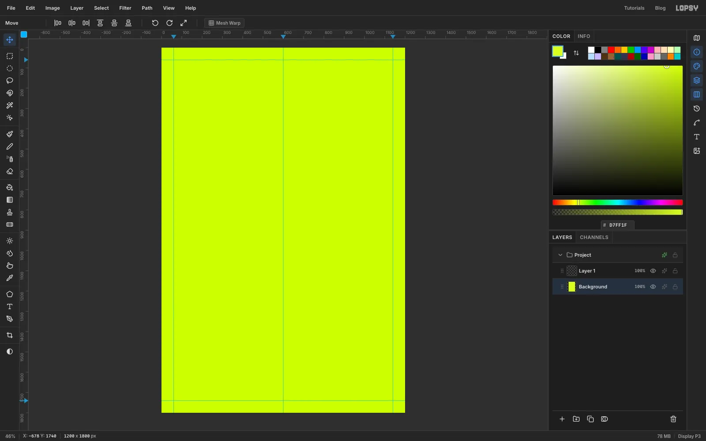

Choose **File → New**, enter **1200 × 1800** and click **Create**. Click
the *Background* row, set the foreground to lime `#D7FF1F` and choose
**Edit → Fill**.

Click the top ruler at `60`, `600` and `1140` to drop three vertical
guides, then click the left ruler at `60` and `1740`. Those are a 60 px
margin all round and a centre line.

## Draw the construction lines

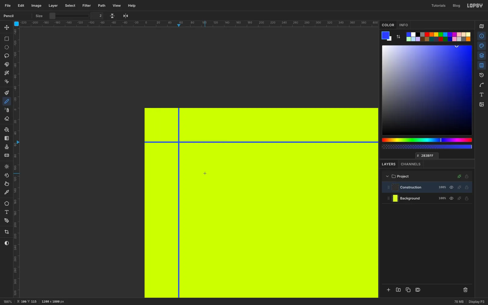

Anti-design shows its working, so draw the margin box into the poster.
Rename *Layer 1* to *Construction*. Pick the **Pencil**, set **Size** to
`2` and the foreground to electric blue `#2B3BFF`.

Click at the very top of the `60` guide, then [[Shift]]-click at the very
bottom. That's a straight line. Do the same down the `1140` guide, then
across the `60` and `1740` guides from the left edge to the right edge.
The lines cross at the corners and run out to the trim like crop marks.
At fit-to-screen zoom they hide under the guides, so zoom into a corner to
check them.

## Drop in the standing tower block

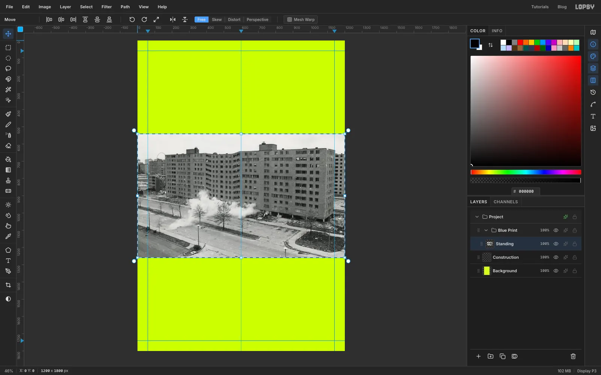

With *Construction* selected, click **New Group** at the bottom of the
Layers panel and name it *Blue Print*. Drag the first photo (the block
still standing) from your desktop onto the canvas. It lands inside the
group as *Pasted Layer*, shrunk to the canvas width, with its pixels
selected. Rename it *Standing*.

## Slide it onto the margin

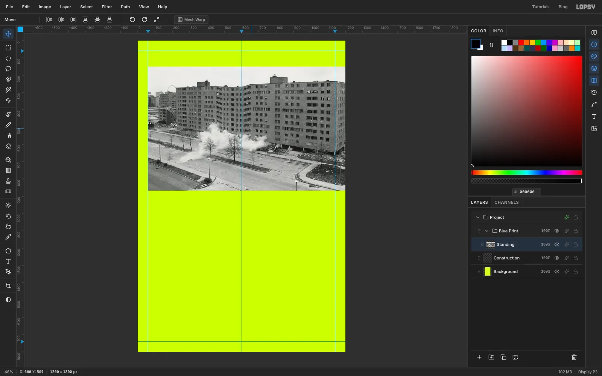

Press [[Cmd+D]] first to drop the selection, so the Move tool moves the
whole layer rather than the selected pixels. A whole layer can hang off
the canvas safely. Pick the **Move** tool and
drag the photo up and to the right until its left edge sits on the `60`
guide and its top is at `150`. Use the arrow keys for the last few
pixels. The right-hand 60 px now hang off the canvas, which is what you
want: the photo bleeds off the right side.

## Strip the colour and add punch

With *Standing* selected, choose **Filter → Desaturate**. Then choose
**Filter → Brightness/Contrast…**, set **Contrast** to `35` and click
**Apply**. The Gradient Map in the next step will recolour the greys, so
strong contrast here gives a crisp duotone.

## Print it in blue with a Gradient Map

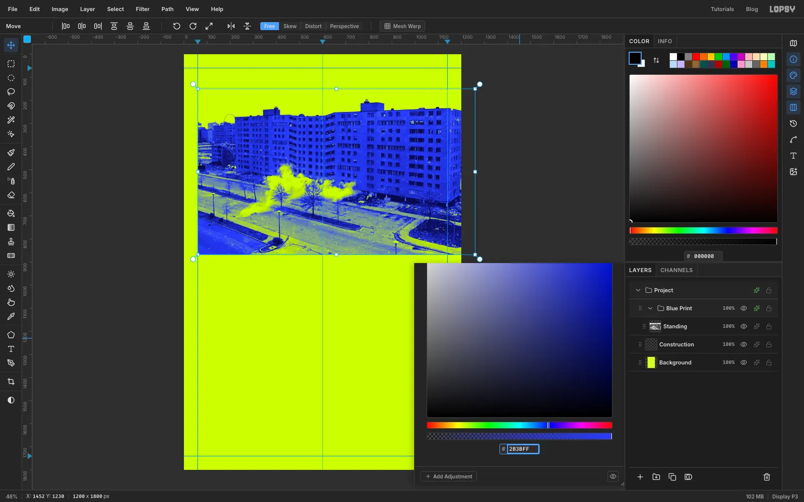

Click the *Blue Print* group row and open its effects drawer (the sparkle
icon on the row). Click **Add Adjustment → Gradient Map**. Click the left
stop and type `08084A` in the hex field, then click the right stop and
type `D7FF1F`. Click the middle of the gradient bar to add a third stop
and make it `2B3BFF`. Close the drawer.

The shadows become deep navy, the mid-tones electric blue and the sky
turns the same lime as the paper, so the building looks printed straight
onto the poster.

## Scale and tilt the collapsing block

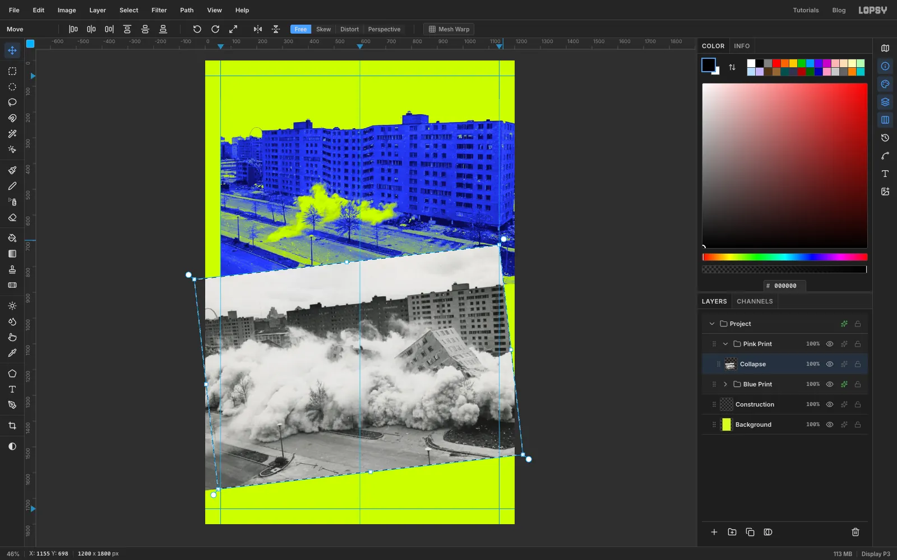

Collapse the *Blue Print* group with its arrow, keep it selected, and click
**New Group**. Name the new group *Pink Print*. Drag the third photo (the
block falling) onto the canvas and rename it *Collapse*.

[[Cmd]]-click its thumbnail to select its pixels, pick the **Move** tool
and [[Cmd]]-drag the bottom-right corner handle out by about `140` px, so
the photo is about 1340 px wide. [[Cmd]] keeps the proportions. Press
[[Cmd+D]].

Now drag the whole layer so its left edge hangs about 150 px off the left
side and its top is at about `780`. [[Cmd]]-click the thumbnail again and
drag the round rotation handle at the top-right corner anticlockwise by
about **6°**, so the right side rises. Press [[Cmd+D]] to commit. The pale
sky at the top of the photo now cuts across the poster in a tilted band.

## Print it in pink

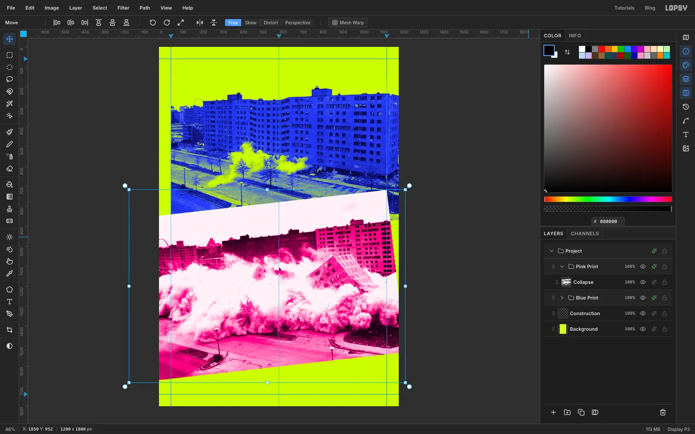

With *Collapse* selected, run **Filter → Desaturate** and
**Filter → Brightness/Contrast…** with **Contrast** `40`. Then click the
*Pink Print* group, open its effects drawer and add a **Gradient Map**
with three stops: `1E0016` on the left, `FF2E88` a little left of the middle (at 45%), and `FFF2F7` on the right.

## Shift some slices sideways

Click *Collapse*. With the **Rectangular Marquee**, drag a thin band right
across the photo, starting off the left edge of the canvas and ending off
the right edge, from about `1010` to `1056` down. Switch to the **Move**
tool, drag inside the band `70` px to the right, and press [[Cmd+D]].

Do two more:

- a band from `1175` to `1203`, moved `55` px **left**
- a band from `1300` to `1370`, moved `34` px **right**

On the left, a band that touches the canvas edge carries along the
pixels hanging past it, so no gap opens there. A gap may open at the
right edge, but the lime strip you add later covers it.

## Smear one band with Pixel Stretch

Marquee another full-width band from `1090` to `1150`. Choose
**Filter → Pixel Stretch…** and set **Amount** `60`, **Bands** `8`,
**Seed** `412` and **RGB Split** `0.6`. Click **Apply**. Filters stay
inside the selection, so only this band streaks like a corrupted video
frame.

## Censor the dust with a mosaic block

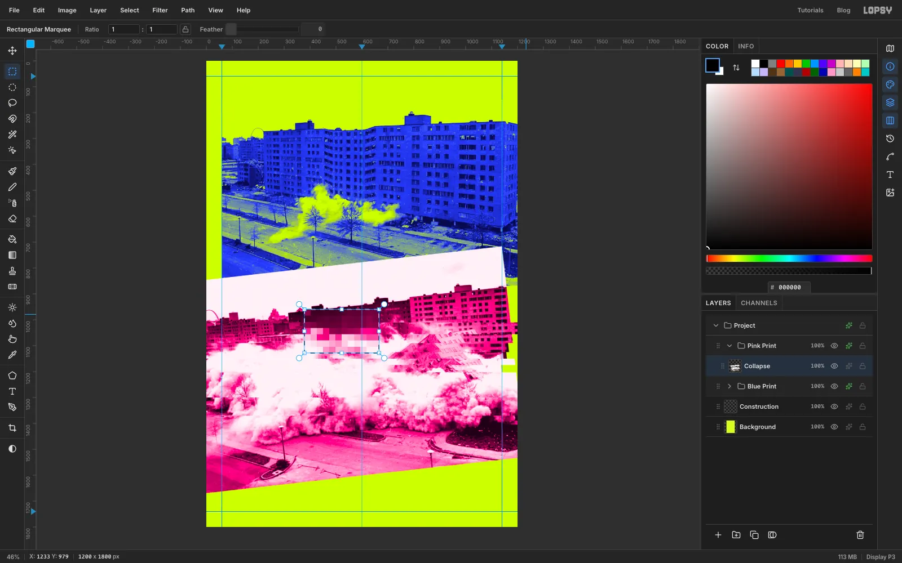

With the exact-corners dialog, select from `378, 960` to `666, 1128`.
Choose **Filter → Pixelate…**, set **Block Size** to `24` and click
**Apply**. Pixelate's grid starts at the layer's top-left corner, not
the canvas corner. This selection is 12 × 7 blocks and lines up with that
grid, so every block comes out whole, with no half cells along the edges.
If your photo's left edge isn't exactly 150 px off the canvas, the edge
blocks may come out as part cells. Undo, nudge the selection a few pixels
sideways and try again. Deselect.

There's a faint dark smudge in the pale sky band at about `960, 795`,
right of where the title will go. Pick the **Clone Stamp** at **Size**
`60`, [[Alt]]-click clean sky at about `1080, 790`, then paint over the
smudge.

## Type FAULTY

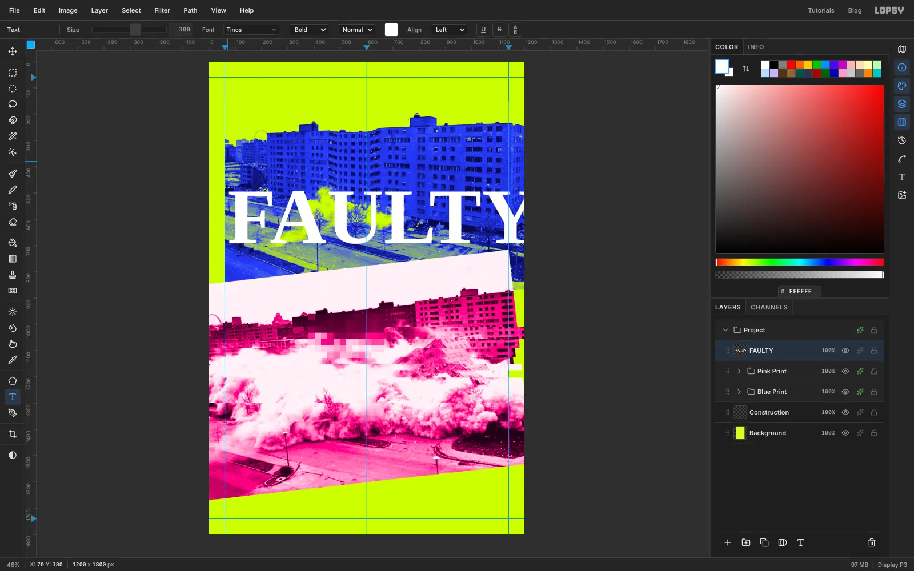

Click the *Pink Print* group and collapse it. Pick the **Text** tool. In the
options bar set the font to **Tinos** (an open-source twin of Times New
Roman), weight **Bold**, size `300`, and the colour to white `#FFFFFF`.
Click at about `70, 380` and type `FAULTY`. Press [[Tab]] to commit.
Rename the layer *FAULTY*.

## Stretch it to fill the width

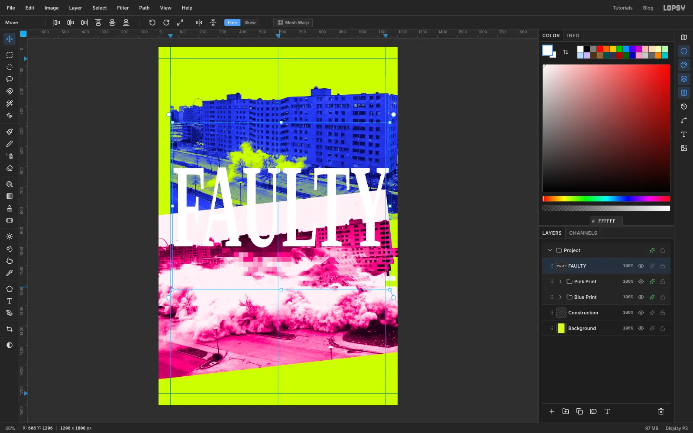

With the **Move** tool, text gets its own transform handles and stays
editable. Drag the right-middle handle until the word is about 1080 px wide,
the distance between the two margin guides. Then drag the bottom-middle handle down
about `420` px, so the letters are roughly twice as tall. Press
[[Cmd+D]].

Nudge the word with the arrow keys so its left edge sits at about `40`
(the F hangs 20 px into the margin) and the letters run from about `460`
to `860` down. The bottoms of
the letters should land on the pale sky band, clear of the pink rooftops.

## Flip the title with Difference

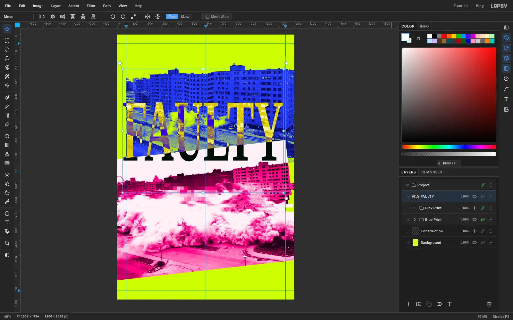

Open the *FAULTY* effects drawer and set its **Blend** to **Difference**.
White text in Difference inverts whatever is underneath, so the letters
turn ochre over the blue building, violet over the lime, and black over
the pale band. The lower third reads as solid black type, and the upper
two thirds show the building through the letters.

## Run UTOPIA up a lime strip

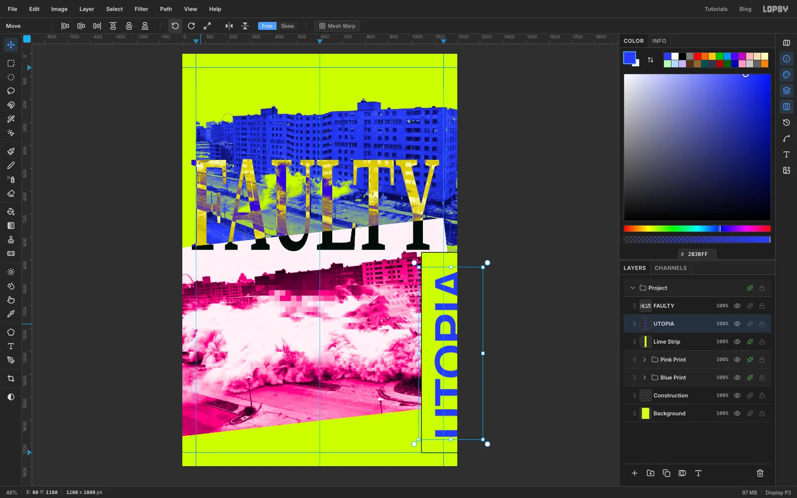

Click *Pink Print* and add a layer named *Lime Strip*. Select from
`1045, 868` to `1200, 1740`, fill it with lime and deselect. In its
effects drawer turn on **Stroke**, black `#000000`, **Width** `3`.

Type `UTOPIA` in **Arimo** Bold, size `200`, electric blue, somewhere in
open space. With the **Move** tool, click **Rotate 90° CCW** in the
options bar so it reads upwards. Then nudge it into the strip, centred
from top to bottom, with the letters' baseline about 40 px past the right
edge. Cropping a big slice off reads as a choice rather than a slip.

## Knock a second plate out of register

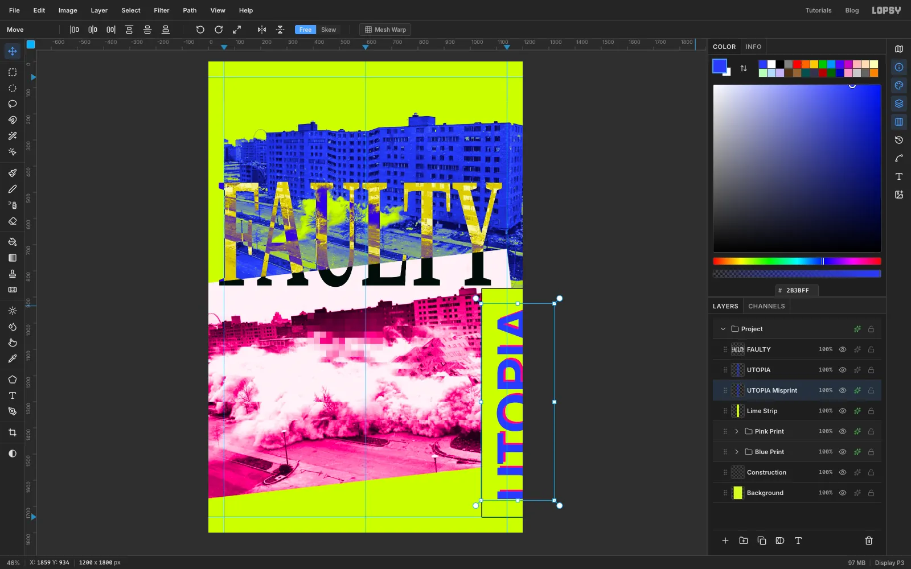

Choose **Layer → Duplicate Layer** and rename the copy *UTOPIA Misprint*.
Turn on **Color Overlay** with hot pink `#FF2E88`. Drag the copy's row by
its grip down below *UTOPIA*. Then select it, pick the **Move** tool and
nudge it `9` px right and `7` px up with the arrow keys. The pink peeks
out on two sides, like a second ink printed out of register.

## Set the tagline, slug and printer's notes

Click *Lime Strip* before each new line of type so they all stack above
the photos:

- **Tagline:** `it looked great on paper.` in **Comic Neue** Bold, `64`, ink `#111111`. Click at about `72, 80`, type it, then nudge it with the Move tool until the i sits on `72` (12 px inside the margin) and the tops of the letters are at about `93`.
- **Spec line:** `1200 × 1800 PX — MARGIN 60 PX — NO BLEED` in **Cousine**, `16`, blue, at `72, 20`, above the top margin line.
- **Fold note:** `↑ TRIM — FOLD HERE — DO NOT FOLD` in Cousine `16`, blue, at `72, 1748`, just under the bottom line. The arrow isn't on the keyboard, so copy it from this page.
- **Slug:** `ST. LOUIS — 16.III.1972 — 15:00` in Cousine `20`, ink. Type it in open space, click **Rotate 90° CW** with the Move tool, and nudge it into the left margin, centred on x `30`, with its top level with the photo at `150`.

Finally add a real dimension mark. On a new layer, use the Pencil
(Size `2`, blue) to draw a line from `3, 104` to `57, 104`, with ticks
from `3, 96` to `3, 112` and from `57, 96` to `57, 112`. Type `60` in
Cousine `14`, blue, in open space (well away from the slug, or the click
will edit it) and nudge it so it sits centred just above the line, at
about `30, 88`.

## Build a Windows 98 window

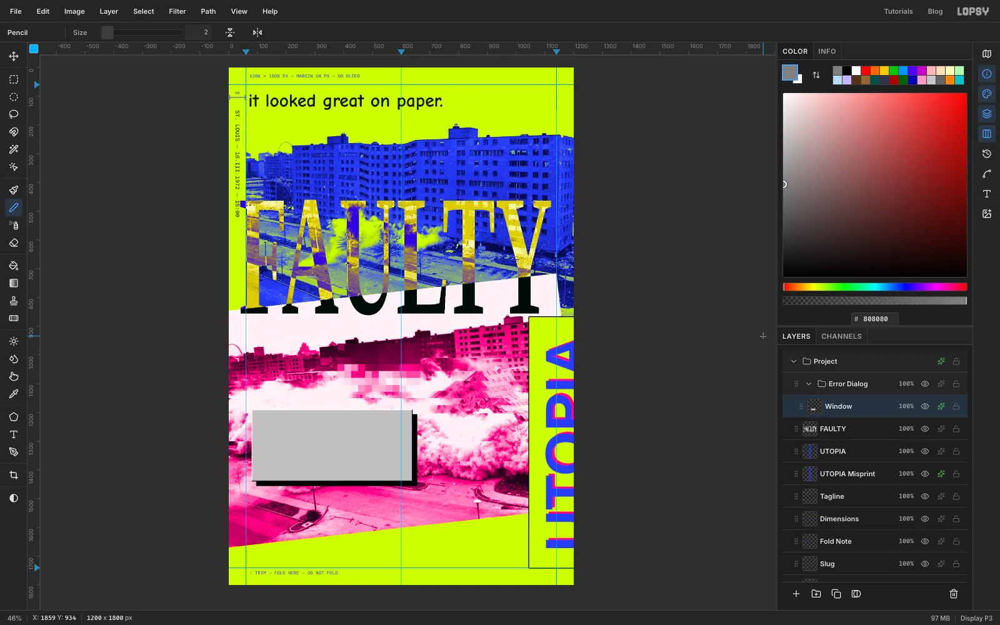

Click *FAULTY* and click **New Group**. Name the group *Error Dialog*. Add a
layer named *Window*, select from `80, 1190` to `640, 1440` and fill it
with grey `#C0C0C0`. Deselect.

The Windows 98 look comes from a 2 px bevel. Zoom in, pick the
**Pencil** at **Size** `2`, and draw each colour as an L: a click, then
two [[Shift]]-clicks.

- white `#FFFFFF`: `81, 1438` → `81, 1191` → `638, 1191` (up the left edge and along the top)
- black `#000000`: `81, 1439` → `639, 1439` → `639, 1191` (along the bottom and up the right edge)
- dark grey `#808080`: `83, 1437` → `637, 1437` → `637, 1193` (one line in from the bottom and right)

Give the layer a **Drop Shadow**: black, **Offset X** `16`,
**Offset Y** `16`, **Blur** `0`, **Opacity** `100`. That gives a hard,
offset shadow.

## Add the title bar gradient

Add a layer named *Title Bar* and select from `86, 1196` to `634, 1238`.
Pick the **Gradient** tool, open **Advanced…**, and set the two stops to
navy `#000080` and blue `#1084D0`. Drag from the left end of the
selection to the right end, then deselect.

## Add the close box, stop icon and buttons

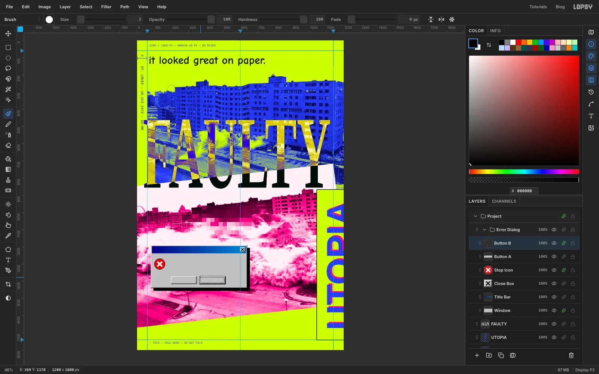

Each button and the close box is its own layer, built like the window:
an exact selection, a grey fill and the same three-colour bevel 1 px in
from its edges. The stop icon is different.

- **Close Box:** `598, 1202` to `628, 1230`, with a black X drawn by the Pencil at **Size** `3`.
- **Stop Icon:** an Elliptical selection from `102, 1270` to `162, 1330` filled with red `#D81E1E`. Add a white X with the Pencil at **Size** `7`, then a black **Stroke** of `2`.
- **Button A:** `197, 1372` to `347, 1416`.
- **Button B:** `363, 1372` to `513, 1416`. This is the default button, so give it a black **Stroke** of `2`.

For the dotted focus rectangle, set the foreground back to black
`#000000`, pick the **Brush**, open the brush settings and set **Size** `2`, **Hardness** `100` and **Spacing** `200`.
At that spacing each dab is a separate dot. On *Button B*, click at
`369, 1378` and [[Shift]]-click round the other three corners
(`506, 1378`, `506, 1409`, `369, 1409`) and back to the start.

## Write the dialog text

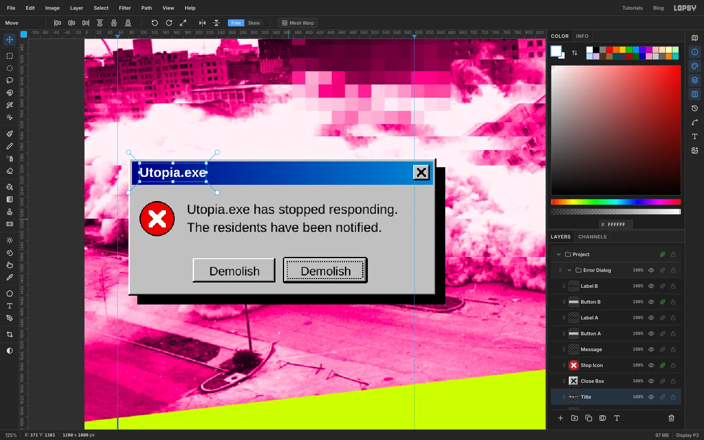

Set all the dialog text in **Arimo**, an open-source twin of Arial.
Type each piece in open space below the dialog and nudge it into place.
Click the layer you want it to sit above first.

- Above *Button B*: `Demolish`, Regular `22`, black, centred in the button at `438, 1394`.
- Above *Button A*: the same word centred at `272, 1394`.
- Above *Stop Icon*: `Utopia.exe has stopped responding.`, then [[Enter]] and `The residents have been notified.`, Regular `24`, starting at `186, 1266`.
- Above *Title Bar*: `Utopia.exe`, Bold `24`, white, starting at `100` and centred on the bar's height.

Both buttons do the same thing. That's the joke.

## Tilt the whole dialog

Collapse the *Error Dialog* group and click its row. Pick the **Move** tool
and make sure nothing is selected. The handles now frame everything in the
group. Drag the top-right rotation handle about **5°** clockwise and
press [[Cmd+D]]. The text stays live inside the turned group.

Press [[Cmd+Z]] to watch it snap back level, then [[Cmd+Shift+Z]] to
redo the tilt.

## Draw a giant mouse pointer with the Pen

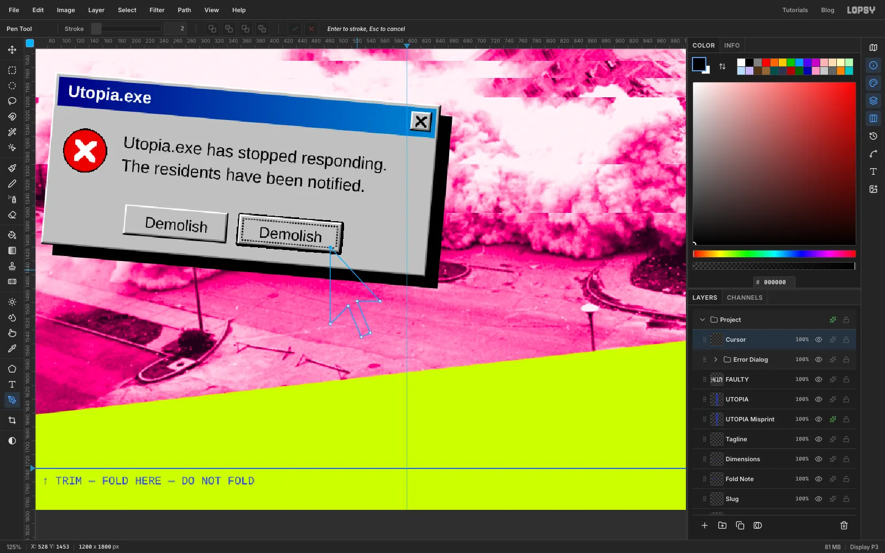

With *Error Dialog* still selected, add a layer named *Cursor*. Pick the
**Pen** tool and click these seven points in order. Then click the first
point again to close the path:

`489, 1420` (the tip) → `489, 1531` → `515, 1505` → `535, 1550` →
`548, 1544` → `528, 1498` → `561, 1498`

That's the classic arrow pointer at 6.5× size. Its tip sits in the
padding at the default button's bottom-right corner, clear of the
**Demolish** label.

## Fill the pointer and give it a keyline

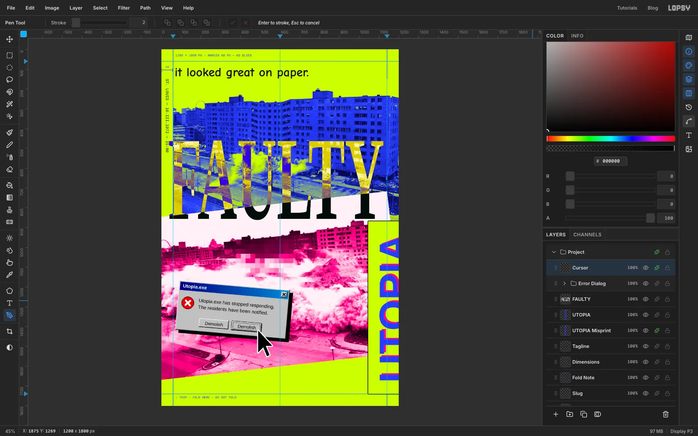

Open the **Paths** panel and click **Path to Selection**. Set the
foreground to black, choose **Edit → Fill** and deselect. In the effects
drawer turn on **Stroke**, white, **Width** `5`. Back in the Paths panel,
click **Delete Path**. You'll pick a different path for text in the next
step, and an extra path would clutter that list.

## Wrap text round a sticker

Add a group named *Sticker* and a layer named *Disc*. Select a circle from
`878, 180` to `1102, 404`, fill it with hot pink and give it a black
**Stroke** of `3`.

Select a smaller circle from `904, 206` to `1076, 378`, choose
**Selection → Path** from the **Select** menu, then deselect. With *Disc*
selected, click in open space (the bottom-left corner is fine) and type
`IN THEATERS NEVER ✕ IN THEATERS NEVER ✕ ` (note the space at the end) in
Arimo Bold, `22.7`, white. The ✕ isn't on the keyboard, so copy it from
this page. Rename the layer *Ring Text*. Then choose that new path in the options bar's
**Path** dropdown. The letters wrap round the circle. The size is chosen so
the text runs all the way round, with the same gap at both **✕** marks.

## Add the date and finish the sticker

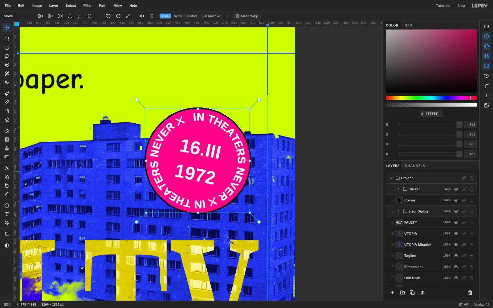

Click *Disc* and type `16.III`, [[Enter]], `1972` in Arimo Bold `40`,
white, **Align** center, in open space. With the **Move** tool, nudge it
to the middle of the disc, drag its rotation handle about **12°**
clockwise and press [[Cmd+D]]. Open the
Paths panel and click the selected path's row to deselect it, so its
anchors stop showing.

## Add a hyperlink-blue web address

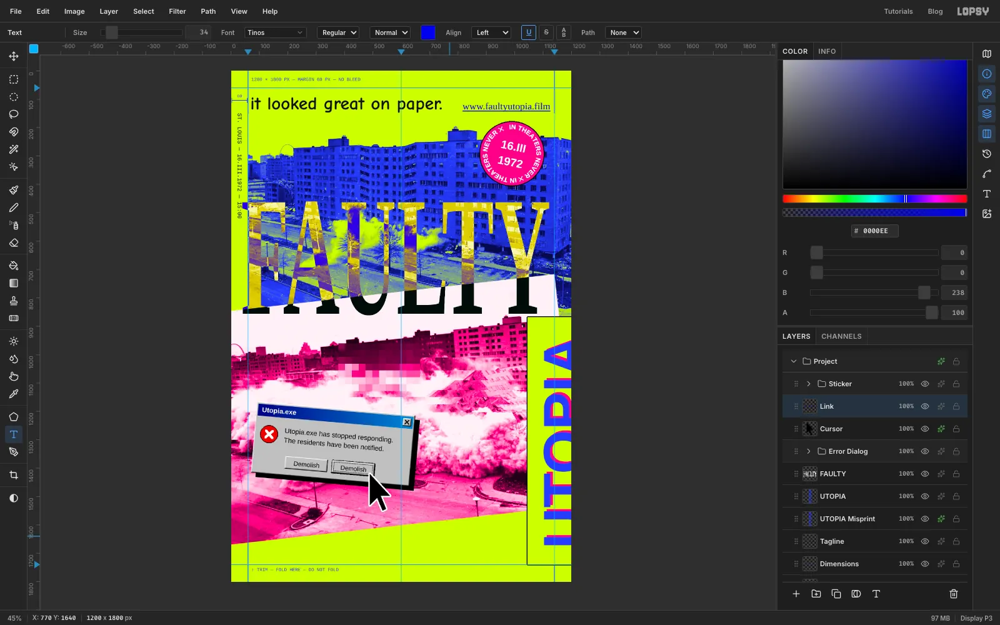

Click *Cursor* and type `www.faultyutopia.film` in **Tinos**, `34`, in
the classic unvisited-link blue `#0000EE`, and rename the layer *Link*.
Nudge it until the end of
"film" sits at `1124`, 16 px inside the right margin, and the bottoms of
its letters line up with the bottom of "it looked" in the tagline. Then
pick the **Text** tool (the layer stays selected) and click **U** in its
options bar to underline it.

Selecting a text layer copies its settings into the Text tool, so the
underline is now switched on for new text too. Click *Cursor* and click
**U** again to turn it off.

## Type the billing block

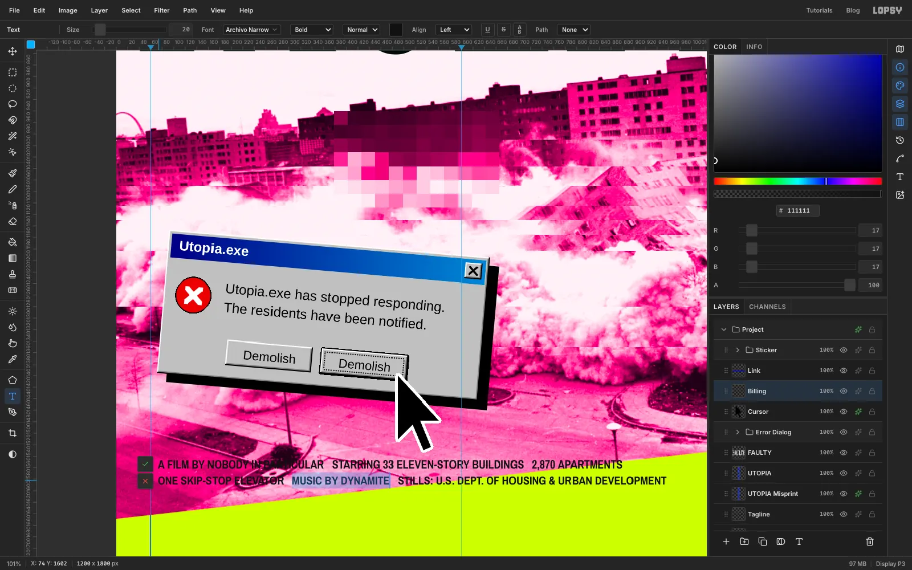

With *Cursor* selected, click at `72, 1560` and type the credits in
**Archivo Narrow** Bold `20`, ink:

`A FILM BY NOBODY IN PARTICULAR   STARRING 33 ELEVEN-STORY BUILDINGS   2,870 APARTMENTS`

[[Enter]]

`ONE SKIP-STOP ELEVATOR   MUSIC BY DYNAMITE   STILLS: U.S. DEPT. OF HOUSING & URBAN DEVELOPMENT`

Press [[Tab]] to commit and rename the layer *Billing*. Click back into
the second line just before the M of MUSIC, then hold [[Shift]] and press
[[Right]] until **MUSIC BY DYNAMITE** is highlighted (or drag across the
three words). Click the **Text color** swatch in the options bar,
type `2B3BFF`, click the swatch again to close it and press [[Tab]].
Only that credit turns blue.

## Open the leading and tilt the billing

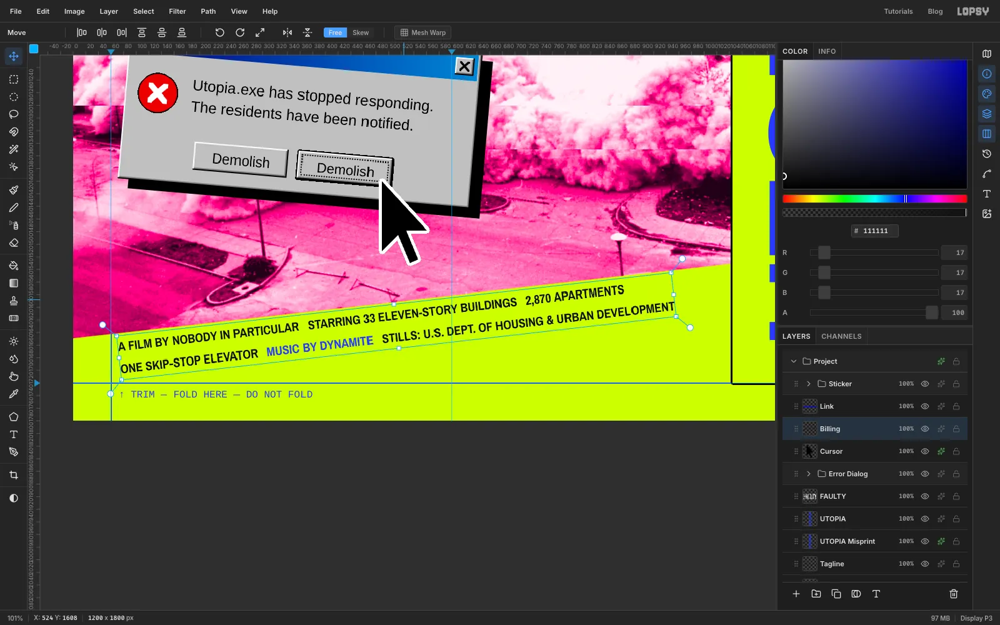

Select the *Billing* layer, open the **Text** panel and set
**Line height** to `1.75` so the two lines breathe. Close the panel.

With the Move tool, drag the billing's rotation handle anticlockwise
until it runs parallel to the photo's bottom edge. That's the same angle
you gave the photo, about 6–6.5°. Press [[Cmd+D]]. Then nudge it so it starts at `72` and sits about 24 px
below the photo all the way along.

## Patch the sky band

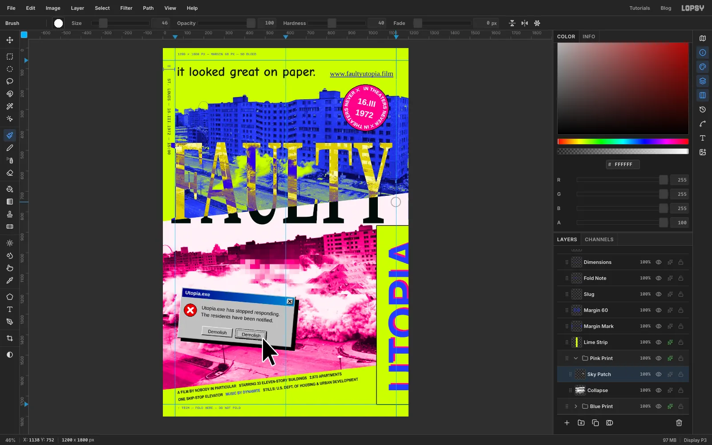

Where the tilted photo's corner stops short of the right edge, a sliver of
the blue photo shows through. Expand *Pink Print*, click *Collapse* and
add a layer named *Sky Patch* above it. A layer inside the group goes
through the group's Gradient Map, so white paints in exactly the pale
pink of the band.

With the **Pen**, click `1131, 715`, `1199, 707`, `1199, 872`,
`1147, 872` and back to the first point. Use **Path to Selection**, fill
with white, deselect and delete the path. Then pick the **Brush**, and in the
brush settings set Size `46`, Hardness `40`, and put **Spacing** back to
`10` (the focus rectangle left it at 200). Paint out any blots left in
the pale band, for example around `990, 785` and along `1065–1140, 755`,
just right of the Y. Collapse *Pink Print* again.

## Copy and paste a frozen pointer trail

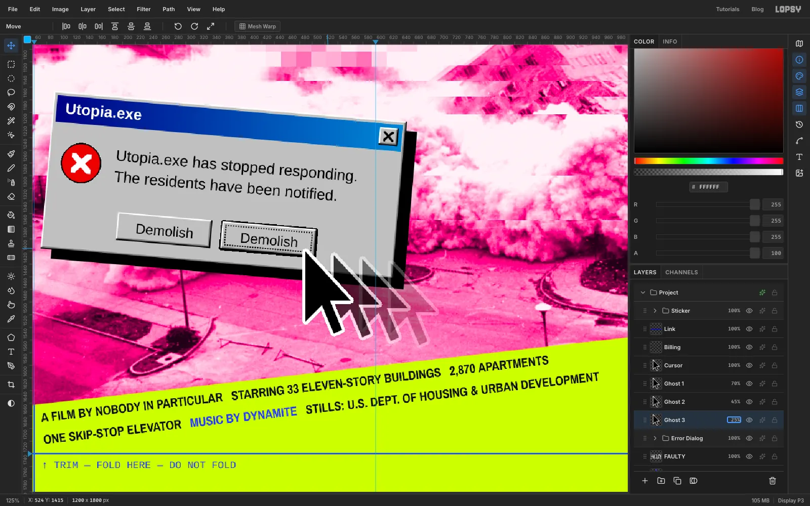

When Windows froze, the pointer left a trail. Select *Cursor*, open its
effects drawer and click **Rasterize Layer Style**, so the white keyline
becomes real pixels. Then, three times:

1. Click *Cursor* and [[Cmd]]-click its thumbnail.
2. **Edit → Copy**, then **Edit → Paste**. The copy lands in place as a new layer. Rename it *Ghost 1*, *Ghost 2* or *Ghost 3*.
3. Press [[Cmd+D]], then nudge it with the Move tool: `45` px right and `6` down for Ghost 1, `90` and `12` for Ghost 2, `135` and `18` for Ghost 3.
4. Set its opacity: `70%`, `45%`, `25%`.

Each paste lands above *Cursor*, so finally drag the *Cursor* row by its
grip up above *Ghost 1*. The real pointer sits on top and the copies fade
away behind it.

## Add registration marks

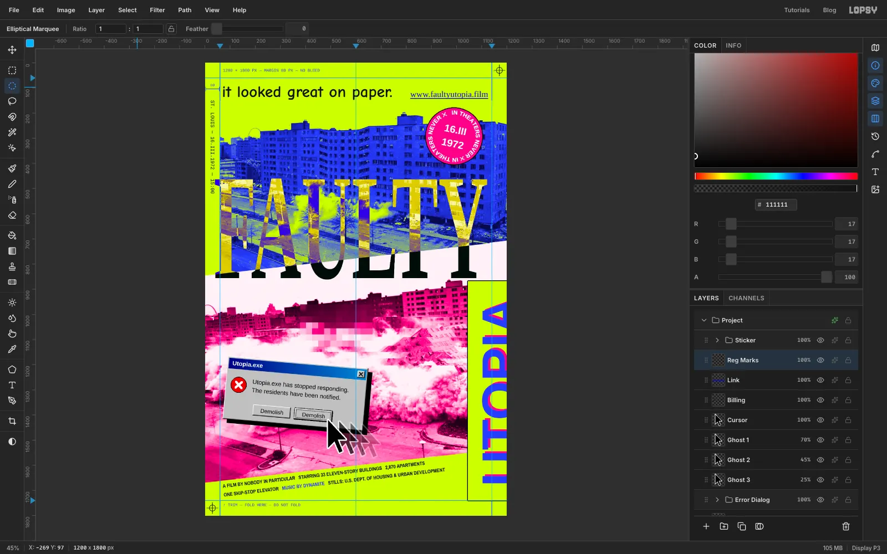

Click *Link* and add a layer named *Reg Marks*. With the Pencil (Size
`2`, ink `#111111`), draw a cross 44 px wide at `30, 1770` in the
bottom-left corner and another at `1170, 30` in the top-right.

For the bottom-left ring, add a layer, select a circle from `17, 1757`
to `43, 1783` and fill it with ink. Then select `19, 1759` to
`41, 1781`, press [[Delete]] to leave a thin ring, deselect and choose
**Layer → Merge Down**. Repeat for the top-right ring with `1157, 17` to
`1183, 43`, then `1159, 19` to `1181, 41`.

## Add print grain and export

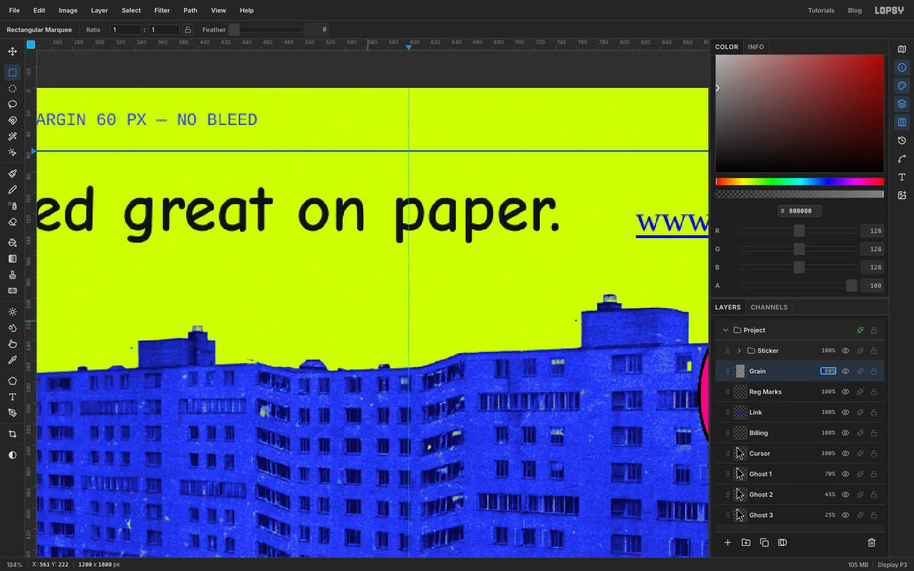

With *Reg Marks* selected, add a layer named *Grain*. It lands just
under the *Sticker* group, so the sticker stays clean, as if it were stuck
on after printing. Fill the whole canvas with grey `#808080`. Choose **Filter → Add Noise…** with **Amount** `80`. Set the
layer's **Blend** to **Overlay** and its opacity to **60%**. Mid grey
disappears in Overlay and only the noise shows, so the flat lime, the
photos and the dialog all look printed together.

Choose **View → Fit to Screen** to check the whole poster. Export with
**File → Quick Export PNG** and keep a copy with **File → Save Project**.
