In the 1920s, the discovery of Tutankhamun's tomb set off a craze for
Egyptian motifs, and Art Deco designers turned pyramids, lotus flowers,
sun discs and ibises into crisp geometry. This tutorial paints **Nile
Zodiac**, a 1500 × 2000 px night scene in that style. A gold zodiac wheel
rises behind the pyramids of Giza, the Nile carries a broken path of
moonlight, and a sacred ibis watches from a stone quay.

Nearly everything is built from selections filled with flat colour and
gradients, which is how Deco posters were printed. The ornament comes from
two filters doing the repetitive work for you. **Kaleidoscope** turns a single
wedge of ornament into a full ring, and **Sunburst** draws the fan of rays.

The ibis is traced from a photo, [Helig ibis-2.jpg](https://commons.wikimedia.org/wiki/File:Helig_ibis-2.jpg)
by David Castor on Wikimedia Commons, which is released under **CC0** (public
domain). Open its Commons page and download the 1,280 px wide version. Any
side-on photo of a standing ibis or heron on a plain background works too.

Along the way you'll use:

- ruler **guides**, the **Gradient** tool (linear and radial, with transparent stops) and **Edit → Fill**
- the **Sunburst**, **Kaleidoscope**, **Clouds**, **Pixel Stretch**, **Motion Blur**, **Gaussian Blur**, **Threshold**, **Bloom** and **Add Noise** filters
- elliptical marquees combined with [[Shift]] (add), [[Alt]] (subtract) and [[Shift]]+[[Alt]] (intersect), the **Lasso**, **Quick Selection**, the **Magic Wand**, **Grow**, **Shrink**, **Feather** and **Inverse**
- the **Pencil**, **Brush** and **Eraser**, including [[Shift]]-click straight lines
- text layers in **Noto Sans Symbols**, rotated with the Move tool's handles
- **Copy Merged**, copy and paste in place, **Flip Horizontal / Vertical**, scaling with the corner handles, arrow-key nudges and **Merge Down**
- a **layer mask**, a group **Gradient Map**, groups moved as one, and undo / redo
- **Outer Glow**, **Inner Glow** and **Stroke** effects, and the **Soft Light**, **Multiply**, **Screen** and **Overlay** blend modes

The palette:

- Night sky `#0A1330` → `#1B2C57` → `#2F6A6E`
- Gold `#D9A441`, pale gold `#F2D48A`, deep gold `#9C6B1E`, cream `#F3E3B5`
- Wheel disc `#24407A` → `#0C1636`, cloisonné turquoise `#3AA39B`, Egyptian blue `#2F6DB5`
- Moon `#FBF3DC` → `#F3E6C8` → `#E2C27E`, craters `#E9D8AE`
- Pyramid lit faces `#D6AE6C` / `#B98E57`, shadow faces `#5C3B4C` / `#4E3346`, courses `#2A1A2A`
- Water `#1D4A5A` → `#0F2A44` → `#060E24`, ripples `#5FB3A1`
- Sail `#F0D49A` → `#C98A3E`, hulls `#0B1426`
- Quay `#0E2030` / `#1D3B4C`, quay edge `#3E6A80`, palms `#06141F`, palm rim `#4FA3A0`, trunk rings `#22305A`
- Lotus `#F09A7E` / `#E07A5F` / `#C9604A`, lily pad `#1E5A52`
- Ibis ink `#0B1220`, ibis cream `#F2E6CC`, frame `#060A18`

## Create the canvas and place guides

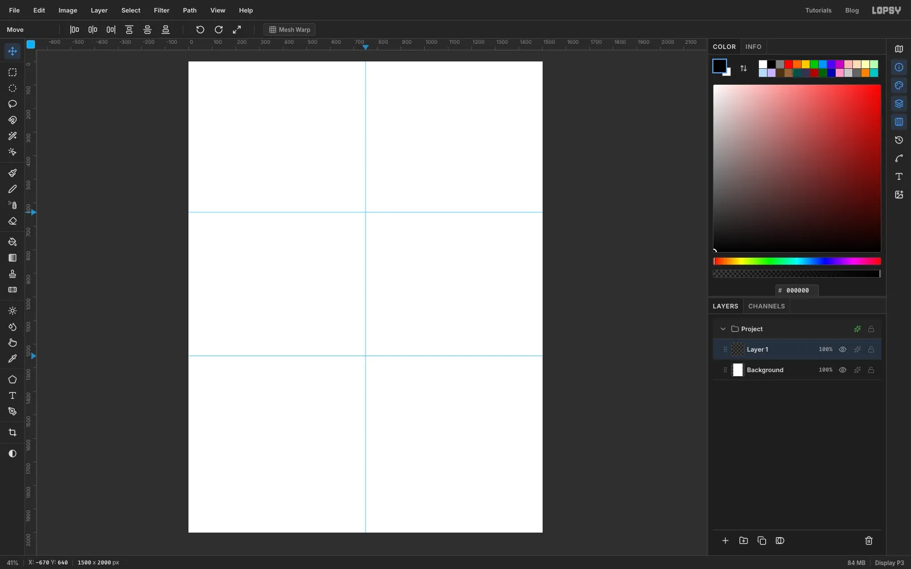

Create a new document **1500 × 2000 px**. Click the top ruler at the middle
of the canvas (x 750) to drop a vertical guide. Then click the left ruler at
y 640, where the centre of the zodiac wheel will start, and at y 1250, which
will be the horizon. A click on a ruler is all it takes to make a guide.
Lopsy also adds an empty **Layer 1** to new documents; you can ignore it or
delete it.

## Paint the night sky

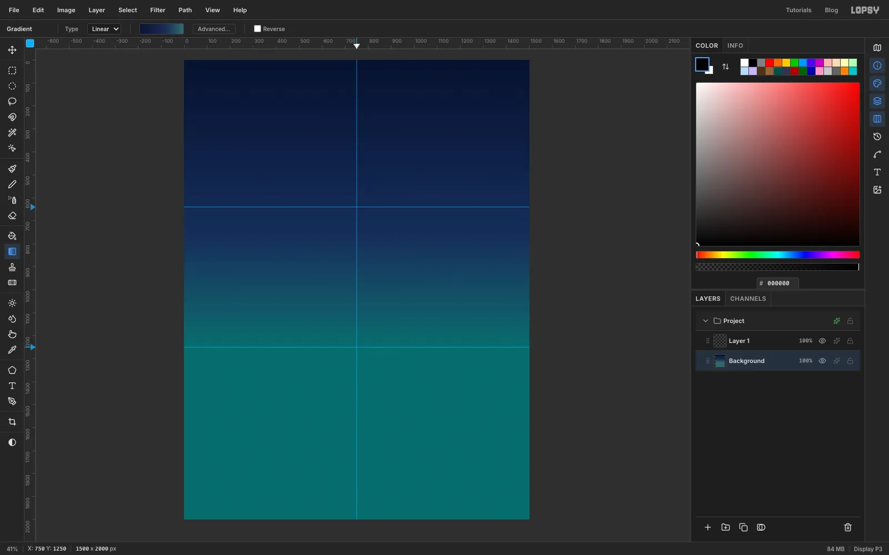

Select the **Background** layer and pick the **Gradient** tool (Linear). In
**Advanced…**, set three stops: `#0A1330` at the left, `#1B2C57` at about
60 % and `#2F6A6E` at the right. Drag from just below the top of the canvas
straight down to the horizon guide. Everything below the horizon will be
covered by water later.

## Select the sky for the fan rays

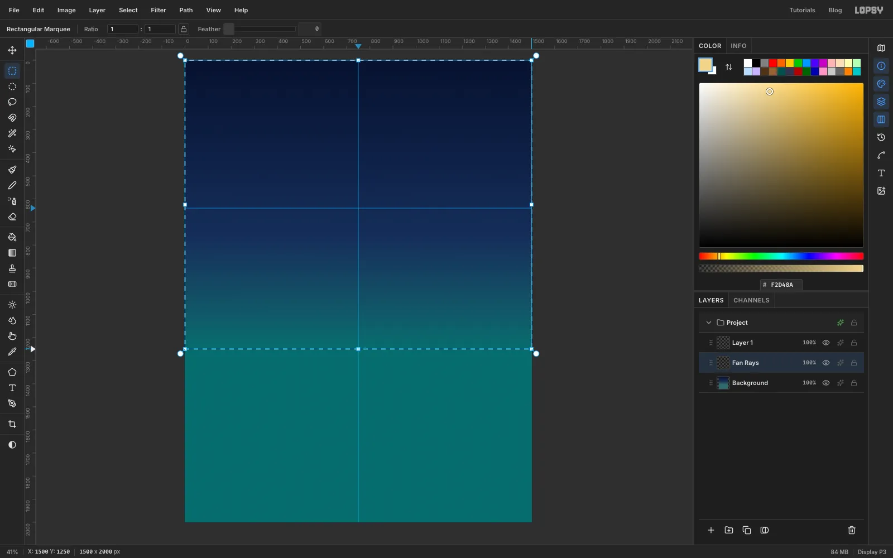

Add a layer named **Fan Rays**. With the **Rectangular Marquee**, drag from
the top-left corner of the canvas to the right edge at the horizon guide, so
the rays can't spill into the water. Set the foreground colour to pale gold
`#F2D48A`.

## Draw the Deco fan with Sunburst

Choose **Filter → Sunburst…** and set **Rays** 40, **Length** 95, **Width**
45, **Taper** 0, **Fade** 80 and **Softness** 6. Set **Center X** to 50 and
**Center Y** to 62.5, which puts the origin on the horizon guide at the
middle of the canvas. Apply, then press [[Cmd+D]]. Click the effects button (the sparkle icon) on
the Fan Rays row in the Layers panel to open the effects drawer, and set
**Blend** to **Soft Light** there. Then click the row's opacity readout and
lower it to 55 % so the rays read as a glow rather than stripes. Every later
step that mentions a blend mode or an effect uses this same drawer.

## Dot in the stars

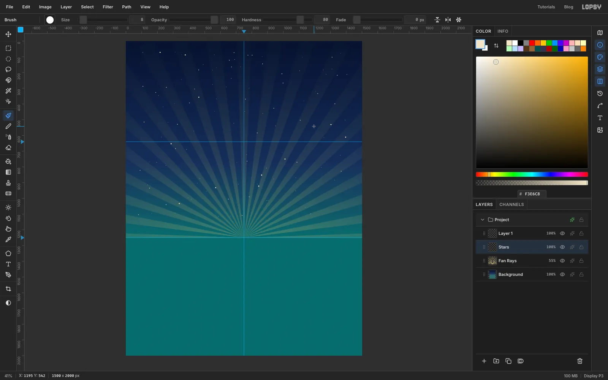

Add a layer named **Stars** and choose the **Brush** with the foreground set
to `#F3E6C8`. Click single dots across the sky. Use Size 3 for most of them,
switch to 5 for a few dozen more and 8 for about a dozen bright ones. Keep
them denser near the top and thinner towards the horizon.

## Add four-point gold sparkles

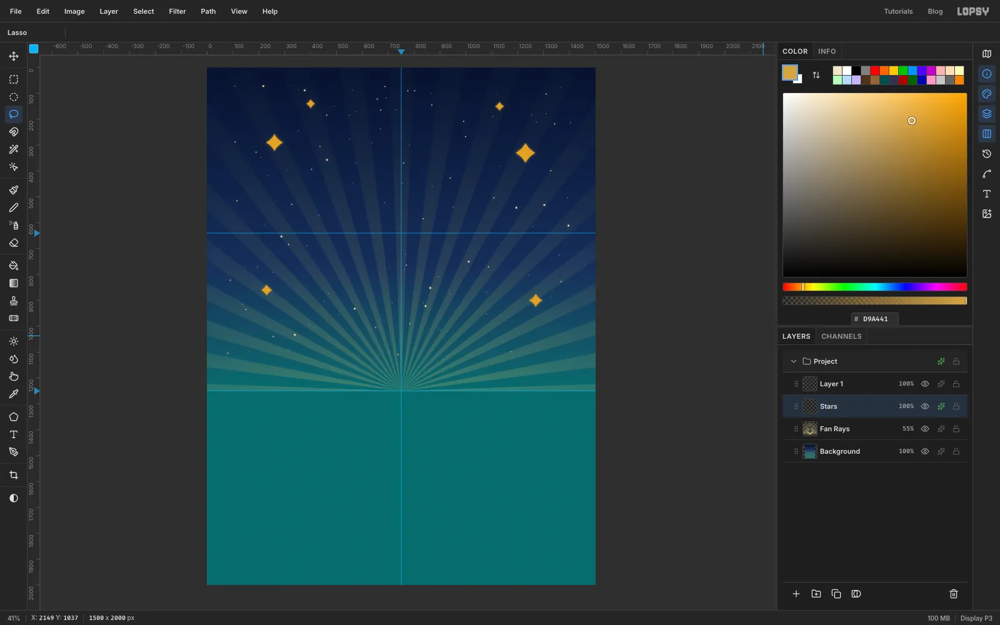

Still on the Stars layer, lasso six four-point stars with concave sides
(like a stretched diamond) and fill them with gold `#D9A441`. Keep them well
inside the canvas, away from the corners, because the frame's fan corners
go there at the end. Give the layer an **Outer Glow** of Size 14 and Opacity
60 in gold.

## Make the wheel's disc

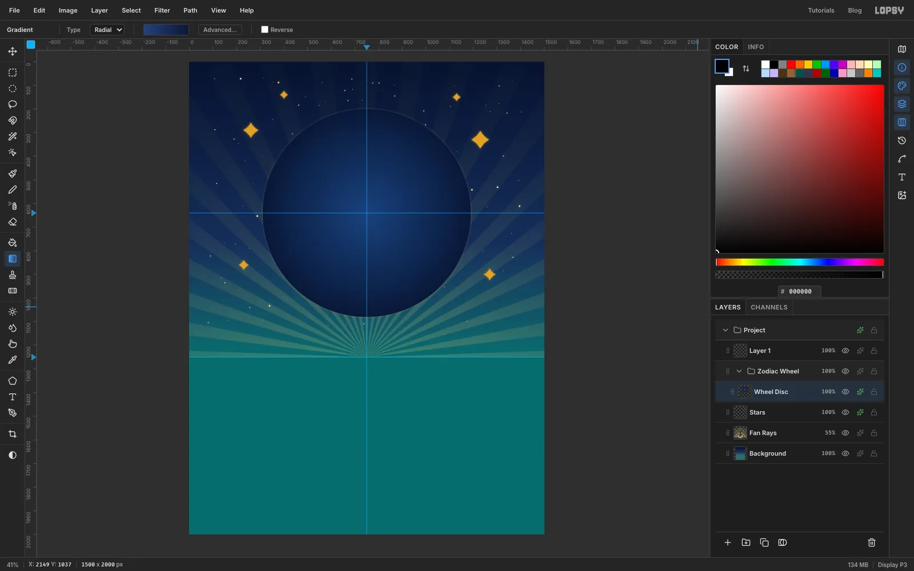

Click **New Group** in the Layers panel and name it **Zodiac Wheel**. Inside
it, add a layer called **Wheel Disc**. With the **Elliptical Marquee** (hold
[[Cmd]] or set Ratio 1:1 to keep it round), drag a circle 880 px across, centred where the guides cross (750,
640). Choose the Gradient tool, set it to **Radial** with `#24407A` in the
middle and `#0C1636` at the edge, and drag from the centre to the rim.
Deselect, then add an **Outer Glow** of Size 10, Opacity 40, in gold.

## Build the rings as one selection

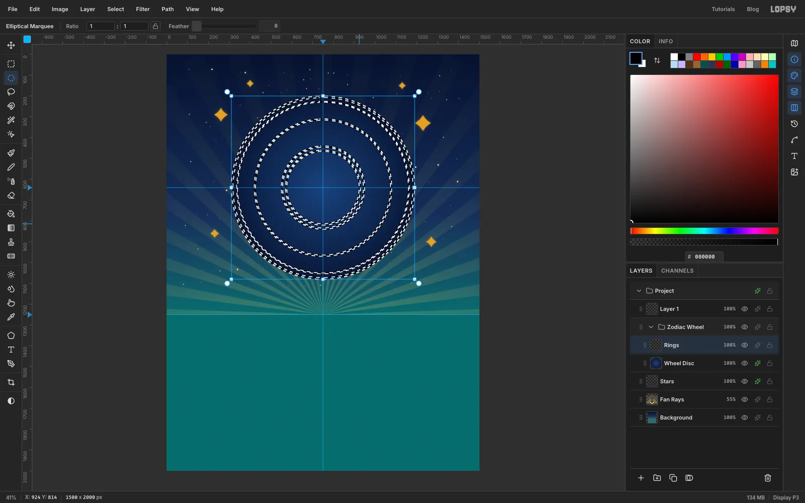

Add a layer called **Rings**. Draw the outer circle again (radius 440). For
exact circles, click once with nothing selected to open the Elliptical
Selection dialog and type the corners, here From 310, 200 To 1190, 1080.
Modifier drags don't open the dialog, so zoom in for the smaller circles and
watch the size readout as you drag. Hold
[[Alt]] and drag a circle 8 px smaller from the same centre to cut a thin
ring out of it. Then hold [[Shift]] and drag the next circle (radius 414),
and [[Alt]]-drag one 4 px smaller inside it. Repeat for rings at radius
330, 200 and 180, each about 4–6 px thick. Each [[Shift]] drag adds and each
[[Alt]] drag subtracts, so you end up with five rings in one selection.
Fill it with gold `#D9A441` and deselect.

## Draw one wedge of ornament

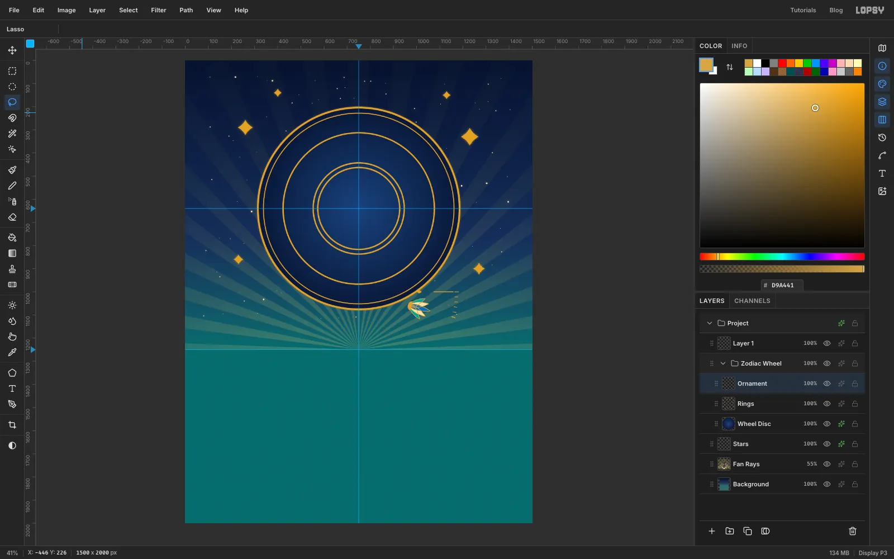

Add a layer called **Ornament**. Kaleidoscope mirrors around the **centre of
the canvas** (750, 1000), so draw this wedge there, not on the wheel. Kaleidoscope only keeps a thin slice: from three o'clock round to where the
hour hand would sit at half past three (15°). Keep everything inside that
slice:

- With the **Pencil**, click and [[Shift]]-click a 4 px spoke straight right
  along three o'clock, in the band where the outer ring of signs will be
  (about 330 to 410 px from the centre). Just beyond its tip, fan five short
  2–3 px ticks down across the slice.
- About halfway along the spoke's line, lasso a small gold diamond.
- Lower in the slice, about 220 px from the centre, lasso a lotus seen from
  the side, pointing outward:
  a gold cup, two turquoise `#3AA39B` outer petals, two cream `#F3E3B5` inner
  petals and a tall Egyptian blue `#2F6DB5` centre petal.
- Outline each petal with a 3 px gold **Brush** by clicking round its edge
  with [[Shift]] held. The gold lines become the cloisonné cells.

## Repeat it with Kaleidoscope

Choose **Filter → Kaleidoscope…** with **Segments** 12 and **Rotation** 0.
The wedge's two edges are mirror lines, so one lotus becomes twelve and the
spoke becomes twelve dividers. Run **Filter → Gaussian Blur…** at Radius 1
to soften the stair-stepped edges the mirroring leaves behind.

## Nudge the ornament onto the wheel

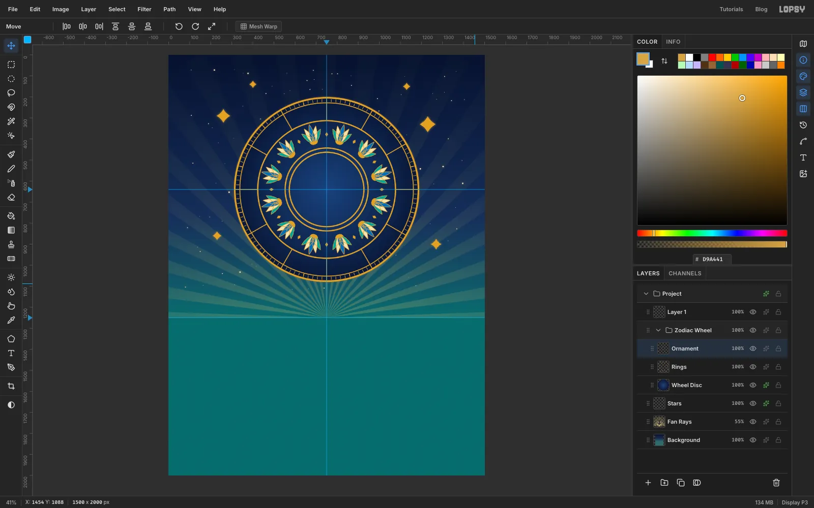

Press [[V]] for the Move tool. With nothing selected, press
[[Shift+Up]] 36 times to lift the layer 360 px, from the canvas centre to
the wheel's centre. The lotuses now sit between the inner rings, and the
spokes and ticks land in the outer band.

## Add the moon

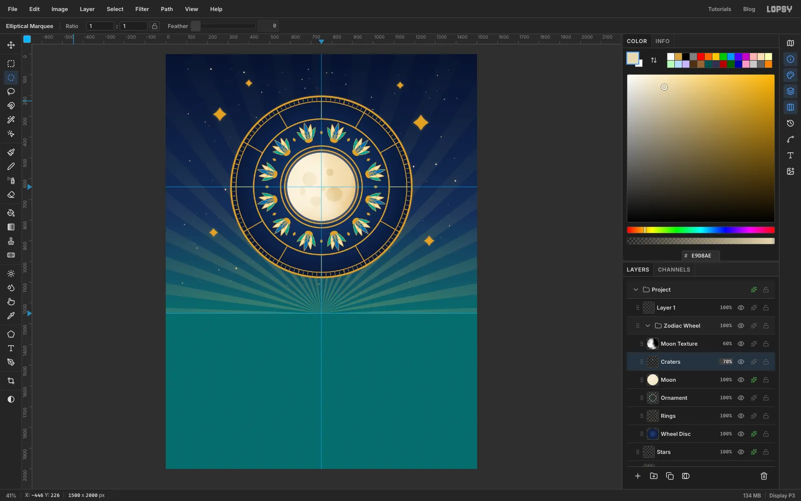

Add a layer called **Moon** and select a circle 330 px across in the middle
of the wheel. Fill it with a radial gradient of `#FBF3DC` → `#F3E6C8` →
`#E2C27E`, dragged from up and left of centre towards the lower right.

While the selection is still active, add a layer **Moon Texture**, run
**Filter → Clouds…** at Scale 7, deselect, and set Moon Texture to **Soft
Light** at 60 %.

Back on the Moon layer, add an **Outer Glow** (Size 34, Opacity 55,
`#FFE4A8`). Finally add a **Craters** layer and fill six flat circles of
different sizes in `#E9D8AE`, at 70 % opacity.

## Type the first zodiac sign and turn it

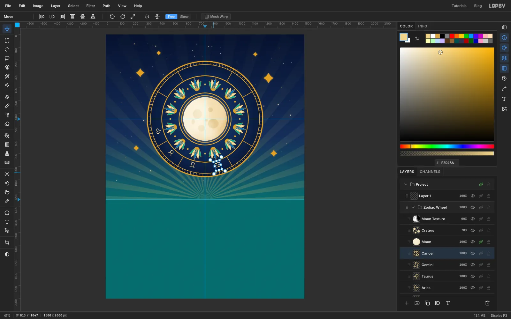

Select the **Ornament** layer first, so the text tool starts a new layer
instead of editing an old one. Choose the **Text** tool, pick the font
**Noto Sans Symbols** at Size 50 with pale gold `#F2D48A`, click in an empty
area and type ♈ (Aries). Press [[Tab]] to commit. Nudge it into the outer
band, just below the nine o'clock spoke. Then switch to the Move tool, hold [[Cmd]] and drag the round rotation
handle just off the top-right corner of the text box. [[Cmd]] snaps the angle
to 15° steps, so count the snaps: Aries needs -105°, seven snaps
anticlockwise. Check by eye that the top of the glyph points away from the
centre. The screenshot shows the fourth sign, Cancer, being turned the same
way.

## Place all twelve signs

Repeat for the other eleven signs (♉ ♊ ♋ ♌ ♍ ♎ ♏ ♐ ♑ ♒ ♓), going
anticlockwise one cell at a time. Each one turns 30° further than the last:
Aries -105°, Taurus -135°, Gemini -165°, then Cancer 165°, Leo 135° and so
on. Rename each layer after its sign so the Layers panel stays readable.

## Move the whole wheel group

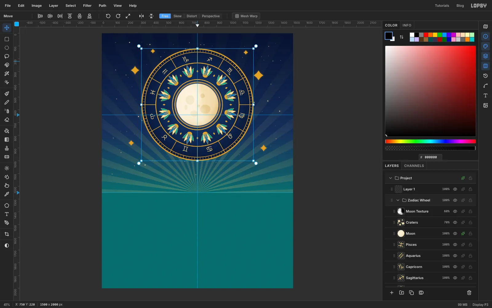

The wheel has to clear the Great Pyramid's tip, so lift it. Click the
**Zodiac Wheel** group's row, press [[V]], and drag inside the wheel straight
up by 80 px. Pressing [[Shift+Up]] 8 times does the same thing exactly. Every layer in the group moves together,
including the rotated text, so nothing needs re-aligning.

## Lasso the pyramid faces

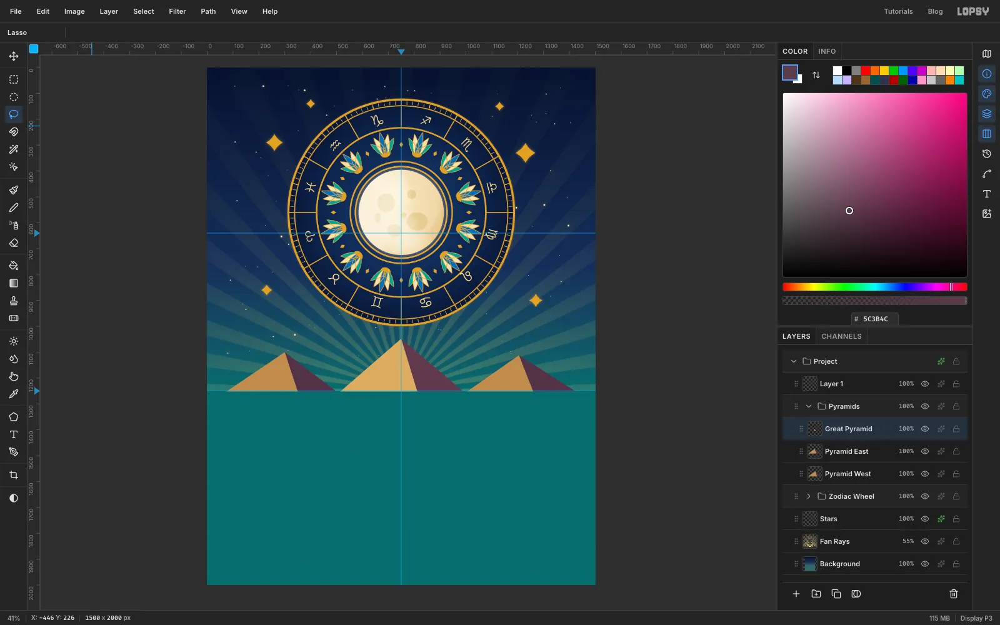

With the wheel group collapsed and selected, click **New Group** and name
it **Pyramids**. Collapsing it first makes the new group sit beside it, not
inside it. Make one layer per pyramid, named **Pyramid West**, **Pyramid East** and
**Great Pyramid**. For each one, select the left face (apex, left corner,
the point where the ridge meets the ground) and fill it sandy gold, then
select the right face and fill it plum. For perfectly straight edges, click
the three corners with the **Pen** tool and use **Path → Selection** in the
Paths panel; a steady Lasso works too. The Great Pyramid's apex sits at about
(750, 1048), well below the wheel, with its base running from 515 to 990
along the horizon. The two smaller pyramids are shorter and sit on either side.

## Load a pyramid as a selection

Add a layer called **Courses**. [[Cmd]]-click a pyramid layer's thumbnail
to load that pyramid's outline as a selection. Anything you draw now stays
inside the pyramid, even though you're painting on the Courses layer.

## Rule the stone courses

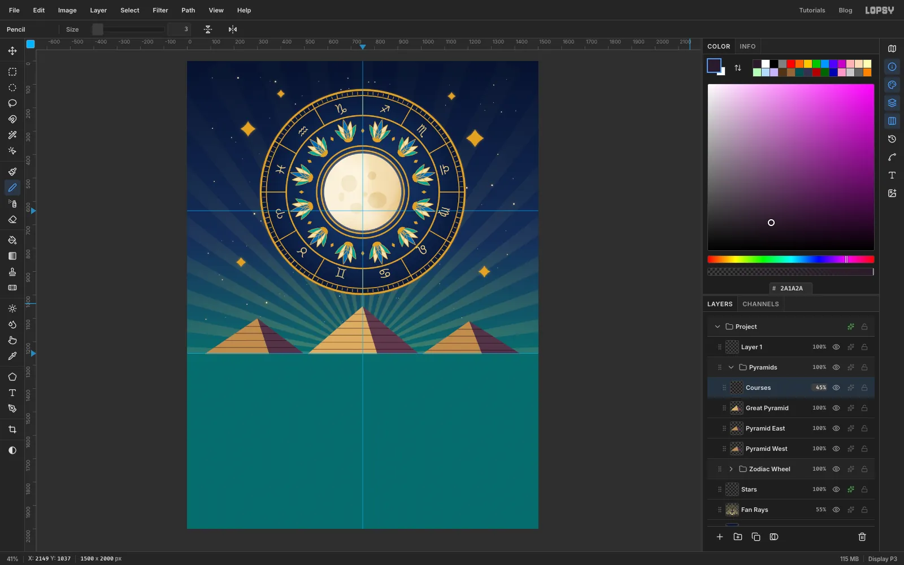

Pick the **Pencil** at Size 3 in `#2A1A2A`. Click at the left edge and
[[Shift]]-click at the right edge to draw a straight line every 30 px down the
pyramid. Repeat the [[Cmd]]-click and the lines for the other two pyramids,
then deselect. Set the layer to **Multiply** at 45 %.

## Catch the moonlight on the ridges

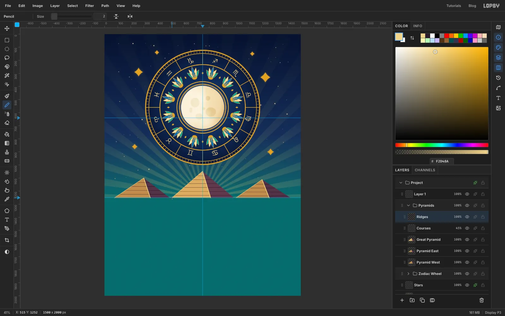

Add a **Ridges** layer and draw pale gold Pencil lines: 4 px from each apex
down the ridge, and 2 px down each left edge.

## Select a shadow face

Add a layer called **Face Shadow**. Set the Gradient tool to linear, from
fully transparent white to `#2A1838`. To make a stop transparent, open
**Advanced…**, select the stop and drag its alpha bar (under the hue strip)
all the way left. Lasso the right-hand face of the Great
Pyramid.

## Shade the faces with gradients

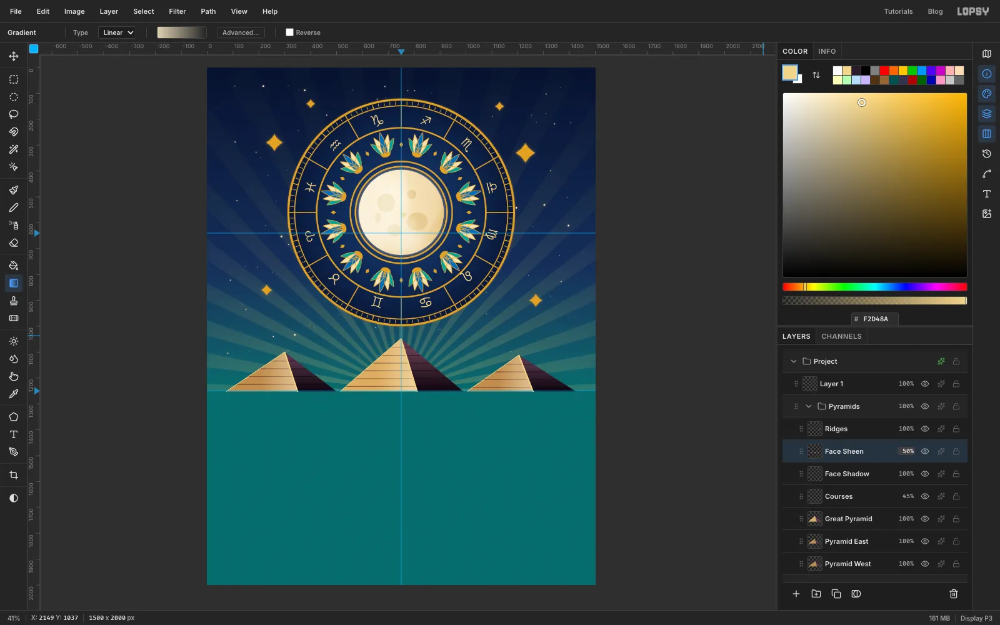

Drag the gradient from a quarter of the way down the ridge to the ground,
then repeat the lasso and drag for the other two pyramids. Set the layer to
**Multiply**. Add a **Face Sheen** layer. On each lit face, drag a gradient
from cream `#FFF1C9` at 85 % alpha near the ridge to transparent towards
the left edge. Set it to **Screen** at 50 %.

## Cap the Great Pyramid in gold

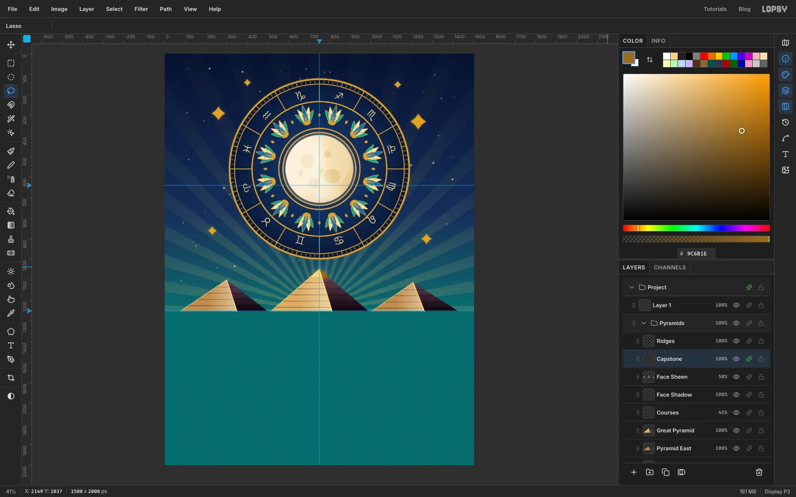

Add a **Capstone** layer. Lasso the top fifth of the Great Pyramid's left
face and fill it pale gold `#F2D48A`. Lasso the same strip on the right face
and fill it deep gold `#9C6B1E`. Give it an **Outer Glow** of Size 40 and
Opacity 80 in gold.

## Lay the far bank

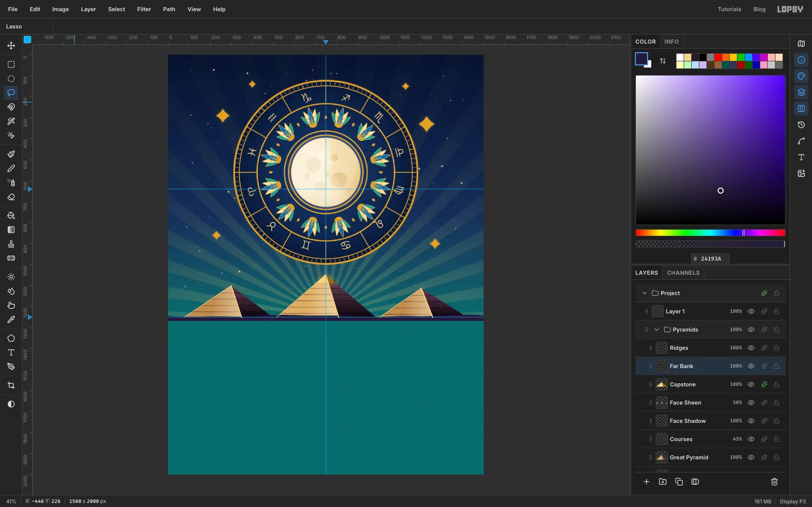

Add a **Far Bank** layer and lasso a thin, gently uneven strip across the
whole width, from just above the horizon to about 15 px below it. Fill it
with `#24193A` so the pyramids stand on ground.

## Fill the river

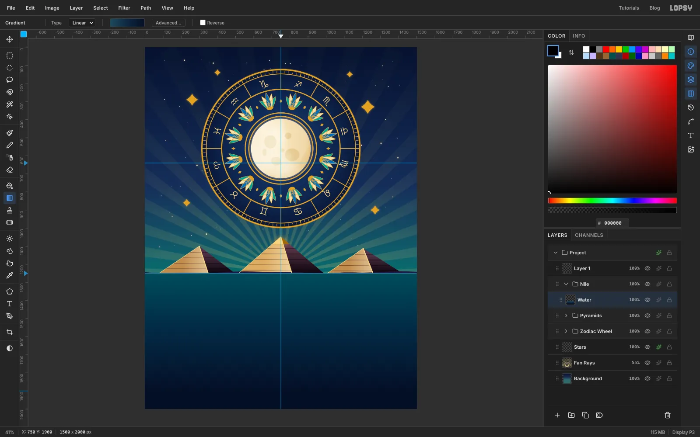

Collapse **Pyramids**, select it and add a **Nile** group. Add a **Water**
layer, select everything below the horizon and drag a linear gradient of
`#1D4A5A` → `#0F2A44` → `#060E24` from the horizon down towards the bottom.

## Flip a Copy Merged strip for the reflection

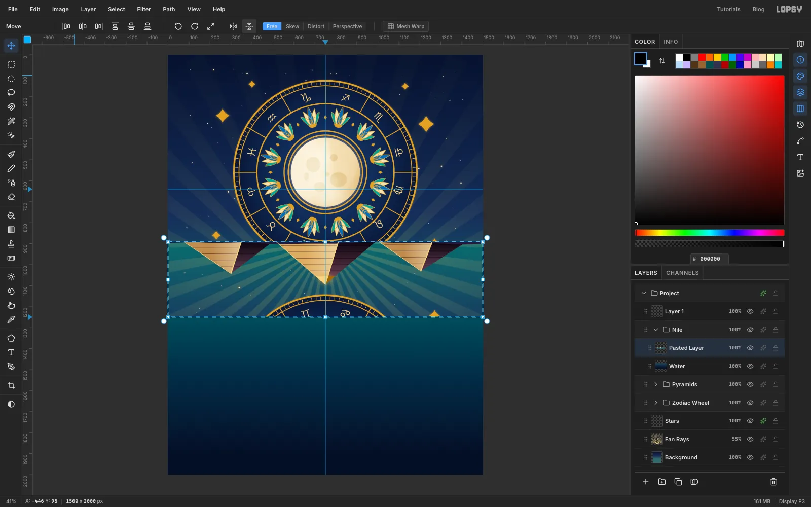

Draw a marquee across the full width over the band of sky and pyramids just
above the horizon, about 360 px tall. Choose **Edit → Copy Merged**, which
copies what you see from every layer. Then press [[Cmd+V]]: the paste lands
in place as a new layer and switches to the Move tool. Click **Flip
Vertical** in the options bar, the second of the two mirror icons just right
of the rotate buttons.

## Ripple and fade the reflection

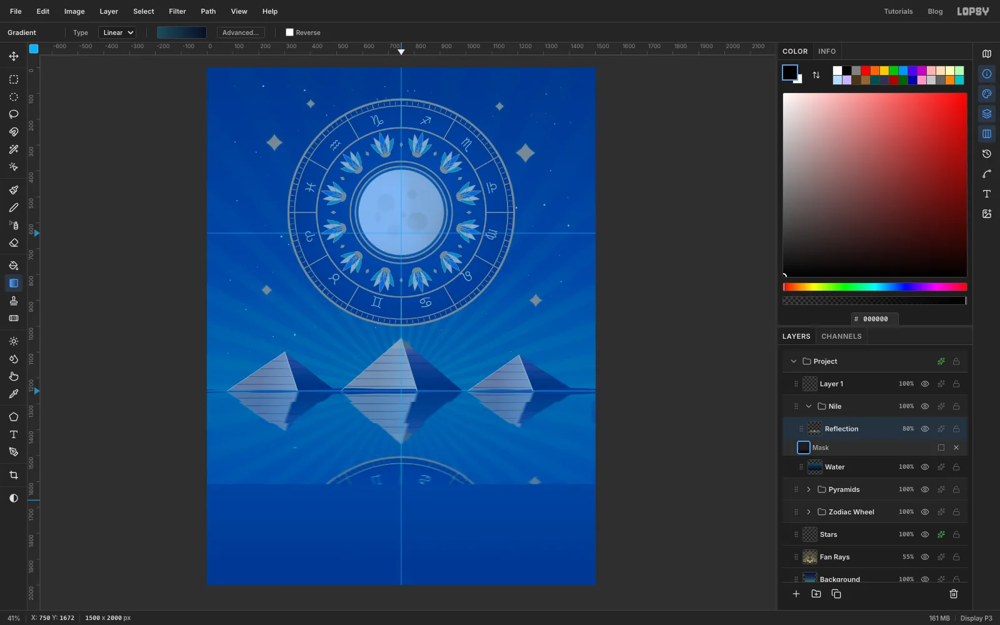

Press [[Shift+Down]] 36 times to drop the flipped strip just below the
horizon, then deselect and name the layer **Reflection**. Run **Filter →
Pixel Stretch…** with Amount 22, Bands 48 and RGB Split 0 for a broken
water ripple. Then run **Motion Blur…** at Angle 0 and Distance 14, and set
the layer to 80 %. Click the **Add Mask** button (the fourth icon along the bottom of the
Layers panel), then click the new mask thumbnail on the row to edit it. The
canvas is tinted while you edit a mask; that's only an overlay. Drag a white-to-black gradient from just below the horizon about 380 px
down, so the reflection fades out. To go back to painting pixels, click the
Reflection layer's own thumbnail.

## Rule the ripples

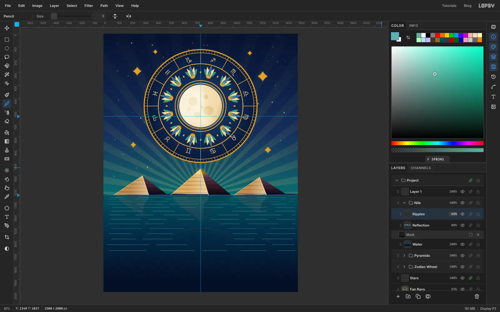

Add a **Ripples** layer. With the Pencil in `#5FB3A1`, draw dashed
horizontal lines across the river by clicking and [[Shift]]-clicking short
runs with gaps between them. Keep the rows close together near the horizon
and spread them out towards the viewer. Leave a gap down the middle for the
moon path. Set the layer to **Screen** at 45 %.

## Lay the moon path

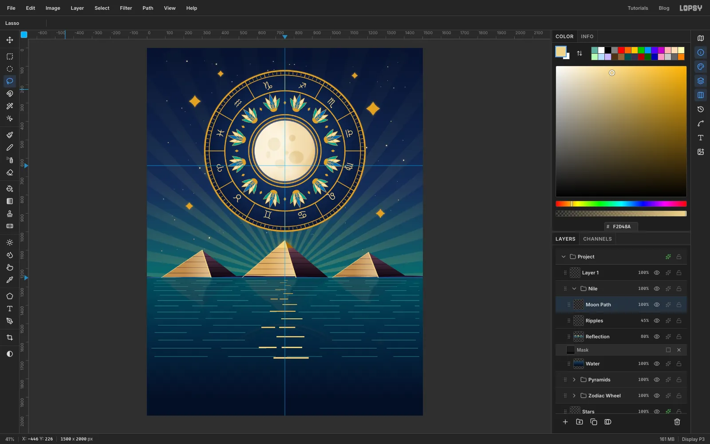

Add a **Moon Path** layer. Below the Great Pyramid, lasso thin horizontal bars,
starting about 20 px wide at the horizon and growing to about 230 px near
the bottom. Shift each bar a little left or right of centre, make the gaps
uneven, and split three of them into two pieces. Fill the top bars in gold
`#D9A441` and lighten each one towards pale gold `#F2D48A` at the bottom.
The irregularity is what keeps it from looking like runway lights.

## Build the felucca

Add a **Felucca** layer, left of the moon path. Lasso a crescent hull about
150 px long and 30 px deep, and fill it `#0B1426`. Lasso a tall triangular
sail above it with a gently curved back edge, and drag a linear gradient
from `#F0D49A` to `#C98A3E` across it. Draw the yard with a 5 px Pencil line
raked through the sail's leading edge, and keep its tip at least 40 px
below the horizon. Finish with a 2 px gold line along the top of the hull.

## Reflect the boat

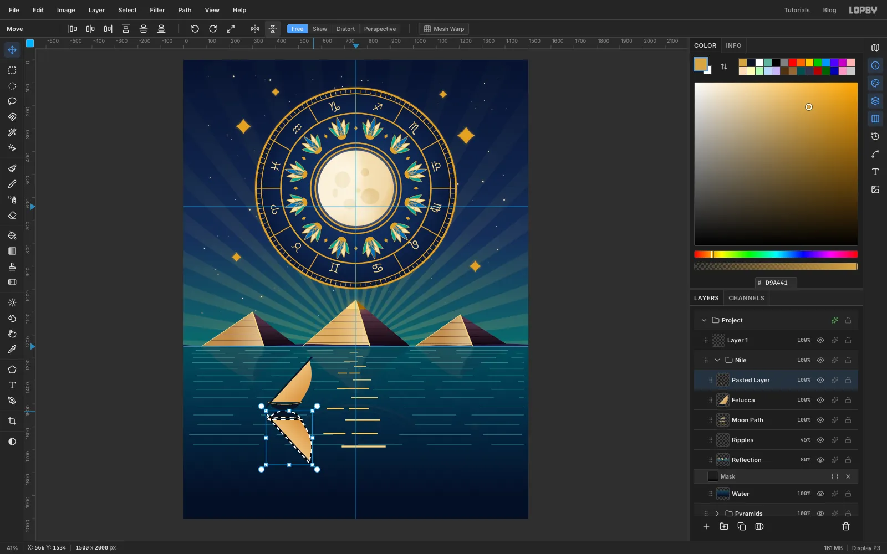

Draw a marquee around the boat, copy and paste it, and click **Flip
Vertical**. Then nudge the copy down with the arrow keys
until it mirrors the hull at the waterline. Deselect, name it **Felucca
Reflection**, then marquee from 60 px below the waterline to below the reflection and
press [[Delete]].
Run Pixel Stretch (Amount 6, Bands 50) and Motion Blur (Distance 10), soften
the bottom edge with a few passes of the **Eraser**, and set the layer to
35 %.

## Sail a second boat in the distance

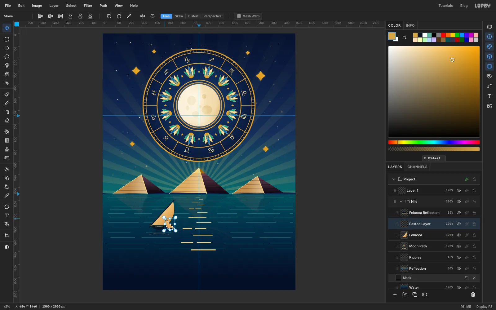

Select the **Felucca** layer, marquee the boat, then copy and paste it.
Click **Flip Horizontal** so it sails the other way. Hold [[Cmd]] and drag
the top-left corner handle towards the middle until it's a little over a
third of the size. Nudge it up towards the horizon, right of the moon path, so its
hull sits around y 1360. Deselect, name it **Felucca Far** and set it to
85 %.

## Build the stepped quay

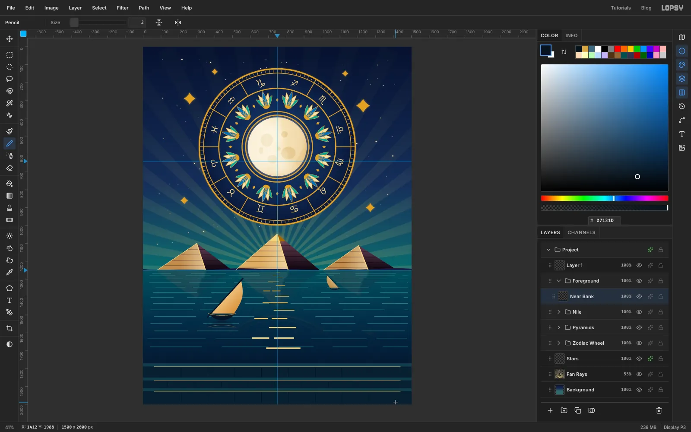

Collapse **Nile**, select it and add a **Foreground** group. Add a **Near
Bank** layer and fill everything from y 1772 down (about 230 px up from the
bottom) with `#0E2030`. Fill three 16 px treads in `#1D3B4C`: one along the
top and two more about 80 and 140 px lower. Rule a 2 px
`#3E6A80` line along the top edge, and 2 px gold lines along each step's
nose, stopping about 62 px from each side, where the frame will go later. Add short
dark vertical joints every 150 px, staggered by half a slab on each step.

## Draw a lotus flower

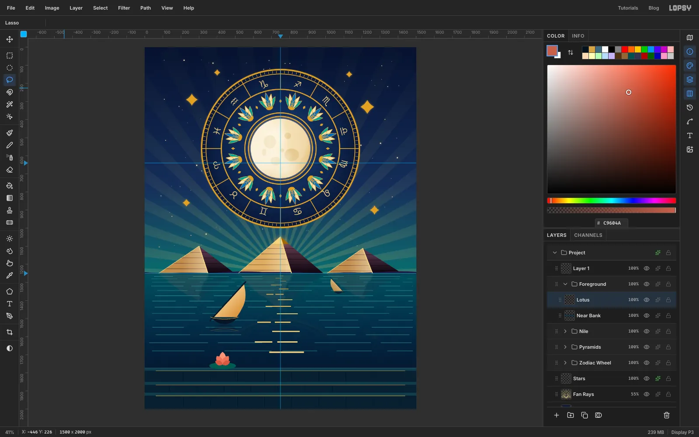

Add a **Lotus** layer. Fill a flat ellipse in `#1E5A52` for the pad. Then
lasso five pointed petals fanning up from its centre: the tallest in
`#F09A7E`, two beside it in `#E07A5F` and two low ones in `#C9604A`.

## Copy and scale more lotuses

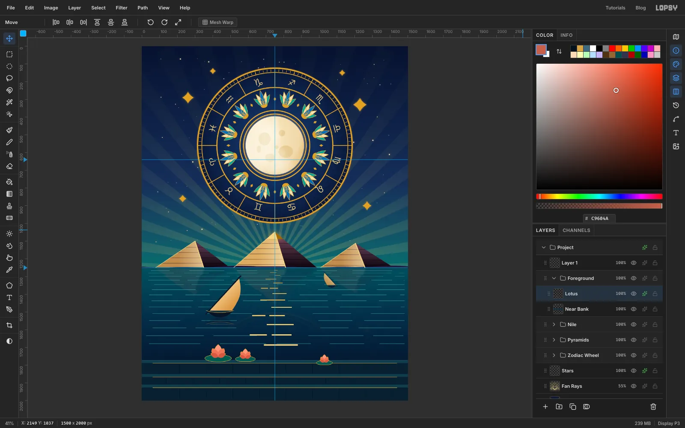

Marquee the flower, copy and paste it, and drag a corner handle with
[[Cmd]] held to shrink it to about three quarters. Nudge it right and up a
little, then choose **Layer → Merge Down**. Make a third, smaller copy and
put it further right. Stagger the heights so they don't march in a
straight line. Add a 2 px gold **Stroke** to the layer.

## Draw a palm silhouette

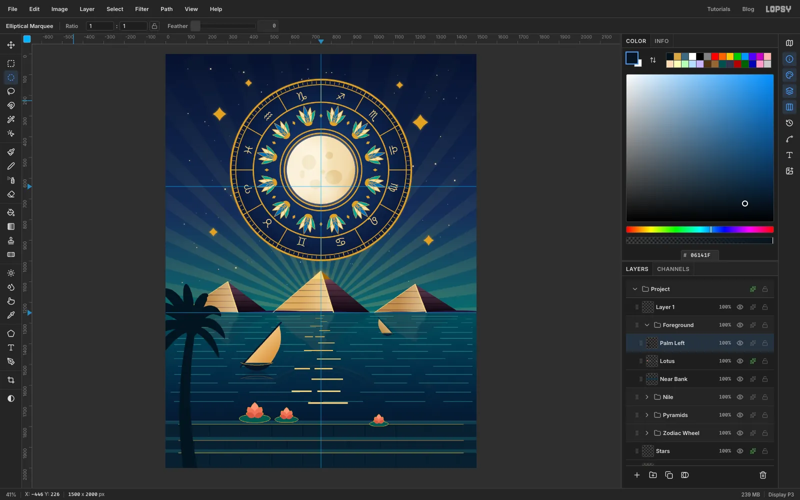

Add a **Palm Left** layer. Lasso a gently curving trunk from the bottom-left
corner up to a crown at about (125, 1335), wider at the base. Then lasso
nine smooth, tapered fronds. The ones on the outside arch up and then droop,
the ones towards the river are shorter, and none of them should reach the
boat. Fill them all with `#06141F`, and fill a small oval to tidy the crown.

## Ring the trunk and add rim light

With a 3 px Pencil in `#22305A`, draw a shallow chevron across the trunk
every few dozen pixels by clicking one edge, [[Shift]]-clicking the middle
point slightly lower, then the other edge. Add an **Inner Glow** of Size 3
and Opacity 80 in teal `#4FA3A0`. It works like moonlight catching the edges.

## Mirror the palm to the right

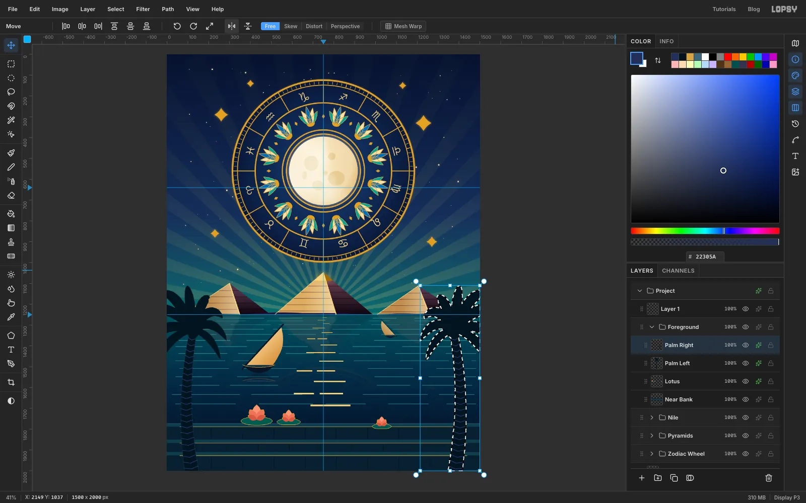

Click **Duplicate Layer**, rename the copy **Palm Right** and click its
row. With the Move tool, press [[Cmd+A]] and click **Flip Horizontal**. The
flip mirrors around the selection's centre, which is the middle of the
canvas, so the palm lands at exactly the same place on the right side.

## Add gold papyrus

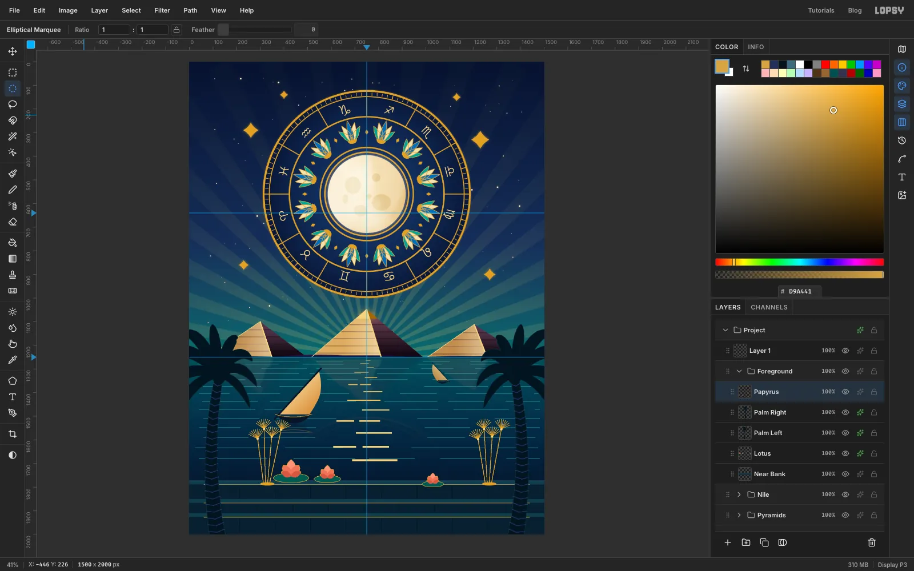

Add a **Papyrus** layer. With a 3 px gold Pencil, draw four or five stems
rising from the quay's front edge, leaning slightly apart. Fan nine 2 px
lines out from the top of each stem for the umbel, and dot a small pale gold
circle where they meet. Keep the clumps at least 60 px in from the frame's
corner brackets. Finish each clump with a small gold oval collar where it
meets the quay.

## Paste the ibis photo

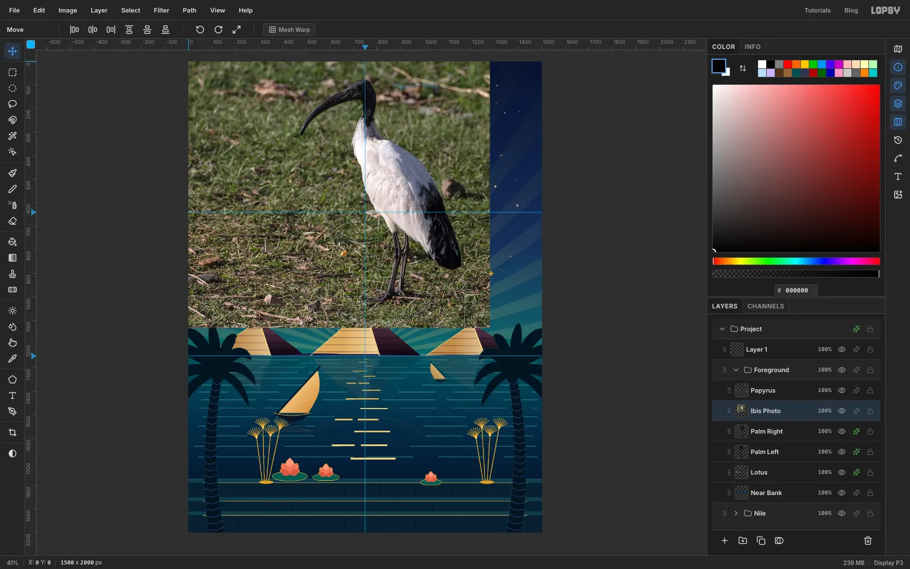

Select the **Palm Right** layer, open the ibis photo in your browser, copy
it and press [[Cmd+V]] in Lopsy. It lands at the top left as a new layer.
Rename it **Ibis Photo** and deselect.

## Grab the white feathers with Quick Selection

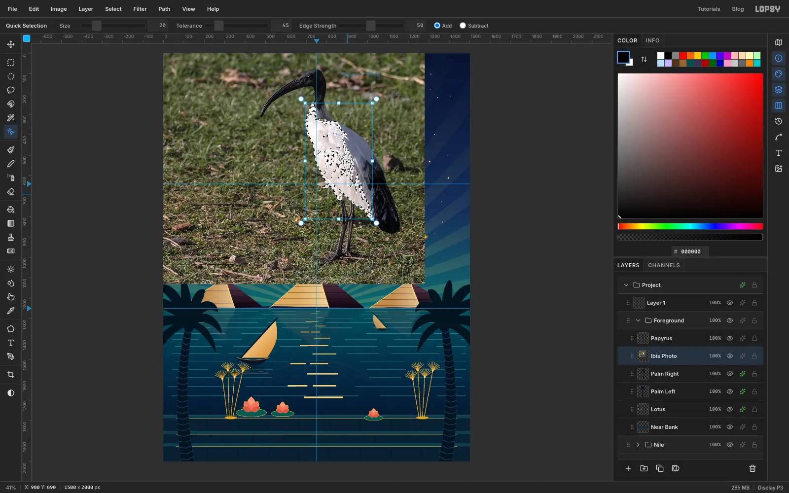

Choose **Quick Selection** with Size 20, Tolerance 45 and Edge Strength 50,
and paint two strokes down the white breast and back. Quick Selection
compares colour only, so it may also catch some bright grass highlights.
Keep it off the black head and tail; dark strokes spread into the dark grass
and even into the empty part of the layer.

## Keep only the body

Switch to the **Lasso**, hold [[Shift]]+[[Alt]] and draw a loose outline
around the body. That combination keeps only the overlap of the two
selections, so every speck in the grass disappears.

## Add the head, legs and tail

Hold [[Shift]] and lasso around the body again to fill in the shaded
feathers Quick Selection missed. Keep [[Shift]] held and lasso the black head
and curved beak, each leg and the black tail plumes. Then run **Select →
Grow…** 6 px and **Shrink…** 6 px to close the pinholes.

## Lift the bird onto its own layer

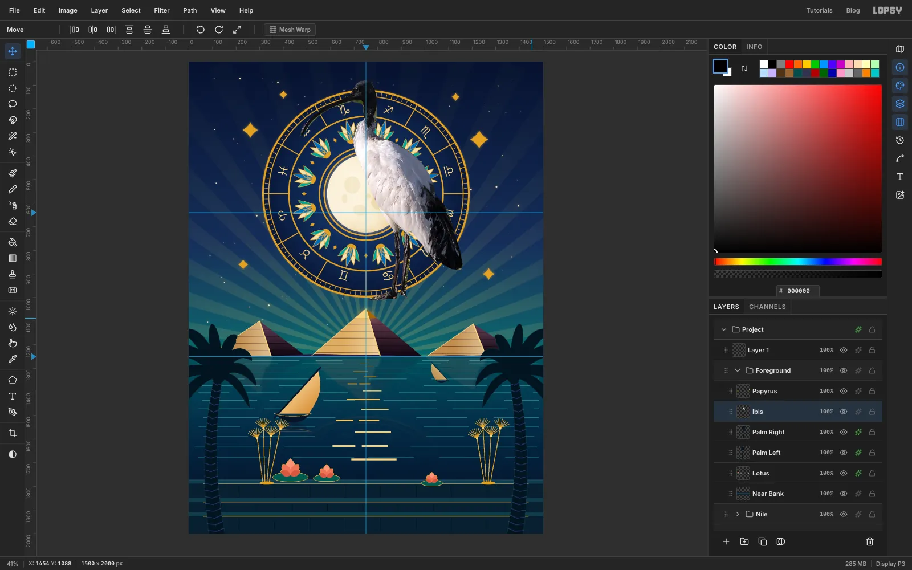

Press [[Cmd+C]] and [[Cmd+V]] to copy the bird to a new layer in place, and
name it **Ibis**. Select the **Ibis Photo** layer and click **Delete
Layer**.

## Flatten it to two tones

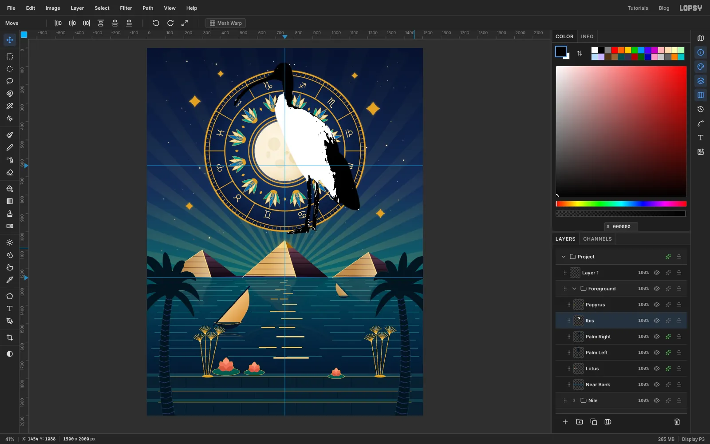

On the Ibis layer, choose **Filter → Desaturate**, then **Gaussian Blur…**
at Radius 4, then **Threshold…** at Level 105. The blur first is what keeps
the threshold from turning feathers into noise. To tidy the outline,
[[Cmd]]-click the thumbnail and run **Grow** 10, **Shrink** 10, **Shrink** 6
and **Grow** 6. Then choose **Select → Inverse**, press [[Delete]] and
deselect.

## Clean up the speckle with the Magic Wand

Choose the **Magic Wand** at Tolerance 60 and click the white body. Run
**Grow** 6 and **Shrink** 6, which swallows the black specks inside, and
fill it: set the foreground to white and choose **Edit → Fill**. Do the same
on the head, the tail and each leg, filling those with black.

## Check the silhouette

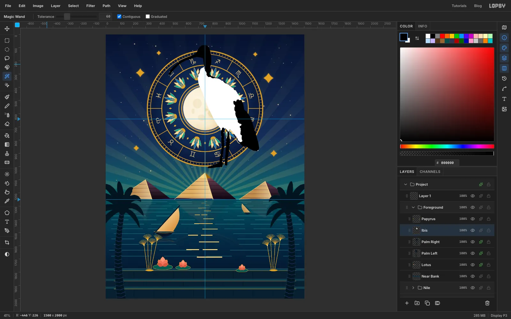

You now have a clean two-tone silhouette, like a Deco print, built on the
real bird's proportions.

## Scale the ibis down

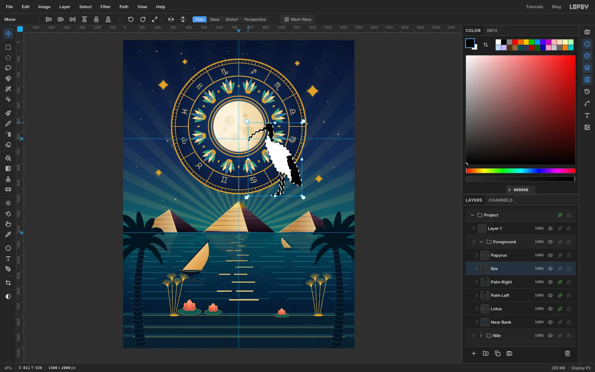

[[Cmd]]-click the Ibis thumbnail, then hold [[Cmd]] and drag the top-left
handle in until the bird is about half its size, about 480 px tall.
Deselect.

## Stand it on the quay

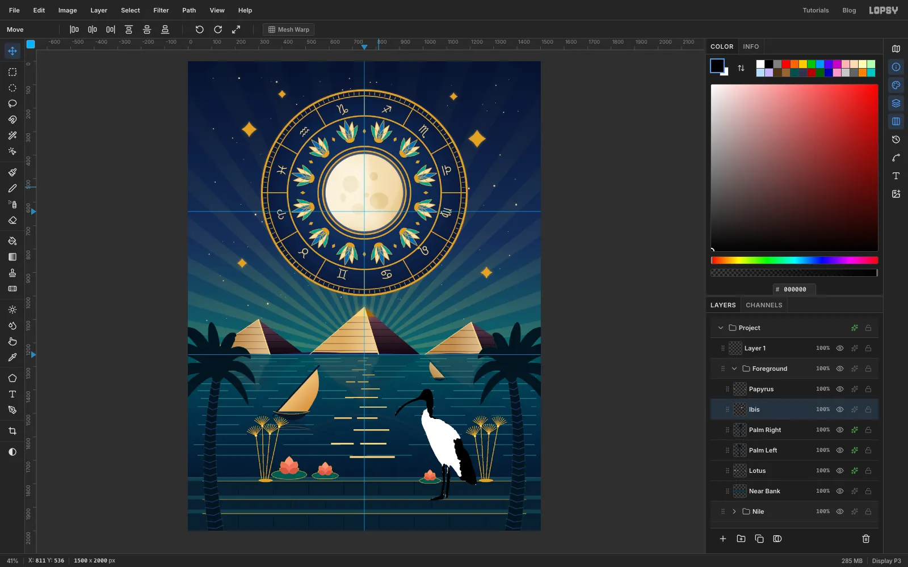

Nudge the bird with the arrow keys until its feet rest on the quay at about
y 1870 and its beak points at the moon path. Select **Palm Right** and add
an **Ibis Shadow** layer, which places it under the bird. Draw a flat
ellipse under the feet, **Feather** it 10 px, fill it with `#02040C` and
set the layer to 70 %.

## Recolour it with a Gradient Map

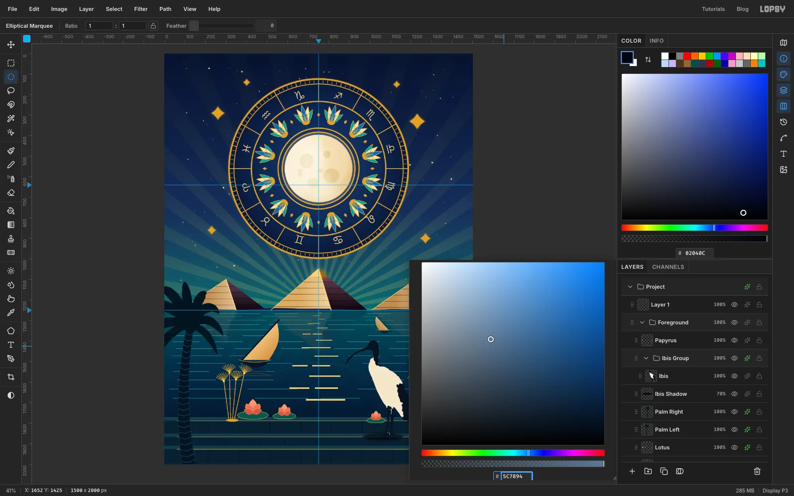

Select the Ibis layer and choose **Layer → Group Layers**, then name the
group **Ibis Group**. Open the group's effects drawer and choose **Add
Adjustment → Gradient Map**. Click the left stop and type `0B1220` in its hex
field, then click the right stop and type `F2E6CC`. The bird turns from
stark black and white into ink and moonlit cream. Click the middle of the handle row to add a slate `#5C7894` stop; it only
affects the grey edges. Finally, give the Ibis
layer a faint **Inner Glow** (Size 4, Opacity 45) in pale gold.

## Bloom the capstone

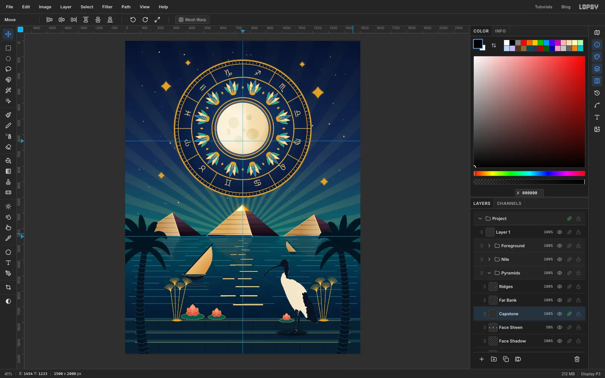

Expand **Pyramids**, select **Capstone** and run **Filter → Bloom…** with
Threshold 40, Soft Knee 50, Radius 16 and Intensity 60. It makes the gold
tip look lit by the moon. Collapse the group again.

## Breathe mist over the horizon

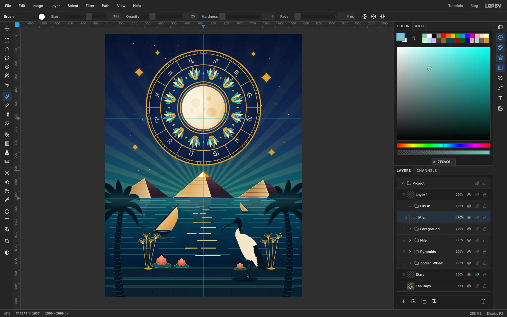

Collapse **Foreground**, select it and add a **Finish** group. Add a
**Mist** layer and choose the Brush at Size 180, Hardness 0 and Opacity 25
in `#7FC4C0`. Paint one slow stroke along the horizon. Set the layer to
**Screen** at 70 %.

## Darken the edges

Add a **Vignette** layer and press [[Cmd+A]]. Drag a radial gradient from the
canvas centre to a corner. Make it transparent black to 60 %, then
`#03050F` at 85 % at the edge. Deselect and set the layer to **Multiply**.

## Add print grain

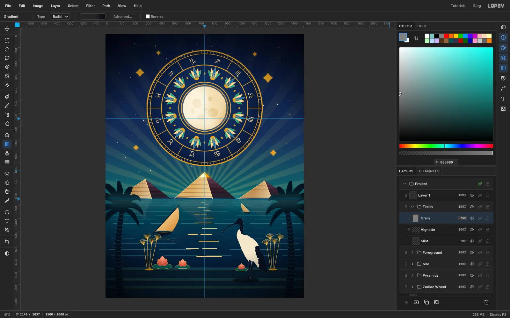

Add a **Grain** layer, fill it with mid grey `#808080` and run **Filter →
Add Noise…** at Amount 45 with **Mono** and **Gaussian**. Set it to
**Overlay** at 75 %. The grey disappears and only the grain is left.

## Frame it in gold

Add a **Frame** layer. With the Rectangular Marquee, click once on the
canvas to open the exact-corners dialog, enter From 36, 36 and To 1464,
1964, and click **Select**. Choose **Select → Inverse** and fill with
`#060A18`. For the gold rules, add a layer named **Frame Rule 44** and use the dialog to select from
44, 44 to 1456, 1956. Fill it gold, then select from 48, 48 to 1452, 1952 and
press [[Delete]], which leaves a 4 px rule. Make a 2 px rule the same way on a
**Frame Rule 56** layer, starting 56 px in.

## Select a corner fan

Add a **Corners** layer. Draw a circle 192 px across centred on the inner
rule's corner (58, 58). Then hold [[Shift]]+[[Alt]] with the Rectangular
Marquee and drag a square from that corner down and right. Only the quarter
circle inside the frame stays selected.

## Fill it with a sunburst and stepped brackets

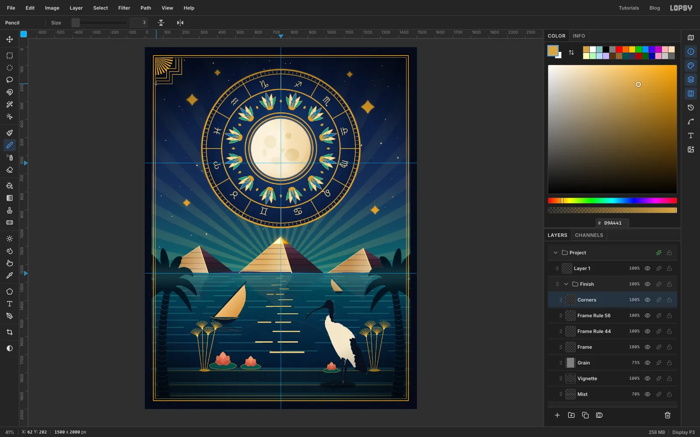

Run **Sunburst** again in gold with Rays 36, Width 50 and no fade. Set
Center X to 3.87 and Center Y to 2.9, so the fan radiates from the corner.
Deselect, and with a 3 px Pencil draw three stepped brackets around it:
start on the top rule, step down and in, then back out to the side rule.

## Copy the corner to the others

Use the palm trick. Click **Duplicate Layer**, press [[Cmd+A]] with the Move
tool and click **Flip Horizontal**: the copy mirrors around the canvas centre
and lands exactly in the top-right corner. Deselect and choose **Layer →
Merge Down**. Then duplicate again, press [[Cmd+A]], click **Flip Vertical**
and merge down, which fills the two bottom corners.

## Finish

That's the finished piece. Save it with **File → Save Project** and export
it with **File → Export…**. Deco travel posters worked in a few flat inks,
so if you push this further, keep adding shapes and lines rather than
textures. A second moon path in the reflection or a row of hieroglyph
borders along the quay would both fit the style.
